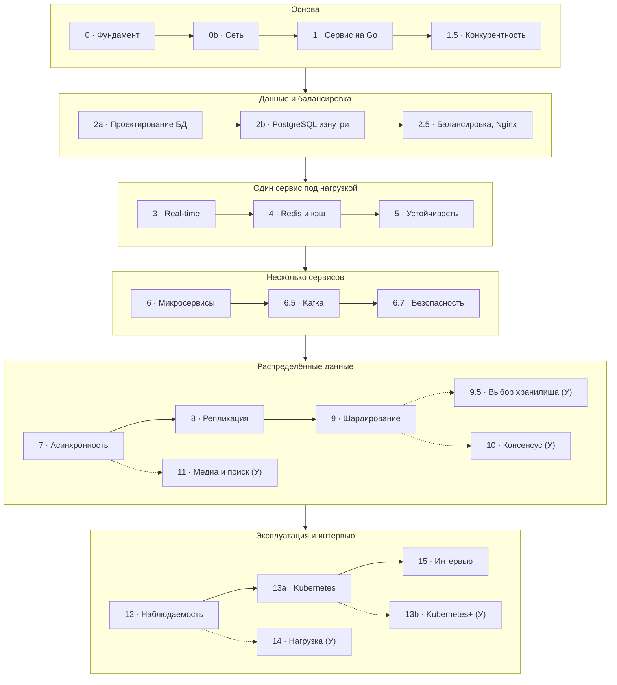

# 0.1. Как устроен курс и как учиться

## <Part kind="theory" /> Зачем этот курс

Представьте собеседование. Вы год пишете сервисы на Go: умеете сделать эндпоинт, сходить в PostgreSQL, собрать образ в Docker. И тут вас просят: «Спроектируйте мессенджер на 50 миллионов пользователей». Перед вами пустая доска.

С чего начать? Сколько нужно серверов? Где хранить сообщения? Что будет, если упадёт база? Почему именно так, а не иначе?

Растерянность здесь нормальна. Писать код и проектировать систему — разные навыки. Первый вы уже тренируете каждый день. Второй почти не развивается сам собой: на работе архитектуру обычно выбирают до вас, а вы видите только её небольшой кусок.

Этот курс закрывает разрыв. Дисциплина, которой он посвящён, называется <T id="system-design">проектирование систем (system design)</T>: из каких частей собрать систему, как их связать и чем за это заплатить.

**Кто с вами говорит.** Курс написан от лица доктора наук в области компьютерных технологий и проектирования высоконагруженных систем — человека, который много лет строит такие системы и учит этому других. Поэтому договоримся о правилах сразу:

- я упрощаю, но не искажаю. Если модель упрощена, я так и скажу и пообещаю, где вернёмся к деталям;
- каждое утверждение опирается на источник, а где в индустрии нет единого мнения, я скажу об этом прямо;
- трудные темы я буду называть трудными. Если что-то не понятно с первого раза, это не значит, что с вами что-то не так.

**Для кого курс.** Для Go-разработчика с опытом около года, который хочет выйти на уровень Middle+/Senior в проектировании систем. Мы опираемся на то, что вы уже знаете: Go, PostgreSQL, Docker, Git, Linux. Kafka, Kubernetes и внутреннее устройство PostgreSQL объясняем с нуля.

**Что вы сможете в конце.** Курс считается пройденным успешно, если вы можете:

1. спроектировать систему уровня мессенджера и объяснить компромисс каждого решения;
2. реализовать её ключевые части на своём стеке — Go, PostgreSQL, Redis, Kafka, Kubernetes;
3. пройти system design интервью.

Весь курс построен вокруг одного сквозного проекта — мессенджера, похожего на Telegram. Он вырастет у вас на глазах: от одного процесса на Go с данными в памяти до распределённой системы в Kubernetes. Почти каждый модуль добавляет к нему один шаг.

## <Part kind="theory" /> Карта курса

Модули идут в таком порядке: слева направо внутри каждого этапа, этапы — сверху вниз. Сплошные стрелки — основной путь по модулям ядра (они в фиолетовых рамках). Пунктирные стрелки ведут к модулям углубления (они в голубых рамках с пунктиром и помечены «(У)») и показывают, после какого модуля углубление можно проходить.



Не пугайтесь незнакомых слов на карте. Каждое из них мы объясним в своём модуле, а пока это просто названия.

Модули делятся на два уровня. **Ядро** — основной путь по сплошным стрелкам. Это уровень Middle+: пройдя ядро, вы уверенно чувствуете себя на собеседовании и можете спроектировать мессенджер целиком. **Углубление** — модули в рамках с пунктиром. Это уровень Senior: выбор NoSQL-хранилищ, консенсус, продвинутый Kubernetes, нагрузочное тестирование.

Углубление можно отложить, сюжет при этом не сломается: ни один модуль ядра не опирается на модуль углубления. Мой совет — сначала пройти ядро целиком, а к углублению возвращаться, когда ядро уже «улеглось». Исключение одно: если тема углубления нужна вам по работе прямо сейчас, берите её сразу после того модуля, от которого к ней идёт пунктир.

## <Part kind="theory" /> Как устроен урок

Почти каждый урок собран по одному шаблону из восьми частей. Шаблон не ради порядка: каждая часть решает свою задачу.

1. **Проблема** — чтобы вы почувствовали боль раньше, чем увидите лекарство: без проблемы решение не запоминается.
2. **Теория с терминами** — механизм на уровне «почему так работает», каждый новый термин объяснён на месте.
3. **Визуализация** — процессы во времени (запрос, репликация, ребалансировка) проще понять, когда их видно по шагам.
4. **Типичные ошибки** — чужие грабли обходятся дешевле своих.
5. **Компромиссы** — у каждого решения есть цена, и на интервью спрашивают именно о ней.
6. **Шаг в коде** — то, что не написано руками, остаётся теорией.
7. **Самопроверка** — вопросы на понимание, чтобы вы вспомнили материал сами, а не узнали его в тексте.
8. **Источники** — где прочитать глубже и чем подкреплены утверждения.

В тексте каждая часть отмечена цветной меткой у заголовка раздела, так что по странице легко найти, например, все компромиссы. Подробнее о метках — ниже, в разделе про сайт.

Вводные уроки по инструментам (Kafka, Redis, Kubernetes) устроены немного иначе: какую проблему решает инструмент, ментальная модель, термины, команды руками, грабли и ссылки.

Этот урок — вводный, поэтому визуализации и кода в нём нет. Первая визуализация появится в уроке 0.3, первый код мессенджера — в модуле 1.

## <Part kind="theory" /> Как учиться, чтобы помнить

Сейчас будет, пожалуй, самая полезная часть урока. Она про то, как не потерять всё, что вы прочитаете дальше.

### Почему перечитывание обманывает

Самый популярный способ учиться — перечитать конспект или выделить главное маркером. Исследования, которые собраны в книге «Make It Stick», показывают: это один из самых слабых способов (гл. 1 и 5). Что это за исследования и какие в них числа, разберём в блоке «Под капотом» чуть ниже.

Механизм такой. Когда вы читаете текст второй раз, он кажется знакомым и читается легко. Мозг принимает эту лёгкость за знание. Но узнать текст и воспроизвести его — разные действия. Авторы называют это иллюзией знания: вам кажется, что вы всё поняли, а на собеседовании, когда текста перед глазами нет, ничего не всплывает.

### Что работает вместо этого

**<T id="active-recall">Активное воспроизведение (active recall)</T>.** Закройте текст и попробуйте вспомнить главное сами. Усилие вспомнить и есть то, что укрепляет память (гл. 2). Аналогия — спортзал: мышца растёт от нагрузки, а не от того, что вы смотрите, как тренируется другой. Аналогия перестаёт работать в одном месте: если тянуть «вес», которого вы ещё не поднимали, — пытаться вспомнить то, что вы толком не прочитали, — пользы мало. Сначала поймите, потом вспоминайте.

**<T id="spaced-repetition">Интервальное повторение (spaced repetition)</T>.** Повторять материал с растущими паузами: через день, через неделю, через месяц. То же число повторений, разнесённое во времени, даёт больше, чем повторения подряд за один вечер (гл. 3). Чуть-чуть забыть перед повторением, по-видимому, даже полезно: вспоминать становится труднее, а усилие, судя по всему, и закрепляет знание (почему «судя по всему» — в блоке «Под капотом» ниже). Курс помогает вам в этом сам: к ранним темам мы намеренно возвращаемся в поздних модулях.

**Объясните своими словами.** Если вы можете объяснить репликацию коллеге на салфетке и ответить на его «а почему?», вы её знаете. Если можете только повторить определение, — пока нет. Авторы «Make It Stick» называют это элаборацией: вы связываете новое с тем, что уже знаете (гл. 4). Поэтому в уроках так много связей вида «это тот же механизм, что в модуле N».

<Deep title="почему вспоминание работает лучше перечитывания">

**Кривая забывания.** Первым забывание измерил немецкий психолог Герман Эббингауз (Hermann Ebbinghaus) в 1885 году. Он заучивал списки бессмысленных слогов, а потом через разные промежутки проверял, насколько быстрее выучит их заново: чем больше времени экономилось, тем больше сохранилось в памяти. Форма кривой такая: сначала резкое падение — большая часть выученного теряется уже в первые сутки, — а дальше медленный пологий спуск. Точные проценты зависят от материала: осмысленный текст, связанный с тем, что вы уже знаете, забывается медленнее бессмысленных слогов. Поэтому запомните форму, а не числа. В 2015 году опыт Эббингауза повторили (Мюрре и Дрос) и получили ту же форму.

**Эффект тестирования (testing effect).** Самый известный эксперимент провели Генри Рёдигер — один из авторов «Make It Stick» — и Джеффри Карпике в 2006 году (статья «Test-Enhanced Learning»). Студенты читали короткий научно-популярный текст. Групп было три; сравним две крайние. Одна затем ещё трижды перечитывала текст. Другая прочитала один раз, а потом трижды записывала по памяти всё, что помнит, — без подсказок и без проверки ответов. Через 5 минут после занятия впереди были «перечитывающие»: около 83% текста против 71%. Через неделю картина перевернулась: группа вспоминания помнила около <N>61%</N>, группа перечитывания — около <N>40%</N>. Третья, промежуточная группа (три чтения и одна попытка вспомнить) оказалась посередине: 78% через 5 минут и 56% через неделю. Причём «перечитывающие» сами оценивали своё запоминание выше. Это и есть иллюзия знания в цифрах: сразу после занятия перечитывание выглядит выигрышнее, а проигрывает там, где важно, — через время.

Оговорка: это результат одного эксперимента с конкретным текстом и конкретными студентами, а не закон природы. Сам эффект с тех пор воспроизводили много раз на разном материале, но величина выигрыша от исследования к исследованию разная.

**Эффект интервалов (spacing effect).** То же число повторений, разнесённое во времени, работает лучше, чем повторения подряд за один вечер. Его заметил ещё Эббингауз, а позже подтвердили сотни экспериментов. Простое объяснение: за паузу материал немного забывается, вспомнить становится труднее, и это усилие сильнее закрепляет память. Объяснение упрощённое: точный механизм учёные ещё обсуждают, а вот сам эффект сомнений не вызывает.

**Желательные трудности (desirable difficulties).** Так психолог Роберт Бьорк (Robert Bjork) назвал условия, которые делают учёбу труднее сейчас, но полезнее для памяти потом. Если вспоминать трудно, это не признак неудачи: судя по всему, именно усилие и закрепляет память. Трудность полезна, только если она преодолима: вспоминать то, чего вы не поняли, бесполезно.

**Что это значит для курса.** Вопросы самопроверки — это «тест» из эксперимента: отвечайте до того, как раскроете ответ. Мини-интервью в конце модуля — то же вспоминание, только крупнее. Возврат к урокам через неделю в ритуале ниже — интервал. А если ответ даётся с трудом, значит, приём работает.

</Deep>

### <Part kind="practice" /> Ритуал на каждый урок

Чтобы приёмы не остались благими намерениями, вот конкретный ритуал. Он занимает около <N>15 минут</N> сверх времени на сам урок.

1. **Сразу после урока** закройте страницу и за <N>5 минут</N> запишите главное: проблему, решение, цену решения. Без подглядывания. Пробелы в записи — это ровно то, что нужно перечитать.
2. **Через день** откройте урок и ответьте на вопросы самопроверки, прежде чем раскрывать ответы. Отвечайте вслух или письменно, а не «в уме» — мысль «да я примерно знаю» и есть иллюзия знания.
3. **Через неделю** ещё раз ответьте на вопросы самопроверки по урокам, которые прошли за эту неделю.

<Callout type="mistake">

Читать курс подряд, как роман, и откладывать вопросы самопроверки «на потом». Через месяц у вас будет ощущение, что вы прочли всё, и почти ничего, что вы можете воспроизвести. Лучше пройти один урок с ритуалом, чем три без него.

</Callout>

## <Part kind="theory" /> Как пользоваться сайтом

**Термины.** Слова, подчёркнутые пунктиром, — это термины из глоссария. Наведите на них курсор или перейдите к ним клавишей Tab — появится краткое определение. Нажатие на термин открывает полное описание в [глоссарии](/glossary). На телефоне первое касание показывает определение, второе — открывает глоссарий.

**Визуализации.** В уроках про механизмы (начиная с урока 0.3) будут пошаговые визуализации. Ими управляют кнопками под схемой, а с клавиатуры — стрелками ← и → (шаг назад и вперёд) и пробелом (пуск и пауза). Клавиши работают, только когда визуализация в фокусе: щёлкните по ней или перейдите к ней клавишей Tab. Под схемой на каждом шаге есть пояснение — читайте его, а не только смотрите на анимацию.

**Метки разделов.** Цветная метка у заголовка показывает, какая это часть урока: Проблема, Теория, Визуализация, Ошибки, Компромисс, Код, Самопроверка, Источники — те самые части шаблона из раздела «Как устроен урок». Цвет каждой метки один и тот же во всём курсе, поэтому, например, компромиссы легко найти, просто пролистав страницу. Подзаголовки внутри раздела окрашены в цвет его метки и отмечены полоской слева — так видно, к какой части урока они относятся. Отдельная метка **Практика** стоит там, где нужно не читать, а делать самому: ритуал после урока, мини-интервью в конце модуля.

**Ключевые числа.** Числа, которые стоит запомнить или сравнить с другими, выделены цветом — вот так: <N>15 минут</N>. Остальные числа в тексте — промежуточные шаги расчёта, их запоминать не нужно.

**«Под капотом».** Свёрнутые блоки со значком 🔬 — подробности для любопытных: откуда взялось число, как механизм устроен внутри. Один такой блок вы уже видели выше, в разделе «Как учиться, чтобы помнить». Чтобы понять урок, раскрывать их не обязательно, но всё нужное для глубокого понимания лежит там, а не в книгах. Раскрыть блок можно мышью или с клавиатуры: Tab до заголовка блока, затем Enter.

**Блоки-выноски.** В тексте встречаются пять видов блоков: 💡 ключевая идея, ⚠️ типичная ошибка, ⚖️ компромисс, 📚 источник и ⚠️ «Упрощено». Вот как они выглядят.

<Callout type="idea">

Мысль, которую стоит унести из урока, даже если всё остальное забудется. Например: архитектуру определяет не то, *что* делает система, а то, *насколько хорошо* она должна это делать. Об этом — следующий урок.

</Callout>

<Callout type="mistake">

Заблуждение, в которое часто попадают и новички, и опытные разработчики. Например: считать, что больше серверов — всегда быстрее. Иногда лишний сервер только добавляет сетевых переходов.

</Callout>

<Callout type="tradeoff">

Что мы выигрываем, чем платим и когда решение не подходит. Например: кэш ускоряет чтение, но данные в нём могут устареть. Подробно — модуль 4.

</Callout>

<Callout type="source">

Откуда взято утверждение и где прочитать глубже — с указанием главы, а не просто названия книги.

</Callout>

<Callout type="simplified">

Здесь модель сознательно упрощена, и я говорю, где именно и где вернёмся к деталям. Например: в уроке 0.2 мы сначала считаем, что серверы ломаются независимо друг от друга. На деле это не всегда так, и там же, в блоке «Под капотом», разобрано, чем это грозит.

</Callout>

## <Part kind="theory" /> Сквозные практики

Три практики проходят через все модули. Они превращают знания в навык, который виден на собеседовании и в работе.

### ADR: записывайте не только решение, но и причину

<T id="adr">ADR (Architecture Decision Record, запись архитектурного решения)</T> — короткий документ об одном архитектурном решении. Формат предложил Майкл Найгард в 2011 году: заголовок, статус, контекст, решение, последствия. Статус показывает, действует ли решение: «предложено» (proposed), пока его обсуждают; «принято» (accepted), когда договорились; «устарело» (deprecated) или «заменено» (superseded), когда более поздний ADR его отменил — тогда в старой записи ставят ссылку на новую. Старые ADR не удаляют и не переписывают, а нумеруют по порядку: ценность в том, что видна вся история решений. В курсе мы добавляем раздел «Варианты» — какие альтернативы рассматривали и почему отказались. Так делают многие современные шаблоны (например, MADR — популярный шаблон ADR в формате Markdown), и на интервью именно сравнение вариантов показывает, что вы понимаете компромисс.

Зачем это нужно? Через полгода никто не помнит, *почему* выбрали именно эту базу. Решение видно в коде, а причина — нет. Без причины следующий разработчик либо боится что-то менять, либо меняет и наступает на ту же проблему, из-за которой выбор когда-то сделали. Когда условия изменились, ADR позволяет честно сказать: «мы решали это при 10 тысячах пользователей, теперь их миллион — пора пересмотреть».

Вот как может выглядеть ADR для нашего мессенджера:

```markdown
# ADR-0003. Хранить сообщения в PostgreSQL

Статус: принято

## Контекст
Нужно хранилище сообщений. Ожидаем до 10 млн активных пользователей в день.
Команда хорошо знает PostgreSQL.

## Варианты
1. PostgreSQL — команда его знает, есть транзакции;
   при сильном росте одного сервера базы не хватит.
2. Распределённая база вроде Cassandra — проще растёт вширь,
   но команда с ней не работала.

## Решение
PostgreSQL.

## Последствия
+ Быстрый старт и привычные инструменты.
− При росте в 10 раз придётся делить данные между серверами (модуль 9).
```

ADR мессенджера будут лежать в репозитории проекта, в папке `messenger/docs/adr/`. Первый вы напишете в модуле 1, когда будем выбирать структуру Go-сервиса.

### Мини-интервью в конце модуля

Каждый модуль заканчивается задачей в формате system design интервью на <N>45 минут</N> по его материалу. Эталонный разбор спрятан под спойлер. Попробуйте сначала решить сами — это то же активное воспроизведение, только в форме, которая пригодится на собеседовании.

### Разборы реальных систем

Где есть хороший публичный материал — инженерные блоги и доклады Discord, Slack, WhatsApp и других компаний, — модуль заканчивается уроком-кейсом. Вы увидите, что настоящие команды принимали те же решения, что и мы, и иногда ошибались.

<Callout type="tradeoff">

Ритуал, ADR и мини-интервью отнимают время: один только ритуал добавляет около 15 минут к каждому уроку, а мини-интервью — около часа к каждому модулю. Курс идёт заметно дольше, чем если «просто прочитать». Взамен вы получаете знания, которые можно воспроизвести без подсказки. Если времени совсем мало, не бросайте практики целиком — сократите ритуал до одного шага: ответы на самопроверку через день.

</Callout>

## <Part kind="selfcheck" /> Самопроверка

<SelfCheck question="Почему перечитывание конспекта — слабый способ учиться?">

Знакомый текст читается легко, и мозг принимает эту лёгкость за знание. Но узнать материал, когда он перед глазами, и воспроизвести его без подсказки — разные действия. На собеседовании и в работе нужно второе. Перечитывание тренирует узнавание, а активное воспроизведение — вспоминание; поэтому лучше закрыть текст и попытаться рассказать его самому.

</SelfCheck>

<SelfCheck question="Чем модули ядра отличаются от модулей углубления и когда браться за углубление?">

Ядро — основной путь до уровня Middle+: после него можно спроектировать мессенджер и пройти интервью. Углубление — темы уровня Senior. Ни один модуль ядра не опирается на углубление, поэтому его можно отложить. Обычно за углубление берутся после всего ядра. Если тема нужна по работе сейчас — сразу после модуля, от которого к ней ведёт пунктир на карте (например, модуль 10 — после модуля 9).

</SelfCheck>

<SelfCheck question="Что такое ADR и зачем записывать причины решения, а не только само решение?">

ADR — короткая запись одного архитектурного решения: контекст, варианты, решение, последствия. Само решение видно в коде, а причины — нет. Без причин нельзя понять, остаётся ли решение верным, когда условия изменились, и легко повторить старую ошибку. Записанный контекст позволяет пересматривать решение осознанно.

</SelfCheck>

## <Part kind="sources" /> Источники

<Callout type="source">

- Brown P. C., Roediger H. L., McDaniel M. A., «Make It Stick: The Science of Successful Learning», гл. 1–2 — ещё эксперименты с эффектом тестирования, в том числе в обычных школьных классах, и почему перечитывание так популярно, хотя работает хуже.
- Brown P. C., Roediger H. L., McDaniel M. A., «Make It Stick: The Science of Successful Learning», гл. 3–4 — интервальное повторение, чередование тем и «желательные трудности» Бьорка — с примерами того, как эти приёмы применяют на практике.
- Brown P. C., Roediger H. L., McDaniel M. A., «Make It Stick: The Science of Successful Learning», гл. 5 — какие ещё иллюзии знания бывают и как их ловить у себя.
- Roediger H. L., Karpicke J. D., «Test-Enhanced Learning: Taking Memory Tests Improves Long-Term Retention» (Psychological Science, 2006), эксперимент 2 — устройство эксперимента с группами перечитывания и вспоминания, графики и самооценки студентов.
- Murre J. M. J., Dros J., «Replication and Analysis of Ebbinghaus' Forgetting Curve» (PLoS ONE, 2015), весь текст — как повторили опыт Эббингауза и насколько точно совпала форма кривой.
- Nygard M., [«Documenting Architecture Decisions»](https://cognitect.com/blog/2011/11/15/documenting-architecture-decisions) (2011), короткая статья целиком — исходное описание формата ADR и статусов записей.

</Callout>

Дальше — урок 0.2: что такое system design и почему архитектуру определяют требования, о которых заказчик часто забывает сказать.
