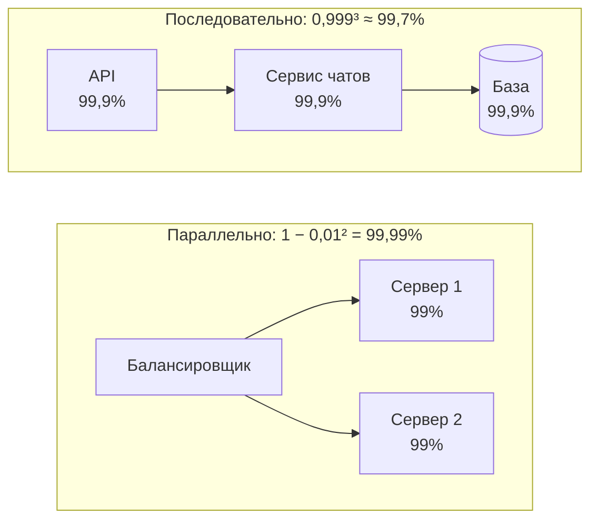

# 0.2. Что такое system design и требования

## Проблема: функции те же, а система упала

Небольшая команда сделала сервис заметок. Один сервер на Go, одна база PostgreSQL. Сервис работал у 1 000 пользователей, и всё было хорошо: заметки сохранялись, страницы открывались мгновенно.

Потом вышла реклама у популярного блогера. За вечер пришли 200 000 пользователей. Через полчаса сервис лёг, а в логах сервера появились тысячи одинаковых строк:

```text
pq: sorry, too many clients already
```

Так PostgreSQL отвечает, когда к нему пытаются открыть больше соединений, чем разрешено (в таком виде ошибку выводит драйвер lib/pq; в pgx текст чуть другой, суть та же). По умолчанию разрешено 100 (параметр `max_connections`). А в Go пул соединений `sql.DB` по умолчанию вообще не ограничивает их число: каждый новый одновременный запрос просто открывает ещё одно соединение.

Прикинем, почему при 1 000 пользователей всё работало. Цифры условные, но порядок реалистичный. Пусть вечером онлайн каждый пятый пользователь, а редактор каждые 5 секунд автоматически сохраняет заметку. Каждое сохранение держит соединение с базой около 20 мс.

| | 1 000 пользователей | 200 000 пользователей |
|---|---|---|
| Онлайн (каждый пятый) | 200 | 40 000 |
| Запросов в секунду (раз в 5 с) | 40 | 8 000 |
| Соединений занято одновременно (× 0,02 с) | ≈ 1 | ≈ 160 |

Последняя строка — это <T id="littles-law">закон Литтла (Little's law)</T>: среднее число одновременных запросов равно их потоку в секунду, умноженному на время обработки. Мы ещё вернёмся к нему в уроках про задержку и оценки. Пока важно одно: 160 соединений не помещаются в лимит 100.

Обратите внимание: **функции сервиса не изменились**. Пользователь по-прежнему создаёт, редактирует и удаляет заметки. Изменилась нагрузка — и то, что было достаточно хорошим для 1 000 человек, перестало работать для 200 000.

Как думаете, что надо было сделать? Просто поднять `max_connections` до 1 000? Это не лечит, а переносит проблему: каждое соединение PostgreSQL — отдельный процесс операционной системы со своей памятью, и тысяча таких процессов сама по себе тяжела для сервера (подробно — модуль 2b). Настоящие ответы — ограниченный пул соединений, кэш (быстрая память для часто читаемых данных), реплики (копии базы на других серверах), несколько серверов приложения — и есть предмет этого курса.

## Что такое system design

<T id="system-design">Проектирование систем (system design)</T> — это выбор компонентов системы, связей между ними и компромиссов так, чтобы система выполняла требования при реальной нагрузке.

Аналогия — строительство. Код — это кирпичи и их кладка. Проект здания отвечает на другие вопросы: сколько этажей выдержит фундамент, где несущие стены, что будет, если половина лифтов сломается. Плохой проект не спасти идеальной кладкой. Аналогия хромает в одном важном месте: здание проектируют один раз, а программную систему перестраивают на ходу, не выселяя жильцов. Поэтому в нашем деле так важна возможность менять решения позже.

Проектирование ведут на двух уровнях:

- **High-level design (HLD, верхнеуровневый дизайн)** — из каких крупных частей состоит система и как они общаются: клиенты, балансировщик, сервисы, базы, кэши, очереди. Это «карта района».
- **Low-level design (LLD, детальный дизайн)** — что внутри одной части: пакеты и интерфейсы в Go, схемы таблиц, форматы API. Это «план квартиры».

На собеседованиях под «system design» обычно имеют в виду HLD. Но в реальной работе система падает и из-за неудачной схемы таблицы, поэтому в курсе есть оба уровня: LLD — в модулях 1 (сервис на Go, API) и 2a (проектирование БД), HLD — начиная с модуля 2.5 (балансировка) и дальше.

## Требования: что и насколько хорошо

Любое проектирование начинается с требований. Их делят на два вида.

<T id="functional-requirements">Функциональные требования (functional requirements)</T> — **что** система делает. Обычно формулируются как «пользователь может…». Для мессенджера:

1. Пользователь может отправить сообщение другому пользователю.
2. Пользователь может создать группу и добавить в неё участников.
3. Пользователь видит историю переписки, в том числе на новом устройстве.
4. Пользователь видит статусы «доставлено» и «прочитано».
5. Пользователь может найти сообщение по слову.

<T id="non-functional-requirements">Нефункциональные требования (non-functional requirements)</T> — **насколько хорошо** система это делает. Для того же мессенджера (числа — примерные цели, точные мы выберем в уроке 0.6):

1. Сообщение доходит до получателя в сети за 1 секунду — в 99% случаев.
2. Отправка сообщений доступна 99,95% времени за месяц.
3. Сообщение, на которое пользователь увидел «отправлено», не теряется ни при каком сбое сервера.
4. Система выдерживает 10 миллионов активных пользователей в день и вечерний пик.
5. Переписку читают только её участники.

Заметьте: ни одно функциональное требование не говорит, сколько нужно серверов. А каждое нефункциональное — говорит, пусть и неявно.

<Callout type="idea">

Архитектуру определяют нефункциональные требования. Функция «отправить сообщение» одинакова для 100 и для 100 миллионов пользователей. Архитектура — совершенно разная: в первом случае хватит одного сервера и одной базы, во втором нужны сотни серверов, разделение данных и очереди. Поэтому на интервью и в работе первым делом выясняйте нефункциональные требования: без них проектировать не из чего.

</Callout>

## Нефункциональные требования по одному

Разберём главные нефункциональные требования. Для каждого — что это значит, как выглядит в мессенджере и какой вопрос задать заказчику (или интервьюеру), чтобы превратить расплывчатое «должно работать хорошо» в число.

### Масштабируемость

<T id="scalability">Масштабируемость (scalability)</T> — способность справляться с ростом нагрузки, добавляя ресурсы. Можно купить сервер мощнее (вертикально) или добавить ещё серверов (горизонтально). У вертикального есть потолок — самая большая машина на рынке; горизонтальное почти не ограничено, но требует, чтобы систему можно было разделить на части.

- **В мессенджере:** выдержать рост с 1 до 10 миллионов пользователей, добавив серверы, а не переписав систему.
- **Вопрос заказчику:** «Сколько пользователей сейчас, через год и через три? Насколько пик выше среднего — например, в новогоднюю ночь?»

### Доступность

<T id="availability">Доступность (availability)</T> — доля времени, когда система корректно отвечает на запросы. Измеряется в процентах и «девятках»: 99,9% — «три девятки».

- **В мессенджере:** отправка сообщений доступна 99,95% времени за месяц.
- **Вопрос заказчику:** «Сколько минут простоя в месяц допустимо? И что мы считаем простоем — полную недоступность, ошибки у части пользователей, медленные ответы?»

### Надёжность

<T id="reliability">Надёжность (reliability)</T> — способность работать *правильно*, даже когда что-то ломается. Это не то же самое, что доступность. Сервис может отвечать на все запросы (доступность 100%) и при этом дублировать сообщения после сбоя сети — он доступен, но ненадёжен.

- **В мессенджере:** при падении одного сервера сообщения не теряются, не дублируются и не меняют порядок.
- **Вопрос заказчику:** «Какие сбои мы обязаны пережить незаметно для пользователя: падение сервера, диска, целого <T id="data-center">дата-центра (data center)</T>?»

### Долговечность

<T id="durability">Долговечность (durability)</T> — гарантия, что подтверждённые данные не пропадут. Если система сказала «сохранено», данные должны пережить перезагрузку, отключение питания и смерть диска.

- **В мессенджере:** сообщение с галочкой «отправлено» не исчезает, даже если сервер базы сгорел через секунду после ответа.
- **Вопрос заказчику:** «Можно ли при крупной аварии потерять последние секунды переписки? Последний час?» Ответ напрямую определяет, сколько копий данных хранить и как быстро их синхронизировать (модуль 8).

### Задержка

<T id="latency">Задержка (latency)</T> — время от отправки запроса до получения ответа. Именно её пользователь ощущает как «быстро» или «тормозит». Описывают её не средним, а долей запросов, которые уложились в порог, — почему, разберём ниже в этом уроке.

- **В мессенджере:** сообщение доходит до получателя в сети за 1 секунду в 99% случаев.
- **Вопрос заказчику:** «Какая задержка ощущается как мгновенная? Для какой доли запросов это должно выполняться — половины, 99%, 99,9%?»

### Пропускная способность

<T id="throughput">Пропускная способность (throughput)</T> — сколько работы система выполняет за единицу времени, обычно в <T id="rps">запросах в секунду (RPS)</T>. Задержка — «как быстро обслуживают одного», пропускная способность — «сколько обслуживают за секунду». Это разные величины: можно обслуживать много запросов, но каждый медленно.

- **В мессенджере:** порядок величины — тысячи сообщений в секунду в среднем и в несколько раз больше в пик; точно посчитаем в уроке 0.6.
- **Вопрос заказчику:** «Сколько сообщений отправляет средний пользователь за день? Каково соотношение чтений и записей?»

### Согласованность, безопасность, стоимость

<T id="consistency">Согласованность (consistency)</T> — видят ли все пользователи и все копии данных одно и то же: например, увидят ли участники группы сообщения в одном порядке и увидите ли вы своё сообщение сразу после отправки. Тема глубокая и запутанная, ей посвящены модули 8 и 10.

- **Вопрос заказчику:** «Допустимо ли, что сообщение появится у собеседника на пару секунд позже, чем у вас? А что порядок сообщений у двух участников будет разным?»

**Безопасность** — кто может что читать и делать, и что будет, если злоумышленник получит доступ. В мессенджере — переписку видят только участники чата, пароли не хранятся в открытом виде. Подробно — модуль 6.7.

- **Вопрос заказчику:** «Какие данные персональные? Нужно ли <T id="e2e-encryption">сквозное шифрование (end-to-end encryption)</T>, при котором даже сервер не может прочитать сообщения?»

**Стоимость** — сколько денег уходит на серверы, трафик и людей, которые всё это поддерживают. Это тоже требование, причём часто решающее: архитектура, которую компания не может оплатить, — плохая архитектура.

- **В мессенджере:** текст сообщений дёшев, а вот хранение фото и видео и исходящий трафик при их раздаче обычно быстро становятся главной статьёй расходов — поэтому медиа хранят и раздают отдельно от сообщений (модуль 11).
- **Вопрос заказчику:** «Какой бюджет на инфраструктуру? Сколько лет храним медиа и в каком качестве? Что важнее — сэкономить или получить ещё одну „девятку“ доступности?»

## Доступность в «девятках»

Проценты обманывают интуицию: 99% звучит как «почти всегда». Переведём их в минуты простоя.

| Доступность | В год | В месяц (30 дней) |
|---|---|---|
| 99% | 3,65 дня | 7,2 часа |
| 99,9% | 8,76 часа | 43,2 минуты |
| 99,99% | 52,6 минуты | 4,32 минуты |
| 99,999% | 5,26 минуты | 25,9 секунды |

Как получены цифры. Допустимый простой — это недоступная доля, умноженная на длину периода. Для 99,9% в год:

(1 − 0,999) × 365 × 24 = 0,001 × 8 760 ч = **8,76 ч**.

Для месяца из 30 дней: 0,001 × 30 × 24 × 60 = 0,001 × 43 200 мин = **43,2 мин**.

Каждая новая «девятка» уменьшает допустимый простой в 10 раз. 99% — это целый рабочий день простоя в месяц. 99,999% — меньше 26 секунд в месяц, примерно столько длится один перезапуск сервиса. Поэтому на такой уровень нельзя выйти, если хоть что-то в системе чинится вручную.

## Доступность цепочки компонентов

Почти любой запрос проходит через несколько компонентов. Как их доступности складываются в доступность всей системы? Тут работают две простые формулы теории вероятностей.

**Последовательно.** Запрос отправки сообщения проходит через API, сервис чатов и базу. Он успешен, только если работают *все три*. Вероятности перемножаются:

0,999 × 0,999 × 0,999 ≈ 0,997, то есть **≈ 99,7%**.

Три сервиса, каждый из которых держит «три девятки», вместе дают *меньше* трёх девяток. В месяц это около 130 минут простоя вместо 43. Чем длиннее цепочка, тем ниже итог — это одна из главных цен микросервисов (модуль 6).

**Параллельно (резерв).** Поставим два одинаковых сервера с доступностью 99% каждый, и пусть запрос может обслужить любой из них. Система недоступна, только если упали *оба сразу*. Вероятность этого — 0,01 × 0,01 = 0,0001, поэтому:

1 − (1 − 0,99)² = 1 − 0,0001 = **0,9999**, то есть **99,99%**.

Два сервера по «две девятки» дают «четыре девятки». Так резервирование и покупает доступность.



Здесь важна честность: обе формулы — упрощённая модель.

- Формулы верны, только если компоненты **отказывают независимо**. Два сервера в одной стойке с одним блоком питания упадут вместе, и резерв не спасёт. Поэтому копии разносят по разным стойкам и дата-центрам.
- На схеме резерва есть третий участник — <T id="load-balancer">балансировщик нагрузки (load balancer)</T>, который распределяет запросы между серверами. Он стоит *последовательно* перед ними, и его доступность умножается на 99,99%. Резерв не должен порождать новую единственную точку отказа (single point of failure) — компонент, падение которого кладёт всю систему, — к этому вернёмся в модуле 2.5.

Давайте закрепим это кодом. Вот расчёт обеих схем на Go — его удобно держать под рукой и подставлять свои числа:

<!-- go-check -->

```go
package main

import (
	"fmt"
	"time"
)

const month = 30 * 24 * time.Hour

// serial — все компоненты нужны одновременно: работаем, только если работает каждый.
func serial(availabilities ...float64) float64 {
	up := 1.0
	for _, a := range availabilities {
		up *= a
	}
	return up
}

// parallel — резервные копии: не работаем, только если упали все сразу.
func parallel(availabilities ...float64) float64 {
	allDown := 1.0
	for _, a := range availabilities {
		allDown *= 1 - a
	}
	return 1 - allDown
}

func downtime(availability float64, period time.Duration) time.Duration {
	return time.Duration((1 - availability) * float64(period)).Round(time.Second)
}

func main() {
	s := serial(0.999, 0.999, 0.999)
	fmt.Printf("последовательно: %.2f%%, простой за 30 дней: %v\n", s*100, downtime(s, month))

	p := parallel(0.99, 0.99)
	fmt.Printf("параллельно:     %.2f%%, простой за 30 дней: %v\n", p*100, downtime(p, month))
}
```

```text
$ go run main.go
последовательно: 99.70%, простой за 30 дней: 2h9m28s
параллельно:     99.99%, простой за 30 дней: 4m19s
```

## SLI, SLO, SLA и бюджет ошибок

«Сервис должен быть доступен» — это пожелание. Чтобы оно стало инженерной задачей, его нужно измерять. Для этого есть три связанных понятия. SLA существовали в договорах задолго до Google, а связку SLI/SLO/бюджет ошибок популяризовала книга Google о SRE — инженерии надёжности (Google SRE Book, гл. 3–4).

- <T id="sli">SLI (Service Level Indicator, индикатор уровня обслуживания)</T> — **что измеряем.** Число, которое можно снять с работающей системы. Аналогия — градусник.
- <T id="slo">SLO (Service Level Objective, цель уровня обслуживания)</T> — **какое значение считаем нормой** за период. Аналогия — отметка «36,6» на градуснике. Это внутренняя цель команды.
- <T id="sla">SLA (Service Level Agreement, соглашение об уровне обслуживания)</T> — **что обещаем клиенту в договоре** и чем платим, если не выполнили: например, возвращаем часть денег.

Аналогия с градусником хороша для SLI и SLO, но не передаёт главного в SLA: SLA — это не измерение и не цель, а юридическое обязательство с последствиями. У бесплатного мессенджера SLA может вообще не быть, а SLO быть обязан.

Пример для мессенджера:

- **SLI** — доля запросов `POST /messages`, которые завершились успешно и быстрее 300 мс;
- **SLO** — 99,9% таких запросов за скользящие 30 дней;
- **SLA** — допустим, для корпоративных клиентов обещаем 99,5% и компенсацию при нарушении. SLA мягче SLO: команда видит проблему по SLO раньше, чем компании придётся платить.

Из SLO сразу следует <T id="error-budget">бюджет ошибок (error budget)</T> — допустимый объём «плохой» работы. При SLO 99,9% за 30 дней это 0,1% времени, то есть около **43 минут**. (Строго говоря, наш SLI считает запросы, а не минуты: бюджет — это 0,1% всех запросов. Минуты — удобный пересчёт при равномерной нагрузке.)

Бюджет ошибок меняет разговор между разработкой и эксплуатацией (SRE Book, гл. 3). Вопрос уже не «можно ли выкатывать?», а «сколько бюджета осталось?». Неудачная выкатка «съела» 30 минут — осталось 13, и рискованные эксперименты лучше отложить до следующего периода. Бюджет нетронут — можно выкатывать смелее.

<Callout type="mistake">

**Путать SLA и SLO.** SLO — внутренняя цель команды, SLA — внешнее обещание с деньгами на кону. Если сделать их равными, первое же нарушение цели сразу превращается в выплату клиентам: у команды не остаётся запаса, чтобы заметить проблему и исправить её.

**Ставить SLO 100%.** Это значит, что бюджет ошибок равен нулю: любая выкатка, любой перезапуск, любой сбой сети у провайдера — нарушение. Команда перестаёт выпускать изменения из страха, а цель всё равно недостижима: пользователь сидит на мобильном интернете, который сам доступен далеко не 100% времени.

</Callout>

## Почему среднее врёт: перцентили

Вернёмся к SLI «быстрее 300 мс». Почему не написать просто «средняя задержка 100 мс»? Посмотрим на пример.

Сервер ответил на 10 запросов. Отсортируем время ответа:

20, 22, 25, 25, 28, 30, 31, 35, 40, **900** мс.

Среднее: (20 + 22 + 25 + 25 + 28 + 30 + 31 + 35 + 40 + 900) / 10 = 1156 / 10 = **115,6 мс**.

Посмотрите на это число внимательно. Ни один пользователь не ждал 115,6 мс. Девять получили ответ за 20–40 мс, один ждал почти секунду. Среднее описывает несуществующего человека и при этом прячет того, кто реально страдал.

Честнее описывать задержку <T id="percentile">перцентилями (percentiles)</T>. Перцентиль p90 — значение, быстрее которого прошли 90% запросов.

- **p50 (медиана)** — «типичный» запрос: половина быстрее, половина медленнее. При чётном числе замеров это среднее двух центральных значений, 5-го и 6-го: (28 + 30) / 2 = **29 мс**.
- **p90** — 9-е значение из 10: **40 мс**. 90% запросов уложились в 40 мс.
- **Максимум** — **900 мс**. Это и есть «хвост» распределения.

Оговорка о точности: на 10 замерах перцентили считаются грубо, и разные методы дают разные числа. Мы взяли p90 как 9-е значение («ближайший ранг»); метод с интерполяцией, который по умолчанию использует, например, numpy, даст для тех же данных уже 126 мс. В реальной системе замеров тысячи и миллионы, и разница между методами становится несущественной.

### Почему хвост важнее, чем кажется

Кажется, что медленный запрос — 1 из 100, и это мелочь. Но одна страница или один экран приложения часто делает много запросов: профиль, список чатов, последние сообщения, аватарки. Экран готов, только когда пришли *все* ответы.

Пусть экран делает 20 независимых запросов, и каждый с вероятностью 1% медленнее p99. Вероятность, что хотя бы один окажется медленным:

1 − 0,99²⁰ ≈ 1 − 0,82 = **0,18**.

Почти каждый пятый экран будет тормозить, хотя «99% запросов быстрые». Чем больше запросов на экран, тем ближе каждый пользователь к хвосту.

Есть и вторая причина. Клеппман приводит пример Amazon: самые медленные запросы часто у самых ценных клиентов — у них больше всего данных (покупок, переписки, подписчиков). Поэтому внутренние сервисы Amazon оценивают по p99,9 (DDIA, гл. 1). В мессенджере то же: медленнее всех грузится тот, у кого сотни чатов, — ваш самый активный пользователь.

<Callout type="mistake">

**Усреднять перцентили.** У трёх серверов p99 равны 100, 120 и 900 мс. Их среднее — 373 мс — не является p99 всей системы и не имеет смысла. Перцентили нельзя складывать и усреднять: их пересчитывают по объединённым замерам или по гистограммам. Как это делают в Prometheus, разберём в модуле 12.

</Callout>

## Компромисс: цена каждой «девятки»

<Callout type="tradeoff">

Каждая следующая «девятка» стоит заметно дороже предыдущей. Это эвристика из практики, а не закон природы, но она хорошо описывает, что приходится добавлять:

- **99% → 99,9%:** резервирование — второй экземпляр сервиса и реплика базы (её копия на другом сервере), чтобы падение одной машины не останавливало систему;
- **99,9% → 99,99%:** автоматическое переключение на резерв (failover) — на ручное у вас всего 4 минуты в месяц, человек столько только просыпается от будильника дежурства;
- **99,99% → 99,999%:** дисциплина выкаток — постепенные выкатки, автоматический откат, несколько дата-центров. Здесь деньги тратятся уже не столько на железо, сколько на процессы и людей.

**Что выигрываем:** меньше простоя и меньше недовольных пользователей. **Чем платим:** деньги, сложность системы и скорость выпуска новых функций. **Когда не стоит:** когда пользователь всё равно не заметит разницы. Google SRE Book (гл. 3) приводит именно этот довод: если интернет у пользователя сам доступен на 99%, он не отличит сервис на 99,99% от сервиса на 99,999%, а платить за пятую девятку придётся по-настоящему.

</Callout>

Поэтому правильный вопрос — не «сколько девяток можем сделать», а «сколько девяток нужно этому сценарию». Отправке сообщений — больше, поиску по истории — меньше: если поиск недоступен 10 минут, пользователь переживёт.

## Что дальше

В этом уроке мы договорились о языке: требования, доступность, SLO, перцентили. Дальше они будут возвращаться постоянно:

- в уроке 0.3 вы пройдёте путь одного запроса и увидите, из каких звеньев складывается задержка;
- в уроке 0.4 разберём, сколько на самом деле стоит обращение к памяти, диску и сети;
- в уроках 0.5 и 0.6 научимся считать нагрузку и превратим требования к мессенджеру в числа;
- SLO и бюджет ошибок станут настоящими дашбордами в модуле 12, а цена резервирования — темой модулей 2.5 и 8.

## Самопроверка

<SelfCheck question="«Пользователь может удалить сообщение» — какое это требование?">

Функциональное. Оно говорит, **что** система умеет, и ничего — о том, **насколько хорошо**: как быстро удаление дойдёт до собеседника, что будет при сбое. Если добавить «и у всех участников сообщение исчезает в течение 2 секунд», появится уже нефункциональное требование к задержке.

</SelfCheck>

<SelfCheck question="Почему функциональные требования мессенджера на 100 и на 100 млн пользователей одинаковы, а архитектура — нет?">

Функции не зависят от масштаба: отправить, прочитать, создать группу — одно и то же для любого числа людей. Архитектура определяется нефункциональными требованиями — нагрузкой, объёмом данных, доступностью, задержкой. Для 100 человек хватит одного сервера и одной базы. Для 100 миллионов один сервер не выдержит ни запросов, ни данных, и появляются балансировщики, реплики, <T id="sharding">шарды (shards)</T> — части данных на разных серверах, очереди. Пример с сервисом заметок из начала урока — то же самое в миниатюре.

</SelfCheck>

<SelfCheck question="Три сервиса с доступностью 99,9% вызываются последовательно. Какая итоговая доступность и сколько это минут простоя в месяц?">

Доступности перемножаются: 0,999³ ≈ 0,997, то есть около 99,7%. Недоступная доля — 0,3%, а в месяце из 30 дней 43 200 минут: 0,003 × 43 200 ≈ 130 минут, втрое больше, чем у одного сервиса (43 минуты). Расчёт предполагает, что сервисы отказывают независимо.

</SelfCheck>

<SelfCheck question="Чем SLO отличается от SLA?">

SLO — внутренняя цель команды для измеряемого индикатора (SLI): например, 99,9% успешных запросов быстрее 300 мс за 30 дней. SLA — внешнее обещание клиенту в договоре с последствиями при нарушении, обычно денежными. SLA делают мягче SLO, чтобы команда успела заметить и исправить проблему раньше, чем придётся платить.

</SelfCheck>

<SelfCheck question="Почему p99 важнее среднего для пользовательского опыта?">

Среднее смешивает быстрые и медленные запросы и описывает задержку, которую никто не испытал; один медленный запрос может сильно сдвинуть его, а может и спрятаться. p99 прямо показывает, сколько ждёт «хвост». А хвост встречается чаще, чем кажется: экран из 20 запросов хотя бы раз попадает в худший 1% примерно в 18% случаев. К тому же медленнее всех обычно обслуживаются самые активные пользователи с большим объёмом данных.

</SelfCheck>

## Источники

<Callout type="source">

- Клеппман М. *Высоконагруженные приложения. Программирование, масштабирование, поддержка* (Designing Data-Intensive Applications). Гл. 1 — надёжность, масштабируемость, описание нагрузки и производительности, перцентили, пример Amazon с p99,9.
- Сюй А. *System Design. Подготовка к сложному интервью*, т. 1. Гл. 1 — как система растёт от одного сервера до миллионов пользователей; гл. 2 — таблица «девяток» доступности. Учтите: там месяц считается как 1/12 года, поэтому месячные цифры чуть больше наших (для 99,9% — 43,83 минуты, для 99% — 7,31 часа), а у нас месяц — ровно 30 дней.
- Google. *Site Reliability Engineering*. Гл. 3 [Embracing Risk](https://sre.google/sre-book/embracing-risk/) — цена каждой «девятки», бюджет ошибок; гл. 4 [Service Level Objectives](https://sre.google/sre-book/service-level-objectives/) — SLI, SLO, SLA и как их выбирать.
- Документация PostgreSQL: параметр [max_connections](https://www.postgresql.org/docs/current/runtime-config-connection.html) (по умолчанию 100). Документация Go: [`DB.SetMaxOpenConns`](https://pkg.go.dev/database/sql#DB.SetMaxOpenConns) (по умолчанию без ограничения).

</Callout>
