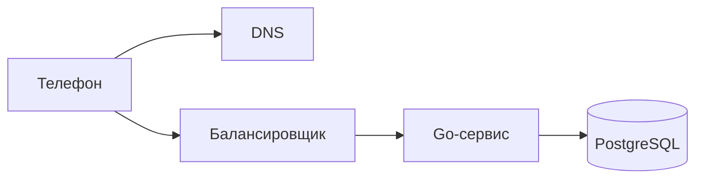

<script setup>
import RequestPath from '../../viz/scenes/RequestPath.vue'
</script>

# 0.3. Путь запроса: что происходит, когда вы нажимаете «Отправить»

## Проблема: код работает несколько миллисекунд, а пользователь ждёт 150

Представьте: вы написали обработчик отправки сообщения на Go. Профилировщик показывает: сам обработчик работает доли миллисекунды, вместе с записью в базу — несколько миллисекунд. Отлично.

А потом вы открываете приложение на телефоне, жмёте «Отправить» и видите, что галочка появляется через 150 мс. Это в 30–40 раз дольше, чем работает весь ваш код.

Куда уходит время? Если не знать ответа, легко начать оптимизировать не то: переписывать обработчик, ускорять JSON, добавлять кэш, а пользователь не заметит никакой разницы. В этом уроке мы пройдём путь одного запроса от нажатия кнопки до ответа и посчитаем, сколько стоит каждое звено.

Прежде чем читать дальше, сделайте ставку: какая доля из этих 150 мс уходит на работу сервера и базы — половина, четверть, десятая часть?

## Участники

Запрос «отправить сообщение» проходит через пять участников. Это статичная схема — кто с кем связан. Как запрос по ней движется во времени, покажет визуализация ниже.



- **Телефон** — клиент. Приложение знает только имя сервера, например `api.messenger.example`. Но сеть доставляет пакеты не по именам, а по <T id="ip-address">IP-адресам (IP address)</T> — числовым адресам вроде `93.184.216.34`.
- <T id="dns">DNS (Domain Name System)</T> — «телефонная книга» интернета. Переводит имя в IP-адрес.
- <T id="load-balancer">Балансировщик нагрузки (load balancer)</T> — входная дверь системы. Принимает соединения от клиентов и раздаёт запросы нескольким одинаковым серверам. Мы уже встречали его в уроке 0.2, когда считали доступность резервированной схемы.
- **Go-сервис** — <T id="application-server">сервер приложения (application server)</T>: процесс с бизнес-логикой. Проверяет, кто вы, разбирает запрос, решает, что делать.
- **PostgreSQL** — <T id="database">база данных (database)</T>: надёжно хранит сообщения.

Аналогия — заказ в ресторане по телефону. Сначала вы ищете номер в справочнике (DNS). Потом дозваниваетесь и ждёте, пока на том конце снимут трубку (установка соединения). Администратор (балансировщик) принимает заказ и передаёт его свободному повару (Go-сервис), а повар записывает его в журнал заказов (база данных). Аналогия перестаёт работать в одном месте: по телефону вы дозваниваетесь один раз, а в сети «снять трубку» приходится в несколько этапов, и каждый стоит отдельного перелёта туда и обратно. Именно эти перелёты мы и будем считать.

## Визуализация: один запрос по шагам

Пройдите все шаги кнопками или стрелками на клавиатуре (сначала кликните по плееру или выберите его клавишей Tab). Следите за часами в правом верхнем углу: они показывают, сколько времени прошло с нажатия кнопки. Под схемой — код обработчика на Go. Когда запрос доходит до сервиса и базы, подсвечивается строка, которая сейчас выполняется.

В подписях плеера встретятся несколько слов, которые подробно разберём ниже, но знать их стоит заранее. <T id="rtt">RTT</T> — время, за которое пакет доходит до сервера, а ответ возвращается обратно; в нашей модели это 40 мс. Прежде чем отправить сообщение, телефон дважды «знакомится» с сервером. Сначала устанавливает <T id="tcp">TCP</T>-соединение, обменявшись пакетами `SYN`, `SYN-ACK` и `ACK` (это рукопожатие TCP). Потом договаривается о шифровании: шлёт `ClientHello`, получает `ServerHello` в ответ (рукопожатие <T id="tls">TLS</T>). Расшифровывает запрос балансировщик — это <T id="tls-termination">TLS-терминация</T>. Каждое рукопожатие стоит перелёта туда и обратно; что именно в нём происходит, расскажет раздел «Разбор по шагам».

<RequestPath>

<!-- go-check: harness=send-message -->

```go
const (
	maxBodyBytes   = 64 << 10 // 64 КБ: текст сообщения и метаданные с большим запасом
	executeTimeout = 2 * time.Second
)

func (h *Handler) SendMessage(w http.ResponseWriter, r *http.Request) {
	userID, err := h.auth.UserID(r)
	if err != nil {
		writeError(w, http.StatusUnauthorized, "unauthorized")
		return
	}

	r.Body = http.MaxBytesReader(w, r.Body, maxBodyBytes)
	dec := json.NewDecoder(r.Body)
	dec.DisallowUnknownFields()
	var req SendMessageRequest
	if err := dec.Decode(&req); err != nil {
		writeError(w, http.StatusBadRequest, "invalid json")
		return
	}
	if err := req.Validate(); err != nil {
		writeError(w, http.StatusUnprocessableEntity, err.Error())
		return
	}

	ctx, cancel := context.WithTimeout(r.Context(), executeTimeout)
	defer cancel()

	msg, err := h.send.Execute(ctx, userID, req.ChatID, req.Text)
	switch {
	case errors.Is(err, chat.ErrNotMember):
		writeError(w, http.StatusForbidden, "not a chat member")
		return
	case errors.Is(err, context.DeadlineExceeded):
		writeError(w, http.StatusGatewayTimeout, "timeout")
		return
	case err != nil:
		h.log.ErrorContext(ctx, "send message", "err", err)
		writeError(w, http.StatusInternalServerError, "internal error")
		return
	}

	w.Header().Set("Content-Type", "application/json")
	w.WriteHeader(http.StatusCreated)
	if err := json.NewEncoder(w).Encode(toResponse(msg)); err != nil {
		h.log.WarnContext(ctx, "encode response", "err", err)
	}
}
```

</RequestPath>

<Callout type="simplified">

Код выше — обработчик, каким он бывает в живом сервисе, но кое-что в настоящем проекте устроено иначе:

- **Аутентификация** — это middleware: он проверяет токен и кладёт пользователя в `context`, а обработчик берёт его оттуда (модуль 1).
- **Логирование запросов, метрики и трассировка** — тоже middleware (модуль 12), в обработчике их нет.
- **`Validate` и DTO** (data transfer object — структура для обмена данными) живут в HTTP-адаптере, отдельно от доменной модели (модуль 1).
- **Сопоставление доменных ошибок со статусами** — одна функция в адаптере, а не `switch` в каждом обработчике.
- **Таймаут** приходит из конфигурации, а не зашит константой.

</Callout>

Проверьте свою ставку из начала урока. Из 144 мс на сервер и базу пришлось 4 мс — меньше 3%. Остальное — сеть между телефоном и дата-центром. Разберём, почему так.

## Разбор по шагам

### DNS: узнать адрес

Телефон знает имя `api.messenger.example`, а не адрес. Он спрашивает DNS-сервер (обычно у мобильного оператора): «какой IP у этого имени?». Если у оператора ответ уже есть в кэше, это один короткий запрос туда и обратно. Если нет, тот сам опрашивает цепочку DNS-серверов, и выйти может заметно дольше. В нашей модели DNS стоит 20 мс.

Хорошая новость: ответ DNS кэшируется — на телефоне и у оператора. Срок хранения задаёт владелец домена в поле **TTL (time to live, «время жизни»)**, например 300 секунд. Пока TTL не истёк, повторный запрос DNS не делается вовсе, и этот шаг занимает ноль миллисекунд.

Обратная сторона кэша: если сервер переехал на новый IP-адрес, клиенты с закэшированной старой записью продолжат стучаться на старый адрес, пока у них не истечёт TTL. К этому вернёмся в типичных ошибках.

### TCP: договориться о соединении

Адрес известен, но отправлять сообщение ещё рано. Сначала нужно установить соединение по TCP (Transmission Control Protocol).

Зачем? Сама сеть ненадёжна: пакеты теряются, приходят не по порядку, дублируются. TCP поверх неё даёт программам надёжный поток байтов: всё, что отправлено, дойдёт целиком и в том же порядке, а потерянное будет отправлено повторно. Чтобы это работало, обе стороны должны заранее договориться о начальных номерах, которыми они будут нумеровать байты. Отсюда **трёхстороннее рукопожатие (three-way handshake)**:

1. телефон → балансировщик: `SYN` — «хочу соединиться, мой начальный номер такой-то»;
2. балансировщик → телефон: `SYN-ACK` — «согласен, мой номер такой-то, твой принял»;
3. телефон → балансировщик: `ACK` — «принял твой».

Третий пакет телефон может отправить вместе с первыми данными. Поэтому рукопожатие стоит один полный RTT (round-trip time, время кругового пути) — время, за которое пакет доходит до получателя и ответ возвращается. В нашей модели RTT между телефоном и дата-центром — 40 мс. Ни одного байта сообщения ещё не отправлено, а 60 мс уже прошло.

Почему нельзя быстрее? RTT ограничен снизу скоростью света: в оптоволокне сигнал проходит около 200 000 км/с, то есть 1 000 км туда и обратно — это минимум 10 мс, и никакой код этого не ускорит (Grigorik, гл. 1). Мобильная сеть добавляет к этому ещё задержку радиоучастка.

### TLS 1.3: договориться о шифровании

Сообщения в мессенджере нельзя отправлять открытым текстом. Поверх TCP работает TLS (Transport Layer Security) — протокол шифрования, тот самый, который превращает HTTP в HTTPS. За время рукопожатия TLS стороны:

- договариваются о шифре и вырабатывают общий секретный ключ;
- проверяют сертификат сервера — что телефон говорит именно с `api.messenger.example`, а не с подменой.

В TLS 1.3 на это уходит **1 RTT**: телефон сразу шлёт `ClientHello` со своей частью ключа, сервер отвечает `ServerHello`, своей частью ключа и сертификатом — и канал готов. В TLS 1.2 нужно было **2 RTT**: сначала стороны договаривались о параметрах и только потом обменивались ключами. В нашей модели это лишние 40 мс на каждом новом соединении.

В TLS 1.3 есть и режим **0-RTT**: если телефон уже соединялся с этим сервером, он может отправить данные сразу, вместе с `ClientHello`, не дожидаясь ответа сервера. TCP-рукопожатие при этом всё равно нужно — 0-RTT экономит только раунд TLS. Но у этого режима есть серьёзная оговорка: такие ранние данные злоумышленник может перехватить и отправить повторно, и сервер не отличит повтор от оригинала (RFC 8446, разд. 8). Для «отправить сообщение» это означало бы дубликат в чате. Поэтому 0-RTT разрешают только для безопасных повторяемых запросов вроде чтения. Как сделать повторы безопасными в принципе, разберём в модуле 5 (идемпотентность).

### HTTP-запрос: наконец сами данные

Теперь по зашифрованному каналу идёт сам запрос по <T id="http">HTTP (HyperText Transfer Protocol)</T>:

```http
POST /messages HTTP/1.1
Host: api.messenger.example
Authorization: Bearer eyJhbGciOi...
Content-Type: application/json

{"chat_id": 42, "text": "Привет!"}
```

Запрос и ответ на него — ещё 1 RTT. Итого на сеть до телефона: 20 (DNS) + 40 (TCP) + 40 (TLS) + 40 (HTTP) = **140 мс**. Заметьте, только последнее из этих слагаемых — полезная работа. Остальные три — подготовка.

### TLS-терминация на балансировщике

Балансировщик расшифровывает запрос. Это называется TLS-терминацией (TLS termination): шифрованный канал от телефона заканчивается здесь, а дальше, внутри дата-центра, запрос идёт к Go-сервису уже без внешнего TLS.

Почему на этом шаге нет нового рукопожатия? У балансировщика к сервисам заранее открыты соединения, и он переиспользует их для всех клиентов. Да и путь внутри <T id="data-center">дата-центра (data center)</T> короткий: RTT между серверами — около 0,5 мс, в 80 раз меньше нашего RTT до телефона.

### Обработчик на Go

Запрос попадает в обработчик (строка 6 в панели кода). Он проверяет токен (строка 7) и разбирает JSON. Это работа процессора, микросекунды. На фоне сети — почти ноль.

Разбор устроен так, чтобы плохой запрос не стоил сервису дорого. `http.MaxBytesReader` обрезает тело на 64 КБ: без этого клиент мог бы прислать гигабайт и занять память. `DisallowUnknownFields` отвергает JSON с неизвестными полями — опечатка в имени поля не пройдёт молча. `Validate` проверяет текст сообщения, и невалидный запрос получает `422`, не дойдя до базы.

Затем строка 29: `h.send.Execute(...)`. Обработчик не пишет в базу сам, а передаёт работу отдельному объекту — сценарию «отправить сообщение». Зачем так делить код и почему HTTP-слой не должен знать про SQL, подробно разберём в модуле 1. Пока достаточно знать, что где-то внутри `Execute` выполняется `INSERT` в PostgreSQL. Соединение с базой тоже берётся уже открытое, из пула `sql.DB` — того самого, который в уроке 0.2 исчерпал лимит `max_connections`.

Вызов идёт с контекстом, у которого есть таймаут в 2 секунды: если база зависла, клиент получит `504`, а не вечное ожидание. Ошибки сценария разбирает `errors.Is`: «не участник чата» превращается в `403`, истёкший таймаут — в `504`, всё остальное — в `500`, причём подробности уходят в лог, а не клиенту. Ответ пишется последним, и ошибку `Encode` обработчик тоже проверяет: клиент мог оборвать соединение, и об этом стоит знать.

### Запись в базу и fsync

PostgreSQL получает `INSERT`. Как думаете, когда база ответит «готово» — сразу, как только данные попали в память, или позже?

Позже. Прежде чем подтвердить транзакцию, PostgreSQL вызывает <T id="fsync">fsync</T> — системный вызов, который заставляет операционную систему реально записать данные на диск, а не держать их в своём кэше в памяти. Без этого при отключении питания «подтверждённое» сообщение могло бы исчезнуть.

Это и есть <T id="durability">долговечность (durability)</T> из урока 0.2: сообщение с галочкой «отправлено» не должно пропасть. Платим за неё временем: в нашей модели fsync — 2 мс, половина всей работы сервера. Типичный порядок — от десятых долей миллисекунды на <T id="ssd">SSD</T> (NVMe с защитой от потери питания) до ~10 мс на <T id="hdd">HDD</T>. На самом деле PostgreSQL пишет на диск не саму таблицу, а журнал изменений (WAL); как он устроен и как база выжимает из fsync максимум, разберём в модуле 2b.

### Ответ

База подтвердила запись, обработчик отвечает `201 Created` (строка 44). Ответ идёт обратно: сервис → балансировщик (шифрует ответ) → телефон. Последний участок — ещё полпути RTT, и вот галочка «отправлено». Итого ≈ 144 мс.

## Допущения модели

Все числа в визуализации — **порядки величин, а не измерения**. Они соответствуют мобильному интернету 4G и серверу в соседней стране. В вашей сети значения будут другими, но соотношение между ними — примерно такое же.

| Параметр | Значение | Откуда порядок |
|---|---|---|
| DNS-запрос (`dnsLookup`) | 20 мс | один RTT до DNS-сервера оператора, ответ из его кэша; без кэша дольше (Grigorik, гл. 10) |
| RTT телефон ↔ дата-центр (`rtt`) | 40 мс | скорость света в оптоволокне плюс задержка мобильной сети (Grigorik, гл. 1 и 7) |
| Переход внутри дата-центра (`internalHop`) | 0,5 мс | RTT внутри одного ЦОД ≈ 0,5 мс (таблица задержек Джеффа Дина). Берём его на каждый переход в одну сторону — с запасом |
| Запись на диск с fsync (`diskFsync`) | 2 мс | типичный порядок — от десятых долей мс (NVMe-SSD с защитой от потери питания) до ~10 мс (HDD); на своей машине можно измерить утилитой PostgreSQL `pg_test_fsync` |

Откуда 144: 20 + 3 × 40 + 4 × 0,5 + 2 = 144 мс. Три RTT — это TCP, TLS и сам HTTP-запрос; четыре внутренних перехода — балансировщик → сервис → база → сервис → балансировщик.

Что модель упрощает. Мы не учитываем время передачи самих данных (сообщение маленькое), потери пакетов и повторные отправки, очереди на перегруженных серверах. Каждое из этих явлений может добавить сотни миллисекунд; ими займёмся в модуле 0b (сеть) и в уроке 0.4 (задержки).

Посмотреть на эти этапы в реальном запросе можно через `curl`. Он печатает время от начала запроса до конца каждого этапа — DNS, TCP, TLS, первый байт ответа:

```bash
curl -so /dev/null -w 'dns:  %{time_namelookup}s\ntcp:  %{time_connect}s\ntls:  %{time_appconnect}s\nttfb: %{time_starttransfer}s\n' https://example.com
```

Времена накопительные: чтобы получить длительность TCP-рукопожатия, вычтите `dns` из `tcp`. Запустите команду два раза подряд: изменится ли время DNS во второй раз?

## Главный вывод

<Callout type="idea">

**140 из 144 мс — это сеть до клиента.** Работа сервера и базы — 4 мс. Даже если сервер и база станут вдвое быстрее, вы сэкономите 2 мс из 144 — пользователь этого не заметит. А ускорение самого Go-кода сэкономит и вовсе микросекунды.

Поэтому главный способ ускорить такие запросы — **не устанавливать соединение заново**. Если соединение уже открыто (keep-alive — TCP и TLS переиспользуются для следующих запросов), второе сообщение не платит ни за DNS, ни за TCP, ни за TLS: ≈ 1 RTT + 4 мс ≈ **44 мс**. Втрое быстрее, и ни строчки серверного кода не тронуто.

Как устроены keep-alive, пулы соединений и HTTP/2, разберём в модуле 0b. А в модуле 3 мессенджер пойдёт дальше: <T id="websocket">WebSocket</T> держит одно соединение открытым всё время, пока приложение запущено, и сервер сам присылает по нему новые сообщения.

</Callout>

## Типичные ошибки

<Callout type="mistake">

**Оптимизировать код, когда тормозит сеть.** Команда неделю ускоряет сериализацию JSON и экономит 0,3 мс, а пользователи по-прежнему ждут 150 мс, потому что каждый запрос открывает новое соединение. Прежде чем оптимизировать, измерьте, где именно уходит время: на сервере (метрики и трейсы, модуль 12) или до него (`curl -w`, как выше).

**Забыть про TTL DNS при переезде сервера.** У записи TTL сутки, сервер переносят на новый IP-адрес, старый выключают — и часть пользователей до суток видит ошибку соединения: их телефоны и DNS-серверы операторов честно помнят старый адрес. Правильно — заранее, за срок не меньше старого TTL, снизить TTL до минут, переехать и только потом вернуть TTL обратно. Причём некоторые DNS-серверы держат записи дольше положенного, поэтому старый адрес выключают не сразу.

</Callout>

## Компромисс: где расшифровывать TLS

<Callout type="tradeoff">

**TLS-терминация на балансировщике.**

**Что выигрываем:** сертификаты и их обновление — в одном месте, а не на каждом из десятков сервисов. Шифрование стоит процессорного времени, и эту работу берёт на себя балансировщик, разгружая сервисы. Балансировщик видит расшифрованный HTTP и может маршрутизировать по пути и заголовкам.

**Чем платим:** внутри дата-центра трафик идёт без шифрования. Если злоумышленник попал во внутреннюю сеть, он читает переписку.

**Когда не применять «как есть»:** когда внутренней сети нельзя доверять — облако с общими сетями, требования регуляторов, чувствительные данные. Тогда трафик между сервисами шифруют отдельно, например через mTLS — взаимную проверку сертификатов обеими сторонами (модуль 6.7). Настраивать терминацию на Nginx будем в модуле 2.5.

</Callout>

## Самопроверка

<SelfCheck question="Сколько займёт второе сообщение по уже открытому соединению и почему?">

Около 44 мс. DNS уже не нужен — адрес известен и соединение открыто. TCP- и TLS-рукопожатия тоже уже позади. Остаются только сам HTTP-запрос и ответ — 1 RTT (40 мс) — и внутренняя работа: 4 перехода по 0,5 мс и fsync 2 мс, то есть 4 мс. Итого 40 + 4 = 44 мс вместо 144.

</SelfCheck>

<SelfCheck question="Что изменится, если вместо TLS 1.3 используется TLS 1.2?">

Рукопожатие TLS 1.2 занимает 2 RTT вместо одного: стороны сначала договариваются о параметрах и только во втором обмене — о ключах. Значит, первый запрос станет дольше на 1 RTT ≈ 40 мс: около 184 мс вместо 144. На повторные запросы по открытому соединению это не влияет — рукопожатие уже сделано.

</SelfCheck>

<SelfCheck question="Зачем база данных делает fsync до подтверждения записи и чем она за это платит?">

Без fsync данные могут оставаться в кэше операционной системы в памяти. Если в этот момент пропадёт питание, транзакция, о которой база уже сказала «готово», исчезнет — а пользователь видел галочку «отправлено». fsync гарантирует, что данные на диске до ответа, и это даёт долговечность. Платим временем: в нашей модели 2 мс — половина всей работы сервера, а на медленных дисках больше. Поэтому базы стараются объединять fsync нескольких транзакций в один (подробно — модуль 2b).

</SelfCheck>

<SelfCheck question="Сервер переехал на новый IP-адрес, а часть пользователей продолжает ходить на старый. Почему?">

Из-за кэширования DNS. Ответ «имя → старый IP» сохранился на телефонах и у DNS-серверов операторов и будет использоваться, пока не истечёт его TTL. Если TTL был большим (часы или сутки), всё это время часть пользователей будет обращаться к старому адресу. Поэтому TTL снижают заранее, до переезда.

</SelfCheck>

## Источники

<Callout type="source">

- Kurose J., Ross K. *Computer Networking: A Top-Down Approach*. Гл. 1 — задержки в сетях; гл. 2 — HTTP и DNS, кэширование и TTL; гл. 3 — TCP и трёхстороннее рукопожатие.
- Grigorik I. *High Performance Browser Networking* (бесплатно: [hpbn.co](https://hpbn.co)). Гл. 1 — задержка и скорость света; гл. 2 — TCP и рукопожатие; гл. 11 — переиспользование соединений (Benefits of Keepalive Connections); гл. 4 — TLS и стоимость рукопожатия; гл. 7 — задержки мобильных сетей; гл. 10 — DNS в общей картине загрузки.
- [RFC 8446](https://www.rfc-editor.org/rfc/rfc8446) — TLS 1.3: рукопожатие за 1 RTT; разд. 8 — риск повтора данных 0-RTT.
- J. Dean. *Designs, Lessons and Advice from Building Large Distributed Systems* (LADIS 2009), слайд «Numbers Everyone Should Know» — RTT внутри дата-центра ≈ 0,5 мс. Под названием «Latency Numbers Every Programmer Should Know» таблицу знают по версии Colin Scott. Подробно её разберём в уроке 0.4.
- Документация PostgreSQL: [pg_test_fsync](https://www.postgresql.org/docs/current/pgtestfsync.html) — измерение скорости fsync на вашем диске.

</Callout>
