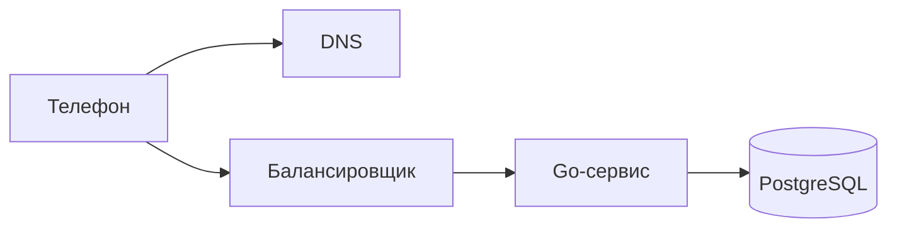

<script setup>
import RequestPath from '../../viz/scenes/RequestPath.vue'
</script>

# 0.3. Путь запроса: что происходит, когда вы нажимаете «Отправить»

## <Part kind="problem" /> Проблема: код работает несколько миллисекунд, а пользователь ждёт 150

Представьте: вы написали обработчик отправки сообщения на Go. Профилировщик показывает: сам обработчик работает доли миллисекунды, вместе с записью в базу — несколько миллисекунд. Отлично.

А потом вы открываете приложение на телефоне, жмёте «Отправить» и видите, что галочка появляется через 150 мс. Это в 30–40 раз дольше, чем работает весь ваш код.

Куда уходит время? Если не знать ответа, легко начать оптимизировать не то: переписывать обработчик, ускорять JSON, добавлять кэш, а пользователь не заметит никакой разницы. В этом уроке мы пройдём путь одного запроса от нажатия кнопки до ответа и посчитаем, сколько стоит каждое звено.

Прежде чем читать дальше, сделайте ставку: какая доля из этих 150 мс уходит на работу сервера и базы — половина, четверть, десятая часть?

## <Part kind="theory" /> Участники

Запрос «отправить сообщение» проходит через пять участников. Это статичная схема — кто с кем связан. Как запрос по ней движется во времени, покажет визуализация ниже.



Цвет рамки подсказывает роль участника: клиент, сетевая инфраструктура, сервис или база данных. Те же цвета вы увидите в визуализации ниже и во всех схемах курса.

- **Телефон** — клиент. Приложение знает только имя сервера, например `api.messenger.example`. Но сеть доставляет пакеты не по именам, а по <T id="ip-address">IP-адресам (IP address)</T> — числовым адресам вроде `192.0.2.10` (это адрес из диапазона, зарезервированного для документации, — в настоящей сети он не используется).
- <T id="dns">DNS (Domain Name System)</T> — «телефонная книга» интернета. Переводит имя в IP-адрес.
- <T id="load-balancer">Балансировщик нагрузки (load balancer)</T> — входная дверь системы. Принимает соединения от клиентов и раздаёт запросы нескольким одинаковым серверам. Мы уже встречали его в уроке 0.2, когда считали доступность резервированной схемы.
- **Go-сервис** — <T id="application-server">сервер приложения (application server)</T>: процесс с бизнес-логикой. Проверяет, кто вы, разбирает запрос, решает, что делать.
- **PostgreSQL** — <T id="database">база данных (database)</T>: надёжно хранит сообщения.

Аналогия — заказ в ресторане по телефону. Сначала вы ищете номер в справочнике (DNS). Потом дозваниваетесь и ждёте, пока на том конце снимут трубку (установка соединения). Администратор (балансировщик) принимает заказ и передаёт его свободному повару (Go-сервис), а повар записывает его в журнал заказов (база данных). Аналогия перестаёт работать в одном месте: по телефону вы дозваниваетесь один раз, а в сети «снять трубку» приходится в несколько этапов, и каждый стоит отдельного перелёта туда и обратно. Именно эти перелёты мы и будем считать.

## <Part kind="viz" /> Визуализация: один запрос по шагам

Пройдите все шаги кнопками или стрелками на клавиатуре (сначала кликните по плееру или выберите его клавишей Tab). Следите за часами в правом верхнем углу: они показывают, сколько времени прошло с нажатия кнопки. Под схемой — код обработчика на Go. Когда запрос доходит до сервиса и базы, подсвечивается строка, которая сейчас выполняется.

В подписях плеера встретятся несколько слов, которые подробно разберём ниже, но знать их стоит заранее. <T id="rtt">RTT</T> — время, за которое пакет доходит до сервера, а ответ возвращается обратно; в нашей модели это 40 мс. Прежде чем отправить сообщение, телефон дважды «знакомится» с сервером. Сначала устанавливает <T id="tcp">TCP</T>-соединение, обменявшись пакетами `SYN`, `SYN-ACK` и `ACK` (это рукопожатие TCP). Потом договаривается о шифровании: шлёт `ClientHello`, получает `ServerHello` в ответ (рукопожатие <T id="tls">TLS</T>). Расшифровывает запрос балансировщик — это <T id="tls-termination">TLS-терминация</T>. Каждое рукопожатие стоит перелёта туда и обратно; что именно в нём происходит, расскажет раздел «Разбор по шагам».

<RequestPath>

<!-- go-check: harness=send-message -->

```go
const (
	maxBodyBytes   = 64 << 10 // 64 КБ: текст сообщения и метаданные с большим запасом
	executeTimeout = 2 * time.Second
)

func (h *Handler) SendMessage(w http.ResponseWriter, r *http.Request) {
	userID, err := h.auth.UserID(r)
	if err != nil {
		writeError(w, http.StatusUnauthorized, "unauthorized")
		return
	}

	r.Body = http.MaxBytesReader(w, r.Body, maxBodyBytes)
	dec := json.NewDecoder(r.Body)
	dec.DisallowUnknownFields()
	var req SendMessageRequest
	if err := dec.Decode(&req); err != nil {
		var tooLarge *http.MaxBytesError
		if errors.As(err, &tooLarge) {
			writeError(w, http.StatusRequestEntityTooLarge, "body too large")
			return
		}
		writeError(w, http.StatusBadRequest, "invalid json")
		return
	}
	if dec.Decode(&struct{}{}) != io.EOF {
		writeError(w, http.StatusBadRequest, "invalid json")
		return
	}
	if err := req.Validate(); err != nil {
		writeError(w, http.StatusUnprocessableEntity, err.Error())
		return
	}

	ctx, cancel := context.WithTimeout(r.Context(), executeTimeout)
	defer cancel()

	msg, err := h.send.Execute(ctx, userID, req.ChatID, req.Text)
	switch {
	case errors.Is(err, chat.ErrNotMember):
		writeError(w, http.StatusForbidden, "not a chat member")
		return
	case errors.Is(err, context.DeadlineExceeded):
		writeError(w, http.StatusGatewayTimeout, "timeout")
		return
	case errors.Is(err, context.Canceled):
		return
	case err != nil:
		h.log.ErrorContext(ctx, "send message", "err", err)
		writeError(w, http.StatusInternalServerError, "internal error")
		return
	}

	w.Header().Set("Content-Type", "application/json")
	w.WriteHeader(http.StatusCreated)
	if err := json.NewEncoder(w).Encode(toResponse(msg)); err != nil {
		h.log.WarnContext(ctx, "encode response", "err", err)
	}
}
```

</RequestPath>

<Callout type="simplified">

Код выше — обработчик, каким он бывает в живом сервисе, но кое-что в настоящем проекте устроено иначе:

- **Аутентификация** — это <T id="middleware">middleware</T>: он проверяет токен и кладёт пользователя в `context`, а обработчик берёт его оттуда (модуль 1).
- **Логирование запросов, метрики и трассировка** — тоже middleware (модуль 12), в обработчике их нет.
- **`Validate` и <T id="dto">DTO</T>** живут в <T id="http">HTTP (HyperText Transfer Protocol)</T>-адаптере, отдельно от доменной модели (модуль 1).
- **Сопоставление доменных ошибок со статусами** — одна функция в адаптере, а не `switch` в каждом обработчике.
- **Таймаут** приходит из конфигурации, а не зашит константой.

</Callout>

Проверьте свою ставку из начала урока. Из <N>144 мс</N> на сервер и базу пришлось <N>4 мс</N> — меньше 3%. Остальное — сеть между телефоном и <T id="data-center">дата-центром (data center)</T>. Разберём, почему так.

## <Part kind="theory" /> Разбор по шагам

### DNS: узнать адрес

Телефон знает имя `api.messenger.example`, а не адрес. Он спрашивает DNS-сервер (обычно у мобильного оператора): «какой IP у этого имени?». Если у оператора ответ уже есть в кэше, это один короткий запрос туда и обратно. Если нет, тот сам опрашивает цепочку DNS-серверов, и выйти может заметно дольше. В нашей модели DNS стоит 20 мс.

Хорошая новость: ответ DNS кэшируется — на телефоне и у оператора. Срок хранения задаёт владелец домена в поле **TTL (time to live, «время жизни»)**, например 300 секунд. Пока TTL не истёк, повторный запрос DNS не делается вовсе, и этот шаг занимает ноль миллисекунд.

Обратная сторона кэша: если сервер переехал на новый IP-адрес, клиенты с закэшированной старой записью продолжат стучаться на старый адрес, пока у них не истечёт TTL. К этому вернёмся в типичных ошибках.

<Deep title="как DNS находит адрес">

Вопрос «какой IP у имени?» проходит несколько звеньев. Первое — **стаб-резолвер (stub resolver)** на самом устройстве: небольшая часть ОС, которая сама ничего не ищет. Она смотрит в свой кэш, если он есть, и, если ответа нет, пересылает вопрос дальше. Кэш есть у Android, iOS и systemd-resolved, а вот у обычной библиотеки glibc без отдельного демона его нет. В Go у этой роли два исполнителя: встроенный резолвер на чистом Go и системный через cgo. Выбрать можно переменной окружения `GODEBUG=netdns=go` или `GODEBUG=netdns=cgo`. Встроенный резолвер Go ответы не кэширует: каждый поиск идёт к резолверу, указанному в `/etc/resolv.conf`. Это пригодится, когда ваш сервис сам ищет адрес базы или соседнего сервиса.

Стаб-резолвер отправляет вопрос **рекурсивному резолверу (recursive resolver)** — серверу оператора или публичному, например `1.1.1.1`. «Рекурсивный» значит, что он берёт весь поиск на себя и возвращает готовый ответ. Если в его кэше ответа нет, он идёт по иерархии имён справа налево и задаёт каждому серверу один и тот же вопрос. Покажем это на нашем имени, как будто зона `.example` настоящая. На деле она зарезервирована для примеров и в настоящем DNS не существует, но для реальных зон вроде `.com` цепочка точно такая же:

1. **Корневой сервер (root server):** «где `api.messenger.example`?» — «не знаю, но вот серверы зоны `.example`».
2. **Сервер зоны верхнего уровня (TLD, top-level domain)** `.example`: «за `messenger.example` отвечают вот эти серверы».
3. **Авторитетный сервер (authoritative server)** домена, где владелец хранит свои записи: «`api.messenger.example` — это `192.0.2.10`, TTL 300 секунд».

Первые два ответа — не адрес, а направление «спроси вон там» (referral).

**Корневых серверов 13** — по именам от `a.root-servers.net` до `m.root-servers.net`. Но это 13 имён, а не 13 машин: за ними стоят больше полутора тысяч экземпляров по всему миру (карта — на root-servers.org). Работает это благодаря **anycast**: один и тот же IP-адрес объявлен из многих точек сети, и пакет доставляется в ближайшую. Число 13 историческое: столько адресов помещалось в один ответ DNS по UDP, ограниченный тогда 512 байтами. UDP — протокол без соединения и рукопожатия: пакет просто отправляют, без гарантии доставки; подробно — [урок 0b.3](../00b-network/03-udp#датаграмма-и-ее-заголовок), а про 512 байт и EDNS0 — [там же](../00b-network/03-udp#dns-512-баит-edns0-и-1232).

**Кэш на каждом шаге.** Резолвер запоминает каждый ответ на время его TTL, в том числе направления. Адреса серверов `.com` корневая зона отдаёт с TTL двое суток, поэтому до корня дело почти не доходит. Кэшируются и отрицательные ответы — «такого имени нет» (RFC 2308). Иначе каждая опечатка в имени заново гоняла бы резолвер по всей цепочке. Итог: полный проход по цепочке — редкость. Обычно ответ приходит из кэша рекурсивного резолвера за один короткий запрос, как в нашей модели.

Посмотреть цепочку своими глазами можно командой `dig +trace github.com`. Она сама проходит путь от корня и печатает ответ каждого звена.

</Deep>

### TCP: договориться о соединении

Адрес известен, но отправлять сообщение ещё рано. Сначала нужно установить соединение по TCP (Transmission Control Protocol).

Зачем? Сама сеть ненадёжна: пакеты теряются, приходят не по порядку, дублируются. TCP поверх неё даёт программам надёжный поток байтов: всё, что отправлено, дойдёт целиком и в том же порядке, а потерянное будет отправлено повторно. Чтобы это работало, обе стороны должны заранее договориться о начальных номерах, которыми они будут нумеровать байты. Отсюда **трёхстороннее рукопожатие (three-way handshake)**:

1. телефон → балансировщик: `SYN` — «хочу соединиться, мой начальный номер такой-то»;
2. балансировщик → телефон: `SYN-ACK` — «согласен, мой номер такой-то, твой принял»;
3. телефон → балансировщик: `ACK` — «принял твой».

Третий пакет телефон может отправить вместе с первыми данными. Поэтому рукопожатие стоит один полный RTT (round-trip time, время кругового пути) — время, за которое пакет доходит до получателя и ответ возвращается. В нашей модели RTT между телефоном и дата-центром — <N>40 мс</N>. Ни одного байта сообщения ещё не отправлено, а 60 мс уже прошло.

Почему нельзя быстрее? RTT ограничен снизу скоростью света: в оптоволокне сигнал проходит около 200 000 км/с, то есть 1 000 км туда и обратно — это минимум 10 мс, и никакой код этого не ускорит (Grigorik, гл. 1). Мобильная сеть добавляет к этому ещё задержку радиоучастка: телефону нужно получить у базовой станции разрешение передавать, а если радиомодуль «спал» ради экономии батареи, его пробуждение в сети 4G (LTE) может стоить ещё до 100 мс (Grigorik, гл. 7).

<Deep title="что происходит в TCP-рукопожатии">

TCP нумерует не пакеты, а **байты**: у каждого байта потока есть порядковый номер (sequence number). По номерам получатель собирает поток в правильном порядке, выбрасывает дубликаты и сообщает отправителю, до какого байта всё дошло. Это сообщение и есть подтверждение, ACK (acknowledgment).

Начинать нумерацию с нуля нельзя. Тогда опоздавший пакет от прошлого соединения между теми же адресами и портами легко принять за свежий, а злоумышленник мог бы угадать номер и подделать пакет. Поэтому каждая сторона выбирает свой **начальный номер (ISN, initial sequence number)**, непредсказуемый для посторонних. По RFC 6528 это показания таймера плюс криптографический хэш от адресов, портов и секретного ключа.

Теперь рукопожатие читается так:

1. `SYN`, seq = x: «мой начальный номер x».
2. `SYN-ACK`, seq = y, ack = x + 1: «мой начальный номер y; твой принял, жду байт x + 1» (сам `SYN` расходует один номер).
3. `ACK`, ack = y + 1: «твой принял».

Двух пакетов не хватило бы: сервер так и не узнал бы, что клиент получил его номер y. Трёх достаточно, чтобы каждая сторона назвала свой номер и получила подтверждение.

**Состояния.** Каждое соединение — маленький конечный автомат. Сервер ждёт клиентов в `LISTEN`. Клиент после `SYN` переходит в `SYN_SENT`, сервер после `SYN-ACK` — в `SYN_RECEIVED`, а после третьего пакета у обоих `ESTABLISHED`. При закрытии сторона, закрывшая первой, проходит `FIN_WAIT_1`, `FIN_WAIT_2` и `TIME_WAIT`, вторая — `CLOSE_WAIT` и `LAST_ACK`. На Linux их видно командой `ss -tan`, только названия там чуть короче: `SYN-RECV`, `ESTAB`.

**Потерянный пакет** TCP отправляет повторно по таймеру — RTO (retransmission timeout). Пока RTT ещё не измерен, RFC 6298 велит начинать с 1 секунды, а при каждой новой потере таймер удваивается. Потом RTO вычисляется из измеренного RTT и его разброса. Отсюда неприятное следствие: потерянный `SYN` стоит не 40 мс, а целую секунду, вторая потеря подряд — ещё две. (Это классическая схема RFC; современный Linux первые повторы `SYN` шлёт с паузой в 1 с без удвоения — в лабораторной [урока 0b.2](../00b-network/02-tcp#шаг-5-потерянныи-syn-стоит-секунду) это видно по времени рукопожатий.) Такие запросы с секундными «ступеньками» и выглядят в мониторинге как загадочный хвост задержек. Потери посреди уже идущего потока обычно чинятся быстрее, по повторяющимся подтверждениям (duplicate ACK), не дожидаясь таймера ([урок 0b.2](../00b-network/02-tcp#как-tcp-замечает-потерю-и-что-делает)).

**`TIME_WAIT`.** Сторона, закрывшая соединение первой, ещё какое-то время держит его — в Linux ровно 60 секунд (константа `TCP_TIMEWAIT_LEN` в ядре). Так опоздавшие пакеты старого соединения не попадут в новое с теми же адресами и портами, а последний `ACK` можно повторить, если он потерялся. Если на каждый запрос открывают новое соединение и первым закрывает клиент, цену платит он: каждое закрытое соединение ещё минуту занимает локальный порт. (Если первым закрывает сервер, например в ответ на HTTP-заголовок `Connection: close`, `TIME_WAIT` остаётся у сервера.) В Linux по умолчанию таких портов 28 232 (диапазон 32768–60999), то есть без особых настроек — не больше ~470 новых соединений в секунду к одному и тому же адресу и порту. Ещё один довод за переиспользование соединений; подробно — [урок 0b.2](../00b-network/02-tcp#закрытие-соединения-и-time-wait).

</Deep>

### TLS 1.3: договориться о шифровании

Сообщения в мессенджере нельзя отправлять открытым текстом. Поверх TCP работает TLS (Transport Layer Security) — протокол шифрования, тот самый, который превращает HTTP в HTTPS. За время рукопожатия TLS стороны:

- договариваются о шифре и вырабатывают общий секретный ключ;
- проверяют сертификат сервера — что телефон говорит именно с `api.messenger.example`, а не с подменой.

В TLS 1.3 на это уходит **1 RTT**: телефон сразу шлёт `ClientHello` со своей частью ключа, сервер отвечает `ServerHello`, своей частью ключа и сертификатом — и канал готов. Что это за «части ключа» и почему общий секрет не передаётся по сети, разобрано в блоке «Под капотом» ниже. В TLS 1.2 нужно было **2 RTT**: сначала стороны договаривались о параметрах и только потом обменивались ключами. В нашей модели это лишние 40 мс на каждом новом соединении.

В TLS 1.3 есть и режим **0-RTT**: если телефон уже соединялся с этим сервером, он может отправить данные сразу, вместе с `ClientHello`, не дожидаясь ответа сервера. TCP-рукопожатие при этом всё равно нужно — 0-RTT экономит только раунд TLS. Но у этого режима есть серьёзная оговорка: такие ранние данные злоумышленник может перехватить и отправить повторно, и сервер не отличит повтор от оригинала (RFC 8446, разд. 8). Для «отправить сообщение» это означало бы дубликат в чате. Поэтому 0-RTT разрешают только для безопасных повторяемых запросов вроде чтения. Как сделать повторы безопасными в принципе, разберём в модуле 5 (идемпотентность).

<Deep title="обмен ключами в TLS 1.3">

Главный фокус TLS — договориться об общем секрете, ни разу не передав его по сети, которую может слушать кто угодно. Для этого служит обмен ключами по Диффи — Хеллману на эллиптических кривых, **ECDHE** (Elliptic Curve Diffie–Hellman Ephemeral). Каждая сторона генерирует пару ключей: секретную часть, которая никогда не покидает машину, и открытую, которую можно показать всем. Математика устроена так, что «моя секретная + твоя открытая» и «твоя секретная + моя открытая» дают одно и то же число, а по двум открытым частям вычислить его практически невозможно. Чаще всего для этого используют кривую X25519.

Как это ложится на сообщения TLS 1.3 (RFC 8446, разд. 2):

1. **`ClientHello`** несёт список поддерживаемых шифров и сразу расширение `key_share` — открытую часть ключа клиента. Клиент угадывает, какую кривую выберет сервер, и шлёт ключ заранее. В этом и вся экономия: в TLS 1.2 клиент сначала узнавал параметры сервера и присылал свою часть только во втором обмене.
2. **`ServerHello`** несёт `key_share` сервера. С этого момента обе стороны вычисляют общий секрет и выводят из него ключи шифрования.
3. Остальное сервер шлёт **уже зашифрованным**: сертификат, `CertificateVerify` (подпись всей переписки рукопожатия секретным ключом сертификата) и `Finished` — код проверки целостности, который подтверждает, что переписку никто не подменил. Клиент проверяет всё это, отвечает своим `Finished` и сразу отправляет HTTP-запрос.

Если сервер не поддерживает угаданную кривую, он просит повторить `ClientHello` с другой (`HelloRetryRequest`), и это стоит лишнего RTT.

**Проверка сертификата.** Клиент проверяет три вещи. Цепочка подписей ведёт к корневому центру сертификации (CA, certificate authority) из хранилища доверенных сертификатов ОС. Имя `api.messenger.example` указано в сертификате. Срок действия не истёк. Но сам сертификат публичен, переслать его может кто угодно. Доказательство, что на том конце именно владелец, — `CertificateVerify`: такую подпись может поставить только тот, у кого есть секретный ключ сертификата.

**Прямая секретность (forward secrecy).** Ключи ECDHE одноразовые: живут одно рукопожатие и выбрасываются. Секретный ключ сертификата только подписывает и в шифровании трафика не участвует. Поэтому, даже если через год ключ сервера утечёт, записанный сегодня трафик расшифровать не получится. В TLS 1.2 был распространён обмен ключами через RSA без этого свойства, и в TLS 1.3 его убрали. Оговорка: у данных 0-RTT из основного текста прямой секретности нет (RFC 8446, разд. 2.3).

Что меняется прямо сейчас: с конца 2024 года браузеры, а с версии 1.24 и Go, по умолчанию кладут в `key_share` гибрид X25519 и постквантового ML-KEM. Это защита на случай, если записанный трафик когда-нибудь попробуют вскрыть квантовым компьютером. Схема рукопожатия при этом та же.

</Deep>

### HTTP-запрос: наконец сами данные

Теперь по зашифрованному каналу идёт сам запрос по HTTP:

```http
POST /messages HTTP/1.1
Host: api.messenger.example
Authorization: Bearer eyJhbGciOi...
Content-Type: application/json

{"chat_id": 42, "text": "Привет!"}
```

Заголовок `Authorization` несёт токен — строку, которую приложение получило при входе и по которой сервер узнаёт пользователя. Проверять его будет обработчик. `Content-Type` говорит, что тело запроса — JSON.

Запрос и ответ на него — ещё 1 RTT. Итого на сеть до телефона: 20 (DNS) + 40 (TCP) + 40 (TLS) + 40 (HTTP) = **140 мс**. Заметьте, только последнее из этих слагаемых — полезная работа. Остальные три — подготовка.

### TLS-терминация на балансировщике

Балансировщик расшифровывает запрос. Это называется TLS-терминацией (TLS termination): шифрованный канал от телефона заканчивается здесь, а дальше, внутри дата-центра, запрос идёт к Go-сервису уже без внешнего TLS.

Почему на этом шаге нет нового рукопожатия? У балансировщика к сервисам заранее открыты соединения, и он переиспользует их для всех клиентов. Да и путь внутри дата-центра короткий: RTT между серверами — около 0,5 мс, в 80 раз меньше нашего RTT до телефона.

### Обработчик на Go

Запрос попадает в обработчик (строка 6 в панели кода). Он проверяет токен (строка 7) и разбирает JSON. Это работа процессора, микросекунды. На фоне сети — почти ноль.

Разбор устроен так, чтобы плохой запрос не стоил сервису дорого. `http.MaxBytesReader` ограничивает тело 64 КБ: чтение сверх лимита завершается ошибкой, и клиент получает `413 Content Too Large`, а не гигабайт в памяти сервиса. Тип этой ошибки проверяет `errors.As` — он нужен для ошибок-типов, а `errors.Is` ниже сравнивает ошибки-значения. После разбора мы пробуем прочитать из потока ещё одно значение и ждём `io.EOF`: так отвергается мусор после JSON вроде `{...}garbage`, который одиночный `Decode` молча пропустил бы.

`DisallowUnknownFields` отвергает JSON с неизвестными полями: опечатка в имени поля не пройдёт молча. Но у строгости есть цена. Она ловит ошибки клиентов, зато ломает прямую совместимость: новый клиент с новым полем получит `400` от старого сервера. Поэтому публичные API чаще игнорируют неизвестные поля. `Validate` проверяет текст сообщения, и невалидный запрос получает `422`, не дойдя до базы.

Затем строка 38: `h.send.Execute(...)`. Обработчик не пишет в базу сам, а передаёт работу отдельному объекту — сценарию «отправить сообщение». Зачем так делить код и почему HTTP-слой не должен знать про SQL, подробно разберём в модуле 1. Пока достаточно знать, что где-то внутри `Execute` выполняется `INSERT` в PostgreSQL. Соединение с базой тоже берётся уже открытое, из пула `sql.DB` — того самого, который в уроке 0.2 исчерпал лимит `max_connections`.

Вызов идёт с контекстом, у которого есть таймаут в 2 секунды: если база зависла, клиент получит `504`, а не вечное ожидание. Ошибки сценария разбирает `errors.Is`: «не участник чата» превращается в `403`, истёкший таймаут — в `504` (мы ждали вышестоящее звено — базу; так принято, альтернатива — `503`), всё остальное — в `500`, причём подробности уходят в лог, а не клиенту. Если клиент сам оборвал запрос (`context.Canceled`), отвечать некому и это не повод для тревоги, поэтому обработчик просто выходит. Ответ пишется последним, и ошибку `Encode` обработчик тоже проверяет: клиент мог оборвать соединение, и об этом стоит знать.

### Запись в базу и fsync

PostgreSQL получает `INSERT`. Как думаете, когда база ответит «готово» — сразу, как только данные попали в память, или позже?

Позже. Прежде чем подтвердить транзакцию, PostgreSQL вызывает <T id="fsync">fsync</T> — системный вызов, который заставляет операционную систему реально записать данные на диск, а не держать их в своём кэше в памяти. Без этого при отключении питания «подтверждённое» сообщение могло бы исчезнуть.

Это и есть <T id="durability">долговечность (durability)</T> из урока 0.2: сообщение с галочкой «отправлено» не должно пропасть. Платим за неё временем: в нашей модели fsync — <N>2 мс</N>, половина всей работы сервера. Типичный порядок — от десятых долей миллисекунды на <T id="ssd">SSD</T> (NVMe с защитой от потери питания) до ~10 мс на <T id="hdd">HDD</T>. На самом деле при подтверждении транзакции PostgreSQL сбрасывает на диск не саму таблицу, а <T id="wal">журнал предзаписи (write-ahead log, WAL)</T>: короткую запись об изменении в конце файла. Страницы таблицы он обновит позже, в фоне. Как устроен WAL и как база выжимает из fsync максимум, разберём в модуле 2b.

<Deep title="куда на самом деле пишет fsync">

Между `INSERT` и флеш-памятью или магнитной пластиной лежат несколько уровней кэша, и fsync отвечает за то, чтобы данные прошли их все.

**Кэш ОС.** Обычный системный вызов `write()` только копирует байты в страничный кэш (page cache) — область оперативной памяти, где ядро держит содержимое файлов. Вызов возвращается за микросекунды, а на диск ядро сбросит данные позже, по своему расписанию. Если до этого пропадёт питание, данных нет. `fsync()` просит ядро отправить все изменённые страницы файла на устройство и **дождаться**, пока устройство подтвердит запись. Вариант `fdatasync()` делает то же, но не сбрасывает метаданные, которые не нужны для чтения данных, например время изменения файла. Им PostgreSQL на Linux пользуется по умолчанию.

**Кэш самого диска.** У накопителя есть собственная быстрая память, и «записано» он может ответить, когда данные лежат только в ней. Поэтому при fsync ядро дополнительно отправляет диску команду сброса кэша (flush) или помечает запись флагом FUA (force unit access — «записать мимо кэша»). Только после этого данные действительно на носителе.

**Защита от потери питания (PLP, power loss protection).** В серверных SSD стоят конденсаторы, энергии которых хватает, чтобы при отключении питания дописать содержимое кэша во флеш-память. Такой кэш считается надёжным, и диск подтверждает запись сразу из него. Отсюда fsync порядка десятков–сотен микросекунд. В потребительском SSD без PLP команда сброса заставляет реально записать данные во флеш, а это уже миллисекунды. У HDD тоже миллисекунды: нужно дождаться, пока нужный участок пластины подъедет под головку, а один оборот на 7200 об/мин длится 8,3 мс. Наши 2 мс в модели — где-то посередине этого диапазона (оценка).

**PostgreSQL.** Каким системным вызовом сбрасывать журнал, задаёт параметр `wal_sync_method` (`fdatasync`, `fsync`, `open_datasync` и другие). Параметр `fsync = off` отключает сброс совсем. Запись становится намного быстрее, но после сбоя питания или ОС база может оказаться **повреждённой**, а не просто потерять последние транзакции. Документация допускает это только для данных, которые не жалко пересоздать с нуля. Если нужна скорость ценой ограниченного риска, есть честный вариант — `synchronous_commit = off`: база подтверждает транзакцию, не дожидаясь fsync. При сбое пропадут последние подтверждённые транзакции, по умолчанию не больше чем за 0,6 с, но база останется целостной.

**Как измерить.** Утилита `pg_test_fsync` из комплекта PostgreSQL сравнивает способы сброса на вашем диске и печатает, сколько операций в секунду выдерживает каждый. Запустите её на ноутбуке и на облачном сервере — разница может удивить.

</Deep>

### Ответ

База подтвердила запись, обработчик отвечает `201 Created` (строка 55). Ответ идёт обратно: сервис → балансировщик (шифрует ответ) → телефон. Путь от балансировщика до телефона — вторая половина того RTT, который мы уже посчитали за HTTP-запрос, и вот галочка «отправлено». Итого ≈ 144 мс.

## <Part kind="theory" /> Допущения модели

Все числа в визуализации — **порядки величин, а не измерения**. Они соответствуют мобильному интернету 4G и серверу в соседней стране. В вашей сети значения будут другими, но соотношение между ними — примерно такое же.

| Параметр | Значение | Откуда порядок |
|---|---|---|
| DNS-запрос (`dnsLookup`) | 20 мс | один RTT до DNS-сервера оператора, ответ из его кэша; без кэша дольше (Grigorik, гл. 10) |
| RTT телефон ↔ дата-центр (`rtt`) | 40 мс | скорость света в оптоволокне плюс задержка мобильной сети (Grigorik, гл. 1 и 7) |
| Переход внутри дата-центра (`internalHop`) | 0,5 мс | RTT внутри одного ЦОД ≈ 0,5 мс (таблица задержек Джеффа Дина). Берём его на каждый переход в одну сторону — с запасом |
| Запись на диск с fsync (`diskFsync`) | 2 мс | типичный порядок — от десятых долей мс (NVMe-SSD с защитой от потери питания) до ~10 мс (HDD); на своей машине можно измерить утилитой PostgreSQL `pg_test_fsync` |

Откуда 144: 20 + 3 × 40 + 4 × 0,5 + 2 = 144 мс. Три RTT — это TCP, TLS и сам HTTP-запрос; четыре внутренних перехода — балансировщик → сервис → база → сервис → балансировщик.

Что модель упрощает. Мы не учитываем время передачи самих данных (сообщение маленькое), потери пакетов и повторные отправки, очереди на перегруженных серверах. Каждое из этих явлений может добавить сотни миллисекунд; потерями и повторами займёмся в [уроке 0b.2](../00b-network/02-tcp#как-tcp-замечает-потерю-и-что-делает), временем передачи и очередями — в уроке 0.4 (задержки).

Посмотреть на эти этапы в реальном запросе можно через `curl`. Он печатает время от начала запроса до конца каждого этапа — DNS, TCP, TLS, первый байт ответа:

```bash
curl -so /dev/null -w 'dns:  %{time_namelookup}s\ntcp:  %{time_connect}s\ntls:  %{time_appconnect}s\nttfb: %{time_starttransfer}s\n' https://example.com
```

Времена накопительные: чтобы получить длительность TCP-рукопожатия, вычтите `dns` из `tcp`. Запустите команду два раза подряд: изменится ли время DNS во второй раз?

## <Part kind="theory" /> Главный вывод

<Callout type="idea">

**140 из 144 мс — это сеть до клиента.** Работа сервера и базы — 4 мс. Даже если сервер и база станут вдвое быстрее, вы сэкономите 2 мс из 144 — пользователь этого не заметит. А ускорение самого Go-кода сэкономит и вовсе микросекунды.

Поэтому главный способ ускорить такие запросы — **не устанавливать соединение заново**. Если соединение уже открыто (keep-alive — TCP и TLS переиспользуются для следующих запросов), второе сообщение не платит ни за DNS, ни за TCP, ни за TLS: 1 RTT + 4 мс ≈ <N>44 мс</N>. Втрое быстрее, и ни строчки серверного кода не тронуто.

Как устроены keep-alive и пулы соединений, разберём в [уроке 0b.6](../00b-network/06-http1-pools#пул-соединении-http-transport), а HTTP/2 — в [уроке 0b.7](../00b-network/07-http2#кадры-и-потоки). А в модуле 3 мессенджер пойдёт дальше: <T id="websocket">WebSocket</T> держит одно соединение открытым всё время, пока приложение запущено, и сервер сам присылает по нему новые сообщения.

</Callout>

## <Part kind="mistakes" /> Типичные ошибки

<Callout type="mistake">

**Оптимизировать код, когда тормозит сеть.** Команда неделю ускоряет сериализацию JSON и экономит 0,3 мс, а пользователи по-прежнему ждут 150 мс, потому что каждый запрос открывает новое соединение. Прежде чем оптимизировать, измерьте, где именно уходит время: на сервере (метрики и трейсы, модуль 12) или до него (`curl -w`, как выше).

**Забыть про TTL DNS при переезде сервера.** У записи TTL сутки, сервер переносят на новый IP-адрес, старый выключают — и часть пользователей до суток видит ошибку соединения: их телефоны и DNS-серверы операторов честно помнят старый адрес. Правильно — заранее, за срок не меньше старого TTL, снизить TTL до минут, переехать и только потом вернуть TTL обратно. Причём некоторые DNS-серверы держат записи дольше положенного, поэтому старый адрес выключают не сразу.

</Callout>

## <Part kind="tradeoff" /> Компромисс: где расшифровывать TLS

<Callout type="tradeoff">

**TLS-терминация на балансировщике.**

**Что выигрываем:** сертификаты и их обновление — в одном месте, а не на каждом из десятков сервисов. Шифрование стоит процессорного времени, и эту работу берёт на себя балансировщик, разгружая сервисы. Балансировщик видит расшифрованный HTTP и может маршрутизировать по пути и заголовкам.

**Чем платим:** внутри дата-центра трафик идёт без шифрования. Если злоумышленник попал во внутреннюю сеть, он читает переписку.

**Когда не применять «как есть»:** когда внутренней сети нельзя доверять — облако с общими сетями, требования регуляторов, чувствительные данные. Тогда трафик между сервисами шифруют отдельно, например через mTLS — взаимную проверку сертификатов обеими сторонами (модуль 6.7). Настраивать терминацию на Nginx будем в модуле 2.5.

</Callout>

## <Part kind="selfcheck" /> Самопроверка

<SelfCheck question="Сколько займёт второе сообщение по уже открытому соединению и почему?">

Около 44 мс. DNS уже не нужен — адрес известен и соединение открыто. TCP- и TLS-рукопожатия тоже уже позади. Остаются только сам HTTP-запрос и ответ — 1 RTT (40 мс) — и внутренняя работа: 4 перехода по 0,5 мс и fsync 2 мс, то есть 4 мс. Итого 40 + 4 = 44 мс вместо 144.

</SelfCheck>

<SelfCheck question="Что изменится, если вместо TLS 1.3 используется TLS 1.2?">

Рукопожатие TLS 1.2 занимает 2 RTT вместо одного: стороны сначала договариваются о параметрах и только во втором обмене — о ключах. Значит, первый запрос станет дольше на 1 RTT ≈ 40 мс: около 184 мс вместо 144. На повторные запросы по открытому соединению это не влияет — рукопожатие уже сделано.

</SelfCheck>

<SelfCheck question="Зачем база данных делает fsync до подтверждения записи и чем она за это платит?">

Без fsync данные могут оставаться в кэше операционной системы в памяти. Если в этот момент пропадёт питание, транзакция, о которой база уже сказала «готово», исчезнет — а пользователь видел галочку «отправлено». fsync гарантирует, что данные на диске до ответа, и это даёт долговечность. Платим временем: в нашей модели 2 мс — половина всей работы сервера, а на медленных дисках больше. Поэтому базы стараются объединять fsync нескольких транзакций в один (подробно — модуль 2b).

</SelfCheck>

<SelfCheck question="Сервер переехал на новый IP-адрес, а часть пользователей продолжает ходить на старый. Почему?">

Из-за кэширования DNS. Ответ «имя → старый IP» сохранился на телефонах и у DNS-серверов операторов и будет использоваться, пока не истечёт его TTL. Если TTL был большим (часы или сутки), всё это время часть пользователей будет обращаться к старому адресу. Поэтому TTL снижают заранее, до переезда.

</SelfCheck>

## <Part kind="sources" /> Источники

<Callout type="source">

- Kurose J., Ross K., «Computer Networking: A Top-Down Approach», гл. 1 — из чего складывается задержка в сети: распространение сигнала, передача, обработка и очереди в маршрутизаторах.
- Kurose J., Ross K., «Computer Networking: A Top-Down Approach», гл. 2, разд. 2.4 — DNS подробнее: типы записей, рекурсивные и итеративные запросы, формат сообщений.
- Kurose J., Ross K., «Computer Networking: A Top-Down Approach», гл. 3, разд. 3.5 — TCP целиком: номера и подтверждения, расчёт таймера повтора, полные диаграммы состояний при установке и закрытии соединения.
- Grigorik I., [«High Performance Browser Networking»](https://hpbn.co) (бесплатно онлайн), гл. 1 — задержка и ширина канала, скорость света в оптоволокне на реальных маршрутах.
- Grigorik I., «High Performance Browser Networking», гл. 2 — рукопожатие TCP и медленный старт (slow start) с графиками.
- Grigorik I., «High Performance Browser Networking», гл. 4 — TLS: стоимость рукопожатия, возобновление сессий, цепочки сертификатов. Книга 2013 года и описывает TLS 1.2; для 1.3 — RFC 8446.
- Grigorik I., «High Performance Browser Networking», гл. 7 — откуда берётся задержка мобильных сетей и сколько стоит пробуждение радиомодуля.
- Grigorik I., «High Performance Browser Networking», гл. 10 и 11 — DNS в общей картине загрузки страницы и выигрыш от переиспользования соединений (keep-alive).
- Rescorla E., [«RFC 8446: The Transport Layer Security (TLS) Protocol Version 1.3»](https://www.rfc-editor.org/rfc/rfc8446), разд. 2 — схема рукопожатия по сообщениям; разд. 4.2.8 — формат `key_share`; разд. 8 — почему данные 0-RTT можно повторить.
- Paxson V. и др., [«RFC 6298: Computing TCP's Retransmission Timer»](https://www.rfc-editor.org/rfc/rfc6298), разд. 2 и 5 — начальный RTO в 1 секунду, формула расчёта из RTT и удвоение таймера при потерях.
- Gont F., Bellovin S., [«RFC 6528: Defending against Sequence Number Attacks»](https://www.rfc-editor.org/rfc/rfc6528) — почему начальный номер TCP должен быть непредсказуемым и как его вычисляют.
- Andrews M., [«RFC 2308: Negative Caching of DNS Queries»](https://www.rfc-editor.org/rfc/rfc2308) — как кэшируются ответы «такого имени нет» и откуда берётся их TTL.
- The Linux Kernel Documentation, [«IP Sysctl»](https://docs.kernel.org/networking/ip-sysctl.html), `ip_local_port_range` и `tcp_tw_reuse` — диапазон локальных портов по умолчанию и когда ядро может переиспользовать соединения в `TIME_WAIT`. Длительность `TIME_WAIT` задана в исходниках ядра, `include/net/tcp.h`, константой `TCP_TIMEWAIT_LEN`.
- Root Server Operators, [root-servers.org](https://root-servers.org/) — карта всех экземпляров корневых серверов и кто их обслуживает.
- Dean J., «Designs, Lessons and Advice from Building Large Distributed Systems» (LADIS 2009), слайд «Numbers Everyone Should Know» — RTT внутри дата-центра ≈ 0,5 мс. Подробно эту таблицу разберём в уроке 0.4.
- PostgreSQL Global Development Group, [«PostgreSQL Documentation»](https://www.postgresql.org/docs/current/wal-reliability.html), раздел «Reliability» — какие кэши стоят между базой и носителем и почему потребительским дискам нельзя слепо верить.
- PostgreSQL Global Development Group, [«PostgreSQL Documentation»](https://www.postgresql.org/docs/current/runtime-config-wal.html), раздел «Write Ahead Log» — параметры `fsync`, `wal_sync_method` и `synchronous_commit` с предупреждениями о рисках.
- PostgreSQL Global Development Group, [«PostgreSQL Documentation»](https://www.postgresql.org/docs/current/pgtestfsync.html), «pg_test_fsync» — как измерить скорость fsync на вашем диске и прочитать результат.

</Callout>
