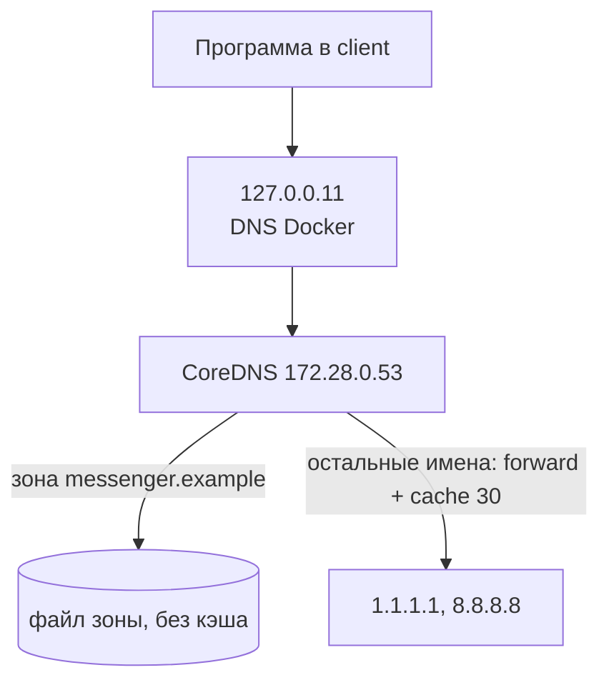

<script setup>
import DnsChain from '../../viz/scenes/DnsChain.vue'
</script>

# 0b.4. DNS глубже

## <Part kind="problem" /> Проблема: сервер давно на новом адресе, а пользователи всё ещё ходят на старый

Две истории, которые случаются с каждой командой.

**Переезд.** Сервис переносят на новый сервер. В <T id="dns">DNS</T> меняют адрес у `api.messenger.example`, старый сервер выключают — и следующие сутки поддержка разбирает жалобы: у части пользователей приложение не подключается. У <T id="dns-record">записи (DNS record)</T> стоял <T id="ttl">TTL (time to live)</T> 86 400 секунд, и DNS-серверы провайдеров честно помнили старый адрес до суток. Ничего не сломалось — всё работало так, как было настроено.

**Kubernetes.** Go-сервис в Kubernetes ходит во внешний API `api.github.com`. Мы повторили его настройки DNS в лабораторной этого урока и замерили, сколько времени занимает поиск адреса:

```
api.github.com    dns: 82.92ms   (8 DNS-запросов, ответы уже в кэше резолвера)
api.github.com.   dns: 20.82ms   (2 DNS-запроса)
```

Разница — одна точка в конце имени. Без неё <T id="resolver">резолвер (resolver)</T> сначала трижды ищет несуществующие имена вроде `api.github.com.default.svc.cluster.local` и только потом настоящее. А если один из этих лишних запросов потеряется (DNS работает поверх <T id="udp">UDP</T>, урок [0b.3](./03-udp)), поиск задержится на **5 секунд** — столько резолвер по умолчанию ждёт ответа, прежде чем спросить снова.

Обе истории — про устройство DNS, которое не видно, пока всё работает: кэши и их сроки, правила дописывания имён, таймауты резолвера. В уроке [0.3](../00-foundation/03-request-path) мы прошли цепочку DNS как модель. Здесь разберём, что хранится в DNS, кто и сколько это кэширует, как ищет адреса Go и как DNS влияет на балансировку и отказоустойчивость. А в лабораторной поменяем запись в собственной зоне и посмотрим, кто заметит изменение, а кто — нет.

Подумайте, прежде чем читать дальше: вы поменяли адрес в DNS, а Go-сервис, который держит открытое соединение со старым адресом, — когда он переключится?

## <Part kind="theory" /> Зона и записи

DNS — распределённая база данных. Пространство имён — дерево: корень `.`, под ним `example`, под ним `messenger`, под ним `api`. Имя читается справа налево: `api.messenger.example.` — точка в конце и есть корень. Кусок дерева, за который отвечает один владелец, называется **зоной** (zone). Зона хранится на её **авторитетных серверах** (authoritative server) в виде набора **записей** (resource records).

Вот вся зона `messenger.example` из нашей лабораторной — файл `labs/0b/dns/messenger.example.db`:

```
$ORIGIN messenger.example.
$TTL 30
@       IN SOA ns.messenger.example. admin.messenger.example. 2026101201 3600 600 86400 30
@       IN NS  ns.messenger.example.
ns      IN A   172.28.0.53
api     IN A   172.28.0.10
www     IN CNAME api.messenger.example.
_api._tcp IN SRV 10 5 8443 api.messenger.example.
@       IN TXT "lab=0b"
```

Каждая строка — запись: **имя, класс, тип, значение**. `$ORIGIN` дописывается к именам без точки в конце: `api` — это `api.messenger.example.`, а `@` — сама зона. `$TTL 30` — срок жизни по умолчанию для всех записей: 30 секунд. `IN` — класс «интернет», другие на практике не встречаются.

| Тип | Что хранит | Пример из зоны |
|---|---|---|
| **A** | IPv4-адрес имени | `api` → `172.28.0.10` |
| **AAAA** | IPv6-адрес | в нашей зоне нет |
| **CNAME** | псевдоним: «это имя — другое имя, спроси про него» | `www` → `api.messenger.example.` |
| **NS** | какие серверы авторитетны для зоны | `ns.messenger.example.` |
| **MX** | почтовый сервер домена с приоритетом | в нашей зоне нет |
| **TXT** | произвольный текст: подтверждение владения доменом, SPF для почты | `"lab=0b"` |
| **SRV** | где служба: приоритет, вес, порт, хост | `10 5 8443 api.messenger.example.` — служба `_api._tcp` на порту 8443 |
| **SOA** | паспорт зоны: главный сервер, контакт, номер версии и таймеры | первая строка |

Разберём SOA, он пригодится дважды. `ns.messenger.example.` — главный сервер зоны. `admin.messenger.example.` — почта администратора (первая точка означает `@`). `2026101201` — **серийный номер**, версия зоны: при каждой правке его увеличивают, и по нему вторичные серверы (и CoreDNS в лабораторной) понимают, что зона изменилась. Дальше `3600 600 86400` — как часто вторичные серверы проверяют и копируют зону. Последнее число, `30`, — **минимум**, сегодня это срок хранения отрицательных ответов (ниже).

SRV в бэкенде встречается чаще, чем кажется: по SRV-записям находят серверы в Kubernetes, Consul, у XMPP и SIP. Клиент спрашивает `_api._tcp.messenger.example` и получает не только адрес, но и порт.

### CNAME нельзя на вершине зоны

У CNAME строгое правило: если у имени есть CNAME, **никаких других записей** у этого имени быть не может (RFC 1034, разд. 3.6.2; RFC 2181, разд. 10.1). Логика простая: CNAME говорит «это имя — на самом деле другое имя», и любые свои записи рядом ему противоречили бы.

Отсюда частая ловушка. Вершина зоны (`@`, сам `messenger.example`) **обязана** иметь SOA и NS. Значит, CNAME на вершине невозможен. Вы купили домен и хотите, чтобы `messenger.example` вёл на <T id="load-balancer">балансировщик нагрузки (load balancer)</T> облака, у которого есть только имя вроде `lb-123.cloud.example`. Для `www` можно сделать CNAME, а для голого домена — нельзя. Варианты: прописать A-записи (если адреса стабильны) или использовать нестандартные записи провайдера DNS — ALIAS, ANAME, «CNAME flattening». Провайдер сам ищет адреса целевого имени и отдаёт их как обычные A-записи. Это возможность конкретного провайдера, а не стандарт DNS.

Ещё два следствия того же правила (RFC 2181, разд. 10.3): MX и NS должны указывать на имя с A/AAAA-записью, а не на CNAME.

## <Part kind="theory" /> TTL, кэш и отрицательный кэш

У каждой записи есть TTL — сколько секунд её разрешено хранить в кэше. Важно, кто и как с ним обращается.

**Авторитетный сервер** всегда отдаёт TTL из зоны как есть. Спросите его хоть десять раз подряд — увидите `30`.

**Кэширующий резолвер** кладёт ответ в кэш и отдаёт его следующим клиентам, **уменьшая TTL** на прошедшее время. Если запись получена с TTL 300, а через 120 секунд её спросил другой клиент, он получит TTL 180. Когда TTL дойдёт до нуля, запись выбрасывается, и следующий вопрос снова пойдёт к авторитетному серверу. Это вы увидите в лабораторной: TTL `go.dev` убывал 30, 25, 20.

Отсюда первое правило переезда: изменение в зоне доходит до клиента **не раньше**, чем истечёт TTL у всех кэшей по пути. Если TTL был сутки, переезд займёт сутки. Правильно — заранее, за срок не меньше старого TTL, снизить TTL до минуты, переехать и потом вернуть TTL обратно. Причём некоторые резолверы держат записи дольше положенного, поэтому старый сервер выключают не сразу, а когда трафик на нём иссякнет.

### Отрицательный кэш

Кэшируются не только адреса, но и ответ «такого нет». Бывает два вида такого ответа:

- **NXDOMAIN** — имени не существует вообще (`nope.messenger.example`);
- **NODATA** — имя есть, но записи нужного типа нет. Например, AAAA для `api.messenger.example`: статус `NOERROR`, а ответ пустой.

Без кэша каждая опечатка или каждый вопрос про несуществующий AAAA заново гнал бы резолвер по всей цепочке. Сколько хранить отрицательный ответ, определяет RFC 2308 (разд. 5): авторитетный сервер прикладывает к нему запись SOA своей зоны, а срок хранения равен **меньшему** из двух чисел — TTL самой записи SOA и поля «минимум» в ней. В нашей зоне оба равны 30 секундам.

Ловушка здесь такая. Вы спросили `new-api.messenger.example` до того, как создали запись, — получили NXDOMAIN. Создали запись. А резолвер ещё min(TTL SOA, минимум из SOA) секунд будет отвечать, что имени нет. У многих зон этот минимум — от нескольких минут до часа: посмотрите его командой `dig SOA` перед тем, как заводить новые имена в спешке.

## <Part kind="theory" /> Кто отвечает: рекурсивный и авторитетный сервер

В блоке «как DNS находит адрес» урока [0.3](../00-foundation/03-request-path) мы прошли цепочку. Коротко повторим и добавим две детали.

- **Стаб-резолвер** (stub resolver) — часть ОС или библиотеки в вашей программе. Сам ничего не ищет: отправляет вопрос с флагом **RD** (recursion desired, «найди за меня») рекурсивному резолверу.
- **Рекурсивный резолвер** (recursive resolver) — сервер провайдера, `1.1.1.1`, `8.8.8.8` или кластерный DNS в Kubernetes. Берёт поиск на себя: спрашивает корень, сервер зоны верхнего уровня, авторитетный сервер — и кэширует каждый ответ. В ответе ставит флаг **RA** (recursion available).
- **Авторитетный сервер** хранит зону. В ответе из своей зоны ставит флаг **AA** (authoritative answer). Рекурсии не делает.

**Glue-записи.** Корень отвечает: «за `.example` спрашивайте серверы вот с такими именами». Но имя сервера ещё нужно превратить в адрес. А если сервер зоны лежит **внутри** самой зоны — как наш `ns.messenger.example` для `messenger.example`, — получается замкнутый круг: чтобы найти адрес `ns.messenger.example`, надо спросить `ns.messenger.example`. Поэтому родительская зона вместе с направлением (referral) отдаёт и адреса таких серверов в дополнительной секции ответа. Эти «приклеенные» адреса и называются glue. Тот же шаг вы видели в плеере урока: зона `.example` передаёт резолверу и имя, и адрес `ns.messenger.example`.

### DNS в нашей лаборатории

В лабораторной цепочка короче, чем в интернете, и это важно понимать, чтобы правильно читать числа:



- В `/etc/resolv.conf` контейнера стоит `nameserver 127.0.0.11`. Это **встроенный DNS Docker**: он работает внутри сетевого пространства контейнера, знает имена соседних контейнеров, а остальные вопросы пересылает нашему CoreDNS на 172.28.0.53.
- Для зоны `messenger.example` CoreDNS — **авторитетный** сервер. Кэша для неё нет: правка зоны видна сразу после того, как CoreDNS её перечитал.
- Все остальные имена CoreDNS пересылает публичным резолверам (`forward`) и кэширует ответы не дольше 30 секунд (`cache 30`). На них можно посмотреть, как работает кэш.

<Callout type="simplified">

В настоящем интернете между клиентом и авторитетным сервером почти всегда стоит кэширующий рекурсивный резолвер, и именно его кэш держит старый адрес после переезда. В нашей лаборатории для своей зоны такого кэша нет, поэтому «зависший» адрес мы покажем по-другому — на долгом соединении Go (шаг 6).

</Callout>

## <Part kind="theory" /> Как ищет адреса Go

Когда Go-программа вызывает `http.Get("https://api.messenger.example/")`, `net.Dial` или `net.DefaultResolver.LookupHost`, работает резолвер пакета `net`. Он и есть стаб-резолвер вашей программы.

**Чистый Go или cgo.** В Go два резолвера. Встроенный, на чистом Go, сам читает `/etc/resolv.conf` и `/etc/hosts` и сам отправляет UDP-запросы. Заблокированный поиск занимает только горутину. Системный, через cgo, вызывает `getaddrinfo` из libc, и каждый поиск занимает поток ОС. На Linux Go по умолчанию выбирает чистый Go, а на cgo переходит, если видит то, чего сам не умеет: например, переменную окружения `LOCALDOMAIN` или нестандартные источники в `/etc/nsswitch.conf`. Выбор можно задать вручную: `GODEBUG=netdns=go` или `GODEBUG=netdns=cgo`. А `GODEBUG=netdns=2` печатает, что Go решил. В лабораторной:

```
go package net: confVal.netCgo = false  netGo = false
go package net: dynamic selection of DNS resolver
go package net: hostLookupOrder(api.messenger.example) = files,dns
```

`files,dns` — порядок: сначала `/etc/hosts`, потом DNS. Будь выбран cgo, здесь было бы `cgo`.

Что делает встроенный резолвер:

- **Кэша ответов нет.** Каждый `Dial` по имени — это новый DNS-запрос. В лабораторной 5 запросов без keep-alive дали 5 поисков по 21 мс, а с keep-alive — один. Кэшируются только сами файлы: `/etc/resolv.conf` Go перечитывает не чаще раза в 5 секунд, `/etc/hosts` — тоже.
- **A и AAAA параллельно.** На каждое имя — два запроса одновременно, IPv4 и IPv6 (опция `single-request` в `resolv.conf` делает их последовательными).
- **EDNS0 с буфером 1232 байта**, как рекомендует DNS Flag Day 2020 (урок [0b.3](./03-udp)); в `tcpdump` это видно как `[1au]` — одна дополнительная запись OPT. Если ответ пришёл обрезанным (флаг TC), Go повторяет вопрос по TCP.
- **Ошибки — `*net.DNSError`** с полями `IsNotFound` (имени нет: NXDOMAIN или пустой ответ) и `IsTimeout`. Их стоит различать: «имени нет» — повод не повторять, таймаут — повод повторить.

### search и ndots: почему одно имя превращается в восемь запросов

В `/etc/resolv.conf` бывают две строки, которые меняют, **какие имена** резолвер спрашивает:

- `search a.example b.example` — список доменов, которые резолвер дописывает к «коротким» именам. Так в офисной сети можно писать `wiki` вместо `wiki.corp.example`;
- `options ndots:N` — что считать коротким. Если в имени **меньше N точек**, резолвер сначала перебирает домены из `search`, и только потом спрашивает имя как есть. Если точек N или больше — сначала как есть.

Имя с точкой в конце (`api.github.com.`) — **полное** (FQDN, fully qualified domain name): `search` к нему не применяется никогда.

Теперь Kubernetes. Под в пространстве имён `default` получает такой `resolv.conf` (документация Kubernetes, «DNS for Services and Pods»):

```
nameserver 10.96.0.10
search default.svc.cluster.local svc.cluster.local cluster.local
options ndots:5
```

Адрес `nameserver` у каждого кластера свой. И это минимальный список: kubelet дописывает в `search` ещё и домены из `resolv.conf` самого узла. В GKE это, например, `c.<проект>.internal` и `google.internal`, в EKS — `ec2.internal` или `<регион>.compute.internal`. Поэтому на практике доменов часто 4–5, и запросов на одно внешнее имя — 10–12. Смысл настройки: внутри кластера сервис можно звать коротким именем — `postgres` или `postgres.db` — и `search` допишет остальное. Но `ndots:5` значит, что **любое** имя меньше чем с пятью точками считается коротким. `api.github.com` — две точки. Резолвер спросит:

1. `api.github.com.default.svc.cluster.local` — NXDOMAIN;
2. `api.github.com.svc.cluster.local` — NXDOMAIN;
3. `api.github.com.cluster.local` — NXDOMAIN;
4. `api.github.com` — наконец ответ.

И каждое — дважды, A и AAAA. Итого <N>8 запросов</N> вместо двух. Вот запись из лабораторной (сокращено):

```
11:49:25.420783 IP 172.28.0.20.51022 > 172.28.0.53.53: 13465+ [1au] A? api.github.com.default.svc.cluster.local. (69)
11:49:25.420785 IP 172.28.0.20.47440 > 172.28.0.53.53: 46166+ [1au] AAAA? api.github.com.default.svc.cluster.local. (69)
11:49:25.439736 IP 172.28.0.53.53 > 172.28.0.20.51022: 13465 NXDomain 0/1/1 (144)
11:49:25.447154 IP 172.28.0.53.53 > 172.28.0.20.47440: 46166 NXDomain 0/1/1 (144)
11:49:25.467656 IP 172.28.0.20.33785 > 172.28.0.53.53: 43964+ [1au] A? api.github.com.svc.cluster.local. (61)
...
11:49:25.526221 IP 172.28.0.20.33648 > 172.28.0.53.53: 13555+ [1au] A? api.github.com. (43)
11:49:25.569473 IP 172.28.0.53.53 > 172.28.0.20.33648: 13555 1/0/1 A 140.82.121.5 (73)
```

Четыре круга вместо одного — отсюда 83 мс вместо 21 в начале урока.

### Таймаут резолвера: откуда берутся ровно 5 секунд

DNS идёт по UDP, а UDP не повторяет потерянное (урок [0b.3](./03-udp)). Повторяет сам резолвер, и правила задают две опции `resolv.conf`: `timeout` — сколько ждать ответа, по умолчанию <N>5 секунд</N>, и `attempts` — сколько раз пробовать, по умолчанию 2. Такие умолчания у glibc (man-страница `resolv.conf`), и у Go те же самые: в исходниках `net/dnsconfig_unix.go` — `timeout: 5 * time.Second, attempts: 2`.

Значит, один потерянный DNS-пакет стоит не миллисекунды, а **5 секунд** ожидания перед повтором. А если DNS-сервер не отвечает совсем, поиск сдаётся только через 5 × 2 = <N>10 секунд</N>. Мы проверили это в лабораторной, направив клиента на несуществующий DNS-сервер:

```
timeout: Get "https://api.messenger.example:8443/": dial tcp: lookup api.messenger.example on 172.28.0.99:53: read udp 172.28.0.20:46611->172.28.0.99:53: i/o timeout
total=10.00364s
```

Ровно 10,0 секунды. Вот откуда «5 секунд» в историях про Kubernetes: восемь UDP-запросов вместо двух — вчетверо больше шансов, что хотя бы один потеряется, а каждая такая потеря стоит 5 секунд. В кластерах Kubernetes на Linux была и известная собственная причина таких потерь: гонка в таблице соединений ядра (conntrack), когда A и AAAA уходят одновременно с одного сокета и один из пакетов отбрасывается.

<Deep title="почему ndots:5 умножает запросы и как это лечить">

Почему Kubernetes вообще выбрал `ndots:5`? Чтобы любые внутренние имена находились через `search` без точки в конце: и `postgres`, и `postgres.db`, и `postgres.db.svc`. Это компромисс в пользу удобства внутренних имён, а платят за него внешние: всё, что меньше чем с пятью точками, сначала проходит через три домена `search`. Сколько стоит одно внешнее имя, считаем просто: (число доменов в `search` + 1) × 2 типа записей. При трёх доменах — 8 запросов вместо 2, вчетверо больше. В настоящем кластере имена внутри `cluster.local` кластерный DNS знает сам и отвечает NXDOMAIN быстро. В нашей лабораторной зоны `cluster.local` нет, и лишние вопросы уходили к внешнему резолверу. В одном из прогонов первый холодный поиск так занял 1,94 с: один из лишних NXDOMAIN пришёл через 1,65 с.

Как лечат, от простого к сложному:

1. **Точка в конце имени** во внешних адресах: `api.github.com.`. Минус: в URL точка уходит и в заголовок `Host`, а многие серверы его не принимают. В лабораторной `https://api.github.com./` вернул `HTTP 400`. Поэтому чаще точку добавляют только для DNS — например, в своём `Dialer` — или выбирают способ 2.
2. **`dnsConfig` в описании пода**: уменьшить `ndots`, например до 2. Тогда `api.github.com` спросится как есть сразу, а короткие `postgres` и `postgres.db` по-прежнему найдутся через `search`. Цена: для имён с двумя и более точками (например, `postgres.db.svc`) сначала уйдёт лишний запрос «как есть», и только потом сработает `search`.
   ```yaml
   spec:
     dnsConfig:
       options:
         - name: ndots
           value: "2"
   ```
3. **Кэш DNS на каждом узле** (NodeLocal DNSCache в Kubernetes): лишние запросы остаются, но отвечаются локально за доли миллисекунды и не теряются по дороге через conntrack.
4. **Кэш в приложении.** Резолвер Go ничего не кэширует, поэтому сервис, который открывает много новых соединений, каждый раз платит за поиск. Лучшее лекарство — переиспользовать соединения (пул, урок 0b.6): тогда поиск нужен раз в жизни соединения.

Подробно DNS в Kubernetes — в модуле 13a. Здесь достаточно запомнить связку: `ndots` × `search` умножают запросы, UDP их иногда теряет, а таймаут резолвера превращает каждую потерю в 5 секунд.

</Deep>

## <Part kind="theory" /> DNS и балансировка

У имени может быть несколько A-записей. Например, `go.dev` в лабораторной вернул четыре адреса:

```
go.dev.			30	IN	A	216.239.38.21
go.dev.			30	IN	A	216.239.32.21
go.dev.			30	IN	A	216.239.36.21
go.dev.			30	IN	A	216.239.34.21
```

Так DNS превращается в простейший балансировщик нагрузки. **Round-robin DNS**: сервер отдаёт адреса в разном порядке, клиенты обычно берут первый, и нагрузка размазывается. У нас три ответа из кэша CoreDNS пришли в одном порядке, а резолвер на хосте в ту же минуту выдал другой — порядок решает сервер, который отвечает.

Чем такая балансировка плоха:

- **Кэш ломает равномерность.** Резолвер провайдера отдаёт один и тот же порядок всем своим клиентам до истечения TTL. Тысячи пользователей за одним резолвером попадут на один адрес.
- **DNS не знает, жив ли сервер.** Упавший адрес остаётся в ответах, пока его не уберут, и ещё TTL после этого. Есть DNS-сервисы с проверкой здоровья, которые убирают адрес сами, но и они упираются в TTL кэшей.
- **Клиент выбирает сам.** Go пробует адреса по порядку: если первый не отвечает, переходит к следующему, деля оставшееся время на все адреса поровну, но не меньше 2 секунд на попытку (`partialDeadline` в `net/dial.go`). Если у `Dialer` нет таймаута, каждый мёртвый адрес будет ждать таймаута ядра — до двух минут (урок [0b.2](./02-tcp)).
- **Долгие соединения не перебалансируются.** Соединение выбрало адрес один раз, при подключении, и дальше DNS для него не существует.

Поэтому в продакшене DNS обычно указывает на **балансировщик** (один или несколько адресов, которые почти не меняются), а уже балансировщик распределяет запросы по серверам и следит за их здоровьем. Подробно — в модуле 2.5. А между дата-центрами и регионами DNS используют для грубого выбора «куда направить пользователя» (GeoDNS).

<Deep title="как DNS ломает отказоустойчивость">

Классический план аварийного переключения: основной дата-центр упал — меняем A-запись на резервный. Посчитаем, сколько займёт переключение для клиента. Сначала мониторинг должен заметить падение и система — поменять запись: десятки секунд. Потом истекают кэши: до TTL у рекурсивных резолверов, и ещё дольше у тех, что держат записи сверх TTL. Потом — то, о чём часто забывают: приложения, которые адрес уже нашли.

**Кэш в приложении.** Резолвер Go ничего не кэширует. Но соединение, открытое по старому адресу, будет работать, пока его не закроют. Мы проверили это в лабораторной (шаг 6): `httpbench` с keep-alive сделал 75 запросов по одному соединению, а посреди прогона мы поменяли адрес в зоне. Последние ~25 секунд DNS уже отдавал новый адрес, а все запросы по-прежнему шли на старый: `errors=0 tcp_conns=1`. Если старый сервер жив, это даже хорошо — переезд без ошибок. Но трафик не переедет, пока соединения не закроются. А пул `net/http` закрывает соединение только после 90 секунд простоя (`IdleConnTimeout` в `DefaultTransport`), и под постоянной нагрузкой соединение не простаивает никогда. Для мессенджера это особенно важно: WebSocket-соединения (модуль 3) живут часами. В других средах бывает хуже: старые версии Java кэшировали адреса навсегда.

**Длинный TTL против нагрузки на DNS.** Почему бы тогда не поставить TTL 5 секунд? Каждый рекурсивный резолвер, у которого есть ваши клиенты, будет спрашивать ваш авторитетный сервер раз в TTL. Оценка: 10 000 резолверов × 1 имя ÷ 30 с ≈ 330 запросов в секунду; при TTL 5 с — 2000, при TTL 3600 с — меньше 3. Короткий TTL также добавляет задержку: у клиентов чаще холодный кэш, а это лишние десятки миллисекунд на поиск.

Что делают на практике:

- TTL держат умеренным (30–300 с) у имён, которые могут понадобиться для переключения, и длинным — у стабильных;
- переключение внутри региона делает балансировщик, а не DNS: его адрес не меняется;
- сервер периодически закрывает долгие соединения (`Connection: close`, `GOAWAY` в HTTP/2 — урок 0b.7), чтобы клиенты заново искали адрес и переподключались;
- клиент с долгоживущими соединениями время от времени закрывает простаивающие — `(*http.Transport).CloseIdleConnections`.

</Deep>

## <Part kind="viz" /> Визуализация: путь DNS-запроса и кэш

Плеер показывает настоящий интернет, а не нашу лабораторную: телефон спрашивает рекурсивный резолвер, тот обходит корень, зону `.example` и авторитетный сервер `messenger.example`, кладёт ответ в кэш на TTL 30 секунд. Потом второй телефон спрашивает то же имя, и резолвер отвечает из кэша. Следите за счётчиком времени и за кэшем резолвера.

<Callout type="simplified">

В модели задержки взяты из урока 0.3: 20 мс в одну сторону между телефоном и резолвером и по 10 мс между резолвером и каждым сервером имён. Холодный кэш — <N>100 мс</N> (20 + 3 × 20 + 20), тёплый — <N>40 мс</N> (только телефон ↔ резолвер). В жизни задержки до серверов имён разные, а адреса корня и `.com` почти всегда уже в кэше: их TTL — двое суток и больше: NS-записи корня живут 518 400 с (6 суток), делегирования зон верхнего уровня из корня — 172 800 с (2 суток). В лабораторной числа другие, см. шаг 3.

</Callout>

<DnsChain />

Вопросы:

1. Сколько из 100 мс холодного запроса телефон ждёт, пока резолвер общается с другими серверами?
2. На каком шаге появляется glue и что было бы без него?
3. Третий телефон спросит то же имя через 31 секунду после первого. Сколько займёт его запрос?

<SelfCheck question="Ответы">

1. 60 мс из 100: три обмена резолвера с серверами имён по 20 мс. Ещё 40 мс — путь между телефоном и резолвером туда и обратно; их не избежать даже с тёплым кэшем.
2. На шаге, где зона `.example` отвечает направлением на `ns.messenger.example`. Без адреса этого сервера резолверу пришлось бы искать адрес `ns.messenger.example`, а за ним — снова в зону `messenger.example`, то есть к тому же серверу. Круг замкнулся бы.
3. Снова около 100 мс: TTL 30 секунд истёк, запись выброшена из кэша, и резолвер проходит цепочку заново. Точнее, чуть меньше: адреса серверов корня и `.example` живут в кэше дольше и обычно ещё там.

</SelfCheck>

## <Part kind="practice" /> Лабораторная: DNS вживую

Окружение — то же, что в прошлых уроках, нам нужны контейнеры `client` (172.28.0.20), `server` (172.28.0.10) и `dns` (172.28.0.53, CoreDNS с зоной `messenger.example`). Псевдоним `lab` — как раньше:

```bash
alias lab='docker compose -f labs/0b/compose.yaml'
```

```bash
docker compose -f labs/0b/compose.yaml up -d --build
labs/0b/netem.sh 40ms 0%
```

Во всех выводах ниже — реальные результаты прогона на нашем стенде. У вас числа будут другими, но порядок величин — такой же.

<Callout type="simplified">

Как задержка действует на DNS в лабораторной: `netem.sh` ставит половину RTT, 20 мс, на исходящие пакеты `client` и `server`, а у контейнера `dns` netem нет. Поэтому вопрос к DNS идёт 20 мс, а ответ возвращается мгновенно: RTT до DNS — около **20 мс**, а не 40.

</Callout>

### Шаг 1. Кого спрашивает клиент

```bash
lab exec client cat /etc/resolv.conf
```

```
# (комментарии Docker сокращены)
nameserver 127.0.0.11
options ndots:0

# Based on host file: '/etc/resolv.conf' (internal resolver)
# ExtServers: [172.28.0.53]
```

`127.0.0.11` — встроенный DNS Docker, `ExtServers` — куда он пересылает вопросы: наш CoreDNS. `ndots:0` — любое имя сразу спрашивается как есть, `search` нет.

### Шаг 2. dig и как читать ответ

```bash
lab exec client dig api.messenger.example
```

```
;; ->>HEADER<<- opcode: QUERY, status: NOERROR, id: 36513
;; flags: qr aa rd; QUERY: 1, ANSWER: 1, AUTHORITY: 1, ADDITIONAL: 1
;; WARNING: recursion requested but not available

;; OPT PSEUDOSECTION:
; EDNS: version: 0, flags:; udp: 1232
; COOKIE: 664d4f18c6471da8 (echoed)
;; QUESTION SECTION:
;api.messenger.example.		IN	A

;; ANSWER SECTION:
api.messenger.example.	30	IN	A	172.28.0.10

;; AUTHORITY SECTION:
messenger.example.	30	IN	NS	ns.messenger.example.

;; Query time: 42 msec
;; SERVER: 127.0.0.11#53(127.0.0.11) (UDP)
;; MSG SIZE  rcvd: 95
```

Читаем сверху вниз:

- `status: NOERROR` — ответ есть. Бывают ещё `NXDOMAIN` (имени нет) и `SERVFAIL` (сервер не смог ответить).
- `flags: qr aa rd` — это ответ (`qr`), авторитетный (`aa`), мы просили рекурсию (`rd`). Флага `ra` нет: CoreDNS для этой зоны авторитетный и рекурсию не делает, отсюда `WARNING`.
- `EDNS … udp: 1232` — то самое число DNS Flag Day 2020 из урока 0b.3.
- `ANSWER` — сама запись: имя, TTL 30, класс, тип, адрес. `AUTHORITY` — кто авторитетен для зоны.
- `Query time: 42 msec` — первый запрос на свежем стенде. Повторите — будет 20–21 мс. Первый раз клиент ещё искал MAC-адрес DNS-сервера (ARP, урок [0b.1](./01-layers)), и этот поиск тоже прошёл через очередь netem.

Короткие формы, которые пригодятся: `+short` — только значение, `+noall +answer` — только секция ответа.

### Шаг 3. Записи, отрицательные ответы и TTL

```bash
lab exec client dig www.messenger.example +noall +answer
lab exec client dig _api._tcp.messenger.example SRV +noall +answer
lab exec client dig nope.messenger.example
lab exec client dig api.messenger.example AAAA
```

```
www.messenger.example.	30	IN	CNAME	api.messenger.example.
api.messenger.example.	30	IN	A	172.28.0.10
_api._tcp.messenger.example. 30	IN	SRV	10 5 8443 api.messenger.example.
```

На вопрос про `www` сервер сам прошёл по CNAME и приложил запись A для `api`. Теперь отрицательные ответы:

```
;; ->>HEADER<<- opcode: QUERY, status: NXDOMAIN, id: 6894
;; flags: qr aa rd; QUERY: 1, ANSWER: 0, AUTHORITY: 1, ADDITIONAL: 1
;; AUTHORITY SECTION:
messenger.example.	30	IN	SOA	ns.messenger.example. admin.messenger.example. 2026101201 3600 600 86400 30
```

`NXDOMAIN` и запись SOA в секции `AUTHORITY` — по ней резолвер решает, сколько хранить «такого нет»: min(TTL SOA = 30, минимум = 30) = 30 секунд. На AAAA ответ другой — `status: NOERROR`, `ANSWER: 0`: это NODATA, имя есть, IPv6-адреса нет.

Теперь кэш. Наша зона кэша не имеет, а внешние имена CoreDNS кэширует. Спросите `go.dev` три раза с паузой в 5 секунд:

```bash
for i in 1 2 3; do lab exec client dig go.dev +noall +answer +stats | grep -E 'IN|Query time'; sleep 5; done
```

```
go.dev.			30	IN	A	216.239.38.21
...
;; Query time: 94 msec
go.dev.			25	IN	A	216.239.38.21
...
;; Query time: 20 msec
go.dev.			20	IN	A	216.239.38.21
...
;; Query time: 21 msec
```

Первый запрос — холодный кэш: CoreDNS сходил к `1.1.1.1`, 94 мс. Следующие — из кэша, 20 мс, и TTL убывает: 30, 25, 20. Через 30 секунд запись выбросится. Почему TTL 30, если настоящий TTL у `go.dev` больше (на хосте в ту же минуту было `165`)? Это `cache 30` в нашем `Corefile`: CoreDNS не хранит ничего дольше 30 секунд.

Сравните с плеером: там 100 мс против 40, здесь 94 против 20. Порядок тот же, а различие — в устройстве лабораторной: до нашего DNS-сервера RTT 20 мс, а не 40, и «холодный» путь — это не обход корня, а один поход CoreDNS к публичному резолверу, у которого `go.dev` почти наверняка уже в кэше.

### Шаг 4. dig +trace — и что, если трассировка врёт

`dig +trace` сам проходит цепочку от корня, как рекурсивный резолвер, и печатает ответ каждого звена. В обычной сети вы увидите четыре блока: список корневых серверов от вашего резолвера; направление на серверы `.dev` от корневого сервера; направление на серверы `go.dev` от сервера `.dev`; и наконец ответ с флагом `aa` от авторитетного сервера `go.dev`.

```bash
lab exec client dig +trace go.dev
```

На нашем стенде вышло вот что (подписи DNSSEC убраны):

```
.			30	IN	NS	m.root-servers.net.
...
;; Received 537 bytes from 127.0.0.11#53(127.0.0.11) in 79 ms

go.dev.			154	IN	A	216.239.36.21
go.dev.			154	IN	A	216.239.34.21
go.dev.			154	IN	A	216.239.38.21
go.dev.			154	IN	A	216.239.32.21
;; Received 123 bytes from 198.41.0.4#53(a.root-servers.net) in 134 ms
```

Корневой сервер `a.root-servers.net` будто бы сразу ответил адресом `go.dev`. Так не бывает: корень знает только серверы зон верхнего уровня. Проверим, что отвечает «корень» напрямую:

```bash
lab exec client dig @198.41.0.4 go.dev +norec
```

```
;; flags: qr ra; QUERY: 1, ANSWER: 4, AUTHORITY: 0, ADDITIONAL: 1
```

Флага `aa` нет, зато есть `ra` — «рекурсия доступна». Настоящий корень так не отвечает. Это значит, что сеть, через которую выходит наш стенд, **перехватывает весь DNS-трафик** на порт 53 (даже по TCP) и отвечает сама, от имени любого адреса. Так делают некоторые провайдеры и корпоративные сети. Но сначала исключите Docker: на Docker Desktop DNS-трафик контейнеров проходит через виртуальную машину, и перехватывать его может она. Запустите ту же трассировку на хосте, вне контейнеров:

```bash
dig +trace go.dev
```

Если на хосте четыре нормальных блока — дело в Docker. У нас на хосте «корень» тоже сразу ответил адресом `go.dev`, значит, перехватывает сеть. Если у вас `dig +trace` выдаёт четыре блока — ваша сеть DNS не трогает. Если как у нас — вы только что научились распознавать перехват.

Цепочку можно восстановить и через обычный резолвер, спрашивая NS-записи каждого уровня:

```bash
lab exec client dig NS dev. +noall +answer
lab exec client dig NS go.dev. +noall +answer
```

```
dev.			30	IN	NS	ns-tld1.charlestonroadregistry.com.
...
go.dev.			30	IN	NS	ns-cloud-e1.googledomains.com.
...
```

Корень направляет к серверам `.dev`, `.dev` — к серверам `go.dev`, и уже они авторитетно знают адрес.

Похожее на glue видно и в нашей зоне. Спросите NS-записи зоны:

```bash
lab exec client dig messenger.example NS
```

```
;; ANSWER SECTION:
messenger.example.	30	IN	NS	ns.messenger.example.

;; ADDITIONAL SECTION:
ns.messenger.example.	30	IN	A	172.28.0.53
```

Сервер имён лежит внутри своей же зоны, поэтому его адрес приложен в `ADDITIONAL`. В интернете такие адреса приложила бы родительская зона `.example` к своему направлению — это и есть glue. У нас родительской зоны нет, и адрес отдаёт сам авторитетный сервер.

### Шаг 5. Поменять запись

Поменяем адрес `api` на 172.28.0.11 и увеличим серийный номер SOA: модуль `file` в CoreDNS раз в минуту проверяет зону и перечитывает её, **только если серийный номер изменился**.

```bash
sed 's/^api     IN A   172.28.0.10/api     IN A   172.28.0.11/; s/2026101201/2026101202/' labs/0b/dns/messenger.example.db > /tmp/zone.db
cat /tmp/zone.db > labs/0b/dns/messenger.example.db
for i in $(seq 1 14); do echo "$(date +%T) $(lab exec client dig api.messenger.example +short)"; sleep 5; done
```

Файл перезаписан «на месте» (`cat … >`), а не заменён новым: на Docker Desktop мы столкнулись с тем, что контейнер не видит файл, который `sed -i` или редактор заменили целиком. Если через минуту ничего не изменилось — перезапустите DNS: `lab restart dns`.

```
14:40:50 172.28.0.10
14:40:55 172.28.0.10
14:41:00 172.28.0.11
```

А в журнале CoreDNS (`lab logs dns`):

```
[INFO] plugin/file: Successfully reloaded zone "messenger.example." in "/etc/coredns/messenger.example.db" with 2026101202 SOA serial
```

Изменение появилось в пределах минуты — как только CoreDNS перечитал зону. Кэша между клиентом и авторитетным сервером у нас нет, поэтому TTL 30 здесь ничего не задержал. В интернете после этого прошло бы ещё до TTL секунд, пока старый ответ живёт в кэшах резолверов, — как живёт `go.dev` в кэше CoreDNS из шага 3.

Новые соединения теперь идут на несуществующий адрес:

```bash
lab exec -d server h2server -addr :8443 -http-addr :8080 -names api.messenger.example,server -ca-out /captures/ca.pem
lab exec client httpbench -url https://api.messenger.example:8443/ -ca /captures/ca.pem -c 1 -n 3 -keepalive=false -timeout 2s
```

```
requests=3 errors=3 tcp_conns=0 new_conns=0 proto=-
errors: timeout=2 refused=0 tls=0 status=0 other=1
  timeout: Get "https://api.messenger.example:8443/": dial tcp 172.28.0.11:8443: i/o timeout (Client.Timeout exceeded while awaiting headers)
  other: Get "https://api.messenger.example:8443/": dial tcp 172.28.0.11:8443: connect: no route to host
```

Верните зону и перезапустите DNS:

```bash
git checkout labs/0b/dns/messenger.example.db
lab restart dns
```

### Шаг 6. Долгое соединение не замечает переезда

Запустите долгий клиент: 75 запросов по секунде (`/slow?ms=1000`) по одному соединению с keep-alive:

```bash
lab exec client httpbench -url 'https://api.messenger.example:8443/slow?ms=1000' -ca /captures/ca.pem -c 1 -n 75 -keepalive=true
```

Пока он идёт, во втором терминале повторите правку зоны из шага 5 (адрес 172.28.0.11, серийный номер больше прежнего) и следите за `dig`. У нас DNS переключился примерно на 53-й секунде 78-секундного прогона, а результат клиента такой:

```
requests=75 errors=0 tcp_conns=1 new_conns=1 proto=HTTP/1.1
latency: n=75 min=1.04047s p50=1.04059s p99=1.14297s max=1.14297s
dns: n=1 min=20.93ms p50=20.93ms max=20.93ms
```

Одно соединение, один поиск в DNS, ни одной ошибки. Последние ~25 запросов ушли на старый адрес, хотя DNS уже отдавал новый. Резолвер Go ничего не кэширует — «кэшем» здесь работает само открытое соединение. Не забудьте снова вернуть зону (`git checkout`, `lab restart dns`).

### Шаг 7. Резолвер Go: без кэша

```bash
lab exec -e GODEBUG=netdns=go+2 client httpbench -url https://api.messenger.example:8443/ -ca /captures/ca.pem -c 1 -n 5 -keepalive=false
lab exec -e GODEBUG=netdns=2 client httpbench -url https://api.messenger.example:8443/ -ca /captures/ca.pem -c 1 -n 5 -keepalive=true
```

```
go package net: confVal.netCgo = false  netGo = true
go package net: GODEBUG setting forcing use of the Go resolver
go package net: hostLookupOrder(api.messenger.example) = files,dns
... (ещё 4 такие же строки)
requests=5 errors=0 tcp_conns=5 new_conns=5 proto=HTTP/1.1
latency: n=5 min=147.89ms p50=148.33ms p99=149.87ms max=149.87ms
dns: n=5 min=21.05ms p50=22.39ms max=22.57ms
connect: n=5 min=40.57ms p50=40.7ms max=40.85ms
tls: n=5 min=43.79ms p50=44.1ms max=45.01ms
```

```
go package net: confVal.netCgo = false  netGo = false
go package net: dynamic selection of DNS resolver
go package net: hostLookupOrder(api.messenger.example) = files,dns
requests=5 errors=0 tcp_conns=1 new_conns=1 proto=HTTP/1.1
dns: n=1 min=21.13ms p50=21.13ms max=21.13ms
```

Без keep-alive — пять соединений и **пять** DNS-запросов: кэша нет, каждое соединение ищет адрес заново. 148 мс на запрос ≈ 21 (DNS) + 41 (TCP) + 44 (TLS) + 41 (запрос). С keep-alive — один поиск на всё.

### Шаг 8 (по желанию). Kubernetes-подобный resolv.conf

Нужен доступ в интернет. Подменим `resolv.conf` клиента на такой, как в поде Kubernetes, и сравним поиск с точкой и без:

```bash
lab exec client cp /etc/resolv.conf /tmp/resolv.conf.orig
lab exec client sh -c 'printf "nameserver 127.0.0.11\nsearch default.svc.cluster.local svc.cluster.local cluster.local\noptions ndots:5\n" > /etc/resolv.conf'
lab exec -d client tcpdump -i eth0 -w /captures/ndots.pcap udp port 53
lab exec client httpbench -url https://api.github.com/ -c 1 -n 1
lab exec client httpbench -url https://api.github.com/ -c 1 -n 1
lab exec client httpbench -url https://api.github.com./ -c 1 -n 1
lab exec client pkill tcpdump
lab exec client tcpdump -nn -r /captures/ndots.pcap
```

У нас первый поиск без точки занял 169 мс (лишние NXDOMAIN шли к внешнему резолверу), повторный (вторая команда) — 83 мс (NXDOMAIN уже в отрицательном кэше CoreDNS), с точкой — 21 мс. Но с точкой GitHub ответил `status: HTTP 400`: имя с точкой ушло в заголовок `Host`. Запись `tcpdump` — та, что в теории выше.

Теперь направим клиента на DNS-сервер, которого нет, и посмотрим на таймаут резолвера:

```bash
lab exec client sh -c 'printf "nameserver 172.28.0.99\n" > /etc/resolv.conf'
lab exec client httpbench -url https://api.messenger.example:8443/ -ca /captures/ca.pem -c 1 -n 1 -timeout 60s
lab exec client cp /tmp/resolv.conf.orig /etc/resolv.conf
```

Вывод — тот, что в теории: `i/o timeout` через 10,0 секунды, две попытки по 5. Последняя команда возвращает исходный `resolv.conf`.

Закончили — остановите стенд:

```bash
labs/0b/netem.sh off
docker compose -f labs/0b/compose.yaml down
```

## <Part kind="mistakes" /> Типичные ошибки

<Callout type="mistake">

**Переезжать с длинным TTL.** TTL сутки, адрес поменяли, старый сервер выключили — сутки ошибок. Снижайте TTL заранее, минимум за один старый TTL до переезда, и выключайте старый сервер, только когда трафик на нём закончится.

**Думать, что смена записи переключит работающие сервисы.** Резолвер Go не кэширует адреса, но открытое соединение — это и есть кэш: оно работает со старым адресом, пока его не закроют. В лабораторной клиент 25 секунд после смены записи ходил на старый адрес. Под постоянной нагрузкой пул соединений не закроет их никогда. Нужен механизм ротации: сервер закрывает старые соединения, или клиент периодически закрывает простаивающие.

**CNAME на вершине зоны.** `messenger.example IN CNAME lb.cloud.example` нарушает правило «у CNAME нет соседей»: на вершине обязаны быть SOA и NS. Одни DNS-серверы такую зону не загрузят, другие загрузят и будут отвечать непредсказуемо. Используйте A-записи или ALIAS/CNAME flattening вашего провайдера.

**Забыть про отрицательный кэш.** Спросили имя до создания записи — резолвер запомнил NXDOMAIN на срок из SOA — min(TTL SOA, минимум из SOA). Запись создана, а клиенты ещё долго видят `no such host`.

**Изменить зону и не увеличить серийный номер.** Вторичные серверы (и CoreDNS в лабораторной) считают, что зона не менялась, и продолжают отдавать старые данные.

**Не ставить таймаут на поиск.** По умолчанию недоступный DNS-сервер стоит 10 секунд на каждое имя, а с `search` — больше. Передавайте в поиск `context` с таймаутом; в `http.Client` таймаут на весь запрос покрывает и DNS.

**Считать, что «no such host» — это всегда опечатка.** Ошибка может прийти из отрицательного кэша, из лишнего домена `search` или из-за таймаута DNS-сервера. Различайте `IsNotFound` и `IsTimeout` у `*net.DNSError`.

</Callout>

Как выглядит поиск адреса с таймаутом и различением ошибок:

<!-- go-check -->

```go
package snippet

import (
	"context"
	"errors"
	"fmt"
	"net"
	"time"
)

const lookupTimeout = 2 * time.Second

// ErrHostNotFound — имени нет: повторять поиск бессмысленно.
var ErrHostNotFound = errors.New("имя не найдено в DNS")

// resolve ищет адреса host не дольше lookupTimeout и отличает «имени нет» от сбоя DNS.
func resolve(ctx context.Context, r *net.Resolver, host string) ([]string, error) {
	lookupCtx, cancel := context.WithTimeout(ctx, lookupTimeout)
	defer cancel()

	addrs, err := r.LookupHost(lookupCtx, host)
	if err == nil {
		return addrs, nil
	}
	// Вызывающий отменил запрос или исчерпал свой срок — повторять нельзя, отдаём его причину.
	if ctxErr := ctx.Err(); ctxErr != nil {
		return nil, fmt.Errorf("resolve %s: %w", host, ctxErr)
	}
	var dnsErr *net.DNSError
	if errors.As(err, &dnsErr) && dnsErr.IsNotFound {
		return nil, fmt.Errorf("resolve %s: %w", host, ErrHostNotFound)
	}
	// Наш таймаут поиска или сбой DNS-сервера — временные ошибки, их можно повторить.
	return nil, fmt.Errorf("resolve %s: %w", host, err)
}
```

Вызывают его так: `resolve(ctx, net.DefaultResolver, "api.messenger.example")`. Такой же поиск мы запускали в контейнере `client`: `api.messenger.example` нашёлся за 21 мс, а `nope.messenger.example` дал `IsNotFound=true` тоже за 21 мс — отрицательный ответ приходит так же быстро, как положительный. С недоступным DNS-сервером функция сдастся через 2 секунды (таймаут контекста), а не через 10.

А так клиент с долгими соединениями может периодически сбрасывать простаивающие, чтобы новые соединения заново искали адрес:

<!-- go-check -->

```go
package snippet

import (
	"context"
	"net/http"
	"time"
)

// rotateIdle закрывает простаивающие соединения раз в every, пока ctx не отменён.
// Новые соединения заново спросят DNS и подхватят новый адрес.
// Запускается в горутине, владелец которой отменяет ctx при остановке сервиса.
func rotateIdle(ctx context.Context, t *http.Transport, every time.Duration) {
	ticker := time.NewTicker(every)
	defer ticker.Stop()
	for {
		select {
		case <-ctx.Done():
			return
		case <-ticker.C:
			t.CloseIdleConnections()
		}
	}
}
```

<Callout type="simplified">

`CloseIdleConnections` закрывает только простаивающие соединения. Под ровной нагрузкой в каждый момент часть соединений свободна, поэтому пул постепенно обновляется. Но соединение, которое никогда не простаивает (как в шаге 6 при одном воркере без пауз), так не закроется. Надёжнее, когда старые соединения закрывает сервер: так устроен, например, параметр `MaxConnectionAge` у серверов gRPC.

</Callout>

## <Part kind="tradeoff" /> Компромисс: короткий TTL или длинный

<Callout type="tradeoff">

**Короткий TTL (30–60 с) даёт:** гибкость — смена адреса доходит до клиентов за минуту, DNS можно использовать для переключения между площадками.

**Чем платим:** больше запросов к авторитетным серверам (оценка из блока «Под капотом»: 10 000 резолверов при TTL 30 с — около 330 запросов в секунду, при TTL 3600 с — меньше 3); чаще холодный кэш у клиентов — плюс десятки миллисекунд к первому запросу; сильнее зависимость от доступности DNS: если авторитетные серверы недоступны дольше TTL, имя перестанет работать у всех.

**Длинный TTL (часы, сутки) даёт:** меньше запросов, меньше задержки, переживает сбой DNS-провайдера.

**Чем платим:** переезд и аварийное переключение через DNS занимают часы.

**Как выбирать:** длинный TTL — для того, что не меняется (адреса балансировщиков, почта, TXT-подтверждения); короткий — для имён, которые могут понадобиться для переключения. И помните, что TTL ограничивает только кэши DNS: открытые соединения он не трогает.

</Callout>

## <Part kind="selfcheck" /> Самопроверка

<SelfCheck question="TTL записи — 3600 с. В 12:00 вы поменяли адрес. Ваш коллега проверил dig на своём ноутбуке и видит новый адрес. Можно выключать старый сервер?">

Нет. Ноутбук коллеги спросил резолвер, у которого записи в кэше не было или она уже истекла. У других резолверов старый адрес может жить до 13:00, а у тех, что держат записи сверх TTL, — и дольше. Плюс открытые соединения, которые DNS не трогает вовсе. Выключать можно, когда трафик на старом сервере упадёт до нуля — смотрите на него, а не на `dig`.

</SelfCheck>

<SelfCheck question="Сервис в Kubernetes ходит в api.partner.example. В логах у части запросов DNS занимает ровно 5 с. Откуда 5 и что сделать?">

5 секунд — таймаут резолвера по умолчанию (`options timeout`): один из UDP-запросов потерялся, и резолвер ждал перед повтором. При `ndots:5` и трёх доменах в `search` на это имя уходит 8 запросов вместо 2, и шансов потерять один — вчетверо больше. Что сделать: уменьшить `ndots` через `dnsConfig` (например, до 2) или искать полное имя с точкой в конце (проверив, что точка не уходит в `Host`); поставить кэш DNS на узлах (NodeLocal DNSCache); переиспользовать соединения, чтобы искать реже; и в коде ставить на поиск таймаут меньше 5 секунд с повтором.

</SelfCheck>

<SelfCheck question="Почему Go-сервис, который делает 1000 запросов в секунду с keep-alive, почти не нагружает DNS, а такой же без keep-alive создаёт 1000 DNS-запросов в секунду — а то и 2000?">

Резолвер Go не кэширует ответы: каждое новое соединение ищет адрес заново. С keep-alive соединения переиспользуются, и поиск нужен только при открытии нового — изредка. Без keep-alive каждый запрос — новое соединение и новый поиск, причём A и AAAA — два DNS-запроса на поиск. Это мы видели в шаге 7: пять запросов без keep-alive — пять поисков.

</SelfCheck>

<SelfCheck question="Вы хотите, чтобы голый домен messenger.example вёл на балансировщик облака с адресом lb-7.cloud.example. Коллега предлагает CNAME. Что не так и какие варианты?">

CNAME не может соседствовать с другими записями, а на вершине зоны обязательно есть SOA и NS. Поэтому CNAME на вершине запрещён (RFC 1034, разд. 3.6.2; RFC 2181, разд. 10.1). Варианты: A-записи с адресами балансировщика, если они стабильны; ALIAS, ANAME или CNAME flattening у провайдера DNS (он сам ищет адреса и отдаёт их как A); или перенаправление с голого домена на `www`, где CNAME разрешён.

</SelfCheck>

<SelfCheck question="Вы создали запись new.messenger.example, но клиенты ещё 15 минут получают «no such host». В SOA зоны: TTL 3600, минимум 900. Что произошло?">

Кто-то спросил имя до того, как запись появилась, и резолвер закэшировал NXDOMAIN. По RFC 2308 отрицательный ответ хранится min(TTL SOA, минимум из SOA) = min(3600, 900) = 900 секунд — ровно 15 минут. Ускорить нельзя, только дождаться. В следующий раз заводите имена заранее, до того, как их начнут спрашивать.

</SelfCheck>

## <Part kind="sources" /> Источники

<Callout type="source">

- Kurose J., Ross K., «Computer Networking: A Top-Down Approach», гл. 2, разд. 2.4 — устройство DNS: иерархия серверов, типы записей, кэширование, формат сообщения.
- Fall K., Stevens W. R., «TCP/IP Illustrated, Volume 1», 2-е изд., гл. 11 — DNS подробно: записи, отрицательный кэш, UDP и TCP, EDNS0.
- Liu C., Albitz P., «DNS and BIND», 5-е изд., гл. 2 — как работает DNS: делегирование, рекурсия, кэш и TTL; гл. 4 — файлы зон, SOA и glue на практике.
- Mockapetris P., [«RFC 1034: Domain Names — Concepts and Facilities»](https://www.rfc-editor.org/rfc/rfc1034), разд. 3.6.2 — правило «у CNAME нет других данных»; разд. 4.2.1 — glue.
- Mockapetris P., [«RFC 1035: Domain Names — Implementation and Specification»](https://www.rfc-editor.org/rfc/rfc1035), разд. 3.3.13 — поля SOA; разд. 4.1.1 — флаги заголовка (AA, TC, RD, RA).
- Elz R., Bush R., [«RFC 2181: Clarifications to the DNS Specification»](https://www.rfc-editor.org/rfc/rfc2181), разд. 10.1 и 10.3 — CNAME и почему MX и NS не указывают на псевдонимы.
- Andrews M., [«RFC 2308: Negative Caching of DNS Queries»](https://www.rfc-editor.org/rfc/rfc2308), разд. 5 — срок хранения отрицательного ответа: меньшее из TTL SOA и поля «минимум».
- Gulbrandsen A., Vixie P., Esibov L., [«RFC 2782: A DNS RR for specifying the location of services (DNS SRV)»](https://www.rfc-editor.org/rfc/rfc2782) — формат SRV: приоритет, вес, порт, цель.
- Документация Kubernetes, [«DNS for Services and Pods»](https://kubernetes.io/docs/concepts/services-networking/dns-pod-service/) — `resolv.conf` пода с `ndots:5`, поле `dnsConfig`.
- man-страница `resolv.conf(5)` — опции `search`, `ndots`, `timeout` (по умолчанию 5 с), `attempts` (по умолчанию 2), `single-request`.
- Документация Go, [пакет `net`, раздел «Name Resolution»](https://pkg.go.dev/net#hdr-Name_Resolution) — чистый Go и cgo, когда выбирается какой, `GODEBUG=netdns`; исходники `net/dnsconfig_unix.go` (умолчания), `net/dnsclient_unix.go` (`maxDNSPacketSize` = 1232), `net/dial.go` (`partialDeadline`).
- Документация CoreDNS, плагины [`file`](https://coredns.io/plugins/file/) (перечитывание зоны по серийному номеру, `reload`), [`cache`](https://coredns.io/plugins/cache/) и [`forward`](https://coredns.io/plugins/forward/).
- Grigorik I., [«High Performance Browser Networking»](https://hpbn.co), гл. 10 — DNS в общей задержке загрузки и зачем заранее искать адреса.
- Pumputis M., «Racy conntrack and DNS lookup timeouts», блог Weaveworks, 2018 (сайт weave.works закрыт, статья доступна в [Web Archive](https://web.archive.org/web/2023/https://www.weave.works/blog/racy-conntrack-and-dns-lookup-timeouts)) — почему одновременные A и AAAA с одного UDP-сокета теряют пакет в conntrack и дают задержку 5 с; исправления в ядрах 4.19 и 5.0 и обходные пути (`single-request-reopen`, кэш на узле).

</Callout>
