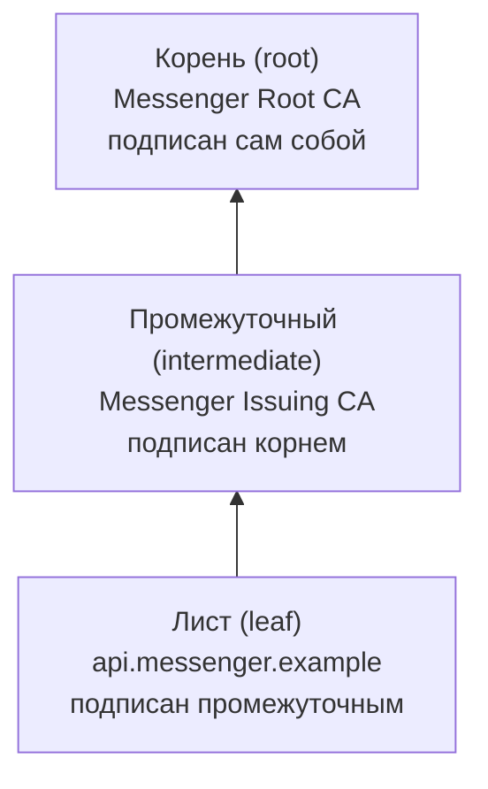
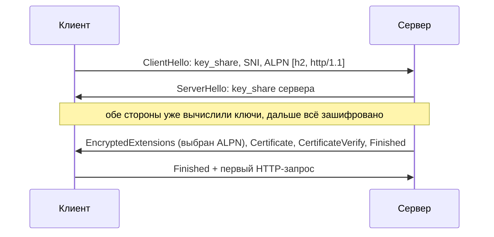

<script setup>
import CertChain from '../../viz/scenes/CertChain.vue'
</script>

# 0b.5. TLS на практике

## <Part kind="problem" /> Проблема: «в браузере открывается, а Go не доверяет»

Пятница, вечер. Партнёр, в API которого ходит наш мессенджер за превью ссылок, обновил <T id="certificate">сертификат (certificate)</T> на своём сервере. Через минуту в логах Go-сервиса посыпались ошибки:

```
Get "https://api.partner.example/v1/preview": tls: failed to verify certificate: x509: certificate signed by unknown authority
```

Вы открываете тот же адрес в браузере — зелёный замок, всё работает. `curl` с вашего ноутбука тоже ругается, а браузер — нет. Кто-то в чате предлагает быстрое решение:

```
TLSClientConfig: &tls.Config{InsecureSkipVerify: true}, // «потом уберём»
```

Ошибки пропадут. Но вместе с ними пропадёт и всё, ради чего существует <T id="tls">TLS</T>: клиент перестанет проверять, с кем он говорит. Шифровать разговор он продолжит — только шифровать будет и с атакующим посередине, если тот подставит свой сертификат.

Чтобы починить по-настоящему, нужно понимать, что именно Go проверяет и где он берёт то, чему доверяет. Почти всегда причина одна из трёх: сервер перестал присылать промежуточный сертификат, сертификат выдан центром, которого нет в хранилище вашей ОС (в Docker-образе `scratch` их нет вообще), или имя в сертификате не совпадает с тем, к которому вы подключаетесь. В уроке [0.3](../00-foundation/03-request-path) мы прошли рукопожатие TLS 1.3 как модель с числами. Здесь разберём, что лежит внутри сертификата, как строится и проверяется цепочка, зачем нужны SNI и ALPN, сколько стоит рукопожатие и что даёт возобновление сессии. А в лабораторной заведём собственный центр сертификации и посмотрим на все эти ошибки вживую.

Подумайте, прежде чем читать дальше: почему браузер доверяет серверу, а Go на той же машине — нет? Что у них может быть разным?

## <Part kind="theory" /> Что внутри сертификата X.509

Сертификат — это документ, в котором <T id="ca">центр сертификации (certificate authority, CA)</T> своей подписью заверяет: «открытый ключ такой-то принадлежит владельцу имени такого-то, с такого-то по такое-то число». Формат сертификатов в интернете — **X.509** версии 3 (RFC 5280).

Аналогия — паспорт. В нём есть имя владельца, кем выдан, срок действия, фотография, по которой владельца узнают, и печать того, кто выдал. Вот сертификат нашего лабораторного сервера — команда из шага 5 лабораторной, байты ключа и подписи убраны:

```
Certificate:
    Data:
        Version: 3 (0x2)
        Signature Algorithm: ecdsa-with-SHA256
        Issuer: CN=lab0b-ca
        Validity
            Not Before: Oct 12 12:12:49 2026 GMT
            Not After : Oct 13 12:13:49 2026 GMT
        Subject: CN=api.messenger.example
        Subject Public Key Info:
            Public Key Algorithm: id-ecPublicKey
                Public-Key: (256 bit)
                NIST CURVE: P-256
        X509v3 extensions:
            X509v3 Key Usage: critical
                Digital Signature
            X509v3 Extended Key Usage:
                TLS Web Server Authentication
            X509v3 Subject Alternative Name:
                DNS:api.messenger.example, DNS:server
    Signature Algorithm: ecdsa-with-SHA256
```

Разберём поля по порядку.

| Поле | Что значит | У нас |
|---|---|---|
| **Subject** (субъект) | кому выдан сертификат | `CN=api.messenger.example` |
| **Issuer** (издатель) | кто выдал и подписал | `CN=lab0b-ca` — наш CA |
| **Validity** (срок) | «действителен с» и «действителен по» | сутки: `h2server` выпускает сертификат при каждом старте |
| **Subject Public Key Info** | открытый ключ владельца — та самая «фотография» | ECDSA на кривой P-256 |
| **Subject Alternative Name, SAN** | список имён (и IP-адресов), для которых сертификат действует | `api.messenger.example` и `server` |
| **Key Usage, Extended Key Usage** | для чего ключ разрешено использовать | подписи; аутентификация TLS-сервера |
| **Signature** | подпись издателя над всеми полями выше | ECDSA с SHA-256 |

`CN` — это Common Name, «общее имя», часть поля Subject. Исторически сервер проверяли по нему, но давно уже нет — к этому вернёмся через раздел.

Ключевое слово — **подпись**. Издатель берёт все поля сертификата, считает от них хеш и подписывает своим **закрытым** ключом. Проверить подпись может любой, у кого есть **открытый** ключ издателя. Если в сертификате изменить хоть один байт — например, имя, — подпись перестанет сходиться. Поэтому подделать сертификат нельзя, не имея закрытого ключа издателя.

**Где аналогия с паспортом ломается.** Паспорт вы показываете лично, и вас сверяют с фотографией. Сертификат же публичен: сервер отправляет его каждому, кто подключится, и любой может его сохранить и показать от своего имени. Значит, сам сертификат **ничего не доказывает** о том, кто на другом конце. Доказательство — в другом: сервер подписывает переписку рукопожатия закрытым ключом, парным к открытому ключу из сертификата. Это сообщение `CertificateVerify` (RFC 8446, разд. 4.4.3). Подделать такую подпись может только тот, у кого есть закрытый ключ, а он никогда не покидает сервер.

### Цепочка: лист, промежуточный, корень

Кто проверит подпись самого издателя? Его открытый ключ тоже лежит в сертификате, и тот тоже кем-то подписан. Так получается **цепочка доверия**:



- **Лист** (leaf, конечный сертификат) — сертификат самого сервера.
- **Промежуточный** (intermediate) — сертификат CA, который выпускает листы. Промежуточных может быть несколько.
- **Корень** (root) — сертификат, подписанный сам собой (Subject и Issuer совпадают). Подпись корня ничего не доказывает — ему доверяют **заранее**, потому что он лежит в хранилище доверенных корней вашей ОС или браузера.

Зачем промежуточные, почему бы корню не подписывать листы напрямую? Закрытый ключ корня — самое ценное, что есть у CA: если он утечёт, придётся обновлять хранилища корней на миллиардах устройств. Поэтому ключ корня держат в отключённом от сети аппаратном модуле и достают несколько раз в год — подписать новый промежуточный. А листы каждый день выпускает промежуточный CA. Если утечёт его ключ, CA отзовёт один промежуточный сертификат, а корни на устройствах трогать не придётся.

Отсюда правило, на котором держится вся проверка: **сервер присылает лист и промежуточные, клиент достраивает цепочку до корня из своего хранилища.** Корень по сети присылать не нужно — клиент ему всё равно не поверит, если такого корня у него нет.

**Где корни лежат в Linux и в Go.** На Debian и Ubuntu хранилище — файл `/etc/ssl/certs/ca-certificates.crt` из пакета `ca-certificates`, на Alpine — `/etc/ssl/cert.pem`. Go на Linux читает эти файлы сам: в пакете `crypto/x509` есть список из шести известных путей (`root_linux.go`), а переменные окружения `SSL_CERT_FILE` и `SSL_CERT_DIR` его переопределяют. В программе это выглядит так:

- `tls.Config{RootCAs: nil}` — доверять системным корням;
- `tls.Config{RootCAs: pool}` — доверять **только** корням из `pool`. Чтобы добавить свой корень к системным, а не заменить их, берут `x509.SystemCertPool()` и дописывают в него свой (пример ниже).

Отсюда же самая частая причина `unknown authority` в контейнерах: в образе `FROM scratch` или в «голом» `distroless/static` без пакета сертификатов **хранилища нет вовсе**, и Go не доверяет никому. Лечится копированием `ca-certificates.crt` в образ, а не отключением проверки.

### Проверка имени: SAN, а не CN

Подпись сходится, срок не истёк — но для того ли сервера этот сертификат? Сертификат `evil.example` тоже может быть подлинным и подписанным настоящим CA. Поэтому клиент обязательно сверяет имя, к которому подключался, со списком в поле **SAN** листа (RFC 6125, а с 2023 года — RFC 9525).

Правила сравнения:

- имя сравнивается без учёта регистра;
- `*.messenger.example` подходит к `api.messenger.example`, но **не** к `messenger.example` и не к `a.b.messenger.example`: звёздочка заменяет ровно одну метку;
- если вы подключаетесь по IP-адресу, этот адрес должен быть в SAN как IP (`IP Address:172.28.0.10`), а не как DNS-имя.

А поле CN? Раньше, когда SAN ещё не было, имя сервера писали в CN. Браузеры перестали смотреть на CN много лет назад, а Go — с версии **1.15** (2020): если SAN нет, Go не станет искать имя в CN, а вернёт ошибку `x509: certificate relies on legacy Common Name field, use SANs instead`. С Go 1.17 вернуть старое поведение нельзя даже флагом `GODEBUG`. Если вам попался внутренний сервис со старым самодельным сертификатом только с CN — его нужно перевыпустить.

## <Part kind="theory" /> SNI и ALPN: что клиент сообщает в первом сообщении

Вспомним по уроку [0.3](../00-foundation/03-request-path) рукопожатие TLS 1.3 и уточним порядок — он важен, чтобы читать ошибки:



Обратите внимание на порядок: **обмен ключами идёт раньше сертификата.** Ключи шифрования стороны согласуют уже в `ClientHello` и `ServerHello`. Сертификат приходит следом и уже зашифрованным, а `CertificateVerify` доказывает, что на том конце владелец ключа. Значит, ключи, о которых договорились, — с ним и ни с кем другим. В TLS 1.2 было наоборот: сертификат шёл открытым текстом, и любой, кто слушает сеть, видел, к какому сайту вы подключаетесь.

### SNI: «я пришёл к api.messenger.example»

На одном IP-адресе часто живут сотни сайтов — у балансировщика, у CDN, у хостинга. Сервер должен выбрать, какой сертификат показать, **до** того, как клиент пришлёт HTTP-запрос с заголовком `Host`: ведь сертификат нужен уже в рукопожатии. Для этого клиент в `ClientHello` кладёт имя, к которому подключается. Это расширение <T id="sni">SNI (Server Name Indication)</T>, RFC 6066, разд. 3.

Три практических следствия:

- **SNI идёт открытым текстом.** Содержимое разговора зашифровано, но имя сайта видит любой посредник: провайдер, корпоративный прокси. Существует новое расширение ECH (Encrypted Client Hello), которое шифрует и его, но поддерживают его пока не везде.
- **В Go имя для SNI и для проверки сертификата — одно и то же**: `tls.Config.ServerName`. Если его не задать, `http.Transport` возьмёт хост из URL. По IP-адресу SNI не отправляется вовсе (RFC 6066 это запрещает), поэтому в лабораторной мы подключаемся к `172.28.0.10`, но задаём `ServerName: "api.messenger.example"` — и сервер, и проверка получают нужное имя.
- **Нет SNI — нет нужного сертификата.** Старый клиент без SNI получит сертификат «по умолчанию» и ошибку имени.

### ALPN: о каком протоколе договорились

Поверх TLS может идти HTTP/1.1, HTTP/2 или что-то третье. Чтобы не тратить лишний RTT на выяснение, клиент в том же `ClientHello` перечисляет протоколы, которые умеет, — например, `h2, http/1.1`. Сервер выбирает один и сообщает в `EncryptedExtensions`. Это <T id="alpn">ALPN (Application-Layer Protocol Negotiation)</T>, RFC 7301. Договорённость бесплатна: она едет внутри рукопожатия, которое всё равно происходит.

В Go это поле `tls.Config.NextProtos`. Вручную его почти никогда не трогают: `http.Server` с TLS сам предлагает `h2` и `http/1.1`, а `http.Transport` сам предлагает `h2`, если HTTP/2 включён (урок 0b.7). В лабораторной `tlsdemo get` покажет `ALPN=h2`.

## <Part kind="theory" /> Сколько стоит рукопожатие и что даёт возобновление сессии

<T id="rtt">RTT</T> — время пакета туда и обратно; в лабораторной это 40 мс. Полное рукопожатие **TLS 1.3 занимает <N>1 RTT</N>**: `ClientHello` туда, `ServerHello` с сертификатом обратно — и клиент уже шлёт запрос. **TLS 1.2 — <N>2 RTT</N>**: сначала стороны договаривались о параметрах и только во втором обмене — о ключах. Мы замерили это `curl` в лабораторной, заставив его использовать то одну, то другую версию (шаг 6):

```
TLS 1.2: connect=0.040205s appconnect=0.122915s total=0.163386s
TLS 1.3: connect=0.040228s appconnect=0.082764s total=0.123091s
```

`connect` — конец TCP-рукопожатия, `appconnect` — конец TLS-рукопожатия. На TLS ушло 122,9 − 40,2 = 82,7 мс против 82,8 − 40,2 = 42,5 мс: ровно лишний RTT, <N>40 мс</N> на каждом новом соединении.

### Возобновление сессии

Полное рукопожатие стоит не только RTT. Сервер отправляет цепочку сертификатов — в интернете это обычно 3–5 КБ, — и считает подпись `CertificateVerify`. Клиент проверяет подписи всей цепочки. Для сервера, который принимает тысячи новых соединений в секунду, это заметная работа процессора.

Поэтому TLS умеет **возобновлять сессию** (<T id="session-resumption">session resumption</T>). Как это устроено в TLS 1.3 (RFC 8446, разд. 2.2 и 4.6.1):

1. После рукопожатия сервер присылает сообщение `NewSessionTicket` — **билет**. Внутри — секрет для возобновления, зашифрованный ключом, который знает только сервер. Клиент хранит билет, не понимая его содержимого.
2. При следующем подключении клиент кладёт билет в `ClientHello` (расширение `pre_shared_key`). Сервер расшифровывает билет, узнаёт общий секрет прошлой сессии и **пропускает сертификат и `CertificateVerify`**: клиент уже проверял этот сервер, и знание секрета доказывает, что это тот же собеседник.

А сколько RTT экономится? В TLS 1.3 — **ни одного**. Возобновлённое рукопожатие идёт в режиме `psk_dhe_ke`: стороны всё равно обмениваются свежими ключами ECDHE, чтобы сохранить прямую секретность (урок [0.3](../00-foundation/03-request-path)), а это тот же один круг. Экономятся байты сертификатов и проверка подписей — процессорное время, а не сеть. В лабораторной (шаг 7) это видно прямо:

```
соединение 1: версия=TLS 1.3 шифр=TLS_AES_128_GCM_SHA256 ALPN=http/1.1 DidResume=false TCP=40.21ms TLS=41.32ms статус=200 OK
соединение 2: версия=TLS 1.3 шифр=TLS_AES_128_GCM_SHA256 ALPN=http/1.1 DidResume=true TCP=40.16ms TLS=40.81ms статус=200 OK
```

`DidResume=true` — сессия возобновлена, а TLS занял те же ~41 мс. Полмиллисекунды разницы — это и есть сэкономленная проверка нашего маленького сертификата.

В TLS 1.2 возобновление экономит именно RTT: полное рукопожатие — 2 RTT, сокращённое — 1. Отсюда и пошла слава возобновления как «ускорителя». А самое быстрое — режим **0-RTT** в TLS 1.3: клиент отправляет запрос прямо вместе с `ClientHello`. Его цену мы обсуждали в уроке 0.3: ранние данные можно перехватить и повторить. В `crypto/tls` из Go для TLS поверх TCP режима 0-RTT нет — ни у клиента, ни у сервера.

**Возобновление в Go.** Сервер Go выдаёт билеты по умолчанию. Клиенту же нужен кэш билетов — поле `tls.Config.ClientSessionCache`, например `tls.NewLRUClientSessionCache(64)`. И вот деталь, о которой мало кто знает: **`http.Transport` этот кэш сам не создаёт.** HTTP-клиент Go по умолчанию сессии не возобновляет. Обычно это и не нужно: благодаря <T id="keep-alive">keep-alive</T> (урок [0b.6](./06-http1-pools)) рукопожатие делается один раз на соединение, а соединение живёт минутами.

<Deep title="билеты сессий в кластере и их цена для безопасности">

Билет зашифрован ключом сервера. Что будет, если серверов десять за балансировщиком? Клиент получил билет от первого, а при следующем подключении балансировщик отправил его ко второму. Второй сервер билет расшифровать не может — ключ другой — и молча проводит полное рукопожатие. Ошибки нет, просто возобновления никогда не случается. В Go каждый процесс по умолчанию сам генерирует ключи билетов: меняет ключ раз в 24 часа и принимает билеты, зашифрованные ключами не старше 7 суток (константы `ticketKeyRotation` и `ticketKeyLifetime` в `crypto/tls/common.go`). Чтобы билеты работали во всём кластере, всем серверам выдают общие ключи через `tls.Config.SetSessionTicketKeys` и меняют их по расписанию. На практике это редко делают в Go-сервисах: TLS обычно завершается на балансировщике (раздел «Компромисс»), и билеты — его забота.

Срок жизни билета сервер сообщает клиенту. В выводе `openssl s_client` из лабораторной видно: `TLS session ticket lifetime hint: 604800 (seconds)` — 7 суток, максимум, который разрешает RFC 8446 (разд. 4.6.1). Там же `Max Early Data: 0`: сервер Go не принимает 0-RTT.

Теперь безопасность. Ключ билетов — секрет, равный по ценности ключу шифрования трафика. В TLS 1.2 знание ключа билетов позволяло расшифровать **все** записанные возобновлённые сессии за время жизни ключа: прямой секретности для них не было. Поэтому ключи билетов меняют часто и не хранят на диске. В TLS 1.3 в режиме `psk_dhe_ke`, единственном, который поддерживает Go, каждое возобновление делает свежий обмен ECDHE. Утёкший ключ билетов позволит выдать себя за прошлого собеседника, но записанный трафик расшифровать не даст.

Второй аспект — отслеживание. Билет — это уникальная строка, которую клиент предъявляет при каждом возобновлении. Сервер может по ней узнать клиента, даже если тот сменил IP. Поэтому браузеры не делятся билетами между обычными и приватными окнами, а TLS 1.3 рекомендует клиентам использовать каждый билет один раз (RFC 8446, приложение C.4).

</Deep>

## <Part kind="theory" /> tls.Config в Go: что настраивать, а что не трогать

Почти все настройки TLS в Go живут в одной структуре `tls.Config`. Она общая для клиента и сервера, но поля используются разные.

**Клиент:**

| Поле | По умолчанию | Когда менять |
|---|---|---|
| `RootCAs` | `nil` — системные корни | внутренний CA компании, тестовый стенд |
| `ServerName` | хост из URL (в `http.Transport`) | подключение по IP или через туннель, когда имя в сертификате другое |
| `MinVersion` | TLS 1.2 (у клиента — с Go 1.18, у сервера — с Go 1.22) | поднять до TLS 1.3, если все собеседники его умеют |
| `MaxVersion` | TLS 1.3 | почти никогда |
| `NextProtos` | заполняет `http.Transport` | почти никогда |
| `ClientSessionCache` | `nil` — без возобновления | много коротких соединений к одному серверу |
| `InsecureSkipVerify` | `false` | **никогда** в рабочем коде |

`MinVersion` по умолчанию — TLS 1.2: TLS 1.0 и 1.1 устарели (RFC 8996 запретил их в 2021 году), и Go с ними по умолчанию не соединится. Указывать `MinVersion: tls.VersionTLS12` явно всё равно стоит: это документирует намерение, и линтеры безопасности (`gosec`) требуют его.

**Сервер:** `Certificates` — сертификат с закрытым ключом, или `GetCertificate` — функция, которая выбирает сертификат по SNI и позволяет подменить сертификат без перезапуска (так работают автоматические выпуски через ACME). Плюс `ClientAuth` и `ClientCAs` — о них ниже.

Вот как выглядит клиент, который доверяет системным корням **и** корню вашей компании. Это правильная замена `InsecureSkipVerify` из начала урока, если причина — внутренний CA:

<!-- go-check -->

```go
package snippet

import (
	"crypto/tls"
	"crypto/x509"
	"errors"
	"fmt"
	"net/http"
	"os"
	"time"
)

// newClientWithExtraCA возвращает HTTP-клиент, который доверяет системным корням
// и дополнительно корню из caFile (например, внутреннему CA компании).
// Создаётся один раз при старте и переиспользуется: внутри — пул соединений.
func newClientWithExtraCA(caFile string, timeout time.Duration) (*http.Client, error) {
	pemData, err := os.ReadFile(caFile)
	if err != nil {
		return nil, fmt.Errorf("read CA file: %w", err)
	}
	// Копия системного пула: свой корень добавляется к системным, а не заменяет их.
	roots, err := x509.SystemCertPool()
	if err != nil {
		return nil, fmt.Errorf("load system roots: %w", err)
	}
	if !roots.AppendCertsFromPEM(pemData) {
		return nil, errors.New("CA file contains no PEM certificates")
	}

	base, ok := http.DefaultTransport.(*http.Transport)
	if !ok {
		return nil, errors.New("http.DefaultTransport is not *http.Transport")
	}
	// Clone сохраняет таймауты и пул DefaultTransport и ForceAttemptHTTP2:
	// без него свой TLSClientConfig выключил бы HTTP/2.
	tr := base.Clone()
	tr.TLSClientConfig = &tls.Config{
		RootCAs:    roots,
		MinVersion: tls.VersionTLS12,
	}
	return &http.Client{Transport: tr, Timeout: timeout}, nil
}
```

### Взгляд на mTLS

До сих пор проверял только клиент: сервер доказывал, кто он, а клиент оставался анонимным. В **взаимном TLS** (mutual TLS, mTLS) сервер в рукопожатии отправляет `CertificateRequest`, и клиент тоже показывает сертификат и подписывает `CertificateVerify`. В Go на сервере это `ClientAuth: tls.RequireAndVerifyClientCert` плюс `ClientCAs` — корни, которым сервер доверяет для клиентов; на клиенте — `Certificates` с его сертификатом. mTLS — основной способ, которым сервисы внутри кластера доказывают друг другу, кто они: так работают service mesh вроде Istio и Linkerd. Подробно — в модуле 6.7: там мы выпустим сертификаты для сервисов мессенджера и разберём, как их менять без простоя.

<Deep title="как Go проверяет цепочку">

Проверка происходит внутри рукопожатия: получив сообщение `Certificate`, клиент (`crypto/tls`, `handshake_client.go`) разбирает присланные сертификаты. Первый — лист, все остальные складываются в `x509.VerifyOptions.Intermediates` как **кандидаты** в промежуточные. Порядок, в котором сервер их прислал, неважен: Go не верит ему, а строит цепочку сам. Затем вызывается `leaf.Verify(opts)` с `DNSName` = `ServerName` и `Roots` = `RootCAs`.

`Verify` (`crypto/x509/verify.go`) делает следующее:

1. **Выбирает корни.** Если `Roots == nil`, берётся системный пул. На Linux это файлы из `root_linux.go` или `SSL_CERT_FILE`/`SSL_CERT_DIR`. На macOS и Windows при системных корнях Go отдаёт проверку самой ОС, и результат может отличаться: например, Windows умеет сама скачать недостающий промежуточный сертификат.
2. **Проверяет сам лист**: срок действия по текущему времени, а затем имя — `VerifyHostname` сверяет `DNSName` с SAN.
3. **Строит цепочки** (`buildChains`): для текущего сертификата ищет возможных родителей — сначала среди корней, потом среди промежуточных — по совпадению Issuer родителя с Subject ребёнка и идентификаторов ключей. Для каждого кандидата проверяет подпись (`CheckSignatureFrom`), срок, флаг «это CA» (`BasicConstraints`) и ограничения длины цепочки. Если родитель — корень, цепочка готова; если промежуточный — поиск продолжается вверх. Это поиск в глубину с ограничением в 100 проверок подписей, чтобы злонамеренный сервер не заставил клиента перебирать варианты бесконечно.
4. **Отбрасывает негодные цепочки**: у всех сертификатов цепочки должно быть разрешено назначение «аутентификация сервера» (Extended Key Usage), и должны выполняться ограничения имён (Name Constraints) промежуточных CA.

Если ни одна цепочка не дошла до корня — `x509.UnknownAuthorityError` с текстом `certificate signed by unknown authority`. Если имя не совпало — `x509.HostnameError`. Если истёк срок — `x509.CertificateInvalidError` с причиной `Expired`. `crypto/tls` оборачивает любую из них в `tls: failed to verify certificate: …` и отправляет серверу alert `bad certificate`. Поэтому в журнале нашего сервера в лабораторной видно `remote error: tls: bad certificate`.

Важные последствия для эксплуатации:

- **Go на Linux не докачивает промежуточные сертификаты.** В сертификате бывает ссылка AIA (Authority Information Access) на файл издателя, и браузеры ею пользуются или держат кэш известных промежуточных. Go — нет. Поэтому «браузер открывает, а Go нет» почти всегда значит: сервер не прислал промежуточный.
- **Отзыв не проверяется.** `Verify` не смотрит списки отзыва (CRL) и не спрашивает OCSP: в документации прямо написано `this function doesn't do any revocation checking`. Отозванный, но не истёкший сертификат Go примет.
- **Сертификаты с подписью SHA-1** в построении цепочек не участвуют.

</Deep>

## <Part kind="viz" /> Визуализация: проверка цепочки шаг за шагом

Плеер показывает, как клиент проверяет цепочку из трёх сертификатов: лист `api.messenger.example`, промежуточный «Messenger Issuing CA» и корень «Messenger Root CA». Первые шесть шагов — успешная проверка, следующие четыре — та же цепочка, но с корнем, которого нет в хранилище ОС, и ошибкой из начала урока.

<Callout type="simplified">

Шаги в плеере идут в логическом порядке: подписи, срок, имя. Go проверяет в своём порядке — имя листа раньше построения цепочки (см. блок «Под капотом» выше). Итог от порядка не зависит: любая непройденная проверка отвергает соединение.

</Callout>

<CertChain />

Вопросы:

1. На каком шаге клиент использует то, что **не** пришло по сети? Почему это принципиально?
2. На шаге «Цепочка принята» все проверки пройдены. Почему клиент всё ещё не знает наверняка, что говорит с настоящим `api.messenger.example`?
3. В ветке ошибки подпись листа сходится. Почему это ничего не спасает?

<SelfCheck question="Ответы">

1. На проверке подписи промежуточного: открытый ключ корня клиент берёт из хранилища ОС, а не из сообщения сервера. Если бы и корень приходил по сети, атакующий прислал бы собственную цепочку от собственного «корня», и она бы сошлась. Доверие должно опираться на то, что было у клиента **до** подключения.
2. Потому что сертификаты публичны: их мог переслать кто угодно. Проверка цепочки доказывает, что сертификат подлинный и выдан для этого имени, но не что собеседник — его владелец. Это доказывает подпись `CertificateVerify` закрытым ключом листа.
3. Подпись листа доказывает только, что лист выдан этим промежуточным центром. Но кем выдан сам промежуточный? Любой может завести свой CA и подписать им что угодно. Цепочка ценна только тогда, когда упирается в корень, которому клиент уже доверяет, — а его в хранилище нет.

</SelfCheck>

## <Part kind="practice" /> Лабораторная: свой CA, неверное имя и возобновление

Окружение — то же, что в прошлых уроках: контейнеры `client` (172.28.0.20), `server` (172.28.0.10) и `dns` (CoreDNS с зоной `messenger.example`, где `api` указывает на 172.28.0.10). Псевдоним `lab` — как раньше:

```bash
alias lab='docker compose -f labs/0b/compose.yaml'
docker compose -f labs/0b/compose.yaml up -d --build
labs/0b/netem.sh 40ms 0%
```

Во всех выводах ниже — реальные результаты прогона на нашем стенде. У вас числа будут другими, порядок — такой же.

### Шаг 1. Свой центр сертификации

Запустите сервер:

```bash
lab exec -d server h2server -addr :8443 -http-addr :8080 -names api.messenger.example,server -ca-out /captures/ca.pem
```

При старте `h2server` делает то же, что настоящий CA, только за миллисекунды: создаёт ключ и самоподписанный корневой сертификат `lab0b-ca`, выпускает им сертификат для `api.messenger.example` и `server` на сутки и записывает корень в `/captures/ca.pem`. Этот файл — наш «пакет `ca-certificates`»: клиенты, которым его передадут, будут доверять серверу. Промежуточного CA в лабораторной нет: лист подписан прямо корнем. Сервер присылает лист и корень — корень в цепочке лишний, клиент всё равно возьмёт его из своего пула, но и не мешает.

### Шаг 2. Правильное подключение

```bash
lab exec client tlsdemo get -url https://api.messenger.example:8443/ -ca /captures/ca.pem
```

```
TLS: версия=TLS 1.3 ALPN=h2 шифр=TLS_AES_128_GCM_SHA256
цепочка от сервера:
  0: subject=CN=api.messenger.example issuer=CN=lab0b-ca срок=2026-10-12T12:12:49Z..2026-10-13T12:13:49Z
  1: subject=CN=lab0b-ca issuer=CN=lab0b-ca срок=2026-10-12T12:12:49Z..2026-10-13T12:13:49Z
ответ: HTTP/2.0 200 OK
proto=HTTP/2.0 remote=172.28.0.20:44668
```

Читаем: договорились о TLS 1.3; по ALPN выбран `h2`, и запрос действительно ушёл по HTTP/2; шифр `TLS_AES_128_GCM_SHA256` — один из трёх шифров TLS 1.3, которые поддерживает Go. Сервер прислал два сертификата: лист (`0`) и наш корень (`1`) — у корня Subject и Issuer совпадают. Имя `api.messenger.example` клиент нашёл через DNS из зоны прошлого урока, и это же имя ушло в SNI и в проверку.

### Шаг 3. Неверное имя

Подключимся к тому же серверу, но скажем клиенту, что ждём `evil.example`:

```bash
lab exec client tlsdemo get -url https://api.messenger.example:8443/ -ca /captures/ca.pem -server-name evil.example
```

```
проверка сертификата не прошла: сертификат выдан не для "evil.example", а для ["api.messenger.example" "server"] — проверьте -server-name
исходная ошибка: Get "https://api.messenger.example:8443/": tls: failed to verify certificate: x509: certificate is valid for api.messenger.example, server, not evil.example
```

Цепочка в порядке, корень знакомый, срок не истёк — а соединение отвергнуто: имени нет в SAN. Именно эта проверка не даёт атакующему с настоящим сертификатом на `evil.example` выдать себя за ваш сервер.

### Шаг 4. Неизвестный CA

Уберём `-ca`, и клиент будет доверять только системным корням контейнера:

```bash
lab exec client tlsdemo get -url https://api.messenger.example:8443/
```

```
проверка сертификата не прошла: сертификат подписан неизвестным CA: его нет среди доверенных корней — проверьте -ca
исходная ошибка: Get "https://api.messenger.example:8443/": tls: failed to verify certificate: x509: certificate signed by unknown authority
```

Ровно ошибка из начала урока. А вот как два неудачных подключения выглядят со стороны сервера, в его журнале (`ErrorLog` сервера направлен в `slog`):

```
level=WARN msg="http: TLS handshake error from 172.28.0.20:58736: remote error: tls: bad certificate"
level=WARN msg="http: TLS handshake error from 172.28.0.20:58744: remote error: tls: bad certificate"
```

Сервер не знает, что именно не понравилось клиенту — только что тот прервал рукопожатие с alert `bad certificate`. Когда такие строки появляются в журнале вашего сервера после смены сертификата — проблема почти наверняка в цепочке, и проверять её нужно со стороны клиента, следующим шагом.

### Шаг 5. openssl s_client: взгляд со стороны

`openssl s_client` — главный инструмент диагностики TLS: он подключается, печатает всё, что прислал сервер, и проверяет цепочку.

```bash
lab exec client openssl s_client -connect 172.28.0.10:8443 -servername api.messenger.example -CAfile /captures/ca.pem </dev/null
```

`-connect` — куда подключаться (здесь — по IP), `-servername` — имя для SNI, `-CAfile` — каким корням доверять. `</dev/null` закрывает ввод, чтобы `openssl` не ждал, что вы напечатаете запрос. Вывод (сокращён):

```
depth=1 CN=lab0b-ca
verify return:1
depth=0 CN=api.messenger.example
verify return:1
CONNECTED(00000003)
---
Certificate chain
 0 s:CN=api.messenger.example
   i:CN=lab0b-ca
   a:PKEY: EC, (prime256v1); sigalg: ecdsa-with-SHA256
   v:NotBefore: Oct 12 12:12:49 2026 GMT; NotAfter: Oct 13 12:13:49 2026 GMT
 1 s:CN=lab0b-ca
   i:CN=lab0b-ca
   ...
---
Peer signature type: ecdsa_secp256r1_sha256
Negotiated TLS1.3 group: X25519MLKEM768
---
SSL handshake has read 2244 bytes and written 1627 bytes
Verification: OK
---
New, TLSv1.3, Cipher is TLS_AES_128_GCM_SHA256
No ALPN negotiated
Early data was not sent
Verify return code: 0 (ok)
---
Post-Handshake New Session Ticket arrived:
    TLS session ticket lifetime hint: 604800 (seconds)
    Max Early Data: 0
```

На что смотреть:

- **`Certificate chain`** — что прислал сервер: `s:` — субъект, `i:` — издатель. Правило проверки на глаз: издатель каждой строки должен быть субъектом следующей, а издатель последней — корнем из вашего хранилища. **Если в цепочке одна строка, а её издатель — промежуточный CA, сервер не присылает промежуточный.** Это первое, что стоит проверить при «в браузере работает, а в Go нет».
- **`Verify return code: 0 (ok)`** — цепочка проверена. При неизвестном CA было бы `21 (unable to verify the first certificate)` или `19 (self-signed certificate in certificate chain)`.
- **`Negotiated TLS1.3 group: X25519MLKEM768`** — обмен ключами гибридный, с постквантовым ML-KEM, как и рассказывалось в уроке 0.3.
- **`No ALPN negotiated`** — `openssl` не предлагал протоколов, а сервер не навязывает. С `-alpn h2` было бы `ALPN protocol: h2`.
- **`New Session Ticket`** — билет для возобновления пришёл **после** рукопожатия, со сроком 7 суток; 0-RTT сервер не разрешает (`Max Early Data: 0`).

Посмотреть сам сертификат, как в начале урока, можно, передав вывод в `openssl x509`:

```bash
lab exec client sh -c 'openssl s_client -connect 172.28.0.10:8443 -servername api.messenger.example -CAfile /captures/ca.pem </dev/null 2>/dev/null | openssl x509 -noout -text'
```

А `-showcerts` напечатает все присланные сертификаты в PEM — их можно сохранить и разобрать по одному.

### Шаг 6. TLS 1.2 против TLS 1.3

Заставим `curl` использовать одну версию TLS и попросим напечатать время этапов. `--resolve` подставляет адрес для имени, а `--tlsv1.2 --tls-max 1.2` фиксирует версию:

```bash
for v in 1.2 1.3; do
  lab exec client curl -s -o /dev/null --cacert /captures/ca.pem \
    --resolve api.messenger.example:8443:172.28.0.10 --tlsv$v --tls-max $v \
    -w "TLS $v: connect=%{time_connect}s appconnect=%{time_appconnect}s total=%{time_total}s\n" \
    https://api.messenger.example:8443/
done
```

```
TLS 1.2: connect=0.040205s appconnect=0.122915s total=0.163386s
TLS 1.3: connect=0.040228s appconnect=0.082764s total=0.123091s
```

Мы повторили каждую версию трижды, разброс — десятые доли миллисекунды. TLS 1.2 — 82,7 мс, два RTT; TLS 1.3 — 42,5 мс, один. И весь запрос: 163 мс против 123 — четыре RTT против трёх.

### Шаг 7. Возобновление сессии

```bash
lab exec client tlsdemo inspect -addr 172.28.0.10:8443 -server-name api.messenger.example -ca /captures/ca.pem
```

```
соединение 1: версия=TLS 1.3 шифр=TLS_AES_128_GCM_SHA256 ALPN=http/1.1 DidResume=false TCP=40.21ms TLS=41.32ms статус=200 OK
соединение 2: версия=TLS 1.3 шифр=TLS_AES_128_GCM_SHA256 ALPN=http/1.1 DidResume=true TCP=40.16ms TLS=40.81ms статус=200 OK
```

`inspect` открывает два соединения подряд с общим `ClientSessionCache`. Первое — полное рукопожатие, после него сервер присылает билет. Второе предъявляет билет: `DidResume=true`. Время TLS почти не изменилось — по причинам, разобранным в теории. Одна тонкость, на которой мы споткнулись при написании `tlsdemo`: билет TLS 1.3 приходит **после** рукопожатия, и клиент Go обрабатывает его, только когда читает из соединения. Если сразу после рукопожатия закрыть соединение, билета не будет. Поэтому `inspect` отправляет по каждому соединению один HTTP-запрос и читает ответ.

### Шаг 8. Код: настройка клиента

Вот функция, которая собирает `tls.Config` для `tlsdemo`:

<<< @/../labs/0b/cmd/tlsdemo/main.go#client-config{go}

На что посмотреть:

- **`RootCAs: roots`** — пул только с нашим `lab0b-ca`. Системные корни в нём **не** участвуют: такой клиент не сможет подключиться ни к одному публичному сайту. Для лабораторной это правильно — мы доверяем ровно одному CA. Для сервиса, которому нужны и внутренние, и публичные адреса, — пример `newClientWithExtraCA` из теории.
- **`ServerName`** — имя, которое попадёт и в SNI, и в проверку SAN. Если пусто, `http.Transport` возьмёт хост из URL.
- **`MinVersion: tls.VersionTLS12`** — совпадает с умолчанием Go, но записано явно.
- **И чего здесь нет** — `InsecureSkipVerify`. Комментарий в коде объясняет почему.

Закончили — снимите задержку и остановите стенд:

```bash
labs/0b/netem.sh off
docker compose -f labs/0b/compose.yaml down
```

## <Part kind="mistakes" /> Типичные ошибки

<Callout type="mistake">

**`InsecureSkipVerify: true`, «временно».** Соединение остаётся зашифрованным, но клиент принимает **любой** сертификат — в том числе от атакующего в той же сети, в Wi-Fi кафе, в скомпрометированном прокси. Такой код имеет свойство попадать в прод и жить там годами. Если причина — внутренний CA, добавьте его в `RootCAs` (пример выше). Если тестовый сервер с самоподписанным сертификатом — передайте его сертификат как корень. Если сервер не присылает промежуточный — чините сервер.

**Сервер не присылает промежуточный сертификат.** Администратор положил в конфигурацию Nginx только сертификат сайта, без файла цепочки (`fullchain.pem` у Let's Encrypt — правильный, `cert.pem` — нет). Браузеры часто справляются сами — докачивают промежуточный по ссылке AIA или берут из кэша, — а Go, `curl` и мобильные приложения падают с `unknown authority`. Проверка: `openssl s_client -showcerts` — сколько сертификатов прислал сервер.

**Docker-образ без корней.** `FROM scratch` и минимальные образы не содержат `/etc/ssl/certs/ca-certificates.crt`. Любое подключение к публичному HTTPS — `unknown authority`. Скопируйте файл из образа сборки: `COPY --from=build /etc/ssl/certs/ca-certificates.crt /etc/ssl/certs/`.

**Истёкший сертификат без мониторинга.** Самая банальная и самая частая авария TLS. Сертификаты Let's Encrypt живут 90 дней, и CA/Browser Forum постановил сокращать максимальный срок публичных сертификатов до 47 дней к 2029 году — ручное продление перестаёт быть вариантом. Нужны автоматическое продление (ACME) **и** отдельный мониторинг: продление тоже ломается. Сертификат проверяют снаружи, как клиент, и поднимают тревогу за 2–3 недели до истечения. Метрики и тревоги — модуль 12.

**Сертификат только с CN.** Внутренний сервис со старым самодельным сертификатом без SAN: Go с версии 1.15 его не принимает. Перевыпустите сертификат с SAN; флаг `GODEBUG=x509ignoreCN=0` удалён в Go 1.17.

**Подключение по IP с сертификатом на имя.** `https://10.0.3.17/` против сертификата на `api.internal`: имени `10.0.3.17` в SAN нет. Либо подключайтесь по имени, либо задайте `ServerName: "api.internal"` — как в лабораторной.

**Свой `RootCAs` вместо дополнения.** `x509.NewCertPool()` с одним внутренним корнем — и сервис внезапно не может ходить в публичные API. Нужен `x509.SystemCertPool()` плюс свой корень.

</Callout>

Вот как может выглядеть проверка срока для мониторинга: подключиться как обычный клиент, с полной проверкой, и узнать, когда истекает самый ранний сертификат проверенной цепочки:

<!-- go-check -->

```go
package snippet

import (
	"context"
	"crypto/tls"
	"errors"
	"fmt"
	"net"
	"time"
)

const dialTimeout = 5 * time.Second

// certExpiry подключается к addr с полной проверкой сертификата и возвращает момент,
// когда истекает самый ранний сертификат проверенной цепочки. Если проверка не прошла,
// ошибка рукопожатия вернётся как есть — это тоже повод для тревоги.
func certExpiry(ctx context.Context, addr, serverName string) (expiry time.Time, err error) {
	d := &tls.Dialer{
		NetDialer: &net.Dialer{Timeout: dialTimeout},
		Config:    &tls.Config{ServerName: serverName, MinVersion: tls.VersionTLS12},
	}
	conn, err := d.DialContext(ctx, "tcp", addr)
	if err != nil {
		return time.Time{}, fmt.Errorf("tls dial %s: %w", addr, err)
	}
	defer func() { err = errors.Join(err, conn.Close()) }()

	tlsConn, ok := conn.(*tls.Conn)
	if !ok {
		return time.Time{}, fmt.Errorf("tls dial %s: unexpected connection type %T", addr, conn)
	}
	for _, chain := range tlsConn.ConnectionState().VerifiedChains {
		for _, cert := range chain {
			if expiry.IsZero() || cert.NotAfter.Before(expiry) {
				expiry = cert.NotAfter
			}
		}
	}
	if expiry.IsZero() {
		return time.Time{}, fmt.Errorf("tls dial %s: no verified chains", addr)
	}
	return expiry, nil
}
```

Вызывающий сравнивает `time.Until(expiry)` с порогом и выставляет метрику. Смотреть стоит на всю цепочку, а не только на лист: промежуточные сертификаты тоже истекают.

## <Part kind="tradeoff" /> Компромисс: где заканчивать TLS

<Callout type="tradeoff">

В уроке [0.3](../00-foundation/03-request-path) мы уже встречали <T id="tls-termination">TLS-терминацию</T>: внешний TLS заканчивается на <T id="load-balancer">балансировщике (load balancer)</T>, а к сервисам запрос идёт внутри дата-центра. Теперь, зная цену рукопожатия и устройство сертификатов, сравним варианты подробнее.

**Терминация на балансировщике, дальше открытым текстом.**
Что выигрываем: сертификаты, их продление и мониторинг — в одном месте; рукопожатия и билеты сессий — забота балансировщика, а не каждого из сотни подов; балансировщик видит HTTP и умеет маршрутизировать по пути и заголовкам (модуль 2.5).
Чем платим: внутри сети трафик читаем для любого, кто туда попал.

**Терминация на балансировщике и новый TLS до сервиса (re-encryption).**
Что выигрываем: маршрутизация по HTTP сохраняется, и внутри сети тоже шифрование.
Чем платим: два рукопожатия вместо одного, сертификаты нужны и сервисам — значит, внутренний CA и автоматическая выдача. Балансировщик держит пул соединений к сервисам, поэтому второе рукопожатие случается редко.

**Сквозное шифрование (TLS passthrough).** Балансировщик работает на уровне TCP (L4) и пересылает зашифрованные байты, не расшифровывая.
Что выигрываем: ключи только у сервиса; балансировщик ничего не видит.
Чем платим: никакой маршрутизации по HTTP — только по адресу, порту и SNI; сертификаты и рукопожатия снова на каждом сервисе.

**Как выбирать:** для большинства систем — терминация на балансировщике. Внутри — открытый текст, если сеть изолирована и требований нет, или mTLS между сервисами (модуль 6.7), если сети нельзя доверять или этого требует регулятор. Сквозное шифрование — когда балансировщику нельзя видеть данные или протокол не HTTP.

</Callout>

## <Part kind="selfcheck" /> Самопроверка

<SelfCheck question="Сервис в Docker-образе FROM scratch получает «x509: certificate signed by unknown authority» при обращении к api.github.com, а на ноутбуке разработчика тот же бинарник работает. Почему?">

Go на Linux берёт доверенные корни из файлов ОС (`/etc/ssl/certs/ca-certificates.crt` и других путей из `root_linux.go`). В образе `scratch` этих файлов нет, системный пул пуст, и цепочку GitHub не к чему привязать. На ноутбуке файлы есть. Лечится копированием `ca-certificates.crt` в образ или переменной `SSL_CERT_FILE`, указывающей на файл с корнями.

</SelfCheck>

<SelfCheck question="Атакующий в той же сети перехватил подключение и показывает клиенту настоящий, неизменённый сертификат api.messenger.example — он скачал его, подключившись к серверу сам. Почему рукопожатие у него не получится?">

Сертификат публичен, и его проверка пройдёт: подписи, срок и имя в порядке. Но в рукопожатии сервер должен подписать переписку (`CertificateVerify`) закрытым ключом, парным к ключу из сертификата. У атакующего закрытого ключа нет: подделать подпись он не может, и клиент разорвёт соединение. Сертификат говорит, чей это ключ, а `CertificateVerify` доказывает, что собеседник этим ключом владеет.

</SelfCheck>

<SelfCheck question="Коллега включил ClientSessionCache в http.Transport, чтобы «ускорить запросы на один RTT». Сервисы общаются по TLS 1.3, keep-alive включён. Сколько он выиграет?">

Почти ничего. В TLS 1.3 возобновлённое рукопожатие (`psk_dhe_ke`) занимает тот же 1 RTT, что и полное: экономятся только передача сертификатов и проверка подписей — доли миллисекунды процессорного времени (в лабораторной 41,3 против 40,8 мс). А с keep-alive рукопожатие и так случается раз на соединение, которое живёт минутами. RTT возобновление экономит в TLS 1.2 (2 → 1); 0-RTT Go не поддерживает.

</SelfCheck>

<SelfCheck question="Вы подключаетесь к https://10.0.3.17:8443/, а сертификат сервера выдан на api.internal. Что покажет Go и как исправить, не отключая проверку?">

Ошибку имени: `x509: cannot validate certificate for 10.0.3.17 because it doesn't contain any IP SANs`. Клиент сверяет адрес из URL с SAN, а там только DNS-имя. Исправить: подключаться по имени `api.internal` (через DNS или `/etc/hosts`) или задать `tls.Config{ServerName: "api.internal"}`, оставив в URL IP-адрес. Тогда имя уйдёт и в SNI, и в проверку. Второй способ мы использовали в лабораторной.

</SelfCheck>

<SelfCheck question="После обновления сертификата на сервере браузеры работают, а Go-клиенты получают unknown authority. Что проверить первым и какой командой?">

Что сервер присылает промежуточный сертификат. `openssl s_client -connect host:443 -servername host -showcerts </dev/null` покажет присланную цепочку. Если в ней один сертификат, а его издатель — промежуточный CA, значит, в конфигурацию сервера положили сертификат без цепочки. Браузеры часто докачивают промежуточный сами, Go на Linux — никогда. Чинится на сервере: нужен файл с полной цепочкой (у Let's Encrypt — `fullchain.pem`).

</SelfCheck>

## <Part kind="sources" /> Источники

<Callout type="source">

- Rescorla E., [«RFC 8446: The Transport Layer Security (TLS) Protocol Version 1.3»](https://www.rfc-editor.org/rfc/rfc8446), разд. 2 — схема полного рукопожатия; разд. 2.2 — возобновление и PSK; разд. 4.2.9 — режимы `psk_ke` и `psk_dhe_ke`; разд. 4.4.2–4.4.3 — `Certificate` и `CertificateVerify`; разд. 4.6.1 — `NewSessionTicket` и предел 7 суток; приложение C.4 — отслеживание клиентов по билетам.
- Cooper D. и др., [«RFC 5280: Internet X.509 Public Key Infrastructure Certificate and CRL Profile»](https://www.rfc-editor.org/rfc/rfc5280), разд. 4.1 — поля сертификата; разд. 4.2.1.6 — SAN; разд. 6 — алгоритм проверки пути сертификации.
- Saint-Andre P., Salz R., [«RFC 9525: Service Identity in TLS»](https://www.rfc-editor.org/rfc/rfc9525), разд. 6 — сравнение имени с сертификатом, звёздочка в имени, почему CN не используется.
- Eastlake D., [«RFC 6066: TLS Extensions: Extension Definitions»](https://www.rfc-editor.org/rfc/rfc6066), разд. 3 — SNI и запрет IP-адресов в нём.
- Friedl S. и др., [«RFC 7301: TLS Application-Layer Protocol Negotiation Extension»](https://www.rfc-editor.org/rfc/rfc7301) — ALPN.
- Dierks T., Rescorla E., [«RFC 5246: The TLS Protocol Version 1.2»](https://www.rfc-editor.org/rfc/rfc5246), разд. 7.3 — полное рукопожатие за 2 RTT и сокращённое при возобновлении.
- Moriarty K., Farrell S., [«RFC 8996: Deprecating TLS 1.0 and TLS 1.1»](https://www.rfc-editor.org/rfc/rfc8996) — почему минимум — TLS 1.2.
- Grigorik I., [«High Performance Browser Networking»](https://hpbn.co/transport-layer-security-tls/), гл. 4 — цена рукопожатия, возобновление сессий, длина цепочки сертификатов и почему нужно отдавать промежуточные. Глава описывает TLS 1.2; для 1.3 — RFC 8446.
- Документация Go: пакет [`crypto/tls`](https://pkg.go.dev/crypto/tls) — поля `Config` (`RootCAs`, `ServerName`, `MinVersion`, `ClientSessionCache`, `SetSessionTicketKeys`); пакет [`crypto/x509`](https://pkg.go.dev/crypto/x509) — `Certificate.Verify`, `SystemCertPool`, `SSL_CERT_FILE`. Исходники: `crypto/x509/verify.go` (построение цепочек), `crypto/x509/root_linux.go` (пути к корням), `crypto/tls/common.go` (ротация ключей билетов). [Примечания к выпуску Go 1.15](https://go.dev/doc/go1.15#commonname) — отказ от CN.
- Документация OpenSSL, [`openssl-s_client`](https://docs.openssl.org/master/man1/openssl-s_client/) — параметры `-servername`, `-CAfile`, `-showcerts`, `-alpn` и коды проверки.

</Callout>
