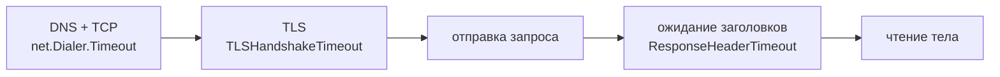

<script setup>
import PoolSandbox from '../../viz/scenes/PoolSandbox.vue'
</script>

# 0b.6. HTTP/1.1, keep-alive и пулы соединений

## <Part kind="problem" /> Проблема: две трети времени запроса — рукопожатия

Сервис сообщений мессенджера на каждое отправленное сообщение ходит в соседний сервис — проверить, не заблокирован ли получатель. Сто раз в секунду, по HTTPS, между дата-центрами с <T id="rtt">RTT</T> 40 мс. Мы повторили это в лабораторной этого урока — 20 запросов подряд, один и тот же сервер, одна и та же сеть:

```
без keep-alive:  latency p50=121.62ms   tcp_conns=20
с keep-alive:    latency p50=40.47ms    tcp_conns=1
```

Разница втрое, и ни строчки серверного кода не тронуто. Без переиспользования соединения каждый запрос платит за <T id="tcp">TCP</T>-рукопожатие (1 RTT), <T id="tls">TLS</T>-рукопожатие (1 RTT) и только потом за сам запрос (1 RTT): <N>3 RTT</N> вместо <N>1 RTT</N>. Две трети времени — подготовка.

«Но ведь Go переиспользует соединения сам», — скажете вы. Да, если ему не мешать. Второй прогон той же лабораторной: 50 горутин делают 500 запросов через `http.Transport` с настройками по умолчанию:

```
requests=500 errors=0 tcp_conns=239 new_conns=50 proto=HTTP/1.1
```

<N>239 TCP-соединений</N> на 500 запросов, хотя одновременно нужно не больше 50. Лишние 189 рукопожатий не ускорили ни одного запроса: соединения набрали и закрыли впустую. Виновата одна строчка в умолчаниях Go: `DefaultMaxIdleConnsPerHost = 2`.

В этом уроке разберём, как устроен HTTP/1.1 на проводе и почему соединение вообще можно переиспользовать, как работает пул `http.Transport` и какие у него умолчания, почему тело ответа нужно дочитывать, какие таймауты у клиента и сервера Go по умолчанию — спойлер: никаких, — и что происходит, когда соединение закрыли на другом конце. В лабораторной всё это измерим.

Подумайте, прежде чем читать дальше: если пул хранит только два свободных соединения, а запросов одновременно десять — что происходит с остальными восемью соединениями, когда запросы заканчиваются?

## <Part kind="theory" /> HTTP/1.1 на проводе

<T id="http">HTTP</T>/1.1 — текстовый протокол: запрос и ответ — это строки, которые можно прочитать глазами. Вот что реально ушло по TCP в лабораторной, когда мы отправили два запроса подряд по одному соединению (шаг 7):

```
GET / HTTP/1.1
Host: api

GET /bytes?n=5 HTTP/1.1
Host: api
Connection: close

```

И что пришло в ответ:

```
HTTP/1.1 200 OK
Date: Mon, 12 Oct 2026 12:14:28 GMT
Content-Length: 40
Content-Type: text/plain; charset=utf-8

proto=HTTP/1.1 remote=172.28.0.20:53304
HTTP/1.1 200 OK
Content-Length: 5
Content-Type: application/octet-stream
Date: Mon, 12 Oct 2026 12:14:28 GMT
Connection: close

```

Любое сообщение HTTP/1.1 состоит из трёх частей (RFC 9112, разд. 2):

1. **Стартовая строка.** У запроса — метод, путь и версия: `GET / HTTP/1.1`. У ответа — версия, код и пояснение: `HTTP/1.1 200 OK`.
2. **Заголовки** — строки `Имя: значение`. `Host` обязателен в каждом запросе HTTP/1.1: на одном адресе живёт много сайтов, и сервер должен знать, к какому из них запрос. Заканчиваются заголовки **пустой строкой** (каждая строка завершается двумя байтами `\r\n`, а пустая строка — это просто `\r\n`).
3. **Тело** — байты после пустой строки. У `GET` его обычно нет, у ответа — есть.

### Где кончается тело

Это главный вопрос для переиспользования соединения. TCP — поток байт без границ сообщений (урок [0b.2](./02-tcp)). Клиент читает ответ и должен понять: вот здесь ответ закончился, а следующий байт — уже начало ответа на следующий запрос. Способов три (RFC 9112, разд. 6.3):

- **`Content-Length: 40`** — длина тела в байтах заранее. Прочитал 40 байт — ответ закончился. В первом ответе выше тело `proto=HTTP/1.1 remote=172.28.0.20:53304` плюс перевод строки — ровно 40 байт.
- **`Transfer-Encoding: chunked`** — тело идёт кусками, когда длина заранее неизвестна (сервер генерирует ответ на лету). Каждый кусок начинается со своей длины в шестнадцатеричной записи, а конец обозначает кусок нулевой длины:
  ```
  1a\r\n
  ...26 байт данных...\r\n
  0\r\n
  \r\n
  ```
- **Закрыть соединение.** Если нет ни того, ни другого, тело ответа длится до закрытия соединения. Переиспользовать такое соединение, разумеется, нельзя.

Сервер Go выбирает сам. Если обработчик записал меньше 2048 байт и завершился, сервер знает полную длину и ставит `Content-Length` — так было в нашем ответе. Если больше или если обработчик вызвал `Flush`, ответ уходит кусками (`chunked`). Порог — константа `bufferBeforeChunkingSize` в `net/http/server.go`. Обработчик может и сам поставить `Content-Length`, как наш `/bytes`.

### keep-alive

В HTTP/1.0 соединение по умолчанию закрывалось после каждого ответа. В HTTP/1.1 наоборот: соединение **постоянное** (persistent) по умолчанию, и следующий запрос идёт по нему же (RFC 9112, разд. 9.3). Это и называют <T id="keep-alive">keep-alive</T>. Закрыть соединение после ответа просят заголовком **`Connection: close`** — его прислал наш второй запрос, и сервер ответил тем же и закрыл соединение. Так поступают и серверы: при остановке, при превышении числа запросов на соединение, при ошибке в запросе.

Не путайте HTTP keep-alive с TCP keepalive из урока [0b.1](./01-layers): тот лишь шлёт пустые пробные пакеты, проверяя, жив ли собеседник на молчащем соединении.

### Один запрос за раз: блокировка начала очереди

У HTTP/1.1 есть важное ограничение: на соединении в каждый момент — **один** запрос. Ответы не помечены номерами запросов, поэтому они обязаны идти строго в порядке запросов. Медленный ответ задерживает все следующие за ним на этом соединении — это <T id="head-of-line-blocking">блокировка начала очереди (head-of-line blocking)</T> на уровне запросов.

Стандарт разрешает конвейер (pipelining): отправить несколько запросов, не дожидаясь ответов. Но ответы всё равно придут по порядку, а многие прокси и серверы обрабатывали конвейер с ошибками, и браузеры его выключили. Клиент Go конвейер тоже не использует.

Вывод: **параллельность в HTTP/1.1 — это число соединений.** Десять одновременных запросов к одному серверу — десять TCP-соединений. Поэтому браузеры держат до <N>6 соединений</N> на один хост (так в Chrome и Firefox; RFC 9112, разд. 9.4, оставляет предел на усмотрение клиента) и седьмой запрос ставят в очередь. HTTP/2 снимает это ограничение, мультиплексируя запросы в одном соединении, — урок [0b.7](./07-http2).

## <Part kind="theory" /> Пул соединений http.Transport

Раз соединение можно переиспользовать, его надо где-то хранить между запросами. В Go это делает `http.Transport` — он и есть <T id="connection-pool">пул соединений (connection pool)</T> HTTP-клиента. `http.Client` — лишь обёртка над ним: редиректы, куки, общий таймаут.

Аналогия — стоянка такси у вокзала. Пассажир (запрос) выходит и берёт машину, которая уже ждёт: это переиспользованное соединение, ехать можно сразу. Если свободных нет — вызывает новую по телефону, и ждать её придётся (рукопожатия). Привезя пассажира, машина возвращается на стоянку — если там есть место. Мест мало — возвращаться некуда, и машина уезжает в парк (соединение закрывается).

Как это устроено в `net/http`:

- **Пул разбит по адресатам.** Ключ — схема, хост, порт и прокси: `https://api.messenger.example:8443` — одна «стоянка», `https://api.github.com:443` — другая.
- **Запрос берёт простаивающее соединение**, причём самое недавнее: дольше всех простаивавшие скорее закроются по таймауту, пусть уходят.
- **Нет простаивающих — набирает новое**: DNS, TCP, TLS. Как именно, с хитростью, — в блоке «Под капотом» ниже.
- **После ответа соединение возвращается.** Сначала его отдают запросу, который сейчас ждёт соединения к тому же адресу. Никто не ждёт — кладут в простаивающие, **если там есть место**. Нет места — закрывают.
- **Простаивающее дольше `IdleConnTimeout` закрывается.**

Настройки пула и их значения:

| Поле `http.Transport` | В `http.DefaultTransport` | В `&http.Transport{}` | Что значит |
|---|---|---|---|
| `MaxIdleConns` | 100 | 0 — без ограничения | всего простаивающих, ко всем хостам |
| `MaxIdleConnsPerHost` | 0 → `DefaultMaxIdleConnsPerHost` = 2 | 0 → 2 | простаивающих к одному хосту |
| `MaxConnsPerHost` | 0 — без ограничения | 0 — без ограничения | всего соединений к одному хосту: простаивающие, занятые и набираемые |
| `IdleConnTimeout` | 90 с | 0 — **вечно** | через сколько закрыть простаивающее |
| `DisableKeepAlives` | `false` | `false` | `true` — новое соединение на каждый запрос |

Главное в этой таблице:

- **`MaxIdleConnsPerHost` по умолчанию — <N>2</N>.** И 0 тоже значит 2 (функция `maxIdleConnsPerHost` в `transport.go`). Число выбрано для клиента, который ходит понемногу во многие места, — например, для браузера или краулера. Сервису, который ходит в **один** соседний сервис десятки раз одновременно, двух мест на стоянке мало: в лабораторной это и дало 239 соединений вместо 50. Отключить хранение вовсе можно отрицательным значением или `DisableKeepAlives`.
- **`IdleConnTimeout` <N>90 секунд</N> — только у `DefaultTransport`.** Если создать `&http.Transport{}` с нуля, простаивающие соединения живут вечно, а заодно пропадают таймауты подключения и TLS из следующего раздела. Поэтому свой транспорт правильно делать так: `http.DefaultTransport.(*http.Transport).Clone()` — и менять нужные поля.
- **`MaxConnsPerHost` = 0 — соединений сколько угодно.** Если задать предел, лишние запросы встанут в очередь и будут ждать освободившееся соединение. Это защищает соседа от вашего всплеска, но ожидание в очереди входит в таймаут запроса.

### Почему тело нужно дочитать и закрыть

Соединение возвращается в пул только тогда, когда транспорт уверен, что ответ прочитан **до конца**: иначе следующий запрос получил бы на этом соединении хвост чужого ответа. Варианты:

- **Прочитали тело до конца (`io.EOF`) и закрыли** — соединение возвращается в пул.
- **Закрыли, не дочитав** — транспорт не может переиспользовать соединение, где осталось непрочитанное, и **закрывает его** (`earlyCloseFn` в `transport.go`). Следующему запросу придётся набирать новое.
- **Не закрыли вовсе** — хуже всего. Соединение не вернётся в пул и не закроется: висят файловый дескриптор и две горутины транспорта (чтения и записи) на каждое такое соединение. Это утечка, которая со временем исчерпает лимит дескрипторов (урок [0b.1](./01-layers)).

Мы проверили это на `httpbench`, убрав из кода одну строку — дочитывание тела `io.Copy(io.Discard, resp.Body)` перед `Close`. Тест, ожидавший одно соединение на 10 последовательных запросов, получил 10. Правило: **всегда** `defer resp.Body.Close()` сразу после проверки ошибки и дочитывание остатка перед закрытием — с ограничением, чтобы огромный ненужный ответ не качать целиком.

## <Part kind="theory" /> Таймауты клиента: по умолчанию их нет

Запрос проходит несколько этапов, и на каждом может зависнуть: DNS не отвечает, SYN уходит в никуда, сервер принял соединение и молчит, сервер отправляет тело по байту в минуту. Таймауты клиента Go накрывают эти этапы так:



- **`http.Client.Timeout`** — на **весь** запрос: от набора соединения до последнего байта тела, включая редиректы. По умолчанию — <N>0, то есть таймаута нет</N>. `http.Get` и `http.DefaultClient` ждут вечно. Сервер завис — горутина вашего обработчика висит вместе с ним, а с ней и соединение, и память, и, возможно, транзакция в базе.
- **`net.Dialer.Timeout`** (через `Transport.DialContext`) — на установку TCP-соединения, включая DNS. В `DefaultTransport` — 30 с. Без него недоступный адрес ждёт таймаута ядра — около двух минут (урок [0b.2](./02-tcp)).
- **`TLSHandshakeTimeout`** — на TLS-рукопожатие. В `DefaultTransport` — 10 с, в пустом `Transport{}` — нет.
- **`ResponseHeaderTimeout`** — от конца отправки запроса до заголовков ответа: «сколько сервер может думать». По умолчанию нет.
- **`ExpectContinueTimeout`** — сколько ждать `100 Continue` перед отправкой тела, если запрос просит `Expect: 100-continue`. В `DefaultTransport` — 1 с.

Отдельно стоит **контекст запроса**: `http.NewRequestWithContext(ctx, …)`. Отмена или дедлайн контекста прерывает запрос на любом этапе, включая чтение тела. Это правильный способ задать срок конкретному вызову — например, остаток бюджета времени входящего запроса. А `Client.Timeout` — страховка «не дольше никогда».

Вот как выглядит сработавший таймаут — в лабораторной `httpbench` запросил ответ, который сервер отдаёт через 3 секунды, с таймаутом 1 секунда:

```
timeout: Get "https://172.28.0.10:8443/slow?ms=3000": context deadline exceeded (Client.Timeout exceeded while awaiting headers)
total=1.00068s
```

Ровно секунда, и ошибка честно говорит, что истёк `Client.Timeout` во время ожидания заголовков.

## <Part kind="theory" /> Таймауты сервера: по умолчанию их тоже нет

У `http.Server` четыре таймаута, и у всех нулевое значение значит «без ограничения». `http.ListenAndServe(addr, handler)` создаёт сервер именно с нулями.

- **`ReadHeaderTimeout`** — сколько ждать заголовков запроса с момента, когда соединение начало новый запрос.
- **`ReadTimeout`** — на чтение всего запроса вместе с телом. Если `ReadHeaderTimeout` не задан, вместо него действует `ReadTimeout`.
- **`WriteTimeout`** — на запись ответа: отсчитывается заново для каждого запроса — от конца чтения его заголовков до конца записи ответа.
- **`IdleTimeout`** — сколько держать keep-alive-соединение, на котором нет запросов. Если не задан — берётся `ReadTimeout`, а если и его нет — вечно.

Ещё есть `MaxHeaderBytes` — предел размера заголовков, по умолчанию 1 МБ.

**Slowloris.** Атака 2009 года, названная по программе Роберта Хансена. Атакующий открывает тысячи соединений и в каждом отправляет заголовки запроса очень медленно: строчку раз в десять секунд, никогда не заканчивая пустой строкой. Сервер честно ждёт конца заголовков, на каждое соединение держит горутину, буферы и файловый дескриптор — и кончается задолго до того, как кончится пропускная способность сети. Атакующему для этого не нужен мощный канал: тысячи соединений, по байту в секунду. Защита — `ReadHeaderTimeout`: не прислал заголовки за 5 секунд — до свидания. Именно `ReadHeaderTimeout`, а не только `ReadTimeout`: долгую загрузку файла (тело) обрывать нельзя, а заголовки не бывают большими.

В лабораторной (шаг 6) мы открыли соединение к серверу, отправили половину заголовков и стали ждать:

```
real	0m5.045s
```

Через 5,045 с сервер молча закрыл соединение: 5 с `ReadHeaderTimeout` плюс около одного RTT. Отсчёт на сервере начинается, когда до него дошёл последний ACK рукопожатия, — это на 20 мс позже, чем `connect()` вернулся у клиента; ещё 20 мс `FIN` идёт обратно к клиенту; остальные миллисекунды — запуск процессов. Без этой настройки соединение висело бы вечно.

### Рассинхрон idle-таймаутов

Keep-alive-соединение могут закрыть с **обеих** сторон: клиент — по `IdleConnTimeout`, сервер или балансировщик — по своему idle-таймауту. Опасен случай, когда сервер закрывает раньше. Клиент считает соединение живым, берёт его из пула и отправляет запрос в тот самый момент, когда навстречу уже летит закрытие. Запрос уходит в закрытое соединение, и клиент получает ошибку.

Пример с реальными числами. `IdleConnTimeout` в `DefaultTransport` — 90 с. Idle-таймаут Application Load Balancer в AWS по умолчанию — 60 с (документация AWS). Запрос раз в 61–89 секунд — и каждое такое переиспользование рискует попасть на только что закрытое балансировщиком соединение.

Правило: **у того, кто переиспользует соединение (клиента), idle-таймаут должен быть меньше, чем у того, кто его принимает (сервера или балансировщика).** Тогда соединение всегда закрывает клиент, и гонки нет. То же правило действует на каждом звене цепочки: балансировщик — клиент для вашего сервиса, поэтому `IdleTimeout` Go-сервиса за ALB должен быть **больше** 60 с. Иначе сервис будет закрывать соединения раньше балансировщика, и ALB, по его же документации, вернёт пользователю `502 Bad Gateway`.

<Deep title="почему сервер закрыл соединение, а клиент об этом не знал">

Когда сервер закрывает простаивающее соединение, его TCP отправляет `FIN`. У каждого соединения в пуле Go есть горутина чтения (`readLoop`), которая всё время ждёт данных. Получив `FIN` на простаивающем соединении, она видит `io.EOF`, и транспорт сразу выкидывает соединение из пула. Так что обычно Go **узнаёт** о закрытии и следующий запрос просто наберёт новое соединение.

Проблема — в окне гонки. `FIN` идёт по сети полпути RTT. Если клиент взял соединение и отправил запрос, пока `FIN` в пути, запрос уходит в соединение, которое сервер уже закрыл. Ответа не будет: клиент прочитает `EOF` (или получит `connection reset by peer`, если сервер ответит на запрос пакетом RST). Хуже, если посредник — NAT, файрвол, балансировщик — забыл соединение молча, не отправив ничего: тогда клиент пишет в пустоту и ждёт до своего таймаута. Это одна из причин, зачем Go включает на соединениях TCP keepalive.

Что делает Go, получив такую ошибку (`shouldRetryRequest` в `net/http/transport.go`):

1. **Соединение было новым — не повторяет.** Свежее соединение сервер закрыть «по таймауту» не мог; значит, ему не понравился сам запрос, и повтор зациклится.
2. **Соединение было из пула, и в него не успели записать ни байта** — повторяет на новом соединении, если у запроса нет тела или тело можно перемотать (`GetBody`).
3. **Запрос записан, но не пришло ни байта ответа** — повторяет, только если запрос можно безопасно повторить: методы `GET`, `HEAD`, `OPTIONS`, `TRACE` или любой запрос с заголовком `Idempotency-Key` (или `X-Idempotency-Key`) и перематываемым телом.

Обратите внимание на третий пункт: **`PUT` и `DELETE` Go не повторяет**, хотя по RFC 9110 (разд. 9.2.2) они идемпотентны. Мы проверили это на Go 1.26 небольшой отдельной программой (её нет в `labs/`): тестовый сервер на `127.0.0.1` отвечает на первый запрос, а второй запрос по тому же соединению читает и закрывает соединение, не ответив. Клиент — обычный `http.Client`, по два запроса каждым методом.

```
GET                    first=<nil> second=<nil>
PUT                    first=<nil> second=Put "http://127.0.0.1:46019/": EOF
POST                   first=<nil> second=Post "http://127.0.0.1:46019/": EOF
POST+Idempotency-Key   first=<nil> second=<nil>
```

`GET` транспорт молча повторил на новом соединении. `PUT` и `POST` вернули вызывающему ту самую ошибку `EOF`. С заголовком `Idempotency-Key` повторён и `POST` — Go доверяет обещанию, что сервер распознает дубликат. Как сервер это делает, разберём в модуле 5.

Практические выводы: держите `IdleConnTimeout` клиента меньше idle-таймаута сервера и балансировщика; ошибку `EOF` на `POST` не считайте «странным сбоем» — это гонка с закрытием соединения; повторяйте неидемпотентные запросы только с ключом идемпотентности.

</Deep>

<Deep title="что делает http.Transport, когда пул пуст">

Запрос пришёл, простаивающих соединений нет. Наивный пул набрал бы новое соединение и ждал его. Go устроен хитрее (`getConn` в `transport.go`):

1. Запрос встаёт в очередь ожидающих простаивающее соединение (`queueForIdleConn`).
2. **Одновременно** транспорт начинает набирать новое соединение в отдельной горутине (`queueForDial`).
3. Запрос забирает то, что появится **первым**: соединение, которое вернул другой запрос, или своё набранное.

Это гонка за соединением, и она выгодна: другой запрос может освободить соединение через 1 мс, а набор нового стоит 2 RTT (80 мс в лабораторной). Зачем ждать?

Но что станет с набором, если запрос уже уехал на чужом соединении? Он **не отменяется**. В коде прямо написано: набор продолжается, даже если запрос отменён, — вдруг соединение пригодится следующему. Готовое соединение отдаётся ожидающему запросу или кладётся в простаивающие. А если простаивающих уже `MaxIdleConnsPerHost`, оно **закрывается, не обслужив ни одного запроса**. TCP- и TLS-рукопожатия сделаны впустую — и клиентом, и сервером.

Так получились 239 соединений из начала урока. 50 воркеров по кругу: запрос, ответ, следующий запрос. Своё соединение воркер всегда успевает вернуть: `Read` тела на `io.EOF` в Go не возвращается, пока горутина транспорта не положила соединение в пул (канал `eofc` в `transport.go`). Беда в том, что ответы приходят пачкой — у многих воркеров в пределах микросекунд. Первые два вернувшихся соединения занимают оба места в простаивающих, третье и следующие находят список полным и закрываются (`tryPutIdleConn` → `errTooManyIdleHost`). Воркер, чьё соединение закрылось, не находит простаивающего и начинает набор. Через долю миллисекунды кто-то из соседей заканчивает свой запрос, и его соединение отдаётся ожидающему — раньше, чем набор закончится. Набор тем временем продолжается и через 2 RTT приносит готовое соединение: если в простаивающих уже лежат 2, оно закрывается, так и не понадобившись. Чем больше воркеров и чем плотнее пачки ответов, тем больше наборов уходит впустую.

Отсюда и разница между счётчиками `httpbench`:

- `new_conns` считает запросы, которым досталось соединение, ещё не побывавшее в пуле. Это **нижняя граница**: соединение, набранное «впрок» и полежавшее в пуле, запрос получит уже как переиспользованное.
- `tcp_conns` — сколько TCP-соединений установлено на самом деле.

Наконец, `MaxConnsPerHost`. Если задан предел, шаг 2 выполняется только при свободном месте; иначе запрос ждёт в отдельной очереди, пока какое-то соединение не закроется или не освободится. Это единственный способ гарантированно ограничить число соединений к соседу — но очередь превращается в задержку.

</Deep>

## <Part kind="viz" /> Визуализация: песочница пула

Песочница рисует каждый запрос на временной шкале: какое соединение он занял и сколько ждал рукопожатий. Протокол — HTTP/1.1: на соединении один запрос за раз. Начальные настройки — как в лабораторной: RTT 40 мс, 100 запросов, 10 воркеров, пул на 2 простаивающих соединения (умолчание Go), TLS включён.

<Callout type="simplified">

Модель упрощена, и в двух местах — в сторону пессимизма. Во-первых, запрос, который не нашёл простаивающего соединения, в модели всегда набирает своё и ждёт его до конца. Настоящий Go параллельно ждёт и освободившееся соединение и обычно получает его раньше (блок «Под капотом» выше). Поэтому в модели у лишних соединений растёт и время, а в лабораторной лишние рукопожатия почти не видны в задержке — их платят процессоры клиента и сервера. Во-вторых, в модели воркеры идут строго в ногу, и в пул возвращаются сразу все соединения — худший случай; в жизни ответы приходят пачками поплотнее или пореже.

</Callout>

<PoolSandbox preset="go-default" />

Задания:

1. Не меняя настроек, посмотрите на итог: сколько соединений и сколько времени? Затем поставьте простаивающих на хост 10. Что изменилось и почему именно 10?
2. Верните 2 и выключите keep-alive. Сравните с первым заданием.
3. Поставьте параллельность 1 и переключайте keep-alive. Во сколько раз отличается время и откуда это отношение?
4. Подберите наименьший размер пула, при котором соединений столько же, сколько воркеров.

<SelfCheck question="Ответы">

1. С пулом на 2 — 62 соединения и 960 мс; с пулом на 10 — 10 соединений и 480 мс. В модели 10 воркеров заканчивают запросы одновременно, и в пул на 2 места возвращаются только 2 соединения из 10; остальные 8 закрываются, и в следующем круге 8 запросов платят за рукопожатия. Пул на 10 вмещает все соединения — каждый воркер всё время ездит на своём. Десять — потому что столько запросов одновременно; больше пула не нужно.
2. Без keep-alive — 100 соединений и 1200 мс: каждый запрос — 3 RTT (120 мс), 10 кругов по 120 мс. С пулом на 2 было 960 мс: часть запросов переиспользовала соединения.
3. 12 000 мс против 4080 мс — почти втрое. Без keep-alive каждый из 100 запросов стоит 3 RTT: 100 × 120 = 12 000 мс. С keep-alive первый — 3 RTT, остальные 99 — по одному: 120 + 99 × 40 = 4080 мс. Предельное отношение — 3 к 1, как в начале урока.
4. 10 — равный числу воркеров. При 9 и меньше в каждом круге хоть одно соединение не помещается и закрывается. Правило для настройки: `MaxIdleConnsPerHost` не меньше обычного числа одновременных запросов к этому хосту.

</SelfCheck>

## <Part kind="practice" /> Лабораторная: пул под микроскопом

Окружение — то же, что в прошлых уроках. Псевдоним `lab`, задержка 40 мс и сервер из урока [0b.5](./05-tls):

```bash
alias lab='docker compose -f labs/0b/compose.yaml'
docker compose -f labs/0b/compose.yaml up -d --build
labs/0b/netem.sh 40ms 0%
lab exec -d server h2server -addr :8443 -http-addr :8080 -names api.messenger.example,server -ca-out /captures/ca.pem
```

Инструмент — `httpbench`: N запросов в C горутин через `http.Transport`, настройки которого задаются флагами. Первая строка вывода — итог: `tcp_conns` — сколько TCP-соединений установлено на самом деле, `new_conns` — нижняя граница числа новых соединений (что это значит, разобрано в «Под капотом»). Дальше — распределение задержки и длительности рукопожатий.

Во всех выводах ниже — реальные результаты прогона на нашем стенде. У вас числа будут другими, порядок — такой же.

### Шаг 1. Без keep-alive и с ним

```bash
lab exec client httpbench -url https://172.28.0.10:8443/ -ca /captures/ca.pem -server-name api.messenger.example -keepalive=false -c 1 -n 20
lab exec client httpbench -url https://172.28.0.10:8443/ -ca /captures/ca.pem -server-name api.messenger.example -keepalive=true -c 1 -n 20
```

```
requests=20 errors=0 tcp_conns=20 new_conns=20 proto=HTTP/1.1
latency: n=20 min=121.48ms p50=121.62ms p99=121.93ms max=121.93ms
connect: n=20 min=40.13ms p50=40.16ms max=40.24ms
tls: n=20 min=40.94ms p50=41.03ms max=41.34ms
total=2.43372s
```

```
requests=20 errors=0 tcp_conns=1 new_conns=1 proto=HTTP/1.1
latency: n=20 min=40.41ms p50=40.47ms p99=122.26ms max=122.26ms
connect: n=1 min=40.3ms p50=40.3ms max=40.3ms
tls: n=1 min=41.42ms p50=41.42ms max=41.42ms
total=891.34ms
```

Без keep-alive: 20 соединений, и каждое — `connect` 40 мс плюс `tls` 41 мс плюс сам запрос: 121,6 мс, три RTT. С keep-alive: одно соединение на всё. Рукопожатия заплатил только первый запрос — он и есть `max=122.26ms`; остальные 19 — по одному RTT. Весь прогон — 0,89 с против 2,43.

### Шаг 2. Десять воркеров: пул на 2 и на 10

```bash
lab exec client httpbench -url https://172.28.0.10:8443/ -ca /captures/ca.pem -server-name api.messenger.example -c 10 -n 100 -max-idle-per-host 2
lab exec client httpbench -url https://172.28.0.10:8443/ -ca /captures/ca.pem -server-name api.messenger.example -c 10 -n 100 -max-idle-per-host 10
```

```
requests=100 errors=0 tcp_conns=44 new_conns=10 proto=HTTP/1.1
latency: n=100 min=40.1ms p50=40.31ms p99=127.69ms max=128.35ms
connect: n=44 min=40.06ms p50=40.21ms max=46.95ms
tls: n=44 min=40.81ms p50=41.31ms max=45.29ms
total=529.72ms
```

```
requests=100 errors=0 tcp_conns=10 new_conns=10 proto=HTTP/1.1
latency: n=100 min=40.1ms p50=40.61ms p99=123.16ms max=123.23ms
connect: n=10 min=40.2ms p50=40.25ms max=40.74ms
tls: n=10 min=41.18ms p50=42.11ms max=42.79ms
total=487.65ms
```

Сравните с песочницей. Пул на 10 — 10 соединений, как и в модели. Пул на 2 — 44 TCP-соединения вместо 62 в модели, и при этом `new_conns=10`: по счётчику запросов «новых» соединений столько же, сколько с большим пулом. Задержка почти не изменилась — p50 40,3 против 40,6 мс. Лишние 34 соединения — это наборы, которые запросам так и не понадобились: запросы уехали на соединениях соседей, а набранные соединения не поместились в пул и закрылись. Задержку они не испортили, но каждое стоило двух рукопожатий клиенту и серверу.

Мы повторили прогон с пулом на 2 шесть раз подряд: `tcp_conns` — 44, 44, 47, 34, 43, 35. С пулом на 10 — всегда 10. А в другой день на том же стенде с пулом на 2 выходило ровно 10, без лишних наборов. Всё решает, насколько плотно приходят ответы. Если несколько воркеров заканчивают в пределах микросекунд, третье и следующие вернувшиеся соединения находят пул на 2 места полным и закрываются, а их воркерам приходится набирать новые — которые потом часто оказываются не нужны (разбор — в «Под капотом»). Если ответы разбросаны во времени, каждое соединение возвращается в пул, где есть место, и тут же уходит следующему запросу. С пулом на 10 место есть всегда — поэтому ровно 10. При 10 воркерах предел пула 2 — на грани, поэтому смотрите на следующий шаг.

### Шаг 3. Пятьдесят воркеров

```bash
lab exec client httpbench -url https://172.28.0.10:8443/ -ca /captures/ca.pem -server-name api.messenger.example -c 50 -n 500 -max-idle-per-host 2
lab exec client httpbench -url https://172.28.0.10:8443/ -ca /captures/ca.pem -server-name api.messenger.example -c 50 -n 500 -max-idle-per-host 50
```

```
requests=500 errors=0 tcp_conns=239 new_conns=50 proto=HTTP/1.1
latency: n=500 min=40.06ms p50=40.47ms p99=129.29ms max=135.11ms
connect: n=239 min=40.04ms p50=40.18ms max=48.55ms
tls: n=229 min=40.78ms p50=41.84ms max=49.25ms
total=527.74ms
```

```
requests=500 errors=0 tcp_conns=50 new_conns=50 proto=HTTP/1.1
latency: n=500 min=40.06ms p50=40.16ms p99=129.28ms max=129.94ms
connect: n=50 min=40.07ms p50=40.85ms max=43.76ms
tls: n=50 min=41.37ms p50=43.85ms max=47.6ms
total=490.74ms
```

Здесь предел пула виден всегда: повтор дал 246 соединений против 50. На 500 запросов — 239 TCP-рукопожатий и 229 TLS-рукопожатий вместо 50. `tls n` меньше `connect n` не потому, что наборы прервали: транспорт фоновый набор не отменяет (у него свой контекст, отвязанный от запроса). Просто `httpbench` подводит итог сразу после того, как все запросы обслужены, а к этому моменту около десятка фоновых наборов уже установили TCP, но ещё не закончили TLS. По той же причине и `tcp_conns` — слегка заниженная оценка: наборы, которые ещё не закончили TCP, в итог не попали. Представьте это в масштабе: 100 экземпляров сервиса, каждый в 5 раз чаще обычного делает рукопожатия с соседом, — и сосед тратит процессор на криптографию вместо работы.

Исправление — одна строка: `MaxIdleConnsPerHost` не меньше обычной параллельности к этому хосту.

### Шаг 4. Таймаут клиента

```bash
lab exec client httpbench -url 'https://172.28.0.10:8443/slow?ms=3000' -ca /captures/ca.pem -server-name api.messenger.example -c 1 -n 1 -timeout 1s
```

```
requests=1 errors=1 tcp_conns=1 new_conns=1 proto=-
errors: timeout=1 refused=0 tls=0 status=0 other=0
  timeout: Get "https://172.28.0.10:8443/slow?ms=3000": context deadline exceeded (Client.Timeout exceeded while awaiting headers)
connect: n=1 min=40.25ms p50=40.25ms max=40.25ms
tls: n=1 min=41.13ms p50=41.13ms max=41.13ms
total=1.00068s
```

Сервер отвечает через 3 секунды, а клиент сдался через 1,00 — соединение и TLS успели установиться, а заголовков не дождались. В `httpbench` флаг `-timeout` задаёт сразу `Client.Timeout` и `ResponseHeaderTimeout` (код ниже). Уберите их из программы мысленно — и этот запрос ждал бы, сколько сервер захочет.

### Шаг 5. Slowloris против ReadHeaderTimeout

Откроем TCP-соединение средствами `bash` (`/dev/tcp/хост/порт` — встроенная возможность `bash`), отправим строку запроса и один заголовок без завершающей пустой строки и будем ждать, пока сервер закроет соединение:

```bash
lab exec client bash -c 'exec 3<>/dev/tcp/172.28.0.10/8080; printf "GET / HTTP/1.1\r\nHost: api\r\n" >&3; time cat <&3'
```

```
real	0m5.045s
```

`cat` ничего не напечатал: сервер не ответил ни байта и закрыл соединение через 5,045 с — `ReadHeaderTimeout: 5 * time.Second` из кода сервера плюс около одного RTT (40 мс): последний ACK рукопожатия доходит до сервера через 20 мс после того, как у клиента соединение уже установлено, и `FIN` возвращается ещё 20 мс; пара миллисекунд — на запуск `bash` и `cat`. Так Slowloris и обезвреживают.

### Шаг 6. HTTP/1.1 руками

Два запроса по одному соединению, второй — с `Connection: close`:

```bash
lab exec client bash -c 'exec 3<>/dev/tcp/172.28.0.10/8080; printf "GET / HTTP/1.1\r\nHost: api\r\n\r\nGET /bytes?n=5 HTTP/1.1\r\nHost: api\r\nConnection: close\r\n\r\n" >&3; cat <&3'
```

Вывод — тот, что в теории: два ответа подряд в одном потоке, первый с `Content-Length: 40`, второй — с `Connection: close` и телом из 5 нулевых байт (в терминале их не видно), после которого сервер закрыл соединение и `cat` завершился. Попробуйте убрать `Connection: close` — `cat` будет ждать, пока сервер не закроет простаивающее соединение по `IdleTimeout` (90 с).

Посмотреть, что отправляет и получает `curl`, можно флагом `-v`: строки `>` — запрос, `<` — заголовки ответа.

```bash
lab exec client curl -sv http://172.28.0.10:8080/
```

### Шаг 7. Код

Транспорт `httpbench` — настройки пула и таймаутов:

<<< @/../labs/0b/cmd/httpbench/main.go#transport{go}

На что посмотреть:

- **`MaxIdleConns: 100` и `MaxIdleConnsPerHost` из флага** — именно их мы меняли в шагах 2 и 3. `IdleConnTimeout` — те же 90 с, что в `DefaultTransport`.
- **`DialContext` с `Timeout`** и **`TLSHandshakeTimeout: 5 * time.Second`** — без них пустой `Transport{}` не ограничивает ни подключение, ни рукопожатие.
- **`ResponseHeaderTimeout`** — от отправки запроса до заголовков.
- **`DisableKeepAlives: !cfg.keepalive`** — переключатель шага 1.
- **`ForceAttemptHTTP2`** — со своим `TLSClientConfig` транспорт HTTP/2 сам не включает. Подробнее — урок [0b.7](./07-http2).

Как `httpbench` считает соединения и рукопожатия — через `httptrace`, колбэки, которые транспорт вызывает на каждом этапе запроса:

<<< @/../labs/0b/cmd/httpbench/main.go#trace{go}

На что посмотреть:

- **`ConnectDone` и `TLSHandshakeDone`** записывают длительность только успешных этапов; из них строки `connect` и `tls`, а `tcp_conns` — число успешных `ConnectDone`.
- **Комментарий у `GotConn`** — почему `Reused == false` не значит «соединение набрано для этого запроса».
- **Всё под мьютексом**: колбэки вызываются из горутин транспорта, в том числе из горутины набора, которая переживает сам запрос, — та самая из «Под капотом».

И сервер с его таймаутами:

<<< @/../labs/0b/cmd/h2server/main.go#server{go}

`ReadHeaderTimeout` — 5 с против Slowloris (шаг 5), `ReadTimeout` и `WriteTimeout` — 30 с на запрос и ответ целиком, `IdleTimeout` — 90 с. Обратите внимание: 90 с у сервера и 90 с у клиента `httpbench` — ровно тот рассинхрон, о котором шла речь в теории, только на границе. Для лабораторной это не важно: соединения не простаивают так долго. В продакшене клиентский `IdleConnTimeout` стоит сделать меньше серверного.

Закончили — снимите задержку и остановите стенд:

```bash
labs/0b/netem.sh off
docker compose -f labs/0b/compose.yaml down
```

## <Part kind="mistakes" /> Типичные ошибки

<Callout type="mistake">

**`http.Client{}` или `http.Get` без таймаута.** `Client.Timeout` по умолчанию 0. Один зависший сосед — и горутины вашего сервиса копятся, пока не кончится память. Ставьте `Client.Timeout` как верхнюю границу и контекст с дедлайном на каждый запрос.

**Новый `Transport` на каждый запрос.** `&http.Client{Transport: &http.Transport{…}}` внутри обработчика — и у каждого запроса свой пустой пул: рукопожатия на каждый запрос, как с выключенным keep-alive. А старые транспорты со своими простаивающими соединениями никто не закрывает. `http.Client` и `http.Transport` безопасны для одновременного использования: создавайте один на процесс (или на соседа) при старте и передавайте в конструкторы.

**Недочитанное или незакрытое тело.** Без `Close` — утечка соединения, дескриптора и двух горутин. С `Close`, но без дочитывания — соединение закрывается, и следующий запрос платит рукопожатия. Проверка ошибки до `defer resp.Body.Close()`: при ошибке `resp` — `nil`.

**`MaxIdleConnsPerHost` = 2 при высокой нагрузке на один хост.** Умолчание рассчитано на «понемногу во многие места». Сервис, который держит 50 одновременных запросов к соседу, с ним делает в 5 раз больше рукопожатий, чем нужно (шаг 3). Ставьте значение не меньше обычной параллельности к хосту.

**`&http.Transport{}` с нуля.** Без `DialContext` с таймаутом, без `TLSHandshakeTimeout`, с вечным `IdleConnTimeout` и без прокси из окружения. Начинайте с `http.DefaultTransport.(*http.Transport).Clone()`.

**`http.ListenAndServe` в продакшене.** Сервер без единого таймаута: Slowloris, клиенты, которые не читают ответ, вечные простаивающие соединения. Создавайте `http.Server` с `ReadHeaderTimeout`, `IdleTimeout` и, если нет потоковых ответов, `ReadTimeout` и `WriteTimeout`.

**`IdleConnTimeout` клиента больше idle-таймаута сервера.** Гонка с закрытием соединения и редкие необъяснимые `EOF` на `POST`. Клиентский — меньше серверного; серверный — больше, чем у балансировщика перед ним.

</Callout>

Вот как может выглядеть клиент к соседнему сервису, собранный с учётом всех этих ошибок:

<!-- go-check -->

```go
package snippet

import (
	"context"
	"errors"
	"fmt"
	"io"
	"net"
	"net/http"
	"time"
)

const (
	// Обычная параллельность к соседу с запасом: 1000 запросов/с × 0,05 с ≈ 50 (закон Литтла, урок 0.4).
	maxIdlePerHost = 64
	// Меньше idle-таймаута балансировщика перед соседом (например, 60 с у AWS ALB).
	idleConnTimeout = 50 * time.Second
	requestTimeout  = 3 * time.Second
	// Сколько непрочитанного тела дочитывать, чтобы вернуть соединение в пул.
	maxDrainBytes = 64 << 10
)

// newServiceClient создаётся один раз при старте и разделяется всеми горутинами.
func newServiceClient() (*http.Client, error) {
	base, ok := http.DefaultTransport.(*http.Transport)
	if !ok {
		return nil, errors.New("http.DefaultTransport is not *http.Transport")
	}
	tr := base.Clone() // прокси из окружения, HTTP/2, MaxIdleConns и таймауты DefaultTransport
	tr.DialContext = (&net.Dialer{Timeout: 2 * time.Second, KeepAlive: 30 * time.Second}).DialContext
	tr.TLSHandshakeTimeout = 3 * time.Second
	tr.ResponseHeaderTimeout = 2 * time.Second
	tr.MaxIdleConnsPerHost = maxIdlePerHost
	tr.IdleConnTimeout = idleConnTimeout
	return &http.Client{Transport: tr, Timeout: requestTimeout}, nil
}

// fetch выполняет GET и возвращает тело не длиннее limit байт.
// При любом исходе тело дочитывается (в пределах maxDrainBytes) и закрывается,
// чтобы соединение вернулось в пул.
func fetch(ctx context.Context, c *http.Client, url string, limit int64) (body []byte, err error) {
	req, err := http.NewRequestWithContext(ctx, http.MethodGet, url, nil)
	if err != nil {
		return nil, fmt.Errorf("build request: %w", err)
	}
	resp, err := c.Do(req)
	if err != nil {
		return nil, fmt.Errorf("get %s: %w", url, err)
	}
	defer func() {
		_, drainErr := io.Copy(io.Discard, io.LimitReader(resp.Body, maxDrainBytes))
		err = errors.Join(err, drainErr, resp.Body.Close())
	}()

	if resp.StatusCode != http.StatusOK {
		return nil, fmt.Errorf("get %s: unexpected status %d", url, resp.StatusCode)
	}
	// Читаем на байт больше предела, чтобы отличить «ровно limit» от «больше».
	body, err = io.ReadAll(io.LimitReader(resp.Body, limit+1))
	if err != nil {
		return nil, fmt.Errorf("read body of %s: %w", url, err)
	}
	if int64(len(body)) > limit {
		return nil, fmt.Errorf("get %s: body exceeds %d bytes", url, limit)
	}
	return body, nil
}
```

Что здесь важно: транспорт — клон `DefaultTransport`, поэтому сохраняются прокси, HTTP/2 и `MaxIdleConns`; у каждого этапа свой таймаут, а `Client.Timeout` — общий потолок; `fetch` принимает `ctx`, и вызывающий может задать более короткий срок; тело закрывается и дочитывается на **любом** пути выхода, включая ошибочный статус.

## <Part kind="tradeoff" /> Компромисс: большой пул или маленький

<Callout type="tradeoff">

**Большой пул (`MaxIdleConnsPerHost` в десятки и сотни) даёт:** рукопожатия только при росте нагрузки; всплеск запросов обслуживается готовыми соединениями с уже разогнанным окном TCP (урок [0b.2](./02-tcp)); ниже задержка хвоста.

**Чем платим.** Каждое простаивающее соединение — это файловый дескриптор и память на **обеих** сторонах: у клиента две горутины транспорта и буферы, у сервера — горутина и буферы на соединение. Умножьте на число клиентов: 200 экземпляров сервиса × 64 простаивающих соединения = 12 800 соединений, которые держит сосед или балансировщик перед ним, почти не используя. У облачных балансировщиков число одновременных соединений входит в цену и в лимиты. Ещё большой долгоживущий пул медленнее замечает изменения: соединения, открытые к старым адресам, живут до `IdleConnTimeout` (урок [0b.4](./04-dns)).

**Маленький пул (умолчание 2) даёт:** почти никакой нагрузки на соседей в покое.

**Чем платим:** под параллельной нагрузкой — лишние рукопожатия, как в шагах 2 и 3, а значит, процессор клиента и сервера.

**Как выбирать:** считайте обычную параллельность к хосту по закону Литтла (урок [0.4](../00-foundation/04-latency)): запросов в секунду × средняя длительность запроса. 1000 запросов/с × 50 мс = <N>50 одновременных запросов</N> — значит, `MaxIdleConnsPerHost` около 50–64. Если важно защитить соседа от всплесков, добавьте `MaxConnsPerHost` — но тогда следите за ожиданием в очереди. А если одновременно нужно сотни запросов к одному хосту, возможно, вам нужен не пул побольше, а HTTP/2, где они идут в одном соединении (урок [0b.7](./07-http2)).

</Callout>

## <Part kind="selfcheck" /> Самопроверка

<SelfCheck question="Сервис делает 200 одновременных запросов к одному соседу через http.DefaultClient. В метриках соседа — тысячи новых TLS-соединений в минуту, хотя число клиентов не менялось. Почему, и что поменять?">

`DefaultClient` использует `DefaultTransport`, у которого `MaxIdleConnsPerHost` не задан — значит, 2. После каждой волны ответов в пул помещаются 2 соединения из 200, остальные закрываются, и следующая волна набирает их заново, а часть наборов ещё и уходит впустую (Go параллельно ждёт освободившееся соединение). Нужен свой клиент: клон `DefaultTransport` с `MaxIdleConnsPerHost` около 200 (обычная параллельность к хосту) — и заодно с `Client.Timeout`, которого у `DefaultClient` тоже нет.

</SelfCheck>

<SelfCheck question="Обработчик вызывает resp.Body.Close() сразу после проверки кода ответа, не читая тело — «тело нам не нужно, только статус». Что происходит с соединением и чем это плохо под нагрузкой?">

Транспорт не может переиспользовать соединение, в котором остался непрочитанный ответ, и закрывает его. Следующий запрос к этому хосту набирает новое соединение: TCP + TLS — 2 RTT и рукопожатия на обеих сторонах. Под нагрузкой это эквивалентно выключенному keep-alive. Правильно — дочитать остаток в `io.Discard` с ограничением (`io.LimitReader`) и только потом закрыть. Если тело огромное, дешевле как раз закрыть, не дочитывая, — поэтому и ограничение.

</SelfCheck>

<SelfCheck question="Go-сервис стоит за балансировщиком с idle-таймаутом 60 с. В http.Server сервиса задан IdleTimeout: 30 * time.Second. Пользователи изредка получают 502. Связано ли это?">

Да. Балансировщик — клиент вашего сервиса: он держит к нему пул соединений и закрывает их через 60 с простоя. Сервис закрывает простаивающие соединения раньше — через 30 с. Если балансировщик отправит запрос в соединение в тот момент, когда сервис его закрывает, запрос уйдёт в никуда, и балансировщик ответит пользователю 502. Правило: у принимающей стороны idle-таймаут больше, чем у переиспользующей. Здесь `IdleTimeout` сервиса должен быть больше 60 с — например, 75–90 с.

</SelfCheck>

<SelfCheck question="Клиент Go отправил PUT по соединению из пула, а сервер в этот момент закрыл соединение по idle-таймауту. Повторит ли Go запрос сам? А если это GET?">

`GET` — да: соединение было переиспользованным, ответа не пришло ни байта, метод безопасно повторить, и транспорт молча повторит его на новом соединении. `PUT` — нет, хотя по RFC 9110 он идемпотентен: Go повторяет записанные запросы только с методами `GET`, `HEAD`, `OPTIONS`, `TRACE` или с заголовком `Idempotency-Key`. Вызывающий получит `Put "…": EOF`. Повтор — его решение, и делать его безопасно — только если сервер распознаёт дубликаты.

</SelfCheck>

<SelfCheck question="Почему 10 одновременных запросов к одному серверу по HTTP/1.1 требуют 10 соединений, и почему браузер на седьмом запросе к одному хосту начинает ждать?">

На соединении HTTP/1.1 — один запрос за раз: ответы не помечены номерами и идут строго по порядку, а конвейер на практике выключен. Значит, параллельность равна числу соединений. Браузеры ограничивают себя 6 соединениями на хост, чтобы не перегружать сервер и сеть, и седьмой запрос ждёт, пока освободится одно из шести. HTTP/2 убирает это ограничение мультиплексированием (урок [0b.7](./07-http2)).

</SelfCheck>

## <Part kind="sources" /> Источники

<Callout type="source">

- Fielding R., Nottingham M., Reschke J., [«RFC 9112: HTTP/1.1»](https://www.rfc-editor.org/rfc/rfc9112), разд. 2–3 — формат сообщения и стартовой строки; разд. 6.3 — как определяется длина тела; разд. 7.1 — `chunked`; разд. 9.3 — постоянные соединения; разд. 9.3.1 — когда клиент может повторить запрос; разд. 9.4 — сколько соединений держать; разд. 9.6 — `Connection: close`.
- Fielding R., Nottingham M., Reschke J., [«RFC 9110: HTTP Semantics»](https://www.rfc-editor.org/rfc/rfc9110), разд. 9.2.1–9.2.2 — безопасные и идемпотентные методы.
- Grigorik I., [«High Performance Browser Networking»](https://hpbn.co/http1x/), гл. 11 — keep-alive, конвейер и почему от него отказались, 6 соединений на хост в браузерах.
- Valsorda F., [«The complete guide to Go net/http timeouts»](https://blog.cloudflare.com/the-complete-guide-to-golang-net-http-timeouts/), блог Cloudflare, 29 июня 2016 — схема, какой таймаут сервера и клиента какой этап покрывает. Статья написана до Go 1.8 и не упоминает `ReadHeaderTimeout` и `IdleTimeout` сервера; описание `WriteTimeout` для TLS («от Accept») устарело — сейчас рукопожатие получает свой срок, а `WriteTimeout` отсчитывается для каждого запроса. В остальном в основном актуальна.
- Документация Go, пакет [`net/http`](https://pkg.go.dev/net/http) — поля `Transport` (`MaxIdleConns`, `MaxIdleConnsPerHost`, `MaxConnsPerHost`, `IdleConnTimeout`, `ResponseHeaderTimeout`) и `Server` (`ReadHeaderTimeout`, `ReadTimeout`, `WriteTimeout`, `IdleTimeout`); пакет [`net/http/httptrace`](https://pkg.go.dev/net/http/httptrace) — колбэки этапов запроса. Исходники `net/http/transport.go`: `DefaultTransport`, `getConn`, `tryPutIdleConn`, `shouldRetryRequest`; `net/http/request.go`: `isReplayable`.
- Документация AWS, [«Edit attributes for your Application Load Balancer»](https://docs.aws.amazon.com/elasticloadbalancing/latest/application/edit-load-balancer-attributes.html), раздел «Connection idle timeout» — idle-таймаут 60 с по умолчанию и почему таймаут приложения должен быть больше.

</Callout>
