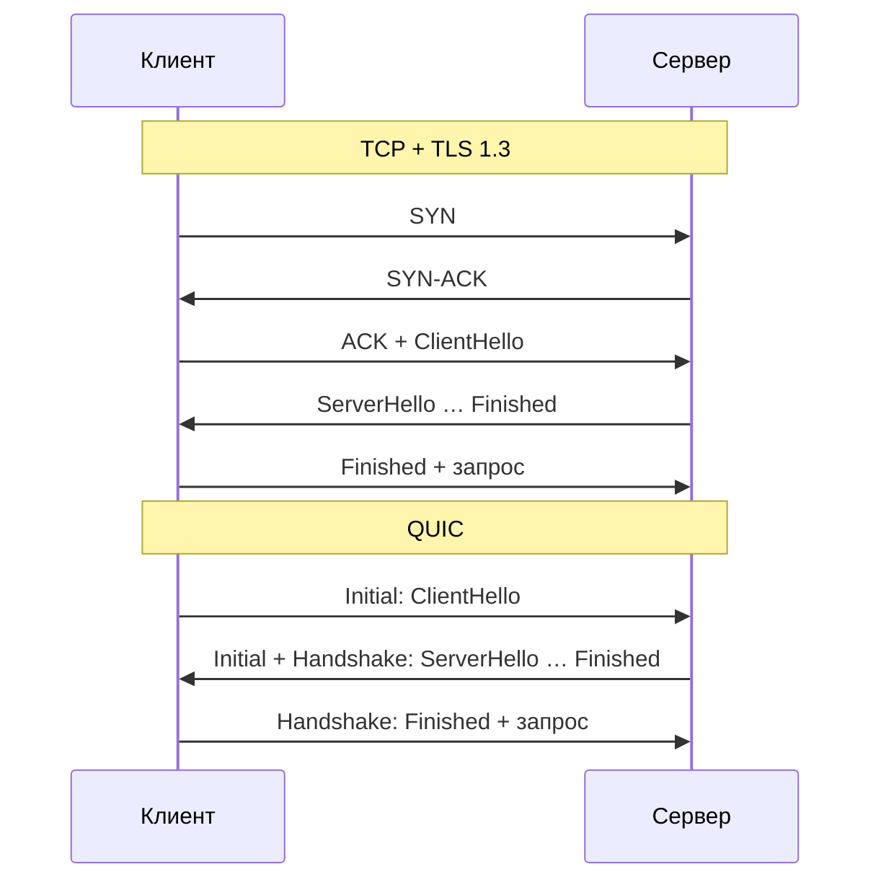

<script setup>
import LanesSandbox from '../../viz/scenes/LanesSandbox.vue'
</script>

# 0b.8. HTTP/3 и QUIC

## <Part kind="problem" /> Проблема: электричка, LTE и смена сети

Пользователь мессенджера едет в электричке. Мобильная сеть: <T id="rtt">RTT</T> 100–150 мс, потери пакетов то 1%, то 5% — между станциями хуже. Приложение держит одно <T id="tcp">TCP</T>-соединение по HTTP/2 (урок [0b.7](./07-http2)): по нему идут отправка сообщений, подгрузка истории, аватарки и картинки.

Первая беда вам уже знакома. Потерялся один пакет с куском картинки — и пока не придёт повтор, ждут **все** потоки соединения, включая крошечный запрос «отправить сообщение». При RTT 150 мс каждая такая потеря — минимум 150 мс задержки для всего сразу, а повтор по таймеру — заметно больше. Это <T id="head-of-line-blocking">блокировка начала очереди</T> уровня TCP.

Вторая беда — человек вышел на станции, и телефон переключился с LTE на Wi-Fi вокзала. Сменился IP-адрес. TCP-соединение определяется четвёркой (адрес и порт клиента, адрес и порт сервера — урок [0b.1](./01-layers)), и с новым адресом это уже **чужое** соединение: сервер его не знает. Старое соединение мертво, но телефон узнает об этом не сразу — сначала будут повторы в никуда. Потом всё заново: <T id="dns">DNS</T>, TCP-рукопожатие (1 RTT), <T id="tls">TLS</T> (ещё 1 RTT), запрос (ещё 1 RTT). При RTT 150 мс — <N>450 мс</N> только на то, чтобы снова начать разговор, и это если ни один пакет рукопожатия не потерялся.

Ни то, ни другое нельзя починить настройками HTTP. Оба свойства — в самом TCP. HTTP/3 меняет транспорт: вместо TCP — <T id="quic">QUIC</T>, протокол поверх <T id="udp">UDP</T>, в котором потоки независимы, рукопожатие совмещено с TLS, а соединение переживает смену адреса. В этом уроке разберём, почему QUIC сделан поверх UDP, как он устроен, что такое <T id="zero-rtt">0-RTT</T> и чем он опасен, как браузер узнаёт, что сервер умеет HTTP/3, и почему в нашей Go-лабораторной HTTP/3 нет. А в конце — мини-интервью по всему модулю.

Подумайте, прежде чем читать дальше: если TCP так мешает, почему бы просто не исправить TCP?

## <Part kind="theory" /> Почему не «улучшить TCP»

Пробовали. Две причины, по которым это почти невозможно.

**TCP живёт в ядре.** Код TCP — часть операционной системы. Новый механизм в TCP заработает у пользователя, когда обновится ядро на его телефоне, ноутбуке и на сервере. Серверы обновить можно, а вот миллиарды телефонов и домашних роутеров живут со старыми ядрами годами. Приложение же обновляется за неделю.

**Окостенение (ossification).** Между клиентом и сервером стоят **посредники** (middlebox): NAT в домашнем роутере, файрволы, балансировщики, «ускорители» операторов. Многие из них заглядывают в заголовки TCP — номера последовательности, флаги, опции — и делают выводы. Всё, что выглядит непривычно, они отбрасывают или «чинят». Пример — TCP Fast Open (RFC 7413): отправка данных уже в `SYN`. Стандарт вышел в 2014 году, но на практике часть посредников выкидывала такие `SYN` или вырезала опцию, и в массовом вебе механизм так и не прижился. Протокол, чьи заголовки видны всем, со временем застывает: любое изменение ломается о посредника, который «знает», как TCP должен выглядеть.

Отсюда решение QUIC:

- **Поверх UDP.** UDP проходит почти через любую сеть, и посредники в его содержимое не лезут: смотреть там нечего, кроме портов (урок [0b.3](./03-udp)). UDP здесь — не «быстрый транспорт», а способ пройти через существующий интернет, ничего в нём не меняя.
- **В пространстве пользователя.** QUIC реализован библиотекой в приложении или в браузере, а не в ядре. Новая версия алгоритма — с обновлением приложения.
- **Шифровать почти всё**, включая служебные поля транспорта, — чтобы посредникам не во что было вцепиться. Об этом блок «Под капотом» ниже.

## <Part kind="theory" /> QUIC: надёжный транспорт поверх UDP

QUIC описан в RFC 9000 (транспорт), RFC 9001 (как в нём используется TLS) и RFC 9002 (обнаружение потерь и управление перегрузкой). Всё, что TCP делает в ядре, QUIC делает сам, поверх UDP-датаграмм: нумерует пакеты, подтверждает, повторяет потерянное, управляет окном перегрузки и потоком.

Отличия от TCP, ради которых всё затевалось:

**Независимые потоки.** Внутри одного соединения QUIC — много потоков, как в HTTP/2 (<T id="multiplexing">мультиплексирование</T>). Но теперь потоки — понятие **транспорта**: каждый кадр `STREAM` несёт номер потока и смещение данных внутри него. Порядок QUIC соблюдает только **внутри потока**. Потерялся пакет с данными потока 1 — ждёт повтора только поток 1, данные потоков 3 и 5 сразу отдаются приложению. Блокировка начала очереди между потоками исчезла.

**Номера пакетов не повторяются.** В TCP повтор сегмента идёт с тем же номером последовательности, и отправитель не может понять, на какой экземпляр пришло подтверждение — на исходный или на повтор. Из-за этого путаются замеры RTT. В QUIC повтор — это **новый пакет с новым номером** (RFC 9000, разд. 12.3), в который просто положили те же данные. Подтверждения однозначны, замеры RTT точнее, а кадр `ACK` перечисляет диапазоны полученных пакетов — как SACK в TCP, только диапазонов может быть гораздо больше.

**Но окно перегрузки по-прежнему одно на соединение.** Это важно не перепутать: QUIC убирает блокировку очереди, но не общую судьбу целиком. Потеря всё так же уменьшает окно перегрузки соединения, и все потоки замедляются. В лабораторной урока 0b.7 при крупных ответах именно этот эффект дал HTTP/2 самый большой проигрыш, и QUIC его не устраняет.

## <Part kind="theory" /> Рукопожатие: 1 RTT и 0-RTT

В TCP + TLS 1.3 два рукопожатия друг за другом: сначала TCP (1 RTT), потом TLS (1 RTT). В QUIC TLS 1.3 встроен в транспорт (RFC 9001): сообщения TLS едут в кадрах `CRYPTO` прямо в первых пакетах QUIC. Одно совмещённое рукопожатие — **1 RTT** до первого запроса вместо двух.



Две детали первого пакета клиента, которые вы увидите в лабораторной:

- **Он не меньше 1200 байт.** Клиент обязан дополнять датаграммы с пакетами `Initial` до 1200 байт (RFC 9000, разд. 8.1). Зачем: пока сервер не убедился, что клиент действительно сидит на своём адресе, он может отправить в ответ не больше чем втрое больше, чем получил. Иначе злоумышленник подделал бы адрес жертвы в маленьком пакете, и сервер обрушил бы на жертву килобайты сертификатов — атака усиления. 1200 байт клиента — это до <N>3600 байт</N> ответа. Компактной цепочке (ключи ECDSA, сжатие сертификатов по RFC 8879) этого хватает; длинная цепочка с ключами RSA не влезает, и сервер ждёт следующего пакета клиента — лишний RTT.
- **Его повтор — по таймеру, как у SYN.** Пока RTT не измерен, QUIC считает его равным 333 мс (RFC 9002, разд. 6.2.2), и первый таймер повтора выходит около секунды, дальше — удвоение. Та же история, что с `SYN` в уроке [0b.2](./02-tcp).

### 0-RTT: запрос в первом пакете

Если клиент уже подключался к этому серверу, у него есть билет сессии (урок [0b.5](./05-tls)). Тогда он может отправить запрос **сразу**, в первом же пакете, вместе с `ClientHello`, не дожидаясь ответа сервера. Это 0-RTT (RFC 9001, разд. 4.6). Для повторного подключения после смены сети это ровно то, что нужно: запрос уходит без единого круга ожидания.

Цену мы обсуждали в уроке [0.3](../00-foundation/03-request-path): данные 0-RTT можно **повторить**. Атакующий в сети записывает первый пакет и отправляет его серверу ещё раз — и сервер выполнит запрос дважды (RFC 9001, разд. 9.2). Протокол защиту от повтора не гарантирует: сервер может вести свой анти-повтор (RFC 8446, разд. 8), но это по желанию и не полностью. Поэтому правило: по 0-RTT только безопасные повторяемые запросы — чтение. «Отправить сообщение» в 0-RTT — это возможный дубль в чате. Сервер, которому ранние данные не нравятся, может их отвергнуть, а HTTP-сервер — ответить `425 Too Early` (RFC 8470), и клиент повторит запрос после полного рукопожатия. Как делать повторы безопасными в принципе — модуль 5.

В Go ни 0-RTT поверх TCP (урок 0b.5), ни QUIC в стандартной библиотеке нет — об этом ниже.

## <Part kind="theory" /> ID соединения и миграция

В TCP соединение — это четвёрка адресов и портов. В QUIC каждое соединение помечено **идентификатором соединения** (connection ID, RFC 9000, разд. 5.1), который стоит в заголовке каждого пакета. Сервер узнаёт «своё» соединение по этому идентификатору, а не по адресу, с которого пришёл пакет.

Отсюда **миграция соединения** (разд. 9). Телефон переключился на Wi-Fi и отправил следующий пакет с нового адреса — с тем же connection ID. Сервер находит соединение, проверяет новый путь (кадры `PATH_CHALLENGE` и `PATH_RESPONSE`, разд. 8.2: убедиться, что клиент действительно получает пакеты по новому адресу, а не кто-то подделал отправителя) и продолжает разговор. Без рукопожатия, без потери потоков. То же спасает и при тихой смене адреса, когда NAT перевыдал клиенту порт после простоя.

Две оговорки:

- Чтобы по connection ID нельзя было связать старый и новый адрес одного пользователя, при миграции клиент переходит на **новый** идентификатор из запаса, который сервер выдал заранее (разд. 9.5).
- Балансировщик перед серверами должен направлять пакеты по connection ID, а не по адресу клиента — иначе после миграции пакет попадёт на другой сервер, который этого соединения не знает. Обычный L4-балансировщик, хеширующий четвёрку, миграцию ломает.

## <Part kind="theory" /> HTTP/3 и QPACK

**HTTP/3** (RFC 9114) — это семантика HTTP поверх QUIC. Каждый запрос — отдельный двунаправленный поток QUIC; кадры `HEADERS` и `DATA` знакомы по HTTP/2, но номер потока в них больше не нужен — его несёт QUIC. Управление потоком, приоритеты по RFC 9218, плавное отключение `GOAWAY` — всё есть, частью перенесено в транспорт.

Заголовки сжимает **QPACK** (RFC 9204). Почему не <T id="hpack">HPACK</T> из урока 0b.7? HPACK рассчитывает на то, что изменения динамической таблицы приходят строго по порядку: заголовки потока 5 могут ссылаться на запись, добавленную заголовками потока 3. Поверх TCP порядок гарантирован. В QUIC потоки независимы, и если пакет с заголовками потока 3 потерялся, поток 5 не смог бы раскодировать свои — блокировка очереди вернулась бы через сжатие. QPACK выносит изменения таблицы в отдельные однонаправленные потоки кодировщика и декодировщика, а кодировщик сам решает, можно ли сослаться на запись, получение которой ещё не подтверждено, или лучше отправить заголовок целиком (разд. 2.1.2).

### Как клиент узнаёт про HTTP/3: Alt-Svc

С HTTP/2 было просто: <T id="alpn">ALPN</T> в рукопожатии TLS. Но HTTP/3 идёт по UDP, а не по TCP, — договориться в рукопожатии TCP-соединения о том, чтобы перейти на другой транспорт, нельзя. Поэтому:

1. Первый раз клиент подключается по TCP — HTTP/2 или HTTP/1.1.
2. Сервер в ответе присылает заголовок **`Alt-Svc`** (RFC 7838, разд. 3): «то же самое есть по HTTP/3 на таком-то порту». Вот что ответил `cloudflare.com` в нашей лабораторной:
   ```
   alt-svc: h3=":443"; ma=86400
   ```
   `h3` — идентификатор HTTP/3 для ALPN, `:443` — тот же хост, UDP-порт 443, `ma=86400` — помнить сутки.
3. Следующие запросы клиент пробует по HTTP/3. Не вышло — откатывается на TCP.

Есть и способ без первого TCP-захода: DNS-запись типа `HTTPS` (RFC 9460) прямо сообщает `alpn=h3`, и браузер может начать с QUIC сразу.

### Где HTTP/3 уже работает

Как правило, в основных браузерах — Chrome, Firefox, Safari, Edge — HTTP/3 сегодня включён по умолчанию. На стороне серверов (опыт Google описан в статье Langley и др. из списка источников) — крупные сервисы, которые сами пишут свой сетевой стек (Google и YouTube, Meta), и CDN: Cloudflare, Akamai, Fastly. То есть там, где клиенты — мобильные устройства в плохих сетях, а выигрыш от 1 RTT и миграции заметен на миллиардах подключений. Внутри дата-центров между сервисами HTTP/3 почти не используют: сети там быстрые и почти без потерь, а TCP с HTTP/2 дешевле по процессору и привычнее в отладке.

### Почему в нашей Go-лабораторной HTTP/3 нет

Мы проверили стандартную библиотеку Go 1.26: **реализации QUIC и HTTP/3 в ней нет.** В `net/http` есть только HTTP/1.1 и HTTP/2. Есть строительный блок: с Go 1.21 в `crypto/tls` есть тип `QUICConn` — рукопожатие TLS 1.3 для того, кто реализует QUIC (QUIC сам упаковывает сообщения TLS в свои пакеты, и ему нужен TLS «без своего транспорта»). Но сам QUIC — сторонний:

- **`github.com/quic-go/quic-go`** — самая распространённая реализация на Go, вместе с пакетом `http3`; на ней работает, например, Caddy.
- **`golang.org/x/net/quic`** — реализация от команды Go в дополнительном модуле `x/net`. В документации пакета прямо сказано: работа в процессе, для продакшена не готова, API может меняться.

Лабораторные модуля обходятся без внешних зависимостей, поэтому HTTP/3 мы наблюдаем снаружи — через `curl`.

## <Part kind="viz" /> Визуализация: третья полоса — QUIC

Та же песочница, что в уроке 0b.7, с третьей полосой: HTTP/3 поверх QUIC. Пакеты потоков чередуются так же, как в HTTP/2, но порядок соблюдается только внутри потока.

<Callout type="simplified">

Как и в уроке 0b.7: потеря обнаруживается ровно через RTT, повтор всегда доходит, управления перегрузкой нет. Значит, модель показывает только то, что QUIC действительно убирает, — блокировку очереди между потоками. Общее окно перегрузки, которое у QUIC осталось, здесь не видно. Сравнивайте каждый протокол с ним же без потери (число «+N»).

</Callout>

<LanesSandbox protocols="h1,h2,quic" />

Задания:

1. Не меняя настроек (потерян пакет 4 потока 1, RTT 4), сравните HTTP/2 и QUIC. Какие потоки задержаны в каждом?
2. Потеряйте пакет 4 потока 3 — самый последний. Почему теперь HTTP/2 и QUIC ведут себя одинаково?
3. Поставьте RTT 8 и потеряйте пакет 4 потока 2. Сколько теряет поток 3 в HTTP/2 и в QUIC?
4. Поставьте HTTP/1.1 три соединения и сравните его с QUIC при той же потере. Что общего и чем они всё-таки отличаются в жизни?

<SelfCheck question="Ответы">

1. В HTTP/2 — все три потока (+4, +3, +2), в QUIC — только поток 1 (+4); потоки 2 и 3 готовы в слотах 12 и 13, как без потери. Их данные пришли, и QUIC отдаёт их приложению, не дожидаясь повтора чужого пакета.
2. За последним пакетом нечего блокировать: все остальные данные уже доставлены. Поток 3 задержан на +4 в обоих протоколах, потоки 1 и 2 — нет. Блокировка очереди стоит дорого, когда потеря случается **посреди** передачи и за ней ещё идут данные других потоков.
3. В HTTP/2 поток 3 задержан на 7 слотов (готов в 22 вместо 15), хотя потеря не его. В QUIC — ни на слот: готов в 15. Поток 2 задержан на 8 в обоих.
4. Общее: потеря задерживает только свой поток — у HTTP/1.1 потому, что у каждого потока своё соединение, у QUIC — потому, что потоки независимы внутри одного. В жизни разница большая: у QUIC одно рукопожатие на 1 RTT вместо трёх TCP + TLS по 2 RTT, общий разогнанный cwnd, одна таблица сжатия заголовков и миграция при смене сети. Зато окно перегрузки у QUIC одно, и потеря урезает скорость всех потоков — модель этого не показывает.

</SelfCheck>

## <Part kind="practice" /> Практика: HTTP/3 снаружи, через curl

Go-лабораторной для HTTP/3 нет, но `curl` в контейнере `client` собран с поддержкой HTTP/3. Проверить свою сборку можно так — ищите `HTTP3` в строке `Features`:

```bash
alias lab='docker compose -f labs/0b/compose.yaml'
docker compose -f labs/0b/compose.yaml up -d --build
lab exec client curl -V
```

```
curl 8.14.1 (x86_64-pc-linux-gnu) libcurl/8.14.1 OpenSSL/3.5.7 zlib/1.3.1 brotli/1.1.0 zstd/1.5.7 libidn2/2.3.8 libpsl/0.21.2 libssh2/1.11.1 nghttp2/1.64.0 nghttp3/1.8.0 librtmp/2.3 OpenLDAP/2.6.10
Features: alt-svc AsynchDNS brotli GSS-API HSTS HTTP2 HTTP3 HTTPS-proxy IDN IPv6 Kerberos Largefile libz NTLM PSL SPNEGO SSL threadsafe TLS-SRP UnixSockets zstd
```

(Строка `Protocols` и дата выпуска убраны.) `HTTP3` есть: `nghttp3` — библиотека HTTP/3, а QUIC здесь даёт OpenSSL 3.5. У `curl` на нашей хост-машине (Ubuntu, 8.5.0) `HTTP3` в `Features` нет — такой `curl` флаг `--http3` не примет. Для этой практики нужен доступ в интернет, задержку netem не включаем.

Во всех выводах ниже — реальные результаты на нашем стенде. И здесь стенд преподнёс урок: **в нашей сети UDP на порт 443 не проходит.** Поэтому успешного ответа по HTTP/3 мы показать не можем — зато можем показать, как выглядит самая частая беда HTTP/3 в жизни.

### Шаг 1. Сервер объявляет HTTP/3

```bash
lab exec client curl -sI https://cloudflare.com
```

Нас интересуют две строки:

```
HTTP/2 301
alt-svc: h3=":443"; ma=86400
```

Ответ пришёл по HTTP/2 через TCP, и в нём объявление: «у меня есть HTTP/3 на UDP-порту 443, помни сутки».

### Шаг 2. Попросим HTTP/3 с откатом

```bash
lab exec client curl --http3 -sI https://cloudflare.com -o /dev/null -w '%{http_version}\n'
```

```
2
```

`--http3` значит «попробуй HTTP/3, а не выйдет — откатись». `curl` пробует QUIC и параллельно, с небольшой задержкой, TCP — и ответ пришёл по HTTP/2. Ошибки нет, пользователь ничего не заметил. Так же ведут себя браузеры.

### Шаг 3. Только HTTP/3 — и запись трафика

Флаг `--http3-only` запрещает откат. Заодно запишем, что уходит по UDP:

```bash
lab exec -d client tcpdump --immediate-mode -i eth0 -w /captures/quic.pcap udp port 443
lab exec client bash -c 'time curl --http3-only -sS -I --max-time 10 https://cloudflare.com'
lab exec client pkill tcpdump
lab exec client tcpdump -nn -r /captures/quic.pcap
```

```
curl: (28) Failed to connect to cloudflare.com port 443 after 9999 ms: Could not connect to server

real	0m10.004s
```

```
12:47:04.004390 IP 172.28.0.20.49169 > 104.16.133.229.443: UDP, length 1200
12:47:04.004431 IP 172.28.0.20.49169 > 104.16.133.229.443: UDP, length 1200
12:47:05.003406 IP 172.28.0.20.49169 > 104.16.133.229.443: UDP, length 1200
12:47:07.001413 IP 172.28.0.20.49169 > 104.16.133.229.443: UDP, length 1200
12:47:09.000933 IP 172.28.0.20.52130 > 104.16.132.229.443: UDP, length 1200
12:47:09.000974 IP 172.28.0.20.52130 > 104.16.132.229.443: UDP, length 1200
12:47:09.999948 IP 172.28.0.20.52130 > 104.16.132.229.443: UDP, length 1200
12:47:11.997960 IP 172.28.0.20.52130 > 104.16.132.229.443: UDP, length 1200
```

Здесь видна почти вся теория урока:

- **`length 1200`** — каждая датаграмма ровно 1200 байт: клиент дополняет пакеты `Initial` до минимума RFC 9000.
- **Две датаграммы сразу.** Скорее всего, `ClientHello` не уместился в одну: в нём гибридный постквантовый ключ `X25519MLKEM768` (урок 0b.5), а одна только его часть ML-KEM занимает 1184 байта. Содержимое пакетов зашифровано, и `tcpdump` его не покажет — это наш вывод, а не прочитанное в записи.
- **Повторы через 1 с и ещё через 2 с** — таймер повтора без измеренного RTT, с удвоением. Повторы — по одной датаграмме, а не по две: проба по таймеру (RFC 9002, разд. 6.2.4) может нести только часть неподтверждённых данных. Ответа нет ни одного.
- **Через 5 с — второй адрес** `104.16.132.229` (у `cloudflare.com` их несколько в DNS), с той же картиной. Через 10 с `curl` сдаётся по `--max-time`.

Что видели бы в сети, где UDP проходит: ответные датаграммы от сервера, строку `HTTP/3 301` вместо `HTTP/2 301` в шаге 3 и `3` вместо `2` в шаге 2. Попробуйте на домашней сети или с телефона, раздающего интернет: многие корпоративные и некоторые домашние сети UDP 443 режут, мобильные операторы, как правило, пропускают.

Закончили — остановите стенд:

```bash
docker compose -f labs/0b/compose.yaml down
```

<Deep title="почему QUIC шифрует даже заголовки транспорта">

В TCP весь заголовок открыт: номера последовательности и подтверждений, флаги, окно, опции. Это удобно для отладки и для операторов — по одной записи трафика видно RTT, потери, повторы. И именно это привело к окостенению: посредники начали **полагаться** на то, что видят, и ломать всё непривычное.

QUIC делает ставку на обратное: показать посреднику как можно меньше. Что видно в пакете QUIC открытым текстом:

- IP-адреса и UDP-порты — без них пакет не доставить;
- несколько бит флагов и тип пакета (длинный заголовок — в рукопожатии, короткий — потом);
- connection ID — чтобы балансировщик мог направить пакет;
- в длинном заголовке — номер версии.

Всё остальное зашифровано: кадры, подтверждения, данные потоков. Одна оговорка: пакеты `Initial` зашифрованы ключами, которые выводятся из connection ID (RFC 9001, разд. 5.2), а его видит любой. Это защита от случайной порчи, а не секретность: посредник и Wireshark читают `ClientHello`, включая SNI, — как в TCP+TLS (урок [0b.5](./05-tls)). Настоящие ключи начинаются с пакетов `Handshake`. И даже **номер пакета** закрыт отдельной «защитой заголовка» (header protection, RFC 9001, разд. 5.4): из зашифрованного содержимого берётся образец, по нему вычисляется маска и накладывается на номер пакета и часть флагов. Посредник не видит ни номеров, ни подтверждений — значит, не может «помогать» ретрансляциями, переписывать окно или отбрасывать пакеты по своей логике. А поля, которые видны, специально «шевелят»: один бит, который раньше всегда был 1, по договорённости сторон можно ставить случайно (RFC 9287), чтобы никто не привык проверять его значение.

Цена — для всех, кто отлаживает сеть.

- **Пассивно RTT и потери не измерить.** Оператор, который раньше смотрел на TCP-подтверждения, теперь не видит ничего. Компромисс — необязательный «спин-бит» (RFC 9000, разд. 17.4): стороны переключают его раз за круг, и наблюдатель может оценить RTT, не узнав больше ничего. Многие реализации его не включают.
- **Запись трафика без ключей бесполезна.** В Wireshark пакеты QUIC после рукопожатия — шум. Чтобы их прочитать, нужны ключи сессии. Стандартный способ — переменная окружения `SSLKEYLOGFILE`: браузеры и `curl` пишут в указанный файл секреты каждой сессии, а Wireshark подхватывает его в настройках TLS и расшифровывает запись. В Go то же даёт поле `tls.Config.KeyLogWriter` — и для TLS поверх TCP, и для quic-go. Держите такой файл как секрет: с ним расшифровывается весь записанный трафик.

  Вот одна и та же запись `quic-h3.pcap` — `curl --http3-only` с `SSLKEYLOGFILE` к серверу HTTP/3 Caddy, запущенному в сети стенда (до интернета UDP 443 у нас не проходит, см. шаг 3), — сначала без ключей, потом с ними.

  <Shot
    src="/shots/0b-08-quic/wireshark-no-keys.webp"
    :width="1400" :height="780"
    alt="Wireshark без ключей: после рукопожатия все пакеты QUIC подписаны Protected Payload, байты выбранного пакета не читаются"
    caption="Без ключей: после рукопожатия — только шифротекст"
    version="Wireshark 4.6.6"
    :marks="[
      { n: 1, x: 41.1, y: 2.2, w: 26.9, h: 7.0, text: 'Пакеты `Initial` (и пакет 8) читаются и без ключей: их ключи выводятся из открытого connection ID. Видны тип пакета, номер и кадры.' },
      { n: 2, x: 41.1, y: 11.2, w: 12.1, h: 25.1, text: 'Всё остальное, кроме пакета 8, — `Protected Payload (KP0)`: ни кадров, ни номера пакета.' },
      { n: 3, x: 3.0, y: 70.1, w: 18.4, h: 1.8, at: 'below', text: 'Короткий заголовок открывает только пару бит и спин-бит. Остальное — `Remaining Payload`, шифротекст.' },
      { n: 4, x: 53.7, y: 52.2, w: 35.2, h: 14.5, text: 'Байты пакета №16 — шум, хотя в нём ответ сервера.' },
    ]"
  />

  <Shot
    src="/shots/0b-08-quic/wireshark-with-keys.webp"
    :width="1400" :height="780"
    alt="Wireshark с файлом ключей: в списке видны кадры QUIC и HTTP/3, пакет 16 разобран до HEADERS и DATA, в расшифрованных байтах текст hello over HTTP/3"
    caption="С ключами: та же запись, кадры QUIC и HTTP/3 видны"
    version="Wireshark 4.6.6"
    :marks="[
      { n: 1, x: 41.1, y: 2.2, w: 27.1, h: 34.1, text: 'В колонке Info — кадры QUIC (`ACK`, `CRYPTO`, `NCI`) и HTTP/3 (`SETTINGS`, `HEADERS`, `DATA`). Ключи Wireshark взял из настройки TLS `(Pre)-Master-Secret log filename`.' },
      { n: 2, x: 3.0, y: 61.2, w: 28.4, h: 19.7, text: 'Пакет №16 — ответ сервера: кадр `HEADERS` (59 байт, заголовки сжаты QPACK) и кадр `DATA` (17 байт).' },
      { n: 3, x: 79.9, y: 55.8, w: 9.1, h: 3.6, text: 'Тело ответа в расшифрованных байтах: `hello over HTTP/3`.' },
      { n: 4, x: 59.3, y: 93.8, w: 12.1, h: 2.8, text: 'Вкладка расшифрованного содержимого. Во вкладке `Packet` — те же байты, что и без ключей.' },
    ]"
  />

- **Свои инструменты.** Вместо разбора пакетов реализации QUIC умеют писать журнал событий в формате qlog — что отправили, что подтвердили, когда сочли пакет потерянным; его смотрят в визуализаторе qvis.

Это осознанная плата: отладка стала труднее, зато протокол можно развивать — новые версии QUIC и новые алгоритмы перегрузки выкатываются вместе с приложением, и ни один посредник им не помешает.

</Deep>

## <Part kind="mistakes" /> Типичные ошибки

<Callout type="mistake">

**Рассчитывать, что HTTP/3 есть у всех.** UDP 443 режут корпоративные файрволы, некоторые провайдеры и публичные Wi-Fi — у нас на стенде он не прошёл вообще. Клиент обязан уметь откатываться на HTTP/2 по TCP, а сервер — продолжать его обслуживать. HTTP/3 — ускорение для тех, у кого он работает, а не замена TCP.

**Разрешить 0-RTT для запросов, которые меняют данные.** Ранние данные можно повторить, и сервер выполнит запрос дважды. 0-RTT — только для чтения; всё остальное либо отвергать (`425 Too Early`), либо защищать ключом идемпотентности (модуль 5).

**L4-балансировщик, хеширующий адрес клиента, перед QUIC-серверами.** После миграции или перевыдачи порта NAT пакеты соединения попадают на другой сервер, и соединение рвётся — ровно то, от чего QUIC должен был спасти. Балансировщик должен уметь направлять по connection ID.

**Ждать, что QUIC уберёт любую задержку при потерях.** Он убирает блокировку между потоками, но окно перегрузки у соединения одно, и при потерях скорость падает у всех потоков. Для крупных передач по плохому каналу QUIC не волшебнее TCP.

**Забыть про процессор.** QUIC работает в пространстве пользователя, шифрует каждый пакет отдельно и лишь частично получает аппаратные ускорения, которые у TCP есть десятилетиями. На сервере HTTP/3 обычно дороже по процессору на байт, чем TCP + TLS. Включая его, мерьте.

</Callout>

## <Part kind="tradeoff" /> Компромисс: HTTP/3 или HTTP/2

<Callout type="tradeoff">

**HTTP/3 даёт:** рукопожатие за 1 RTT вместо 2 (и 0-RTT для повторных подключений); потоки без взаимной блокировки при потере; соединение, которое переживает смену сети; протокол, который развивается вместе с приложением, а не с ядром.

**Чем платим:** UDP режут в части сетей — нужен откат на TCP, а значит, держать оба стека; больше процессора на сервере; балансировщики должны понимать connection ID; отладка требует ключей и своих инструментов; в Go — сторонняя библиотека.

**HTTP/2 по TCP даёт:** работает везде, дешевле по процессору, привычные инструменты (`tcpdump`, `ss`), полная поддержка в стандартной библиотеке Go.

**Чем платим:** блокировкой начала очереди уровня TCP, 2 RTT на подключение, разрывом при смене сети.

**Как выбирать:** на границе с мобильными клиентами — включать HTTP/3 на балансировщике или CDN, оставляя HTTP/2 как откат; это дешевле всего, потому что QUIC там уже реализован. Внутри дата-центра между Go-сервисами — HTTP/2 (или gRPC): потерь почти нет, RTT — доли миллисекунды, выигрыш HTTP/3 не окупает его сложность.

</Callout>

## <Part kind="practice" /> Мини-интервью модуля 0b

В конце модуля — задача в формате интервью. Засеките 30 минут, возьмите бумагу и не подглядывайте в разбор, пока не закончите. Всё, что нужно для ответа, было в уроках 0b.1–0b.8.

<Callout type="idea" title="Мини-интервью: 30 минут">

**Задача.** Пользователи жалуются, что API мессенджера иногда отвечает ровно через 3 секунды или ровно через 1 секунду, хотя обычно — за 50 мс. Иногда — ровно через 5 секунд. Как найти причину на сетевом уровне?

Ориентир:

1. 5 минут — гипотезы: какие механизмы дают задержку **ровно** в 1, 3 или 5 секунд;
2. 15 минут — как подтвердить каждую гипотезу: какие команды, какие метрики, где смотреть — у клиента, у балансировщика, у сервиса, у его соседей;
3. 10 минут — что чинить в коде и в настройках.

</Callout>

<SelfCheck question="Эталонный разбор мини-интервью" label="Задание." button="Показать эталонный разбор">

**Ключ — слово «ровно».** Случайная медлительность (перегруженная база, сборка мусора) даёт размазанное распределение. Задержка ровно в 1, 3 или 5 секунд — признак **таймера**: кто-то ждал ответа, не дождался и повторил. Ищем, у какого механизма такие таймеры.

**1 с и 3 с — потерянный `SYN`** (урок [0b.2](./02-tcp)). В рукопожатии RTT ещё не измерен, и первый таймер повтора — 1 с (RFC 6298). Потеряли `SYN` или `SYN-ACK` один раз (<T id="retransmission">повтор</T> по таймеру) — соединение установится примерно через 1 с. Дальше зависит от ядра:

- **ровно 1 с / 3 с — классический удваивающийся RTO**: повторы через 1, потом через 2 секунды; две потери подряд — 1 + 2 = <N>3 с</N>. Так ведут себя RFC 6298 и ядра Linux постарше;
- **на свежем Linux первые повторы линейны** — параметр `tcp_syn_linear_timeouts` (по умолчанию 4): моменты повторов — 1, 2, 3, 4, 5 с от начала (каждое ожидание по 1 с), потом удвоение. Две потери — около 2 с, три — около 3 с.

Таймер — у того, кто отправляет `SYN`, то есть у **клиента** соединения. Если «клиент» — телефон пользователя, решают его ОС и сеть. Если задержка возникает между вашим сервисом и его соседом — ядро машины вашего сервиса.

**5 с — таймаут DNS** (урок [0b.4](./04-dns)). DNS идёт по UDP, повторяет сам резолвер, и по умолчанию он ждёт ответа 5 с (`timeout:5` в `resolv.conf`, умолчание glibc; у резолвера Go те же 5 с и 2 попытки). Потерялся один DNS-пакет — ровно 5 с. В Kubernetes с `ndots:5` запросов на одно имя в 4 раза больше, и шанс потерять один — тоже. Две потери подряд — 10 с, и это уже таймаут поиска целиком.

**Откуда потери.** Чаще всего не из «плохой сети», а из переполненных очередей: у сервера заполнена очередь приёма соединений (`listen` backlog) — ядро молча отбрасывает `SYN`; переполнена таблица conntrack на узле или NAT; DNS-сервер перегружен; потери на перегруженном канале.

**Как подтвердить.**

- **Метрики фаз запроса.** В Go — `httptrace` (как в `httpbench`, урок [0b.6](./06-http1-pools)): длительность `DNSStart → DNSDone` и `ConnectStart → ConnectDone` отдельно от ожидания ответа. Гистограммы с пиками ровно на 1, 3, 5 с — ответ на вопрос. Если `connect` ≈ 1,0 с, а сервер обработал запрос за 20 мс, — это рукопожатие.
- **Счётчики ядра.** `nstat -az TcpExtTCPSynRetrans` — сколько повторов `SYN` отправила машина; на стороне сервера — `TcpExtListenOverflows` и `TcpExtListenDrops` (переполнение очереди приёма); `ss -ltn` — у слушающего сокета `Recv-Q` (ждут `accept`) против `Send-Q` (размер очереди).
- **Состояние соединений.** `ss -ti` — `retrans`, `rto`, `rtt` у живых соединений: растущий `retrans` — потери на пути.
- **Запись трафика.** `tcpdump -nn 'tcp[tcpflags] & tcp-syn != 0'` у клиента: два `SYN` с одним и тем же `seq` с интервалом ровно в секунду — потерянный `SYN`. `tcpdump -nn udp port 53`: вопрос без ответа и тот же вопрос через 5 с.
- **Сопоставить с логами сервера.** Если сервер вообще не видел медленный запрос или видел его быстрым — задержка была до него: в подключении или в DNS.

**Что чинить.**

- **Реже устанавливать соединения**: keep-alive и правильно настроенный пул (`MaxIdleConnsPerHost` не меньше параллельности, урок 0b.6), HTTP/2 к соседям. Нет нового рукопожатия — нечему теряться.
- **DNS**: кэш на узле (например, NodeLocal DNSCache в Kubernetes), меньше `ndots` или точка в конце внешних имён, `timeout:1` и `attempts` в `resolv.conf`, если пять секунд недопустимы.
- **Таймауты и повторы в коде**: `Dialer.Timeout` меньше секунды-двух и повтор подключения на уровне приложения — с бюджетом повторов и джиттером (модуль 5), иначе агрессивные повторы сами переполнят очередь приёма у сервера, — а не ожидание таймера ядра; общий дедлайн запроса через контекст; повторять — только идемпотентные запросы.
- **Причину потерь**: увеличить очередь приёма (`somaxconn`, `backlog`), если она переполняется; проверить conntrack и NAT; добавить мощности DNS.

**Связи.** Повторы, таймауты, бюджеты и идемпотентность — модуль 5 (устойчивость). Гистограммы фаз запроса, трассировка и алерты, которые ловят такие проблемы раньше пользователей, — модуль 12 (наблюдаемость).

</SelfCheck>

## <Part kind="selfcheck" /> Самопроверка

<SelfCheck question="Почему QUIC сделан поверх UDP, а не как новая версия TCP?">

TCP реализован в ядрах ОС, и новая версия дошла бы до пользователей через годы обновлений телефонов и роутеров. А посредники в сети (NAT, файрволы) разбирают заголовки TCP и ломают всё непривычное — так TCP Fast Open и не прижился. UDP проходит почти везде, а его содержимое посредникам непрозрачно. QUIC работает в пространстве пользователя и обновляется вместе с приложением.

</SelfCheck>

<SelfCheck question="Потерялся пакет с данными потока 1. Что происходит с потоками 3 и 5 в HTTP/2 поверх TCP и в HTTP/3 поверх QUIC? Есть ли у QUIC общий для всех потоков эффект от этой потери?">

В HTTP/2 данные потоков 3 и 5, пришедшие после потерянного пакета, ждут в буфере ядра, пока не придёт повтор: TCP отдаёт байты строго по порядку. В QUIC порядок соблюдается только внутри потока, и данные потоков 3 и 5 сразу отдаются приложению. Общий эффект у QUIC остаётся: потеря уменьшает окно перегрузки соединения, и скорость всех потоков падает.

</SelfCheck>

<SelfCheck question="Клиент мессенджера хочет отправлять сообщения в 0-RTT, чтобы после смены сети они уходили мгновенно. Что ответить?">

Нельзя без защиты от повторов. Данные 0-RTT атакующий может записать и отправить серверу снова, и сообщение будет доставлено дважды. По 0-RTT безопасно только чтение. Для отправки — либо полное рукопожатие (1 RTT; а миграция соединения QUIC часто вообще избавляет от переподключения), либо ключ идемпотентности, по которому сервер распознает дубль (модуль 5).

</SelfCheck>

<SelfCheck question="Телефон перешёл с LTE на Wi-Fi. Почему TCP-соединение умирает, а QUIC-соединение может выжить? Что для этого нужно от балансировщика?">

TCP-соединение определяется четвёркой адресов и портов; новый IP-адрес — это другое соединение, и сервер его не знает. QUIC-соединение определяется connection ID в каждом пакете: сервер узнаёт соединение по нему, проверяет новый путь (`PATH_CHALLENGE` / `PATH_RESPONSE`) и продолжает. Балансировщик должен направлять пакеты по connection ID, а не по адресу клиента, иначе пакет с нового адреса попадёт на другой сервер.

</SelfCheck>

<SelfCheck question="Как браузер узнаёт, что сайт умеет HTTP/3, если первое подключение — по TCP?">

Сервер присылает в ответе заголовок `Alt-Svc: h3=":443"; ma=86400` — «HTTP/3 есть на UDP-порту 443, помни сутки». Следующие запросы браузер пробует по QUIC, а если не выходит — откатывается на TCP. Другой путь — DNS-запись `HTTPS` с `alpn=h3`: тогда можно начать с QUIC без первого TCP-захода.

</SelfCheck>

## <Part kind="sources" /> Источники

<Callout type="source">

- Iyengar J., Thomson M., [«RFC 9000: QUIC: A UDP-Based Multiplexed and Secure Transport»](https://www.rfc-editor.org/rfc/rfc9000), разд. 2 — потоки; разд. 5.1 — connection ID; разд. 8.1 — проверка адреса, минимум 1200 байт и предел «втрое больше»; разд. 8.2 — проверка пути; разд. 9 — миграция соединения, 9.5 — приватность при миграции; разд. 12.3 — номера пакетов; разд. 17.4 — спин-бит.
- Thomson M., Turner S., [«RFC 9001: Using TLS to Secure QUIC»](https://www.rfc-editor.org/rfc/rfc9001), разд. 4 — TLS-рукопожатие внутри QUIC, 4.6 — 0-RTT; разд. 5.2 — ключи пакетов `Initial` из connection ID; разд. 5.4 — защита заголовка; разд. 9.2 — атаки повтором на 0-RTT.
- Iyengar J., Swett I., [«RFC 9002: QUIC Loss Detection and Congestion Control»](https://www.rfc-editor.org/rfc/rfc9002), разд. 6.2 — таймер повтора (PTO), 6.2.2 — начальный RTT 333 мс, 6.2.4 — что кладут в пробные пакеты.
- Bishop M., [«RFC 9114: HTTP/3»](https://www.rfc-editor.org/rfc/rfc9114), разд. 3.1 — обнаружение через Alt-Svc; разд. 4 — запросы на потоках QUIC; приложение A — отличия от HTTP/2.
- Krasic C., Bishop M., Frindell A., [«RFC 9204: QPACK: Field Compression for HTTP/3»](https://www.rfc-editor.org/rfc/rfc9204), разд. 2.1.2 — заблокированные потоки и почему HPACK не подошёл.
- Nottingham M., McManus P., Reschke J., [«RFC 7838: HTTP Alternative Services»](https://www.rfc-editor.org/rfc/rfc7838), разд. 3 — заголовок `Alt-Svc`.
- Schwartz B., Bishop M., Nygren E., [«RFC 9460: Service Binding and Parameter Specification via the DNS»](https://www.rfc-editor.org/rfc/rfc9460) — DNS-запись `HTTPS` с параметром `alpn`.
- Ghedini A., Vasiliev V., [«RFC 8879: TLS Certificate Compression»](https://www.rfc-editor.org/rfc/rfc8879) — сжатие цепочки сертификатов, чтобы она помещалась в лимит ответа до проверки адреса.
- Rescorla E., [«RFC 8446: The Transport Layer Security (TLS) Protocol Version 1.3»](https://www.rfc-editor.org/rfc/rfc8446), разд. 8 — защита от повтора 0-RTT на сервере и её пределы.
- Thomson M., [«RFC 8470: Using Early Data in HTTP»](https://www.rfc-editor.org/rfc/rfc8470), разд. 5.2 — код `425 Too Early`.
- Cheng Y. и др., [«RFC 7413: TCP Fast Open»](https://www.rfc-editor.org/rfc/rfc7413), разд. 4.1.3–4.1.3.1 — что делать клиенту, если посредники отбрасывают `SYN` с данными; пример окостенения TCP.
- Thomson M., [«RFC 9287: Greasing the QUIC Bit»](https://www.rfc-editor.org/rfc/rfc9287) — зачем «шевелить» видимые поля.
- Langley A. и др., «The QUIC Transport Protocol: Design and Internet-Scale Deployment», ACM SIGCOMM 2017 — почему Google сделал QUIC поверх UDP, окостенение и опыт развёртывания.
- Документация Go: пакет [`crypto/tls`](https://pkg.go.dev/crypto/tls) — `QUICConn`, `QUICConfig` (Go 1.21+), `Config.KeyLogWriter`; пакет [`golang.org/x/net/quic`](https://pkg.go.dev/golang.org/x/net/quic) — экспериментальная реализация; [quic-go](https://github.com/quic-go/quic-go) — QUIC и HTTP/3 на Go.
- Документация curl, [«HTTP/3 with curl»](https://curl.se/docs/http3.html) — сборки с HTTP/3, флаги `--http3` и `--http3-only`.

</Callout>
