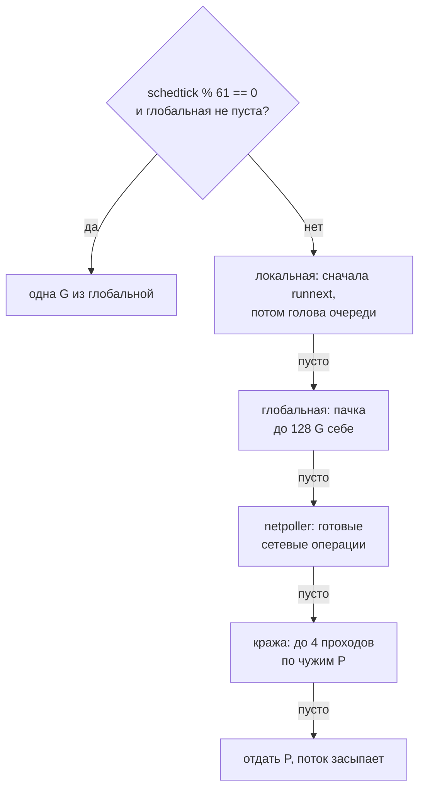

<script setup>
import GmpScheduler from '../../viz/scenes/GmpScheduler.vue'
</script>

# 1.5.1. Горутины и планировщик

## <Part kind="problem" /> Проблема: сто тысяч горутин и три загадки

Каждый запрос к мессенджеру обслуживает своя горутина. Мы её не запускали: это делает `net/http`. Сервер принимает соединение и выполняет `go c.serve(connCtx)` (`net/http/server.go`). Тысяча открытых соединений — тысяча горутин, сто тысяч — сто тысяч. В Java до 21-й версии стандартом был другой подход: запрос обслуживает поток, но взятый из ограниченного пула. Так работают сервлеты, у Tomcat по умолчанию пул из 200 потоков. Новый поток ОС на каждое соединение без ограничения считался ошибкой проектирования. Почему Go может себе позволить то, что в Java было запрещено? И где эта щедрость кончается?

Начнём с измерений. Программа `sched/cost` из лабы запускает 100 000 горутин, которые ждут на канале. Потом она запускает 1 000 горутин, каждая из которых закреплена за собственным потоком ОС:

```text
$ go run ./1-5/sched/cost
go version: go1.27.2
GOMAXPROCS: 12
NumCPU: 12
горутин: 100000
стек на горутину: 2052 байт
создание одной горутины: 1052 нс
потоков ОС: 1000
рост RSS на поток: 15 КиБ
создание одного потока: 7 мкс
```

машина: Intel Core i5-12400 (6 ядер, 12 логических процессоров), Linux 7.0, go1.27.2.

Горутина обходится в <N>2052 байт</N> памяти и <N>1052 нс</N> на создание, поток — в <N>7 мкс</N>. Сто тысяч горутин создаются за десятую долю секунды. Но память на поток всего около 15 КиБ, а не мегабайты, о которых пишут в книгах. Так в чём тогда дороговизна потока? Ответим в первом разделе.

Вторая программа, `sched/preempt`, оставляет Go один процессор (`GOMAXPROCS(1)`). На нём горутина крутит цикл без вызовов функций около двух секунд, а `main` просит разбудить себя через 10 мс:

```text
$ go run ./1-5/sched/preempt
main проснулся через 10 мс (просил 10 мс)
цикл работал 1566 мс
$ GODEBUG=asyncpreemptoff=1 go run ./1-5/sched/preempt
main проснулся через 1674 мс (просил 10 мс)
цикл работал 1674 мс
```

машина: Intel Core i5-12400 (6 ядер, 12 логических процессоров), Linux 7.0, go1.27.2. Шапка вывода (версия, `GOMAXPROCS`, `NumCPU`) здесь и дальше опущена.

Одна настройка `GODEBUG` — и `main` ждёт не 10 мс, а 1,7 с: пока цикл не кончится сам. Кто и как снимает горутину с процессора посреди цикла?

Третья, `sched/syscall`, усыпляет 8 горутин на 200 мс двумя способами и считает потоки ОС:

```text
$ go run ./1-5/sched/syscall
time.Sleep        x8: потоков до 5, во время 5 (+0)
syscall.Nanosleep x8: потоков до 5, во время 11 (+6)
```

машина: Intel Core i5-12400 (6 ядер, 12 логических процессоров), Linux 7.0, go1.27.2.

Обе горутины просто спят. Но `time.Sleep` не добавил ни одного потока, а системный вызов `nanosleep` добавил <N>+6</N>. Почему?

Все три загадки решает одна часть рантайма — планировщик. В этом уроке мы разберём его так, чтобы вы могли нарисовать его на собеседовании и прочитать его отладочный вывод на живом сервисе.

## <Part kind="theory" /> Поток ОС и его цена

### Что такое поток

Процесс — это программа с собственным адресным пространством, открытыми файлами и правами. <T id="os-thread">Поток ОС</T> (OS thread) — единица исполнения внутри процесса. Потоки одного процесса делят память, но у каждого свои регистры процессора и свой стек. Решает, какой поток сейчас работает на ядре процессора, планировщик ядра ОС. В Linux поток создаётся системным вызовом `clone`, и для ядра это почти такой же объект, как процесс: у него свой идентификатор и своя запись в таблице задач.

Переключение потоков (context switch) устроено так. Поток уходит в ядро — сам, потому что заблокировался на вводе-выводе или на замке, или принудительно, по прерыванию таймера. Ядро сохраняет его регистры, выбирает следующий поток и восстанавливает его регистры. Потоки одного процесса делят адресное пространство, поэтому таблицы страниц менять не нужно. Но вход в ядро, работа его планировщика и выход обратно стоят микросекунды. К тому же новый поток приходит на «холодные» кэши процессора: данные предыдущего ему не нужны.

### Сколько это стоит: бенчмарк

Бенчмарки `sched/cost_test.go` гоняют значение по кругу между двумя горутинами через небуферизованные каналы. Один круг — это два переключения: туда и обратно. В варианте `SwitchOSThreads` обе горутины закреплены за своими потоками (`runtime.LockOSThread`), поэтому каждое переключение — это пробуждение другого потока через ядро:

```text
$ go test -run='^$' -bench=. -benchtime=1s -count=5 -cpu=1,4,8 ./1-5/sched/
cpu: 12th Gen Intel(R) Core(TM) i5-12400
BenchmarkSpawnGoroutine       	 2415703	       522.8 ns/op
BenchmarkSpawnGoroutine-4     	 6449077	       184.1 ns/op
BenchmarkSpawnGoroutine-8     	 6852402	       179.7 ns/op
BenchmarkSwitchGoroutines     	 3386215	       319.2 ns/op
BenchmarkSwitchGoroutines-4   	 2536627	       418.1 ns/op
BenchmarkSwitchGoroutines-8   	 2833525	       457.2 ns/op
BenchmarkSwitchOSThreads      	  139650	      8484 ns/op
BenchmarkSwitchOSThreads-4    	  116631	     10361 ns/op
BenchmarkSwitchOSThreads-8    	  121573	     10135 ns/op
…
```

машина: Intel Core i5-12400 (6 ядер, 12 логических процессоров), Linux 7.0, go1.27.2. Показан первый из пяти прогонов каждой строки. Разброс по всем пяти: `SwitchGoroutines` на одном P — 318–333 нс, `SwitchOSThreads` на одном P — 8,2–8,5 мкс.

Сначала про создание. `SpawnGoroutine` даёт 523 нс на одном P и около 184 нс на четырёх, а `sched/cost` в начале урока — 1052 нс. Противоречия нет: мерится разное. Бенчмарк запускает пустую функцию через `wg.Go`. Это метод `sync.WaitGroup` из Go 1.25, он сам делает `Add(1)`, запускает горутину и вызывает `Done` по её завершении. Горутины тут же кончаются, и рантайм переиспользует их структуры G вместе со стеками из кэша свободных G у P. При `-cpu=4` их к тому же исполняют другие P, пока `main` создаёт следующие. `sched/cost` держит все 100 000 горутин живыми, поэтому каждой нужен новый G и новый стек. А в замер входит ещё и путь до запуска: горутину надо поставить в очередь, дождаться, пока её запустят, и дождаться её отправки в канал `started`. Так что 0,2–0,6 мкс — это цена самого `go f()`, а 1 мкс — цена «создать и дождаться, что горутина заработала».

Круг между горутинами — около <N>320 нс</N>, между потоками — около <N>8,5 мкс</N>. Разница в 26 раз, и это при том, что в обоих случаях работают одни и те же каналы. Всё отличие — в том, кто переключает: рантайм Go в пространстве пользователя или ядро ОС. На одном переключении это примерно 160 нс против 4 мкс.

### Память потока: 8 МиБ, которых нет

Обычно пишут, что поток ОС резервирует 8 МиБ под стек. Это правда для потоков, созданных через `pthread_create`: так работают C, C++ и Go-программы с <T id="cgo">cgo</T> (вызовами C-кода из Go). Размер берётся из `ulimit -s`, у автора это 8192 КиБ. Но Go без cgo создаёт потоки сам, вызовом `clone`, и даёт каждому системный стек всего 16 КиБ (`allocm` в `runtime/proc.go`: `mp.g0 = malg(16384 * sys.StackGuardMultiplier)`). Проверим. Программа закрепляет 1 000 горутин за потоками и печатает строки из `/proc/self/status`:

<!-- go-check -->

```go
package main

import (
	"fmt"
	"os"
	"runtime"
	"strings"
)

const threads = 1000

// status возвращает строки VmSize, VmRSS и Threads из /proc/self/status.
func status() string {
	data, err := os.ReadFile("/proc/self/status")
	if err != nil {
		return err.Error()
	}
	var out []string
	for line := range strings.SplitSeq(string(data), "\n") {
		for _, key := range []string{"VmSize:", "VmRSS:", "Threads:"} {
			if rest, ok := strings.CutPrefix(line, key); ok {
				out = append(out, key+" "+strings.TrimSpace(rest))
			}
		}
	}
	return strings.Join(out, ", ")
}

// Каждая горутина закрепляется за своим потоком ОС и ждёт: рантайм вынужден
// создать по потоку на горутину.
func main() {
	fmt.Println("до:   ", status())
	stop, started := make(chan struct{}), make(chan struct{})
	for range threads {
		go func() {
			runtime.LockOSThread()
			started <- struct{}{}
			<-stop
		}()
	}
	for range threads {
		<-started
	}
	fmt.Println("после:", status())
	close(stop)
}
```

Запускаем как есть, а потом с одной добавленной строкой `import _ "runtime/cgo"`, которая заставляет рантайм создавать потоки через `pthread_create`:

```text
$ go run ./threads
до:    VmSize: 1226868 kB, VmRSS: 2352 kB, Threads: 5
после: VmSize: 1295356 kB, VmRSS: 21108 kB, Threads: 1015
$ go run ./threadscgo
до:    VmSize: 1598304 kB, VmRSS: 4020 kB, Threads: 6
после: VmSize: 15826088 kB, VmRSS: 24336 kB, Threads: 1014
```

машина: Intel Core i5-12400 (6 ядер, 12 логических процессоров), Linux 7.0, go1.27.2, glibc 2.39.

`VmSize` — виртуальная память, то есть сколько адресов процесс зарезервировал. `VmRSS` — сколько физической памяти он на самом деле занимает. Без cgo тысяча потоков добавила 67 МиБ виртуальной памяти, в среднем меньше 70 КиБ на поток. Из них у каждого M есть системный стек `g0` на 16 КиБ и отдельный стек на 32 КиБ для обработчиков сигналов (`mpreinit` в `runtime/os_linux.go`: `mp.gsignal = malg(32 * 1024)`), плюс сама структура `m`. Остальное, по-видимому, — память, которую рантайм заодно зарезервировал под кучу и стеки. С cgo — 13,6 ГиБ, около 14 МиБ на поток. Из них 8 МиБ — стек `pthread`, а остальное, судя по всему, резервы аллокатора C (glibc заводит потокам свои области `malloc`). Физической же памяти в обоих случаях прибавилось почти одинаково: около 19–20 КиБ на поток. Ядро выделяет страницы только при первом касании, а поток, который просто ждёт, касается лишь пары страниц своего стека.

Значит, память потока — это порядка 10–20 КиБ реальных страниц. Плюс структуры ядра, которых не видно в RSS: запись о задаче, стек потока в ядре. Виртуальные мегабайты опасны в основном там, где резерв чем-то ограничен. Это 32-битные платформы, где кончается адресное пространство. Это лимит виртуальной памяти процесса (`RLIMIT_AS`, `ulimit -v`). И это строгий учёт памяти ядром (`vm.overcommit_memory=2`), при котором ядро считает каждый зарезервированный мегабайт, а не только тронутый. Тогда тысяча cgo-потоков по 8 МиБ стека упрётся в лимит задолго до того, как займёт физическую память. **Главная цена потока — время и работа ядра.** Создание — 7 мкс против 1 мкс у горутины, переключение — 4 мкс против 160 нс. Есть и пределы. Рантайм Go падает, если потоков больше 10 000 (`sched.maxmcount` в `runtime/proc.go`, меняется через `runtime/debug.SetMaxThreads`). У контейнера есть лимит `pids.max` (урок 1.15). А планировщику ядра с десятками тысяч готовых потоков приходится выбирать среди них на каждом такте.

## <Part kind="theory" /> Горутина: поток в пространстве пользователя

<T id="goroutine">Горутина</T> (goroutine) — функция, которую рантайм Go исполняет независимо от остальных. Для ядра ОС горутин не существует. Оно видит только потоки, а на них рантайм сам решает, какую горутину выполнять. Эту работу делает <T id="go-scheduler">планировщик Go</T> (Go scheduler) — часть рантайма, которая живёт в каждой Go-программе.

### Стек: 2 КиБ, растёт копированием

У каждой горутины свой стек. Начинается он с 2 КиБ (`stackMin = 2048` в `runtime/stack.go`) — отсюда наши 2052 байт на горутину. Как стеку хватает 2 КиБ, если функция может уйти в глубокую рекурсию? Каждая функция начинается с короткой проверки, её называют прологом: «хватит ли места на стеке для моего кадра?». Указатель стека сравнивается с полем `stackguard0` горутины. Исключение — маленькие «листовые» функции, которые никого не вызывают. На amd64 компилятор не ставит им пролог, если кадр меньше 128 байт (`abi.StackSmall`): им заведомо хватит запаса, который рантайм держит под стеком. Не хватает — вызывается `morestack`, рантайм выделяет стек вдвое больше (`newstack`: `newsize := oldsize * 2`) и **копирует** в него старый, исправляя указатели внутри стека (`copystack`). Предел — 1 ГБ на 64-битных платформах (`maxstacksize` в `runtime/proc.go`). Сборщик мусора умеет и сжимать: если горутина использует меньше четверти стека, стек уменьшается вдвое (`shrinkstack`).

С Go 1.19 рантайм ещё и подстраивает стартовый размер (`adaptivestackstart`, по умолчанию включён). На каждой сборке мусора он считает средний размер стеков, и новые горутины стартуют с него, а не с 2 КиБ. Если ваши горутины обычно уходят глубоко, это экономит несколько копирований на старте каждой.

### Переключение: три регистра вместо входа в ядро

Состояние остановленной горутины — это её стек плюс структура `gobuf` (`runtime/runtime2.go`): указатель стека `sp`, счётчик команд `pc`, указатель кадра `bp` и пара служебных полей. Чтобы переключиться с одной горутины на другую, рантайм сохраняет эти несколько регистров в `gobuf` первой и загружает из `gobuf` второй (функции `mcall` и `gogo`, написаны на ассемблере). Ни входа в ядро, ни планировщика ОС. Поток ОС под горутинами всё это время продолжает работать и даже не знает, что исполняет уже другую горутину.

Есть и вторая причина, почему переключение дешёвое: оно случается в известных местах. Горутина отдаёт процессор, когда блокируется на канале, мьютексе или таймере. В этот момент компилятор и так сохранил всё нужное, поэтому восстанавливать полный набор регистров, как ядру при прерывании, не надо. Исключение — асинхронное вытеснение, о нём ниже.

### Где кончается дешевизна

Вернитесь к первому выводу урока: 2052 байт на горутину. Умножим на 100 000 — получится около 196 МиБ только на стеки, и это у горутин, которые ничего не делают. У мессенджера `GOMEMLIMIT` — 230 МиБ (урок 1.17). Сто тысяч забытых горутин уложат его без всякой утечки памяти «в куче». У живых горутин стек больше двух килобайт: обработчик HTTP с разбором JSON и вызовом хранилища легко дорастает до 8–16 КиБ. Горутина дешевле потока примерно в 7–10 раз по памяти и в 7–26 раз по времени. Но она не бесплатна, и у каждой должен быть владелец, который её остановит. Как терять их не следует, разберём в 1.5.5 и 1.5.6.

## <Part kind="theory" /> Модель GMP

### Три буквы

Планировщик Go описывают тремя сущностями. Это <T id="gmp">модель GMP</T>. Комментарий в начале `runtime/proc.go` даёт её в четыре строки:

- **G** (goroutine) — горутина: стек, `gobuf`, состояние (готова, выполняется, ждёт, в системном вызове);
- **M** (machine) — поток ОС, который реально исполняет инструкции. Рантайм создаёт их по мере надобности и держит про запас уснувшие;
- **P** (processor) — «право исполнять Go-код». Чтобы исполнять Go-код, поток M должен держать P. Без P поток может только спать или сидеть в системном вызове.

Число P равно <T id="gomaxprocs">GOMAXPROCS</T>. Поэтому одновременно Go-код исполняется не больше чем на `GOMAXPROCS` потоках, сколько бы их ни было всего. Потоков в программе может быть сколько угодно, до предела в 10 000. Но работают из них ровно столько, сколько есть P, а остальные спят или ждут ядро.

Зачем нужен P, если есть M? У P есть свои ресурсы: очередь готовых горутин, кэш памяти для мелких аллокаций (`mcache`), кэш свободных структур G, таймеры. Поток, ушедший в системный вызов, отдаёт P другому потоку вместе со всем этим. Работа продолжается, а кэши не размножаются по числу потоков. Как к этому пришли, расскажем в «Под капотом» ниже.

### Локальная очередь, runnext и глобальная очередь

Готовые к запуску горутины стоят в <T id="run-queue">очередях выполнения</T> (run queue). Их три вида.

**Локальная очередь P** — кольцевой буфер на 256 мест. Это прямо в описании структуры `p` (`runtime/runtime2.go`, [строка 807](https://github.com/golang/go/blob/go1.27.2/src/runtime/runtime2.go#L807)):

```text
runqhead uint32
runqtail uint32
runq     [256]guintptr
```

Добавлять в неё может только владелец P, а забирать — и владелец, и чужие P, когда воруют работу. Поэтому очередь устроена без замка: голова и хвост — атомарные счётчики, а забор делается через CAS (сравнение с обменом, урок 1.5.4). Число 256 — компромисс. Очередь должна быть достаточно длинной, чтобы P редко ходил в общую глобальную очередь под замком, и достаточно короткой, чтобы массив из 256 указателей (2 КиБ на P) не раздувал структуру.

**Слот `runnext`** — одно место «вне очереди» (`runtime2.go`, [строка 820](https://github.com/golang/go/blob/go1.27.2/src/runtime/runtime2.go#L820)). Оператор `go f()` превращается в вызов `newproc`, а тот кладёт новую горутину именно сюда: `runqput(pp, newg, true)` (`proc.go`, [строка 5341](https://github.com/golang/go/blob/go1.27.2/src/runtime/proc.go#L5341)). Логика такая. Горутина, которую только что создали или разбудили, скорее всего связана с текущей: получит от неё данные по каналу или ответит ей. Если запустить её следующей на этом же P, данные ещё лежат в кэше процессора. Если слот уже занят, `runqput` переносит прежнего жильца в хвост обычной очереди ([строка 7529](https://github.com/golang/go/blob/go1.27.2/src/runtime/proc.go#L7529)). Отсюда неочевидное следствие: при одном P из нескольких `go f()` подряд первой запустится **последняя** созданная горутина.

Горутина из `runnext` наследует остаток кванта времени текущей. Это видно в `execute` ([строка 3346](https://github.com/golang/go/blob/go1.27.2/src/runtime/proc.go#L3346)): счётчик `schedtick` у P растёт, только если `inheritTime == false`. Так пара горутин, которые гоняют друг другу значения, не может захватить P навсегда: квант у них общий, и через 10 мс их вытеснят. Кто и как это делает — в разделе о вытеснении ниже.

**Глобальная очередь** — одна на всю программу, под замком `sched.lock`. Туда попадают горутины в трёх случаях:

- **локальная очередь переполнена.** `runqput` не находит места, и `runqputslow` ([строка 7575](https://github.com/golang/go/blob/go1.27.2/src/runtime/proc.go#L7575)) переносит **половину** локальной очереди, 128 горутин, плюс новую одним пакетом в глобальную: `var batch [len(pp.runq)/2 + 1]*g`;
- **горутину вытеснили или она сама вызвала `runtime.Gosched()`.** `goschedImpl` ставит её в глобальную очередь, а не обратно в свою локальную. Иначе вытесненная горутина тут же получила бы процессор снова;
- **горутина вернулась из системного вызова, а свободного P нет** — об этом ниже.

Переполнение мы поймали в лабе (как — разберём в разделе о наблюдении). Вот две строки `schedtrace` с разницей в 10 мс. В квадратных скобках — длины локальных очередей двенадцати P, `runqueue` — длина глобальной:

```text
SCHED 105ms: … runqueue=0 [ 0 0 0 0 0 250 0 0 0 0 0 0 ] …
SCHED 115ms: … runqueue=87 [ 0 0 0 0 0 128 0 0 0 0 0 0 ] …
```

машина: Intel Core i5-12400 (6 ядер, 12 логических процессоров), Linux 7.0, go1.27.2.

У P5 очередь дошла до 250 из 256. Затем ровно <N>128</N> горутин осталось на месте, а остальные ушли в глобальную очередь, где их уже разбирают соседи.

### Где P ищет работу

Когда текущая горутина заблокировалась или кончилась, поток вызывает `schedule`, а тот — `findRunnable` (`proc.go`, [строка 3404](https://github.com/golang/go/blob/go1.27.2/src/runtime/proc.go#L3404)). Порядок поиска, без служебных шагов (трассировка, сборщик мусора, финализаторы):



Что смотреть на схеме: пунктирная проверка сверху — защита глобальной очереди от голода, она срабатывает раньше всего остального. Фиолетовые шаги — свои и общая очереди, бирюзовый — сеть, янтарный — чужие очереди: кража идёт, только когда больше ничего нет. Серый — засыпание, самый последний шаг.

Netpoller — часть рантайма, которая следит за сетевыми сокетами через `epoll` (в Linux) и сообщает, на каких из них можно читать или писать. Горутины, ждущие сети, ждут именно его. Подробнее — в разделе о системных вызовах ниже и в части 1.5b.

**Откуда 61.** Первое, что делает `findRunnable`, — эта проверка ([строка 3458](https://github.com/golang/go/blob/go1.27.2/src/runtime/proc.go#L3458)):

```text
// Check the global runnable queue once in a while to ensure fairness.
// Otherwise two goroutines can completely occupy the local runqueue
// by constantly respawning each other.
if pp.schedtick%61 == 0 && !sched.runq.empty() {
```

Комментарий объясняет **зачем**. Две горутины, которые порождают друг друга, всегда находят работу в своей локальной очереди. Без проверки P никогда не дошёл бы до глобальной, и горутины в ней голодали бы вечно. Раз в 61 запуск P берёт одну горутину из глобальной очереди, даже если своя не пуста. **Почему именно 61**, в исходниках не сказано. Это простое число. Правдоподобная причина: так проверка реже совпадает по фазе с периодичностью в самой программе. Например, если программа каждые 64 запуска делает что-то одинаковое, кратный период вроде 64 попадал бы всегда на одно и то же. Важна не точная величина, а порядок. Проверять каждый раз дорого, потому что глобальная очередь под замком. Не проверять никогда — значит допустить голодание.

**Пачка из глобальной.** Если локальная очередь пуста, P берёт из глобальной не одну горутину, а пачку: `globrunqgetbatch(int32(len(pp.runq)) / 2)`, то есть до 128 ([строка 3491](https://github.com/golang/go/blob/go1.27.2/src/runtime/proc.go#L3491)). Но не больше справедливой доли: `globrunqgetbatch` ограничивает пачку числом `размер очереди / GOMAXPROCS + 1` ([строка 7344](https://github.com/golang/go/blob/go1.27.2/src/runtime/proc.go#L7344)), чтобы первый пришедший P не унёс всё.

### Кража работы и «спиннинг»

Своя очередь пуста, глобальная тоже, а у соседа 50 горутин в очереди — нелепо простаивать. Поэтому свободный P ворует. Это <T id="work-stealing">кража работы</T> (work stealing). `stealWork` ([строка 3843](https://github.com/golang/go/blob/go1.27.2/src/runtime/proc.go#L3843)) делает до четырёх проходов (`const stealTries = 4`) по всем P в случайном порядке (`stealOrder.start(cheaprand())`). У каждого непустого соседа `runqsteal` ([строка 7781](https://github.com/golang/go/blob/go1.27.2/src/runtime/proc.go#L7781)) забирает **половину** очереди, округляя вверх: в `runqgrab` стоит `n = n - n/2` ([строка 7718](https://github.com/golang/go/blob/go1.27.2/src/runtime/proc.go#L7718)). Из 7 горутин уйдут 4, из 1 — одна. Забирают с головы, то есть самых давно ждущих. Чужой `runnext` трогают только на последнем проходе. Даже тогда вор сначала ждёт 3 мкс: вдруг хозяин сейчас сам запустит эту горутину, и рвать пару «создатель — созданная» не придётся.

Почему половину, а не одну? Одна горутина — и через микросекунду вору снова нечего делать, и он снова идёт к соседям. Забрать всё — и обворованный станет вором. Половина выравнивает нагрузку за один шаг. А почему случайный порядок? Если бы все начинали с P0, на нём сходились бы все воры разом.

Поток, у которого есть P, но нет работы, и который сейчас эту работу ищет, называется **спиннингующим** (spinning). Он не засыпает сразу. Заснуть и проснуться — это вызов `futex` в ядро (системный вызов «усыпи поток, пока не изменится это слово в памяти» и парный ему «разбуди») и микросекунды задержки, а новая работа часто появляется через мгновение. Но спиннинг жжёт процессор впустую. Поэтому число таких потоков ограничено половиной занятых P. Это проверка `2*sched.nmspinning.Load() < gomaxprocs-sched.npidle.Load()` ([строка 3532](https://github.com/golang/go/blob/go1.27.2/src/runtime/proc.go#L3532)). А когда горутина становится готовой, `wakep` будит ещё один поток, только если есть свободный P и нет ни одного уже ищущего. Подробное обоснование — в большом комментарии «Worker thread parking/unparking» в начале `proc.go`. Там же перечислены три отвергнутых подхода и сказано, почему каждый хуже.

<Callout type="simplified">

Мы опустили шаги `findRunnable`, которые не касаются обычных горутин: запуск воркеров сборщика мусора и трассировщика, пробуждение финализатора, проверку таймеров (их P тоже может украсть у соседа). Опустили и «деликатный танец» при засыпании: перед тем как отдать P, поток ещё раз проверяет все очереди, чтобы не уснуть, пока где-то есть работа. Полный порядок — в исходнике функции, он хорошо прокомментирован.

</Callout>

## <Part kind="theory" /> Вытеснение: как снять горутину с процессора

Пока горутина блокируется на каналах и мьютексах, она отдаёт процессор сама. А если она просто считает? Тогда нужно <T id="preemption">вытеснение</T> (preemption) — снять её с процессора принудительно.

### Кто следит: sysmon

<T id="sysmon">sysmon</T> — служебный поток рантайма, который работает **без P** и поэтому никогда не стоит в очереди. Он спит от 20 мкс до 10 мс. После 1 мс простоя пауза удваивается, и так до потолка (`sysmon`, [строка 6537](https://github.com/golang/go/blob/go1.27.2/src/runtime/proc.go#L6537)). Проснувшись, он среди прочего вызывает `retake` ([строка 6681](https://github.com/golang/go/blob/go1.27.2/src/runtime/proc.go#L6681)). Тот смотрит на каждый P: менялся ли его `schedtick` с прошлого раза? Если счётчик стоит дольше `forcePreemptNS` ([строка 6679](https://github.com/golang/go/blob/go1.27.2/src/runtime/proc.go#L6679)):

```text
// forcePreemptNS is the time slice given to a G before it is
// preempted.
const forcePreemptNS = 10 * 1000 * 1000 // 10ms
```

значит, одна горутина (или цепочка через `runnext` с общим квантом) занимает P больше 10 мс. Тогда `retake` вызывает `preemptone` ([строка 6917](https://github.com/golang/go/blob/go1.27.2/src/runtime/proc.go#L6917)), и тот включает два механизма сразу.

### Кооперативное вытеснение: через пролог функции

Помните проверку стека в прологе каждой функции? `preemptone` портит её нарочно: пишет в `stackguard0` горутины особое значение `stackPreempt`, больше любого настоящего указателя стека. При следующем вызове любой функции проверка «не хватает места» сработает, горутина попадёт в `newstack`, а тот увидит `stackguard0 == stackPreempt`. Значит, стек на самом деле в порядке, а это просьба уступить. Горутина уходит в планировщик (`gopreempt_m` → `goschedImpl`) и встаёт в глобальную очередь. Комментарий в начале `runtime/preempt.go` называет такие места синхронными безопасными точками.

Механизм дешёвый: проверка в прологе есть почти у каждой функции. Но у него дыра. Цикл **без вызовов функций** через пролог не проходит, и просьбу уступить не увидит никогда. То же с вызовами маленьких листовых функций: пролога у них нет, мы видели это выше. До Go 1.14 цикл вроде `for { i++ }` занимал свой P навсегда. А когда сборщику мусора нужно остановить все горутины (stop-the-world), он ждал этот цикл — и вставала вся программа.

### Асинхронное вытеснение: сигнал SIGURG

С Go 1.14 к кооперативному добавилось асинхронное вытеснение. Если платформа его поддерживает и `GODEBUG=asyncpreemptoff=1` не задан, `preemptone` вызывает `preemptM`: рантайм шлёт потоку этой горутины сигнал `SIGURG`. Обработчик сигнала прерывает горутину посреди цикла и проверяет, в безопасной ли она точке (`isAsyncSafePoint`). Безопасная точка — такая, где сборщик мусора может консервативно просканировать стек и регистры. Если да, обработчик подменяет контекст так, будто горутина сама вызвала функцию `asyncPreempt`. Та сохраняет **все** регистры и уходит в планировщик. Почему не переключаться прямо в обработчике? Комментарий в `preempt.go` отвечает: тогда на каждую вытесненную горутину уходил бы целый поток, а сам планировщик не рассчитан на работу внутри обработчика сигнала.

Почему именно `SIGURG`? В `runtime/signal_unix.go` перед `const sigPreempt = _SIGURG` есть целый список требований. Сигнал не должен мешать отладчикам. Его не должны использовать libc и сами приложения. Он может приходить «лишний раз» без последствий. И он должен быть на всех Unix, включая macOS, где нет сигналов реального времени. `SIGURG` извещает о срочных данных TCP (out-of-band). Ими почти никто не пользуется, а приходит он, не сообщая, на каком сокете эти данные. Так что настоящим его смыслом почти никто не дорожит.

Теперь вывод `sched/preempt` из начала урока читается целиком. `GOMAXPROCS(1)`, цикл без вызовов функций. С асинхронным вытеснением `main` просыпается через <N>10–15 мс</N> (в трёх прогонах 10, 15 и 15 мс). Таймер `main` срабатывает через 10 мс, но единственный P занят циклом. К этому моменту цикл как раз исчерпал свой квант в 10 мс, и ближайший проход sysmon его вытесняет. P уходит в планировщик, тот проверяет таймеры, и `main` снова в деле. Без него, при `asyncpreemptoff=1`, — через 1,6–1,8 с: ровно когда цикл закончился сам и в конце дошёл до вызова функции. Время в самом цикле программа не читает, потому что `time.Now()` — вызов функции, то есть точка кооперативного вытеснения. Число итераций она подбирает заранее замером.

<Callout type="simplified">

Мы сказали «вытесненная горутина встаёт в глобальную очередь». Есть исключение. Если вытесняют ради остановки мира под сборку мусора, горутину кладут в `runnext` её же P, чтобы она продолжила сразу после паузы (`goschedImpl`). Кроме того, асинхронное вытеснение — не мгновенное. Если сигнал пришёл в небезопасной точке (например, посреди runtime-кода), рантайм просто попробует позже.

</Callout>

## <Part kind="theory" /> Системные вызовы: P уходит, M остаётся

### Блокирующий вызов держит поток

Системный вызов — это обращение к ядру: прочитать файл, усыпить поток, узнать время. Пока ядро не ответило, поток стоит внутри вызова, и рантайм Go ничего не может с этим сделать. Значит, горутина в блокирующем системном вызове **держит свой M**. Но держать P ей незачем: исполнять Go-код она сейчас не может.

Перед вызовом рантайм выполняет `entersyscall`. Горутина переходит в состояние `_Gsyscall`, а P пока остаётся при потоке: большинство вызовов возвращается за микросекунды, и передавать P туда-обратно дороже самого вызова. В Go 1.27 у P даже нет отдельного состояния «в системном вызове»: оно помечено в `runtime2.go` как `_Psyscall_unused`, и рантайм смотрит на состояние горутины. А дальше в дело вступает уже знакомый `retake` в sysmon. Он отбирает P у потока в системном вызове, если вызов длится дольше одного такта sysmon (не меньше 20 мкс) и выполнено одно из условий:

- у этого P есть работа в локальной очереди;
- нет ни свободных P, ни потоков, которые ищут работу;
- вызов идёт дольше 10 мс.

Отобранный P получает `handoffp`. Если у P есть работа, он запускает на нём другой поток — спящий, если такой есть, или новый. Если работы нет, но в программе нет ни одного свободного P и ни одного ищущего работу потока, `handoffp` всё равно запускает на нём поток в режиме поиска: кто-то должен быть готов подхватить новую работу. В остальных случаях P просто встаёт в список свободных. Из последнего правила видно, что 10 мс — это поблажка для случая «работы и так нет», но не навсегда.

Когда вызов вернулся, `exitsyscall` пробует забрать свой старый P, потом любой свободный. Нет ни того ни другого — горутина встаёт в глобальную очередь, а поток засыпает в запасе. Для вызовов, которые заведомо долгие, есть `entersyscallblock`: он отдаёт P сразу, не дожидаясь sysmon.

Теперь третья загадка из начала урока. Восемь горутин в `syscall.Nanosleep` — восемь потоков, застрявших в ядре. Было 5 потоков: главный, sysmon и запасные. Запасные пошли в дело, а недостающие рантайм создал, итого +6. `time.Sleep` же не системный вызов, а таймер рантайма. Горутина паркуется (состояние «ждёт»), освобождает и P, и M, а через 200 мс таймер делает её готовой. Ни одного нового потока. Как это выглядит изнутри, увидим в `scheddetail` ниже.

### Сеть — другое дело

Сетевые операции в Go выглядят блокирующими (`conn.Read` ждёт данных), но поток они не держат. Сокеты рантайм открывает в неблокирующем режиме. Если данных нет, горутина паркуется, а сокет регистрируется в netpoller — обёртке над `epoll` в Linux. Когда данные придут, netpoller сделает горутину готовой (`findRunnable` опрашивает его, это четвёртый шаг на схеме выше). Поэтому 100 000 соединений мессенджера — это 100 000 горутин и единицы потоков. Подробно netpoller и замер стоимости соединения — в части 1.5b.

А вот чтение **обычного файла** блокирует поток по-настоящему. `epoll` с обычными файлами не работает, и `os.File.Read` на диске — это честный системный вызов. Тысяча горутин, одновременно читающих с медленного диска, — это тысяча потоков. Так же держит поток вызов C-функции через cgo.

## <Part kind="theory" /> GOMAXPROCS и LockOSThread

### Сколько P

`GOMAXPROCS` — число P, а значит, потолок одновременно исполняемого Go-кода. По умолчанию с Go 1.25 это меньшее из двух: число логических процессоров, доступных процессу (с учётом CPU affinity), и лимит CPU из <T id="cgroup">cgroup</T>, округлённый вверх и не меньше 2. Рантайм пересматривает значение раз в секунду. Мы разбирали это в уроке 1.17: контейнер с `cpus: 1` получает `GOMAXPROCS` = 2. Явная переменная окружения `GOMAXPROCS` или вызов `runtime.GOMAXPROCS(n)` фиксируют значение и выключают пересчёт. Вернуть поведение по умолчанию можно через `runtime.SetDefaultGOMAXPROCS()`.

Что будет, если поставить P больше, чем ядер? Go-код станет исполняться на большем числе потоков, чем есть процессоров, и делить их будет ядро ОС — тем самым дорогим переключением в 4 мкс. Кэши остывают, а под лимитом cgroup потоки быстрее выбирают квоту и упираются в <T id="cpu-throttling">троттлинг</T> (урок 1.15). Пропускная способность от этого не растёт, ведь процессоров столько же. Растёт только задержка. Меньше P, чем ядер, ставят осознанно: например, чтобы оставить ядро соседнему процессу на той же машине.

### LockOSThread

`runtime.LockOSThread()` привязывает горутину к её текущему потоку: она всегда исполняется на нём, и никакая другая горутина на нём не исполняется, пока не будет столько же вызовов `UnlockOSThread`. Если горутина завершится, не открепившись, поток будет уничтожен (документация `LockOSThread` в `proc.go`). Нужно это для того, что привязано к потоку ОС, а не к процессу:

- графические библиотеки (OpenGL, главный поток GUI в macOS);
- вызов C-библиотеки, которая хранит состояние в thread-local переменных;
- системные вызовы, меняющие свойства одного потока: `setns` для входа в namespace (вспомните урок 1.15), `unshare`, приоритет потока.

Цена видна в бенчмарке: закреплённые горутины переключаются через ядро, круг стоит 8,5 мкс вместо 320 нс. Ведь когда закреплённая горутина блокируется, её M засыпает вместе с ней, а P надо передать другому потоку. И каждая закреплённая горутина в ожидании держит целый поток.

## <Part kind="theory" /> Как подсмотреть за планировщиком

### schedtrace: строка раз в N миллисекунд

`GODEBUG=schedtrace=1000` заставляет sysmon раз в 1000 мс печатать в stderr сводку планировщика. Функция `schedtrace` в `proc.go` ([строка 6950](https://github.com/golang/go/blob/go1.27.2/src/runtime/proc.go#L6950)). Запустим `sched/cost`:

```text
$ GODEBUG=schedtrace=1000 go run ./1-5/sched/cost
SCHED 0ms: gomaxprocs=12 idleprocs=11 threads=5 spinningthreads=0 needspinning=0 idlethreads=2 runqueue=0 [ 0 0 0 0 0 0 0 0 0 0 0 0 ] schedticks=[ 0 0 0 0 0 0 0 0 0 0 1 3 ]
горутин: 100000
…
```

машина: Intel Core i5-12400 (6 ядер, 12 логических процессоров), Linux 7.0, go1.27.2.

Строка одна: первая печатается сразу при старте, а вся программа живёт 0,3 с и до второй не доживает. Разберём её по полям:

| Поле | Значение | Что это |
|---|---|---|
| `SCHED 0ms` | 0 | время от первой печати трассировки, не от старта процесса |
| `gomaxprocs` | 12 | число P |
| `idleprocs` | 11 | P без работы, в списке свободных (`sched.npidle`). Занят один — тот, на котором стартует `main` |
| `threads` | 5 | все M, созданные рантаймом, включая sysmon и спящие (`mcount()`) |
| `spinningthreads` | 0 | потоки, которые сейчас ищут работу, в том числе воруют (`sched.nmspinning`) |
| `needspinning` | 0 | флаг «работа нашлась, а свободного P нет». Он просит поток, который собирается уснуть, не засыпать, а стать ищущим |
| `idlethreads` | 2 | потоки без P, спящие в запасе (`sched.nmidle`) |
| `runqueue` | 0 | длина глобальной очереди |
| `[ 0 0 … 0 ]` | 12 чисел | длина локальной очереди каждого P, от P0 до P11. Слот `runnext` и выполняющаяся горутина сюда **не входят** |
| `schedticks=[ … ]` | 12 чисел | счётчик `schedtick` каждого P: сколько раз P запускал горутину с новым квантом |

Чтобы увидеть, что происходит внутри короткой программы, период можно уменьшить до 10 мс. Вот выдержка из такого прогона. Порядок строк настоящий, повторяющиеся опущены:

```text
$ GODEBUG=schedtrace=10 go run ./1-5/sched/cost
SCHED 0ms: gomaxprocs=12 idleprocs=10 threads=5 spinningthreads=0 needspinning=0 idlethreads=1 runqueue=0 [ 0 0 0 0 0 0 0 0 0 0 0 0 ] schedticks=[ 0 0 0 0 0 0 0 0 0 0 1 3 ]
SCHED 14ms: gomaxprocs=12 idleprocs=0 threads=13 spinningthreads=6 needspinning=0 idlethreads=0 runqueue=0 [ 0 0 0 0 0 0 0 0 0 0 0 0 ] schedticks=[ 1037 693 694 528 1063 1006 1082 973 1306 1041 549 993 ]
…
SCHED 105ms: gomaxprocs=12 idleprocs=10 threads=13 spinningthreads=1 needspinning=0 idlethreads=10 runqueue=0 [ 0 0 0 0 0 250 0 0 0 0 0 0 ] schedticks=[ 5022 6458 7832 6900 9126 8602 9335 9136 9737 7878 7540 7796 ]
горутин: 100000
стек на горутину: 2052 байт
создание одной горутины: 1109 нс
SCHED 115ms: gomaxprocs=12 idleprocs=2 threads=13 spinningthreads=1 needspinning=0 idlethreads=2 runqueue=87 [ 0 0 0 0 0 128 0 0 0 0 0 0 ] schedticks=[ 7573 9416 11000 9845 13035 8602 12829 12322 12530 10300 10270 9995 ]
SCHED 125ms: gomaxprocs=12 idleprocs=12 threads=13 spinningthreads=0 needspinning=0 idlethreads=11 runqueue=0 [ 0 0 0 0 0 0 0 0 0 0 0 0 ] schedticks=[ 13193 16919 23584 18654 19664 8906 23396 16801 16125 15439 13643 13809 ]
…
SCHED 227ms: gomaxprocs=12 idleprocs=0 threads=131 spinningthreads=0 needspinning=1 idlethreads=0 runqueue=345 [ 31 6 31 208 30 20 30 40 33 26 35 45 ] schedticks=[ 13197 16937 23599 18662 19675 8917 23404 16810 16133 15448 13653 13818 ]
SCHED 237ms: gomaxprocs=12 idleprocs=0 threads=494 spinningthreads=0 needspinning=1 idlethreads=0 runqueue=236 [ 9 0 10 183 4 19 19 9 20 0 0 8 ] schedticks=[ 13219 16972 23621 18688 19701 8944 23440 16842 16169 15474 13689 13856 ]
SCHED 247ms: gomaxprocs=12 idleprocs=0 threads=788 spinningthreads=0 needspinning=1 idlethreads=0 runqueue=43 [ 3 0 1 162 0 1 0 1 4 3 6 0 ] schedticks=[ 13236 16996 23648 18709 19729 8963 23466 16868 16199 15496 13713 13886 ]
потоков ОС: 1000
рост RSS на поток: 15 КиБ
создание одного потока: 30 мкс
```

машина: Intel Core i5-12400 (6 ядер, 12 логических процессоров), Linux 7.0, go1.27.2. На машине шла фоновая нагрузка, поэтому создание потока здесь 30 мкс, а не 7, как в прогоне на спокойной машине в начале урока.

Как это читать:

- **14 мс.** `main` в цикле создаёт горутины, все 12 P заняты (`idleprocs=0`), 6 потоков ищут работу. Создавать с такой скоростью успевает только P с `main`, остальные разбирают его очередь кражей. Отсюда огромные `schedticks` при пустых очередях;
- **105–115 мс.** Очередь P5 дошла до 250, потом 128 горутин ушли в глобальную очередь: `runqueue=87` (часть уже разобрали) и `[ … 128 … ]`. Это `runqputslow` в действии;
- **125 мс.** Все 100 000 горутин запущены и ждут на канале: `idleprocs=12`, очереди пусты, `schedticks` замерли;
- **227–247 мс.** Фаза потоков. 1 000 горутин с `LockOSThread` ждут не процессора, а **потока**: каждая, заблокировавшись, держит свой M, и под следующую рантайм создаёт новый. `threads` растёт примерно на 300 за 10 мс. Очереди при этом полны (`runqueue=345`), а `needspinning=1`: работы больше, чем свободных P.

### scheddetail: P, M и G поимённо

`GODEBUG=schedtrace=N,scheddetail=1` печатает вместо одной строки состояние каждого P, M и G. Вот снимок `sched/syscall` через несколько миллисекунд после того, как восемь горутин вошли в `syscall.Nanosleep` (выдержка, опущены строки простаивающих P и служебных G):

```text
$ GODEBUG=schedtrace=100,scheddetail=1 go run ./1-5/sched/syscall
…
SCHED 206ms: gomaxprocs=12 idleprocs=10 threads=10 spinningthreads=0 needspinning=0 idlethreads=0 runqueue=0 gcwaiting=false nmidlelocked=0 stopwait=0 sysmonwait=false
  P0: status=1 schedtick=10 syscalltick=3 m=3 runqsize=0 gfreecnt=0 timerslen=0
  P5: status=0 schedtick=1 syscalltick=1 m=nil runqsize=0 gfreecnt=0 timerslen=0
  …
  P11: status=1 schedtick=10 syscalltick=1 m=4 runqsize=0 gfreecnt=0 timerslen=1
  M8: p=nil curg=17 mallocing=0 throwing=0 preemptoff= locks=0 dying=0 spinning=false blocked=false lockedg=nil
  M7: p=nil curg=23 mallocing=0 throwing=0 preemptoff= locks=0 dying=0 spinning=false blocked=false lockedg=nil
  M6: p=nil curg=19 mallocing=0 throwing=0 preemptoff= locks=0 dying=0 spinning=false blocked=false lockedg=nil
  M5: p=nil curg=21 mallocing=0 throwing=0 preemptoff= locks=0 dying=0 spinning=false blocked=false lockedg=nil
  M4: p=11 curg=24 mallocing=0 throwing=0 preemptoff= locks=0 dying=0 spinning=false blocked=false lockedg=nil
  M3: p=0 curg=22 mallocing=0 throwing=0 preemptoff= locks=0 dying=0 spinning=false blocked=false lockedg=nil
  M2: p=nil curg=18 mallocing=0 throwing=0 preemptoff= locks=0 dying=0 spinning=false blocked=false lockedg=nil
  M0: p=nil curg=20 mallocing=0 throwing=0 preemptoff= locks=0 dying=0 spinning=false blocked=false lockedg=nil
  G1: status=4(sleep) m=nil lockedm=nil
  G22: status=3() m=3 lockedm=nil
  G21: status=3() m=5 lockedm=nil
  …
  G23: status=3() m=7 lockedm=nil
syscall.Nanosleep x8: потоков до 5, во время 11 (+6)
```

машина: Intel Core i5-12400 (6 ядер, 12 логических процессоров), Linux 7.0, go1.27.2.

Восемь горутин G17–G24 в состоянии `3` — это `_Gsyscall` (числа состояний — константы в начале `runtime2.go`: 1 — готова, 2 — выполняется, 3 — системный вызов, 4 — ждёт). Каждая сидит на своём M (`curg=`). У шести из этих M `p=nil`: sysmon уже отобрал их P, и те стоят свободными (`status=0`, `m=nil`). У двух, M3 и M4, P ещё при них (`status=1`): работы в их очередях нет, свободные P есть, и `retake` даёт им поблажку до 10 мс. `main` (G1) в это время спит в `time.Sleep` (`status=4(sleep)`, `m=nil`) и потока не держит.

<Callout type="simplified">

Почему шесть P отобраны почти сразу, а два ещё нет? Счётчик `syscalltick` у P растёт не при входе в системный вызов, а при выходе из него (`exitsyscall`) и когда P отбирают (`takeP`). `retake` запоминает, каким видел этот счётчик в прошлый раз. Если счётчик с тех пор изменился, на P недавно закончился вызов. Тогда sysmon открывает P новое окно: `syscallwhen = now`, и поблажка в 10 мс отсчитывается от этого момента. Судя по снимку, так было у P0 и P11: P ещё при потоке. Если же счётчик не менялся давно (или ни разу), окно открыто давно, поблажка уже истекла, и P отбирают на первом же проходе sysmon. Так случилось с P5–P9. Есть и второй путь: если `schedtick` у P стоит дольше 10 мс, `retake` ставит `sysretake` и отбирает P у потока в вызове без всяких поблажек (`proc.go`, строки 6713–6720). Соотношение зависит от истории каждого P, в другом прогоне оно будет другим. Неизменно одно: горутина в системном вызове держит M, а P надолго у него не остаётся.

</Callout>

### runtime/metrics: то же, но для мониторинга

`schedtrace` — инструмент отладки: текст в stderr, который не разобрать графиком. Для живого сервиса те же сведения отдаёт пакет `runtime/metrics`. `/sched/goroutines:goroutines` есть давно (с Go 1.16). Разбивка по состояниям, счётчик созданных горутин и число потоков `/sched/threads/total:threads` появились в Go 1.26:

<!-- go-check -->

```go
package main

import (
	"fmt"
	"runtime/metrics"
	"time"
)

// Метрики планировщика из runtime/metrics: то же, что видно в schedtrace,
// но в виде, пригодном для экспорта в систему мониторинга.
func main() {
	stop := make(chan struct{})
	for range 1000 {
		go func() { <-stop }() // 1000 горутин ждут на канале
	}
	for range 3 {
		go func() { // 3 горутины заняты вычислением
			for {
				select {
				case <-stop:
					return
				default:
				}
			}
		}()
	}
	time.Sleep(10 * time.Millisecond)

	names := []string{
		"/sched/gomaxprocs:threads",
		"/sched/goroutines:goroutines",
		"/sched/goroutines/running:goroutines",
		"/sched/goroutines/runnable:goroutines",
		"/sched/goroutines/waiting:goroutines",
		"/sched/goroutines/not-in-go:goroutines",
		"/sched/goroutines-created:goroutines",
		"/sched/threads/total:threads",
	}
	samples := make([]metrics.Sample, len(names))
	for i, name := range names {
		samples[i].Name = name
	}
	metrics.Read(samples)
	for _, s := range samples {
		fmt.Printf("%-40s %d\n", s.Name, s.Value.Uint64())
	}
	close(stop)
}
```

```text
$ go run ./metrics
/sched/gomaxprocs:threads                12
/sched/goroutines:goroutines             1009
/sched/goroutines/running:goroutines     4
/sched/goroutines/runnable:goroutines    0
/sched/goroutines/waiting:goroutines     1005
/sched/goroutines/not-in-go:goroutines   0
/sched/goroutines-created:goroutines     1009
/sched/threads/total:threads             10
```

машина: Intel Core i5-12400 (6 ядер, 12 логических процессоров), Linux 7.0, go1.27.2.

1009 горутин — это наши 1000 + 3 + `main` + 5 служебных горутин рантайма: принудительная сборка мусора, фоновая очистка памяти (sweep), возврат памяти ОС (scavenge), финализатор и обновление `GOMAXPROCS` (их видно и в `scheddetail`). Выполняются 4: три считающих и `main`. Ждут 1005. `not-in-go` — горутины в системном вызове или в cgo, у нас таких нет. Документация метрик честно предупреждает: значения по состояниям приблизительные и не обязаны в сумме давать общее число. Для графиков это неважно. Если `goroutines` растёт без остановки, а `waiting` растёт вместе с ним, у вас утечка горутин (урок 1.5.5). Если `threads/total` растёт, кто-то держит потоки системными вызовами или cgo. В мессенджере метрики появятся на служебном порту в 1.5b и модуле 12.

<Deep title="Почему в Go нет пула потоков в стиле Java и откуда взялся P">

В Java до 21-й версии поток `java.lang.Thread` — это один поток ОС, модель 1:1. Создать его дорого, держать тысячи — тяжело для ядра. Поэтому серверы на Java раздавали запросы пулу из нескольких сотен потоков (`ExecutorService`). Блокировать поток пула надолго было нельзя: пул кончится, и сервер встанет. Отсюда асинхронные фреймворки: колбэки, `CompletableFuture`, реактивные потоки данных. Код становился цепочкой продолжений вместо простой последовательности.

Go с первой версии выбрал модель **M:N**: много (M) горутин поверх небольшого числа (N) потоков ОС. Пишется обычный блокирующий код, а мультиплексированием занимается рантайм. Пул потоков в Go есть, только он спрятан. Это спящие M рантайма (`idlethreads` в `schedtrace`), и программист их не видит.

Первый планировщик Go (2009–2012) был устроен проще, чем сегодня: только G и M. В 2012 году Дмитрий Вьюков описал его проблемы в документе «Scalable Go Scheduler Design» (ссылка — golang.org/s/go11sched, то есть «планировщик для Go 1.1»):

- одна глобальная очередь горутин под одним замком `sched.lock`, на который становились все потоки;
- горутины часто передавались с потока на поток, и терялась локальность кэшей;
- у **каждого** M был свой кэш памяти `mcache`, даже у потока, который час сидит в системном вызове. Память кэшей росла с числом потоков, а не с числом работающих;
- потоки слишком часто засыпали и просыпались.

Решение — третья сущность, P. P — это «рабочее место»: очередь горутин, `mcache` и всё, что нужно для исполнения Go-кода. Таких мест ровно `GOMAXPROCS`. Поток, уходя в системный вызов, отдаёт место вместе с кэшем, и кэшей ровно столько, сколько мест. Глобальную очередь дополнили локальными очередями у каждого P, а для равновесия добавили кражу работы и ограниченный «спиннинг». Новый планировщик вошёл в Go 1.1 (2013). Правда, локальная очередь в нём была ещё не той, что мы разобрали: растущий массив под замком самого P, а в исходнике `runqput` стояла пометка `TODO(dvyukov): consider using lock-free queue`. Проверка глобальной очереди раз в 61 такт появилась в Go 1.2. Кольцо на 256 мест без замка, с CAS, — в Go 1.3. Позже добавились `runnext` (Go 1.5) и асинхронное вытеснение (Go 1.14), но каркас прежний.

Java пришла к той же модели через десять лет. Виртуальные потоки (JEP 444, JDK 21, 2023) — это M:N поверх пула «несущих» потоков ForkJoinPool, тоже с кражей работы. Их долго мучила болезнь, знакомая нам по `LockOSThread`: виртуальный поток внутри `synchronized` «прилипал» к несущему потоку. Это исправили только в JDK 24 (JEP 491).

</Deep>

## <Part kind="viz" /> Визуализация: планировщик по шагам

Плеер проходит один сценарий на двух P. Что смотреть:

1. **Шаги 2–4** — `go G2`, `go G3`, `go G4`: новая горутина всегда занимает `runnext`, а прежний жилец уходит в хвост очереди. Следите, в каком порядке они встанут.
2. **Шаг 5** — кража: P1 пуст и забирает половину очереди P0 с головы, округляя вверх.
3. **Шаги 7–8** — системный вызов: G5 застревает на M1 вместе с потоком, sysmon отдаёт P1 потоку M2, и тот ворует работу дальше.
4. **Шаг 9** — асинхронное вытеснение: G1 крутит цикл дольше 10 мс, sysmon шлёт `SIGURG`, G1 уходит в глобальную очередь.
5. **Последний шаг** — G5 вернулась из вызова, свободного P нет: она встаёт в глобальную очередь, M1 засыпает.

<GmpScheduler />

Вопросы к сцене:

1. После шага 4 в каком порядке запустятся G2, G3 и G4, если P1 не станет воровать?
2. На шаге кражи у P0 в очереди две горутины. Почему P1 забрал одну, а не обе, и почему не тронул G4 в `runnext`?
3. Почему на последнем шаге G5 идёт в глобальную очередь, а не в локальную очередь какого-нибудь P?

<SelfCheck question="Ответы">

1. Сначала G4 из `runnext`, потом G2 и G3 в порядке очереди. Последняя созданная горутина запускается первой.
2. `runqgrab` берёт половину с округлением вверх: из двух — одну. Чужой `runnext` трогают только на последнем проходе кражи и после паузы в 3 мкс, чтобы не рвать пару «создатель — созданная», которую хозяин вот-вот запустит сам.
3. В чужую локальную очередь добавлять может только её владелец, а своего P у M1 нет. Глобальная очередь — единственное общее место. Оттуда её возьмёт любой P: на 61-м такте или когда у него кончится своя работа.

</SelfCheck>

<Callout type="simplified">

В плеере всего два P и квант вытеснения показан одним шагом. Не показаны netpoller, таймеры и спиннинг. В реальном прогоне кража происходит за микросекунды, и порядок событий зависит от того, какой поток раньше проснулся.

</Callout>

## <Part kind="code" /> Код: три программы лабы

### sched/cost — цена горутины и потока

<<< @/../labs/1-5/sched/cost/main.go#cost{go}

- **`parkGoroutines` одна на оба замера.** Отличие — только `pinThread`. С ним каждая горутина вызывает `runtime.LockOSThread()` и ждёт на канале, поэтому её поток не может вернуться в запас, и под следующую горутину рантайм создаёт новый. Так мы мерим цену потока, не выходя из Go;
- **`started` — буферизованный канал на `n` мест.** Горутины отчитываются о старте, не дожидаясь, пока `main` их прочитает. Время до последнего отчёта — время запуска всех `n`;
- **стек мерим метрикой `/memory/classes/heap/stacks:bytes`**, а не RSS. Это ровно память под стеки горутин, без шума кучи;
- **RSS потоков снимается после фазы горутин.** Горутины уже вышли, но освобождённые ими страницы остались за процессом, и рантайм может отдать их под системные стеки новых потоков. Поэтому 15 КиБ — порядок величины, а не точная цена потока. Отдельный замер в теории дал 19–20 КиБ;
- **`time.Sleep` перед замером потоков** — единственное место, где программа ждёт по времени. Это демонстрация, а не тест, и 100 мс хватает горутинам, чтобы выйти, с большим запасом.

### sched/preempt — асинхронное вытеснение

<<< @/../labs/1-5/sched/preempt/main.go#preempt{go}

Функции `spin` и `iterationsFor` над регионом подбирают длину цикла замером, чтобы он занимал около 2 с на любой машине. Сам `spin` — цикл `for i := range iterations { x += i }` без единого вызова функции, то есть без единой точки кооперативного вытеснения. Результат пишется в глобальную `sink`, иначе компилятор выбросил бы цикл как бесполезный.

### sched/syscall — системный вызов держит поток

<<< @/../labs/1-5/sched/syscall/main.go#syscall{go}

Потоки считает функция `threads` над регионом через метрику `/sched/threads/total:threads`. Замер берётся на середине блокировки (`sampleAfter` = 50 мс из 200), когда все восемь горутин уже внутри вызова. `time.Sleep` идёт первым намеренно: если бы он шёл вторым, «+0» могло бы получиться просто потому, что запасные потоки уже наплодил `nanosleep`.

### Бенчмарки переключения

<<< @/../labs/1-5/sched/cost_test.go{go}

`pingPong` — один круг на итерацию: `ping` туда, `pong` обратно, два переключения. В `SwitchOSThreads` закреплены обе стороны. Сторона бенчмарка закрепляется сама и открепляется в `defer`, чтобы после замера горутина бенчмарка не осталась привязанной к потоку.

## <Part kind="practice" /> Что изменилось в репозитории

### Go 1.27.2 во всём репозитории

С этого модуля весь репозиторий на Go 1.27.2. Решение записано в ADR-0011 «Линия Go в репозитории» (`messenger/docs/adr/0011-линия-go.md`): одна версия Go везде; патчи приносит бот, а минорную версию поднимает человек отдельной задачей со всеми проверками. Изменились:

- `messenger/go.mod` и `labs/go.mod` — `go 1.27.0`;
- `.github/workflows/ci.yml` — `GO_VERSION: "1.27.x"`, `golangci-lint` v2.14.0 (Go 1.27 он поддерживает с v2.13.0);
- все Dockerfile — `golang:1.27.2-trixie` с digest;
- два теста мессенджера. На реализации `encoding/json` v2 текст ошибки разбора для элемента массива теперь указывает индекс (`member_ids.0`, а не `member_ids`), а новый `gofmt` перестроил выравнивание в одном тесте.

Почему 1.27.2, а не 1.27.0, который предлагал Dependabot? У `golang:1.27.0` `trivy` нашёл три уязвимости HIGH в стандартной библиотеке: CVE-2026-78667 и CVE-2026-78669 в `net/http`, CVE-2026-97031 в `crypto/tls`. Исправлены они в 1.27.2. Выпуск безопасности мы берём, не дожидаясь обычной выдержки в 14 дней, и записываем причину в ADR.

Что из Go 1.27 понадобится модулю:

| Возможность 1.27 | Где пригодится |
|---|---|
| профиль `goroutineleak` общедоступен (`runtime/pprof`, `/debug/pprof/goroutineleak`); в 1.26 был экспериментом | 1.5.5 — поиск утечек горутин; 1.5b — профилирование мессенджера |
| `testing/synctest.Sleep` | 1.5.5 и 1.5.6 — тесты со временем без настоящего ожидания |
| `net/http/httptest.NewTestServer` — фейковая сеть для `synctest` | 1.5.6 — тесты HTTP-сервера внутри «пузыря» `synctest` |
| каналы таймеров всегда синхронные, `asynctimerchan` удалён | 1.5.2 — таймеры и `time.After` |

Выводы уроков 1.16–1.19, снятые на Go 1.26.9, остались как есть с пометкой версии: они привязаны к тегам модуля 1 и описывают состояние репозитория на тот момент.

### Лаба labs/1-5

```text
labs/1-5/
├── README.md          # new: что запускать к какому уроку, ожидаемый вывод
├── scenario.sh        # new: прогон всех программ и проверка ключевых строк (check:labs, CI)
├── labenv/            # new: шапка вывода — версия Go, GOMAXPROCS, NumCPU
├── sched/             # new: урок 1.5.1
│   ├── cost/          #   цена горутины и потока
│   ├── preempt/       #   асинхронное вытеснение
│   ├── syscall/       #   системный вызов держит поток
│   └── cost_test.go   #   бенчмарки создания и переключения
├── chan/  race/  sync/  patterns/   # new: к урокам 1.5.2–1.5.5
```

Запуск — из каталога `labs/`, Docker не нужен: `go run ./1-5/sched/cost`, полный прогон — `bash 1-5/scenario.sh` (около 15 секунд). Сценарий проверяет порядок величины, а не точные числа, с запасом под CI-раннер на 2–4 ядра. Например, `main` с вытеснением должен проснуться быстрее 100 мс, а без него — не раньше чем через 1 с. Программы с намеренными гонками и утечками (уроки 1.5.3 и 1.5.5) собираются только с тегом `labdemo`, поэтому `go vet ./...` и `go test -race ./...` общего модуля остаются чистыми.

Состояние репозитория после урока — тег `m01-5-l01`.

## <Part kind="mistakes" /> Типичные ошибки

<Callout type="mistake">

**«Горутины бесплатны».** Запустить горутину на каждый элемент миллионного среза или на каждое входящее сообщение без ограничения — это 2 КиБ стека на штуку минимум, 2 ГиБ на миллион, плюс всё, что каждая успеет выделить. Под `GOMEMLIMIT` мессенджера в 230 МиБ помещается около ста тысяч пустых горутин. Горутина дешевле потока, но число одновременных горутин всё равно ограничивают: семафором, пулом или `errgroup.SetLimit` (урок 1.5.5).

**`runtime.Gosched()` как синхронизация.** «Уступлю процессор, и другая горутина успеет записать значение». `Gosched` ставит текущую горутину в глобальную очередь, и только. Он ничего не говорит о том, когда запустится другая и запустится ли вообще до вас: при `GOMAXPROCS` > 1 она и так работает параллельно на другом P. Порядок между горутинами дают только синхронизирующие события — канал, мьютекс, `WaitGroup` (урок 1.5.3). Код, который работает «благодаря» `Gosched`, — это гонка, которая пока проигрывается в вашу пользу.

**`GOMAXPROCS` больше числа ядер «для скорости».** P больше, чем процессоров, значит, потоки с Go-кодом делит ядро ОС с переключениями по 4 мкс, а в контейнере они быстрее выбирают квоту cgroup и упираются в троттлинг. Ускоряется только рост задержки. Явное значение к тому же выключает пересчёт `GOMAXPROCS` при изменении лимита. Ставьте его, только если измерили, что так лучше.

**`LockOSThread` без нужды.** Закрепляют горутину «чтобы не прыгала между ядрами» или «для скорости». На деле каждое её переключение идёт через ядро (в бенчмарке 8,5 мкс за круг вместо 320 нс), ожидая, она держит целый поток, а завершившись без `UnlockOSThread`, уничтожает его. Закреплять нужно, только когда состояние живёт в потоке ОС: thread-local данные C-библиотеки, `setns`, главный поток GUI.

**Ожидание порядка запуска горутин.** `for i := range 3 { go f(i) }` не значит, что `f(0)` начнётся первой. При одном P первой стартует последняя созданная — из `runnext`. При нескольких P их разберут кражей в произвольном порядке. А под `-race` рантайм нарочно перемешивает очередь: `runqput` при `randomizeScheduler` в половине случаев игнорирует `runnext`. Это сделано, чтобы тесты не полагались на порядок. Нужен порядок — передавайте его явно: каналами, индексами результатов (урок 1.5.5).

**Блокирующие системные вызовы и cgo «как обычный код».** Каждая горутина в блокирующем вызове или в C-функции держит поток. Тысяча горутин, читающих файлы с медленного диска или ждущих C-библиотеку, — тысяча потоков, а на 10 001-м программа падает с `program exceeds 10000-thread limit`. Ограничивайте число одновременных таких вызовов так же, как любой дорогой ресурс.

**Ждать «пока горутина запустится» через `time.Sleep`.** `go worker(); time.Sleep(10 * time.Millisecond)` — и дальше код считает, что `worker` уже работает. На загруженной машине или в CI-раннере на 2 ядра горутина может не получить процессор и за 100 мс. Запуск подтверждают синхронизацией: канал «готов», `WaitGroup`, а в тестах — `testing/synctest` (урок 1.5.5).

</Callout>

## <Part kind="tradeoff" /> Компромисс: справедливость против пропускной способности

<Callout type="tradeoff">

Почти каждое число в планировщике — точка на одной и той же оси: дать процессор тому, кто ждёт дольше всех (справедливость, предсказуемая задержка), или тому, чьи данные уже в кэше и кто сделает больше работы (пропускная способность).

- **`runnext`** — в пользу пропускной способности. Связанные горутины идут подряд на тёплом кэше, но новая горутина обгоняет 255 ждущих в очереди. Перекос сдерживают общий квант (через 10 мс пару вытеснят) и пауза в 3 мкс перед кражей чужого `runnext`;
- **квант 10 мс** (`forcePreemptNS`). Короче — справедливее для горутин, ждущих в очереди, но больше переключений и потерянного кэша. Длиннее — счётная горутина успевает больше, но задержка остальных растёт. Планировщики ОС тоже меряют квант миллисекундами;
- **проверка глобальной очереди раз в 61 такт** — каждый раз дорого (замок на всю программу), никогда — голодание. Выбрана редкая, но гарантированная проверка;
- **спиннинг** — поток крутится в поиске работы и жжёт процессор ради того, чтобы новая горутина стартовала без задержки на пробуждение. Предел — половина занятых P: на машине с 64 ядрами и одной активной горутиной искать работу будут не 63 потока;
- **кража половины очереди**: меньше — воровать придётся чаще, больше — обворованный сам станет вором.

**Как это касается вас.** Крутить эти числа нельзя, они константы рантайма. Но вы выбираете, какую нагрузку подаёте. Тысячи коротких горутин, которые постоянно будят друг друга, — это работа для планировщика, и она видна в `schedticks` и `/sched/latencies:seconds` (сколько горутины ждут в очереди). Ограниченное число горутин, каждая из которых делает заметную работу, — это работа для процессора. Первый вариант имеет смысл, когда горутины в основном ждут сеть. Второй — когда они считают. Мерить это мы будем в 1.5.5 на пуле воркеров и семафоре.

</Callout>

## <Part kind="selfcheck" /> Самопроверка

<SelfCheck question="В schedtrace сервиса под нагрузкой видно runqueue=0 [ 0 0 0 0 ], а процессор загружен на 100 %. Где горутины, которые его загружают? Почему очереди пусты?">

Выполняющаяся горутина и горутина в `runnext` в эти числа не входят: `schedtrace` печатает только длину кольцевого буфера, `runqtail - runqhead`. Четыре P заняты четырьмя горутинами, и новых готовых нет. Значит, планировщик не перегружен, ждущих нет, и задержка от очереди нулевая. Пустые очереди при 100 % CPU — нормальная картина для счётной нагрузки. Тревожный признак — длинные очереди: горутины готовы, но ждут процессор.

</SelfCheck>

<SelfCheck question="Восемь горутин в syscall.Nanosleep дали +6 потоков, а не +8. Куда делись ещё два? И что изменится, если заменить Nanosleep чтением из TCP-соединения, в которое ничего не пишут?">

До замера в программе было 5 потоков: поток `main`, sysmon и запасные. Восемь горутин в вызове держат восемь M. Часть из них — уже существовавшие запасные потоки, и рантайм создал только недостающие. Итого 11 = 5 + 6. С TCP потоков не прибавится вовсе. Сокет неблокирующий: при отсутствии данных горутина паркуется, сокет регистрируется в netpoller (`epoll`), а поток и P освобождаются, как при `time.Sleep`.

</SelfCheck>

<SelfCheck question="Коллега говорит: «у нас 32-ядерная машина, но сервис в контейнере с cpus: 4; поставлю GOMAXPROCS=32, пусть горутины работают параллельно». Что будет?">

Квота cgroup — 4 процессора времени на каждый период. 32 P с Go-кодом выберут её за первую восьмую часть периода, а остаток будут стоять в троттлинге. Задержка запросов вырастет скачками до длины периода (100 мс по умолчанию), пропускная способность не изменится. Кроме того, явное значение выключит пересчёт `GOMAXPROCS` раз в секунду. По умолчанию (Go 1.25+) рантайм сам поставил бы 4.

</SelfCheck>

<SelfCheck question="При GOMAXPROCS=1 программа делает go a(); go b(); go c() и блокируется на канале. В каком порядке стартуют горутины? А если запустить тот же код с -race?">

Без `-race` первой стартует `c`: она последней заняла `runnext` и вытолкнула `b` в хвост очереди, а `b` до того вытолкнула `a`. Дальше `a` и `b` в порядке очереди: c, a, b. С `-race` рантайм включает `randomizeScheduler`, и `runqput` в половине случаев кладёт горутину в очередь, минуя `runnext`. Порядок становится случайным нарочно, чтобы код, зависящий от порядка, падал в тестах, а не в проде.

</SelfCheck>

<SelfCheck question="Зачем асинхронное вытеснение, если кооперативное через пролог функции срабатывает «почти всегда»? Приведите пример, где без него страдает вся программа, а не одна горутина.">

Кооперативное вытеснение срабатывает только при вызове функции. Цикл без вызовов — подсчёт, поиск по массиву, плотная математика — его не замечает. Страдает вся программа из-за остановки мира: сборщику мусора нужно остановить все горутины, он ждёт и этот цикл, а остальные горутины тем временем уже стоят. До Go 1.14 одна такая горутина могла заморозить сервис на всё время цикла. В лабе с `asyncpreemptoff=1` `main` ждал 1,7 с вместо 10 мс.

</SelfCheck>

<SelfCheck question="Почему P берёт одну горутину из глобальной очереди раз в 61 такт, даже если его локальная очередь не пуста? Что сломается, если убрать эту проверку?">

Глобальная очередь — место, куда попадают вытесненные горутины, переполнение локальных очередей и горутины, вернувшиеся из системных вызовов без P. Если P берёт из неё только когда своя очередь пуста, две горутины, постоянно порождающие друг друга, никогда не дадут ей опустеть. Горутины в глобальной очереди будут голодать бесконечно — например, та, которую вытеснили по кванту. Проверка гарантирует им продвижение. Число 61 в исходниках не обосновано: важен порядок — редко, но гарантированно.

</SelfCheck>

<SelfCheck question="Мессенджер держит 50 000 WebSocket-соединений (модуль 3), по горутине на соединение. Сколько это памяти только на стеки и сколько потоков ОС понадобится?">

Минимум 50 000 × 2 КиБ ≈ 98 МиБ на стеки, а у горутин, разбирающих сообщения, стек обычно больше: при 8 КиБ это уже 390 МиБ. Это сравнимо с `GOMEMLIMIT` и требует замера. Потоков же нужно немного: `GOMAXPROCS` работающих плюс горстка запасных. Ожидание сети не держит поток, горутины спят в netpoller. Поэтому узкое место такого сервиса — память на соединение, а не потоки. Её мы измерим в 1.5b.

</SelfCheck>

## <Part kind="sources" /> Источники

<Callout type="source">

- Исходники Go 1.27.2 (`go1.27.2`), [`src/runtime/proc.go`](https://github.com/golang/go/blob/go1.27.2/src/runtime/proc.go) — комментарий о G, M, P в начале файла и «Worker thread parking/unparking»; `newproc` (`runqput(pp, newg, true)`), `execute` (`schedtick`), `findRunnable` (`schedtick%61`, `globrunqgetbatch`, предел спиннинга), `stealWork` (`stealTries = 4`), `runqput`, `runqputslow`, `runqget`, `runqgrab` (`n - n/2`), `runqsteal`, `globrunqgetbatch`, `goschedImpl`, `sysmon` (паузы 20 мкс – 10 мс), `retake` и `forcePreemptNS`, `preemptone`, `exitsyscallTryGetP`, `allocm` (системный стек M 16 КиБ), `schedtrace`, `LockOSThread`, `sched.maxmcount`; [`runtime2.go`](https://github.com/golang/go/blob/go1.27.2/src/runtime/runtime2.go) — `struct p` (`runq [256]guintptr`, `runnext`), `gobuf`, состояния G и P (`_Psyscall_unused`); [`preempt.go`](https://github.com/golang/go/blob/go1.27.2/src/runtime/preempt.go) — синхронные и асинхронные безопасные точки, `asyncPreempt`; [`signal_unix.go`](https://github.com/golang/go/blob/go1.27.2/src/runtime/signal_unix.go) — почему `SIGURG`; [`stack.go`](https://github.com/golang/go/blob/go1.27.2/src/runtime/stack.go) — `stackMin = 2048`, `newstack`, `copystack`, `shrinkstack`, `startingStackSize`; [`runtime/metrics/description.go`](https://github.com/golang/go/blob/go1.27.2/src/runtime/metrics/description.go) — описания метрик `/sched/…`.
- Исходники Go 1.27.2: [`os_linux.go`](https://github.com/golang/go/blob/go1.27.2/src/runtime/os_linux.go) — `mpreinit` (стек `gsignal` 32 КиБ); [`cmd/internal/obj/x86/obj6.go`](https://github.com/golang/go/blob/go1.27.2/src/cmd/internal/obj/x86/obj6.go) — листовые функции с кадром меньше `abi.StackSmall` без пролога.
- История планировщика: `src/pkg/runtime/proc.c` в [go1.1](https://github.com/golang/go/blob/go1.1/src/pkg/runtime/proc.c) (локальная очередь под замком P, `runqgrow`, `TODO(dvyukov): consider using lock-free queue`), [go1.2](https://github.com/golang/go/blob/go1.2/src/pkg/runtime/proc.c) (проверка глобальной очереди раз в 61 такт), [go1.3](https://github.com/golang/go/blob/go1.3/src/pkg/runtime/proc.c) и `runtime.h` (кольцо `runq[256]` без замка, `runqgrab`).
- Dmitry Vyukov, [«Scalable Go Scheduler Design»](https://golang.org/s/go11sched), 2012 — проблемы планировщика G-M и введение P, локальных очередей и кражи работы.
- [Go 1.14 Release Notes](https://go.dev/doc/go1.14) — асинхронное вытеснение горутин; [Go 1.19 Release Notes](https://go.dev/doc/go1.19) — стартовый размер стека по среднему; [Go 1.25 Release Notes](https://go.dev/doc/go1.25) — `GOMAXPROCS` с учётом cgroup; [Go 1.26 Release Notes](https://go.dev/doc/go1.26) — новые метрики планировщика; [Go 1.27 Release Notes](https://go.dev/doc/go1.27) — `goroutineleak`, `synctest.Sleep`, `httptest.NewTestServer`, `asynctimerchan`.
- Документация Go: [`runtime`](https://pkg.go.dev/runtime) — `GOMAXPROCS`, `SetDefaultGOMAXPROCS`, `LockOSThread`, `Gosched`, переменные `GODEBUG` `schedtrace`, `scheddetail`, `asyncpreemptoff`; [`runtime/debug.SetMaxThreads`](https://pkg.go.dev/runtime/debug#SetMaxThreads); [`runtime/metrics`](https://pkg.go.dev/runtime/metrics); [Diagnostics](https://go.dev/doc/diagnostics) — `GODEBUG` для планировщика; [FAQ: Why goroutines instead of threads?](https://go.dev/doc/faq#goroutines).
- Man-страницы Linux: `clone(2)`, `pthread_create(3)` (размер стека по умолчанию из `RLIMIT_STACK`), `proc(5)` (`VmSize`, `VmRSS`, `Threads`), `epoll(7)` (обычные файлы не поддерживаются), `futex(2)`.
- Katherine Cox-Buday, «Concurrency in Go» (O'Reilly, 2017), глава 6 «Goroutines and the Go Runtime» — кража работы, продолжения и планировщик Go.
- OpenJDK: [JEP 444: Virtual Threads](https://openjdk.org/jeps/444), [JEP 491: Synchronize Virtual Threads without Pinning](https://openjdk.org/jeps/491).
- ADR-0011 «Линия Go в репозитории» (`messenger/docs/adr/0011-линия-go.md`).

</Callout>

Дальше — урок 1.5.2: каналы. Мы увидели, что горутина паркуется на канале и её будит планировщик. Теперь разберём, что лежит внутри канала, кто кого будит и почему отправка в закрытый канал паникует, а чтение из него — нет.
