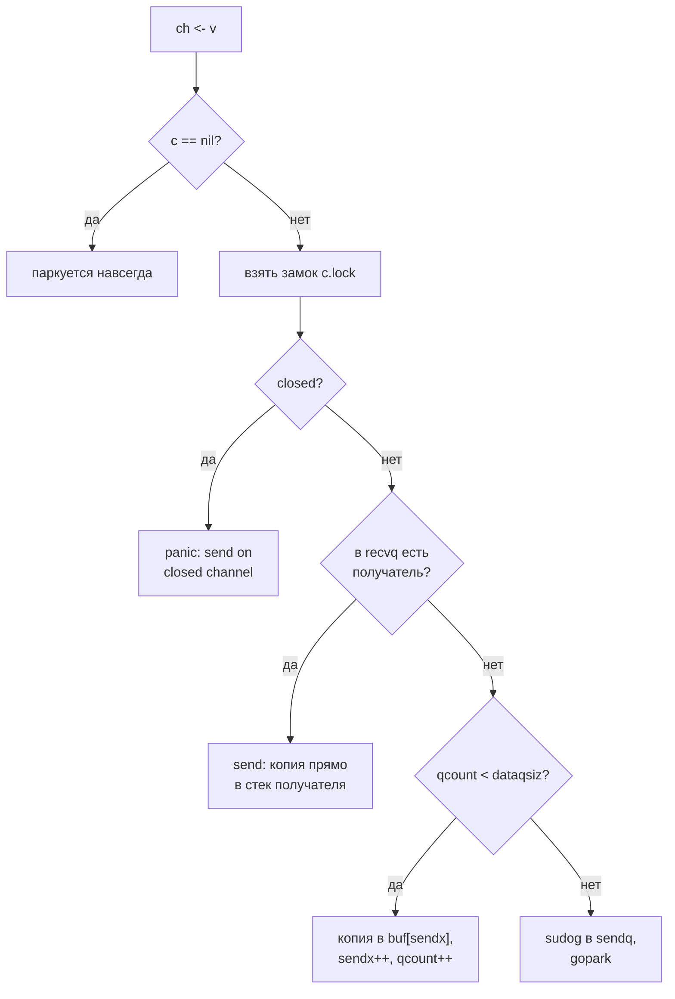

<script setup>
import ChannelLabSandbox from '../../viz/scenes/ChannelLabSandbox.vue'
</script>

# 1.5.2. Каналы

## <Part kind="problem" /> Проблема: миллион таймеров и пятнадцать клеток

В [уроке 1.5.1](./01-goroutines-scheduler) горутины то и дело «ждали на канале»: сто тысяч горутин в `sched/cost` спали на `<-stop`, а бенчмарк гонял значение по кругу через пару каналов. Мы видели, что ждущая горутина паркуется и не держит ни P, ни поток. Но что такое сам канал, мы не разбирали. А в мессенджере на каналах скоро будет держаться многое. В уроке 1.5.6 ограничитель хешей Argon2id соберём из двух буферизованных каналов, а остановку фоновых компонентов — из закрытия канала внутри `context`. Прежде чем доверить им сервис, разберёмся, как они устроены.

Начнём с двух программ из лабы. Первая, `chan/timers`, миллион раз делает `select` между быстрым каналом и таймаутом в одну секунду. В первом варианте на каждой итерации создаётся новый `time.After(time.Second)`. Во втором один `time.Timer` переиспользуется через `Reset`:

```text
$ go run ./1-5/chan/timers
итераций: 1000000
time.After в цикле:    HeapAlloc до   0.25 МиБ, после   0.79 МиБ, выделено за прогон   236.5 МиБ, циклов GC 70
один Timer + Reset:    HeapAlloc до   0.27 МиБ, после   0.28 МиБ, выделено за прогон     0.0 МиБ, циклов GC 0
```

машина: Intel Core i5-12400 (6 ядер, 12 логических процессоров), Linux 7.0, go1.27.2. Шапка вывода (версия, `GOMAXPROCS`, `NumCPU`) здесь и дальше опущена.

Таймаут ни разу не сработал, а первый вариант выделил <N>236,5 МиБ</N> и заставил сборщик мусора пройти <N>70 циклов</N>. Второй не выделил ничего. До Go 1.23 «`time.After` в цикле» справедливо называли утечкой памяти. Здесь же куча в конце почти пустая: 0,79 МиБ. Так утечка это или нет, и откуда тогда 236 МиБ?

Вторая программа, `chan/ops`, применяет каждую операцию — отправку, получение, `close`, `len`, `cap` — к пяти состояниям канала и печатает, что получилось. Из 15 клеток с отправкой, получением и `close` просто проходят только 6. В остальных 9 — 3 паники и 6 вечных блокировок. Отправка в закрытый канал роняет программу, а чтение из него спокойно возвращает ноль. Почему такая асимметрия? И почему у пустого небуферизованного канала отправка «блокирует навсегда», хотя в живой программе она прекрасно проходит?

Ответы лежат внутри канала, в структуре `hchan` из `runtime/chan.go`. К концу урока вы сможете нарисовать её по памяти и объяснить каждую клетку таблицы через код рантайма.

## <Part kind="theory" /> Канал — средство синхронизации, а не очередь

### Два вида каналов

<T id="channel">Канал</T> (channel) — типизированная труба между горутинами. `make(chan int)` создаёт <T id="unbuffered-channel">небуферизованный канал</T> (unbuffered channel), `make(chan int, n)` — <T id="buffered-channel">буферизованный</T> (buffered channel) на `n` значений. Спецификация Go описывает разницу одной фразой: без буфера обмен проходит, «только когда готовы и отправитель, и получатель», с буфером — без блокировки, пока буфер не полон (для отправки) или не пуст (для получения).

**Небуферизованный канал — это рандеву.** Отправитель приходит в точку встречи и ждёт получателя. Или наоборот: получатель ждёт отправителя. Значение переходит из рук в руки, и обе горутины идут дальше, зная, что вторая дошла до этой точки. Поэтому небуферизованный канал прежде всего синхронизирует, а данные передаёт попутно. Часто данных нет вовсе: `chan struct{}` передаёт только факт события.

**Буферизованный канал — это ограниченная очередь.** Отправитель кладёт значение и уходит, не дожидаясь получателя, пока в буфере есть место. Ключевое слово здесь — «ограниченная». Когда буфер полон, отправитель встаёт. Так медленный получатель тормозит быстрого отправителя, и это <T id="backpressure">обратное давление</T> (backpressure) в чистом виде. Ёмкость буфера — это решение о том, сколько работы вы готовы накопить, прежде чем источник почувствует, что вы не успеваете. Ёмкость не способ «убрать блокировки». К этой мысли мы ещё вернёмся в типичных ошибках.

### Что канал гарантирует про память

Канал передаёт не только значение, но и порядок. Модель памяти Go (go.dev/ref/mem) содержит три правила про каналы:

1. отправка в канал <T id="happens-before">происходит раньше</T> (happens-before) завершения соответствующего получения;
2. закрытие канала происходит раньше получения, которое вернуло ноль из-за закрытия;
3. для небуферизованного канала ещё и получение происходит раньше завершения соответствующей отправки.

Есть и четвёртое, для буферизованного канала ёмкостью C: k-е получение происходит раньше завершения (k+C)-й отправки. На нём держится канал-семафор, к которому мы придём в 1.5.5.

Практически это значит: всё, что горутина записала **до** отправки, получатель гарантированно увидит **после** получения. Положили в структуру результат, отправили указатель — получатель читает структуру без всяких замков. Что именно значит «происходит раньше» и почему без этого порядка запись может «не дойти» до другой горутины, разберём в уроке 1.5.3.

### Направление канала в типе

`chan<- int` — канал только для отправки, `<-chan int` — только для получения. Обычный `chan int` неявно приводится к любому из них. Направление — это не украшение. Функция с параметром `<-chan int` не может в него писать, а закрыть его не даст компилятор: спецификация прямо называет `close` для канала только на получение ошибкой. Так правило владения, о котором ниже, проверяется ещё при сборке.

## <Part kind="theory" /> Таблица операций: что делает каждая операция с каждым каналом

Программа `chan/ops` выполняет каждую операцию в отдельной горутине. Паника перехватывается `recover`, а операция, не вернувшаяся за 50 мс, считается заблокированной навсегда. Таблицу программа печатает в формате Markdown, и ниже она вставлена как есть, без единой правки:

```text
$ go run ./1-5/chan/ops
```

| операция | nil | открытый, cap 0 | открытый, пустой, cap 1 | открытый, полный, cap 1 | закрытый, cap 1 |
| --- | --- | --- | --- | --- | --- |
| `ch <- 1` | блокирует навсегда | блокирует навсегда | ок | блокирует навсегда | panic: send on closed channel |
| `<-ch` | блокирует навсегда | блокирует навсегда | блокирует навсегда | ок (v=1, ok=true) | ок (v=0, ok=false) |
| `close(ch)` | panic: close of nil channel | ок | ок | ок | panic: close of closed channel |
| `len(ch)` | ок (0) | ок (0) | ок (0) | ок (1) | ок (0) |
| `cap(ch)` | ок (0) | ок (0) | ок (1) | ок (1) | ок (1) |

машина: Intel Core i5-12400 (6 ядер, 12 логических процессоров), Linux 7.0, go1.27.2. Три прогона дали одну и ту же таблицу.

Пройдём по ней, от простого к неожиданному.

**Открытый канал ведёт себя как обещано.** Отправка в пустой буфер проходит, в полный встаёт. Получение из полного проходит, из пустого встаёт. Небуферизованный канал (cap 0) в таблице блокирует обе операции, потому что программа выполняет их поодиночке: второй стороны нет. В живой программе отправка в небуферизованный канал проходит, как только придёт получатель. «Навсегда» здесь значит «пока не придёт пара».

**nil-канал не готов никогда.** `var ch chan int` без `make` — это `nil`. Отправка и получение на нём блокируют навсегда, а не паникуют. В рантайме это первые строки `chansend` и `chanrecv`: если `c == nil`, горутина паркуется без всякой надежды на пробуждение (`gopark(nil, nil, waitReasonChanSendNilChan, …)`, а следом `throw("unreachable")`). Звучит как ловушка, но в `select` это полезное свойство: nil-канал выключает ветку. Разберём ниже.

**Закрытый канал асимметричен.** Получение проходит всегда. Пока в буфере есть данные, отдаются они. Когда буфер опустел, приходит нулевое значение типа и `ok == false`. А отправка паникует: `send on closed channel`. Почему так?

Спецификация определяет `close(ch)` как запись факта «больше значений в канал отправлено не будет». Закрытие — это обещание отправителя. Получатель, читая из закрытого канала, узнаёт обычную новость «данные кончились». Это нормальный конец потока, как `io.EOF` у файла. Поэтому получение возвращает ноль и `ok == false`, а `for v := range ch` на этом просто заканчивается. Отправка после закрытия — нарушение собственного обещания. Значение уйти никуда не может, а молча выбросить его — значит потерять данные. Ошибка в протоколе программы, и Go честно сообщает о ней паникой.

**`close` паникует дважды.** На `nil` (`close of nil channel`) — закрывать нечего. И повторно (`close of closed channel`). Второй `close` значит, что две части программы считают себя владельцами канала. Повторное закрытие — признак ошибки в коде, и рантайм не делает вид, что всё в порядке.

**`len` и `cap` никогда не блокируют.** У nil-канала оба равны нулю. У закрытого канала `cap` остаётся ёмкостью, а `len` показывает, сколько данных ещё лежит в буфере. В таблице это 0, потому что канал закрыли пустым. Но, как мы увидим в разборе `hchan`, число от `len` устаревает в момент, когда вы его получили.

<Callout type="simplified">

Мы говорим «паника» так, будто это свойство канала. На самом деле паникует **горутина**, которая сделала операцию. Если паника не перехвачена, падает весь процесс: Go печатает стек и завершается с кодом 2. Программа `chan/ops` перехватывает панику через `recover` только для того, чтобы напечатать таблицу. В рабочем коде перехватывать `send on closed channel` нельзя, её нужно исправлять.

</Callout>

### Чтение до конца: `v, ok` и `for range`

У получения две формы. `v := <-ch` возвращает значение. `v, ok := <-ch` ещё и сообщает, настоящее ли это значение (`ok == true`) или ноль от закрытого канала (`ok == false`). Без `ok` нельзя отличить отправленный `0` от признака закрытия.

`for v := range ch` читает, пока канал не закроют и буфер не опустеет. Это самый частый способ потреблять поток. У него есть оборотная сторона: если канал никто не закроет, цикл не кончится никогда. Горутина с таким циклом останется висеть, и это <T id="goroutine-leak">утечка горутин</T> (goroutine leak).

## <Part kind="theory" /> Кто закрывает канал

### Правило владения

Из асимметрии закрытого канала следует главное правило работы с каналами:

> **Закрывает тот, кто пишет, и только один.**

Только отправитель знает, что значений больше не будет. Получатель этого знать не может. Если получатель закроет канал, отправитель, ещё не знающий об этом, при следующей отправке упадёт с паникой. А если отправителей несколько, ни один из них не знает, закончили ли остальные. Закроет первый, а второй упадёт на отправке. Или закроют двое, и упадёт второй `close`.

Удобно думать о канале как о ресурсе, у которого ровно один **владелец**. Владелец создаёт канал, пишет в него, закрывает его и отдаёт наружу только `<-chan T`, только для чтения. Тогда компилятор сам не даст потребителю ни писать, ни закрывать.

### Несколько писателей

Что делать, если писателей несколько? Закрывает не один из них, а отдельная горутина, которая дожидается всех. Так устроено <T id="fan-in">слияние потоков</T> (fan-in):

<!-- go-check -->

```go
import (
	"context"
	"sync"
)

// collect запускает по писателю на каждый источник и отдаёт наружу общий канал.
// Писатели out не закрывают: этого не знает ни один из них. Закрывает отдельная
// горутина — ровно один раз, когда вышли все писатели.
func collect(ctx context.Context, sources [][]int) <-chan int {
	out := make(chan int)
	var wg sync.WaitGroup
	for _, src := range sources {
		wg.Go(func() {
			for _, v := range src {
				select {
				case out <- v:
				case <-ctx.Done(): // потребитель ушёл — не висим на отправке вечно
					return
				}
			}
		})
	}
	go func() {
		wg.Wait()
		close(out)
	}()
	return out
}
```

Обратите внимание на `ctx`. Если потребитель перестал читать, например, нашёл, что искал, писатели без `ctx` навсегда встали бы на `out <- v`. Как потребителю сказать «хватит»? Не закрытием `out`: закрывать чужой канал на запись нельзя. Он отменяет контекст. Это отдельный канал сигнала, который течёт в обратную сторону. `wg.Go` из Go 1.25 сам делает `Add(1)` и `Done` (мы встречали его в 1.5.1).

### Закрывать необязательно

Закрытие — это **сигнал** получателям, а не освобождение ресурса. Канал без ссылок сборщик мусора уберёт, закрыт он или нет. Закрывайте канал, когда получателю нужно узнать о конце потока: чтобы кончился `for range` или сработала ветка `select`. Если такого получателя нет, закрывать незачем.

## <Part kind="theory" /> select: ждать сразу несколько каналов

### Правила

<T id="select">`select`</T> ждёт несколько операций с каналами и выполняет одну. Спецификация описывает это в четыре шага:

1. При входе вычисляются все каналы и все отправляемые значения, один раз, по порядку исходника. Это происходит даже для веток, которые не будут выбраны.
2. Если готова хотя бы одна операция, из готовых выбирается одна «равномерным псевдослучайным выбором».
3. Если не готова ни одна и есть `default`, выполняется `default`.
4. Если `default` нет, `select` блокируется, пока не станет готова хоть одна операция.

Из этих правил вытекают четыре приёма, которые встречаются в каждом сервисе на Go.

**Случайный выбор.** Если готовы обе ветки, Go не выбирает первую по тексту. Так ни один канал не может навсегда занять внимание `select`, пока остальные голодают. Но у случайности есть и обратная сторона: **приоритетов у веток нет**. В `select { case v := <-in: …; case <-ctx.Done(): … }` при готовых обоих каналах примерно в половине случаев выиграет `in`. Даже после отмены цикл может обработать ещё несколько значений. Если отмена должна побеждать, проверяйте её отдельно в начале итерации: `if ctx.Err() != nil { return }`.

**`default` — операция без блокировки.** `select { case ch <- v: … default: … }` значит «отправь, если можно сразу, иначе сделай другое». Так устроен отказ при переполнении: очередь полна, значит, отвечаем 503 вместо ожидания. Именно так ограничитель хешей в 1.5.6 будет отказывать сверх очереди.

**nil-канал выключает ветку.** Операция на nil-канале никогда не готова, поэтому ветка с ним просто никогда не выбирается. Нужно перестать читать из канала, который закрылся? Присвойте его переменной `nil`:

<!-- go-check -->

```go
// merge пересылает в out всё из a и b, пока оба не закроются, и закрывает out.
// Закрытый вход выключается присваиванием nil: иначе select крутился бы на нём,
// раз за разом получая ноль с ok == false.
func merge(a, b <-chan int, out chan<- int) {
	defer close(out)
	for a != nil || b != nil {
		select {
		case v, ok := <-a:
			if !ok {
				a = nil
				continue
			}
			out <- v
		case v, ok := <-b:
			if !ok {
				b = nil
				continue
			}
			out <- v
		}
	}
}
```

Без `a = nil` закрытый `a` готов всегда. Получение из закрытого канала мгновенно возвращает ноль, и `select` превратился бы в горячий цикл, жгущий процессор.

**`select {}` блокирует навсегда.** Пустой `select` без веток не ждёт ничего. Компилятор заменяет его вызовом `block()`, и горутина паркуется с причиной `select (no cases)`.

### Таймаут и отмена

Самое частое применение `select` — ждать результат, но не дольше срока и не после отмены:

<!-- go-check -->

```go
import (
	"context"
	"errors"
)

var errStopped = errors.New("работа остановлена")

// await ждёт значение из results, но возвращается сразу, если ctx отменили или
// истёк его срок: сама операция может висеть сколько угодно, а вызывающий — нет.
func await(ctx context.Context, results <-chan int) (int, error) {
	select {
	case v, ok := <-results:
		if !ok {
			return 0, errStopped
		}
		return v, nil
	case <-ctx.Done():
		return 0, ctx.Err()
	}
}
```

Здесь срок задаёт контекст (`context.WithTimeout`, урок 1.5 модуля 1), а не `time.After`. Так один срок покрывает всю цепочку вызовов, а не только это ожидание.

## <Part kind="theory" /> Внутри канала: hchan

### Структура

`make(chan T, n)` возвращает указатель на структуру `hchan` из `runtime/chan.go` ([строка 34](https://github.com/golang/go/blob/go1.27.2/src/runtime/chan.go#L34)). Поэтому канал можно передавать по значению: копируется указатель, и все копии смотрят на один канал. Поля, без служебных (`elemtype`, `timer`, `bubble`):

| Поле | Тип | Что хранит |
|---|---|---|
| `qcount` | `uint` | сколько значений сейчас в буфере |
| `dataqsiz` | `uint` | ёмкость буфера, то самое `n` из `make`. После создания не меняется |
| `buf` | `unsafe.Pointer` | массив на `dataqsiz` элементов, то есть кольцевой буфер |
| `elemsize` | `uint16` | размер элемента. Отсюда предел: элемент канала меньше 64 КиБ |
| `closed` | `uint32` | закрыт ли канал |
| `sendx` | `uint` | индекс в `buf`, куда ляжет следующая отправка |
| `recvx` | `uint` | индекс в `buf`, откуда возьмёт следующее получение |
| `recvq` | `waitq` | очередь горутин, ждущих получения |
| `sendq` | `waitq` | очередь горутин, ждущих отправки |
| `lock` | `mutex` | замок рантайма. Защищает все поля выше |

**Кольцевой буфер.** `sendx` и `recvx` бегут по массиву по кругу. После записи `sendx++`, и если он дошёл до `dataqsiz`, то сбрасывается в 0. Так же устроен `recvx`. Значения лежат между `recvx` и `sendx`, а `qcount` говорит, сколько их. Сдвигать элементы не нужно: двигаются только индексы. Мы встречали такое кольцо в 1.5.1, это локальная очередь P на 256 мест. Разница в том, что очередь P обходится без замка, а канал работает под замком.

**Очереди ждущих.** `recvq` и `sendq` — двусвязные списки (`waitq{first, last *sudog}`), FIFO: `enqueue` добавляет в хвост, `dequeue` берёт с головы. Элемент списка — не горутина, а <T id="sudog">sudog</T> (pseudo-g, «псевдогорутина», `runtime2.go`). Зачем прослойка? Комментарий над `sudog` объясняет: связь «горутина — объект синхронизации» многие-ко-многим. Горутина в `select` ждёт сразу на нескольких каналах, и на каждом нужна отдельная запись. В `sudog` лежит указатель на горутину `g`, на канал `c` и `elem` — адрес значения. У отправителя это адрес отправляемого значения, у получателя — адрес переменной, куда записать результат. Обычно оба адреса указывают в **стек** горутины. Записи берутся из пула (`acquireSudog`/`releaseSudog`), а не выделяются каждый раз.

**Замок.** `lock` — внутренний мьютекс рантайма, а не `sync.Mutex`. Почти каждая операция над каналом берёт его. Канал — это обычная структура под замком, а вовсе не какая-то волшебная неблокирующая конструкция.

Сколько весит канал? Проверим:

<!-- go-check -->

```go
package main

import (
	"fmt"
	"runtime"
)

var sink []chan int // держит каналы живыми, чтобы компилятор их не выбросил

// measure создаёт n каналов и печатает, сколько байт кучи пришлось на один.
func measure(name string, mk func() chan int) {
	const n = 100_000
	sink = make([]chan int, 0, n)
	runtime.GC()
	var before, after runtime.MemStats
	runtime.ReadMemStats(&before)
	for range n {
		sink = append(sink, mk())
	}
	runtime.ReadMemStats(&after)
	fmt.Printf("%-22s %d байт на канал\n", name, (after.TotalAlloc-before.TotalAlloc)/n)
}

func main() {
	measure("make(chan int)", func() chan int { return make(chan int) })
	measure("make(chan int, 1)", func() chan int { return make(chan int, 1) })
	measure("make(chan int, 100)", func() chan int { return make(chan int, 100) })
}
```

```text
$ go run ./chansize
make(chan int)         112 байт на канал
make(chan int, 1)      128 байт на канал
make(chan int, 100)    1024 байт на канал
```

машина: Intel Core i5-12400 (6 ядер, 12 логических процессоров), Linux 7.0, go1.27.2.

Сама `hchan` занимает <N>112 байт</N> на amd64. Буфер `chan int` на одно значение добавляет 8 байт, итого 120. Аллокатор округляет это до ближайшего класса размера, 128. Буфер на сто значений даёт 112 + 800 = 912 байт, округлённые до 1024. `makechan` ([строка 75](https://github.com/golang/go/blob/go1.27.2/src/runtime/chan.go#L75)) выделяет память тремя способами:

- буфер нулевого размера (`chan struct{}` или ёмкость 0) — только `hchan`;
- элементы без указателей — `hchan` и буфер **одним куском**;
- элементы с указателями — двумя отдельными аллокациями, чтобы сборщик мусора сканировал буфер по типу элемента.

### Отправка: chansend

Оператор `ch <- v` компилятор превращает в вызов `chansend1`, а тот — в `chansend(c, &v, block=true, …)` ([строка 176](https://github.com/golang/go/blob/go1.27.2/src/runtime/chan.go#L176)). Порядок проверок и объясняет строку `ch <- 1` в таблице:



Что смотреть на схеме. Проверки идут сверху вниз, и порядок важен. Пунктирный выход — паника, серый — вечное ожидание на nil-канале. Бирюзовый путь — прямая передача, зелёный — буфер. Янтарный путь — горутина встаёт в очередь и засыпает. Прямая передача проверяется **раньше** буфера. Если получатель уже ждёт, значение до буфера вообще не доходит.

Пройдём по шагам с номерами строк `chan.go`:

1. **nil-канал** (строки 177–183): при неблокирующей отправке из `select` с `default` — сразу «не получилось», иначе вечный `gopark`.
2. **Быстрый путь без замка** (строка 213), только для неблокирующей отправки: `if !block && c.closed == 0 && full(c) { return false }`. Два чтения без замка. Длинный комментарий над этой строкой доказывает, что так можно: закрытый канал не может снова стать «не готовым к отправке». Благодаря этому `select` с `default` на полном канале не трогает замок вовсе.
3. **Замок и проверка закрытия** (строки 222–227). Под замком `closed != 0` — паника.
4. **Ждущий получатель** (строки 229–234): `c.recvq.dequeue()` вернул `sudog`, и вызывается `send`. Комментарий в исходнике: «передаём значение прямо получателю, минуя буфер канала (если он есть)».
5. **Место в буфере** (строки 236–250): копия в `chanbuf(c, c.sendx)`, сдвиг `sendx` по кругу, `qcount++`, замок отпускается.
6. **Ждать** (строки 257–283): `acquireSudog`, в `elem` — адрес отправляемого значения на стеке отправителя. `sudog` встаёт в хвост `sendq`, горутина паркуется через `gopark`. Замок канала отпускает уже `chanparkcommit`, **после** того как горутина помечена ждущей. Иначе её могли бы «разбудить» раньше, чем она уснула.
7. **Проснулась** (строки 296–308). Если `mysg.success == false`, значит, её разбудил не получатель, а `close`. Тогда паника `send on closed channel`. Вот как падает отправитель, который **ждал** в момент закрытия.

### Прямая передача в чужой стек

Функция `send` ([строка 318](https://github.com/golang/go/blob/go1.27.2/src/runtime/chan.go#L318)) делает две вещи. Сначала `sendDirect` копирует значение `memmove`-ом прямо по адресу `sg.elem`, то есть в переменную получателя **на его стеке**. Затем `goready` будит получателя. Комментарий перед `sendDirect` ([строка 382](https://github.com/golang/go/blob/go1.27.2/src/runtime/chan.go#L382)) подчёркивает, насколько это особый случай: отправка и получение на небуферизованном или пустом канале — «единственные операции, при которых одна работающая горутина пишет в стек другой». Сборщик мусора исходит из того, что в стек пишет только его хозяин. Поэтому здесь вручную ставится барьер записи `typeBitsBulkBarrier`.

Зачем такие сложности? Через буфер значение копировалось бы дважды: отправитель кладёт в буфер, получатель забирает. К тому же получатель после пробуждения брал бы замок канала заново. Прямая передача — одна копия, и получатель просыпается с готовым значением в руках.

Симметрично устроен `recv` ([строка 702](https://github.com/golang/go/blob/go1.27.2/src/runtime/chan.go#L702)), когда получатель застаёт ждущего отправителя. На небуферизованном канале значение копируется из стека отправителя (`recvDirect`). На буферизованном интереснее. Раз отправитель ждёт, значит, буфер полон. Получатель берёт значение из головы (`recvx`), а значение отправителя кладёт в **ту же ячейку**. После сдвига `recvx` она становится хвостом: `c.sendx = c.recvx`. Порядок FIFO сохраняется: значение отправителя встаёт за всеми, кто был в буфере раньше.

### Получение и закрытие

`chanrecv` ([строка 524](https://github.com/golang/go/blob/go1.27.2/src/runtime/chan.go#L524)) зеркален отправке, но с одной важной деталью в порядке проверок. Под замком сначала проверяется закрытие. Если канал закрыт **и** `qcount == 0`, получатель получает ноль и `false`. Если закрыт, но в буфере есть данные, проверка проваливается дальше, и данные отдаются как обычно. Поэтому закрытие не теряет то, что уже лежит в буфере: получатели дочитают всё до конца, и только потом пойдут нули.

`closechan` ([строка 414](https://github.com/golang/go/blob/go1.27.2/src/runtime/chan.go#L414)): `nil` — паника, повторное закрытие — паника, иначе `closed = 1`. Затем рантайм выгребает **всех** из `recvq` (им достанется ноль, `success = false`) и **всех** из `sendq` (они проснутся и запаникуют, см. шаг 7). Всех собирают в список, отпускают замок и только потом будят. Комментарий у поля `lock` запрещает делать горутину готовой под замком канала: это может привести к взаимной блокировке со сжатием стека.

### Пробуждение идёт через планировщик

`goready(gp)` не запускает горутину сразу. Он вызывает `ready` (`proc.go`, [строка 1133](https://github.com/golang/go/blob/go1.27.2/src/runtime/proc.go#L1133)): статус меняется с «ждёт» на «готова», и горутина ставится в очередь **текущего** P через `runqput(pp, gp, next=true)`, то есть в слот `runnext`. Затем `wakep()` будит свободный P, если такой есть. Это ровно то, что мы разбирали в 1.5.1. Разбуженный получатель запустится на этом же P следующим, на тёплом кэше, и унаследует остаток кванта. Отправитель продолжит работать, пока не заблокируется сам или не исчерпает квант. Круг в 320 нс в бенчмарке `SwitchGoroutines` из 1.5.1 — это два таких пути «`send` → `goready` → `runnext`».

<Callout type="simplified">

Мы не показали несколько вещей. Во-первых, флаги `activeStackChans` и `parkingOnChan`, через которые канал договаривается со сжатием стека: `sudog` указывает в стек ждущей горутины, и двигать этот стек можно только под замком канала. Во-вторых, вызовы детектора гонок (`racenotify`), которые делают вид, что значение прошло через буфер, даже когда оно передано напрямую. В-третьих, поле `bubble` для `testing/synctest` (урок 1.5.5). И наконец, профилировщик блокировок, который отмечает время ожидания (`blockevent`). Логику операций они не меняют.

</Callout>

### Внутри select

`select` с одной веткой компилятор превращает в обычную операцию. С одной веткой и `default` — в неблокирующий вызов `selectnbsend` или `selectnbrecv`, то есть в `chansend`/`chanrecv` с `block = false`. Это прямо описано в комментариях `chan.go` ([строка 768](https://github.com/golang/go/blob/go1.27.2/src/runtime/chan.go#L768)). Всё остальное делает `selectgo` в `runtime/select.go` ([строка 122](https://github.com/golang/go/blob/go1.27.2/src/runtime/select.go#L122)). Работает она в три прохода. Перед ними строятся два порядка.

**`pollorder` — случайный порядок опроса** (строки 167–195). Ветки перемешиваются вставкой со случайной позицией: `j := cheaprandn(uint32(norder + 1))`. Это обычное перемешивание Фишера — Йетса, и оно реализует «равномерный псевдослучайный выбор» из спецификации. Строкой выше стоит `if cas.c == nil { continue }`: ветки с nil-каналом **вообще не попадают** в порядок опроса. Вот и весь механизм «nil выключает ветку».

**`lockorder` — порядок блокировок** (строки 206–240). Ветки сортируются по адресу `hchan` (`sortkey()` — это просто адрес) пирамидальной сортировкой. Зачем? `select` берёт замки **всех** своих каналов сразу (`sellock`). Представьте две горутины: одна делает `select` по каналам `a, b`, другая — по `b, a`. Если бы каждая брала замки в порядке текста, первая взяла бы `a` и ждала `b`, вторая взяла бы `b` и ждала `a`. Получилась бы классическая <T id="deadlock">взаимная блокировка</T> (deadlock). Единый глобальный порядок по адресу исключает такой цикл. Это тот же приём, что и правило «всегда брать мьютексы в одном порядке», только применённый внутри рантайма. Пирамидальная сортировка выбрана, как сказано в комментарии, ради гарантии n log n и постоянного расхода стека.

**Проход 1** (строки 264–301): под всеми замками, в порядке `pollorder`, ищется первая готовая ветка. Для получения — ждущий отправитель, данные в буфере или закрытие. Для отправки — закрытие (паника), ждущий получатель или место в буфере. Нашлась — операция выполняется, замки отпускаются. Не нашлась, а `default` есть — выбирается `default`.

**Проход 2** (строки 309–351): ни одна ветка не готова. Горутина создаёт по `sudog` на **каждую** ветку, ставит их в очереди всех каналов и засыпает. Теперь её может разбудить любой из каналов. Но разбудить должен только один. Поэтому у `sudog` из `select` есть флаг `isSelect`. Тот, кто достаёт такой `sudog` из очереди, сначала выигрывает гонку через `selectDone.CompareAndSwap(0, 1)` в `waitq.dequeue` (`chan.go`, [строка 896](https://github.com/golang/go/blob/go1.27.2/src/runtime/chan.go#L896)). Проигравший просто берёт следующего в очереди.

**Проход 3** (строки 360–401): проснувшись, горутина снова берёт все замки и вынимает свои `sudog` из очередей всех остальных каналов. Иначе, как сказано в комментарии, они бы «копились на тихих каналах».

Отсюда практический вывод: **цена `select` растёт с числом веток**. Каждая ветка — это замок и `sudog`, а при засыпании — постановка в очередь и снятие с неё. `select` на две-три ветки — норма. `select` на сотню каналов (через `reflect.Select`) — повод задуматься о другом устройстве.

## <Part kind="theory" /> Таймеры: time.After до и после Go 1.23

### Как было

`time.After(d)` — это `time.NewTimer(d).C`: таймер, который через `d` положит текущее время в свой канал. До Go 1.23 у этой простой функции было два подвоха.

1. **Таймер жил до срабатывания.** Созданный таймер сразу вставал в кучу таймеров P (тот самый `timerslen` из `scheddetail` в 1.5.1). Куча ссылалась на таймер, таймер — на канал. Поэтому сборщик мусора не мог убрать ни то ни другое, пока таймер не сработает или его не остановят через `Stop`. Документация `time.After` прямо предупреждала об этом. Наш цикл из `chan/timers` проходит миллион итераций меньше чем за полсекунды. С таймаутом в секунду до 1.23 все миллион таймеров были бы живы одновременно, и это порядка тех самых 236 МиБ, только уже живой кучи, а не мусора. Это наша оценка по выводу программы. На Go 1.27 воспроизвести старое поведение уже нельзя.
2. **Канал таймера был буферизован на одно значение.** Сработавший таймер клал время в буфер, даже если его никто не ждал. После `Stop` или `Reset` в буфере могло остаться устаревшее значение. Следующее чтение мгновенно получало его, будто таймер сработал снова. Правильная остановка требовала ритуала `if !t.Stop() { <-t.C }`, а ошибка в нём легко приводила к зависанию.

### Как стало

Go 1.23 изменил оба пункта (release notes 1.23, раздел «Timer changes»):

- **таймеры и тикеры без ссылок собираются сразу**, даже если `Stop` не вызывали;
- **канал таймера стал синхронным**, ёмкостью 0. Гарантия звучит так: после любого вызова `Reset` или `Stop` никакое значение, подготовленное до вызова, уже не будет получено. Видимый побочный эффект: `len` и `cap` канала таймера теперь возвращают 0, а не 1.

В Go 1.23–1.26 новое поведение включалось, только если в `go.mod` основного модуля стоит `go 1.23` или выше. Вернуть старое можно было настройкой `GODEBUG=asynctimerchan=1`. **В Go 1.27 настройку `asynctimerchan` убрали совсем.** Каналы пакета `time` всегда синхронные, что бы ни стояло в `GODEBUG`. Если же в `go.mod` или в комментарии `//go:debug` осталось `asynctimerchan=1`, команда `go` теперь откажется собирать проект (release notes 1.27).

Как рантайм этого добился? Посмотрите на `needsAdd` в `runtime/time.go` ([строка 655](https://github.com/golang/go/blob/go1.27.2/src/runtime/time.go#L655)):

```text
need := t.state&timerHeaped == 0 && t.when > 0 && (!t.isChan || t.blocked > 0)
```

Таймер с каналом (`isChan`) попадает в кучу таймеров P, **только пока на его канале кто-то заблокирован** (`blocked > 0`). Счётчик увеличивает `blockTimerChan`, когда `chanrecv` или `selectgo` решили заснуть на этом канале (вспомните `if c.timer != nil { blockTimerChan(c) }` в `chanrecv`). Уменьшает его `unblockTimerChan` при пробуждении. Если же никто не ждёт, таймер — обычный объект в куче без внешних ссылок, и сборщик уберёт его вместе с каналом. А как же значение, если таймер сработал, пока никто не ждал? Его досылают лениво. Каждое получение и каждый `select` сначала вызывают `maybeRunChan`: «не пора ли этому таймеру сработать?». Внутри канал таймера по-прежнему имеет буфер на одно значение. `NewTimer` делает `make(chan Time, 1)`, а `chanlen`/`chancap` для таймеров нарочно возвращают 0: так рантайм может «отменить» отправку (`timerchandrain`), а пользователь этого не заметит.

### Так утечка или нет

Вернёмся к загадке из начала урока. В нашем цикле `select` почти никогда не засыпает: быстрый канал всегда готов. Поэтому таймеры даже не попадают в кучу таймеров, а куча в конце прогона почти пуста (0,79 МиБ). **Утечки на Go 1.23+ нет.** Но каждый вызов `time.After` всё равно создаёт таймер и канал: три аллокации, около <N>248 байт</N> на итерацию (236,5 МиБ на миллион итераций). Отсюда 70 сборок мусора на ровном месте. Один `Timer` с `Reset` не выделяет ничего.

Документация `time.After` в 1.27 говорит: «нет причин предпочитать `NewTimer`, когда подходит `After`». Это правда для редкого ожидания: один запрос — один таймаут. В горячем цикле на миллионы итераций в секунду переиспользуйте `Timer`. И ещё одно различие, на этот раз смысловое: `time.After` внутри цикла — это таймаут **на итерацию** («больше секунды тишины»), а не на всю операцию. Нужен общий срок — создайте его один раз до цикла, лучше через `context.WithTimeout`.

## <Part kind="theory" /> Сигналы: закрытие канала против context

### Закрытие как широковещательный сигнал

Отправка будит **одного** получателя: того, кто первым стоит в `recvq`. Закрытие будит **всех**: `closechan` выгребает всю очередь. И любой, кто придёт читать позже, тоже сразу получит ноль. Поэтому `close(done)` — это широковещательный сигнал. Тысяча горутин ждёт `<-done`, один `close`, и все тысяча проснулись. Отправкой так не сделать: пришлось бы отправить ровно тысячу значений и точно знать, сколько слушателей.

Для сигнала берут `chan struct{}`. Значение размером 0 ничего не весит, а `makechan` для нулевого буфера выделяет одну `hchan`. У сигнала закрытием два ограничения. Он **одноразовый**: открыть канал заново нельзя. И закрыть его можно только раз: если остановку могут вызвать из нескольких мест, оберните `close` в `sync.Once`.

### context — тот же сигнал, но с причиной и деревом

`ctx.Done()` из урока 1.5 модуля 1 — это ровно такой канал. В `context/context.go` у `cancelCtx` метод `Done` лениво создаёт `make(chan struct{})` ([строка 458](https://github.com/golang/go/blob/go1.27.2/src/context/context.go#L458)), а `cancel` его закрывает ([строка 568](https://github.com/golang/go/blob/go1.27.2/src/context/context.go#L568)). Но <T id="go-context">`context.Context`</T> добавляет к голому каналу то, что вам пришлось бы писать самим:

| | `close(done)` | `context` |
|---|---|---|
| широковещательный сигнал | да | да, `Done()` — тот же закрываемый канал |
| повторная отмена | паника | `cancel` можно звать сколько угодно раз |
| причина | нет | `Err()`: `Canceled` или `DeadlineExceeded`, `context.Cause` |
| срок | вручную через таймер | `WithTimeout`, `WithDeadline` |
| дерево | нет | отмена родителя отменяет всех потомков |
| значения запроса | нет | `Value` |

**Как выбирать.** На границе API — в функциях, которые ходят в сеть, в базу или вызывают других, — передавайте `ctx` первым аргументом. Так требует наш стандарт кода, и так ваша функция встраивается в цепочку <T id="cancellation">отмены</T> (cancellation) всего запроса. Голый `chan struct{}` уместен внутри одного пакета: сигнал «готово» от одной горутины к другой, остановка, которой не нужны ни причина, ни срок, ни дерево. В уроке 1.5.6 жизненным циклом компонентов мессенджера будет управлять `context`, а `chan struct{}` останется для узких внутренних сигналов.

<Deep title="CSP Хоара и почему Go выбрал каналы, но оставил мьютексы">

В 1978 году Тони Хоар опубликовал в Communications of the ACM статью «Communicating Sequential Processes» (<T id="csp">CSP</T>). Главная идея: параллельные процессы не делят память, а обмениваются сообщениями. Сам обмен их и синхронизирует. Ввод (`P?x`) и вывод (`Q!y`) в CSP синхронные: отправитель ждёт получателя, как в нашем небуферизованном канале. Каналов как отдельных объектов у Хоара ещё не было, процессы обращались друг к другу по имени. Зато была альтернативная команда с охраной из «охраняемых команд» Дейкстры: ждать ту из нескольких операций ввода, что готова первой. Это прямой предок `select`.

Из CSP выросли occam и Erlang. Go, по словам FAQ, происходит из другой ветви семейства, «главный вклад которой — каналы как полноправные объекты». Это языки Роба Пайка и коллег: Newsqueak, Alef, Limbo. Канал стал значением. Его можно передать в функцию, положить в структуру, отправить по другому каналу. Отсюда известный девиз из Effective Go: «Не общайтесь, разделяя память; разделяйте память, общаясь».

Почему же тогда в Go есть `sync.Mutex`, и почему сам канал внутри — структура под мьютексом? Потому что каналы — это **высокоуровневый** инструмент. FAQ так и говорит: высокоуровневые интерфейсы упрощают код, «даже если под капотом всё ещё мьютексы». Канал хорош, когда данные или ответственность переходят из рук в руки. Вики Go («Use a sync.Mutex or a channel?») даёт короткое правило:

- канал — для передачи владения данными, раздачи работы и асинхронных результатов;
- мьютекс — для кэшей и общего состояния;
- главное — берите то, что выразительнее и проще в конкретном месте.

Кэтрин Кокс-Будэй в «Concurrency in Go» предлагает похожее дерево решений. Охраняете внутреннее состояние структуры или участок, критичный к производительности, — берите примитивы `sync`. Передаёте владение или координируете несколько частей логики — берите каналы.

Цена тоже разная. Незанятый `sync.Mutex` — одна атомарная операция CAS (урок 1.5.4). Операция с каналом — замок, копирование значения, а при ожидании ещё `sudog`, постановка в очередь и пробуждение через планировщик. Счётчик запросов на канале — это медленный и запутанный мьютекс. А конвейер обработки на мьютексах — это вручную написанный и, скорее всего, ошибочный канал.

</Deep>

## <Part kind="viz" /> Визуализация: песочница канала

Один канал и четыре горутины G1–G4. Модель повторяет `hchan`: кольцевой буфер с индексами `recvx` и `sendx`, очереди `sendq` и `recvq`, флаг закрытия. Тексты паник — дословно из рантайма. Что смотреть:

1. **Ёмкость 0, прямая передача.** G1 «Получить» — она встаёт в `recvq` (янтарная рамка — заблокирована). G2 «Отправить» — в журнале «передано напрямую, минуя буфер», G1 снова зелёная и держит значение. Буфера нет вовсе, это `send` с `sendDirect`.
2. **Ёмкость 3, кольцо.** Отправьте три значения, затем одно получите, затем снова отправьте. Следите, как `recvx` и `sendx` обходят ячейки по кругу, а значения не сдвигаются.
3. **Полный буфер и ждущий отправитель.** На ёмкости 1 отправьте дважды: вторая горутина встанет в `sendq` со значением «в руках». Теперь получите: получатель возьмёт голову, а значение отправителя ляжет в хвост буфера. Это `recv` на полном канале.
4. **Закрытие.** Поставьте двух получателей в `recvq` и закройте канал: оба проснутся с нулём и `ok=false`. Закройте ещё раз — красная паника `close of closed channel`. На ёмкости 1 с отправителем в `sendq` закрытие заставит запаниковать **его**.
5. **nil-канал и select.** Переключите «nil-канал»: отправка и получение ждут вечно, «Закрыть» паникует. Кнопки «select: … / default» на nil-канале всегда выбирают `default`.

<ChannelLabSandbox />

Вопросы к песочнице:

1. На ёмкости 3 положите в буфер два значения и закройте канал. Что получат три следующих получения?
2. На ёмкости 0 G1 ждёт получения. G2 нажимает «select: отправить / default». Что выберет `select` и почему?
3. На ёмкости 1 буфер полон, G2 ждёт в `sendq`. G3 закрывает канал. Что случится с G2 и со значением в буфере?

<SelfCheck question="Ответы">

1. Первые два получат значения из буфера с `ok=true`, третье — ноль и `ok=false`. `chanrecv` отдаёт ноль, только если канал закрыт **и** буфер пуст.
2. Отправку: в `recvq` есть получатель, значит, операция готова, и `default` не нужен. Значение уйдёт G1 напрямую. `default` выбирается, только когда ни одна операция не готова.
3. G2 проснётся и запаникует (`send on closed channel`): `closechan` будит всех из `sendq` с `success = false`. Значение в буфере не пропадёт, следующий получатель его прочитает.

</SelfCheck>

<Callout type="simplified">

В песочнице горутины ходят по очереди, по нажатию, а не параллельно, и паника останавливает одну горутину, а не весь процесс. В настоящей программе непойманная паника завершает процесс с кодом 2. Песочница не показывает замок канала, `sudog` и планировщик: пробуждение в ней мгновенное, а в рантайме разбуженная горутина ещё ждёт в `runnext`, пока до неё дойдёт P.

</Callout>

## <Part kind="code" /> Код: две программы лабы

### chan/ops — таблица операций

<<< @/../labs/1-5/chan/ops/main.go#ops{go}

- **Таблица — это декартово произведение** двух срезов: пять состояний `states` и пять операций `operations`. Каждое состояние — функция `newChan`, которая создаёт **свежий** канал. Иначе отправка в «пустой» канал заполнила бы его для следующей операции.
- **`observe` запускает операцию в отдельной горутине.** Главная горутина не должна ни упасть от паники, ни повиснуть на nil-канале. Паника ловится `defer`/`recover` внутри горутины. Блокировку ловит `select` с `time.After(blockedAfter)` снаружи. Здесь `time.After` уместен: одно ожидание на операцию, а не миллион в цикле.
- **`result` буферизован на одно значение — и это важно.** Если операция закончится уже после таймаута, её горутина отправит результат в буфер и спокойно выйдет. С небуферизованным `result` она навсегда встала бы на отправке, потому что читать уже некому. Это классическая утечка, о ней в типичных ошибках.
- **Горутины с «вечными» операциями остаются жить** до конца программы. Так сказано и в комментарии к `observe`. Для таблицы это неважно: процесс сейчас завершится. В сервисе такое было бы утечкой.

### chan/timers — time.After против Timer

<<< @/../labs/1-5/chan/timers/main.go#timers{go}

- **`afterEachIteration`** на каждой итерации создаёт новый таймер и канал: `time.After` вычисляется при каждом входе в `select`, как и любое выражение ветки.
- **`reusedTimer`** создаёт таймер один раз и взводит его заново `Reset` в начале итерации. Без вычитывания `timer.C` перед `Reset` этот код корректен только с Go 1.23. Раньше сработавший таймер мог оставить в буфере устаревшее значение. Здесь таймер не срабатывает никогда, но привычку стоит знать для чтения старого кода.
- **`defer timer.Stop()`** с 1.23 нужен не для сборщика мусора, а для аккуратности: таймер остановлен сразу, а не тогда, когда до него доберётся сборка.
- Замер (функция `report` под регионом) делает `runtime.GC()` и снимает `runtime.MemStats` до и после: `HeapAlloc` — живая куча, `TotalAlloc` — всё, что выделено за прогон, `NumGC` — число циклов сборки.

## <Part kind="practice" /> Что появилось в лабе

К этому уроку в лабе две программы в `labs/1-5/chan/`:

```text
labs/1-5/chan/
├── ops/      # таблица: send, recv, close, len, cap над nil, открытым и закрытым каналом
└── timers/   # миллион итераций select: time.After на итерацию против одного Timer с Reset
```

Запуск — из каталога `labs/`: `go run ./1-5/chan/ops` и `go run ./1-5/chan/timers`. Обе программы проверяет общий сценарий `bash 1-5/scenario.sh`. Для `ops` он ищет в таблице три паники, `ок (v=0, ok=false)` и «блокирует навсегда». Для `timers` он требует, чтобы `time.After` выделил больше 100 МиБ, `Timer + Reset` — меньше 1 МиБ, а живая куча после `time.After` осталась меньше 64 МиБ. Последняя проверка упадёт, если таймеры снова перестанут собираться.

Попробуйте сами:

- в `ops` добавьте состояние «закрытый, cap 1, с данными»: `ch := make(chan int, 1); ch <- 7; close(ch)`. Что покажут `<-ch` и `len(ch)`? Сверьтесь с `chanrecv`;
- в `timers` замените `timeout` на 1 мкс. Программа запаникует уже в первом варианте с сообщением «быстрый канал молчал целую секунду». Почему, если канал не молчал и миллисекунды? Подсказка: что делает `select`, когда в буфере `fast` на мгновение пусто, а таймер уже сработал?

Состояние репозитория после урока — тег `m01-5-l02`.

## <Part kind="mistakes" /> Типичные ошибки

<Callout type="mistake">

**Закрытие со стороны получателя.** Потребитель нашёл, что искал, и делает `close(in)`, «чтобы производитель остановился». Производитель на следующей отправке падает с `send on closed channel`, и вместе с ним весь процесс. Получатель не знает, что производитель больше ничего не отправит, а это знание и есть право закрыть. Остановить производителя должен отдельный сигнал в обратную сторону: отмена `ctx` или отдельный канал `done`, который закрывает получатель как **его** владелец. Чтобы ошибка не прошла сборку, отдавайте потребителю `<-chan T`: закрыть такой канал не даст компилятор.

**Закрытие из нескольких писателей.** Каждый из N воркеров по окончании делает `close(out)`. Первый закроет, второй упадёт на `close of closed channel`, а если кто-то ещё пишет — на `send on closed channel`. Проверка «закрыт ли канал» перед `close` не поможет: между проверкой и закрытием другой воркер успеет закрыть сам. Закрывает отдельная горутина после `wg.Wait()` (функция `collect` выше). Когда закрыть просят из нескольких мест, используйте `sync.Once`.

**`time.After` в горячем цикле.** `for { select { case v := <-in: …; case <-time.After(time.Second): … } }` на каждой итерации создаёт таймер и канал. **До Go 1.23** (и в 1.23–1.26 при `go` ниже 1.23 в `go.mod` или с `asynctimerchan=1`) это настоящая утечка: каждый таймер держится в памяти до срабатывания, в нашей лабе — порядка 236 МиБ живой кучи. **С Go 1.23**, а в 1.27 — всегда, утечки нет, но остаются три аллокации и 248 байт на итерацию: 236,5 МиБ мусора и 70 сборок мусора на миллион итераций. В горячем цикле создайте `time.NewTimer` один раз и делайте `Reset`. И проверьте, нужен ли вам таймаут на итерацию, а не общий срок операции.

**Буфер «чтобы не блокировалось».** Программа зависла на отправке, и кто-то меняет `make(chan T)` на `make(chan T, 100)`. Зависание пропало — до первого всплеска нагрузки, когда буфер заполнится, и всё повторится, только позже и реже. Буфер не устраняет причину блокировки, если получатель медленнее отправителя. Он лишь откладывает её, добавляет задержку (значение ждёт в очереди) и память, а при падении процесса всё, что лежало в буфере, теряется. Ёмкость выбирают осознанно. 0 — когда нужна синхронизация. 1 — когда отправитель не должен ждать единственного получателя, как у `result` в `chan/ops`. N — для известного размера всплеска или как семафор на N мест (урок 1.5.5).

**`len(ch)` для принятия решений.** `if len(ch) < cap(ch) { ch <- v }` — между проверкой и отправкой другая горутина может заполнить буфер, и отправка заблокирует. `if len(ch) > 0 { v := <-ch }` — так же с получением. `len` читает `qcount` без замка, и число устаревает сразу же. Комментарий у `empty` в `chan.go` прямо говорит, что канал «может стать непустым сразу после». К тому же у таймера `len` теперь всегда 0. Неблокирующая операция пишется через `select` с `default`: проверка и действие там выполняются под одним замком. `len(ch)` годится только для метрик и логов («в очереди примерно столько-то»).

**Небуферизованный канал результата и таймаут.** `res := make(chan T); go func() { res <- work() }(); select { case r := <-res: …; case <-ctx.Done(): return }`. Если сработала отмена, читать `res` уже некому, и горутина с `work` навсегда встанет на отправке. Каждый отменённый запрос — плюс одна вечная горутина. Достаточно буфера на одно значение: `make(chan T, 1)`, ровно как `result` в `chan/ops`. Тогда отправка проходит без получателя, и горутина выходит.

**`for range` по каналу, который никто не закроет.** Потребитель в `for v := range jobs` ждёт конца, которого не будет: производитель вышел, не закрыв канал. Если в программе больше никого нет, рантайм упадёт с `fatal error: all goroutines are asleep - deadlock!` (`checkdead` в `proc.go`). Но `checkdead` срабатывает, только если не работает ни один поток и не взведён ни один таймер. В сервисе всегда есть что-то живое: HTTP-сервер ждёт соединений в netpoller, тикают таймеры. Поэтому зависший потребитель просто тихо висит. Это утечка, которую видно только по растущему числу горутин. Производитель закрывает канал через `defer close(jobs)`, а потребитель вдобавок слушает `ctx.Done()`.

</Callout>

## <Part kind="tradeoff" /> Компромисс: ёмкость буфера — развязка против обратного давления

<Callout type="tradeoff">

Ёмкость канала — главная настройка, которую вы выбираете для каждого канала. И это выбор на оси «развязать отправителя и получателя» против «сразу почувствовать, что получатель не успевает».

- **Ёмкость 0.** Каждая отправка — встреча, отправитель ждёт получателя. Обратное давление мгновенное: медленный потребитель сразу тормозит производителя. Зато даже короткие всплески превращаются в ожидание, а каждая операция с парным ожиданием — это парковка и пробуждение через планировщик.
- **Небольшая ёмкость.** Сглаживает всплески: производитель не встаёт, пока потребитель на мгновение занят. Если в среднем потребитель успевает, ожидания почти нет.
- **Большая ёмкость.** Прячет перегрузку. Пока буфер заполняется, всё «работает». Но каждое значение теперь ждёт своей очереди: при буфере N и скорости обработки μ значений в секунду последнее ждёт примерно N/μ (закон Литтла, урок 0.4). Буфер в 10 000 при обработке 1 000 в секунду — это 10 секунд задержки и 10 000 значений, потерянных при падении.

**Как это касается вас.** Начинайте с 0 или 1 и увеличивайте ёмкость, только когда можете назвать причину и число: размер всплеска, число воркеров, предел одновременных операций. И решите заранее, что делать, когда буфер полон: ждать (задержка растёт), отбрасывать (данные теряются) или отказывать сразу через `select` с `default` (клиент получает 503 и решает сам). Неограниченной очереди на канале не бывает, и это хорошо: она заставляет принять это решение. Пул воркеров, семафор и их поведение под нагрузкой разберём в 1.5.5 на песочнице `worker-pool`.

</Callout>

## <Part kind="selfcheck" /> Самопроверка

<SelfCheck question="Почему отправка в закрытый канал паникует, а получение из него возвращает ноль? Почему бы не сделать наоборот или одинаково?">

`close` — это обещание отправителя «больше значений не будет». Для получателя закрытие — нормальный конец потока, как `io.EOF`: он дочитывает буфер и получает ноль с `ok == false`, а `for range` заканчивается. Отправка после закрытия нарушает обещание: значение некуда деть, а молча выбросить — значит потерять данные. Это ошибка в протоколе программы, поэтому паника. Если бы паниковало получение, нельзя было бы сообщить о конце потока. Если бы отправка молча проходила, ошибки владения тихо теряли бы данные.

</SelfCheck>

<SelfCheck question="Горутина G1 ждёт на <-ch (небуферизованный канал). G2 выполняет ch <- x. Сколько раз копируется x, куда, и на каком P запустится G1?">

Один раз. `chansend` находит G1 в `recvq` и вызывает `send`, а тот через `sendDirect` копирует `x` прямо в переменную G1 на её стеке, по адресу из `sudog.elem`, мимо всякого буфера. Затем `goready` → `ready` ставит G1 в `runnext` текущего P, то есть того, на котором работает G2, и G1 запустится на нём следующей, на тёплом кэше. Если есть свободный P, `wakep` разбудит его, и он может украсть работу.

</SelfCheck>

<SelfCheck question="Зачем selectgo сортирует каналы по адресу перед тем, как взять их замки? Что сломалось бы без этого?">

`select` держит замки всех своих каналов одновременно. Две горутины, делающие `select` по `a, b` и по `b, a`, при захвате в порядке текста взяли бы по одному замку и ждали бы друг друга вечно — взаимная блокировка. Сортировка по адресу `hchan` (`lockorder`) задаёт один глобальный порядок захвата, и цикл ожидания невозможен. Порядок **опроса** при этом отдельный и случайный (`pollorder`), чтобы выбор среди готовых веток был равномерным.

</SelfCheck>

<SelfCheck question="Цикл обрабатывает задания: select { case j := <-jobs: handle(j); case <-ctx.Done(): return }. После отмены ctx в логах ещё видны обработанные задания. Почему, и как сделать, чтобы отмена побеждала?">

Если готовы обе ветки (в `jobs` есть задания, а `ctx` уже отменён), `select` выбирает случайно, примерно поровну. Приоритетов у веток нет. Поэтому после отмены ещё несколько итераций может выиграть `jobs`. Чтобы отмена побеждала, проверяйте её отдельно в начале каждой итерации: `if ctx.Err() != nil { return }`, и только потом `select`. Полностью «ни одного задания после отмены» это не гарантирует: отмена может прийти посреди `handle`. Поэтому сама `handle` тоже должна принимать `ctx`.

</SelfCheck>

<SelfCheck question="Сервис на Go 1.21 делает time.After(30*time.Second) в цикле обработки сообщений, 50 000 сообщений в секунду. Сколько памяти держат таймеры? Что изменится после обновления до Go 1.27?">

До 1.23 каждый несработавший таймер живёт до срабатывания, 30 секунд. Одновременно живут 50 000 × 30 = 1,5 миллиона таймеров, по нашей оценке около 248 байт каждый, то есть порядка 350 МиБ живой кучи только на таймеры. На Go 1.27 (как и на 1.23+ с `go 1.23` в `go.mod`) несработавшие таймеры без ссылок собираются, живая куча не растёт. Но 50 000 × 3 аллокации в секунду, около 12 МиБ/с мусора, остаются и нагружают сборщик. В горячем цикле лучше один `Timer` с `Reset`.

</SelfCheck>

<SelfCheck question="Код: if len(sem) < cap(sem) { sem <- struct{}{}; go work() } else { reject() }. Найдите ошибку и перепишите проверку правильно.">

Между `len` и отправкой другая горутина может занять последнее место. Тогда `sem <- …` заблокирует, хотя мы хотели отказать, а при гонке двух вызовов оба увидят свободное место. `len` читает `qcount` без замка, и ответ устаревает сразу. Правильно — неблокирующая отправка, где проверка и действие идут под одним замком канала: `select { case sem <- struct{}{}: go work() ; default: reject() }`. Так в 1.5.6 будет устроен захват места в ограничителе хешей.

</SelfCheck>

<SelfCheck question="Три горутины пишут в один канал результатов, четвёртая читает его через for range. Кто и когда должен закрыть канал? Что будет, если не закрыть его вовсе?">

Закрывает отдельная горутина, которая ждёт всех писателей через `WaitGroup` и после `wg.Wait()` делает `close`. Сами писатели не закрывают: никто из них не знает, закончили ли остальные. Если не закрыть, `for range` у читателя не кончится никогда. В программе, где больше никого нет, рантайм упадёт с `all goroutines are asleep - deadlock!`. В сервисе, где всегда кто-то жив, читатель тихо повиснет — утечка горутины.

</SelfCheck>

## <Part kind="sources" /> Источники

<Callout type="source">

- Исходники Go 1.27.2, [`src/runtime/chan.go`](https://github.com/golang/go/blob/go1.27.2/src/runtime/chan.go): инварианты очередей в начале файла; `hchan` (`qcount`, `dataqsiz`, `buf`, `sendx`, `recvx`, `recvq`, `sendq`, `lock`), `waitq`; `makechan` (три способа выделения); `full` и `empty` (чтение без замка); `chansend` (порядок проверок, быстрый путь, `gopark`, паника после пробуждения); `send`, `sendDirect`, `recvDirect` и комментарий о записи в чужой стек; `closechan`; `chanrecv` (ноль только при закрытом и пустом буфере); `recv` (голова буфера получателю, значение отправителя в ту же ячейку); `selectnbsend`/`selectnbrecv`; `chanlen`/`chancap` (0 для таймеров); `waitq.dequeue` (`selectDone`).
- Исходники Go 1.27.2, [`src/runtime/select.go`](https://github.com/golang/go/blob/go1.27.2/src/runtime/select.go): `selectgo` — `pollorder` (`cheaprandn`, пропуск nil-каналов), `lockorder` (пирамидальная сортировка по `sortkey`), проходы 1–3, `sellock`/`selunlock`, `block()` для пустого `select`; [`cmd/compile/internal/walk/select.go`](https://github.com/golang/go/blob/go1.27.2/src/cmd/compile/internal/walk/select.go) — `select` без веток, с одной веткой и с одной веткой плюс `default`.
- Исходники Go 1.27.2: [`runtime/runtime2.go`](https://github.com/golang/go/blob/go1.27.2/src/runtime/runtime2.go) — `sudog` и комментарий о связи многие-ко-многим, причины ожидания `chan send (nil chan)`, `select (no cases)`; [`runtime/proc.go`](https://github.com/golang/go/blob/go1.27.2/src/runtime/proc.go) — `goready`, `ready` (`runqput(…, next=true)`, `wakep`), `checkdead`; [`runtime/time.go`](https://github.com/golang/go/blob/go1.27.2/src/runtime/time.go) — `needsAdd`, `maybeRunChan`, `blockTimerChan`, `unblockTimerChan`; [`time/sleep.go`](https://github.com/golang/go/blob/go1.27.2/src/time/sleep.go) — документация `NewTimer`, `Stop`, `Reset`, `After`; [`context/context.go`](https://github.com/golang/go/blob/go1.27.2/src/context/context.go) — `cancelCtx.Done`, `cancel`.
- [The Go Programming Language Specification](https://go.dev/ref/spec): Channel types, Send statements, Receive operator, Select statements, Close.
- [The Go Memory Model](https://go.dev/ref/mem), раздел «Channel communication».
- [Go 1.23 Release Notes](https://go.dev/doc/go1.23) — «Timer changes»: сборка таймеров без `Stop`, синхронные каналы таймеров, `asynctimerchan`; [Go 1.27 Release Notes](https://go.dev/doc/go1.27) — удаление `asynctimerchan`; [GODEBUG history](https://go.dev/doc/godebug).
- [Go FAQ](https://go.dev/doc/faq#csp): «Why build concurrency on the ideas of CSP?» и «What are Go's ancestors?»; [Effective Go: Concurrency](https://go.dev/doc/effective_go#concurrency) — «Share by communicating»; [Go Wiki: Use a sync.Mutex or a channel?](https://go.dev/wiki/MutexOrChannel).
- C. A. R. Hoare, «Communicating Sequential Processes», Communications of the ACM 21(8), 1978.
- Katherine Cox-Buday, «Concurrency in Go» (O'Reilly, 2017), глава 2 «Modeling Your Code: Communicating Sequential Processes» — дерево решений «примитивы `sync` или каналы»; глава 3 — каналы, владение и закрытие.
- Лаба: `labs/1-5/chan/ops`, `labs/1-5/chan/timers`, `labs/1-5/README.md`.

</Callout>

Дальше — урок 1.5.3: модель памяти и гонки. Мы опирались на «отправка происходит раньше получения». Теперь разберём, что такое «происходит раньше», почему без него запись другой горутины может быть не видна вовсе и как детектор гонок находит такие места.
