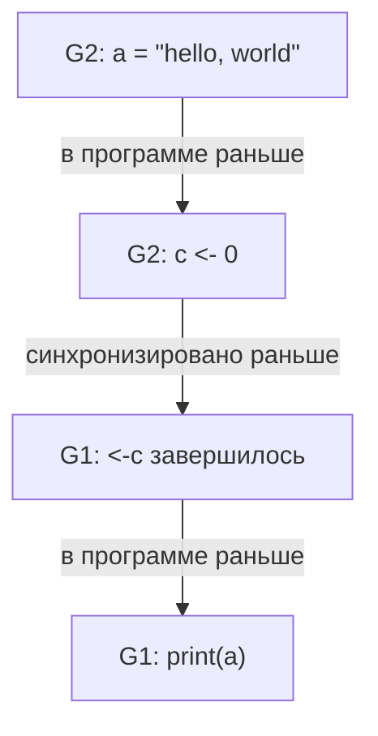
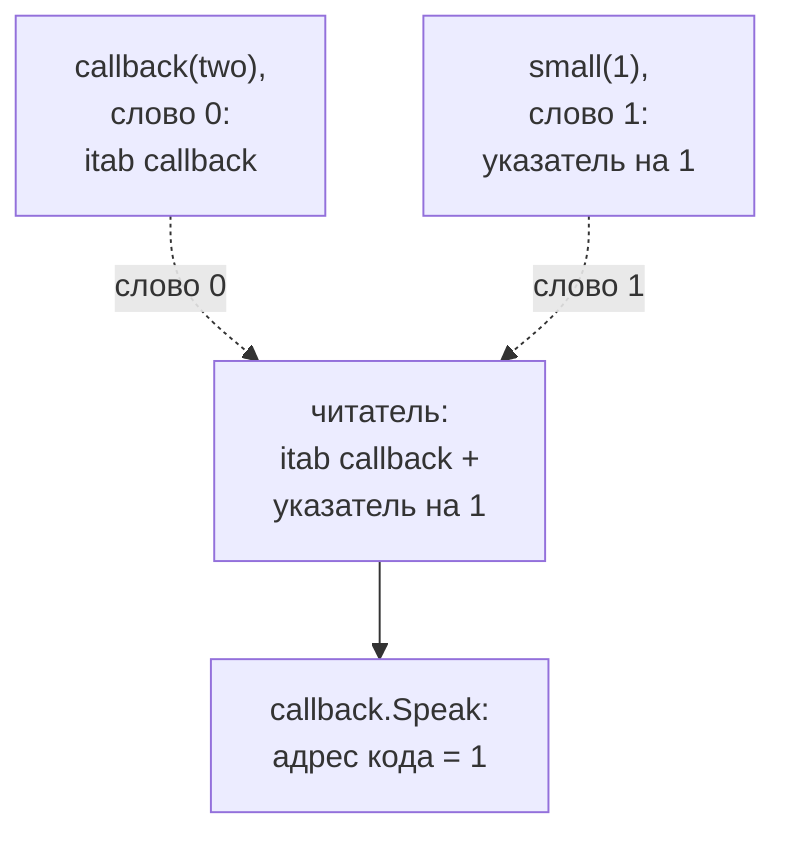

<script setup>
import HappensBefore from '../../viz/scenes/HappensBefore.vue'
</script>

# 1.5.3. Модель памяти и гонки

## <Part kind="problem" /> Проблема: флаг, который работает, и присваивание, которое роняет программу

В [уроке 1.5.2](./02-channels) мы опирались на одно правило: всё, что горутина записала до отправки в канал, получатель увидит после получения. А что будет без канала? Сделаем самое очевидное: одна горутина крутится в цикле `for !done {}`, другая через 10 мс ставит `done = true`. Программа `race/flagloop` из лабы проверяет это дважды — с обычным `bool` и с `atomic.Bool` — и ждёт каждый вариант не дольше 2 секунд:

```text
$ go run -tags labdemo ./1-5/race/flagloop
обычный bool:  завершилось
atomic.Bool:   завершилось
```

<Run dir="labs" cmd="go run -tags labdemo ./1-5/race/flagloop" />

машина: Intel Core i5-12400 (6 ядер, 12 логических процессоров), Linux 7.0, go1.27.2. Шапка вывода (версия, `GOMAXPROCS`, `NumCPU`) здесь и дальше опущена. Три прогона дали одно и то же.

Работает. Обычный `bool` ничем не хуже атомика. Но запустим ту же программу с детектором гонок:

```text
$ go run -race -tags labdemo ./1-5/race/flagloop
==================
WARNING: DATA RACE
Write at 0x000000634448 by main goroutine:
  main.main()
      /home/idel/DevGo/system-desine/labs/1-5/race/flagloop/main.go:60 +0xd4

Previous read at 0x000000634448 by goroutine 8:
  main.waitPlainFlag()
      /home/idel/DevGo/system-desine/labs/1-5/race/flagloop/main.go:30 +0x30
  main.main.gowrap1()
      /home/idel/DevGo/system-desine/labs/1-5/race/flagloop/main.go:58 +0xe

Goroutine 8 (running) created at:
  main.main()
      /home/idel/DevGo/system-desine/labs/1-5/race/flagloop/main.go:58 +0xbe
==================
обычный bool:  завершилось
atomic.Bool:   завершилось
Found 1 data race(s)
exit status 66
```

<Run dir="labs" cmd="go run -race -tags labdemo ./1-5/race/flagloop" />

машина та же; три прогона из трёх дали этот отчёт.

Детектор называет это ошибкой и завершает процесс с кодом 66. Хотя результат тот же. Кто прав?

Вторая программа, `race/iface`, ещё проще по смыслу. Две горутины по очереди присваивают одной переменной-интерфейсу два значения, третья вызывает у неё метод. Ни указателей, ни `unsafe`, ни `nil` в коде нет. Каждое присваивание — обычный `shared = v`:

```text
$ go run -tags labdemo ./1-5/race/iface
panic: runtime error: invalid memory address or nil pointer dereference
[signal SIGSEGV: segmentation violation code=0x1 addr=0x1 pc=0x1]

goroutine 9 [running]:
main.callback.Speak(0x0?)
	/home/idel/DevGo/system-desine/labs/1-5/race/iface/main.go:29 +0x12
main.main.func2()
	/home/idel/DevGo/system-desine/labs/1-5/race/iface/main.go:61 +0x66
created by main.main in goroutine 1
	/home/idel/DevGo/system-desine/labs/1-5/race/iface/main.go:57 +0xeb
exit status 2
```

<Run dir="labs" cmd="go run -tags labdemo ./1-5/race/iface" />

машина та же; программа упала во всех трёх прогонах.

Процессор попытался выполнить код по адресу 1 (`pc=0x1`). Как обычное присваивание в языке с проверкой границ и сборщиком мусора может привести к прыжку по адресу 1? И как связаны две программы: почему одна гонка «ничего не ломает», а другая роняет процесс?

К концу урока вы ответите на оба вопроса. Вы узнаете, что именно обещает Go про память, когда горутины работают вместе, — и чего не обещает. Разберёте, почему «безобидных» гонок не бывает. И научитесь читать отчёт детектора гонок блок за блоком.

## <Part kind="theory" /> Почему «просто прочитать флаг» неверно

Мы привыкли думать, что программа выполняется так, как написана: строка за строкой, и каждая запись сразу попадает в память, откуда её видят все. Для одной горутины это почти правда: всё, что меняется «под капотом», устроено так, чтобы она этого не заметила. Но между вашим кодом и памятью стоят три слоя, и каждый оптимизирует только с одной точки зрения — одного потока. Пройдём по ним.

### Компилятор: значение можно прочитать один раз

Посмотрите на цикл ожидания глазами оптимизатора:

```text
for !done {
}
```

Внутри цикла `done` никто не меняет. С точки зрения одного потока читать его заново на каждой итерации бессмысленно, можно прочитать один раз до цикла. Тогда цикл превращается в такой:

```text
tmp := done   // tmp — регистр
for !tmp {
}
```

Если в момент первого чтения `done` было `false`, цикл не кончится никогда: другая горутина пишет в память, а этот код в память больше не смотрит. Это не выдумка. Ханс Бём разбирает ровно это преобразование в статье «How to miscompile programs with "benign" data races» (HotPar 2011): цикл `while (!flag) {}` компилятор вправе превратить в «теперь, скорее всего, бесконечный, но последовательно эквивалентный» цикл с чтением во временную переменную. Стандарты C и C++ такое преобразование разрешают.

Модель памяти Go тоже допускает преобразования чтений, которые в однопоточной программе незаметны. Пример из раздела «Incorrect compilation»: цикл со счётчиком, который на каждой итерации делает `n += *shared`, можно переписать так, чтобы `*shared` читалось один раз до цикла. Условие — доказано, что чтение не упадёт, потому что «добавленное чтение не повлияет на существующие одновременные чтения и записи». Это не прямое разрешение выносить из цикла чтение флага, который пишет другая горутина. Но и гарантии, что такое чтение когда-нибудь увидит запись, модель не даёт. Про цикл ожидания флага в разделе «Incorrect synchronization» сказано (перевод наш):

> Нет никакой гарантии, что запись в `done` когда-либо будет замечена `main`, поскольку между двумя потоками нет событий синхронизации. Цикл в `main` не обязан завершиться.

Почему же наша программа завершилась? Посмотрим, что сделал компилятор `gc` версии 1.27.2. Флаг `-gcflags=-S` печатает ассемблер; ниже выдержка (пути сокращены, служебные строки `PCDATA`/`FUNCDATA` убраны):

```text
$ go build -tags labdemo -gcflags=-S ./1-5/race/flagloop
main.waitPlainFlag STEXT size=51 …
	0x000e 00014 (main.go:30)	CMPB	main.plainDone(SB), $0
	0x0015 00021 (main.go:30)	JEQ	14
	0x0017 00023 (main.go:32)	CALL	runtime.closechan(SB)
…
main.waitAtomicFlag STEXT size=61 …
	0x000e 00014 (type.go:19)	MOVL	(AX), CX
	0x0010 00016 (type.go:19)	TESTL	CX, CX
	0x0012 00018 (main.go:36)	JEQ	14
…
	0x0089 00137 (main.go:60)	MOVB	$1, main.plainDone(SB)
	0x017c 00380 (type.go:22)	XCHGL	CX, (DX)
```

<Run dir="labs" cmd="go build -tags labdemo -gcflags=-S ./1-5/race/flagloop" />

машина та же, go1.27.2.

Цикл на обычном `bool` — это две инструкции: `CMPB main.plainDone(SB), $0` сравнивает байт **в памяти** с нулём, `JEQ 14` прыгает назад. `gc` сегодня перечитывает флаг на каждой итерации, поэтому программа и завершилась. Но это свойство конкретного компилятора конкретной версии, а не обещание языка. Другой компилятор (`gccgo`, `tinygo`), будущая версия `gc` с более смелым оптимизатором или просто чуть другой код вокруг вправе сделать из этого цикла вечный. Программа, корректность которой держится на том, какие оптимизации компилятор **пока** не делает, — это бомба с неизвестным таймером.

Обратите внимание на атомарную версию. `atomic.Bool.Load` на amd64 — это обычное чтение `MOVL`: на x86 простое чтение уже обладает нужными свойствами. Разница в другом. Атомик **запрещает компилятору** выбрасывать это чтение или переставлять его с соседними операциями. А запись `Store` превратилась в `XCHGL` — обмен, который на x86 всегда выполняется с неявным префиксом `LOCK`, — тогда как обычная запись `plainDone = true` осталась простым `MOVB`. Зачем записи такая тяжёлая инструкция, объясняет следующий слой.

### Процессор: буфер записи

Ядро процессора не ждёт, пока запись дойдёт до памяти. Это заняло бы десятки и сотни тактов. Поэтому запись кладётся в <T id="store-buffer">буфер записи</T> (store buffer) — небольшую очередь внутри ядра, — а ядро идёт выполнять следующие команды. Своё ядро видит свои записи из буфера сразу, а чужие ядра — только когда буфер сольётся в кэш.

Отсюда следствие, которое удивляет даже опытных программистов. Возьмём две горутины на двух ядрах и две переменные, изначально нули:

| Горутина 1 | Горутина 2 |
|---|---|
| `x = 1` | `y = 1` |
| `r1 = y` | `r2 = x` |

Может ли получиться `r1 == 0` и `r2 == 0`? Если бы операции шли «по очереди», то нет. Какая-то запись выполнилась первой, и тот, кто читает после неё, увидит единицу. Но запись `x = 1` может ещё сидеть в буфере ядра 1, когда ядро 2 читает `x`. И симметрично. Обе горутины читают нули. Это классический лакмусовый тест «буфер записи» (store buffering). Проверим на настоящем процессоре:

<!-- go-check -->

```go
package main

// Программа storebuf — лакмусовый тест «буфер записи» (store buffering).
// В первом прогоне намеренная гонка данных: plain — обычный int64. Не делайте так в рабочем коде.

import (
	"fmt"
	"sync/atomic"
)

const rounds = 1_000_000

// cell — общая ячейка: обычная или атомарная.
type cell interface {
	set()
	get() int64
	reset()
}

type plain struct{ v int64 }

func (c *plain) set()       { c.v = 1 } // обычная запись — без синхронизации
func (c *plain) get() int64 { return c.v }
func (c *plain) reset()     { c.v = 0 }

type atomicCell struct{ v atomic.Int64 }

func (c *atomicCell) set()       { c.v.Store(1) }
func (c *atomicCell) get() int64 { return c.v.Load() }
func (c *atomicCell) reset()     { c.v.Store(0) }

// side в каждом раунде пишет 1 в свою ячейку и читает чужую.
func side(round, finished *atomic.Int64, mine, other cell, seen *int64) {
	for i := int64(1); i <= rounds; i++ {
		for round.Load() != i { // ждём, пока main откроет раунд i
		}
		mine.set()
		*seen = other.get()
		finished.Add(1) // атомик: main увидит *seen после своего Load
	}
}

// run гоняет rounds раундов и считает исход «обе горутины прочитали 0».
func run(x, y cell) int {
	var round, finished atomic.Int64
	var r1, r2 int64
	go side(&round, &finished, x, y, &r1)
	go side(&round, &finished, y, x, &r2)
	both := 0
	for i := int64(1); i <= rounds; i++ {
		x.reset()
		y.reset()
		round.Store(i)
		for finished.Load() != 2*i { // ждём обе горутины
		}
		if r1 == 0 && r2 == 0 {
			both++
		}
	}
	return both
}

func main() {
	fmt.Printf("обычные int:   r1 == 0 и r2 == 0 в %d раундах из %d\n", run(&plain{}, &plain{}), rounds)
	fmt.Printf("atomic.Int64:  r1 == 0 и r2 == 0 в %d раундах из %d\n", run(&atomicCell{}, &atomicCell{}), rounds)
}
```

```text
$ go run ./storebuf
обычные int:   r1 == 0 и r2 == 0 в 39820 раундах из 1000000
atomic.Int64:  r1 == 0 и r2 == 0 в 0 раундах из 1000000
$ go run ./storebuf
обычные int:   r1 == 0 и r2 == 0 в 64267 раундах из 1000000
atomic.Int64:  r1 == 0 и r2 == 0 в 0 раундах из 1000000
$ go run ./storebuf
обычные int:   r1 == 0 и r2 == 0 в 21636 раундах из 1000000
atomic.Int64:  r1 == 0 и r2 == 0 в 0 раундах из 1000000
```

<Run dir="labs" cmd="go run ./storebuf" before="положите программу выше в `labs/storebuf/main.go`" />

машина: Intel Core i5-12400 (6 ядер, 12 логических процессоров), Linux 7.0, go1.27.2.

От <N>2 до 6 %</N> раундов на обычных переменных дали исход, который невозможен при выполнении «по очереди». На атомиках таких раундов <N>0</N> из трёх миллионов. Вот зачем атомарная запись — это `XCHG`: на x86 инструкция с блокировкой сливает буфер записи, прежде чем ядро пойдёт дальше. Все раунды синхронизированы атомиками `round` и `finished`, поэтому гонка в программе ровно одна — намеренная, между `set` и `get` обычных ячеек.

**x86 — ещё строгая архитектура.** Его модель называют TSO (total store order): у каждого ядра очередь записей, но записи всех ядер доходят до памяти в одном общем порядке, и порядок «запись данных, потом запись флага» сохраняется. На ARM и POWER процессор вправе переставлять и записи между собой. Рус Кокс в статье «Hardware Memory Models» (2021) разбирает лакмусовый тест «передача сообщения». Одна горутина пишет `x = 1`, потом `y = 1`. Другая читает `y`, потом `x`. Может ли она увидеть `y == 1`, но `x == 0`? На x86 — нет, на ARM — да. А это ровно схема «записал данные, поднял флаг». Код, который годами работал на ноутбуке с x86, может начать ломаться на сервере с arm64 (AWS Graviton, Ampere) или на Mac с Apple Silicon. И Go на arm64 для атомиков ставит другие инструкции — `LDAR` и `STLR` («загрузка с захватом», «запись с освобождением»).

### Кэши: согласованы, но это не спасает

Часто рисуют так: «у каждого ядра своя копия переменной в кэше, и ядро читает устаревшую копию». Это упрощение. Кэши современных процессоров **согласованы**: протокол когерентности (семейство MESI) следит, чтобы <T id="cache-line">кэш-линию</T> (cache line) в изменённом виде держало только одно ядро, а остальные копии объявлялись устаревшими. Запись, дошедшая до кэша, видна всем. Проблемы видимости рождаются раньше: в регистрах (компилятор), в буфере записи и во внеочередном выполнении (процессор). Цена когерентности — передача линий между ядрами — нам ещё встретится как ложное разделение в уроке 1.5.4.

<Callout type="simplified">

Мы описали три источника переупорядочивания по отдельности. В реальном процессоре их больше: внеочередное и спекулятивное выполнение, очереди инвалидаций, предвыборка. Важен не список механизмов, а вывод: **ни компилятор, ни процессор не обещают, что другая горутина увидит ваши записи в порядке исходника — или увидит вообще**. Это обещание даёт только язык, и только на своих условиях. Условия описывает модель памяти.

</Callout>

### Чего бы нам хотелось: последовательная согласованность

Интуитивная модель «операции идут по очереди» имеет имя. Лесли Лэмпорт в 1979 году назвал её <T id="sequential-consistency">последовательной согласованностью</T> (sequential consistency): результат любого выполнения такой же, как если бы операции всех процессоров шли в некотором общем порядке, а операции каждого процессора — в порядке его программы. Иначе говоря, любое поведение — это какое-то перемешивание строк горутин, при котором порядок внутри каждой сохранён.

Давать её всегда — значит запретить компилятору выносить чтения из циклов, держать значения в регистрах и переставлять независимые операции, а процессору — буфер записи. Программы стали бы в разы медленнее. Поэтому все современные языки договорились о компромиссе: последовательную согласованность получает только программа, которая **сама** расставила синхронизацию там, где горутины делят данные. Как именно — говорит модель памяти.

## <Part kind="theory" /> Модель памяти Go

### Что это и откуда

<T id="memory-model">Модель памяти</T> (memory model) — это часть определения языка. Она отвечает на один вопрос. Первая фраза документа go.dev/ref/mem (здесь и дальше цитаты в нашем переводе):

> Модель памяти Go определяет условия, при которых чтение переменной в одной горутине гарантированно видит значение, записанное в ту же переменную в другой горутине.

Это договор трёх сторон. Программист обещает расставить синхронизацию. Компилятор и рантайм обещают, что тогда программа поведёт себя предсказуемо, и обязуются не делать оптимизаций, которые это сломают. Нынешняя редакция датирована 6 июня 2022 года и вышла с Go 1.19. В release notes 1.19 сказано, что модель пересмотрена, чтобы «согласовать Go с моделью памяти C, C++, Java, JavaScript, Rust и Swift», и что Go даёт «только последовательно согласованные атомики». Формальная часть построена по статье Ханса Бёма и Сариты Адве «Foundations of the C++ Concurrency Memory Model» (PLDI 2008).

Начинается документ с совета, который стоит запомнить раньше всех определений:

> Программы, которые меняют данные, одновременно доступные нескольким горутинам, должны упорядочивать такой доступ. […] Если для понимания поведения вашей программы вам нужно дочитать этот документ до конца, вы слишком умничаете. Не умничайте.

### Три отношения порядка

Модель рассматривает выполнение программы как набор операций с памятью. Каждая операция — это обычное чтение или запись либо **синхронизирующая** операция: атомарный доступ, операция мьютекса или канала. Одни операции похожи на чтение: чтение, атомарное чтение, `Lock`, получение из канала. Другие похожи на запись: запись, атомарная запись, `Unlock`, отправка, `close`. Атомарный CAS — и то и другое.

Между операциями определены три порядка.

1. **«Упорядочено в программе раньше»** (sequenced before) — порядок внутри одной горутины. Его задают управляющие конструкции и порядок вычисления выражений по спецификации языка. Строка 5 упорядочена раньше строки 6 той же горутины.
2. **«Синхронизировано раньше»** (synchronized before) — порядок между синхронизирующими операциями **разных** горутин. Если синхронизирующее чтение `r` увидело синхронизирующую запись `w`, то `w` синхронизирована раньше `r`. Например, получение из канала «увидело» отправку.
3. **«Происходит раньше»** (happens before) — транзитивное замыкание объединения первых двух. Цитата: «отношение "происходит раньше" определяется как транзитивное замыкание объединения отношений "упорядочено раньше" и "синхронизировано раньше"».

Третий порядок — главный. <T id="happens-before">«Происходит раньше»</T> (happens-before) — это **цепочки**: шаг внутри горутины, переход по синхронизации в другую горутину, снова шаг внутри и так далее. Если от операции A до операции B можно дойти по такой цепочке, A происходит раньше B. Если нельзя ни от A до B, ни от B до A, операции **не упорядочены**. Это и значит «частичный порядок»: не любые две операции сравнимы.

Вот пример из модели памяти. Он гарантированно печатает `hello, world`:

<!-- go-check -->

```go
var c = make(chan int, 10)
var a string

func f() {
	a = "hello, world"
	c <- 0
}

func main() {
	go f()
	<-c
	print(a)
}
```



Что смотреть на схеме. Синие узлы — горутина `f` (G2), бирюзовые — `main` (G1). Две стрелки идут внутри горутин, одна — через канал. Вместе они дают путь от записи `a` до чтения `a`, поэтому запись происходит раньше чтения. Уберите среднюю стрелку — например, замените канал на флаг, — и пути не станет.

### Какую запись увидит чтение

Теперь можно сказать точно, что увидит обычное чтение `r` переменной `x`. Модель требует, чтобы `r` прочитало запись `w`, которая ему **видна** (Requirement 3). Видна — значит:

1. `w` происходит раньше `r`;
2. `w` не происходит раньше никакой другой записи `w'` в `x`, которая сама происходит раньше `r`.

Проще говоря, `r` видит **последнюю** запись на цепочке «происходит раньше». Если таких цепочек нет, видимой записи может не быть вовсе, а правило ничего не обещает.

### Синхронизирующие события: полный список

Вот всё, что в Go создаёт стрелку «синхронизировано раньше». Источник — go.dev/ref/mem и документация пакетов `sync` и `sync/atomic` в Go 1.27.2.

| Механизм | Правило (что синхронизировано раньше чего) |
|---|---|
| Инициализация | если пакет `p` импортирует `q`, завершение `init` в `q` происходит раньше начала любого `init` в `p`; завершение всех `init` — раньше начала `main.main` |
| `go` | оператор `go` — раньше начала выполнения новой горутины |
| Канал | отправка — раньше завершения соответствующего получения; `close` — раньше получения, вернувшего ноль из-за закрытия; для небуферизованного канала получение — раньше завершения отправки; k-е получение из канала ёмкостью C — раньше завершения (k+C)-й отправки |
| `sync.Mutex`, `sync.RWMutex` | для n < m n-й `Unlock` — раньше возврата m-го `Lock`; для `RLock` есть n, что n-й `Unlock` — раньше возврата `RLock`, а парный `RUnlock` — раньше возврата (n+1)-го `Lock`; неудачный `TryLock` не синхронизирует ничего |
| `sync.Once` | возврат из `f` в `once.Do(f)` — раньше возврата **любого** вызова `once.Do(f)` |
| `sync.WaitGroup` | `Done` — раньше возврата `Wait`, который он разблокировал; для `wg.Go(f)` — возврат из `f` |
| `sync/atomic` | если атомарная операция B увидела результат атомарной операции A, то A — раньше B; все атомарные операции программы выполняются как бы в одном последовательно согласованном порядке |
| Финализатор | `runtime.SetFinalizer(x, f)` — раньше вызова `f(x)` |
| `sync.Cond`, `sync.Map`, `sync.Pool` | гарантии описаны в документации каждого типа: например, `Broadcast`/`Signal` — раньше возврата разбуженного `Wait`, `Put(x)` — раньше `Get`, вернувшего `x` |

Правила каналов мы разобрали в [уроке 1.5.2](./02-channels), устройство `Mutex` и атомиков — в уроке 1.5.4. Здесь важен общий принцип: **синхронизирует пара операций над одним и тем же объектом**. `Unlock` одного мьютекса ничего не говорит о `Lock` другого. Отправка в канал `a` ничего не говорит о получении из канала `b`.

О двух строках стоит сказать отдельно.

**Атомики Go — последовательно согласованные.** Документация `sync/atomic` говорит, что это «та же семантика, что у последовательно согласованных атомиков C++ и у volatile-переменных Java». Более слабых режимов (acquire/release, relaxed), как в C++ или Rust, в Go нет. Это сознательное решение. Рус Кокс в «Updating the Go Memory Model» (2021) объясняет: последовательно согласованные атомики полезнее, потому что для корректности часто важен порядок атомарных операций над **разными** ячейками. Тест `storebuf` выше — ровно такой случай. На атомиках acquire/release исход «оба прочитали 0» снова стал бы возможен.

**Завершение горутины не синхронизирует ничего.** Пример из модели памяти:

<!-- go-check -->

```go
var a string

func hello() {
	go func() { a = "hello" }()
	print(a)
}
```

Запись в `a` не связана ни с каким событием синхронизации, и её не обязана увидеть ни одна горутина. Модель добавляет: «агрессивный компилятор мог бы удалить весь оператор `go`». Хотите увидеть результат горутины — дождитесь её через канал, `WaitGroup` или `errgroup` (урок 1.5.5).

### Три неверные идиомы

Раздел «Incorrect synchronization» модели памяти разбирает приёмы, которые выглядят разумно и встречаются в реальном коде. Все три сломаны одним и тем же.

**Ожидание флага.** Наш `flagloop`, только с данными:

<!-- go-check -->

```go
var a string
var done bool

func setup() {
	a = "hello, world"
	done = true
}

func main() {
	go setup()
	for !done {
	}
	print(a)
}
```

Модель говорит о двух проблемах. Первая: даже если `main` увидела `done == true`, это не значит, что она увидит `a`. Может напечататься пустая строка — на ARM даже без участия компилятора. Вторая, хуже: цикл не обязан завершиться вовсе.

**Публикация указателя.** Тонкий вариант той же ошибки:

<!-- go-check -->

```go
type T struct {
	msg string
}

var g *T

func setup() {
	t := new(T)
	t.msg = "hello, world"
	g = t
}

func main() {
	go setup()
	for g == nil {
	}
	print(g.msg)
}
```

Даже если `main` увидела `g != nil`, нет гарантии, что она увидит `g.msg`, записанное до `g = t`. Указатель «опубликован» раньше, чем содержимое. Так ломаются самодельные кэши и ленивая инициализация.

**Двойная проверка блокировки** (double-checked locking). Хочется не платить за синхронизацию, когда инициализация уже прошла:

<!-- go-check -->

```go
import "sync"

var a string
var done bool
var once sync.Once

func setup() {
	a = "hello, world"
	done = true
}

func doprint() {
	if !done { // быстрый путь без синхронизации — ошибка
		once.Do(setup)
	}
	print(a)
}
```

Горутина, увидевшая `done == true` на быстром пути, не прошла через `once.Do` и не получила стрелку «происходит раньше» от `setup`. Значит, может увидеть пустую `a`. Модель памяти: «эта версия может (ошибочно) напечатать пустую строку».

Лекарство во всех трёх случаях одно — явная синхронизация. Вот как пишутся все три правильно:

<!-- go-check -->

```go
import (
	"sync"
	"sync/atomic"
)

type Config struct {
	Limit int
	Hosts []string
}

// Ожидание события: закрытие канала — широковещательный сигнал с порядком.
func waitReady(ready <-chan struct{}) {
	<-ready // всё, что сделано до close(ready), видно после этой строки
}

// Публикация: atomic.Pointer — Store раньше Load, увидевшего новый указатель.
var current atomic.Pointer[Config]

func publish(c *Config) { current.Store(c) } // c больше не меняют: только новая копия
func limit() int        { return current.Load().Limit }

// Ленивая инициализация: sync.OnceValue (Go 1.21) — быстрый путь внутри уже корректен.
var defaultHosts = sync.OnceValue(func() []string {
	return []string{"a.example", "b.example"}
})
```

Обратите внимание на `publish`. `atomic.Pointer` гарантирует, что читатель увидит всё, что записано в `*c` **до** `Store`. Но менять `*c` после публикации нельзя: эти записи уже ничем не упорядочены с чтениями. Публикуют неизменяемый снимок, а для изменения собирают новый и публикуют его заново. Быстрый путь `sync.Once` внутри — это атомарное чтение флага `done` и только потом обычное чтение данных: ровно то, что неверная идиома пыталась сделать без атомика.

## <Part kind="theory" /> Гонка данных и гарантия DRF-SC

### Определение

Теперь можно дать точное определение. <T id="data-race">Гонка данных</T> (data race) по модели памяти Go — это пара обращений к одной ячейке памяти, где:

- хотя бы одно обращение — запись (гонка «чтение — запись» или «запись — запись»);
- хотя бы одно обращение не синхронизирующее, то есть не атомарное;
- обращения **не упорядочены** отношением «происходит раньше».

Обратите внимание, чего в определении нет: слова «одновременно». Два обращения могут разделять секунды. Если между ними нет цепочки синхронизации, это гонка. Отсюда и вердикт детектора по `flagloop`: запись `plainDone = true` в `main` и чтение в `waitPlainFlag` ничем не упорядочены. Неважно, что программа «сработала».

Гонку данных не путайте с логической гонкой (race condition), которую мы видели в [уроке 1.6](../01-go-service/06-tests) модуля 1. Там каждое обращение к карте шло под замком — гонки данных не было, — но «проверил имя» и «записал» шли под **разными** замками, и между ними вклинивалась другая горутина. Детектор гонок логические гонки не ловит. Их ловят тесты на поведение.

### DRF-SC: что Go обещает программе без гонок

Главная теорема модели памяти:

> Любая программа на Go без гонок данных — то есть без выполнений с гонками «чтение — запись» и «запись — запись» — может давать только результаты, объяснимые некоторым последовательно согласованным перемешиванием выполнений горутин. […] Это свойство называется DRF-SC.

DRF-SC — «data-race-free → sequentially consistent», «без гонок значит последовательно согласованно». Неформальная часть документа говорит ещё проще: «В отсутствие гонок данных программы на Go ведут себя так, будто все горутины мультиплексированы на одном процессоре».

Это сильное обещание, и оно освобождает от всего, что мы разбирали в начале урока. Пишете без гонок — забудьте про буферы записи, вынос чтений и ARM против x86. Компилятор и процессор могут переставлять что угодно, но так, чтобы вы этого не заметили. Идею сформулировали Сарита Адве и Марк Хилл в 1990 году для аппаратуры («Weak Ordering — A New Definition»), а сегодня её дают C, C++, Java, JavaScript, Rust, Swift и Go.

### Что бывает с программой, где гонка есть

Здесь языки расходятся. В C и C++ программа с гонкой не определена совсем: компилятор вправе сделать что угодно. Go так не поступает. Модель памяти в разделе «Implementation Restrictions for Programs Containing Data Races» перечисляет, что реализация обязана соблюдать и в программе с гонкой.

1. **Можно сообщить о гонке и остановиться.** «Любая реализация, обнаружив гонку данных, может сообщить о ней и остановить выполнение программы». Ровно это делает `-race`: код выхода 66 в `flagloop`.
2. **Слово читается целиком.** Чтение ячейки не больше машинного слова должно увидеть значение, которое кто-то **действительно записал**: предшествующей или одновременной записью. Значений «из воздуха» (out of thin air) не бывает. Гонка на `int` или указателе может дать старое значение, но не мусор.
3. **Составное читается по частям.** Чтение и запись массива, структуры или комплексного числа можно выполнять по полям, в любом порядке.
4. **Многословное может разорваться.** Цитата целиком, потому что на ней держится вторая программа урока:

> Чтение ячеек больше одного машинного слова рекомендуется, но не обязано подчиняться той же семантике. […] Из соображений производительности реализации могут обрабатывать такие операции как набор отдельных операций над машинными словами в неуказанном порядке. Это значит, что гонки на многословных структурах данных могут приводить к несогласованным значениям, не соответствующим ни одной записи. Когда значения зависят от согласованности внутренних пар (указатель, длина) или (указатель, тип), как это бывает у интерфейсов, карт, срезов и строк в большинстве реализаций Go, такие гонки могут, в свою очередь, приводить к произвольной порче памяти.

Вот какие значения в Go многословные (на 64-битной машине):

| Тип | Слова | Что будет при «рваном» чтении |
|---|---|---|
| `string` | указатель, длина | длина от одной строки, байты от другой: чтение за концом буфера |
| `[]T` | указатель, длина, ёмкость | `s[i]` проходит проверку границ по чужой длине и читает или пишет чужую память |
| интерфейс | тип (`itab`), данные | метод одного типа вызывается с данными другого — падение `race/iface` |
| `map` | одно слово, указатель | сам указатель не рвётся, но внутренние таблицы меняются без замка; рантайм ловит часть случаев и падает с `fatal error: concurrent map writes` (`internal/runtime/maps`). Это `fatal`, а не `panic`: `recover` его не перехватит |

Для слова (`int`, `bool`, указатель) модель обещает «одно из записанных значений». Для `int64` на 32-битной машине (`GOARCH=386`, `arm`) это уже два слова, и чтение может склеить половины двух значений. Отсюда `atomic.Int64` с гарантированным выравниванием.

### Разбор падения race/iface

Теперь у нас есть всё, чтобы понять `pc=0x1`. Значение интерфейса в Go — два машинных слова:



Что смотреть на схеме. Вверху — по одному слову из двух разных записей: бирюзовое слово 0 из `callback(two)` и зелёное слово 1 из `small(1)`. Вторые половины этих записей (`itab small` и указатель на замыкание) читатель не увидел. Синий узел — то, что он склеил. Красный — итог: прыжок по адресу 1.

По шагам:

1. **Два слова.** Первое слово (`itab`) указывает на таблицу методов пары «интерфейс `speaker` — конкретный тип». Второе — данные. `small` — это `int`. Такое значение не помещается в слово-указатель «как есть», поэтому слово данных указывает на ячейку, где лежит 1. Здесь `small(1)` — константа, и компилятор положил 1 в статические данные программы: в ассемблере это `LEAQ main..stmp_3(SB), BX`, без всякого вызова рантайма. Для неконстантных значений от 0 до 255 рантайм тоже не выделяет память, а берёт адрес из готовой таблицы `staticuint64s` (`runtime/iface.go`, `convT64`). `callback` — тип-функция, а значение функции в Go и есть указатель на замыкание. Он кладётся во второе слово сам.
2. **Запись не атомарна.** Вот как `gc` скомпилировал `set` (выдержка):

   ```text
   0x0014 00020 (main.go:39)	MOVQ	AX, main.shared(SB)     // слово 0: itab
   0x001b 00027 (main.go:39)	CMPL	runtime.writeBarrier(SB), $0
   …
   0x0037 00055 (main.go:39)	MOVQ	BX, main.shared+8(SB)   // слово 1: данные
   ```

   Это `go build -gcflags=-S` на go1.27.2, amd64. Две отдельные записи, между ними — проверка барьера записи сборщика мусора. Читатель на другом ядре может прочитать оба слова между ними.
3. **Читатель склеивает.** Он видит `itab` от `callback` и данные от `small(1)`, то есть указатель на ячейку с числом 1.
4. **Вызов.** `shared.Speak()` по `itab` идёт в `callback.Speak`. Тот вызывает `c()`, а вызов функции-значения в Go — это «прочитай адрес кода по указателю на замыкание и прыгни туда». По указателю лежит 1. Процессор прыгает на адрес 1: `pc=0x1`.
5. **Паника.** Ядро присылает `SIGSEGV`. Обработчик сигналов рантайма (`sigpanic` в `runtime/signal_unix.go`) превращает ошибку по адресу меньше `0x1000` в обычную панику `invalid memory address or nil pointer dereference`. Отсюда «nil pointer» в программе, где `nil` нет. Паника не перехвачена — процесс завершается с кодом 2.

Нам ещё повезло: адрес 1 точно не отображён в память, и программа упала сразу. Если бы «склеились» указатель и длина среза, читатель мог бы молча прочитать или **записать** чужую память и продолжить работу. Такую поломку находят через неделю, в другом месте и без связи с причиной. Именно это модель памяти называет «произвольной порчей памяти». Рус Кокс показал это ещё в 2010 году в заметке «Off to the Races»: гонкой на значении интерфейса можно получить доступ к произвольной памяти без пакета `unsafe`.

### Чего компилятор Go не сделает

В обмен на ограничения для программиста модель памяти ограничивает и компилятор — строже, чем в C и C++. Раздел «Incorrect compilation» запрещает:

- **вводить записи, которых нет в программе.** Нельзя превратить `*p = 1; if cond { *p = 2 }` в `*p = 2; if !cond { *p = 1 }`. Иначе другая горутина увидела бы 2, которого в исходной программе при `cond == false` не было;
- **считать, что циклы и вызовы функций завершаются**, и выносить обращения к памяти из-за них вперёд;
- **читать одно значение дважды.** Если код сделал `i := *p` и проверил границы `i`, компилятор не вправе, экономя регистры, перечитать `*p` перед `funcs[i]()`. Иначе проверка прошла бы для одного значения, а вызов ушёл бы по другому;
- **писать одно значение в несколько шагов**, используя саму переменную как временную: `*p = i + *p/2` нельзя превратить в `*p /= 2; *p += i`.

Модель отмечает, что все эти оптимизации **разрешены** компиляторам C и C++. Бём в статье 2011 года показывает, что повторное чтение даёт в C «дикий переход» (wild branch): проверка прошла для одного значения счётчика, а вызов по указателю на функцию ушёл по другому. В Go такого нет — но только для значений в одно слово. Для многословных значений, как мы видели, гарантий нет даже в Go.

## <Part kind="theory" /> Детектор гонок изнутри

Основы детектора мы прошли в [уроке 1.6](../01-go-service/06-tests) модуля 1. Это флаг `-race`, отчёт `WARNING: DATA RACE`, цена в разы и правило «находит только то, что выполнилось». Здесь разберём, как он устроен, — тогда все его свойства станут следствиями, а не правилами для запоминания.

### Что добавляет -race

<T id="race-detector">Детектор гонок</T> (race detector) — это библиотека ThreadSanitizer (TSan) из проекта LLVM, вкомпилированная в рантайм Go (`runtime/race`). Флаг `-race` делает три вещи:

1. **Инструментирует доступы.** Перед каждым чтением и записью памяти компилятор вставляет вызов `runtime.raceread(addr)` или `runtime.racewrite(addr)`, а для диапазонов — `racereadrange`/`racewriterange`. На входе и выходе функций — `racefuncenter`/`racefuncexit`, чтобы детектор знал стек.
2. **Сообщает о синхронизации.** Каналы, мьютексы, `WaitGroup`, атомики и запуск горутины зовут TSan: «здесь освобождение», «здесь захват», «здесь горутина создана» (`racegostart` вызывает `__tsan_go_start`). Из этих событий TSan строит отношение «происходит раньше».
3. **Включает тег сборки `race`.** Можно исключить код или тест: `//go:build !race`.

Требования: включённый cgo, а на всех системах, кроме macOS, ещё и компилятор C. Поддерживаются linux/amd64, linux/arm64, linux/ppc64le, linux/s390x, linux/loong64, freebsd/amd64, netbsd/amd64, darwin/amd64, darwin/arm64 и windows/amd64.

### Векторные часы: как проверить «происходит раньше»

Строить граф всех операций и искать пути было бы безнадёжно дорого. TSan использует <T id="vector-clock">векторные часы</T> (vector clock). У каждой горутины есть свой логический счётчик — **эпоха**, — который растёт на каждом событии. И есть вектор: что эта горутина «знает» о счётчиках остальных.

- При **освобождении** (`Unlock`, отправка в канал) горутина кладёт копию своего вектора в объект синхронизации.
- При **захвате** (`Lock`, получение) горутина берёт поэлементный максимум своего вектора и вектора объекта. Так знание о чужих событиях переходит по цепочке — ровно как стрелки «синхронизировано раньше».
- Обращение A горутины G1 в эпоху `e` **происходит раньше** текущего обращения горутины G2, если в векторе G2 значение для G1 не меньше `e`.

Разберём на мьютексе. G1 пишет `x` под замком, потом G2 читает `x`:

| Шаг | Событие | Вектор G1 | Вектор мьютекса | Вектор G2 | Проверка |
|---|---|---|---|---|---|
| 1 | G1: `x = 42` в эпоху 5 | [G1:5, G2:0] | — | [G1:0, G2:3] | тень `x`: «запись G1@5» |
| 2 | G1: `mu.Unlock()` | [G1:6, G2:0] | [G1:5, G2:0] | [G1:0, G2:3] | |
| 3 | G2: `mu.Lock()` | | [G1:5, G2:0] | max → [G1:5, G2:4] | |
| 4 | G2: `print(x)` | | | [G1:5, G2:5] | G2 знает G1 до 5 ≥ 5 → упорядочено, гонки нет |
| 4′ | то же без `Lock` | | | [G1:0, G2:4] | G2 знает G1 до 0 < 5 → **гонка** |

Строка 4′ — это `flagloop`, только с ролями наоборот. В отчёте `flagloop` в начале урока текущее обращение — запись флага в `main` (`Write … by main goroutine`), а прошлое — чтение в горутине 8 (`Previous read … by goroutine 8`). Горутина 8 ни разу не передавала `main` своих знаний: между ними нет ни канала, ни замка. Поэтому в векторе `main` значение для горутины 8 меньше эпохи того чтения, чтение для `main` «невидимо» по часам — и это гонка.

### Теневая память: где хранится «кто обращался»

Чтобы сравнивать, детектору нужно помнить прошлые обращения к каждому адресу. Для этого есть <T id="shadow-memory">теневая память</T> (shadow memory): отдельная область, где каждым 8 байтам данных программы соответствуют ячейки с описанием последних обращений. Адрес тени вычисляется из адреса данных простой арифметикой, без поиска.

В текущей версии TSan (v3; в Go — с 1.19) на каждые 8 байт приходится **4 ячейки по 32 бита** (`kShadowCnt = 4`, `kShadowCell = 8`, `RawShadow` — `u32`). Так теневая память вдвое больше памяти программы. В одной ячейке лежат:

- маска: какие из 8 байт задеты;
- номер слота — кто обращался;
- эпоха (14 бит) — когда по его часам;
- признаки «чтение» и «атомарное».

При каждом обращении TSan сравнивает новое обращение с четырьмя ячейками адреса. Если в ячейке обращение другого слота, хотя бы одно из двух — запись, а по векторным часам оно не происходит раньше — печатается отчёт. Новое обращение затем занимает свободную ячейку или вытесняет одну из старых.

<Callout type="simplified">

Мы говорили «часы у каждой горутины». В TSan v3 вектор фиксированного размера: 256 **слотов** (`kThreadSlotCount = 256`), и горутины по очереди занимают слоты из общей очереди, отбирая их друг у друга. Эпоха слота — 14 бит. Когда эпохи всех слотов исчерпаны, детектор делает глобальный сброс часов и теневой памяти (`DoReset` в `tsan_rtl.cpp`) и начинает новый период. Поэтому с Go 1.19 число горутин под `-race` не ограничено (release notes 1.19). У TSan v2 был предел одновременно живых горутин. На логику «знает ли G2 о событии G1» всё это не влияет.

</Callout>

Из устройства сразу следуют свойства детектора:

- **Он ловит гонку, даже если поломки не случилось.** Достаточно, чтобы два неупорядоченных обращения **произошли** в этом прогоне. Поэтому `flagloop` под `-race` падает в 3 прогонах из 3, хотя без `-race` всё «работает».
- **Он видит только выполненный код.** Если путь не выполнился, обращений не было и сравнивать нечего. Документация: детектор «не может найти гонки в путях кода, которые не выполнялись».
- **Память у него конечная.** Гонка будет найдена, только если прошлое обращение ещё лежит в теневой памяти **и** его стек ещё есть в журнале. Четыре ячейки на 8 байт — не вся история. Если между двумя гоночными обращениями к адресу было много других, старое могло вытесниться. Стек давнего обращения восстанавливается из кольцевого журнала, куда горутина записывает свои события. Если журнал уже перезаписан, TSan v3, на котором работает Go, такую гонку, как правило, просто не печатает: в его `ReportRace` неудача `RestoreStack` ведёт к молчаливому выходу. Старый TSan v2 печатал отчёт с пометкой `failed to restore the stack` — о ней и пишет документация Go. Журнал можно увеличить: `GORACE=history_size=N` даёт 32K × 2^N записей на горутину ценой памяти. Документация Go называет значением по умолчанию N = 1, но на go1.27.2 без переменной детектор у нас вёл себя как при `history_size=0` (в флагах самого TSan по умолчанию 0) — замер ниже.
- **Ложных срабатываний по устройству почти не бывает.** Если отчёт есть, неупорядоченные обращения действительно были. Исключения возможны там, где синхронизация идёт мимо инструментированного кода: через `unsafe` и самодельные примитивы на ассемблере.

Конечность истории легко увидеть вживую. Запустим `race/iface` под детектором, но на одном P:

```text
$ GOMAXPROCS=1 go run -race -tags labdemo ./1-5/race/iface
читатель дожил до конца, сумма 28224729
гонка не сломала программу в этот раз
$ echo $?
0
```

<Run dir="labs" cmd="GOMAXPROCS=1 go run -race -tags labdemo ./1-5/race/iface; echo $?" />

машина та же, go1.27.2; семь прогонов из семи — ни одного отчёта и код 0, хотя на 12 P та же программа даёт 5 отчётов. Ещё по три прогона с `GORACE=history_size=1` и `history_size=7` — тоже ни одного отчёта. Гонка никуда не делась: сумма 28 миллионов, а не 20 или 40, значит, читатель видел значения обоих писателей вперемешку.

Что здесь установлено, а что — догадка. Установлено (исходник TSan v3, `tsan_rtl_report.cpp`): если стек прошлого обращения не удаётся восстановить из журнала, `ReportRace` выходит молча. Для `iface` мы не мерили, сколько обращений горутина успевает сделать за квант и что именно лежит в журнале к моменту прихода другой горутины. Наиболее вероятное объяснение, согласное с замером ниже: на одном P горутины сменяют друг друга редко, целыми квантами планировщика (урок 1.5.1), и между гоночными обращениями разных горутин проходит слишком много событий, чтобы стек старого обращения ещё был в журнале.

Чтобы проверить это на программе, где всё под контролем, в лабе есть `race/history`: две горутины по n раз пишут в одну переменную, и больше ничего.

<<< @/../labs/1-5/race/history/main.go#history{go}

```text
$ go build -race -tags labdemo -o history ./1-5/race/history
$ GOMAXPROCS=1 GORACE=atexit_sleep_ms=0 ./history -n 20000 2>&1 | grep -c 'WARNING: DATA RACE'
1
$ GOMAXPROCS=1 GORACE=atexit_sleep_ms=0 ./history -n 30000 2>&1 | grep -c 'WARNING: DATA RACE'
0
$ GOMAXPROCS=1 GORACE='atexit_sleep_ms=0 history_size=1' ./history -n 30000 2>&1 | grep -c 'WARNING: DATA RACE'
1
```

Сводка: в каждой клетке — число отчётов в трёх прогонах.

| `GOMAXPROCS=1`, `GORACE` | n = 10 000 | 20 000 | 30 000 | 50 000 | 70 000 | 100 000 | 1 000 000 |
|---|---|---|---|---|---|---|---|
| без `history_size` | 1 1 1 | 1 1 1 | 0 0 0 | 0 0 0 | 0 0 0 | 0 0 0 | 0 0 0 |
| `history_size=0` | 1 1 1 | 1 1 1 | 0 0 0 | 0 0 0 | 0 0 0 | 0 0 0 | 0 0 0 |
| `history_size=1` | 1 1 1 | 1 1 1 | 1 1 1 | 0 0 0 | 0 0 0 | 0 0 0 | 0 0 0 |
| `history_size=3` | 1 1 1 | — | 1 1 1 | 0 0 0 | 0 0 0 | 0 0 0 | 0 0 0 |
| `history_size=7` | 1 1 1 | — | 1 1 1 | 1 1 1 | 1 1 1 | 0 0 0 | 0 0 0 |

<Run dir="labs" cmd="GOMAXPROCS=1 GORACE=atexit_sleep_ms=0 ./history -n 20000 2>&amp;1 | grep -c 'WARNING: DATA RACE'" before="`go build -race -tags labdemo -o history ./1-5/race/history`; для клеток таблицы меняйте `-n` и `GORACE=history_size=…`" />

машина та же, go1.27.2; «—» — не мерили. С `GOMAXPROCS=2` и `4` (без `history_size`) при n от 100 000 до 10 000 000 отчёт был в каждом из трёх прогонов; при `GOMAXPROCS=2` и n = 100 000 и 1 000 000 — ещё в 10 из 10. Но в одном из первых, черновых прогонов того же опыта на 2 P при n = 1 000 000 отчёта **не было**. Так что несколько P делают отчёт вероятнее, но не гарантируют его.

Как читать таблицу. Это порядок величины на нашей машине, а не константы TSan. Видно, что порог растёт с размером журнала, но не пропорционально: `history_size=1` и `3` дали одинаковый порог (между 30 000 и 50 000), хотя журнал отличается вчетверо, а `history_size=7` сдвинул его только до 70 000–100 000. Значит, размер журнала — не единственный фактор. Порог зависит и от того, как TSan хранит журнал частями и переиспользует их. При таких n горутина к тому же успевает пройти весь цикл за один квант: вся программа при n = 1 000 000 работает 0,02 с. Устройство журнала мы не разбирали и объяснять порог точнее не беремся.

Вывод для практики: детектор надёжнее ловит гонки, когда горутины действительно работают **параллельно** и обращения перемежаются часто. Гоняйте тесты с `-race` на нескольких ядрах (`-cpu=1,4` проверяет оба режима), а не в контейнере на одно ядро. И помните: зелёный `-race` — это «в этом прогоне ничего не нашлось», а не «гонок нет».

### Читаем отчёт: race/iface под -race

Вот первый прогон `race/iface` с детектором (команда — `go run -race -tags labdemo ./1-5/race/iface` из `labs/`; отчётов пять, показаны первый и третий):

```text
$ go run -race -tags labdemo ./1-5/race/iface
==================
WARNING: DATA RACE
Write at 0x0000005e9640 by goroutine 9:
  main.set()
      /home/idel/DevGo/system-desine/labs/1-5/race/iface/main.go:39 +0x30
  main.main.func1()
      /home/idel/DevGo/system-desine/labs/1-5/race/iface/main.go:51 +0x94

Previous write at 0x0000005e9640 by goroutine 8:
  main.set()
      /home/idel/DevGo/system-desine/labs/1-5/race/iface/main.go:39 +0x30
  main.main.func1()
      /home/idel/DevGo/system-desine/labs/1-5/race/iface/main.go:52 +0xa7

Goroutine 9 (running) created at:
  main.main()
      /home/idel/DevGo/system-desine/labs/1-5/race/iface/main.go:56 +0xe6

Goroutine 8 (running) created at:
  main.main()
      /home/idel/DevGo/system-desine/labs/1-5/race/iface/main.go:55 +0xdc
==================
…
==================
WARNING: DATA RACE
Read at 0x0000005e9640 by goroutine 10:
  main.main.func2()
      /home/idel/DevGo/system-desine/labs/1-5/race/iface/main.go:61 +0xb5

Previous write at 0x0000005e9640 by goroutine 8:
  main.set()
      /home/idel/DevGo/system-desine/labs/1-5/race/iface/main.go:39 +0x30
  main.main.func1()
      /home/idel/DevGo/system-desine/labs/1-5/race/iface/main.go:52 +0xa7

Goroutine 10 (running) created at:
  main.main()
      /home/idel/DevGo/system-desine/labs/1-5/race/iface/main.go:57 +0x14c

Goroutine 8 (running) created at:
  main.main()
      /home/idel/DevGo/system-desine/labs/1-5/race/iface/main.go:55 +0xdc
==================
…
panic: runtime error: invalid memory address or nil pointer dereference
[signal SIGSEGV: segmentation violation code=0x1 addr=0x1 pc=0x1]

goroutine 9 [running]:
main.callback.Speak(0x4f1870)
	/home/idel/DevGo/system-desine/labs/1-5/race/iface/main.go:29 +0x27
main.main.func2()
	/home/idel/DevGo/system-desine/labs/1-5/race/iface/main.go:61 +0xca
created by main.main in goroutine 1
	/home/idel/DevGo/system-desine/labs/1-5/race/iface/main.go:57 +0x14d
exit status 2
```

<Run dir="labs" cmd="go run -race -tags labdemo ./1-5/race/iface" />

машина: Intel Core i5-12400 (6 ядер, 12 логических процессоров), Linux 7.0, go1.27.2. Все три прогона под `-race` дали по 5 отчётов и упали той же паникой.

Отчёт всегда состоит из четырёх частей. Разберём третий, «чтение — запись».

1. **`Read at 0x0000005e9640 by goroutine 10`** — текущее обращение, на котором детектор заметил гонку: что (чтение), где (адрес), кто (горутина 10). Ниже — его стек, самый свежий вызов сверху. `main.main.func2()` на строке 61 — это `sum += shared.Speak()` у читателя. Адрес `0x5e9640` — это переменная `shared`: он одинаков во всех пяти отчётах.
2. **`Previous write at 0x0000005e9640 by goroutine 8`** — прошлое обращение из теневой памяти, с которым текущее не упорядочено. Стек восстановлен из журнала горутины 8: `main.set()` на строке 39 (`shared = v`), вызванный из писателя (`main.main.func1`) на строке 52 — `set(callback(two))`. Слово `Previous` значит «раньше по времени», а не «происходит раньше». Как раз «происходит раньше» между ними и нет.
3. **`Goroutine 10 (running) created at`** — где создана текущая горутина: `go func()` на строке 57. `(running)` — она ещё работает. Для завершившейся было бы `(finished)`.
4. **`Goroutine 8 (running) created at`** — то же для второй стороны: `go writer()` на строке 55.

Первый отчёт — гонка «запись — запись»: оба писателя (`goroutine 9` и `goroutine 8`) пишут `shared` в `set`. В `flagloop` вместо номера стоит `by main goroutine`: запись флага сделала главная горутина.

Три детали, которые сбивают с толку.

- **Номера горутин в отчёте детектора свои.** В отчёте читатель — `goroutine 10`, а в панике того же прогона читатель (`main.main.func2`) — `goroutine 9`. TSan нумерует горутины сам: `racegostart` передаёт ему контекст родителя и адрес, но не `goid` рантайма. Сопоставляйте горутины по стеку `created at`, а не по номеру.
- **Отчётов пять, хотя гоночных пар миллионы.** TSan по умолчанию не печатает отчёт, если уже напечатал другой с тем же стеком (флаг `suppress_equal_stacks`). Пять отчётов — это пять разных сочетаний строк 51, 52 и 61.
- **Детектор не останавливает программу на первой гонке.** По умолчанию `halt_on_error=0`: он печатает отчёт и даёт работать дальше. Поэтому `iface` всё равно упала. Если программа доживает до конца, код выхода — 66 (`GORACE=exitcode=…`). Перед выходом `main` детектор ещё ждёт 1 с (`atexit_sleep_ms=1000`), чтобы поймать гонки при завершении. Отсюда лишняя секунда у коротких программ под `-race`.

### Цена: замер на мессенджере

Документация Go оценивает цену `-race` для типичной программы: память в 5–10 раз, время в 2–20 раз. Проверим на контрактных тестах хранилища чатов из модуля 1 (`internal/chat/adapters/memory`). Там 16 горутин одновременно пишут и читают. Тестовый бинарник собран дважды, и каждый прогоняет тесты 300 раз. Секунда ожидания при выходе отключена, чтобы она не исказила время:

```text
$ go test -c -o mem.test ./internal/chat/adapters/memory/
$ go test -race -c -o mem-race.test ./internal/chat/adapters/memory/
$ GORACE=atexit_sleep_ms=0 /usr/bin/time -f '%e с, макс. RSS %M КиБ' ./mem.test -test.count=300
0.44 с, макс. RSS 12072 КиБ
$ GORACE=atexit_sleep_ms=0 /usr/bin/time -f '%e с, макс. RSS %M КиБ' ./mem-race.test -test.count=300
1.67 с, макс. RSS 94916 КиБ
```

<Run dir="messenger" cmd="GORACE=atexit_sleep_ms=0 /usr/bin/time -f '%e с, макс. RSS %M КиБ' ./mem.test -test.count=300 &amp;&amp; GORACE=atexit_sleep_ms=0 /usr/bin/time -f '%e с, макс. RSS %M КиБ' ./mem-race.test -test.count=300" before="`go test -c -o mem.test ./internal/chat/adapters/memory/ &amp;&amp; go test -race -c -o mem-race.test ./internal/chat/adapters/memory/`" />

машина та же, go1.27.2; три прогона каждого: 0,44–0,47 с и 12 МиБ против 1,67–1,84 с и 93–95 МиБ.

Время выросло примерно в <N>3,9 раза</N>, память — в <N>7,8 раза</N>. На микробенчмарках из урока 1.5.4 цена выше. `BenchmarkCounterMutex` вырос с 52–67 до 348–355 нс/оп (в 5–7 раз), `BenchmarkCounterAtomic` — с 18,7–18,9 до 226–238 нс/оп (около 12 раз). Это прогоны `go test -bench='Counter(Mutex|Atomic)$' -count=3 ./1-5/sync/` из `labs/` с `-race` и без, на той же машине. Каждая атомарная операция под `-race` — это ещё и вызов TSan с обновлением часов. Отдельная ловушка из документации: под `-race` каждый `defer` и `recover` занимает лишние 8 байт, которые не освобождаются до конца горутины. Вечная горутина с `defer` в цикле под `-race` будет расти в памяти.

### Почему -race — в CI и в тестах с нагрузкой

Из устройства следует и практика. Мы её уже применяем, теперь видно почему.

- **`-race` в CI на каждый PR** ([урок 1.18](../01-go-service/18-ci)). Гонка не роняет обычные тесты: `flagloop` проходит, хранилище с убранным `RLock` в уроке 1.6 прошло сто раз из ста. Её видит только детектор. Цена — минуты CI, и её платят все тесты, а не один.
- **Тесты должны создавать одновременность.** Детектор не находит гонку в коде, который в тесте выполнялся в одной горутине. Нужны тесты, где несколько горутин действительно работают с общим объектом: контрактный тест «одновременная запись», `t.Parallel`, `-count=N`, `-cpu=1,4`. Без нагрузки `-race` проверяет пустоту.
- **Не только тесты.** Документация советует: если покрытие тестами неполное, соберите бинарник с `-race` и погоняйте его под реалистичной нагрузкой — например, на стенде.
- **Не в прод.** Память в разы, время в разы и `defer`, который не освобождается. Дешевле найти гонку до выкатки.

<Deep title="Почему Go не дал гарантий как Java для гонок и что такое DRF-SC">

DRF-SC — это договор: «программа без гонок данных выполняется последовательно согласованно». Его первой половины — «без гонок → SC» — придерживаются все современные языки. Расходятся они во второй половине: что обещать программе, где гонка **есть**.

**C и C++ не обещают ничего.** Гонка — неопределённое поведение. Рус Кокс в «Programming Language Memory Models» (2021) называет этот подход «DRF-SC or Catch Fire»: программа с гонкой вправе «сделать что угодно, вплоть до того, чтобы загореться». Так компилятору проще всего: он оптимизирует, исходя из того, что гонок нет, и не думает о последствиях для неверных программ. Бём и показал на примерах, во что это превращает «безобидные» гонки.

**Java обещает много.** Java исполняла недоверенный код в одной виртуальной машине (апплеты) и не могла позволить гонке сломать гарантии безопасности. Поэтому модель памяти Java (переписанная в 2004 году, JSR-133) пытается определить смысл и для программ с гонками. Например, она запрещает значения «из воздуха» через сложные правила причинности. Кокс пишет, что запретить нарушения причинности оказалось «удивительно трудно». Позже нашлись случаи, где модель Java запрещает оптимизации, которые компиляторы на деле делают, — например, удаление избыточной записи (Ševčík и Aspinall, 2008). То есть правила для гонок в Java одновременно сложны и не до конца верны.

Важно и то, что Java может себе это позволить: в ней нет многословных значений, содержащих указатели. Ссылка на объект — одно слово, длина массива лежит внутри объекта, строка — объект. Гонка в Java даёт старую или новую ссылку, но не «половину ссылки». Рваными бывают только числа: спецификация Java (JLS 17.7) разрешает писать не-`volatile` `long` и `double` двумя 32-битными половинами. Но склеенное число — это неверное число, а не неверный адрес.

**Go выбрал середину.** Как и в Java, неопределённого поведения нет. Гонка на слове даёт одно из реально записанных значений, «из воздуха» ничего не возникает, а компилятору запрещены трансформации, которые породили бы новые результаты: лишние записи, повторные чтения. Как и в C++, программа с гонкой — **ошибочная**, и реализация вправе сообщить о ней и остановиться. Для этого и есть `-race`.

Почему не так, как в Java, до конца? Из-за тех самых многословных значений. Интерфейс, срез и строка в Go — это значения из 2–3 слов, которые копируются без выделения памяти. Чтобы гонка на них не рвала значение, пришлось бы или писать их атомарно (двойные атомарные записи на каждое присваивание интерфейса), или хранить за лишним указателем, как в Java. Оба пути замедлили бы все корректные программы ради некорректных. Это наш вывод из устройства значений, а не цитата. Кокс в «Updating the Go Memory Model» формулирует цель так: Go «должен продолжать говорить минимум, необходимый, чтобы быть полезным». Модель памяти честно предупреждает, что гонки на интерфейсах, картах, срезах и строках могут привести к произвольной порче памяти.

Вывод для вас как разработчика: в Go нет «немножко гонки». Модель памяти не даёт права рассуждать, что «в худшем случае прочитается старое значение». Это верно только для слов, и только пока компилятор не воспользовался тем, что гонок нет.

</Deep>

## <Part kind="theory" /> Безобидных гонок не бывает

Всё сказанное сводится к правилу, которое стоит повторять на каждом ревью: **гонка данных — это ошибка, даже если сейчас ничего не ломается**. В пользу «безобидных» гонок обычно приводят четыре довода. Разберём каждый на реальных источниках.

**«Это просто флаг или счётчик статистики».** Документация детектора гонок Go разбирает ровно такой случай — сторожевой таймер `Watchdog`. Одна горутина пишет `w.last = time.Now().UnixNano()`, другая раз в секунду сравнивает `w.last`. Документация: «даже такие "невинные" гонки данных могут приводить к трудно отлаживаемым проблемам из-за неатомарности обращений к памяти, вмешательства оптимизаций компилятора или переупорядочивания обращений к памяти процессором». Конкретнее: `int64` на 32-битной платформе пишется двумя половинами, и сторож может увидеть склейку и решить, что keepalive не было 10 секунд, — и убить процесс. Счётчик `hits++` без синхронизации — это «прочитать, прибавить, записать», и одновременные приращения теряются. Лечение — `atomic.Int64`, цена — единицы наносекунд.

**«Неважно, увидит читатель старое или новое значение».** Бём в «How to miscompile programs with "benign" data races» (HotPar 2011) разбирает именно этот довод. Потребитель читает общий счётчик в локальную переменную и дважды сравнивает её. Компилятору C не хватило регистров, и вместо сохранения копии он **перечитал** глобальную переменную ко второму сравнению — это законно, раз гонок «нет». Первое сравнение прошло со старым значением, второе — с новым, и вызов ушёл по неинициализированному указателю на функцию: «дикий переход». Результат не совпадает ни со старым значением, ни с новым. Go запрещает компилятору повторное чтение, но для многословных значений «старое или новое» не выполняется и в Go — смотрите `race/iface`.

**«Ленивая инициализация с двойной проверкой».** У Бёма это первый пример, а модель памяти Go разбирает его отдельно: горутина на быстром пути видит флаг, но не данные. В Go правильный способ есть в стандартной библиотеке — `sync.Once`, `sync.OnceValue`. Быстрый путь у них стоит одно атомарное чтение.

**«Две горутины пишут одно и то же значение».** Самый стойкий довод: что может пойти не так, если оба пишут `count = 0`? Бём показывает, что может. Раз в коде есть безусловная запись в `count`, компилятор вправе считать, что одновременных обращений нет (иначе была бы гонка), и держать `count` в регистре во всём цикле функции, записывая его обратно в конце. В разобранном у него чередовании обе записи нуля пропадают, и `count` остаётся старым, 17. Ни один поток не записывал 17 «после» нуля.

Насколько всё это часто в настоящем коде? Uber запустил детектор гонок по своему монорепозиторию на Go — около 50 миллионов строк — и опубликовал результаты в 2022 году (блог Uber «Data Race Patterns in Go», статья на PLDI 2022). За шесть месяцев система нашла около <N>2000 гонок данных</N>, примерно 1100 исправили 210 разработчиков. Среди частых причин в статье названы:

- захват переменных цикла и `err` по ссылке в замыкании горутины;
- срезы: при копировании неочевидно, что общий массив под ними остаётся общим;
- обращения к обычной `map` из нескольких горутин;
- передача по значению и методы на значениях, из-за которых копируется и то, что должно быть общим (например, мьютекс);
- смешение каналов с общей памятью;
- неверное место `wg.Add`;
- параллельные табличные тесты.

Это не экзотика из статей о моделях памяти, а будни большого кода на Go. Дмитрий Вьюков, один из авторов детектора гонок Go, собрал похожие примеры для C и C++ в заметке «Benign data races: what could possibly go wrong?» (блог Intel, 2013).

<Callout type="idea">

Вопрос «безобидна ли эта гонка» дороже, чем её исправление. Чтобы ответить честно, нужно знать, во что компилятор превратит код сегодня и в следующей версии, на какой архитектуре он будет работать и не станет ли переменная когда-нибудь многословной. Исправление почти всегда — одна строка: атомик, мьютекс или канал.

</Callout>

## <Part kind="viz" /> Визуализация: «происходит раньше» по шагам

Две временные шкалы — горутины G1 и G2. Время на шкалах — только подпись. Порядок гарантируют не моменты, а **стрелки** между горутинами. Что смотреть:

1. **«Без синхронизации».** G1 пишет `data = 42` и поднимает `done = true`, G2 читает `done` и `data`. Пройдите все шаги: стрелок между шкалами нет ни одной. В итоге — «гарантий нет» и строка отчёта детектора. Это `flagloop` и неверная идиома «ожидание флага» из теории.
2. **«Канал».** Та же запись, но после неё — отправка в канал. Следите за шагом 3: появляется стрелка «отправка → завершение получения». Цепочка «запись → отправка → получение → чтение» замыкается, и итог — «гарантированно видит 42».
3. **«Мьютекс».** Стрелка идёт от `Unlock` в G1 к `Lock` в G2. Сравните подпись шага 3 с таблицей синхронизирующих событий: n-й `Unlock` синхронизирован раньше возврата (n+1)-го `Lock`.

<HappensBefore />

Вопросы к визуализации:

1. В варианте «Мьютекс» G2 читает `data` **до** своего `mu.Lock()`. Что изменится в графе и в итоге?
2. В варианте «Канал» G1 после отправки пишет `data = 7`. Что прочитает G2 после получения: 42 или 7?
3. В варианте «Без синхронизации» G2 увидела `done == true`. Почему из этого не следует, что она увидит `data == 42`, — что мешает на x86 и что на ARM?

<SelfCheck question="Ответы">

1. Чтение окажется **до** конца стрелки `Unlock → Lock`, а значит, вне цепочки. Запись в G1 и чтение в G2 больше не упорядочены — это гонка данных, как в первом варианте. Мьютекс защищает только обращения, сделанные **внутри** парных `Lock`/`Unlock`.
2. Ни то ни другое не гарантировано: это гонка. Стрелка «отправка → получение» упорядочивает с чтением в G2 только то, что G1 сделала **до** отправки. Запись `data = 7` стоит после неё, и с чтением в G2 её не связывает ни одна цепочка: после обмена обе горутины работают одновременно. Нужна вторая синхронизация — например, G1 пишет `7` до отправки, или G2 ждёт отдельного сигнала.
3. Модель памяти этого не обещает: между записями G1 и чтениями G2 нет стрелки. На x86 запись данных и флага процессор не переставит (TSO), но это может сделать компилятор: переставить записи или вынести чтение `data` вперёд. На ARM переставить записи вправе и сам процессор: лакмусовый тест «передача сообщения» там допускает `done == 1`, `data == 0`.

</SelfCheck>

<Callout type="simplified">

Плеер показывает по одной операции на шаг, а горутины в нём выполняются поочерёдно, а не на двух ядрах сразу. Векторных часов и теневой памяти в нём нет. Строка отчёта детектора в варианте «Без синхронизации» — образец формата, а не снятый вывод. Настоящий отчёт разобран выше.

</Callout>

## <Part kind="code" /> Код: две программы лабы

### race/flagloop — флаг на обычном bool и на atomic.Bool

<<< @/../labs/1-5/race/flagloop/main.go#flagloop{go}

- **`plainDone` — обычная глобальная переменная.** Её пишет `main`, читает `waitPlainFlag`, и между ними нет ничего, кроме `time.Sleep`. **Сон — не синхронизация.** Он делает порядок вероятным, но не создаёт стрелки «происходит раньше». Детектор это и показывает.
- **`waitAtomicFlag` получает `*atomic.Bool`.** `Store(true)` в `main` синхронизирован раньше `Load`, который увидел `true`. Цикл обязан завершиться, и всё, что `main` записала до `Store`, будет видно после выхода из цикла.
- **`outcome` ждёт не дольше `giveUpAfter`** через `context.WithTimeout` и `select`. Если бы обычный `bool` завис, программа напечатала бы «зависло», а не повисла сама. Сама зависшая горутина при этом остаётся крутиться до выхода процесса: остановить цикл, который ничего не читает из внешнего мира, нечем. Так сказано и в комментарии.
- **Оба ожидания — «горячие» циклы**, сжигающие ядро. Это допустимо в демонстрации на 10 мс. В рабочем коде ждут на канале или `sync.Cond`: горутина паркуется и не занимает P (урок 1.5.1).

### race/iface — гонка на интерфейсе

<<< @/../labs/1-5/race/iface/main.go#iface{go}

- **`set` помечена `//go:noinline`.** Без этого компилятор встроил бы обе записи в цикл писателя и мог бы выбросить первую как мёртвую: с точки зрения одной горутины её сразу перезаписывают. Так программа держит в памяти именно чередование двух значений.
- **Каждый писатель сам чередует оба типа**, а писателей два. Пара слов меняется непрерывно, и читателю есть что «разорвать», даже если ядер мало.
- **Читатель суммирует результаты `Speak`**, чтобы его чтения не выбросил оптимизатор. До строки «дожил до конца» он на многоядерной машине не доходит.
- **`sync.WaitGroup` здесь корректен**: `wg.Add(3)` стоит до запуска горутин, а `Done` синхронизирован раньше возврата `Wait`. Гонка в программе одна — намеренная, за `shared`.

## <Part kind="practice" /> Что появилось в лабе

К этому уроку в лабе три программы в `labs/1-5/race/`. Все с тегом сборки `labdemo`:

```text
labs/1-5/race/
├── flagloop/   # цикл ожидания на обычном bool и на atomic.Bool; итог за 2 с через context
├── iface/      # два писателя чередуют значения интерфейса, читатель вызывает метод
└── history/    # две горутины по n раз пишут одну переменную: сколько гонок увидит -race (флаг -n)
```

Запуск — из каталога `labs/`: `go run -tags labdemo ./1-5/race/flagloop`, `go run -race -tags labdemo ./1-5/race/iface`, `GOMAXPROCS=1 go run -race -tags labdemo ./1-5/race/history -n 30000`. Без тега программы не собираются. Так `go vet ./...` и `go test -race ./...` общего модуля остаются чистыми, хотя в лабе намеренные гонки.

Общий сценарий `bash 1-5/scenario.sh` проверяет:

- `flagloop`: итог для обычного `bool` — «завершилось» **или** «зависло». Сценарий принимает оба, потому что язык не гарантирует ни того ни другого. Версия с `atomic.Bool` обязана завершиться. Под `-race` программа должна напечатать `WARNING: DATA RACE` и выйти с ненулевым кодом;
- `iface`: из трёх запусков без `-race` хотя бы один должен упасть (`SIGSEGV`, `panic:` или `fatal error`). Под `-race` — `WARNING: DATA RACE`.

Попробуйте сами:

- запустите `iface` на одном P: `GOMAXPROCS=1 go run -tags labdemo ./1-5/race/iface`. У автора три прогона из трёх дожили до конца («читатель дожил до конца, сумма 28207885»). Почему, и значит ли это, что гонки нет? Подсказка: одновременно работает одна горутина. Читатель увидит половину записи, только если писателя вытеснят ровно между двумя `MOVQ` из разбора выше, а это окно в несколько инструкций на 10-миллисекундный квант. Гонка никуда не делась: на машине с двумя и более P программа, как правило, снова падает. А вот `-race` на одном P её тоже не увидит — почему, разобрано в разделе о конечной истории детектора;
- исправьте `iface` тремя способами: `sync.Mutex` вокруг записи и вызова, `atomic.Value` и `atomic.Pointer[speaker]`. Убедитесь, что `-race` молчит и падений нет. Какой из способов не даёт вызывать `Speak` под замком и почему это важно для долгих методов?
- в `flagloop` замените `time.Sleep` перед `plainDone = true` на закрытие канала, которого ждёт горутина перед циклом. Исчезнет ли отчёт `-race`? (Нет: канал упорядочит **старт** цикла, но не запись флага с его чтениями.)

Состояние репозитория после урока — тег `m01-5-l03`.

## <Part kind="mistakes" /> Типичные ошибки

<Callout type="mistake">

**Флаг на обычном `bool` и `time.Sleep` «для порядка».** `go worker(); time.Sleep(100*time.Millisecond); stop = true`, а воркер крутит `for !stop`. Работает на ноутбуке, работает в CI — пока компилятор не вынесет чтение из цикла или машина не окажется медленнее. Сон делает порядок вероятным, а не гарантированным. Модель памяти прямо говорит, что такой цикл не обязан завершиться. Для сигнала остановки — `ctx.Done()` или закрытие канала, для флага — `atomic.Bool`.

**Двойная проверка без атомика.** `if cfg == nil { mu.Lock(); if cfg == nil { cfg = load() }; mu.Unlock() }; use(cfg)`. Горутина, увидевшая `cfg != nil` на первой проверке, не брала замок и может увидеть указатель раньше содержимого. Используйте `sync.OnceValue(load)`: его быстрый путь — атомарное чтение, и он корректен.

**«Это всего лишь счётчик для метрик».** `requests++` из обработчиков. Приращения теряются: два ядра читают 41 и оба пишут 42. А `int64` на 32-битной сборке ещё и рвётся пополам. Детектор гонок упадёт на этом в первом же тесте с нагрузкой, и правильно сделает. `atomic.Int64.Add(1)` стоит единицы наносекунд, а для горячих счётчиков на много ядер есть шардирование (урок 1.5.4).

**Подмена конфигурации присваиванием.** Горутина перечитывает конфиг и делает `s.allowed = newList` (срез) или `s.handler = h` (интерфейс), а обработчики читают поле без замка. Это не «старое или новое значение», а многословная гонка. Длина от одного среза с указателем от другого или `itab` от одного типа с данными от другого — и программа падает, как `race/iface`, или молча читает чужую память. Публикуйте неизменяемый снимок через `atomic.Pointer[T]` или читайте под `RWMutex`.

**`wg.Add` внутри горутины.** `for … { go func() { wg.Add(1); defer wg.Done(); … }() }; wg.Wait()`. `Wait` может выполниться раньше, чем хоть одна горутина сделала `Add`, и вернуться сразу. Документация `WaitGroup` требует, чтобы `Add` с положительной дельтой при нулевом счётчике происходил раньше `Wait`. `Add` — до `go`, а лучше `wg.Go(f)` (Go 1.25), где это сделано за вас.

**Общая переменная в замыкании горутины.** `data, err := a(); go func() { _, err = b() }(); _, err = c()` — обе горутины пишут **одну** `err`. Это один из самых частых шаблонов гонок в исследовании Uber. В горутине объявляйте свои переменные через `:=`, а результат возвращайте через канал или `errgroup`.

**`-race` «у себя», без одновременности в тестах.** Детектор включён, но тесты вызывают хранилище из одной горутины, и он годами молчит. Он видит только выполненные и реально одновременные обращения. В тестах нужна нагрузка из нескольких горутин и повторы `-count`, а в CI `-race` обязателен для каждого PR.

**«На x86 работает — значит, работает».** Порядок «данные, потом флаг» на x86 процессор действительно не нарушит. На arm64 нарушит, а компилятор может нарушить на любой архитектуре. Сервисы всё чаще едут на ARM ради цены. Корректность определяет модель памяти Go, а не модель процессора, на котором вы сегодня запускаете тесты.

</Callout>

## <Part kind="tradeoff" /> Компромисс: цена порядка

<Callout type="tradeoff">

Синхронизация — это всегда отказ от части оптимизаций. Компилятор не держит значение в регистре, процессор сливает буфер записи, ядра передают друг другу кэш-линию. Поэтому возникает соблазн: «здесь гонка, но так быстрее».

- **Синхронизация везде, где данные общие.** Цена — наносекунды на операцию: незанятый мьютекс или атомик стоят единицы и десятки наносекунд (замеры — в уроке 1.5.4). Взамен — DRF-SC, то есть программа ведёт себя так, как написана, на любом компиляторе и любой архитектуре.
- **Гонка ради скорости.** Выигрыш — те же наносекунды. Взамен — поведение, которое зависит от версии компилятора и архитектуры, «рваные» значения и падения, которые воспроизводятся раз в неделю. Ни один отчёт `-race` нельзя закрыть словами «здесь безобидно»: детектор не отличает «безобидные» гонки, и в CI он должен быть зелёным.
- **Цена `-race`.** В CI время растёт в разы — у нас в 3,9 раза, память в 7,8 раза. Это плата за то, что гонки ловятся до прода. Ослаблять её, убирая `-race` из CI, — плохая экономия.

**Как это касается вас.** Если горутины делят данные, выбирайте механизм синхронизации, а не «можно ли без неё». Есть передача владения — канал. Есть общее состояние — мьютекс. Один флаг, счётчик или указатель на неизменяемый снимок — атомик. Если профилировщик действительно показал, что синхронизация — узкое место, уменьшайте **общие** данные: шардируйте, копите локально и сливайте редко. Но не убирайте синхронизацию с общих данных.

</Callout>

## <Part kind="selfcheck" /> Самопроверка

<SelfCheck question="Программа flagloop без -race завершается три раза из трёх. Почему всё равно говорят, что она неверна, и что именно в ней может сломаться?">

Запись `plainDone = true` и чтения в цикле — гонка данных: между ними нет ни одного синхронизирующего события, и они не упорядочены отношением «происходит раньше». Модель памяти ничего не обещает про такое чтение и прямо говорит, что цикл не обязан завершиться. Сегодня `gc` перечитывает флаг на каждой итерации (`CMPB main.plainDone(SB), $0`), но компилятор вправе прочитать его один раз до цикла — Бём показывает такое преобразование для C, а модель памяти Go допускает вынос чтения из цикла. Тогда цикл станет вечным. Плюс любые данные, записанные до флага, не обязаны быть видны после него.

</SelfCheck>

<SelfCheck question="Дайте определение гонки данных по модели памяти Go. Является ли гонкой пара обращений, разнесённых во времени на секунду?">

Гонка данных — это два обращения к одной ячейке памяти, из которых хотя бы одно запись и хотя бы одно не атомарное, не упорядоченные отношением «происходит раньше». Время в определение не входит. Если между обращениями, сколько бы времени ни прошло, нет цепочки «внутри горутины → синхронизация → внутри горутины», это гонка. Поэтому `time.Sleep` не лечит гонку: он разносит обращения во времени, но не создаёт порядка.

</SelfCheck>

<SelfCheck question="Что обещает DRF-SC, и что Go обещает программе, где гонка есть? Сравните с C++.">

DRF-SC: программа без гонок данных ведёт себя последовательно согласованно — будто горутины выполнялись по очереди на одном процессоре, с сохранением порядка внутри каждой. Для программы с гонкой C++ не обещает ничего (неопределённое поведение). Go обещает больше: реализация может сообщить о гонке и остановить программу (`-race`), а иначе чтение значения размером в слово видит одно из реально записанных значений, без значений «из воздуха». Компилятору запрещено вводить записи и перечитывать значения. Но значения больше слова (интерфейс, срез, строка) могут прочитаться «рваными», и это ведёт к произвольной порче памяти.

</SelfCheck>

<SelfCheck question="Почему race/iface падает с «nil pointer dereference» и pc=0x1, если в программе нет nil?">

Интерфейс — два слова: `itab` и данные. Запись `shared = v` — две отдельные инструкции. Читатель на другом ядре склеил `itab` от `callback` с данными от `small(1)` — указателем на ячейку с числом 1. Вызов `callback.Speak` вызывает функцию-значение: читает адрес кода по указателю на замыкание и прыгает туда. По указателю лежит 1, процессор прыгает на адрес 1, ядро присылает `SIGSEGV`. Рантайм (`sigpanic`) превращает ошибку по адресу ниже `0x1000` в панику `invalid memory address or nil pointer dereference`.

</SelfCheck>

<SelfCheck question="Тест с -race зелёный годами, а в проде нашлась гонка в том же пакете. Назовите три причины, по которым детектор мог её пропустить.">

1. Путь с гонкой не выполнялся в тестах: детектор видит только выполненный код.
2. В тестах не было одновременности: объект использовался из одной горутины, и пары неупорядоченных обращений не возникало.
3. История конечна: на 8 байт в теневой памяти четыре ячейки, и давнее обращение могло вытесниться более новыми. Ещё бывает, что стек старого обращения уже перезаписан в журнале горутины. Тогда TSan v3, как правило, не печатает отчёт вовсе (TSan v2 печатал его с пометкой `failed to restore the stack`). Частично лечится `GORACE=history_size`, а главное — тестами, где горутины работают на нескольких ядрах параллельно: на одном P `race/iface` под `-race` проходит без единого отчёта.

Лечение — тесты с нагрузкой из нескольких горутин, `-count`, `-cpu` и прогон бинарника с `-race` под реалистичной нагрузкой на стенде.

</SelfCheck>

<SelfCheck question="Две горутины: G1 делает x = 1; r1 = y, G2 — y = 1; r2 = x (всё — обычные int, изначально 0). Возможно ли r1 == 0 и r2 == 0 на x86? А если x и y — atomic.Int64?">

На обычных переменных — да. Запись каждого ядра может сидеть в его буфере записи, пока ядро уже читает чужую переменную из кэша. В нашем замере так вышло в 2–6 % раундов. Это лакмусовый тест «буфер записи», и x86 (TSO) его допускает. На атомиках — нет: атомики Go последовательно согласованы, все атомарные операции идут в одном общем порядке, а атомарная запись на x86 — `XCHG`, которая сливает буфер. В замере 0 раундов из трёх миллионов. С более слабыми атомиками acquire/release, как в C++, исход «оба нуля» снова был бы возможен. Поэтому Go даёт только последовательно согласованные.

</SelfCheck>

<SelfCheck question="Как прочитать отчёт WARNING: DATA RACE: что означают его четыре блока, и почему номер горутины в отчёте не совпадает с номером в панике того же прогона?">

1. `Read/Write at <адрес> by goroutine N` — текущее обращение и его стек: где детектор заметил гонку.
2. `Previous write/read at <тот же адрес> by goroutine M` — прошлое обращение из теневой памяти, не упорядоченное с текущим. `Previous` значит «раньше по времени», а не «происходит раньше».
3. `Goroutine N (running/finished) created at` — где создана первая горутина.
4. `Goroutine M … created at` — где создана вторая.

Номера свои: TSan нумерует горутины сам и не получает `goid` рантайма (`racegostart` передаёт контекст родителя и адрес). Поэтому горутины сопоставляют по стекам `created at`.

</SelfCheck>

## <Part kind="sources" /> Источники

<Callout type="source">

- [The Go Memory Model](https://go.dev/ref/mem), редакция от 6 июня 2022: Introduction, Advice, Informal Overview (DRF-SC), Memory Model (операции, sequenced before, synchronized before, happens before, Requirement 1–3, гонки «чтение — запись» и «запись — запись»), Implementation Restrictions for Programs Containing Data Races, Synchronization (Initialization, Goroutine creation/destruction, Channel communication, Locks, Once, Atomic Values, Finalizers), Incorrect synchronization, Incorrect compilation. Цитаты в уроке — в нашем переводе.
- [Go 1.19 Release Notes](https://go.dev/doc/go1.19): пересмотр модели памяти, только последовательно согласованные атомики, типы `atomic.Bool`/`Int64`/`Pointer`; ThreadSanitizer v3 (быстрее в 1,5–2 раза, вдвое меньше памяти, без ограничения числа горутин).
- Документация пакетов Go 1.27.2: [`sync`](https://pkg.go.dev/sync) — `Mutex`, `RWMutex`, `Once`, `OnceValue`, `WaitGroup` (`Done`, `Go`, требование к `Add`), `Cond`, `Map`, `Pool` — формулировки «synchronizes before»; [`sync/atomic`](https://pkg.go.dev/sync/atomic) — семантика как у последовательно согласованных атомиков C++ и volatile в Java.
- [Data Race Detector](https://go.dev/doc/articles/race_detector): формат отчёта, `GORACE` (`log_path`, `exitcode=66`, `strip_path_prefix`, `history_size`, `halt_on_error`, `atexit_sleep_ms`), цена (память ×5–10, время ×2–20; 8 байт на `defer`/`recover`), требования и платформы, «только выполненный код», тег `race`, пример `Watchdog` про «невинные» гонки; упоминание `failed to restore the stack` относится к TSan v2.
- Исходники Go 1.27.2: [`runtime/race.go`](https://github.com/golang/go/blob/go1.27.2/src/runtime/race.go) — `raceread`, `racewrite`, `racefuncenter`, `racegostart` → `__tsan_go_start`; [`runtime/race/README`](https://github.com/golang/go/blob/go1.27.2/src/runtime/race/README) — версии TSan; [`runtime/iface.go`](https://github.com/golang/go/blob/go1.27.2/src/runtime/iface.go) — `convT64`, `staticuint64s` (неконстантные значения; константа `small(1)` в `race/iface` лежит в статических данных `main..stmp_3`, по выводу `-gcflags=-S`); [`runtime/signal_unix.go`](https://github.com/golang/go/blob/go1.27.2/src/runtime/signal_unix.go) — `sigpanic`, порог `0x1000`; [`internal/runtime/maps`](https://github.com/golang/go/tree/go1.27.2/src/internal/runtime/maps) — `fatal("concurrent map writes")`; [`internal/runtime/atomic`](https://github.com/golang/go/tree/go1.27.2/src/internal/runtime/atomic) — `LDAR`/`STLR` на arm64, `XCHG` на amd64.
- ThreadSanitizer (LLVM compiler-rt): [`tsan_defs.h`](https://github.com/llvm/llvm-project/blob/main/compiler-rt/lib/tsan/rtl/tsan_defs.h) — `kShadowCnt = 4`, `kShadowCell = 8`, `RawShadow : u32`, `kThreadSlotCount = 256`, `kEpochBits = 14`; [`tsan_shadow.h`](https://github.com/llvm/llvm-project/blob/main/compiler-rt/lib/tsan/rtl/tsan_shadow.h) — поля ячейки тени; [`tsan_flags.inc`](https://github.com/llvm/llvm-project/blob/main/compiler-rt/lib/tsan/rtl/tsan_flags.inc) — `suppress_equal_stacks`, `halt_on_error`, `atexit_sleep_ms`; [`tsan_rtl_report.cpp`](https://github.com/llvm/llvm-project/blob/main/compiler-rt/lib/tsan/rtl/tsan_rtl_report.cpp) — `ReportRace`: при неудаче `RestoreStack` отчёт не печатается (`last_spurious_race`); [ThreadSanitizerAlgorithm](https://github.com/google/sanitizers/wiki/ThreadSanitizerAlgorithm) — алгоритм v2 (теневые слова, вытеснение).
- Russ Cox, серия «Memory Models» (2021): [«Hardware Memory Models»](https://research.swtch.com/hwmm) — последовательная согласованность Лэмпорта, x86-TSO, ARM/POWER, лакмусовые тесты «передача сообщения» и «буфер записи», DRF-SC Адве и Хилла; [«Programming Language Memory Models»](https://research.swtch.com/plmm) — Java (JSR-133, причинность), C++ «DRF-SC or Catch Fire», acquire/release против SC, вынос чтения флага из цикла; [«Updating the Go Memory Model»](https://research.swtch.com/gomm) — позиция Go между Java и C++, выбор последовательно согласованных атомиков.
- Russ Cox, [«Off to the Races»](https://research.swtch.com/gorace) (2010) — гонка на значении интерфейса ломает безопасность памяти без `unsafe`.
- Hans-J. Boehm, [«How to miscompile programs with "benign" data races»](https://www.usenix.org/conference/hotpar-11/how-miscompile-programs-benign-data-races), HotPar 2011 — двойная проверка, «оба значения годятся» и повторное чтение с «диким переходом», самодельная синхронизация и цикл `while (!flag) {}`, избыточные записи (пример с `count = 17`).
- H.-J. Boehm, S. V. Adve, «Foundations of the C++ Concurrency Memory Model», PLDI 2008; S. V. Adve, M. D. Hill, «Weak Ordering — A New Definition», ISCA 1990; L. Lamport, «How to Make a Multiprocessor Computer That Correctly Executes Multiprocess Programs», IEEE Transactions on Computers, 1979; J. Ševčík, D. Aspinall, «On Validity of Program Transformations in the Java Memory Model», ECOOP 2008.
- Uber Engineering, [«Data Race Patterns in Go»](https://www.uber.com/blog/data-race-patterns-in-go/) (2022) и M. Chabbi, M. K. Ramanathan, [«A Study of Real-World Data Races in Golang»](https://arxiv.org/abs/2204.00764), PLDI 2022 — около 2000 гонок за полгода в монорепозитории на 50 млн строк, шаблоны гонок.
- Dmitry Vyukov, «Benign data races: what could possibly go wrong?», блог Intel Developer Zone, январь 2013 — дальнейшее чтение (примеры для C/C++).
- Katherine Cox-Buday, «Concurrency in Go» (O'Reilly, 2017), глава 1 — гонки, атомарность, синхронизация доступа к памяти.
- Лаба: `labs/1-5/race/flagloop`, `labs/1-5/race/iface`, `labs/1-5/race/history`, `labs/1-5/README.md`, `labs/1-5/scenario.sh`. Модуль 1: [урок 1.6](../01-go-service/06-tests) — основы детектора гонок и логические гонки; [урок 1.18](../01-go-service/18-ci) — `-race` в CI.

</Callout>

Дальше — урок 1.5.4: пакет `sync` и атомики изнутри. Мы много раз сказали «`Unlock` синхронизирован раньше `Lock`» и «атомарная запись — это `XCHG`». Теперь разберём, как устроен `sync.Mutex`, когда `RWMutex` проигрывает обычному мьютексу, сколько стоит атомик и почему две независимые переменные в одной кэш-линии замедляют друг друга.
