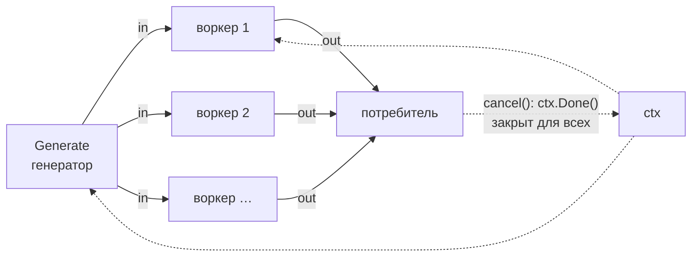

<script setup>
import WorkerPoolSandbox from '../../viz/scenes/WorkerPoolSandbox.vue'
</script>

# 1.5.5. Паттерны конкурентности

## <Part kind="problem" /> Проблема: девять горутин, которых никто не ждёт

За четыре урока у нас собрался словарь: горутина и планировщик, канал и `select`, «происходит раньше», мьютекс, атомик и `WaitGroup`. Каждое слово по отдельности понятно. Ошибки начинаются, когда из слов складывают фразы. Вот функция из release notes Go 1.26. Авторы Go взяли её из реального кода и показали как типичную ошибку. Попробуйте найти её до того, как прочитаете объяснение:

<<< @/../labs/1-5/patterns/leak/main.go#leak{go}

Функция раздаёт задачи горутинам, собирает результаты из канала, а на первой ошибке возвращается. Тесты проходят, ошибка до вызывающего доходит. Программа `patterns/leak` вызывает эту функцию на десяти задачах, из которых задача № 2 падает сразу, а остальные работают по 20 мс. Затем она спрашивает рантайм, сколько горутин утекло:

```text
$ go run -tags labdemo ./1-5/patterns/leak
processWorkItemsFixed: ошибка "задача не удалась"
утекло горутин: 0
processWorkItemsGroup: ошибка "задача не удалась"
утекло горутин: 0
processWorkItems: ошибка "задача не удалась"
утекло горутин: 9
goroutineleak profile: total 9
9 @ 0x47daaa 0x41421c 0x413e17 0x4e0f05 0x483981
#	0x4e0f04	main.processWorkItems.func1+0x44	…/patterns/leak/main.go:69
```

машина: Intel Core i5-12400 (6 ядер, 12 логических процессоров), Linux 7.0, go1.27.2. Первые три строки вывода (версия Go, `GOMAXPROCS`, `NumCPU`) опущены, путь к файлу сокращён. Три прогона дали один и тот же результат.

Ошибка вернулась, а <N>9 горутин</N> остались висеть на строке 69, `ch <- outcome{v, err}`. Канал небуферизованный, а читать из него после раннего `return` некому. Эти горутины не завершатся никогда, и каждый такой вызов добавляет ещё девять. Две верхние строки — два исправления, их разберём в этом уроке.

Вторая программа, `patterns/limit`, запускает 200 задач по 20 мс. Сначала по горутине на задачу, потом через ограничитель на 8 одновременных:

```text
$ go run ./1-5/patterns/limit
задач: 200 по 20ms, лимит: 8
горутина на задачу:  время   20 мс, пик горутин 202 (из них свои: 200)
семафор на канале:   время  514 мс, пик горутин  10 (из них свои:   8)
пул воркеров:        время  514 мс, пик горутин  10 (из них свои:   8)
errgroup.SetLimit:   время  518 мс, пик горутин  10 (из них свои:   8)
semaphore.Weighted:  время  517 мс, пик горутин  10 (из них свои:   8)
errgroup, отказ:     время  124 мс, пик горутин  10 (из них свои:   8)
errgroup, отказ:     выполнено задач 48 из 200, Wait вернул "задача 50: отказ"
```

машина та же, первые три строки вывода (версия Go, `GOMAXPROCS`, `NumCPU`) опущены. Ещё два прогона: у ограничителей 512–520 мс, у последней строки — те же 124 мс и 48 задач.

Без ограничения всё закончилось за 20 мс, ведь задачи только спят. Но пик — <N>202 горутины против 10</N>. Задачи в лабе спят, поэтому им почти ничего не нужно. А если каждая задача — это хеш Argon2id на 19 МиБ из [урока 1.13](../01-go-service/13-passwords) или запрос в базу с пулом на 20 соединений? Четыре ограничителя дают одно и то же время и один и тот же пик. Зачем их четыре и какой выбрать? И что значит последняя строка: почему из 200 задач выполнено 48, а программа уложилась в 124 мс?

К концу урока вы ответите на эти вопросы и научитесь:

- собирать из каналов <T id="pipeline-pattern">конвейер</T> (pipeline), который не течёт, когда потребитель уходит;
- ограничивать параллелизм и выбирать инструмент по задаче, а не по привычке;
- решать, что делать, когда работы больше, чем вы успеваете;
- находить утечки профилем `goroutineleak` и тестами;
- тестировать время без `time.Sleep`.

## <Part kind="theory" /> Конвейер: генератор, стадии и отмена

### Генератор

Начнём с самого маленького паттерна. <T id="generator">Генератор</T> (generator) — функция, которая запускает горутину, отдаёт значения в канал и закрывает его, когда значения кончились. Наружу она возвращает канал только для чтения:

<<< @/../labs/1-5/patterns/pipeline/pipeline.go#generator{go}

Три детали стоит запомнить, они повторятся в каждой стадии.

1. **Владелец закрывает.** Канал создала функция `Generate`, писать в него может только её горутина, и закрывает его тоже она (`defer close(out)`). Это правило владения из [урока 1.5.2](./02-channels): закрывает тот, кто пишет. Тип результата `<-chan T` не даст потребителю ни писать, ни закрыть.
2. **Отправка — в `select` с `ctx.Done()`.** Если потребитель ушёл и больше не читает, обычная отправка `out <- it` заблокировала бы горутину навсегда. Ровно так и утекли горутины в `processWorkItems`. С `select` горутина видит отмену и выходит.
3. **Сигнал «хватит» течёт в обратную сторону.** Данные идут от генератора к потребителю, а отмена — от потребителя к генератору, через `ctx`. Закрыть канал со стороны потребителя нельзя: генератор упал бы с паникой `send on closed channel`.

### Стадия

Стадия конвейера читает из входного канала, обрабатывает значение и пишет в выходной:

<<< @/../labs/1-5/patterns/pipeline/pipeline.go#stage{go}

Здесь уже **две** блокирующие операции: чтение из `in` и запись в `out`. Обе стоят в `select` рядом с `ctx.Done()`. Чтение ждёт, если предыдущая стадия медленная, а запись — если медленная следующая. Повиснуть можно на любой из них, поэтому выход по отмене нужен в обеих.

Обратите внимание на строку `r := f(v)` перед вторым `select`. Можно было бы написать `case out <- f(v):`, но выражения в ветках `select` вычисляются **до** выбора ветки, при входе в оператор. Так говорит спецификация Go. Значит, `f(v)` выполнилась бы в любом случае, даже если потом выбрана ветка `ctx.Done()`. В нашем коде происходит то же самое, но отдельная строка делает этот порядок видимым, и читатель не подумает, что отмена прервёт `f`. Прервать саму работу может только `f`, если она принимает `ctx`.

Тело стадии вынесено в функцию `forward`. Почему, увидим, когда стадию понадобится размножить. Цикл кончается двумя способами. Вход закрыт (`ok == false`) — значит, данных больше не будет, и `Map` закрывает свой выход. Так сигнал «конец потока» проходит по конвейеру до самого потребителя. Отменён `ctx` — выходим, не дочитав.

### Конвейер целиком

Стадии соединяются тем, что выход одной становится входом следующей:



Что смотреть на схеме. Сплошные стрелки — данные, они идут слева направо. Пунктир — отмена: потребитель вызывает `cancel()`, и канал `ctx.Done()` закрывается для всех горутин сразу. Закрытие канала — широковещательный сигнал, как мы видели в 1.5.2. Синий узел — источник, фиолетовые — воркеры, зелёный — потребитель, янтарный — общий `ctx`. Стрелки отмены нарисованы не ко всем воркерам, чтобы не загромождать схему, но слушают её все.

Лаба проверяет главное свойство конвейера тестом. Потребитель берёт три значения из тысячи, отменяет `ctx` и уходит, не дочитав выход:

<<< @/../labs/1-5/patterns/pipeline/pipeline_test.go#cancel{go}

Где здесь проверка, что ни одна горутина не осталась висеть? Её делает `synctest.Test`. Если после возврата функции теста в «пузыре» осталась заблокированная горутина, тест падает. Как это устроено, разберём в разделе о тестировании. Проверим, что тест ловит ошибку. Если убрать из `forward` ветку `ctx.Done()` у записи, тест падает:

```text
--- FAIL: TestPipelineStopsWhenConsumerLeaves (0.00s)
panic: deadlock: main bubble goroutine has exited but blocked goroutines remain [recovered, repanicked]
…
goroutine 12 [chan send (durable), synctest bubble 1]:
```

машина та же, go1.27.2. Мы убрали ветку руками, прогнали тест и вернули код. В репозитории этой версии нет.

<Callout type="simplified">

Конвейер в лабе — учебный, на обобщённых функциях (`Map[In, Out]`). В рабочем коде конвейеры на каналах встречаются реже, чем кажется после статей о Go. Каждая передача значения через канал — это замок канала и, возможно, парковка и пробуждение горутины, то есть сотни наносекунд. Если стадия делает работу на микросекунды, канал съест больше, чем стадия. Конвейер окупается, когда стадии тяжёлые (сеть, диск, CPU на миллисекунды) или когда нужно развязать скорости частей системы. Для «посчитать что-то параллельно над срезом» обычно хватает `errgroup` с индексами — его мы разберём ниже.

</Callout>

## <Part kind="theory" /> Fan-out, fan-in и порядок результатов

### Раздать и собрать

Одна стадия — одна горутина. Если стадия медленная, весь конвейер идёт с её скоростью. Решение — размножить стадию: N горутин читают **один и тот же** входной канал. Это <T id="fan-out">раздача</T> (fan-out): канал сам выдаёт каждое значение ровно одной горутине. Результаты N горутин нужно слить в один выход — это <T id="fan-in">слияние</T> (fan-in). Оба приёма сразу:

<<< @/../labs/1-5/patterns/pipeline/pipeline.go#fanout{go}

Здесь и пригодилась функция `forward`. Каждый воркер — это тело стадии, только все воркеры читают общий `in` и пишут в общий `out`.

Кто закрывает `out`? Писателей четыре, и ни один не знает, закончили ли остальные. Если закроет первый закончивший, второй упадёт на отправке. Поэтому закрывает отдельная горутина, которая дождалась всех через `wg.Wait()`. Это функция `collect` из [урока 1.5.2](./02-channels), только теперь у неё есть вход. `wg.Go` из Go 1.25 сам делает `Add(1)` до запуска горутины (урок 1.5.4).

Эта горутина-закрывальщик тоже не течёт. Как только все воркеры вышли — по закрытию `in` или по отмене, — `Wait` возвращается, и она закрывает `out`.

### Порядок теряется

Fan-in не сохраняет порядок. Воркер, которому досталось значение 2, может закончить раньше воркера со значением 1. Поэтому тест лабы сортирует результат, прежде чем сравнить его с ожидаемым. Часто порядок и не нужен: если вы рассылаете уведомления, неважно, кому уйдёт первое. Но если результаты отображаются на входы, например «i-й ответ — на i-й запрос», порядок надо вернуть.

Способов три.

1. **Индекс в срезе результатов.** Заранее заводим `results := make([]Out, len(items))`, и каждая задача пишет в свою ячейку `results[i]`. Гонки нет: разные горутины пишут в **разные** элементы массива. Спецификация Go говорит, что каждый элемент массива или среза «ведёт себя как переменная», а гонка — это конфликт доступов к **одной** переменной. Видимость результатов даёт ожидание: возврат каждой горутины синхронизирован раньше возврата `Wait`. Способ простой и самый частый, но он для пакетной обработки: результат готов целиком, когда закончили все.
2. **Поток с сохранением порядка.** Генератор для каждого входа создаёт «обещание» — канал `chan Out` ёмкостью 1 — и отправляет его в очередь `chan chan Out` в исходном порядке. Воркер кладёт результат в обещание. Потребитель читает обещания по порядку и ждёт каждое. Ёмкость очереди обещаний ограничивает, на сколько воркеры могут уйти вперёд. Цена — по каналу на элемент.
3. **Номер и сортировка.** Каждый результат несёт номер входа, потребитель собирает и сортирует, или держит небольшой буфер переупорядочивания. Так делают в потоковых системах, где данных слишком много для среза.

В лабе — первый способ, на `errgroup`:

<<< @/../labs/1-5/patterns/pipeline/pipeline.go#ordered{go}

Тест `TestOrderedMapKeepsOrder` специально делает задачу i длиной (10 − i) мс. Задачи заканчиваются в обратном порядке, а результат всё равно по порядку. Строки с `errgroup` разберём в следующем разделе. Пока отметим одну деталь: `i` и `it` захвачены замыканием прямо из цикла, и это правильно. Почему до Go 1.22 такой код был ошибкой, расскажем в «Типичных ошибках».

## <Part kind="theory" /> Ограниченный параллелизм

### Зачем ограничивать

В уроке 1.5.1 мы мерили цену горутины: 2052 байта стека и около микросекунды на создание. Дёшево. Поэтому возникает соблазн запускать горутину на каждую задачу и не думать. Но горутина — это только обёртка. Ограничивать приходится не горутины, а то, что они **делают**:

- **Память на задачу.** Хеш Argon2id в мессенджере держит 19 МиБ. Сто одновременных регистраций — почти 2 ГиБ, а `GOMEMLIMIT` контейнера 230 МиБ (урок 1.17).
- **Процессор.** Если задача считает, больше `GOMAXPROCS` задач одновременно не ускорит её. Лишние горутины только делят ядра, и каждая задача заканчивается позже.
- **Чужие лимиты.** Пул соединений к базе, лимит запросов у соседнего сервиса, файловые дескрипторы. Тысяча горутин встанет в очередь за двадцатью соединениями, и каждая будет держать запрос клиента открытым.

Поэтому вопрос «сколько задач делать одновременно» — это вопрос о ресурсах, и ответ на него должен быть числом. В Go есть четыре способа это число задать. Разберём их по очереди.

### Семафор на буферизованном канале

<T id="semaphore">Семафор</T> (semaphore) — счётчик свободных мест. Занять место — уменьшить счётчик, а если мест нет, ждать. Освободить — увеличить. В Go семафор строится из буферизованного канала ёмкостью N: отправка занимает место, получение освобождает.

<<< @/../labs/1-5/patterns/limit/main.go#limit{go}

Почему это работает? В уроке 1.5.2 мы видели правило модели памяти для буферизованного канала ёмкостью C: k-е получение происходит раньше завершения (k+C)-й отправки. Девятая отправка в канал ёмкостью 8 не завершится, пока не случилось первое получение. Значит, внутри «отправил — … — получил» одновременно не больше восьми горутин. Это не свойство реализации, а гарантия языка. Модель памяти прямо называет такую конструкцию: она описывает буферизованный канал как считающий семафор.

Главная деталь — **где** занимается место. В `channelSemaphore` это строка `slots <- struct{}{}` в цикле, до `wg.Go`. Цикл встаёт, когда восемь мест заняты, и новые горутины не создаются. Если перенести захват внутрь горутины, все 200 горутин запустятся сразу, и 192 из них будут ждать места. Выполнение ограничено, а память и число горутин — нет. Комментарий в коде предупреждает об этом.

### Пул воркеров

<T id="worker-pool">Пул воркеров</T> (worker pool) переворачивает схему. Не горутина на задачу, а N долгоживущих горутин, которые берут задачи из общего канала:

<<< @/../labs/1-5/patterns/limit/main.go#pool{go}

Канал `jobs` небуферизованный. Производитель (здесь `main`) встаёт на отправке, пока какой-нибудь воркер не освободится. Это и есть <T id="backpressure">обратное давление</T> (backpressure) из урока 1.5.2: медленные воркеры тормозят производителя. Закрывает `jobs` производитель — единственный писатель. Воркеры выходят из `for range`, когда канал закрыт и пуст. `wg.Wait()` дожидается, пока они доделают последние задачи.

Чем пул лучше семафора? Горутины не создаются на каждую задачу. У воркера может быть своё долгоживущее состояние: буфер, соединение, кэш. Чем хуже? Больше кода. Задачу надо упаковать в значение (`func()` или структуру). Ошибки и результаты надо везти обратно отдельным каналом. Воркеры живут, даже когда работы нет, и их надо не забыть остановить.

### errgroup: WaitGroup с ошибками, отменой и лимитом

<T id="errgroup">`errgroup`</T> — пакет `golang.org/x/sync/errgroup`. Его документация описывает назначение одной фразой: синхронизация, передача ошибок и отмена через `Context` для группы горутин, которые решают подзадачи одной общей задачи. Всё API — одна функция и четыре метода. Ниже они разобраны по исходнику версии v0.24.0, которую использует лаба.

- **`var g errgroup.Group`** — нулевое значение рабочее: без лимита и без отмены.
- **`g.Go(f func() error)`** запускает `f` в новой горутине. Если задан лимит и он исчерпан, `Go` **блокирует** вызывающего, пока не освободится место.
- **`g.Wait() error`** ждёт, пока вернутся все `f`, и возвращает **первую** ненулевую ошибку. Первую по времени: ошибку записывает тот, кто первым прошёл через `sync.Once` внутри группы. Остальные ошибки отбрасываются.
- **`errgroup.WithContext(ctx)`** возвращает группу и производный `ctx`. Этот `ctx` отменяется при первой ошибке любой `f` или при возврате `Wait`, смотря что случится раньше. Внутри это `context.WithCancelCause`, и причиной отмены записывается та самая первая ошибка. Поэтому `context.Cause(ctx)` вернёт её, а не безликий `context.Canceled`.
- **`g.SetLimit(n)`** ограничивает число активных горутин группы. Отрицательное `n` снимает лимит, ноль не пускает ни одной. Ставить новый лимит (`n >= 0`), пока в группе есть активные горутины, нельзя: `SetLimit` запаникует. Снять лимит отрицательным `n` можно в любой момент, паники не будет.
- **`g.TryGo(f) bool`** — неблокирующий `Go`: запускает `f`, только если место есть прямо сейчас, иначе возвращает `false`.

А теперь самое поучительное — как `SetLimit` устроен внутри. Вот поля группы из исходника:

```text
type Group struct {
	cancel func(error)
	wg sync.WaitGroup
	sem chan token
	errOnce sync.Once
	err     error
}
```

`SetLimit(n)` делает `g.sem = make(chan token, n)`. `Go` начинается с `g.sem <- token{}`, а горутина в `defer` делает `<-g.sem`. `TryGo` — тот же захват, но в `select` с `default`. Это **ровно наш семафор на канале**, с захватом до запуска горутины. Тот же приём, что и в `channelSemaphore`, только вместе с `WaitGroup`, первой ошибкой и отменой. Поэтому `errgroup.SetLimit` и `channelSemaphore` в выводе лабы неотличимы: 518 и 514 мс, пик 8 своих горутин.

Посмотрите, как это выглядит в коде с ошибкой. Это последняя строка вывода `limit`:

<<< @/../labs/1-5/patterns/limit/main.go#first-error{go}

Разберём вывод: «выполнено задач 48 из 200, Wait вернул "задача 50: отказ"», время 124 мс.

1. Лимит 8, задачи по 20 мс — они идут волнами примерно по восемь. Задачи 0–47 — это шесть полных волн, около 120 мс. Все 48 выполнены.
2. Седьмая волна — задачи 48–55. Задача 50 сразу возвращает ошибку. `errgroup` записывает её как первую и отменяет `ctx`.
3. Задачи 48, 49 и 51–55 ждут таймер внутри `taskCtx`. Они видят `ctx.Done()` и выходят с `context.Canceled`. Эти ошибки `Wait` уже не вернёт: первая записана.
4. Цикл в `firstError` проверяет `ctx.Err()` перед каждым `g.Go` и выходит. Задачи 56–199 даже не запускаются.

Итого: <N>48 задач из 200 за 124 мс</N> и ровно та ошибка, которая случилась первой. Без отмены программа отработала бы все 500 мс, хотя результат уже никому не нужен.

Шаг 4 — важная тонкость, её легко пропустить. **`Go` не смотрит на `ctx`.** Если `Go` ждёт места, он дождётся его и запустит `f`, даже если группа давно отменена. Без проверки `ctx.Err()` в цикле все 200 задач были бы запущены: каждая сразу увидела бы отмену и вышла, но 200 горутин всё равно были бы созданы. Тест лабы `TestOrderedMapFirstErrorCancelsOthers` фиксирует это поведение точно. Из 10 задач с лимитом 4 функция `f` вызвана ровно 5 раз. Задачи 0–3 запустились сразу. Задача 4 уже ждала места внутри `g.Go` в момент отмены и всё равно запустилась. Задачи 5–9 отсёк `break`:

<<< @/../labs/1-5/patterns/pipeline/pipeline_test.go#first-error{go}

И последнее о `errgroup` — паника. Паника в `f` **не** передаётся в `Wait`. Она роняет процесс, как паника в любой горутине. В исходнике v0.24.0 есть комментарий: передавать панику из `f` горутине, вызвавшей `Wait`, «заманчиво, но создаёт больше проблем, чем решает». Паника задержалась бы на неопределённое время. Её стек превратился бы в простое значение и спрятался от систем мониторинга падений. А если паника оставила программу в состоянии, где `Wait` не будет вызван, она пропала бы целиком. Почему процесс должен падать, разберём в уроке 1.5.6.

### Взвешенный семафор x/sync/semaphore

Четвёртый инструмент — `golang.org/x/sync/semaphore`, тип `Weighted`:

<<< @/../labs/1-5/patterns/limit/main.go#weighted{go}

Чем он отличается от семафора на канале? По исходнику v0.24.0:

- **Вес.** `Acquire(ctx, n)` занимает `n` единиц из общего бюджета, а не одно место. Так ограничивают не число задач, а сумму ресурса. Например, `semaphore.NewWeighted(256 << 20)` — бюджет 256 МиБ, и каждый запрос занимает столько, сколько весит его тело.
- **Ожидание с `ctx`.** `Acquire` ждёт, пока не освободится место **или** не отменят `ctx`. Во втором случае он возвращает `ctx.Err()`, и семафор остаётся как был. Если отмена пришла одновременно с выдачей места, исходник аккуратно «возвращает» полученное место обратно.
- **Строгая очередь.** Ждущие стоят в списке FIFO. Новый вызов не проскакивает вперёд, даже если ему хватает места: `Acquire` занимает место сразу, только если очередь пуста. Комментарий в `notifyWaiters` объясняет, зачем это нужно. Иначе большой запрос (вес N) голодал бы вечно: для каждого маленького всегда нашлась бы одна свободная единица. Это тот же выбор, что у режима голодания мьютекса из урока 1.5.4: справедливость важнее пропускной способности.
- **`TryAcquire(n)`** — неблокирующий захват.

У семафора на канале ожидание с `ctx` тоже делается одной строкой — `select` между `slots <- struct{}{}` и `<-ctx.Done()`. Вес он не умеет.

### Сколько стоит сам ограничитель

Все четыре ограничителя дали 514–518 мс на 200 задачах по 20 мс. Это 200 / 8 × 20 мс = 500 мс плюс накладные расходы. Чтобы увидеть сами расходы, нужна почти пустая задача. Бенчмарк `LimiterOverhead` делает атомарный инкремент под каждым ограничителем с лимитом 8:

<<< @/../labs/1-5/patterns/limit/limit_test.go#bench{go}

```text
$ go test -run='^$' -bench=LimiterOverhead -benchtime=1s -count=5 ./1-5/patterns/limit/
BenchmarkLimiterOverhead/channel-semaphore-12         	 2495641	       548.3 ns/op
…
BenchmarkLimiterOverhead/pool-12                      	 3977941	       297.9 ns/op
…
BenchmarkLimiterOverhead/errgroup-12                  	 2166590	       585.7 ns/op
…
BenchmarkLimiterOverhead/weighted-12                  	 2139986	       625.3 ns/op
```

машина та же, go1.27.2. Показаны медианы пяти прогонов, разброс — 401–603, 214–320, 542–640 и 601–635 нс соответственно.

Пул дешевле остальных почти вдвое: он не создаёт горутину на задачу, а только передаёт значение через канал. Остальные три платят за создание горутины. Это совпадает с ценой создания горутины из урока 1.5.1. Но посмотрите на масштаб: <N>0,3–0,6 мкс</N> на задачу. На задаче в 17 мс (хеш Argon2id) разница между самым дешёвым и самым дорогим ограничителем — 0,3 мкс из 17 000, около 0,002 %. Выбирать ограничитель по скорости имеет смысл, только если задачи короче нескольких микросекунд. Но такие задачи обычно вообще не стоит раздавать по горутинам.

### Что выбрать

| Инструмент | Когда брать | Чего не умеет |
|---|---|---|
| `errgroup` + `SetLimit` | группа подзадач одной операции: обработать срез, сходить к нескольким сервисам, запустить компоненты; нужны первая ошибка и отмена остальных | вес; ожидание места по `ctx` (`Go` ждёт без отмены, проверяйте `ctx.Err()` сами) |
| семафор на канале | ограничить одновременный доступ к ресурсу из многих независимых мест: обработчиков HTTP, методов адаптера; нужен отказ без ожидания (`select` с `default`) или ожидание с `ctx` | ошибки и ожидание завершения (это `WaitGroup` рядом); вес |
| `semaphore.Weighted` | бюджет ресурса разного «веса» (байты, соединения); строгая очередь FIFO; ожидание с `ctx` из коробки | ошибки и ожидание завершения |
| пул воркеров | у воркера есть дорогое долгоживущее состояние (соединение, большой буфер); очень короткие задачи, где 0,3 мкс на горутину заметны; конвейер с постоянными стадиями | без дополнительного кода — ошибки, отмену, остановку; его надо писать и тестировать |

Почему в продакшене чаще берут `errgroup.SetLimit` или семафор, а не самописный пул? По числам видно, что не из-за скорости: на реальных задачах её разницы нет. Причина — в коде, который пишете **вы**. Самописный пул — это свой канал задач, свой канал результатов или ошибок, своё правило, кто и когда закрывает каналы, своя отмена и своя остановка воркеров. Каждое из этих мест — источник утечек и взаимных блокировок, которые мы разбирали в 1.5.2. `errgroup` — около 150 строк, их читали тысячи людей, и в них всё это уже сделано. Семафор на канале — три строки. Горутина на задачу при этом дешёвая, а планировщик Go и есть пул потоков. Пул воркеров поверх него оправдан, когда воркеру нужно своё состояние.

## <Part kind="theory" /> Обратное давление: когда очередь полна

### Три политики

Ограничитель решает, сколько задач выполняется **одновременно**. Но что делать с задачей, которая пришла, когда все места заняты? Её надо где-то держать, то есть ставить в очередь. Сколько бы мест ни было в очереди, при долгой перегрузке она заполнится. И тогда остаётся три политики.

1. **Ждать.** Тот, кто принёс задачу, блокируется, пока не освободится место. Так работает отправка в полный канал и пул выше. Ничего не теряется, но ожидание переходит к источнику. Если источник — горутина-обработчик HTTP, ждёт клиент, и его запрос висит.
2. **Отбросить.** Задачу молча выбрасывают: новую (`select` с `default` и ничего в ветке `default`) или самую старую из очереди. Задержка не растёт, но данные теряются, и источник об этом не знает. Годится для того, что можно потерять: метрики, трассировки, обновления статуса «печатает…», где следующий кадр заменит пропущенный.
3. **Отказать сразу.** Задачу не принимают и **сообщают** об этом: в HTTP — ответ `503 Service Unavailable`, часто с заголовком `Retry-After`. Это <T id="load-shedding">сброс нагрузки</T> (load shedding). Клиент узнаёт об отказе за микросекунды и решает сам: повторить позже, уйти на другую реплику или показать пользователю ошибку.

Разница между политиками — в том, что происходит с **задержкой**. Посмотрим на неё в модели песочницы этого урока. Модель детерминированная, без случайностей. Возьмём её параметры по умолчанию: 4 воркера, задача 100 мс, очередь (буфер канала) на 8 задач. Пропускная способность — 4 × 1000 / 100 = 40 задач в секунду. Подадим 100 задач в секунду, в 2,5 раза больше:

| Через 20 с перегрузки | горутина на задачу | пул (ждать) | семафор с отказом |
|---|---|---|---|
| горутин | 1790 | 5 | 12 |
| ждут в очереди | 1786 | 8 в буфере + 1192 у производителя | 8 |
| завершено задач | 210 | 800 | 800 |
| отказов (503) | 0 | 0 | 1192 |
| задержка p50 / p99 | 16,6 / 17,5 с | 11,5 / 12,1 с | 0,3 / 0,3 с |

Это вывод модели `viz/simulations/worker-pool.ts`, а не замер; те же числа покажет песочница ниже.

- **Горутина на задачу** — худший вариант. Задачи делят четыре «ядра» модели, поэтому каждая выполняется всё медленнее. Завершилось всего 210 задач за 20 секунд, хотя система могла бы завершить 800. А тысяча горутин держит память.
- **Пул с ожиданием** работает на полную мощность: 800 задач, 40 в секунду. Но задержка растёт без конца: <N>11,5 с</N> на медиане и продолжает расти. В буфере всего 8 задач, остальные 1192 ждут у заблокированного производителя. Буфер канала маленький, а очередь всё равно огромная — она просто переехала в другое место. И горутин на самом деле не 5. Модель сворачивает всех ждущих в одну горутину-производителя, а в HTTP-сервере производитель — это обработчики запросов. 1192 «ждущих у производителя» там — это 1192 заблокированных горутины-обработчика, каждая со своим стеком и открытым соединением.
- **Семафор с отказом** выполняет те же 800 задач, но каждая принятая задача ждёт не дольше <N>300 мс</N>. Остальным 1192 сразу ответили 503.

### Почему «ждать» хуже, чем кажется

Таблица выше выглядит так, будто пул и семафор равны: оба выполнили по 800 задач. Но у любого клиента есть терпение. Браузер, мобильное приложение или соседний сервис ждут ответа ограниченное время. Пусть таймаут клиента — 5 секунд. В пуле задача, завершившаяся на 20-й секунде, ждала 11,5 с. Её клиент давно ушёл, а сервер всё ещё честно тратил на неё процессор. Пропускная способность — 40 задач в секунду, а <T id="goodput">полезная пропускная способность</T> (goodput, сколько ответов в секунду успели к клиенту) — ноль. Хуже того: ушедший клиент обычно **повторяет** запрос, и очередь растёт ещё быстрее.

Отказ сразу оставляет полезными все 40 задач в секунду, а клиентам с 503 даёт честный сигнал. Это и есть решение, принятое для мессенджера. В уроке 1.5.6 ограничитель хешей Argon2id (`auth/adapters/hashlimit`) будет устроен из двух буферизованных каналов:

- `slots` ёмкостью N + Q. Захват неблокирующий, через `select` с `default`. Мест нет — сразу ошибка «перегружено», и HTTP отвечает `503` с `Retry-After: 1`.
- `run` ёмкостью N. Захват ждёт места, но в `select` с `ctx.Done()`. Клиент ушёл — уходим и мы.

N по умолчанию равно `GOMAXPROCS`: хеш — чистая работа процессора. Q по умолчанию — 4N. Это гибрид: короткое ожидание в ограниченной очереди, потом отказ. Ровно так работает режим «семафор с отказом» в песочнице. Сколько ждёт запрос в худшем случае? Очередь у канала — FIFO, и все хеши длятся одинаково (S). Запрос, вставший последним из Q ждущих, дождётся Q / N «волн» по S и затем посчитает свой хеш: (Q / N + 1) × S = 5 × 17 мс ≈ <N>85 мс</N>. Здесь допущение: хеш длится 17 мс (замер урока 1.13 на одном ядре) и тогда, когда параллельно считаются N = `GOMAXPROCS` хешей. Так ли это на самом деле, проверим в 1.5.6. Значит, очередь в 4N добавляет к хешу не больше четырёх его длин.

Есть и четвёртая политика, которой пользуются, когда задача заведомо опоздает: **отказ по сроку**. Задача несёт `ctx` с дедлайном. Если она дождалась места, а срок почти вышел, её не выполняют, ведь результат уже никому не нужен. Это то же «отказать», только решение принимается не на входе, а при выходе из очереди. В мессенджере его роль играет `ctx` запроса в захвате `run`.

<Deep title="Закон Литтла и почему очередь без предела — это отложенный отказ">

<T id="littles-law">Закон Литтла</T> (Little's law) из [урока 0.4](../00-foundation/04-latency) связывает три средние величины любой устойчивой системы: L = λ × W. Здесь L — сколько задач внутри (в очереди и в работе), λ — сколько их проходит в секунду, W — сколько каждая проводит внутри.

**Ограниченная очередь.** В режиме «семафор с отказом» внутри не больше Q + N = 8 + 4 = 12 задач, а проходит их μ = 40 в секунду. По Литтлу **средняя** задержка W = L / λ = 12 / 40 = 0,3 с — ровно те 300 мс, что показала модель. Закон Литтла говорит о средних. Худший случай для одного запроса следует из другого: очередь FIFO, время обслуживания S постоянно, и последний из Q ждущих выполнится через (Q / N + 1) × S = (8 / 4 + 1) × 100 мс = 0,3 с. При полной очереди среднее и худшее совпадают. Важно, что задают эту границу не свойства нагрузки, а два числа в конфигурации: задержка ограничена по построению. Отсюда и 85 мс для мессенджера.

**Неограниченная очередь.** Если задачи приходят быстрее, чем уходят (λ > μ), очередь растёт со скоростью λ − μ, у нас 60 задач в секунду. Устойчивого состояния нет, и закон Литтла в простой форме не применим. Но посчитать задержку можно напрямую. К моменту t система успела выполнить μ·t задач. Это все задачи, пришедшие до момента μ·t / λ. Значит, задача, которая заканчивается в момент t, ждала W(t) = t − μt/λ = (1 − μ/λ)·t. У нас W(t) = 0,6·t, и на 20-й секунде это 12 с. Модель показала 11,5–12,1 с. **Задержка растёт линейно со временем перегрузки** и не остановится, пока не кончится перегрузка или память.

Отсюда название раздела. Неограниченная очередь не спасает от отказа, она его **откладывает**. Сначала задержка переходит порог терпения клиента: при таймауте 5 с это случится через 5 / 0,6 ≈ 8 секунд. С этого момента каждая выполненная задача — пустая работа. Затем ушедшие клиенты повторяют запросы, λ растёт, очередь растёт быстрее. В конце кончается память, и процесс падает вместе со всем, что лежало в очереди. Отказ всё равно случится, только позже, для всех сразу и после того, как сервер успел сжечь ресурсы на ненужную работу.

Ограниченная очередь делает отказ ранним, дешёвым и **частичным**. Отказывают только тем, кто сверх мощности, а остальные обслуживаются с задержкой не больше (Q / N + 1) × S. Поэтому размер очереди выбирают не «побольше, чтобы не отказывать», а из допустимой задержки: Q ≈ W_доп × μ − N. Это закон Литтла, решённый относительно L.

</Deep>

## <Part kind="theory" /> Утечки горутин

### Четыре причины

<T id="goroutine-leak">Утечка горутин</T> (goroutine leak) — горутина, которая навсегда осталась ждать. Она держит стек (от 2 КиБ, у реальных обработчиков — 8–16 КиБ, урок 1.5.1) и всё, на что ссылается её стек: буферы, запросы, соединения. Сборщик мусора не может освободить ничего из этого: стек живой горутины — корень. Почти все утечки сводятся к четырём причинам.

1. **Отправка без получателя.** Получатель ушёл — ранний `return`, таймаут, отмена, — а отправитель стоит на `ch <- v`. Это `processWorkItems` из начала урока и «канал результата с таймаутом» из урока 1.5.2.
2. **Чтение без закрытия.** Потребитель в `for v := range ch` или на `<-ch` ждёт значения или закрытия, а производитель вышел, не закрыв канал. Или закрыть его «должен был кто-то ещё».
3. **Забытый `Ticker`.** Горутина крутит `for range ticker.C` или `select` только по тикеру, без ветки выхода. Сам тикер с Go 1.23 не течёт: тикер без ссылок собирает сборщик мусора и без `Stop` (урок 1.5.2). Течёт **горутина**: у её цикла нет конца.
4. **Нет выхода по `ctx`.** Общий случай для всех трёх: блокирующая операция стоит голой, а не в `select` рядом с `ctx.Done()`. Ждать можно на канале, на `sync.Cond`, на `WaitGroup` и на мьютексе, который кто-то забыл отпустить.

Правильная периодическая работа выглядит так:

<!-- go-check -->

```go
import (
	"context"
	"time"
)

// refreshLoop крутится, пока не отменят ctx. Без ветки ctx.Done() горутина с этим
// циклом жила бы до конца процесса, даже когда её владелец давно остановился.
func refreshLoop(ctx context.Context, every time.Duration, refresh func(context.Context)) {
	t := time.NewTicker(every)
	defer t.Stop() // с Go 1.23 не обязателен для памяти, но освобождает тикер сразу
	for {
		select {
		case <-t.C:
			refresh(ctx)
		case <-ctx.Done():
			return
		}
	}
}
```

Как устроить такой цикл с джиттером и почему в мессенджере будет `Timer` с `Reset`, а не `Ticker`, — урок 1.5.6.

### Признак: растёт число горутин

Утечка не падает и не пишет в журнал. Её видно только по одному признаку: число горутин растёт со временем и не возвращается назад. В уроке 1.5.1 мы читали метрики `runtime/metrics`: `/sched/goroutines:goroutines` — всего живых, `/sched/goroutines/waiting:goroutines` — ждущих. На графике утечка — это пила, которая не опускается до прежнего уровня, или ровная наклонная линия. Если вместе с горутинами растёт и `waiting`, горутины не работают, а ждут. Это и есть утечка.

Но метрика говорит только «что-то течёт». Какая строка кода виновата? Раньше на это отвечал профиль `goroutine`: снимок стеков **всех** горутин. В сервисе их тысячи, и законно ждущих — большинство: обработчики, которые ждут базу, HTTP-сервер, который ждёт соединений, фоновые циклы. Найти среди них утёкшие — работа на часы. В Go 1.27 появился инструмент, который отвечает прямо.

### Профиль goroutineleak

В Go 1.26 профиль `goroutineleak` вышел экспериментом (`GOEXPERIMENT=goroutineleakprofile`), в Go 1.27 он общедоступен. Он есть в `runtime/pprof` и на эндпоинте `/debug/pprof/goroutineleak` пакета `net/http/pprof`. Release notes Go 1.26 объясняют механизм так (наш перевод):

> Утёкшая горутина — это горутина, заблокированная на примитиве синхронизации (каналы, `sync.Mutex`, `sync.Cond` и т. п.), который никак не может разблокироваться. Рантайм находит утёкшие горутины с помощью сборщика мусора: если горутина G заблокирована на примитиве P, а P недостижим ни из одной готовой к выполнению горутины и ни из одной горутины, которую те могли бы разблокировать, то P разблокировать невозможно, и G не проснётся никогда. Найти навсегда заблокированные горутины во всех случаях невозможно, но этот подход находит большой класс таких утечек.

Давайте разберём, почему это работает, на нашем примере. Горутина в `processWorkItems` ждёт на `ch`. Чтобы её разбудить, кто-то должен прочитать из `ch`. А прочитать может только тот, у кого есть ссылка на `ch`. Единственная такая ссылка была у функции `processWorkItems`, и она вернулась. Остались ссылки из стеков самих девяти ждущих горутин, но они-то ждут и никого не разбудят. Значит, `ch` недостижим из живого кода, и проснуться им не от чего.

Как сборщик это вычисляет? Обычная сборка мусора начинает обход от **корней** — глобальных переменных и стеков всех горутин — и помечает всё достижимое. Сборка с поиском утечек (`runtime/mgc.go`, Go 1.27.2) меняет корни:

1. Стеки **заблокированных** горутин не берутся в корни сразу. Корни — глобальные переменные и стеки работающих и готовых горутин. Ссылки из служебных структур ожидания (`sudog`, урок 1.5.2) на канал или мьютекс временно делаются «невидимыми» для обхода, иначе ждущая горутина сама держала бы свой канал живым.
2. Обход доходит до неподвижной точки. Затем рантайм проверяет каждую заблокированную горутину: помечен ли примитив, на котором она ждёт? Если да, до него может дотянуться живой код, и горутину можно разбудить. Её стек добавляется в корни, и обход продолжается. Так находятся и цепочки вида «A разбудит B, B разбудит C».
3. Когда новых таких горутин не находится, оставшиеся заблокированные получают статус «утекла» (`_Gleaked`) и попадают в профиль.

Какие ожидания проверяются? По функции `isMaybeRunnable`: отправка, получение и `select` на канале, `sync.Cond.Wait`, `WaitGroup.Wait`, `Mutex.Lock`, `RWMutex.Lock` и `RLock`. Ожидание на `nil`-канале и пустой `select {}` утекают по определению. Одно исключение: главная горутина в `select {}` в профиль не попадает. Так часто «усыпляют» `main` в программах, где вся работа в других горутинах, и `findGoroutineLeaks` возвращает ей обычный статус после анализа. Горутины в `time.Sleep`, в сетевом вводе-выводе и в системном вызове считаются живыми: их может разбудить таймер или ядро.

У механизма есть пределы, и release notes называют их прямо. Если примитив достижим через **глобальную** переменную или через локальные переменные **работающей** горутины, утечку не найти. Канал в глобальной карте подписчиков, который никто никогда не прочитает, формально достижим. Поэтому профиль — не доказательство отсутствия утечек, а сильный фильтр: всё, что в нём есть, утекло точно.

Сколько это стоит? Release notes Go 1.26: реализация готова к продакшену, а экспериментом её называли, только чтобы собрать отзывы об API. Она не добавляет накладных расходов, пока ею не пользуются. Сам запрос профиля не бесплатен: `runtime/pprof` перед записью вызывает `runtime_goroutineLeakGC`, а это полный цикл сборки мусора с поиском утечек. Поэтому профиль снимают по требованию, а не каждую секунду.

Как читать вывод из начала урока:

- **`goroutineleak profile: total 9`** — всего утекло 9 горутин.
- **`9 @ 0x47daaa …`** — девять горутин с одинаковым стеком сгруппированы в одну запись. Адреса — кадры стека.
- **`main.processWorkItems.func1+0x44 …/main.go:69`** — где они стоят: анонимная функция внутри `processWorkItems`, строка 69, `ch <- outcome{v, err}`.

С `?debug=2` эндпоинт отдаёт стеки **всех** горутин в формате непойманной паники, а утёкшие помечены в заголовке словом `(leaked)`. Программа лабы вызывает профиль напрямую: `pprof.Lookup("goroutineleak").WriteTo(&buf, 1)`. В мессенджере эндпоинты профилирования появятся в уроке [1.5.10](./10-profiling), на служебном порту.

### Два исправления

Первое исправление — буфер на число задач:

<<< @/../labs/1-5/patterns/leak/main.go#leak-fix{go}

Каждая горутина кладёт результат в буфер и выходит, даже если читать некому. Буфер с горутинами соберёт сборщик мусора. Утечки нет, профиль показывает 0. Это минимальная правка, и для старого кода её часто достаточно.

Но посмотрите, что происходит сразу после раннего `return`. Девять горутин ещё работают свои 20 мс. Функция вернулась, а запущенная ею работа продолжается, и владельца у неё нет. Никто не дождётся её завершения и не отменит. Если задача пишет в базу, запись случится уже после того, как вызывающий получил ошибку и, возможно, сделал откат. Второе исправление устраняет и это:

<<< @/../labs/1-5/patterns/leak/main.go#leak-group{go}

`g.Wait()` дожидается **всех** горутин, поэтому ни одна не переживёт вызов. Ошибка — первая. Порядок результатов сохраняется через индекс. Здесь задачи не умеют отменяться (`process` не принимает `ctx`), поэтому `Wait` ждёт самую долгую. Будь у задач `ctx`, `errgroup.WithContext` прервал бы их сразу, как в `OrderedMap`.

Свойство «ни одна горутина не переживает функцию, которая её запустила» называется <T id="structured-concurrency">структурной конкурентностью</T> (structured concurrency). Время жизни горутин вложено в блок кода, как время жизни локальных переменных. В Go это не встроено ни в язык, ни в стандартную библиотеку. Это дисциплина: `WaitGroup` или `errgroup` и ожидание перед возвратом. Наш стандарт кода требует того же другими словами: у каждой горутины есть владелец и способ остановки.

### Утечки в тестах

Профиль ловит утечки в работающем процессе. А хочется ловить их раньше, в тестах. Для этого есть два инструмента.

**`testing/synctest`** проверяет утечки сам. `synctest.Test` ждёт, пока завершатся все горутины, запущенные внутри теста. Если они заблокированы навсегда, тест падает. Лаба прогоняет все три версии `processWorkItems` в `synctest.Test`:

<<< @/../labs/1-5/patterns/leak/leak_test.go#leak-test{go}

```text
$ go test -tags labdemo -run '^TestProcessWorkItemsLeaks$' ./1-5/patterns/leak/
--- FAIL: TestProcessWorkItemsLeaks (0.00s)
panic: deadlock: main bubble goroutine has exited but blocked goroutines remain [recovered, repanicked]
…
goroutine 10 [sleep (durable), synctest bubble 1]:
time.Sleep(0x1312d00)
	/home/idel/sdk/go1.27.2/src/runtime/time.go:366 +0x145
labs/1-5/patterns/leak.process(0x0)
	/home/idel/DevGo/system-desine/labs/1-5/patterns/leak/main.go:55 +0x4b
labs/1-5/patterns/leak.processWorkItems.func1()
	/home/idel/DevGo/system-desine/labs/1-5/patterns/leak/main.go:68 +0x25
created by labs/1-5/patterns/leak.processWorkItems in goroutine 9
	/home/idel/DevGo/system-desine/labs/1-5/patterns/leak/main.go:67 +0x4d
…
FAIL	labs/1-5/patterns/leak	0.004s
FAIL
$ go test -tags labdemo -run '^TestProcessWorkItemsFixedOutlivesCall$' ./1-5/patterns/leak/
--- FAIL: TestProcessWorkItemsFixedOutlivesCall (0.00s)
panic: deadlock: main bubble goroutine has exited but blocked goroutines remain [recovered, repanicked]
…
$ go test -tags labdemo -run '^TestProcessWorkItemsGroup$' ./1-5/patterns/leak/
ok  	labs/1-5/patterns/leak	0.001s
```

машина та же, go1.27.2. Строки вывода — без правок, «…» заменяет пропущенные: стек самого теста и ещё восемь горутин в каждом падении. Строка 55 — `time.Sleep(workTime)` в `process`, 68 — вызов `process` в горутине.

Обратите внимание на две вещи. Первая: упал и тест **буферного** исправления, хотя профиль `goroutineleak` утечки в нём не видит. И в обоих падениях горутины стоят не на отправке в канал, а в `time.Sleep`: функция вернулась на первой ошибке, когда остальные задачи ещё работали. Почему это провал? После возврата функции теста виртуальное время пузыря останавливается (документация: «Time stops advancing when the root goroutine of the bubble exits»). Горутина в `time.Sleep` больше не проснётся, и `synctest` считает её заблокированной навсегда. То есть `synctest.Test` проверяет не только «нет вечных утечек», а более строгое свойство: после возврата функции теста ни одна горутина пузыря не ждёт времени или другой горутины. Горутины, которые просто ещё работают (не заблокированы надёжно), `Test` дождётся; а вот спящих или ждущих канал он считает застрявшими навсегда. Вторая: это паника, а не обычный провал теста. Она останавливает весь тестовый бинарник, и тесты после неё в этом прогоне не запустятся.

**`go.uber.org/goleak`** — популярная библиотека от Uber для кода, который нельзя или неудобно запускать в пузыре. Подключается двумя способами: `defer goleak.VerifyNone(t)` в начале теста или `goleak.VerifyTestMain(m)` в `TestMain` для всего пакета. Документация предупреждает, что `VerifyNone` несовместим с `t.Parallel`: библиотека не может понять, какому тесту принадлежит горутина, поэтому для параллельных тестов советует `VerifyTestMain`. Проверка идёт в конце теста (или пакета): goleak снимает стеки всех горутин, отбрасывает горутины рантайма и тестового фреймворка и ищет лишние. Чтобы не ловить горутины, которые вот-вот закончатся, он повторяет поиск до 20 раз и между попытками спит по **настоящим** часам: от 1 мкс с удвоением до потолка в 100 мс. Отличие от `synctest` в этом: виртуального времени нет, тест с таймаутами ждёт их по-настоящему, а горутина, которой до выхода нужно больше примерно 0,4 с (сумма пауз двадцати попыток по умолчанию), будет засчитана как утечка. Зато goleak не требует, чтобы код жил в пузыре. Зависимость ради него в лабу мы не добавляем.

## <Part kind="theory" /> Тестирование конкурентного кода: testing/synctest

### Почему time.Sleep в тестах — плохо

Как протестировать функцию с таймаутом в 5 секунд? Наивно — вызвать и подождать: `time.Sleep(5 * time.Second)`, потом проверить. У этого две беды.

- **Медленно.** Тест идёт 5 секунд. Сто таких тестов — восемь минут CI, и люди перестают их запускать локально.
- **Мигает.** «Подожду 10 мс, горутина за это время точно успеет» — на вашем ноутбуке успеет. На CI-раннере с двумя ядрами под нагрузкой горутина может не получить процессор и за 100 мс (урок 1.5.1). Тест то проходит, то падает на одном и том же коде. Это <T id="flaky-test">мигающий тест</T> (flaky test). Хуже медленного теста только тест, которому перестали верить и который перезапускают, «пока не позеленеет».

Обычный ответ — синхронизация вместо сна: канал «готово», `WaitGroup`. Но что делать, если код **сам** ждёт по времени — таймаут, повтор с задержкой, периодическая очистка? Подменять часы интерфейсом `Clock` можно (так сделано в `idempotency` мессенджера, урок 1.12). Но это меняет код ради тестов и не помогает со стандартной библиотекой: `context.WithTimeout` и `time.After` настоящие часы не спросят.

### Пузырь и виртуальное время

<T id="synctest">`testing/synctest`</T> решает обе беды. Пакет появился экспериментом в Go 1.24 (`GOEXPERIMENT=synctest`) и стал общедоступным в Go 1.25. Устройство — по документации пакета в Go 1.27.2:

- **`synctest.Test(t, f)`** запускает `f` в изолированном «пузыре» (bubble). Горутины, запущенные внутри пузыря, тоже принадлежат ему. Каналы, `time.Timer` и `time.Ticker`, созданные внутри, привязаны к нему, и трогать их снаружи нельзя: паника.
- **Внутри пузыря часы фальшивые.** У каждого пузыря свои часы, и они стартуют с полуночи UTC 1 января 2000 года. Время **идёт только тогда, когда все горутины пузыря надёжно заблокированы** (durably blocked), и прыгает сразу к ближайшему моменту, который кого-то разбудит. `time.Sleep(time.Hour)` внутри пузыря «проходит» мгновенно, а `time.Since` после него вернёт ровно час.
- **«Надёжно заблокирована»** — значит, разбудить горутину может только другая горутина того же пузыря. Документация перечисляет такие операции: отправка и получение на канале, созданном в пузыре; `select`, где все каналы из пузыря; `sync.Cond.Wait`; `WaitGroup.Wait`, если `Add` вызывался в пузыре; `time.Sleep`. **Не** надёжно: захват `sync.Mutex`, сетевой ввод-вывод, системные вызовы — их может разбудить событие снаружи.
- **`synctest.Wait()`** блокирует, пока все **остальные** горутины пузыря не окажутся надёжно заблокированными. Это точка «всё, что могло случиться, случилось». После неё проверять состояние безопасно, и детектор гонок это понимает: рантайм отмечает для него синхронизацию при блокировке и пробуждении горутин пузыря (`runtime/synctest.go`).
- **`synctest.Sleep(d)`** (Go 1.27) — ровно `time.Sleep(d)`, а затем `synctest.Wait()`. Документация объясняет, зачем он нужен. Если тест и проверяемый код спят одинаковое время, неизвестно, кто проснётся первым. Тест же обычно хочет проверить состояние **после** того, как код отработал. `Sleep` даёт ровно это.
- **Конец теста.** `Test` ждёт, пока завершатся все горутины пузыря. Если они заблокированы навсегда, это взаимная блокировка, и `Test` паникует. Это та проверка утечек, которую мы видели выше.

Вот как выглядит тест функции с таймаутом:

<!-- go-check -->

```go
import (
	"context"
	"errors"
	"testing"
	"testing/synctest"
	"time"
)

// callWithTimeout — код под тестом: ждёт f не дольше d.
func callWithTimeout(ctx context.Context, d time.Duration, f func(context.Context) error) error {
	ctx, cancel := context.WithTimeout(ctx, d)
	defer cancel()
	done := make(chan error, 1) // буфер 1: горутина с f не зависнет, если мы ушли по сроку
	go func() { done <- f(ctx) }()
	select {
	case err := <-done:
		return err
	case <-ctx.Done():
		return ctx.Err()
	}
}

func TestCallWithTimeout(t *testing.T) {
	synctest.Test(t, func(t *testing.T) {
		// «Зависшая» зависимость: ответила бы через минуту, но слушает ctx.
		slow := func(ctx context.Context) error {
			select {
			case <-time.After(time.Minute):
				return nil
			case <-ctx.Done():
				return ctx.Err()
			}
		}
		res := make(chan error, 1)
		go func() { res <- callWithTimeout(t.Context(), 5*time.Second, slow) }()

		time.Sleep(5*time.Second - time.Nanosecond) // виртуальные 5 с без одной наносекунды
		synctest.Wait()                             // все горутины пузыря заблокированы
		select {
		case err := <-res:
			t.Fatalf("вернулся раньше срока: %v", err)
		default:
		}

		synctest.Sleep(time.Nanosecond) // Go 1.27: time.Sleep и сразу synctest.Wait
		select {
		case err := <-res:
			if !errors.Is(err, context.DeadlineExceeded) {
				t.Fatalf("ошибка %v, ждали DeadlineExceeded", err)
			}
		default:
			t.Fatal("не вернулся через 5 с")
		}
	})
}
```

Пройдём по нему.

1. Тест запускает `callWithTimeout` в горутине и спит 5 с минус 1 нс. Все горутины пузыря стоят: тест — в `Sleep`, `callWithTimeout` — в `select`, `slow` — в своём `select`. Часы прыгают на 4,999999999 с.
2. `synctest.Wait()` гарантирует, что все остальные горутины успели отреагировать на новое время и снова заблокировались. Теперь проверка «`res` ещё пуст» честная. Без `Wait` она была бы гонкой с планировщиком.
3. `synctest.Sleep(time.Nanosecond)` — ещё одна наносекунда, и срок `ctx` наступил. `callWithTimeout` вернула `DeadlineExceeded`, `slow` вышла по `ctx`, и после `Wait` результат уже в канале.
4. Тест проверяет границу **точно**: не «примерно через 5 с плюс-минус 100 мс», а «в 4,999999999 с ещё нет, в 5 с — да». С настоящими часами такую проверку не написать.

Обратите внимание, что `slow` слушает `ctx`. Если бы она спала минуту без `ctx`, `callWithTimeout` вернулась бы вовремя, но горутина `slow` пережила бы тест. После возврата функции время пузыря останавливается, и `synctest.Test` упал бы с «blocked goroutines remain». Тест заставляет код быть структурным.

Тесты конвейера в лабе написаны так же. Вот проверка fan-out на виртуальном времени: восемь задач по секунде на четырёх воркерах — это ровно две секунды:

<<< @/../labs/1-5/patterns/pipeline/pipeline_test.go#synctest{go}

```text
$ go test -count=1 -v ./1-5/patterns/pipeline/
=== RUN   TestPipelineStopsWhenConsumerLeaves
--- PASS: TestPipelineStopsWhenConsumerLeaves (0.00s)
=== RUN   TestParallelMapVirtualTime
--- PASS: TestParallelMapVirtualTime (0.00s)
=== RUN   TestOrderedMapKeepsOrder
--- PASS: TestOrderedMapKeepsOrder (0.00s)
=== RUN   TestOrderedMapFirstErrorCancelsOthers
--- PASS: TestOrderedMapFirstErrorCancelsOthers (0.00s)
PASS
ok  	labs/1-5/patterns/pipeline	0.001s
```

машина та же, go1.27.2. В четырёх тестах — 2 с, 1 с и десятки миллисекунд виртуального ожидания, а реального — ни одного: каждый тест занимает меньше 5 мс, весь пакет — 0,001 с. Проверка `elapsed != 2*time.Second` — на **точное** равенство, и она не мигает: 500 прогонов подряд с `-race` и 500 с `GOMAXPROCS=1` прошли без единого сбоя.

### Ограничения

- **Сеть.** Горутина, ждущая на настоящем сокете, не «надёжно заблокирована», и время в пузыре не пойдёт. Для тестов сетевого кода нужна фейковая сеть в памяти: `net.Pipe()`. В Go 1.27 появился `httptest.NewTestServer`, который запускает тестовый HTTP-сервер на фейковой сети, подходящей для `synctest`. Мессенджер воспользуется им в уроке 1.5.6.
- **Мьютексы.** Ожидание на `sync.Mutex` не надёжно. Если код в пузыре ждёт замок, который держит горутина вне пузыря, `Wait` не вернётся, пока замок не отпустят.
- **Внешние горутины.** Горутины, запущенные не в пузыре (глобальные фоновые циклы, пулы библиотек), с пузырём не связаны. Документация советует тестам быть самодостаточными: не трогать чужие горутины, не ходить в сеть и во внешние процессы.
- **Внутри `Test` нельзя** вызывать `t.Run`, `t.Parallel` и `t.Deadline`. `WaitGroup` в глобальной переменной (`var wg sync.WaitGroup`) к пузырю привязать нельзя: это техническое ограничение реализации. С указателем (`var wg = new(sync.WaitGroup)`) всё работает.

## <Part kind="viz" /> Визуализация: песочница пула воркеров

Песочница — модель 20 секунд работы сервиса, по тикам в 100 мс. Задачи приходят ровным потоком λ (дробный остаток переносится на следующий тик, поэтому случайностей нет). Три режима соответствуют трём способам из урока:

- «горутина на задачу» — без ограничения. «Ядер» столько же, сколько воркеров, и они делятся между всеми живыми задачами поровну;
- «пул воркеров» — N воркеров и буферизованный канал ёмкостью Q. Когда буфер полон, производитель блокируется и держит задачи у себя. Это политика «ждать»;
- «семафор с отказом» — N мест и очередь Q. Сверх очереди — отказ 503. Это политика «отказать сразу» и устройство ограничителя мессенджера.

Память — оценка, 8 КиБ на горутину, а не измерение. Что смотреть:

1. **Параметры по умолчанию, режим «горутина на задачу».** 100 задач в секунду против пропускной способности 40. Число горутин растёт прямой линией, а p50 к концу — около 16 секунд. Посмотрите на «завершено» в подписи кадра: задачи делят ядра, и каждая выполняется всё медленнее.
2. **Тот же поток, «пул воркеров».** Горутин всегда 5 — четыре воркера и производитель. В HTTP-сервере вместо одного производителя были бы сотни заблокированных обработчиков: модель сворачивает их в одну горутину. Янтарная линия «в буфере канала» сразу упирается в 8, а красная пунктирная «ждут у производителя» растёт без конца. Задержка растёт линейно: это W(t) = 0,6·t из раздела о законе Литтла. Маленький буфер не ограничил очередь, а только перенёс её.
3. **«Семафор с отказом».** p50 и p99 стоят на 300 мс = (8 + 4) / 40 с, а отказы растут на 60 в секунду — ровно λ − μ. Это и есть сброс нагрузки.
4. **Всплеск.** Поставьте поток 30 (ниже пропускной способности) и включите «всплеск ×5 на 3 с». Сравните, как каждый режим **восстанавливается** после всплеска. Семафор к 10-й секунде снова отвечает за 100–300 мс. Пул разгребает накопленное с запасом мощности всего 10 задач в секунду, и к 20-й секунде у производителя ещё ждут 202. Горутина на задачу — хуже всех: 510 живых горутин и p50 около 12,6 с.
5. **Ёмкость очереди 0 в режиме пула.** Это небуферизованный канал: воркер берёт задачу прямо из рук производителя. Сравните с ёмкостью 64. Что меняется в задержке при перегрузке, а что — при всплеске?

<WorkerPoolSandbox />

Вопросы к песочнице:

1. В режиме «семафор с отказом» при λ = 100, 4 воркерах и задаче 100 мс увеличьте очередь с 8 до 64. Какой станет p99 и почему? Посчитайте до того, как двигать ползунок.
2. В режиме «пул воркеров» при перегрузке поднимите число воркеров с 4 до 10. Что произойдёт с очередью у производителя и почему одного этого достаточно?
3. Почему в режиме «горутина на задачу» при всплеске завершённых задач к 20-й секунде меньше, чем в двух других режимах, хотя ограничения нет и «все работают одновременно»?

<SelfCheck question="Ответы">

1. По закону Литтла W ≈ (Q + N) / μ = (64 + 4) / 40 = 1,7 с. Модель покажет p99 около 1,7 с. Отказов станет почти столько же: длина очереди меняет только задержку принятых, а лишние 60 задач в секунду всё равно получат 503. Большая очередь при постоянной перегрузке — это только большая задержка.
2. Пропускная способность станет 10 × 1000 / 100 = 100 задач в секунду, ровно λ. Очередь у производителя перестанет расти. Обратное давление лечится не очередью, а мощностью или отказом. Модель не учитывает, что десять воркеров на четырёх ядрах не ускорили бы задачу, если она считает. Для задач, которые ждут (сеть, база), так и есть.
3. Все живые задачи делят ядра поровну (в модели — «processor sharing»). Чем больше задач одновременно, тем медленнее каждая, и ни одна не заканчивается быстро. Ограничители выполняют задачи по очереди и заканчивают их с полной скоростью. Поэтому за то же время они завершают больше задач, а задержка у них меньше.

</SelfCheck>

<Callout type="simplified">

Модель песочницы намеренно грубая. В ней нет повторов от ушедших клиентов, которые в жизни ещё сильнее раздувают очередь. Нет таймаутов клиентов, нет сборщика мусора, которому тяжело с тысячами горутин. Время задачи постоянное, а в жизни у него есть хвост. Память на горутину — оценка в 8 КиБ. Модель показывает форму кривых (линейный рост задержки, плато при отказе), а не числа вашего сервиса.

</Callout>

## <Part kind="code" /> Код: что в лабе и почему так

Большую часть регионов мы уже разобрали в теории. Здесь — детали, которые там пропустили.

### pipeline.go — конвейер

- **`forward` — одна функция для стадии и для воркера.** `Map` — одна горутина с `forward` и `close(out)` в `defer`. `ParallelMap` — N горутин с тем же `forward`, а `close` делает отдельная горутина после `wg.Wait()`. Это не случайное совпадение кода, а одно знание: «как читать вход и писать выход, не зависая». Поэтому оно и вынесено в функцию.
- **Генерики.** `Map[In, Out any]` работает с любыми типами. Конвейер на `interface{}` с приведениями типов — наследие кода до Go 1.18. Не повторяйте его.
- **`OrderedMap` возвращает `nil` при ошибке**, а не частичный срез. Частичный результат с дырами нулевых значений легко принять за полный.
- **`if ctx.Err() != nil { break }`** до `g.Go` — не оптимизация, а часть контракта: без него отменённая группа всё равно создаст горутину на каждый оставшийся элемент.

### pipeline_test.go — тесты на виртуальном времени

- **Все четыре теста — в `synctest.Test`.** Ни одного `time.Sleep` для ожидания, все `Sleep` — это имитация работы задачи, и они виртуальные.
- **Проверка времени — на точное равенство** (`elapsed != 2*time.Second`). С виртуальными часами она детерминирована.
- **Тест отмены проверяет утечки без единой строки кода для этого.** Это делает сам `synctest.Test`.

### leak — три версии одной функции

- **Тег `labdemo`.** Программа нарочно содержит утечку, а `leak_test.go` — нарочно падающие тесты. Без тега `go vet ./...` и `go test -race ./...` общего модуля остаются чистыми.
- **Профиль накопительный.** Утёкшие горутины никуда не деваются, поэтому исправленные версии запускаются первыми. Иначе их «0» было бы «9».
- **Ожидание без привязки к часам.** Функция `leakedProfile` ждёт, пока все задачи отработают (счётчик `finished`), и снимает профиль, пока число утёкших не перестанет меняться три замера подряд. Фиксированный `time.Sleep` здесь был бы тем самым мигающим ожиданием из раздела о тестировании.

### limit — пять способов и бенчмарк

- **`peakGoroutines`** опрашивает `runtime.NumGoroutine` раз в миллисекунду в отдельной горутине и останавливается по `ctx`. «Своих» горутин — пик минус `main` и сам наблюдатель.
- **`taskCtx`** — задача, которая умеет прерываться: `select` между таймером и `ctx.Done()`. Обычная `task` с `time.Sleep` отмену не услышала бы. Поэтому прогон с отказом использует `taskCtx`.
- **Бенчмарк меряет ограничитель, а не задачу.** Задача — один атомарный инкремент. `b.Loop()` (Go 1.24) сам управляет числом итераций, а компилятор не выбрасывает вызовы функций в теле такого цикла.

## <Part kind="practice" /> Что появилось в лабе

К этому уроку в лабе каталог `labs/1-5/patterns/`:

```text
labs/1-5/patterns/
├── pipeline/          # пакет: генератор, стадия, fan-out/fan-in, OrderedMap на errgroup
│   └── pipeline_test.go   # тесты в synctest: отмена, виртуальное время, порядок, первая ошибка
├── leak/              # labdemo: processWorkItems и два исправления, профиль goroutineleak
│   └── leak_test.go       # synctest ловит горутины, пережившие вызов (два теста падают намеренно)
└── limit/             # 200 задач: горутина на задачу и четыре ограничителя, отказ в errgroup
    └── limit_test.go      # бенчмарк цены ограничителя
```

Новое и в `labs/go.mod`: первая внешняя зависимость лабы, `golang.org/x/sync` v0.24.0 (`errgroup` и `semaphore`). Это та же версия, что получит мессенджер в уроке 1.5.6.

Запуск — из каталога `labs/`:

- `go run -tags labdemo ./1-5/patterns/leak` — утечка и профиль, около секунды;
- `go run ./1-5/patterns/limit` — пять ограничителей и отказ, около трёх секунд;
- `go test -v ./1-5/patterns/pipeline/` — тесты конвейера, мгновенно;
- `go test -tags labdemo ./1-5/patterns/leak/` — тесты утечек; падение двух из них — ожидаемое;
- `go test -run='^$' -bench=LimiterOverhead -benchtime=1s -count=5 ./1-5/patterns/limit/` — цена ограничителя, около 25 секунд.

`bash 1-5/scenario.sh` проверяет:

- `leak`: обе исправленные версии утекли 0 горутин, исходная — больше 0, в выводе есть профиль `goroutineleak`; тест `errgroup`-версии проходит, а тест исходной падает с сообщением `synctest` об оставшихся горутинах;
- `limit`: без ограничения пик не меньше 150 своих горутин, у каждого из четырёх ограничителей — не больше 12 и не быстрее 400 мс (быстрее 500 мс с лимитом 8 невозможно); в прогоне с отказом выполнено меньше 200 задач, а `Wait` вернул ошибку задачи 50;
- бенчмарк `LimiterOverhead` запускается с `-benchtime=100ms` только на работоспособность.

Тесты `pipeline` идут в общем `go test -race ./...`, который `check:labs` запускает по всему `labs/`.

Попробуйте сами:

- В `OrderedMap` уберите `if ctx.Err() != nil { break }` и запустите `TestOrderedMapFirstErrorCancelsOthers`. Сколько раз теперь вызвана `f` и почему?
- В `limit` перенесите `slots <- struct{}{}` внутрь горутины в `channelSemaphore`. Время останется около 500 мс. А что покажет «пик горутин»?
- В `leak` замените в `processWorkItemsGroup` `var g errgroup.Group` на `g, ctx := errgroup.WithContext(context.Background())` и научите `process` слушать `ctx` (как `taskCtx` в `limit`). Насколько быстрее вернётся функция при ошибке?
- Напишите для `refreshLoop` из этого урока тест на `synctest`: за виртуальные 10 с при периоде 1 с `refresh` вызвана 10 раз, а после отмены `ctx` — больше ни разу. Сколько реального времени займёт тест?

Состояние репозитория после урока — тег `m01-5-l05`.

## <Part kind="mistakes" /> Типичные ошибки

<Callout type="mistake">

**`wg.Add(1)` внутри горутины.** `go func() { wg.Add(1); defer wg.Done(); … }(); wg.Wait()` — `Wait` может увидеть ноль раньше, чем стартовала хоть одна горутина, и вернуться сразу. Результаты ещё не готовы, а код уже их читает. С Go 1.25 это ловит анализатор `waitgroup` в `go vet` (урок 1.5.4). Лечение — `wg.Go(f)`, или `wg.Add(1)` строкой **выше** `go`.

**Игнорировать ошибку `errgroup.Wait`.** `g.Wait()` без проверки результата, или `_ = g.Wait()` «потому что ошибки логируются внутри». Тогда `errgroup` превращается в `WaitGroup`, а вызывающий продолжает работу с неполными результатами. В `OrderedMap` ошибка задачи оставила бы нулевые ячейки в `results`, и они ушли бы клиенту как настоящие данные. `Wait` — единственное место, где первая ошибка группы доходит до вас. В лабе `_ = g.Wait()` встречается дважды — в `errgroupLimit` и в бенчмарке `LimiterOverhead`. В обоих местах задачи по построению возвращают `nil`, и рядом стоит комментарий об этом.

**Захват переменной цикла — и что изменилось в Go 1.22.** До Go 1.22 переменные цикла `for i, v := range s` создавались **один раз** на весь цикл и перезаписывались на каждой итерации. Горутина `go func() { use(v) }()` захватывала ссылку на эту единственную переменную. К моменту запуска горутины цикл часто уже был в конце, и все горутины видели последнее значение. Ещё хуже: чтение `v` в горутине и запись `v` циклом — это гонка данных. Release notes Go 1.22: «каждая итерация цикла создаёт новые переменные, чтобы избежать случайного совместного использования». Это касается и `range`, и цикла с тремя частями `for i := 0; i < n; i++`. Новая семантика включается по строке `go` в `go.mod` модуля: 1.22 и выше — новая, ниже — старая, даже если компилятор свежий. Поэтому в коде на 1.22+ `OrderedMap` правильно захватывает `i` и `it`, а `vet` перестал предупреждать о таких замыканиях. Но если вы правите модуль с `go 1.21` в `go.mod` или читаете старый код, вы увидите костыль `v := v` или `go func(v T) { … }(v)`. Знайте, зачем он там: в старых модулях он обязателен.

**Неограниченный `go` на запрос.** Обработчик HTTP на каждый запрос запускает `go sendNotification(…)` «чтобы не задерживать ответ». В обычный день это десяток горутин. При всплеске или при медленном почтовом сервисе — десятки тысяч, и все держат память и соединения. У этих горутин нет ни владельца, ни способа остановки: при выключении сервиса их работа просто обрывается. Ограничьте их число (семафор с `TryAcquire` или `select` с `default` и отказом, `errgroup.SetLimit` с `TryGo`). Ещё лучше — отдайте работу компоненту с очередью и владельцем (урок 1.5.6; очереди сообщений — модуль 5).

**`time.Sleep` в тестах.** `go worker(); time.Sleep(50 * time.Millisecond); check()` — тест медленный и мигает. Для синхронизации с горутинами нужны каналы и `WaitGroup`. Для кода, который сам зависит от времени, — `testing/synctest`: виртуальное время, `synctest.Wait` вместо «подождать на всякий случай» и `synctest.Sleep` из Go 1.27. Наши глобальные ограничения запрещают `time.Sleep` для ожидания в новых тестах курса.

**Считать, что `errgroup.Go` уважает отмену.** Группа отменена, а цикл продолжает звать `g.Go` для каждого элемента. `Go` ждёт место и запускает `f` независимо от `ctx`. Проверяйте `ctx.Err()` перед `g.Go` или используйте `TryGo`, если ждать места вообще не нужно.

**Захват места семафора внутри горутины.** `go func() { sem <- struct{}{}; defer func() { <-sem }(); … }()` — выполнение ограничено, а число горутин нет: все они созданы и ждут места, каждая со своим стеком. Место занимают **до** `go`.

**Буфер вместо владельца.** Буфер на число задач лечит утечку в `processWorkItems`, но работа после раннего возврата продолжается без хозяина: пишет в базу, ходит в сеть, тратит процессор. Если результат функции — ошибка, вызывающий вправе ожидать, что ничего больше не происходит. `errgroup` с `Wait` и `ctx` даёт эту гарантию, буфер — нет.

</Callout>

## <Part kind="tradeoff" /> Компромисс: пропускная способность, задержка и отказ

<Callout type="tradeoff">

Ограничение параллелизма и размер очереди — это выбор, кому и чем платить при перегрузке.

- **Без ограничения.** Самый простой код. Под нормальной нагрузкой задержка минимальная: никто не ждёт в очереди. Под перегрузкой — худший результат по всем осям: память растёт, задачи делят ресурсы, и каждая заканчивается позже. В песочнице такой режим завершил 210 задач вместо 800.
- **Ограничение с ожиданием.** Защищает ресурсы: память и соединения ограничены числом N. Не теряет задачи. Но при длительной перегрузке задержка растёт линейно, и работа делается для клиентов, которые уже ушли. Годится для фоновой и пакетной работы, где источник можно притормозить: обработка файла, миграция, чтение из очереди сообщений.
- **Ограничение с отказом.** Задержка принятых задач ограничена сверху: (N + Q) / μ. Часть клиентов при перегрузке получает 503. Это требует, чтобы клиенты умели повторять запрос с паузой и <T id="jitter">джиттером</T> (jitter), а не сразу и все вместе. Годится для синхронных запросов от пользователей и сервисов: регистрации, входы, API.
- **Длина очереди Q.** Большая — меньше отказов при коротких всплесках, но больше задержка при долгой перегрузке. Маленькая — наоборот. Выбирают её из допустимой задержки, а не «побольше на всякий случай».

**Как это касается вас.** Для каждой операции, которая порождает горутины или занимает дорогой ресурс, задайте себе три вопроса. Сколько одновременно? Это N, из ресурса: ядра, память, соединения. Сколько ждать? Это Q, из допустимой задержки, по закону Литтла. Что делать сверх? Ждать, отбросить или отказать — и выбор зависит от того, кто стоит на другом конце. Мессенджер для хешей паролей выбрал N = `GOMAXPROCS`, Q = 4N и 503 сверх очереди. Почему именно так и как это проверяется под нагрузкой, разберём в уроке 1.5.6.

</Callout>

## <Part kind="selfcheck" /> Самопроверка

<SelfCheck question="Почему в processWorkItems утекают горутины и почему буфер на len(items) исправляет утечку, но не всю проблему?">

Канал `ch` небуферизованный: отправка ждёт получателя. На первой ошибке функция возвращается, и больше никто не читает из `ch`. Остальные горутины стоят на `ch <- outcome{…}` вечно. Буфер на число задач позволяет каждой горутине положить результат и выйти, даже если читать некому, поэтому вечной утечки нет. Но горутины продолжают работать после возврата функции, у них нет владельца, и никто не дождётся их завершения. `synctest.Test` ловит и это: тест буферной версии падает. Полное исправление — `errgroup`: `Wait` дожидается всех, а с `WithContext` и `ctx` в задачах остальные ещё и прерываются.

</SelfCheck>

<SelfCheck question="Как профиль goroutineleak находит утечку через сборщик мусора? Какие утечки он не найдёт?">

Запрос профиля запускает особый цикл сборки мусора. В нём стеки заблокированных горутин не считаются корнями. Ссылки из их структур ожидания на каналы и мьютексы временно скрыты. Обход идёт от глобальных переменных и стеков работающих горутин. Если примитив, на котором ждёт горутина, оказался помечен, до него дотягивается живой код, горутину можно разбудить, и её стек добавляется в корни. Обход повторяется до неподвижной точки. Оставшиеся заблокированные горутины недостижимы ни для кого, кто мог бы их разбудить. Они помечаются как утёкшие. Не найдёт: если примитив достижим через глобальную переменную или локальные переменные работающей горутины. И если горутина ждёт не на примитиве синхронизации, а в `time.Sleep`, сети или системном вызове.

</SelfCheck>

<SelfCheck question="Что делает errgroup.WithContext при первой ошибке, что вернёт Wait и почему цикл с g.Go должен сам проверять ctx.Err()?">

Первая `f`, вернувшая ненулевую ошибку, записывает её через `sync.Once` и отменяет производный `ctx` с этой ошибкой как причиной (`context.Cause`). Остальные задачи, которые слушают `ctx`, выходят с `context.Canceled`, но `Wait` вернёт именно первую ошибку. `Go` при исчерпанном лимите ждёт места и `ctx` не смотрит: отменённая группа всё равно запустит каждую следующую задачу. Поэтому цикл проверяет `ctx.Err()` перед `g.Go`. В лабе это дало 48 выполненных задач из 200 за 124 мс, а в тесте — ровно 5 вызовов `f` из 10.

</SelfCheck>

<SelfCheck question="Чем семафор на канале, errgroup.SetLimit, semaphore.Weighted и пул воркеров отличаются по устройству и когда что выбрать?">

Семафор на канале — буферизованный канал ёмкостью N: отправка занимает место, получение освобождает, захват — до `go`. `errgroup.SetLimit` внутри — ровно такой же канал `sem chan token`, плюс `WaitGroup`, первая ошибка и отмена. Его берут для группы подзадач одной операции. `semaphore.Weighted` — счётчик под мьютексом и список ждущих FIFO. У него вес, ожидание с `ctx` и защита больших запросов от голодания. Его берут для бюджета ресурса разного размера. Пул — N долгоживущих горутин и канал задач. Он дешевле на очень коротких задачах (0,3 против 0,6 мкс на задачу) и нужен, когда у воркера дорогое состояние. Но ошибки, отмену и остановку пишете вы. На реальных задачах скорость у всех одинаковая: 514–518 мс в лабе.

</SelfCheck>

<SelfCheck question="Сервис хеширует пароли: 17 мс на хеш, 8 ядер. Сколько ставить N и Q, если допустимая задержка ожидания — 100 мс? Что делать с запросами сверх очереди и почему не ждать их всех?">

N = 8: хеш — чистый процессор, больше `GOMAXPROCS` не ускорит, а память умножит. Пропускная способность μ = 8 / 0,017 ≈ 470 хешей в секунду. По закону Литтла время в системе W = (N + Q) / μ ≤ 0,1 с, откуда N + Q ≤ 47, то есть Q ≈ 39. Сверх очереди — сразу 503 с `Retry-After`. Если ждать всех, при долгой перегрузке задержка растёт линейно, W(t) = (1 − μ/λ)·t. Через несколько секунд каждый выполненный хеш будет для клиента, который уже ушёл по таймауту. Пропускная способность останется полной, а полезная упадёт до нуля, и ушедшие клиенты добавят повторов.

</SelfCheck>

<SelfCheck question="Почему тест с time.Sleep медленный и мигает и что меняет synctest? Что такое «надёжно заблокирована»?">

`time.Sleep` в тесте ждёт настоящее время: тест длится столько же, сколько ожидание в коде. А «подождать, пока горутина успеет» — ставка на планировщик, которая проигрывает на загруженном CI. В пузыре `synctest` часы виртуальные. Время идёт, только когда все горутины пузыря надёжно заблокированы, и прыгает к ближайшему событию. Час ожидания проходит мгновенно и детерминированно. `synctest.Wait` даёт точку, где всё, что могло случиться, случилось, и проверка не гоняется с планировщиком. Надёжно заблокирована — значит, разбудить горутину может только горутина того же пузыря: канал из пузыря, `select` по таким каналам, `Cond.Wait`, `WaitGroup.Wait`, `time.Sleep`. Мьютекс, сеть и системные вызовы — не надёжная блокировка.

</SelfCheck>

<SelfCheck question="В модуле с go 1.21 в go.mod код for _, u := range urls { go fetch(&u) } отдаёт fetch странные адреса. Что не так и что изменилось бы с go 1.22?">

До Go 1.22 переменная цикла `u` одна на весь цикл. Каждая горутина получает указатель на одну и ту же переменную, которую цикл перезаписывает. Горутины видят случайные или последние значения, и это ещё и гонка данных между записью цикла и чтением горутины. С `go 1.22` и выше в `go.mod` каждая итерация создаёт новую `u`, и у каждой горутины свой адрес. Семантика выбирается по версии в `go.mod`, а не по компилятору. Поэтому в старом модуле нужен `u := u` в начале тела цикла, или поднимите версию `go` в `go.mod`.

</SelfCheck>

## <Part kind="sources" /> Источники

<Callout type="source">

- `golang.org/x/sync` v0.24.0: [`errgroup`](https://pkg.go.dev/golang.org/x/sync@v0.24.0/errgroup) — `Group`, `WithContext` (`context.WithCancelCause`), `Go`, `TryGo`, `Wait` (первая ошибка через `errOnce`), `SetLimit` (канал `sem chan token`, паника при смене лимита с активными горутинами), комментарий о том, почему паники из `f` не передаются в `Wait` (issues #53757, #74275, #74304, #74306); [`semaphore`](https://pkg.go.dev/golang.org/x/sync@v0.24.0/semaphore) — `NewWeighted`, `Acquire` с `ctx`, `TryAcquire`, `Release`, очередь FIFO и комментарий о голодании больших запросов в `notifyWaiters`.
- Release notes: [Go 1.22](https://go.dev/doc/go1.22) — переменные цикла на каждую итерацию, `vet` больше не предупреждает о замыканиях над ними; [Go 1.24](https://go.dev/doc/go1.24) — `testing/synctest` за `GOEXPERIMENT=synctest`, `testing.B.Loop`; [Go 1.25](https://go.dev/doc/go1.25) — `testing/synctest` общедоступен (`Test`, `Wait`), `WaitGroup.Go`, анализатор `waitgroup`; [Go 1.26](https://go.dev/doc/go1.26) — экспериментальный профиль `goroutineleak`, механизм через сборщик мусора, пример `processWorkItems`, ограничения (глобальные переменные, локальные переменные работающих горутин); [Go 1.27](https://go.dev/doc/go1.27) — `goroutineleak` общедоступен, `/debug/pprof/goroutineleak`, `synctest.Sleep`, `httptest.NewTestServer`.
- Исходники Go 1.27.2: [`testing/synctest/synctest.go`](https://github.com/golang/go/blob/go1.27.2/src/testing/synctest/synctest.go) — пузырь, виртуальные часы с 2000-01-01, «durably blocked», `Wait`, `Sleep`, ограничения `WaitGroup` и `t.Run`; [`runtime/mgc.go`](https://github.com/golang/go/blob/go1.27.2/src/runtime/mgc.go) — `goroutineLeakGC`, `isMaybeRunnable`, `findMaybeRunnableGoroutines`, `setSyncObjectsUntraceable`, `findGoroutineLeaks`; [`runtime/mgcmark.go`](https://github.com/golang/go/blob/go1.27.2/src/runtime/mgcmark.go) — `allGsSnapshotSortedForGC`; [`runtime/pprof/pprof.go`](https://github.com/golang/go/blob/go1.27.2/src/runtime/pprof/pprof.go) — профиль `goroutineleak` запускает сборку с поиском утечек перед записью; [`net/http/pprof`](https://github.com/golang/go/blob/go1.27.2/src/net/http/pprof/pprof.go) — эндпоинт и `debug=2`.
- [Модель памяти Go](https://go.dev/ref/mem) — правило k-го получения для буферизованного канала и канал как считающий семафор; [спецификация Go](https://go.dev/ref/spec#Select_statements) — выражения в ветках `select` вычисляются при входе.
- Sameer Ajmani, [«Go Concurrency Patterns: Pipelines and cancellation»](https://go.dev/blog/pipelines), The Go Blog, 2014 — генератор, стадии, fan-out и fan-in, отмена через закрытие канала.
- Vlad Saioc et al., [«Unveiling and Vanquishing Goroutine Leaks in Enterprise Microservices»](https://dl.acm.org/doi/pdf/10.1145/3676641.3715990) — теория поиска утечек через достижимость, на которой построен профиль.
- Nathaniel J. Smith, [«Notes on structured concurrency, or: Go statement considered harmful»](https://vorpus.org/blog/notes-on-structured-concurrency-or-go-statement-considered-harmful/), 2018 — откуда идея структурной конкурентности.
- [`go.uber.org/goleak`](https://pkg.go.dev/go.uber.org/goleak) — проверка утечек горутин в тестах без пузыря.
- Google SRE Book, [гл. 21 «Handling Overload»](https://sre.google/sre-book/handling-overload/) и [гл. 22 «Addressing Cascading Failures»](https://sre.google/sre-book/addressing-cascading-failures/) — сброс нагрузки, ограниченные очереди, повторы как усилитель перегрузки.
- Katherine Cox-Buday, «Concurrency in Go» (O'Reilly, 2017), глава 4 — генераторы, конвейеры, fan-out и fan-in, предотвращение утечек горутин, `or-done`-канал.
- Курс: [урок 0.4](../00-foundation/04-latency) — закон Литтла; [урок 1.13](../01-go-service/13-passwords) — 17 мс и 19 МиБ на хеш Argon2id; уроки [1.5.1](./01-goroutines-scheduler) (цена горутины, метрики `/sched/goroutines`), [1.5.2](./02-channels) (владение каналом, `collect`, правило k-го получения), [1.5.4](./04-sync) (`WaitGroup.Go`, анализатор `waitgroup`).
- Лаба: `labs/1-5/patterns/pipeline` (регионы `generator`, `stage`, `fanout`, `ordered`; тесты — `cancel`, `synctest`, `first-error`), `labs/1-5/patterns/leak` (`leak`, `leak-fix`, `leak-group`, `leak-test`), `labs/1-5/patterns/limit` (`limit`, `pool`, `errgroup`, `weighted`, `first-error`, `bench`), `labs/1-5/README.md`, `labs/1-5/scenario.sh`; модель песочницы — `course/viz/simulations/worker-pool.ts`.

</Callout>

Дальше — урок 1.5.6: фоновая работа в мессенджере. Мы соберём все горутины сервиса под одним владельцем на `errgroup`, зададим порядок остановки, добавим фоновую очистку ключей идемпотентности и ограничитель хешей Argon2id — тот самый семафор с отказом из этого урока — и протестируем всё это в `synctest`.
