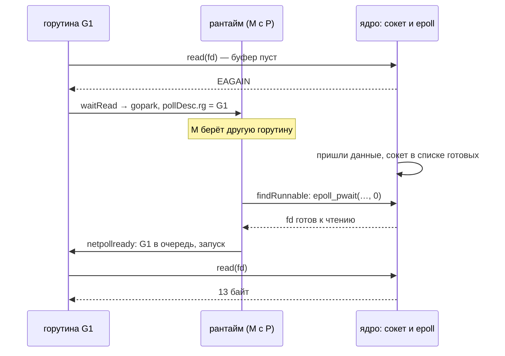

<script setup>
import Netpoller from '../../viz/scenes/Netpoller.vue'
</script>

# 1.5.7. Netpoller и цена соединения

## <Part kind="problem" /> Проблема: сколько стоят сто тысяч соединений, которые молчат

В уроке 0.6 мы прикинули шлюз мессенджера: 30 млн одновременных WebSocket-соединений, по 100 тысяч на сервер. Там же оценили простаивающее соединение в 15–50 КБ и честно записали: «это оценка, а не замер, мерить будем в модуле 1.5». В уроке 1.5.1 появилось второе обещание: сетевой вызов в Go не держит поток ОС, а чтение файла держит. Почему так — «подробно в части 1.5b».

Пора платить по обоим счетам. В лабе есть программа `netpoll`. Подкоманда `serve` принимает N соединений, на каждое запускает горутину, которая ждёт строку от клиента, и печатает, сколько памяти прибавилось. `dial` открывает эти N соединений и держит их молча. Сто тысяч соединений:

```text
$ ./netpoll serve -addr 127.0.0.1:9000 -mode bufio -n 100000
go version: go1.27.2
GOMAXPROCS: 12
NumCPU: 12
режим: bufio, ждём соединений: 100000
слушаю 127.0.0.1:9000
принято соединений: 100000 за 3070 мс
горутин:          до         23, после     100023
RSS:              до       5492 КиБ, после     568284 КиБ
стеки горутин:    до        480 КиБ, после     400800 КиБ
куча (объекты):   до        295 КиБ, после     478633 КиБ
стеки для GC:     до          7 КиБ, после     139069 КиБ (/gc/scan/stack:bytes)
sockstat до:      TCP: inuse 429 orphan 0 tw 9729 alloc 452 mem 167
sockstat после:   TCP: inuse 200422 orphan 0 tw 2677 alloc 200445 mem 423
ядро: TCP-сокетов +199993 (обе стороны, если клиент на этой машине), буферы +256 страниц (1024 КиБ)
на соединение: RSS 5.6 КиБ, стеки 4.0 КиБ, куча 4.8 КиБ
держу соединения до SIGTERM

$ ./netpoll dial -addr 127.0.0.1:9000 -n 100000 -src 8
...
открыто соединений: 100000 с 8 адресов за 2964 мс
держу соединения до SIGTERM
```

<Run dir="labs" cmd="./netpoll serve -addr 127.0.0.1:9000 -mode bufio -n 100000" before="`go build -o netpoll ./1-5/netpoll`; после старта в соседнем терминале — `./netpoll dial -addr 127.0.0.1:9000 -n 100000 -src 8`" />

машина: Intel Core i5-12400 (6 ядер, 12 логических процессоров), Ubuntu 24.04, ядро Linux 7.0, go1.27.2. Обе программы работают на одной машине, `dial` — в соседнем терминале. Шапка `dial` (версия Go и `GOMAXPROCS`) опущена, на её месте `...`. Текущая версия лабы печатает после «стеков для GC» ещё строку «начальный стек» — она понадобится нам в разделе о стеке.

Процесс вырос на <N>5,6 КиБ</N> на соединение. Это втрое меньше нижней границы оценки 0.6. Сто тысяч горутин, а потоков ОС — единицы. Ядро под буферы сокетов не взяло почти ничего: 256 страниц на двести тысяч сокетов. Значит, 0.6 ошибся? Не совсем, и в этом уроке мы разберёмся почему. Вопросов несколько:

- почему 100 000 горутин, каждая из которых «заблокирована» в чтении, не держат 100 000 потоков?
- куда ушли 5,6 КиБ и почему стеки и куча в сумме дают 8,8 КиБ, больше, чем RSS?
- сколько на самом деле стоит соединение ядру и почему `sockstat` его почти не видит?
- и что изменится, если буфер чтения брать только на время чтения (режим `lazy`)?

К концу урока вы:

- объясните разницу между блокирующим и неблокирующим вводом-выводом и почему `epoll` платит за готовое событие, а не за каждое соединение;
- проследите `conn.Read` от системного вызова `read` до парковки горутины на `pollDesc` и обратно и увидите это в `strace`;
- поймёте, как работают дедлайны и почему их ставят перед каждым чтением;
- разложите цену соединения на стек, кучу, структуры рантайма и ядро и сравните замер с оценкой 0.6 и цифрой Камардина;
- узнаете три лимита ОС, в которые упирается сервер с 10⁵ соединениями, и что делать, когда горутины на соединение уже мало.

## <Part kind="theory" /> Блокирующий и неблокирующий ввод-вывод

### Блокирующий read усыпляет поток

Программа читает из сокета системным вызовом `read(fd, buf, n)`. Если данных в буфере сокета нет, ядро по умолчанию **усыпляет поток** до их прихода. Это блокирующий ввод-вывод. Он удобен: код пишется сверху вниз, «прочитал — обработал — ответил». Но один поток обслуживает одно соединение. Десять тысяч клиентов — десять тысяч потоков, и каждый ждёт.

В 1999 году Ден Кегель назвал это <T id="c10k">проблемой C10K</T> (C10K problem): как обслужить десять тысяч соединений на одном сервере. Поток в то время стоил мегабайты стека и микросекунды на переключение. Мы мерили это в уроке 1.5.1: переключение между потоками около 4 мкс против 160 нс у горутин. Десять тысяч спящих потоков — это память и работа планировщика ядра, которые тратятся на ожидание.

### Неблокирующий режим и вопрос «когда пробовать снова»

Сокет можно перевести в <T id="nonblocking-io">неблокирующий режим</T> (non-blocking I/O): флаг `O_NONBLOCK` или `SOCK_NONBLOCK` при создании. Тогда `read` без данных не усыпляет поток, а сразу возвращает ошибку `EAGAIN` — «данных пока нет, попробуй позже». Поток свободен. Но когда именно пробовать снова? Опрашивать все сокеты по кругу — значит жечь процессор впустую: из ста тысяч соединений в каждую миллисекунду данные есть у единиц.

Нужен механизм, который скажет: «вот эти три сокета готовы, остальные нет». Linux прошёл к нему три шага.

### select, poll, epoll

**`select`** (1983, BSD). Программа передаёт ядру битовую маску дескрипторов, ядро проверяет каждый и возвращает маску готовых. Маска фиксированного размера: `FD_SETSIZE` = 1024, дескриптор с номером больше — уже не передать. И на **каждый** вызов программа копирует в ядро весь набор, ядро обходит все дескрипторы, а программа потом ищет в маске единицы. Цена вызова — O(N) от числа наблюдаемых соединений, даже если готово одно.

**`poll`** (System V, середина 1980-х). Вместо маски — массив структур, предела 1024 больше нет. Но суть та же: весь массив в ядро на каждый вызов, обход всех, O(N).

**<T id="epoll">epoll</T>** (Linux 2.6, 2003). Набор наблюдаемых дескрипторов теперь живёт **в ядре**. Три вызова:

- `epoll_create1` создаёт объект `epoll` и возвращает его дескриптор;
- `epoll_ctl(epfd, EPOLL_CTL_ADD, fd, events)` добавляет сокет в набор **один раз** — дальше ядро помнит его само;
- `epoll_wait(epfd, events, maxevents, timeout)` возвращает **только готовые** дескрипторы, не больше `maxevents` за раз, и при необходимости ждёт до `timeout` миллисекунд.

| | `select` | `poll` | `epoll` |
|---|---|---|---|
| где набор дескрипторов | в программе, копия в ядро на каждый вызов | в программе, копия в ядро на каждый вызов | в ядре, добавляется один раз |
| предел числа дескрипторов | 1024 (`FD_SETSIZE`) | нет | нет |
| цена одного ожидания | O(N) — все наблюдаемые | O(N) — все наблюдаемые | O(готовых) |

Почему `epoll` платит только за готовые? Потому что ядро не ищет готовые сокеты, а **узнаёт** о них в момент, когда приходят данные. При `EPOLL_CTL_ADD` ядро вешает на сокет обратный вызов. Пакет пришёл, данные легли в буфер сокета — сетевой стек будит всех, кто ждёт этот сокет, и обратный вызов `epoll` добавляет сокет в **список готовых**. `epoll_wait` просто забирает этот список. Сто тысяч молчащих соединений не стоят ему ничего: их нет в списке.

<Callout type="simplified">

O(готовых) — это цена `epoll_wait`. `epoll_ctl` дороже: набор наблюдаемых дескрипторов в ядре хранится в красно-чёрном дереве, и добавление или удаление стоит O(log N). Но это разовая цена на жизнь соединения, а не на каждое ожидание. Поэтому Go и регистрирует сокет один раз, при создании.

</Callout>

### По уровню и по фронту

Сообщать о готовности `epoll` умеет двумя способами.

- **По уровню** (level-triggered, по умолчанию). Пока в буфере сокета есть непрочитанные данные, каждый `epoll_wait` будет снова и снова возвращать этот сокет.
- **<T id="edge-triggered">По фронту</T>** (edge-triggered, флаг `EPOLLET`). Ядро сообщает один раз — в момент, когда сокет **стал** готов, то есть когда пришли новые данные.

Пример. Пришло 512 байт. Ядро сообщило один раз. Программа прочитала 100 байт и снова пошла ждать события. По уровню она его тут же получит: 412 байт ещё лежат. По фронту — нет: новых данных не приходило, «фронта» не было, и программа может ждать вечно, хотя данные рядом. Отсюда правило режима по фронту: **нельзя начинать ждать, не попробовав сначала прочитать**. Ждут только после `EAGAIN`.

Зачем тогда такой режим? Он дешевле: ядро не возвращает один и тот же сокет в каждом `epoll_wait`, пока кто-то не дочитает его буфер. Для рантайма, который обслуживает сто тысяч соединений одной общей очередью событий, это важно. Go регистрирует сокеты именно по фронту и, как мы сейчас увидим, соблюдает правило сам. Программисту об этом думать не нужно.

<Deep title="io_uring и почему сеть Go на epoll">

<T id="io-uring">io_uring</T> (Linux 5.1, 2019) устроен иначе, чем `epoll`. `epoll` отвечает на вопрос «что готово?», а читать программа идёт сама. Это модель готовности (readiness). `io_uring` — модель завершения (completion). Программа и ядро делят две кольцевые очереди в общей памяти. В очередь отправки программа кладёт запросы: «прочитай в этот буфер», «запиши это». Ядро их выполняет и кладёт результаты в очередь завершений. Один вызов `io_uring_enter` может отправить сотню запросов, а при опросе ядром очереди можно обойтись и вовсе без вызовов. Главное, что `io_uring` умеет то, чего не умеет `epoll`, — **асинхронно читать обычные файлы**. `epoll` файлы на диске не поддерживает вовсе.

Почему же сеть Go не перешла на него? Мы проверили исходники Go 1.27.2: `io_uring` не используется ни в рантайме, ни в `internal/poll`, ни в `net` и `os`. В стандартной библиотеке есть только номера системных вызовов в пакете `syscall` для linux/loong64. Предложение [golang/go#31908](https://github.com/golang/go/issues/31908) «прозрачно поддержать io_uring в internal/poll» открыто с мая 2019 года. Причины в обсуждении называет Ян Ланс Тейлор из команды Go:

- **Кольцо фиксированного размера.** Оно вмещает ограниченное число запросов «в полёте», а рантайм не знает заранее, сколько их будет у программы. Сто тысяч горутин в `conn.Read` — это сто тысяч незавершённых запросов.
- **Борьба за кольцо.** Горутины независимы, общее кольцо стало бы точкой конкуренции при большом `GOMAXPROCS`. А кольцо на каждый P требует спящих потоков у простаивающих P.
- **Отображение API.** Как без поломки совместимости уложить операции стандартной библиотеки на `io_uring` сверх того, что уже даёт `epoll`, пока не видно (комментарий 2024 года). Тейлор считал, что выигрыш реален скорее для файлов.

Есть и довод из этого урока. В модели завершения буфер нужно отдать ядру **вместе с запросом**, то есть каждое ждущее соединение держит буфер, как наш режим `bufio`. Модель готовности позволяет взять буфер, только когда данные пришли (режим `lazy` ниже). У `io_uring` для этого есть отдельный механизм — общие буферы, которые ядро раздаёт само. Но это ещё один слой сложности.

О том же пишет в обсуждении (2024) Энди Пан (panjf2000): по руководству автора `io_uring` для сетевых программ нужно отдать управление буферами `io_uring` и собирать запросы пачками, а ни того ни другого в сетевом коде Go нет.

И довод эксплуатационный. Тейлор в 2024 году заметил, что для прозрачной поддержки в стандартной библиотеке важно, доступен ли `io_uring` там, где обычно запускают Go-программы. В 2023 году Google сообщил, что 60 % эксплойтов ядра Linux, присланных в программу kCTF VRP за год, использовали `io_uring`, и ограничил его у себя: выключил в ChromeOS, закрыл приложениям Android и выключил на продакшен-серверах Google. Docker с ноября 2023 года (moby/moby#46762) запрещает вызовы `io_uring_*` в профиле seccomp по умолчанию: в контейнере они вернут ошибку. Сетевой стек, который работает только там, где `io_uring` разрешён, пришлось бы держать в двух вариантах.

Итог на октябрь 2026 года: для сети Go остаётся на `epoll`, и горутина на соединение уже даёт дешёвое ожидание. Если вам нужен `io_uring` для файлов, его подключают сторонними библиотеками, мимо `os.File`.

</Deep>

## <Part kind="theory" /> Netpoller: как conn.Read ждёт без потока

<T id="netpoller">Сетевой поллер</T> (netpoller) — часть рантайма Go, которая соединяет неблокирующие сокеты, `epoll` и планировщик. Её задача — чтобы `conn.Read` выглядел блокирующим для программиста и не был блокирующим для потока ОС. Пройдём путь одного соединения.

### Сокет создаётся неблокирующим и регистрируется один раз

Рантайм при первой сетевой операции создаёт объект `epoll` и `eventfd` — служебный дескриптор, которым он будит сам себя (`netpollinit` в [`runtime/netpoll_epoll.go`](https://github.com/golang/go/blob/go1.27.2/src/runtime/netpoll_epoll.go#L36)). Сокеты пакет `net` открывает сразу неблокирующими: `socket(…, SOCK_NONBLOCK)` и `accept4(…, SOCK_NONBLOCK)`. Затем `poll.FD.Init` вызывает `runtime_pollOpen`. Тот достаёт из кэша структуру `pollDesc` — дескриптор ожидания этого сокета — и регистрирует сокет в `epoll` ([строка 66](https://github.com/golang/go/blob/go1.27.2/src/runtime/netpoll_epoll.go#L66)):

```text
ev.Events = linux.EPOLLIN | linux.EPOLLOUT | linux.EPOLLRDHUP | linux.EPOLLET
```

Сразу на чтение (`EPOLLIN`), запись (`EPOLLOUT`) и закрытие другой стороной (`EPOLLRDHUP`), по фронту (`EPOLLET`). Регистрация одна на всю жизнь сокета. Перед каждым ожиданием `epoll_ctl` не вызывается.

`pollDesc` — это 296 байт (размер из отладочной информации бинарника лабы, linux/amd64). В нём два слова `rg` и `wg`: кто ждёт чтения и кто ждёт записи. В каждом либо `pdNil` (никто), либо `pdReady` (событие пришло, его ещё никто не забрал), либо `pdWait` (горутина собирается уснуть), либо указатель на саму горутину. Там же таймеры дедлайнов. Живут `pollDesc` **не в куче Go**: `pollcache.alloc` берёт их пачками по 4 КиБ через `persistentalloc` ([`runtime/netpoll.go`](https://github.com/golang/go/blob/go1.27.2/src/runtime/netpoll.go#L688)). Комментарий там объясняет почему: указатель на `pollDesc` лежит внутри ядра, в данных события `epoll`. Сборщик мусора этой ссылки не видит и счёл бы объект мусором. После закрытия сокета `pollDesc` возвращается в кэш и достаётся следующему соединению.

### Read: попробовать, получить EAGAIN, уснуть

`conn.Read(buf)` проходит `net.TCPConn` → `netFD.Read` → `poll.FD.Read` ([`internal/poll/fd_unix.go`](https://github.com/golang/go/blob/go1.27.2/src/internal/poll/fd_unix.go#L141)). Сердце — цикл:

```text
for {
	n, err := ignoringEINTRIO(syscall.Read, fd.Sysfd, p)
	if err != nil {
		n = 0
		if err == syscall.EAGAIN && fd.pd.pollable() {
			if err = fd.pd.waitRead(fd.isFile); err == nil {
				continue
			}
		}
	}
	err = fd.eofError(n, err)
	return n, err
}
```

Вот и правило режима по фронту в коде. Сначала **всегда** `read`. Данные есть — вернуть их. Только `EAGAIN` ведёт в `waitRead`, а после пробуждения цикл снова делает `read`. Если клиент прислал 512 байт, а `Read` забрал 100, остальные 412 заберёт следующий `Read` первым же `read`, без ожидания. Комментарий в том же файле прямо говорит: уведомления по фронту сами по себе не видят данные, которые уже лежат в буфере.

`waitRead` уходит в рантайм: `poll_runtime_pollWait` → `netpollblock` ([`runtime/netpoll.go`](https://github.com/golang/go/blob/go1.27.2/src/runtime/netpoll.go#L548)). Тот атомарно меняет `rg` с `pdNil` на `pdWait` и вызывает `gopark`. Горутина переходит в ожидание (в трассировке и дампе стеков — `IO wait`), а уже после того, как она снята с потока, `netpollblockcommit` записывает в `rg` указатель на неё. Поток M с процессором P свободен и тут же берёт следующую горутину из очереди. Это та же парковка, что у канала или мьютекса (урок 1.5.2), только ждёт горутина не другую горутину, а ядро.

А если событие пришло между `read` и парковкой? Тогда поллер уже записал в `rg` значение `pdReady`, `netpollblock` видит его и возвращается без сна, и цикл снова делает `read`. Гонки «данные пришли, пока мы засыпали» нет.

### Кто будит: netpoll в планировщике

Ядро о готовности сокета Go не сообщает: сигнала нет, поток никто не будит. Рантайм **сам спрашивает** `epoll` функцией `netpoll(delay)` ([`netpoll_epoll.go`](https://github.com/golang/go/blob/go1.27.2/src/runtime/netpoll_epoll.go#L113)). Она вызывает `epoll_wait` (на amd64 — системный вызов `epoll_pwait`) на 128 событий за раз. Для каждого события `netpollready` достаёт горутину из `rg` или `wg` и добавляет её в список готовых. Список уходит в очереди планировщика.

Кто и когда вызывает `netpoll` (`runtime/proc.go`):

1. **`findRunnable`, быстрый опрос** ([строка 3511](https://github.com/golang/go/blob/go1.27.2/src/runtime/proc.go#L3511)). Поток ищет работу: таймеры, локальная очередь, глобальная пусты. **До** кражи у других P он делает `netpoll(0)` — неблокирующий опрос с нулевым таймаутом. Комментарий называет его оптимизацией перед кражей: проверить сеть дешевле, чем обходить чужие очереди. Опрашивает одновременно только один поток (флаг `pollingNet`), чтобы на многоядерной машине не толкаться в ядре.
2. **`findRunnable`, блокирующий опрос** ([строка 3769](https://github.com/golang/go/blob/go1.27.2/src/runtime/proc.go#L3769)). Работы нет нигде, украсть нечего. Поток **отдаёт P** в список свободных и только потом засыпает в `netpoll(delay)`. `delay` — время до ближайшего таймера, а если таймеров нет, `-1`, то есть «пока не придёт событие». С процессором в руках блокироваться запрещено: в коде стоит `throw("findRunnable: netpoll with p")`. Блокируется в `epoll` не больше одного потока сразу. Если появилась работа или таймер раньше, рантайм будит его записью в тот самый `eventfd` (`netpollBreak`).
3. **`sysmon`** ([строка 6622](https://github.com/golang/go/blob/go1.27.2/src/runtime/proc.go#L6622)), если сеть не опрашивали дольше 10 мс. Это на случай, когда все потоки заняты вычислениями и до `findRunnable` дело не доходит. <T id="sysmon">sysmon</T> работает без P, поэтому он раскладывает готовые горутины в глобальную очередь.
4. **`startTheWorldWithSema`** ([строка 1778](https://github.com/golang/go/blob/go1.27.2/src/runtime/proc.go#L1778)) — после <T id="stop-the-world">остановки мира</T> (stop-the-world, урок 1.5.9). Пока мир стоял, события копились, и их забирают сразу.



Что смотреть на схеме: поток (M с P) нигде не ждёт ядро. Горутина «ждёт» в виде указателя в `pollDesc`, а ядро «ждёт» в виде сокета, которого нет в списке готовых. Соединяет их только опрос `epoll` из планировщика. Поэтому 100 000 ждущих горутин в нашем замере — это 100 000 указателей в `pollDesc` и единицы потоков.

### Дедлайны: таймер рантайма, а не спящий поток

`conn.SetReadDeadline(t)` не запускает ни горутину, ни поток. Он вызывает `poll_runtime_pollSetDeadline` ([`netpoll.go`](https://github.com/golang/go/blob/go1.27.2/src/runtime/netpoll.go#L372)), и тот заводит таймер `rt` внутри `pollDesc` — обычный таймер рантайма в куче таймеров P, такой же, как у `time.AfterFunc`. Сработал таймер — `netpolldeadlineimpl` ([строка 622](https://github.com/golang/go/blob/go1.27.2/src/runtime/netpoll.go#L622)) помечает дедлайн чтения истёкшим и будит горутину из `rg`. `waitRead` возвращает `ErrDeadlineExceeded`, и `conn.Read` отдаёт ошибку `*net.OpError` с текстом `i/o timeout`, внутри которой `os.ErrDeadlineExceeded`. Проверяют её через `errors.Is(err, os.ErrDeadlineExceeded)` или `Timeout()` у `net.Error`.

Важная деталь: <T id="deadline">дедлайн</T> — **момент времени**, а не длительность. Он не сдвигается от того, что чтение удалось. Поставили `SetReadDeadline(time.Now().Add(30 * time.Second))` один раз при открытии соединения — через 30 секунд любое чтение упадёт, даже у клиента, который пишет каждую секунду. Таймаут простоя ставят **перед каждым чтением**:

<!-- go-check -->

```go
import (
	"bufio"
	"errors"
	"fmt"
	"net"
	"os"
	"time"
)

// idleTimeout — сколько клиент может молчать между строками. Дедлайн абсолютный,
// поэтому его продлевают перед каждым чтением, а не ставят один раз.
const idleTimeout = 90 * time.Second

func echoLines(c net.Conn) error {
	defer func() { _ = c.Close() }()
	r := bufio.NewReader(c)
	for {
		if err := c.SetReadDeadline(time.Now().Add(idleTimeout)); err != nil {
			return fmt.Errorf("продление дедлайна: %w", err)
		}
		line, err := r.ReadString('\n')
		if errors.Is(err, os.ErrDeadlineExceeded) {
			return fmt.Errorf("клиент молчит дольше %v: %w", idleTimeout, err)
		}
		if err != nil {
			return fmt.Errorf("чтение: %w", err)
		}
		if _, err := c.Write([]byte(line)); err != nil {
			return fmt.Errorf("запись: %w", err)
		}
	}
}
```

Продление дешёвое: это перестановка таймера в куче P, без системных вызовов. Так же работают `ReadTimeout`, `WriteTimeout` и `IdleTimeout` у `http.Server` (урок 1.17): сервер ставит дедлайны на соединение перед каждым этапом.

### Почему файл держит поток, а сокет нет

В уроке 1.5.1 программа `sched/syscall` показала, что `nanosleep` в восьми горутинах добавил потоков ОС, а `time.Sleep` нет. С файлами та же история. `os.Open` на Linux тоже пытается зарегистрировать дескриптор в netpoller. Но `epoll` обычные файлы и каталоги не принимает: `epoll_ctl` отвечает `EPERM` («дескриптор не поддерживает epoll», man `epoll_ctl(2)`). Пакет `os` воспринимает это как «опрашивать нельзя» и возвращает дескриптор в блокирующий режим. Комментарий в [`os/file_unix.go`](https://github.com/golang/go/blob/go1.27.2/src/os/file_unix.go#L215) так и говорит: ошибка регистрации бывает у дескрипторов, которые `epoll` не поддерживает, например у файлов на диске.

Дальше `os.File.Read` — честный системный вызов `read`. Рантайм обрамляет его `entersyscall` и `exitsyscall`, и поток спит в ядре всё время чтения с диска. Если вызов затянулся, sysmon отбирает у потока P и отдаёт его другому потоку (урок 1.5.1). Горутины продолжают работать, но **поток занят**. Тысяча горутин, одновременно читающих с медленного диска или сетевой файловой системы, — тысяча потоков. При пределе в 10 000 потоков (`debug.SetMaxThreads`) процесс падает с `thread exhaustion`. Ниже, в `strace`, мы увидим этот `EPERM` своими глазами.

<Callout type="simplified">

На практике чтение файла часто приходит из страничного кэша ядра и длится микросекунды. Тогда P даже не успевают отобрать, и поток возвращается быстро. Проблема — в медленных или сетевых дисках и в тысячах одновременных чтений. Отсюда совет: работу с файлами в нагруженном сервисе ограничивают семафором (урок 1.5.5), а не запускают по горутине на каждый запрос.

</Callout>

## <Part kind="theory" /> Netpoller в strace

В уроке 0b.1 мы запускали клиент под `strace` и видели одну строку `epoll_ctl` с флагами `EPOLLIN|EPOLLOUT|EPOLLRDHUP|EPOLLET`. Теперь посмотрим на сервер целиком. `serve` принимает три соединения: два от `dial` с адреса 127.0.0.2 и третье от `bash` (`exec 3<>/dev/tcp/127.0.0.1/9100`), который через три секунды пишет `привет` и читает эхо. Флаг `-f` — следить за всеми потоками процесса, `-o` — писать в файл:

```text
$ strace -f -o st.txt -e trace=epoll_ctl,epoll_pwait,epoll_wait,accept4 ./netpoll serve -addr 127.0.0.1:9100 -mode bufio -n 3
$ cat st.txt
2003029 epoll_ctl(5, EPOLL_CTL_ADD, 6, {events=EPOLLIN, data={u32=0, u64=0}}) = 0
2003029 epoll_ctl(5, EPOLL_CTL_ADD, 4, {events=EPOLLIN|EPOLLOUT|EPOLLRDHUP|EPOLLET, data={u32=2801795073, u64=4547205312142114817}}) = 0
2003029 epoll_ctl(5, EPOLL_CTL_DEL, 4, 0x1204477b541c) = 0
2003029 epoll_ctl(5, EPOLL_CTL_ADD, 3, {events=EPOLLIN|EPOLLOUT|EPOLLRDHUP|EPOLLET, data={u32=2801795074, u64=4547205312142114818}}) = 0
…
2003030 accept4(3, 0x1204477b566c, [112], SOCK_CLOEXEC|SOCK_NONBLOCK) = -1 EAGAIN (Resource temporarily unavailable)
2003030 epoll_pwait(5, [], 128, 0, NULL, 0) = 0
2003030 epoll_pwait(5, [{events=EPOLLIN, data={u32=2801795074, u64=4547205312142114818}}], 128, -1, NULL, 0) = 1
2003030 accept4(3, {sa_family=AF_INET, sin_port=htons(43477), sin_addr=inet_addr("127.0.0.2")}, [112 => 16], SOCK_CLOEXEC|SOCK_NONBLOCK) = 4
2003030 epoll_ctl(5, EPOLL_CTL_ADD, 4, {events=EPOLLIN|EPOLLOUT|EPOLLRDHUP|EPOLLET, data={u32=2785017859, u64=4547205312125337603}}) = 0
2003030 accept4(3, {sa_family=AF_INET, sin_port=htons(60519), sin_addr=inet_addr("127.0.0.2")}, [112 => 16], SOCK_CLOEXEC|SOCK_NONBLOCK) = 7
2003030 epoll_ctl(5, EPOLL_CTL_ADD, 7, {events=EPOLLIN|EPOLLOUT|EPOLLRDHUP|EPOLLET, data={u32=2768240641, u64=4547205312108560385}}) = 0
2003029 epoll_pwait(5, [{events=EPOLLOUT, data={u32=2785017859, u64=4547205312125337603}}, {events=EPOLLOUT, data={u32=2768240641, u64=4547205312108560385}}], 128, 0, NULL, 0) = 2
…
2003029 <... epoll_pwait resumed>[], 128, 1999, NULL, 0) = 0
```

<Run dir="labs" cmd="strace -f -o st.txt -e trace=epoll_ctl,epoll_pwait,epoll_wait,accept4 ./netpoll serve -addr 127.0.0.1:9100 -mode bufio -n 3 &amp;&amp; cat st.txt" before="`go build -o netpoll ./1-5/netpoll`; во втором терминале — `./netpoll dial -addr 127.0.0.1:9100 -n 2 -src 1` и из bash `exec 3<>/dev/tcp/127.0.0.1/9100; printf 'привет\n' >&amp;3; read line <&amp;3`" />

машина та же. Это выдержка: строки `SIGURG` (сигналы асинхронного вытеснения, урок 1.5.1) и часть повторных опросов опущены, на месте пропусков — `…`. Числа в начале строк — номера потоков ОС, то есть разных M.

Читаем сверху вниз:

1. `epoll_ctl(5, EPOLL_CTL_ADD, 6, {events=EPOLLIN, data=0})` — дескриптор 5 — это `epoll` рантайма, 6 — его `eventfd` для самопробуждения. Флага `EPOLLET` нет, а `data` равно нулю: так поллер отличает «разбуди себя» от событий сокетов.
2. Дескриптор 4 зарегистрирован и тут же снят. Это не сокет: пакет `net` перед `Listen` читает `/proc/sys/net/core/somaxconn`, чтобы выбрать длину очереди приёма. Во второй трассе ниже видно имя файла.
3. Слушающий сокет 3 — `EPOLLIN|EPOLLOUT|EPOLLRDHUP|EPOLLET`. Те же четыре флага, что в исходнике.
4. `accept4(…) = -1 EAGAIN` — клиентов ещё нет. Горутина `serve` паркуется. Поток делает быстрый `epoll_pwait(…, 0)` и, не найдя работы, засыпает в `epoll_pwait(…, -1)` — блокирующий опрос из конца `findRunnable`, без таймаута. Когда `dial` подключился, ядро вернуло событие `EPOLLIN` на слушающем сокете, и `accept4` вернул сокеты 4 и 7, сразу неблокирующие (`SOCK_NONBLOCK`) и сразу зарегистрированные.
5. Первое событие у новых сокетов — `EPOLLOUT`: «в сокет можно писать». Регистрация по фронту сообщает о готовности, которая возникла, и для свежего соединения это готовность к записи. Читать горутинам пока нечего.
6. `epoll_pwait(…, 1999, …)` — блокирующий опрос с таймаутом 1999 мс. После приёма соединений `serve` ждёт `time.After(settle)` на 2 секунды, и поток спит в `epoll` ровно до ближайшего таймера. Это и есть `delay` из `findRunnable`.

Второй прогон — тот же сценарий, но в трассе ещё `openat`, `read` и `close`. Здесь видно, что делает горутина соединения и что происходит с файлами:

```text
$ strace -f -o st2.txt -e trace=epoll_ctl,epoll_pwait,epoll_wait,accept4,openat,read,close ./netpoll serve -addr 127.0.0.1:9100 -mode bufio -n 3
$ cat st2.txt
…
2005528 openat(AT_FDCWD, "/proc/sys/net/core/somaxconn", O_RDONLY|O_CLOEXEC) = 4
2005528 epoll_ctl(5, EPOLL_CTL_ADD, 6, {events=EPOLLIN, data={u32=0, u64=0}}) = 0
2005528 epoll_ctl(5, EPOLL_CTL_ADD, 4, {events=EPOLLIN|EPOLLOUT|EPOLLRDHUP|EPOLLET, data={u32=4026531841, u64=4271462086476824577}}) = 0
2005528 read(4, "4096\n", 65536)        = 5
…
2005528 openat(AT_FDCWD, "/proc/self/status", O_RDONLY|O_CLOEXEC) = 4
2005528 epoll_ctl(5, EPOLL_CTL_ADD, 4, {events=EPOLLIN|EPOLLOUT|EPOLLRDHUP|EPOLLET, data={u32=4009754625, u64=4271462086460047361}}) = -1 EPERM (Operation not permitted)
2005528 read(4, "Name:\tnetpoll\nUmask:\t0002\nState:"..., 512) = 512
…
2005531 accept4(3, {sa_family=AF_INET, sin_port=htons(39814), sin_addr=inet_addr("127.0.0.1")}, [112 => 16], SOCK_CLOEXEC|SOCK_NONBLOCK) = 8
2005531 epoll_ctl(5, EPOLL_CTL_ADD, 8, {events=EPOLLIN|EPOLLOUT|EPOLLRDHUP|EPOLLET, data={u32=3976200193, u64=4271462086426492929}}) = 0
2005532 epoll_pwait(5, [{events=EPOLLOUT, data={u32=3976200193, u64=4271462086426492929}}], 128, 0, NULL, 0) = 1
…
2005532 read(8, 0x5d8d7f18000, 4096)    = -1 EAGAIN (Resource temporarily unavailable)
…
2005530 <... epoll_pwait resumed>[{events=EPOLLIN|EPOLLOUT, data={u32=3976200193, u64=4271462086426492929}}], 128, -1, NULL, 0) = 1
2005530 read(8, "\320\277\321\200\320\270\320\262\320\265\321\202\n", 4096) = 13
2005530 read(8, 0x5d8d7f18000, 4096)    = -1 EAGAIN (Resource temporarily unavailable)
2005530 epoll_pwait(5, [], 128, 0, NULL, 0) = 0
2005530 epoll_pwait(5, [{events=EPOLLIN|EPOLLOUT|EPOLLRDHUP, data={u32=3976200193, u64=4271462086426492929}}], 128, -1, NULL, 0) = 1
2005530 read(8, "", 4096)               = 0
2005530 epoll_ctl(5, EPOLL_CTL_DEL, 8, 0x5d8d7f20d24) = 0
2005530 close(8)                        = 0
```

<Run dir="labs" cmd="strace -f -o st2.txt -e trace=epoll_ctl,epoll_pwait,epoll_wait,accept4,openat,read,close ./netpoll serve -addr 127.0.0.1:9100 -mode bufio -n 3 &amp;&amp; cat st2.txt" before="`go build -o netpoll ./1-5/netpoll`; во втором терминале — `./netpoll dial -addr 127.0.0.1:9100 -n 2 -src 1` и из bash `exec 3<>/dev/tcp/127.0.0.1/9100; printf 'привет\n' >&amp;3; read line <&amp;3`" />

машина та же; выдержка, пропуски отмечены `…`. Полные трассы обоих прогонов — `labs/1-5/results/netpoll-strace.txt` и `labs/1-5/results/netpoll-strace-read.txt`, команды — в разделе «Что появилось в лабе».

Жизнь соединения 8 (это `bash`) целиком:

1. `accept4` → 8, регистрация, первое событие `EPOLLOUT`.
2. `read(8, …, 4096) = -1 EAGAIN` — горутина обработчика сделала `bufio.Reader.ReadString`, тот попросил у сокета 4096 байт (размер буфера `bufio`), данных нет. Горутина запаркована на `pollDesc`.
3. Три секунды тишины. Один поток спит в `epoll_pwait(…, -1)`. Строка `<... epoll_pwait resumed>` — продолжение вызова, который начался раньше и был прерван в выводе строками других потоков.
4. Пришло `привет\n`: 13 байт в UTF-8 (`\320\277…` — восьмеричная запись кириллицы). Событие `EPOLLIN` вернул поток 2005530, хотя парковалась горутина на потоке 2005532. Горутина не привязана к потоку: проснулась там, где был свободный M.
5. `read(8, …) = 13`, эхо (вызов `write` мы не трассировали), и снова `read = -1 EAGAIN`. Это правило режима по фронту в действии: прежде чем ждать, Go дочитал до `EAGAIN`.
6. `bash` закрыл соединение: событие с `EPOLLRDHUP`, `read = 0` (конец потока), `ReadString` возвращает `io.EOF`, обработчик закрывает соединение: `EPOLL_CTL_DEL` и `close`.

А теперь файлы. `/proc/self/status` — `epoll_ctl … = -1 EPERM`: `epoll` его не принимает, и пакет `os` читает файл обычными блокирующими `read`. Это и есть ответ на вопрос «почему файл держит поток». Любопытно, что `somaxconn` и `/proc/net/sockstat` ядро в `epoll` приняло: у этих файлов есть поддержка ожидания. Go честно их регистрирует, но читаются они из памяти ядра и не блокируют. Обычный файл на диске ведёт себя как `/proc/self/status` — `EPERM`.

## <Part kind="theory" /> Цена соединения: куда ушли килобайты

### Что и как мерит программа

`serve` снимает два снимка: до первого соединения и через 2 секунды после последнего, когда горутины дошли до чтения и запарковались. Перед каждым снимком — `runtime.GC()`, чтобы в замер попала живая память, а не мусор, накопленный при приёме. В снимке:

- **RSS** — `VmRSS` из `/proc/self/status`: страницы памяти, которые процесс реально тронул и которые лежат в оперативной памяти;
- **стеки горутин** — `/memory/classes/heap/stacks:bytes` из `runtime/metrics`: сколько памяти выделено под стеки;
- **куча (объекты)** — `/memory/classes/heap/objects:bytes`: живые объекты в куче после сборки;
- **стеки для GC** — `/gc/scan/stack:bytes`: сколько байт стеков сборщик просканировал в последнем цикле, то есть сколько стека горутины **реально заняли**;
- строка `TCP:` из `/proc/net/sockstat` — о ней отдельно ниже.

Два режима обработчика. `bufio` — классика: горутина и свой `bufio.Reader` на 4 КиБ на всю жизнь соединения. `lazy` — горутина без своего буфера: ждёт готовности сокета через `syscall.RawConn.Read` и берёт буфер из `sync.Pool` только на время чтения. Код обоих — в разделе «Код».

| режим, соединений | RSS на соединение | стеки | куча |
| --- | --- | --- | --- |
| `bufio`, 10 000 | 5,8 КиБ | 4,0 КиБ | 4,8 КиБ |
| `bufio`, 100 000 | 5,6 КиБ | 4,0 КиБ | 4,8 КиБ |
| `lazy`, 10 000 | 3,7 КиБ | 2,0 КиБ | 0,9 КиБ |
| `lazy`, 100 000 | 3,6 КиБ | 2,0 КиБ | 0,9 КиБ |

<Run dir="labs" cmd="./netpoll serve -addr 127.0.0.1:9000 -mode lazy -n 10000" before="`go build -o netpoll ./1-5/netpoll`; во втором терминале — `./netpoll dial -addr 127.0.0.1:9000 -n 10000 -src 8`; для других строк таблицы меняйте `-mode` и `-n`" />

машина та же; полные выводы всех четырёх прогонов — `labs/1-5/results/netpoll-{bufio,lazy}-{10000,100000}.txt`. Цена соединения от 10⁴ до 10⁵ почти не меняется: она линейна, и десяти тысяч хватает, чтобы её измерить. В режиме `lazy` процесс со 100 000 соединений занял 361 020 КиБ (около 353 МиБ) против 568 284 КиБ (около 555 МиБ) у `bufio`.

Разберём по частям.

### Стек: 2 или 4 КиБ, и почему именно столько

Горутина начинается со стека 2 КиБ (урок 1.5.1). Но пролог каждой функции проверяет, хватит ли ей места, и проверяет с запасом: у дна стека держится защитная зона. На linux/amd64 это `stackGuard` = 800 + 128 = 928 байт (`runtime/stack.go`, `abi.StackNosplitBase` + `abi.StackSmall`). Значит, без роста горутине доступно около 1,1 КиБ из 2 КиБ.

Теперь посмотрите на «стеки для GC». В режиме `bufio` сборщик просканировал 139 069 КиБ на 100 000 горутин, то есть около 1,39 КиБ на горутину. Цепочка `ReadString` → `ReadSlice` → `fill` → `conn.Read` → `poll.FD.Read` → `waitRead` → `gopark` занимает больше 1,1 КиБ, и в 2 КиБ она не помещается. В режиме `lazy` занято 57 819 КиБ / 100 000 ≈ 0,58 КиБ, и 2 КиБ хватает.

Откуда же ровно 4,0 КиБ у `bufio`? К этому числу ведут два механизма рантайма, и оба здесь работают.

- **<T id="stack-growth">Рост стека</T> копированием.** Горутина стартовала с 2 КиБ, пролог очередной функции увидел нехватку, и рантайм выделил стек вдвое больше и скопировал в него содержимое: 2 → 4 КиБ.
- **Адаптивный начальный размер** (Go 1.19, включён по умолчанию: `GODEBUG=adaptivestackstart=1`). Каждая сборка считает средний занятый стек всех просканированных горутин, прибавляет `stackGuard` и округляет вверх до степени двойки (`gcComputeStartingStackSize` в `runtime/stack.go`). С этого размера стартуют **новые** горутины. Для `bufio`: 1,39 КиБ + 928 Б ≈ 2,3 КиБ → 4 КиБ. Для `lazy`: 0,58 КиБ + 928 Б ≈ 1,5 КиБ → 2 КиБ.

Какой из них дал наши 4 КиБ? Лаба печатает начальный размер из метрики `/gc/stack/starting-size:bytes`. Сравним `bufio` на 10⁴ соединений как есть и с выключенным адаптивным стартом:

```text
$ ./netpoll serve -addr 127.0.0.1:9211 -mode bufio -n 10000
...
стеки горутин:    до        512 КиБ, после      40800 КиБ
...
начальный стек:   до       2048 Б,   после       4096 Б (/gc/stack/starting-size:bytes)

$ GODEBUG=adaptivestackstart=0 ./netpoll serve -addr 127.0.0.1:9212 -mode bufio -n 10000
...
стеки горутин:    до        480 КиБ, после      40768 КиБ
...
начальный стек:   до       2048 Б,   после       2048 Б (/gc/stack/starting-size:bytes)

$ ./netpoll serve -addr 127.0.0.1:9213 -mode lazy -n 10000
...
стеки горутин:    до        480 КиБ, после      20800 КиБ
...
начальный стек:   до       2048 Б,   после       2048 Б (/gc/stack/starting-size:bytes)
```

<Run dir="labs" cmd="GODEBUG=adaptivestackstart=0 ./netpoll serve -addr 127.0.0.1:9212 -mode bufio -n 10000" before="`go build -o netpoll ./1-5/netpoll`; во втором терминале — `./netpoll dial -addr 127.0.0.1:9212 -n 10000 -src 8`; два других запуска блока — без `GODEBUG` и с `-mode lazy`" />

машина та же; клиент — `dial -n 10000 -src 8`, остальные строки вывода опущены (`...`), полные выводы — `labs/1-5/results/netpoll-stack-start.txt`. Без адаптивного старта все горутины начинали с 2 КиБ, и стеки всё равно вышли по 4 КиБ: каждая выросла копированием. Значит, 4 КиБ задаёт глубина цепочки `bufio`, а не эвристика. С адаптивным стартом после замера начальный размер — 4096 Б: сборки, которые шли во время приёма (куча выросла с 0,3 до 47 МиБ), увидели выросшие стеки, и горутины, созданные после них, скорее всего стартовали сразу с 4 КиБ, без копирования. Сколько горутин выросло, а сколько стартовало с 4 КиБ, мы не мерили, но памяти это не меняет: итог одинаков, 40 800 против 40 768 КиБ. В режиме `lazy` начальный размер остался 2048 Б в обоих вариантах.

Заметьте: цена стека определяется не тем, сколько горутине нужно в среднем, а тем, перешагнула ли самая глубокая точка её цепочки порог. Пара лишних кадров в обработчике может удвоить стек у ста тысяч горутин. Как устроены рост, сжатие и адаптивный старт — урок 1.5.8.

<Callout type="simplified">

Мы не трассировали, где именно цепочка `bufio` перешагивает 1,1 КиБ: это вывод из «стеков для GC» (1,39 КиБ занято) и из прогона с `adaptivestackstart=0`. Проверить можно так: в `serveBufio` замените `ReadString` на прямой `c.Read(buf)` в свой массив и посмотрите, останется ли 4,0 КиБ.

</Callout>

### Куча: дескриптор горутины, netFD, адреса и буфер

Размеры структур можно достать из отладочной информации (DWARF) бинарника лабы:

```text
$ readelf -z --debug-dump=info netpoll | grep -A1 -E 'DW_AT_name *: (runtime\.g|runtime\.pollDesc|net\.netFD|net\.TCPAddr|bufio\.Reader)$' | grep -B1 byte_size | grep -v '^--' | sed -E 's/^ *<[0-9a-f]+> +//'
DW_AT_name        : runtime.g
DW_AT_byte_size   : 456
DW_AT_name        : runtime.pollDesc
DW_AT_byte_size   : 296
DW_AT_name        : net.netFD
DW_AT_byte_size   : 128
DW_AT_name        : net.TCPAddr
DW_AT_byte_size   : 48
DW_AT_name        : bufio.Reader
DW_AT_byte_size   : 88
```

<Run dir="labs" cmd="readelf -z --debug-dump=info netpoll | grep -A1 -E 'DW_AT_name *: (runtime\.g|runtime\.pollDesc|net\.netFD|net\.TCPAddr|bufio\.Reader)$' | grep -B1 byte_size | grep -v '^--' | sed -E 's/^ *<[0-9a-f]+> +//'" before="`go build -o netpoll ./1-5/netpoll`" />

машина та же, linux/amd64. Аллокатор кладёт объект в ближайший <T id="size-class">класс размеров</T> (size class) не меньше его (урок 1.5.8): 456 байт → класс 480, 88 → 96.

Из чего складываются 0,9 КиБ кучи в режиме `lazy`:

- `runtime.g` — дескриптор самой горутины: 456 байт, в куче 480. Состояние, указатели стека, поля планировщика. Это единственная крупная часть;
- `net.netFD` с вложенным `poll.FD` — 128 байт: номер дескриптора, замок чтения и записи, ссылка на `pollDesc`;
- два адреса `net.TCPAddr` (локальный и удалённый) по 48 байт и байты IP в них;
- `net.TCPConn` (8 байт), элемент среза `conns` в `serve` (16 байт), замыкание горутины и мелочь, которую держит `RawConn.Read`.

`bufio` добавляет к этому `bufio.Reader` (88 байт, в куче 96) и буфер `make([]byte, 4096)` — всего 4192 Б, около 4,1 КиБ. Разница между режимами меньше: 4,8 − 0,9 = 3,9 КиБ (точнее, 4,78 − 0,87 КиБ ≈ 4000 Б). Почему? Потому что у `lazy` есть своя мелочь, которой нет у `bufio`: обёртка `rawConn` от `SyscallConn`, замыкание для `RawConn.Read` и захваченные им переменные `buf`, `n`, `readErr`, которые уходят в кучу (разбор — в разделе «Код»). Около двухсот байт этой мелочи вычитаются из прибавки `bufio`. Поштучно её мы не раскладывали: это сходится по порядку величины, но не измерено.

А `pollDesc` (296 байт) в «кучу» не попал совсем: мы видели, что он живёт в памяти `persistentalloc` вне кучи. В RSS он есть, в метрике объектов кучи — нет.

### Почему RSS меньше, чем стеки плюс куча

В режиме `bufio` стеки и куча дают 4,0 + 4,8 = 8,8 КиБ, а RSS — 5,6 КиБ. RSS считает только страницы, которые процесс **тронул**. Буфер `bufio` на 4 КиБ выделен, но в него ни разу не писали: клиент молчит. Свежая память, которую Go получил от ОС, уже нулевая, обнулять её аллокатору не нужно, и страница буфера так и не попала в оперативную память. Выделено — да, занято физически — нет. Вычтем нетронутый буфер: 8,8 − 4,0 ≈ 4,8 КиБ. Оставшиеся ~0,8 КиБ RSS сверх выделенного — `pollDesc`, служебные данные сборщика и аллокатора и свободная память кучи, которую Go ещё не вернул ОС. В режиме `lazy` картина та же: 2,0 + 0,9 = 2,9 КиБ, RSS 3,6 КиБ, сверху те же ~0,7 КиБ.

<Callout type="simplified">

Разбивку «~0,7–0,8 КиБ — `pollDesc`, метаданные и невозвращённая память» мы получили вычитанием, а не прямым замером каждой части. Это гипотеза, которая сходится по порядку величины. Нетронутый буфер — тоже до первого сообщения: как только клиент пришлёт хоть строку, страница буфера станет резидентной и останется такой до закрытия соединения.

</Callout>

### Ядро: sockstat почти ничего не видит, Slab видит

Строка `TCP:` в `/proc/net/sockstat` — это статистика **всей машины**, а не нашего процесса:

- `inuse` — TCP-сокеты в работе у всех процессов. Он вырос на 199 993, то есть на 2N, а не на N: клиент `dial` работает на той же машине, и у каждого соединения два конца — принятый сокет у `serve` и исходящий у `dial`. Небольшие отклонения от 200 000 — чужие соединения машины, открывшиеся и закрывшиеся за время замера;
- `mem` — память **буферов** всех TCP-сокетов машины в **страницах** (здесь 4 КиБ): данные, которые пришли и не прочитаны, и данные, которые отправлены и не подтверждены.

В прогонах `bufio` `mem` вырос на 256 страниц (1 МиБ) на 200 000 сокетов, в прогонах `lazy` — на 0, а в повторном прогоне `bufio` на 10⁵ — тоже на 0. Ровно 256 — подозрительно круглое число. Ядро учитывает память TCP-буферов с резервом на каждый процессор: изменения копятся локально и переносятся в общий счётчик порциями размером `net.core.mem_pcpu_rsv` (по документации ядра — «1 МБ на процессор», здесь 256 страниц). Значит, `mem` меняется ступенями, и +256 — это, скорее всего, одна такая ступень от чьей-то активности на машине, а не 5 байт на каждое наше соединение. Это гипотеза: совпадение с порогом мы проверили, источник ступени — нет. У простаивающего соединения очереди пусты, и буферной памяти у него нет. Значения `tcp_rmem` на этой машине — `4096 131072 33554432` (минимум, начальное значение, максимум) — это пределы, а не заранее выделенная память. Ядро выделяет буфер под пришедшие данные и само подстраивает его размер под скорость потока: это автоподстройка буферов (autotuning). Молчащее соединение не получает ничего.

Но сокет — это не только буферы. У каждого есть структуры ядра: сам TCP-сокет (`struct tcp_sock`), `struct socket` с инодом, `struct file`, запись каталога, а у наших ещё и запись в наборе `epoll`. Всё это лежит в слэбах ядра — пулах объектов фиксированного размера — и в `sockstat` не попадает. Посмотреть по типам можно через `slabtop` или `/proc/slabinfo`, но они требуют root. Без root есть общий счётчик `Slab` в `/proc/meminfo` — тоже на всю машину. Снимем его до и после 10⁵ соединений (`serve -mode lazy` и `dial -src 8`):

```text
$ grep -E "^(Slab|SReclaimable|SUnreclaim):" /proc/meminfo   # до
Slab:            1860348 kB
SReclaimable:    1341064 kB
SUnreclaim:       519284 kB
$ grep -E "^(Slab|SReclaimable|SUnreclaim):" /proc/meminfo   # после
Slab:            2850376 kB
SReclaimable:    1682220 kB
SUnreclaim:      1168156 kB
$ grep -E "^(Slab|SReclaimable|SUnreclaim):" /proc/meminfo   # после закрытия
Slab:            1956596 kB
SReclaimable:    1348568 kB
SUnreclaim:       608028 kB
```

<Run dir="labs" cmd="grep -E &quot;^(Slab|SReclaimable|SUnreclaim):&quot; /proc/meminfo" before="`go build -o netpoll ./1-5/netpoll`; снимите строки до запуска, после `./netpoll serve -addr 127.0.0.1:9000 -mode lazy -n 100000` и `./netpoll dial -addr 127.0.0.1:9000 -n 100000 -src 8` и после их остановки" />

машина та же. `Slab` вырос на 990 028 КиБ на 200 000 сокетов — около 4,95 КиБ на сокет. Повторный прогон дал 920 992 КиБ, 4,6 КиБ на сокет. После закрытия память вернулась почти к исходной: неточно, потому что ядро возвращает освободившиеся слэбы не сразу, а машина живёт своей жизнью. Будем считать, что серверная сторона одного соединения стоит ядру около <N>5 КиБ</N>. Это допущение: мы делим поровну между двумя концами, а не мерим их по отдельности.

### Сводим всё вместе

Теперь можно поставить замер рядом с оценкой урока 0.6 и с цифрой, с которой многие знакомы, — расчётом Сергея Камардина из Mail.Ru в статье «Миллион WebSocket и Go» (2017).

| | замер, `bufio` | замер, `lazy` | оценка 0.6 | Камардин |
|---|---|---|---|---|
| горутин на соединение | 1, стек 4 КиБ | 1, стек 2 КиБ | 2, стек 2–8 КБ | 2, стек 4 КБ |
| буферы ввода-вывода | 1 × 4 КиБ, нетронут | нет при простое | 2 × 4 КБ | 4 × 4 КБ |
| TLS | нет | нет | входит | нет |
| процесс Go | <N>5,6 КиБ</N> RSS | <N>3,6 КиБ</N> RSS | — | 24 КБ |
| ядро | ≈ 5 КиБ (Slab), буферы ≈ 0 | ≈ 5 КиБ | «единицы КБ» | не считал |
| всего | ≈ 10–11 КиБ | ≈ 8–9 КиБ | <N>15–50 КБ</N> | <N>24 КБ</N> + ядро |

Откуда у Камардина 24 КБ: на 3 млн соединений он насчитал 72 ГБ, то есть 24 КБ на соединение. Это две горутины на соединение (чтение и запись) со стеком по 4 КБ — 8 КБ; буферы чтения и записи по 4 КБ — ещё 8 КБ; и два буфера по 4 КБ, которые HTTP-сервер передаёт вместе с соединением после `Hijack` при переключении на WebSocket, — последние 8 КБ. Ядро он не считал.

Наш замер **подтверждает его составные части**: стек горутины под `bufio` — ровно 4 КиБ, буфер — 4 КиБ. Разница в итоге — в их **количестве**. У нас одна горутина и один буфер, у него две горутины и четыре буфера. Соберите его раскладку из наших частей: 2 × 4 КиБ стека + 4 × 4 КиБ буферов = 24 КиБ — ровно его цифра. Дескрипторы горутин (по 480 Б в куче), `netFD`, адреса и ядро он не считал, поэтому полная цена его раскладки по нашим меркам была бы ещё на 1–2 КиБ процесса и около 5 КиБ ядра выше. Оценка 0.6 шире, потому что она честно включала TLS и данные приложения, которых в лабе нет. Ошиблась она в другом: в нашем замере простаивающее соединение не трогает страницы буфера, и RSS заметно меньше выделенного. В реальном шлюзе каждый клиент хоть раз что-то пришлёт, и буферы станут резидентными.

<Callout type="idea">

Сто тысяч простаивающих соединений с одной горутиной и буфером 4 КиБ обходятся процессу Go в 350–560 МиБ и ядру примерно в 0,5 ГиБ. Для сервера с 16–64 ГБ это немного. Узким местом шлюза при 10⁵ соединений на сервер оказывается не память, а то, что вы положите **поверх**: вторая горутина, буферы WebSocket-библиотеки, TLS, данные сессии.

</Callout>

### Чего мы не мерили: TLS

Если TLS расшифровывается на самом шлюзе, у каждого соединения появляется `tls.Conn`. В нём состояние сессии (ключи, шифры, номера записей) и буферы записей: `rawInput`, `input`, `hand`, `sendBuf` ([`crypto/tls/conn.go`](https://github.com/golang/go/blob/go1.27.2/src/crypto/tls/conn.go)). Запись TLS несёт до 16 КиБ открытого текста (`maxPlaintext = 16384` в `crypto/tls/common.go`; RFC 8446, §5.1), и буфер под входящую запись растёт до её размера. Сколько из этого остаётся у **простаивающего** соединения после рукопожатия, в этом уроке **не измерено**. Это гипотеза, которую проверим, когда шлюз получит TLS в модуле 3. Ориентир для оценки: прибавьте к замеру ещё одну-две записи TLS на активное соединение.

### Ещё одна цена: сборщик мусора сканирует стеки

Строка «стеки для GC» — это ещё и работа. Каждый цикл сборщик обходит стеки всех горутин в поисках указателей. В режиме `bufio` это 139 069 КиБ (около 136 МиБ) на 10⁵ соединений, в `lazy` — 57 819 КиБ. Чем больше соединений, тем дороже каждый цикл, даже если все молчат. С Go 1.18 стеки ещё и входят в цель кучи, от которой зависит, как часто сборщик запускается. Подробно — урок 1.5.9.

### Три лимита ОС для 10⁵ соединений

**Дескрипторы: `ulimit -n`.** Каждое соединение — открытый файловый дескриптор. `serve` проверяет, что мягкий лимит не меньше N + 64 (запас на стандартные потоки, слушающий сокет, `epoll`, `eventfd` и файлы `/proc`), и при нехватке выходит с понятной ошибкой и кодом 2. Go с версии 1.19 при старте сам поднимает мягкий лимит до жёсткого, поэтому смотреть нужно на жёсткий: `ulimit -Hn`. На этой машине он 1 048 576. В контейнере бывает и 1024 — тогда лимит поднимают при запуске (`docker run --ulimit nofile=…`, в Kubernetes — на уровне среды исполнения контейнеров) или в `LimitNOFILE` у systemd.

**Эфемерные порты.** У каждого TCP-соединения своя четвёрка: адрес и порт клиента, адрес и порт сервера (урок 0b.1). Сервер новых портов не тратит: все соединения приходят на один порт `9000` и различаются клиентской половиной четвёрки. А клиенту каждое соединение стоит локального порта из диапазона `net.ipv4.ip_local_port_range`: по умолчанию 32768–60999, это 28 232 порта. Но что именно этот диапазон ограничивает, зависит от того, **когда** ядро выбирает порт.

- **Без `bind`.** Обычный `net.Dial` вызывает `connect` на сокете без адреса. Ядро выбирает порт при `connect`, когда адрес назначения уже известен, и может отдать один и тот же порт соединениям с **разными** серверами — лишь бы четвёрка была уникальна. Предел — около 28 тысяч соединений на пару «исходный адрес — адрес и порт сервера».
- **С `bind`.** Наш `dial` задаёт `Dialer.LocalAddr`, чтобы разложить соединения по адресам 127.0.0.2…127.0.0.9. Go тогда делает `bind(127.0.0.x:0)` **до** `connect`, и ядро обязано выбрать порт уже при `bind`, ещё не зная сервера. Порт, занятый так, не делится ни с кем. Предел — около 28 тысяч соединений на **исходный адрес**, куда бы они ни шли. Флаг `IP_BIND_ADDRESS_NO_PORT` из man `ip(7)` откладывает выбор порта до `connect` и снимает это ограничение, но Go его не ставит: в пакете `net` Go 1.27.2 этого флага нет.

Посмотрим на системные вызовы `dial` для одного соединения:

```text
$ strace -f -e trace=socket,setsockopt,bind,connect ./netpoll dial -addr 127.0.0.1:9101 -n 1 -src 1
[pid 2007997] socket(AF_INET, SOCK_STREAM|SOCK_CLOEXEC|SOCK_NONBLOCK, IPPROTO_IP) = 5
[pid 2007997] bind(5, {sa_family=AF_INET, sin_port=htons(0), sin_addr=inet_addr("127.0.0.2")}, 16) = 0
[pid 2007997] connect(5, {sa_family=AF_INET, sin_port=htons(9101), sin_addr=inet_addr("127.0.0.1")}, 16) = -1 EINPROGRESS (Operation now in progress)
[pid 2007997] setsockopt(5, SOL_TCP, TCP_NODELAY, [1], 4) = 0
[pid 2007997] setsockopt(5, SOL_SOCKET, SO_KEEPALIVE, [1], 4) = 0
[pid 2007997] setsockopt(5, SOL_TCP, TCP_KEEPIDLE, [15], 4) = 0
[pid 2007997] setsockopt(5, SOL_TCP, TCP_KEEPINTVL, [15], 4) = 0
[pid 2007997] setsockopt(5, SOL_TCP, TCP_KEEPCNT, [9], 4) = 0
```

<Run dir="labs" cmd="strace -f -e trace=socket,setsockopt,bind,connect ./netpoll dial -addr 127.0.0.1:9101 -n 1 -src 1" before="`go build -o netpoll ./1-5/netpoll`; сервер в соседнем терминале — `./netpoll serve -addr 127.0.0.1:9101 -n 1`" />

машина та же; строки `attached`/`detached` и вывод программы опущены. `bind` с портом 0 до `connect` — без `IP_BIND_ADDRESS_NO_PORT`. `connect` на неблокирующем сокете возвращает `EINPROGRESS`: рукопожатие идёт, а горутина `Dial` ждёт готовности к записи в netpoller, как в уроке 0b.1. Заодно видно, что Go включает keepalive по умолчанию: первая проверка через 15 секунд простоя (константы `defaultTCPKeepAliveIdle` и `defaultTCPKeepAliveInterval` в `net/dial.go`). Для молчащих соединений это значит пакет раз в 15 секунд — копейки, но не ноль.

Поэтому `dial` проверяет, что на один исходный адрес приходится не больше 28 000 соединений, и для 10⁵ берёт 8 адресов (по 12 500). Весь `127.0.0.0/8` — это loopback, привязываться к любому адресу из него можно без настройки. Утверждение о повторном использовании порта без `bind` взято из `ip(7)` и документации ядра. В лабе мы его не проверяли: `dial` всегда делает `bind`.

**Очередь приёма: `somaxconn`.** Ядро завершает рукопожатие само и кладёт готовые соединения в очередь, откуда их забирает `accept`. Её длину ограничивает `net.core.somaxconn` (здесь 4096): Go читает его при `Listen` — мы видели этот `openat` в трассе. Если сервер принимает медленнее, чем подключаются клиенты, очередь переполняется, и ядро начинает отбрасывать новые попытки. Клиент видит таймаут соединения, а не отказ. Поэтому у `dial` `dialTimeout` = 1 секунда: локальное соединение устанавливается за микросекунды, и секунда означает переполненную очередь или незапущенный сервер. В нашем замере сервер принимал 100 000 соединений за 3 секунды, и очередь не переполнялась.

## <Part kind="theory" /> Когда горутины на соединение мало

### Цикл событий вместо горутины

Горутина на соединение — модель «один исполнитель ждёт одно соединение», только исполнитель дешёвый. Альтернатива — **цикл событий** (event loop): несколько потоков сами вызывают `epoll_wait` и на каждое событие запускают короткий обработчик. Так устроены nginx, Redis и Node.js. Ни у какого соединения нет своего стека: состояние соединения — небольшая структура, а стек есть только у того, кто сейчас обрабатывает событие.

Именно так поступил Камардин. Его путь к миллионам соединений на сервер:

- **свой `epoll` поверх сокетов** (библиотека `mailru/easygo`, пакет `netpoll`): соединение регистрируется в нём, и никакая горутина не ждёт в `Read`;
- **горутина из пула только на событие**: пришли данные — пул выделяет горутину, она читает кадр, обрабатывает и возвращается в пул. Ни стека, ни буфера у молчащего соединения нет;
- **переключение на WebSocket без копий** (библиотека `gobwas/ws`): рукопожатие разбирается прямо из сокета, без `http.Server` и его буферов, которые после `Hijack` оставались бы висеть.

По его подсчёту, это убрало 48 ГБ на стеках и буферах двух горутин и ещё 24 ГБ на буферах HTTP — все 72 ГБ «обвязки» на 3 млн соединений. Похожие библиотеки для Go — `panjf2000/gnet` и `cloudwego/netpoll`.

### Чем за это платят

- **Код становится машиной состояний.** «Прочитать заголовок, потом тело» больше не пишется двумя вызовами `Read`: событие может принести половину кадра, и обработчик должен сохранить, что успел прочитать, и вернуть управление. Ошибки в этой логике — классика серверов на событиях.
- **Медленный обработчик тормозит других.** Если обработчик события блокируется (запрос в базу, долгий хеш), он держит горутину пула или поток цикла. В модели «горутина на соединение» он держал бы только свою горутину.
- **Своя интеграция со всем.** `net/http`, `crypto/tls`, HTTP/2, `http.Server` с его таймаутами работают с `net.Conn` и горутинами. Цикл событий получает их по отдельности, а часто — самописные версии.
- **Второй поллер.** Рантайм Go про ваш `epoll` не знает. Дедлайны, трассировка планировщика ([урок 1.5.10](./10-profiling)), `goroutine`-профиль показывают уже не соединения, а пул.

### Середина: lazy

Режим `lazy` лабы — компромисс без смены модели. Горутина на соединение остаётся, а буфер берётся из `sync.Pool` только на время чтения. Мы получили 3,6 КиБ против 5,6 КиБ процесса на соединение. Код остаётся последовательным, `net.Conn` — тем же. Платим тем, что чтение идёт через `RawConn.Read` в обход `bufio`, и разбор протокола приходится делать над кусками, которые вернул `read`.

### Вывод для модуля 3

Шлюз WebSocket мессенджера в модуле 3 мы начнём с горутины на соединение: стандартная библиотека, `net/http` для рукопожатия, читающая горутина на соединение, буферы — по размеру сообщений, а не «на всякий случай». При 10⁵ соединений на сервер это сотни мебибайт процесса и около половины гибибайта ядра. Цикл событий оправдан, когда соединений на сервер миллион и больше **и** профиль ([урок 1.5.10](./10-profiling)) показывает, что память на соединение или сканирование стеков сборщиком стали узким местом. До этого он — сложность, которая ничего не покупает.

## <Part kind="viz" /> Визуализация: conn.Read по шагам

Плеер показывает один поток M с процессором P, две горутины, `pollDesc` сокета, `epoll` и буфер сокета в ядре. G1 читает из сокета, G2 ждёт своей очереди. Два сценария переключаются сверху.

Что смотреть:

1. **«Данные пришли».** Следите за M: после `EAGAIN` он ни шага не стоит без дела, сразу переходит на G2. Когда приходят данные, ничего не происходит, пока M сам не спросит `epoll` в `findRunnable`. Обратите внимание, где это случилось: в быстром `netpoll(0)` **до** кражи у других P.
2. **«Дедлайн истёк».** Здесь данных нет вовсе. Посмотрите на шаг, где M блокируется в `epoll_wait`: он сначала отдаёт P, а таймаут — ровно до дедлайна G1. Разбудило его время, а не пакет, и G1 получает `os.ErrDeadlineExceeded` без повторного `read`.
3. В обоих сценариях проследите поле `rg` в `pollDesc`: G1 «лежит» там всё время ожидания. Это вся её цена для планировщика.

<Netpoller />

Вопросы к плееру:

1. Почему в сценарии «Данные пришли» G1 проснулась на 5-й миллисекунде, а не на 3-й, когда пришли данные? Что должно было бы произойти, чтобы она проснулась раньше?
2. В сценарии «Дедлайн истёк» M блокируется в `epoll_wait` с таймаутом 20 мс. Откуда взялось это число и что было бы, если бы дедлайна не было?
3. Сколько потоков ОС понадобилось бы, если бы горутин, ждущих сокет, было 100 000? А если бы они читали файлы на медленном диске?

<SelfCheck question="Ответы">

1. Ядро не сообщает Go о готовности само: событие лежит в списке готовых `epoll`, пока рантайм его не заберёт. На 3-й миллисекунде M был занят G2 и в `findRunnable` не заходил. Раньше G1 проснулась бы, если бы был свободный P: тогда другой M спал бы в блокирующем `epoll_wait` и вернулся бы из него сразу. Если бы G2 считала долго, через 10 мс без опроса сеть проверил бы sysmon.
2. Это время до ближайшего таймера: 100 мс дедлайна минус 80 мс текущего времени. `findRunnable` вычисляет `delay` до ближайшего таймера, чтобы проснуться и на событие, и на таймер. Без дедлайна и других таймеров `delay` = −1: поток спит в `epoll_wait`, пока не придёт событие или его не разбудят через `eventfd`.
3. Для сокетов — столько же, сколько сейчас: `GOMAXPROCS` работающих плюс несколько запасных. 100 000 ждущих горутин — это 100 000 указателей в `pollDesc`. С файлами на медленном диске каждая горутина в `read` держала бы свой поток, и при 10 000 потоках процесс упал бы.

</SelfCheck>

## <Part kind="code" /> Код: программа netpoll

### Обработчик bufio

<<< @/../labs/1-5/netpoll/serve.go#serve-bufio{go}

Так пишут обработчики почти всегда: `bufio.Reader` поверх соединения и разбор строк. `defer c.Close()` закрывает соединение при любом выходе, а выход случается при любой ошибке чтения или записи: клиент закрыл соединение (`io.EOF`), оборвал его или сервер закрыл сокет при остановке. Буфер живёт столько же, сколько горутина. В разделе о цене мы видели две её стороны: 4 КиБ кучи и стек в 4 КиБ из-за глубины цепочки `ReadString`: выросший копированием или сразу начатый с 4 КиБ по адаптивному старту.

### Обработчик lazy

<<< @/../labs/1-5/netpoll/serve.go#serve-lazy{go}

`SyscallConn` даёт доступ к сырому дескриптору, а `RawConn.Read(f)` — к тому самому циклу `poll.FD`, только без своего `read`. Он вызывает `f` с дескриптором. Если `f` вернула `false`, горутина паркуется на `pollDesc` до следующего события готовности, и `f` вызывается снова. Внутри `f` мы берём буфер из пула, делаем `read` сами и при `EAGAIN` сразу кладём буфер обратно: пока горутина спит, буфера у неё нет. `EINTR` повторяется: системный вызов может прервать сигнал, а повторить его — забота вызывающего. `n == 0` без ошибки — клиент закрыл соединение.

Обратите внимание, что `buf`, `n` и `readErr` объявлены снаружи замыкания. Замыкание их захватывает, и компилятор переносит их в кучу. Это часть той «мелочи», которая есть у `lazy` и нет у `bufio` (escape-анализ — урок 1.5.8).

### Приём соединений

<<< @/../labs/1-5/netpoll/serve.go#accept{go}

У каждой горутины обработчика есть владелец — `serve`. При выходе отложенная функция закрывает все соединения: `Close` будит горутину, запаркованную в `Read`, тот возвращает ошибку, и горутина выходит. Затем `wg.Wait()` дожидается всех. `wg.Go` (Go 1.25) сам делает `Add(1)` и `Done()`. Срез `conns` выделен заранее на N элементов: его 16 байт на соединение — тоже часть замера.

### Клиент на нескольких адресах

<<< @/../labs/1-5/netpoll/dial.go#dial{go}

`Dialer` на каждый исходный адрес, соединения раскладываются по кругу. Проверка `perAddr > ephemeralPortsPerAddr` стоит **до** первого соединения: лучше сразу сказать «увеличьте `-src`», чем открыть 28 тысяч соединений и упасть на 28 001-м с `bind: address already in use`. Комментарий у константы объясняет, почему предел считается на исходный адрес, а не на пару с сервером.

### Снимок

<<< @/../labs/1-5/netpoll/stats.go#snapshot{go}

Три источника: `/proc/self/status` для RSS, `/proc/net/sockstat` для ядра и `runtime/metrics` для того, что знает рантайм. Метрики читаются одним вызовом `metrics.Read` по заранее заданным именам — так же, как в уроке 1.5.1. Разбор `VmRSS` и строки `TCP:` вынесен в чистые функции `parseVmRSS` и `parseSockstatTCP`, и их проверяют табличные тесты в `stats_test.go` без обращения к `/proc`.

## <Part kind="practice" /> Что появилось в лабе

К этому уроку в лабе каталог `labs/1-5/netpoll/`:

```text
labs/1-5/netpoll/
├── main.go        # подкоманды serve и dial, SIGTERM/SIGINT, код выхода 2 при нехватке ресурса
├── serve.go       # приём N соединений, обработчики bufio и lazy, замер до и после
├── dial.go        # N соединений с адресов 127.0.0.2…, проверка эфемерных портов
├── stats.go       # снимок: VmRSS, sockstat, runtime/metrics; проверка RLIMIT_NOFILE
└── stats_test.go  # табличные тесты разбора /proc/self/status и /proc/net/sockstat
```

Запуск — из каталога `labs/`, в двух терминалах:

```bash
go build -o netpoll ./1-5/netpoll
./netpoll serve -addr 127.0.0.1:9000 -mode bufio -n 100000   # первый терминал
./netpoll dial  -addr 127.0.0.1:9000 -n 100000 -src 8        # второй терминал
# дождаться строки «на соединение: …» и остановить оба по Ctrl+C
```

Трассы и память ядра из урока снимаются так же. Для `strace` сервер запускается под ним с `-n 3`, а третье соединение открывает `bash`: `exec 3<>/dev/tcp/127.0.0.1/9100; printf 'привет\n' >&3; read line <&3`. Для `Slab` строки `/proc/meminfo` снимаются до запуска, после строки «на соединение» и после остановки.

`bash 1-5/scenario.sh` проверяет короткий режим: 1000 соединений с двух исходных адресов, сервер на свободном порту (`-addr 127.0.0.1:0`). RSS на соединение должен быть от 1 до 200 КиБ — проверка порядка величины, а не точного числа: на раннере CI другие ядро и лимиты. Горутин после приёма — не меньше 1000. Тесты разбора `/proc` идут в общем `go test -race ./...`.

Попробуйте сами:

- Поставьте в `serve.go` `readBufSize = 64 * 1024` и повторите `bufio` на 10 000. Как изменятся «куча» и RSS на соединение? Объясните, почему их разница стала такой большой. Что будет с RSS, если клиент пришлёт по строке в каждое соединение?
- Запустите `./netpoll dial -n 30000 -src 1`. Какую ошибку вы получите и почему `dial` не открыл ни одного соединения?
- Откройте подоболочку с `ulimit -n 1024` и запустите там `serve -n 2000`. Что напечатает программа и с каким кодом выйдет? Почему Go не поднял лимит сам?
- Запустите `serve` на 10 000 с `GODEBUG=gctrace=1` и сравните время циклов сборщика в режимах `bufio` и `lazy`. Подтверждается ли, что сканирование стеков стоит заметных денег?

Состояние репозитория после урока — тег `m01-5-l07`.

## <Part kind="mistakes" /> Типичные ошибки

<Callout type="mistake">

**`ulimit -n` 1024 в контейнере.** Локально сервис держит 50 000 соединений, а в контейнере примерно на тысячном `accept` начинает возвращать `too many open files`. Сервис при этом жив, пробы зелёные, процессор свободен — просто новые клиенты не подключаются. Go поднимает мягкий лимит до жёсткого, но выше жёсткого не прыгнет. Жёсткий лимит задают снаружи (`--ulimit nofile=…`, настройки среды исполнения контейнеров, `LimitNOFILE`) и проверяют при старте: `syscall.Getrlimit` и строка в журнале с текущим значением.

**`SetReadDeadline` один раз вместо каждого чтения.** `conn.SetReadDeadline(time.Now().Add(30*time.Second))` при открытии соединения и цикл чтения после. Дедлайн — момент времени: через 30 секунд от подключения любое чтение вернёт `i/o timeout`, даже у клиента, который пишет каждую секунду. Обратная ошибка — не ставить дедлайн вовсе: соединение, клиент которого пропал без `FIN` (выключился телефон), висит часами. Таймаут простоя продлевают перед каждым чтением.

**Буфер 64 КиБ на соединение «на всякий случай».** `bufio.NewReaderSize(c, 64*1024)` — и 10⁵ соединений требуют 6,4 ГБ одних буферов, как только каждый клиент пришлёт хоть строку. Пока клиенты молчат, RSS этого не покажет: страницы нетронуты, и проблема всплывёт в продакшене под реальной нагрузкой. Буфер подбирают по размеру сообщения протокола, а для редко пишущих соединений берут его из пула на время чтения.

**Забытый `Close` → утечка дескрипторов и горутин.** Обработчик выходит по ошибке разбора, но соединение не закрыто. Клиент ждёт ответа, дескриптор занят, а если горутина осталась в `Read` — она запаркована навсегда, потому что разбудить её могут только данные или `Close`. Растут `/sched/goroutines:goroutines` и число открытых дескрипторов (`ls /proc/<pid>/fd | wc -l`), пока не упрётесь в `ulimit -n`. `defer c.Close()` первой строкой обработчика, а у сервера — закрытие всех соединений при остановке.

**Один исходный адрес в нагрузочном тесте.** Генератор нагрузки на одной машине открывает 50 000 соединений к сервису и примерно на 28-тысячном получает `cannot assign requested address` (без `bind`) или `address already in use` (с `bind`). Виноват не сервис, а порты генератора. Если генератор делает `bind` на конкретный адрес, предел — порты на этот адрес; без `bind` — на пару с адресом сервера. Лечат несколькими исходными адресами (как `-src` у `dial`), несколькими адресами или портами сервера, расширением `ip_local_port_range` или несколькими машинами генератора.

**Чтение файлов в тысяче горутин.** «Горутины же дешёвые»: на каждый запрос `os.ReadFile` с сетевого диска. Под нагрузкой процесс вырастает до тысяч потоков, а на 10 000 падает с `thread exhaustion`. `epoll` файлы не поддерживает, и каждое чтение держит поток. Одновременные операции с файлами ограничивают семафором.

**Считать `sockstat` цифрами своего процесса.** «`inuse` вырос на 200 000 — у нас 200 000 соединений» или «`mem` 0 — сокеты ничего не стоят». `sockstat` — статистика всей машины: в `inuse` и клиент, и сервер, и чужие процессы, а `mem` считает только буферы данных в страницах, а не структуры сокетов. Структуры видны в `Slab` из `/proc/meminfo` или в `slabtop` под root.

</Callout>

## <Part kind="tradeoff" /> Компромисс: горутина на соединение против цикла событий

<Callout type="tradeoff">

**Горутина на соединение** — последовательный код, `net/http`, `crypto/tls` и все таймауты стандартной библиотеки, понятные дампы стеков и профили. Ожидание сети не держит поток — его берёт на себя netpoller. Цена — стек (2–4 КиБ и больше) и дескриптор горутины на каждое соединение, их сканирование сборщиком в каждом цикле, плюс буферы, если держать их всё время. По нашему замеру — 3,6–5,6 КиБ процесса на соединение.

**Цикл событий** (свой `epoll`, пул горутин на события) — у молчащего соединения нет ни стека, ни буфера. Остаются ядро и небольшая структура состояния. Цена — машина состояний вместо последовательного кода, самописная интеграция с TLS и HTTP, риск того, что медленный обработчик задержит чужие события, и второй поллер, о котором рантайм не знает.

**Как выбирать.** Посчитайте соединения на сервер и умножьте на измеренную цену, а не на оценку. До сотен тысяч соединений на сервер выигрывает горутина на соединение с экономными буферами (`lazy`, пул, буфер по размеру сообщения). К циклу событий переходят, когда соединений миллионы и профиль показывает, что упираетесь именно в память на соединение или в сканирование стеков. Решение о модели шлюза мессенджера — в модуле 3.

</Callout>

## <Part kind="selfcheck" /> Самопроверка

<SelfCheck question="Почему цена epoll_wait зависит от числа готовых соединений, а не от числа наблюдаемых, а у select и poll — наоборот?">

`select` и `poll` получают весь набор дескрипторов при каждом вызове, ядро обходит каждый и проверяет готовность, программа ищет готовые в результате: O(N) на вызов, даже если готов один. У `epoll` набор живёт в ядре, а готовность ядро не ищет, а отмечает в момент события: обратный вызов на сокете кладёт его в список готовых, когда приходят данные. `epoll_wait` просто забирает этот список. Молчащие соединения в нём не появляются и ничего не стоят. Разовая цена — регистрация `epoll_ctl` за O(log N), и Go платит её один раз на сокет.

</SelfCheck>

<SelfCheck question="Go регистрирует сокеты в epoll по фронту (EPOLLET). Почему это не приводит к потерянным данным, если обработчик прочитал не всё, что пришло?">

Потому что `poll.FD.Read` никогда не ждёт, не попробовав сначала прочитать. Каждый `Read` начинается с системного вызова `read`, и только `EAGAIN` ведёт к парковке на `pollDesc`. Оставшиеся в буфере сокета данные заберёт следующий `Read` первым же `read`, не дожидаясь события. А если событие пришло между `read` и парковкой, в `pollDesc.rg` уже лежит `pdReady`, и `netpollblock` возвращается без сна. Ждать по фронту опасно только тому, кто начинает ждать без попытки чтения, а Go так не делает.

</SelfCheck>

<SelfCheck question="Горутина запаркована в conn.Read. Назовите все места в рантайме, откуда её могут разбудить, и чем они отличаются.">

`findRunnable`: быстрый неблокирующий `netpoll(0)` перед кражей работы у других P, и блокирующий `netpoll(delay)` в самом конце поиска, после того как поток отдал P; ждёт до ближайшего таймера или бесконечно. `sysmon` — если сеть не опрашивали дольше 10 мс, например все P заняты вычислениями. `startTheWorldWithSema` — после остановки мира. Кроме событий сокета разбудить её может таймер дедлайна (`netpolldeadlineimpl`) и закрытие соединения: тогда `Read` вернёт ошибку, а не данные.

</SelfCheck>

<SelfCheck question="Сервер ставит SetReadDeadline(time.Now().Add(time.Minute)) сразу после Accept и дальше читает в цикле. Клиент присылает сообщение каждые 10 секунд. Что произойдёт и как исправить?">

Через минуту после подключения очередной `Read` вернёт `i/o timeout` (`os.ErrDeadlineExceeded`), хотя клиент активен: дедлайн — абсолютный момент, успешные чтения его не сдвигают. Сервер разорвёт рабочее соединение. Исправление — продлевать дедлайн перед каждым чтением: `SetReadDeadline(time.Now().Add(idleTimeout))` внутри цикла. Это дёшево: перестановка таймера рантайма в куче P без системного вызова.

</SelfCheck>

<SelfCheck question="Почему 1000 горутин, ждущих данных из сокетов, обходятся несколькими потоками ОС, а 1000 горутин, читающих файлы с медленного диска, — тысячей потоков? Что вы видели в strace?">

Сокет неблокирующий и зарегистрирован в `epoll`: без данных `read` возвращает `EAGAIN`, горутина паркуется на `pollDesc`, поток уходит к другим горутинам. Обычный файл `epoll` не принимает: в `strace` видно `epoll_ctl(…, /proc/self/status …) = -1 EPERM`, и `os` оставляет дескриптор блокирующим. `read` с диска усыпляет поток в ядре; рантайм пометил его как системный вызов, sysmon отбирает P и отдаёт другому потоку, но спящий поток остаётся занят. Тысяча одновременных чтений — тысяча потоков (урок 1.5.1).

</SelfCheck>

<SelfCheck question="В режиме bufio стеки и куча дают 8,8 КиБ на соединение, а RSS вырос на 5,6 КиБ. Как такое возможно и что изменится, когда клиенты начнут писать?">

RSS считает только страницы, которые процесс тронул. Буфер `bufio` на 4 КиБ выделен, но клиент молчит, и в него ни разу не писали. Свежая память от ОС уже нулевая, аллокатор её не обнуляет, и страница остаётся нерезидентной. 8,8 − 4,0 ≈ 4,8 КиБ, остальные ~0,8 КиБ RSS — `pollDesc` вне кучи, метаданные рантайма и невозвращённая память. Как только каждый клиент пришлёт хоть строку, страницы буферов станут резидентными, и RSS вырастет примерно на 4 КиБ на соединение.

</SelfCheck>

<SelfCheck question="После 10⁵ соединений sockstat показал inuse +199 993 и mem +256 страниц. Коллега делает вывод: «у нас 200 тысяч соединений, а ядру они почти ничего не стоят». В чём он ошибается дважды?">

Первое: `sockstat` — статистика всей машины. `inuse` вырос на 2N, потому что клиент `dial` работает на той же машине и у каждого соединения два сокета, а небольшие отклонения — чужие процессы. Соединений 100 000. Второе: `mem` считает только память буферов данных в страницах, а у молчащих сокетов очереди пусты — отсюда почти ноль. А 256 страниц совпадают с порогом поканального резерва `mem_pcpu_rsv`: это ступень учёта, в повторном прогоне её не было. Структуры сокетов (`tcp_sock`, `socket`, `file`, запись в `epoll`) лежат в слэбах и видны в `Slab` из `/proc/meminfo`: около 4,6–5 КиБ на сокет в нашем замере.

</SelfCheck>

<SelfCheck question="Нагрузочный тест с одной машины, Dialer.LocalAddr = 10.0.0.5, открывает соединения к трём разным серверам. На скольких соединениях он упрётся в порты и почему? Что изменится без LocalAddr?">

Около 28 тысяч на всех трёх вместе (при диапазоне 32768–60999). С `LocalAddr` Go делает `bind(10.0.0.5:0)` до `connect` без `IP_BIND_ADDRESS_NO_PORT`, и ядро выбирает порт при `bind`, не зная сервера. Такой порт не делится между назначениями, и предел считается на исходный адрес. Без `LocalAddr` порт выбирается при `connect`, и ядро может использовать один порт для соединений с разными серверами, пока четвёрка уникальна: около 28 тысяч на каждый сервер, то есть до ~84 тысяч.

</SelfCheck>

## <Part kind="sources" /> Источники

<Callout type="source">

- Исходники Go 1.27.2: [`runtime/netpoll.go`](https://github.com/golang/go/blob/go1.27.2/src/runtime/netpoll.go) — `pollDesc`, `pdReady`/`pdWait`, `poll_runtime_pollWait`, `netpollblock`, `netpollready`, `poll_runtime_pollSetDeadline`, `netpolldeadlineimpl`, `pollCache.alloc` через `persistentalloc`; [`runtime/netpoll_epoll.go`](https://github.com/golang/go/blob/go1.27.2/src/runtime/netpoll_epoll.go) — `netpollinit` (`epoll` и `eventfd`), `netpollopen` (`EPOLLIN|EPOLLOUT|EPOLLRDHUP|EPOLLET`), `netpoll(delay)`, `netpollBreak`; [`runtime/proc.go`](https://github.com/golang/go/blob/go1.27.2/src/runtime/proc.go) — вызовы `netpoll` в `findRunnable`, `sysmon` и `startTheWorldWithSema`; [`runtime/stack.go`](https://github.com/golang/go/blob/go1.27.2/src/runtime/stack.go) — `stackGuard`, `startingStackSize`; [`internal/poll/fd_unix.go`](https://github.com/golang/go/blob/go1.27.2/src/internal/poll/fd_unix.go) — цикл `FD.Read` и комментарий о режиме по фронту; [`os/file_unix.go`](https://github.com/golang/go/blob/go1.27.2/src/os/file_unix.go) — `newFile`, отказ регистрации файлов на диске; [`net/sock_linux.go`](https://github.com/golang/go/blob/go1.27.2/src/net/sock_linux.go) — чтение `somaxconn`; [`net/dial.go`](https://github.com/golang/go/blob/go1.27.2/src/net/dial.go) — keepalive по умолчанию 15 с; [`crypto/tls/conn.go`](https://github.com/golang/go/blob/go1.27.2/src/crypto/tls/conn.go) — буферы записей `tls.Conn`.
- Man-страницы Linux: [`epoll(7)`](https://man7.org/linux/man-pages/man7/epoll.7.html) — список наблюдаемых и список готовых, режимы по уровню и по фронту; [`epoll_ctl(2)`](https://man7.org/linux/man-pages/man2/epoll_ctl.2.html) — `EPERM` для обычных файлов и каталогов; [`select(2)`](https://man7.org/linux/man-pages/man2/select.2.html) — `FD_SETSIZE`; [`poll(2)`](https://man7.org/linux/man-pages/man2/poll.2.html); [`ip(7)`](https://man7.org/linux/man-pages/man7/ip.7.html) — `IP_BIND_ADDRESS_NO_PORT`, `ip_local_port_range`; [`tcp(7)`](https://man7.org/linux/man-pages/man7/tcp.7.html) — `tcp_rmem`, `tcp_wmem`, автоподстройка буферов; [`proc(5)`](https://man7.org/linux/man-pages/man5/proc.5.html) — `VmRSS`, `/proc/meminfo` (`Slab`); [`io_uring(7)`](https://man7.org/linux/man-pages/man7/io_uring.7.html).
- Документация ядра Linux: [IP Sysctl](https://docs.kernel.org/networking/ip-sysctl.html) — `ip_local_port_range`, `tcp_rmem`, `tcp_wmem`, `somaxconn`.
- Dan Kegel, [«The C10K problem»](http://www.kegel.com/c10k.html) (1999) — поток на соединение против событий.
- Kamardin S., [«A Million WebSockets and Go»](https://www.freecodecamp.org/news/million-websockets-and-go-cc58418460bb/) (2017) — 24 КБ на соединение (72 ГБ на 3 млн), свой `epoll`, пул горутин, `gobwas/ws` с переключением без копий; библиотеки [`gobwas/ws`](https://github.com/gobwas/ws), [`mailru/easygo`](https://github.com/mailru/easygo), [`panjf2000/gnet`](https://github.com/panjf2000/gnet), [`cloudwego/netpoll`](https://github.com/cloudwego/netpoll).
- [golang/go#31908](https://github.com/golang/go/issues/31908) «internal/poll: transparently support new linux io_uring interface» — открыто с 2019 года, доводы Яна Ланса Тейлора (2019, 2020, 2024) и Энди Пана (2024); Google Security Blog, [«Learnings from kCTF VRP's 42 Linux kernel exploits submissions»](https://security.googleblog.com/2023/06/learnings-from-kctf-vrps-42-linux.html) (2023) — 60 % эксплойтов через `io_uring`, ограничение в продуктах Google; [moby/moby#46762](https://github.com/moby/moby/pull/46762) «seccomp: block io_uring_* syscalls in default profile» (влит 2 ноября 2023) и [профиль seccomp Docker по умолчанию](https://github.com/moby/profiles/blob/main/seccomp/default.json) — вызовов `io_uring_*` в списке разрешённых нет; документация ядра [`/proc/sys/net/core`](https://docs.kernel.org/admin-guide/sysctl/net.html) — `mem_pcpu_rsv`.
- [RFC 8446](https://www.rfc-editor.org/rfc/rfc8446#section-5.1), §5.1 — запись TLS 1.3 не больше 2¹⁴ байт открытого текста.
- Документация Go: [`net`](https://pkg.go.dev/net) — `Dialer.LocalAddr`, `SetReadDeadline` (дедлайн — абсолютное время, продлевать после успешного чтения), `RawConn`; [`runtime/metrics`](https://pkg.go.dev/runtime/metrics) — `/memory/classes/heap/stacks:bytes`, `/memory/classes/heap/objects:bytes`, `/gc/scan/stack:bytes`, `/sched/goroutines:goroutines`; [`os`](https://pkg.go.dev/os#pkg-variables) — `ErrDeadlineExceeded`; [Go 1.19 Release Notes](https://go.dev/doc/go1.19) — подъём `RLIMIT_NOFILE`; [Go 1.25 Release Notes](https://go.dev/doc/go1.25) — `sync.WaitGroup.Go`.
- Курс: урок [0.6](../00-foundation/06-messenger-requirements) — оценка 15–50 КБ на соединение и шлюз на 300 серверов; [0b.1](../00b-network/01-layers) — сокет, четвёрка, `epoll_ctl` в `strace` клиента, `ulimit -n`; [1.5.1](./01-goroutines-scheduler) — поток ОС, GMP, `findRunnable`, sysmon, системный вызов держит поток; [1.5.4](./04-sync) — `sync.Pool`; [1.5.5](./05-patterns) — семафор, утечки горутин; [1.17](../01-go-service/17-service-in-container) — таймауты `http.Server`.
- Лаба: `labs/1-5/netpoll` — регионы `serve-bufio`, `serve-lazy`, `accept`, `dial`, `snapshot`; тесты `stats_test.go`; группа 12 в `scenario.sh`.

</Callout>
