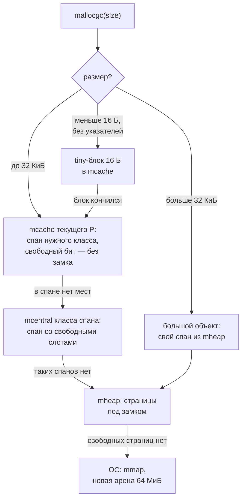

<script setup>
import EscapeLabSandbox from '../../viz/scenes/EscapeLabSandbox.vue'
</script>

# 1.5.8. Стек, куча и аллокатор

## <Part kind="problem" /> Проблема: те же данные, тот же цикл, втрое дольше

Две функции из лабы делают одно и то же. Создают тысячу записей по 32 байта, складывают их в срез и суммируют одно поле. Разница в одном символе: первая хранит в срезе указатели `[]*item`, вторая — сами значения `[]item`.

```text
$ go test -run='^$' -bench=. -count=10 ./1-5/alloc/ > alloc-bench.txt && benchstat alloc-bench.txt
...
                  │ alloc-bench.txt │
                  │     sec/op      │
SlicePointers-12       19.38µ ± 11%
SliceValues-12         6.224µ ±  2%
...
                  │ alloc-bench.txt │
                  │    allocs/op    │
SlicePointers-12      1.000k ± 0%
SliceValues-12         0.000 ± 0%
```

машина: Intel Core i5-12400 (6 ядер, 12 логических процессоров), Ubuntu 24.04, ядро Linux 7.0, go1.27.2. Показаны две строки из шести, полный вывод — в разделе «Цена аллокации».

Версия с указателями медленнее в <N>3,1 раза</N> и делает тысячу аллокаций на прогон. Версия со значениями не делает ни одной: даже сам массив на 32 000 байт не попал в кучу. Кто это решил? Не вы — вы не писали ни `malloc`, ни `free`. Решил компилятор, а исполнил рантайм.

С этим вопросом мы уже сталкивались дважды. В уроке [1.5.7](./07-netpoller) переменные `buf`, `n` и `readErr`, захваченные замыканием, «ушли в кучу» и прибавили по паре сотен байт на соединение. А стек горутины в режиме `bufio` вырос до 4 КиБ из-за глубины цепочки вызовов. В уроке [1.5.6](./06-background-work) мессенджер упирался в лимит памяти: каждый хеш Argon2id брал 19 МиБ, и сборщик мусора освобождал их не сразу. Пора разобраться, как Go решает, где живёт значение, и сколько стоит каждое решение.

К концу урока вы:

- объясните, почему стек горутины можно переносить копированием, а указатель на него нельзя отдать коду на C, и когда стек сжимается;
- будете читать вывод `-gcflags=-m=1` и `-m=2` и узнавать пять главных причин «побега» в кучу;
- поймёте, как встраивание меняет решение escape-анализа;
- проследите аллокацию по иерархии `mcache` → `mcentral` → `mheap` и узнаете, почему маленькие объекты выделяются без замка;
- измерите цену аллокации бенчмарком и узнаете, какие приёмы её снижают, а какие — преждевременная оптимизация.

## <Part kind="theory" /> Стек горутины: рост, перенос и сжатие

### Что мы уже знаем

Урок [1.5.1](./01-goroutines-scheduler) дал основу. <T id="goroutine-stack">Стек горутины</T> начинается с 2 КиБ. Пролог почти каждой функции сравнивает указатель стека с полем `stackguard0`. Если места не хватает, вызывается `morestack`, а затем `newstack` выделяет стек вдвое больше и копирует в него старый (`copystack`). Предел — 1 ГБ на 64-битных платформах. Урок 1.5.7 добавил адаптивный начальный размер (Go 1.19) и показал его в замере. Здесь разберём то, что осталось за кадром: сколько стоит рост, почему стек вообще можно двигать и когда он сжимается.

### Рост в цифрах

Программа `stack` из лабы запускает горутину, которая уходит в рекурсию заданной глубины. На дне программа читает метрику `/memory/classes/heap/stacks:bytes` — сколько памяти занято под стеки всех горутин:

```text
$ go run ./1-5/alloc/stack
go version: go1.27.2
GOMAXPROCS: 12
NumCPU: 12
глубина     10: стеки до    320 КиБ, на дне    320 КиБ (+0 КиБ)
глубина   1000: стеки до    320 КиБ, на дне    480 КиБ (+160 КиБ)
глубина 100000: стеки до    352 КиБ, на дне   8544 КиБ (+8192 КиБ)
начальный стек: обычно 2048 байт, после GC с 200 горутинами на глубине 1000 — 131072 байт, когда они вышли — 2048 байт
```

машина та же. Сколько места занимает один кадр функции `dive`, видно из ассемблерного листинга:

```text
$ go build -gcflags=-S -o /dev/null ./1-5/alloc/stack 2>&1 | grep "dive.*STEXT"
main.dive STEXT size=153 align=0x0 args=0x10 locals=0x40 funcid=0x0
```

`locals=0x40` — 64 байта на локальные переменные (массив `pad` на 32 байта), место под аргументы вызываемых функций и сохранённый указатель кадра. Ещё 8 байт кладёт сама инструкция `CALL` — адрес возврата. Итого 72 байта на уровень рекурсии.

- **Глубина 10**: 720 байт, хватает стартовых 2 КиБ. Прибавка 0: по всей видимости, стек на 2 КиБ рантайм взял из своего кэша стеков, который метрика уже учитывала.
- **Глубина 1000**: 72 000 байт, около 70 КиБ. Стек удваивался шесть раз: 2 → 4 → 8 → 16 → 32 → 64 → <N>128 КиБ</N>. 64 КиБ уже мало, поэтому 128.
- **Глубина 100 000**: 7,2 млн байт, около 6,9 МиБ. Ближайшая степень двойки — 8 МиБ, ровно та прибавка, которую мы видим.

<Callout type="simplified">

На глубине 1000 прибавка — 160 КиБ, а стек — 128. Остальные 32 КиБ, по всей видимости, — маленькие стеки (2, 4, 8 и 16 КиБ), которые освободились по пути роста. Рантайм держит их в кэше стеков, и метрика продолжает их считать. Мы это не трассировали: это вывод из того, как устроен кэш стеков в `runtime/stack.go` (стеки до 32 КиБ — из пулов по размерам, крупнее — напрямую из кучи страниц).

</Callout>

Дорого ли копировать? Каждое удвоение копирует **занятую** часть стека. Сумма копирований при росте до размера S — меньше S: 2 + 4 + … + S/2 < S. Это та же амортизация, что у `append` (раздел «Цена аллокации»): рост стоит O(1) на каждый байт стека в среднем. Дорого становится, когда горутин много и каждая растёт заново. Тогда помогает адаптивный старт.

### Начальный размер — по среднему

Последняя строка вывода показывает адаптивный старт в действии. Программа держит 200 горутин на глубине 1000, пока идёт сборка мусора. Сборщик сканирует их стеки и складывает занятые байты (`p.scannedStackSize`). В начале следующего цикла `gcComputeStartingStackSize` ([`runtime/stack.go`, строка 1421](https://github.com/golang/go/blob/go1.27.2/src/runtime/stack.go#L1421)) считает среднее, прибавляет защитную зону `stackGuard` (928 байт, урок 1.5.7) и округляет вверх до степени двойки. Среднее около 70 КиБ плюс 928 байт — это больше 64 КиБ, значит 128 КиБ. Новые горутины в этот момент стартовали бы со 131 072 байт. Когда глубокие горутины вышли, следующий подсчёт вернул 2048.

Комментарий в исходнике честно называет цену эвристики: старт со среднего тратит «не больше чем вдвое» против идеального алгоритма. Отсюда практический вывод. Несколько сотен горутин, которые на время сборки оказались глубоко в рекурсии, делают дорогим старт **всех** новых горутин до следующего цикла. Если в сервисе сотни тысяч мелких горутин и пара глубоких воркеров, сравните метрику `/gc/stack/starting-size:bytes` с ожидаемыми 2 КиБ.

### Почему стек можно двигать

Копирование стека — смелый ход. После переезда **все** адреса внутри стека меняются. Если где-то остался указатель на старое место, программа прочитает мусор. Почему Go может себе это позволить, а C — нет?

Нужны два условия, и оба выполнены.

**Рантайм знает, где в стеке указатели.** Для каждой функции компилятор записывает карту стека (stack map): какие слоты кадра содержат указатели в каждой точке, где функция может остановиться. Те же карты нужны сборщику мусора, чтобы сканировать стеки. `copystack` ([строка 929](https://github.com/golang/go/blob/go1.27.2/src/runtime/stack.go#L929)) проходит по всем кадрам, и `adjustpointers` сдвигает каждый указатель, который смотрит внутрь старого стека, на ту же разницу.

**Снаружи на стек никто не указывает.** Поправить указатели в самом стеке мало: вдруг на стек указывает объект в куче или другой стек? Этого не бывает, и гарантирует это компилятор. Первые строки `cmd/compile/internal/escape/escape.go` формулируют два инварианта escape-анализа:

1. указатели на объекты в стеке не могут храниться в куче;
2. указатель на объект в стеке не может пережить этот объект.

Значит, все указатели на стек живут в нём самом. Исключения рантайм знает наперечёт и правит вручную. Например, горутина, ждущая в канале, держит в `sudog` адрес своей переменной на стеке (урок [1.5.2](./02-channels)). Его поправляет `adjustsudogs`, а `copystack` перед этим берёт замки всех каналов, на которых горутина ждёт.

Вот почему указатель на стек нельзя отдать коду на C. У C нет карт стека, и рантайм не знает, где C сохранил адрес. Поэтому <T id="cgo">cgo</T> закрывает эту дверь заранее. В сгенерированной обёртке каждый аргумент вызова C передаётся в `_Cgo_use` (`runtime.cgoUse`). Комментарий в `runtime/cgo.go` объясняет: вызов непрозрачен для escape-анализа, поэтому аргумент считается убегающим в кучу. А куча в Go не перемещается. Сам код C при этом выполняется не на стеке горутины, а на системном стеке потока: пролога с проверкой стека у C нет, и растить его стек некому.

### Сжатие при сборке мусора

Горутина один раз ушла глубоко, стек вырос до 8 МиБ, а дальше она годами ждёт в `conn.Read` с парой кадров. Держать 8 МиБ? Нет: стек сжимается. Сборщик мусора, сканируя стек горутины, вызывает `shrinkstack` (`runtime/mgcmark.go`, функция `scanstack`). Правила в `shrinkstack` ([строка 1286](https://github.com/golang/go/blob/go1.27.2/src/runtime/stack.go#L1286)):

- новый размер — вдвое меньше, но не меньше 2 КиБ;
- сжатие только если занято меньше четверти стека;
- только если это безопасно (`isShrinkStackSafe`): горутина не в системном вызове и не остановлена асинхронным вытеснением посреди функции, где нет точной карты стека;
- выключается `GODEBUG=gcshrinkstackoff=1`.

За один цикл сборки стек сжимается только вдвое. С 8 МиБ до 4 КиБ — одиннадцать циклов. Память стеков после всплеска возвращается постепенно, а не сразу.

## <Part kind="theory" /> Escape-анализ: стек или куча

### Две памяти с разной ценой

**Стек** горутины — память, которой владеет одна горутина. Выделить на нём место значит сдвинуть указатель стека при входе в функцию: одна инструкция на весь кадр. Освобождает его возврат из функции. Сборщику мусора стек не стоит ничего, кроме сканирования живых кадров.

**Куча** — общая память процесса. <T id="heap-allocation">Выделение в куче</T> — вызов `runtime.mallocgc`: найти свободный слот подходящего размера, при необходимости обнулить его, отметить в метаданных, где в объекте указатели. Освобождает объект только <T id="garbage-collector">сборщик мусора</T>, и только после того как убедится, что на объект никто не ссылается.

Решение «стек или куча» в Go принимает не программист, а компилятор. <T id="escape-analysis">Escape-анализ</T> (escape analysis, анализ побега) строит граф: вершины — переменные и выделения (`new`, `make`, `&T{}`, литералы, замыкания), рёбра — присваивания между ними. Затем он ищет пути, которые нарушают два инварианта из предыдущего раздела. Если адрес переменной может оказаться в куче или пережить кадр, переменная «убегает» (escapes) и выделяется в куче. Иначе она остаётся в кадре стека.

Анализ консервативен. Если компилятор не может доказать, что значение не переживёт функцию, — в кучу. Ошибиться в сторону стека нельзя: это висячий указатель. Ошибиться в сторону кучи можно: это просто медленнее.

### Пять причин побега

Все примеры — функции из `labs/1-5/alloc/escape/cases`. Строки компилятора — настоящий вывод `go build -gcflags=-m=1` на Go 1.27.2 (`файл:строка:столбец: сообщение`), машина та же; полный вывод — в рабочей папке плана.

**1. Возврат указателя.** Функция возвращает адрес своей переменной. Кадр после возврата займут другие вызовы, а объект ещё нужен вызывающему.

```text
./return.go:9:10: new(point) does not escape
./return.go:19:10: new(point) escapes to heap
```

Строка 9 — `CaseReturnValue`, она возвращает копию `*p`. Строка 19 — `CaseReturnPointer`, она возвращает `p`. Заметьте: дело не в `new`. Обе функции пишут `p := new(point)`. В первой наружу уходит копия `*p`, и объект остаётся на стеке. `new` в Go не означает «в куче».

**2. Сохранение в интерфейс, глобальную переменную или замыкание, которое переживёт вызов.** Присваивание в глобальную `Sink any` — прямой путь в кучу: глобальная переменная живёт вечно. С `fmt.Println(p)` тоньше. Параметр `Println` — `...any`, и внутри `fmt` значение уходит в структуру принтера из `sync.Pool`, то есть в кучу. Компилятор видит это по сводке параметров `fmt.Fprintln` и честно отправляет `p` в кучу. Тот же указатель, переданный в свою функцию `describe`, остаётся на стеке: компилятор видит её тело. Замыкание, которое возвращается из функции, переносит захваченные переменные в кучу — компилятор пишет `moved to heap: n`. Ровно это случилось с `buf`, `n` и `readErr` в режиме `lazy` урока 1.5.7.

**3. Неизвестный при компиляции размер.** `make([]int, n)` с переменной `n`: кадр стека имеет фиксированный размер, и массив неизвестной длины в него не положишь. Раньше это всегда означало кучу. С Go 1.25 компилятор поступает хитрее, и вывод `-m` может ввести в заблуждение:

```text
./slice.go:9:11: make([]int, 16) does not escape
./slice.go:19:11: make([]int, n) does not escape
./slice.go:27:13: make([]int, n) escapes to heap
```

Строка 9 — длина-константа, строка 19 — длина `n`, и всё равно «does not escape». Строка 27 — срез возвращается из функции. «Does not escape» у `make([]int, n)` значит лишь, что срез не покидает функцию. Компилятор (`walk/builtin.go`, порог `VariableMakeThreshold = 32` в `cmd/compile/internal/base/flag.go`) заводит в кадре буфер на <N>32 байта</N> и генерирует проверку: если ёмкость помещается в буфер, срез берёт его, иначе `makeslice` выделяет память в куче **при выполнении**. Для `int` это до четырёх элементов. Release notes 1.25 говорят об этом одной фразой: «компилятор теперь может выделять массив среза на стеке в большем числе случаев». Тест из лабы проверяет это при выполнении через `testing.AllocsPerRun`:

```text
$ go test -v -run TestDoesNotEscapeIsNotAlwaysStack ./1-5/alloc/escape/cases/
...
--- PASS: TestDoesNotEscapeIsNotAlwaysStack (0.00s)
    --- PASS: TestDoesNotEscapeIsNotAlwaysStack/slice/var:_4_int_=_32_байта_помещаются_в_буфер (0.00s)
    --- PASS: TestDoesNotEscapeIsNotAlwaysStack/slice/var:_5_int_=_40_байт_уже_в_куче (0.00s)
    --- PASS: TestDoesNotEscapeIsNotAlwaysStack/elems/values:_8_точек_помещаются_в_массив_на_стеке (0.00s)
    --- PASS: TestDoesNotEscapeIsNotAlwaysStack/elems/values:_девятая_точка_переносит_массив_в_кучу (0.00s)
```

машина та же. Строки `=== RUN` опущены (`...`). Четыре `int` — 0 аллокаций, пять — одна. С `append` то же самое: `make([]point, 0, 8)` лежит на стеке, но на девятом `append` срез растёт, и новый массив выделяется уже в куче.

**4. Слишком большой объект.** Кадр стека не безразмерный. Пороги — в `cmd/compile/internal/ir/cfg.go`: `MaxImplicitStackVarSize = 64 * 1024` для неявных выделений (`new(T)`, `&T{}`, `make([]T, n)`, `[]byte("...")`) и `MaxStackVarSize = 128 * 1024` для явных `var x T` и `x := ...`. Лаба проверяет границу с точностью до байта:

```text
./large.go:13:11: make([]byte, 65536) does not escape
./large.go:21:11: make([]byte, 65544) escapes to heap
```

**5. Отправка указателя в канал.** Получатель — другая горутина, у неё свой стек, и компилятор не знает, когда она прочитает значение. Всё, что отправлено в канал по указателю, — в куче. Отправка значения (`ch <- *p`) копирует его в буфер канала или прямо в стек получателя, и исходный объект остаётся на месте.

Есть и шестая, менее заметная причина — вызов метода через интерфейс. Компилятор не знает, какая реализация вызовется, и не может прочитать её тело. Поэтому аргументы и получатель такого вызова считаются убегающими. Отчасти это снимает девиртуализация с профилем (PGO, урок 1.5.10).

### Как читать -m=1 и -m=2

`-gcflags=-m=1` печатает решения: что встроено и что убежало. `-m=2` добавляет **почему** — путь в графе от выделения до места, которое нарушает инвариант. Возьмём `return.go`, обе версии вывода — для одного файла:

```text
$ go build -gcflags=-m=1 . 2>&1 | grep return.go
./return.go:8:6: can inline CaseReturnValue
./return.go:18:6: can inline CaseReturnPointer
./return.go:9:10: new(point) does not escape
./return.go:19:10: new(point) escapes to heap

$ go build -gcflags=-m=2 . 2>&1 | grep return.go
./return.go:8:6: can inline CaseReturnValue with cost 15 as: func(int, int) point { p := new(point); p.x, p.y = x, y; return *p }
./return.go:18:6: can inline CaseReturnPointer with cost 14 as: func(int, int) *point { p := new(point); p.x, p.y = x, y; return p }
./return.go:9:10: new(point) does not escape
./return.go:19:10: new(point) escapes to heap in CaseReturnPointer:
./return.go:19:10:   flow: p ← &{storage for new(point)}:
./return.go:19:10:     from new(point) (spill) at ./return.go:19:10
./return.go:19:10:     from p := new(point) (assign) at ./return.go:19:4
./return.go:19:10:   flow: ~r0 ← p:
./return.go:19:10:     from return p (return) at ./return.go:21:2
./return.go:19:10: new(point) escapes to heap
```

машина та же; команды запущены из `labs/1-5/alloc/escape/cases`. Читать `-m=2` удобно снизу вверх по цепочке `flow`:

- `&{storage for new(point)}` — адрес памяти, которую выделил `new`;
- `flow: p ← …` — этот адрес попал в переменную `p` (присваивание `p := new(point)`);
- `flow: ~r0 ← p` — `p` попал в `~r0`, безымянный результат функции, через `return p`;
- результат функции переживает её кадр — объект в кучу.

В скобках — вид ребра графа: `spill`, `assign`, `return`, а в других случаях `interface-converted` (значение упаковано в интерфейс), `call parameter` (передано в функцию, которая его сохраняет), `send` (отправлено в канал). Цепочка для `fmt.Println(p)` длиннее, но читается так же: `p` упакован в интерфейс (`interface-converted`), положен в срез `...any` (`slice-literal-element`), срез передан в `fmt.Fprintln` (`call parameter`), а та отправляет `*fmt.a` в `{heap}`.

Для своего кода `-gcflags=-m` применяется к пакетам, перечисленным в команде. Чтобы увидеть решения и в зависимостях, пишут `-gcflags=all=-m`, но вывода будет много: отфильтруйте его `grep` по своему файлу.

### Встраивание меняет решение

<T id="inlining">Встраивание</T> (inlining) — подстановка тела небольшой функции в место вызова. Компилятор оценивает «стоимость» тела в узлах дерева разбора, и функция встраивается, если стоимость не больше бюджета `inlineMaxBudget = 80` (`cmd/compile/internal/inline/inl.go`). Это видно в `-m=2`: `can inline CaseReturnPointer with cost 14`. А вот функция, которая не прошла:

```text
./iface.go:30:6: cannot inline CaseIfacePrintln: function too complex: cost 88 exceeds budget 80
./inline.go:15:6: cannot inline newPointNoinline: marked go:noinline
```

Почему встраивание важно для escape-анализа? Анализ идёт по функциям, и для каждой компилятор запоминает сводку: что она делает с параметрами и результатом. Конструктор `newPoint` возвращает указатель, значит, в своём теле его `&point{}` убегает. Но после встраивания тело оказывается внутри вызывающей функции, и анализ видит весь путь целиком:

```text
$ go build -gcflags=-m=1 . 2>&1 | grep -E "return.go|inline.go"
./inline.go:7:6: can inline newPoint
./inline.go:20:6: can inline CaseInlineInlined
./inline.go:29:6: can inline CaseInlineNoinline
...
./inline.go:21:15: inlining call to newPoint
./inline.go:7:41: &point{...} escapes to heap
./inline.go:15:49: &point{...} escapes to heap
./inline.go:21:15: &point{...} does not escape
...
```

машина та же; строки `return.go` опущены (`...`), они показаны выше. Строка `inline.go:7:41` — решение для самостоятельной копии `newPoint`, которая нужна, если её вызовут без встраивания. Строка `inline.go:21:15` — то же выражение, встроенное в `CaseInlineInlined`. Там указатель дальше суммы `p.x + p.y` не уходит, и объект остаётся на стеке. `newPointNoinline` с директивой `//go:noinline` вызывается по-настоящему, и её объект всегда в куче.

Отсюда важный вывод. «Escapes to heap» в выводе `-m` относится к **телу функции**, а не к каждому её вызову. `CaseReturnPointer` сама может быть встроена (стоимость 14), и в вызывающей функции её объект может остаться на стеке. Маленький конструктор `NewX() *X` после встраивания часто ничего не выделяет в куче. Большой, с проверками и ошибками, бюджет в 80 не пройдёт, и его результат будет в куче всегда. Проверяйте `-m` в месте вызова, а не только в определении. Бюджет поднимает PGO для горячих вызовов — это тема урока 1.5.10.

<Deep title="Почему у Go нет молодого поколения: стек вместо питомника">

Большинство сборщиков мусора в JVM и .NET — поколенческие (generational). Они опираются на гипотезу поколений: большинство объектов умирают молодыми. Новые объекты выделяются в отдельной области, «питомнике» (nursery). Выделение там — сдвиг указателя, почти как на стеке. Питомник часто собирается копированием: живых объектов мало, их переносят в старое поколение, а питомник целиком считается свободным. Цена — барьер записи на каждую запись указателя, чтобы знать ссылки из старого поколения в молодое, и перемещение объектов.

Go пошёл другим путём, и escape-анализ — одна из причин. Рик Хадсон, один из авторов сборщика Go, в докладе «Getting to Go» (ISMM 2018) объясняет: гипотеза поколений в Go тоже верна, «просто молодые объекты живут и умирают молодыми на стеке». Короткоживущие объекты, которые в Java попали бы в питомник, в Go чаще всего вообще не попадают в кучу. В результате, по его словам, сборка с поколениями для Go «намного менее эффективна, чем в других управляемых средах». Команда Go пробовала неперемещающий сборщик с поколениями, но барьер записи для него оказался «быстрым, но недостаточно быстрым», и от идеи отказались.

Отказ от перемещения повлиял и на аллокатор. Перемещающий сборщик может уплотнять кучу, поэтому ему хватает выделения сдвигом указателя. Неперемещающему нужно бороться с фрагментацией иначе — классами размеров, о которых следующий раздел. И ещё одно следствие: раз объекты в куче не двигаются, указатель на них можно передать в C (с ограничениями правил cgo). А стек, как мы видели, двигается, и туда C хода нет.

Как устроен сам сборщик — трёхцветная разметка, барьер записи, pacer — урок 1.5.9.

</Deep>

## <Part kind="theory" /> Аллокатор: как mallocgc находит место

Объект убежал в кучу. Что дальше? Компилятор вставляет вызов `runtime.mallocgc` ([`runtime/malloc.go`, строка 1067](https://github.com/golang/go/blob/go1.27.2/src/runtime/malloc.go#L1067)) или специализированного варианта (о нём ниже). Аллокатор Go вырос из TCMalloc от Google, и главная идея та же: большинство выделений обслуживается из кэша текущего процессора без всякой синхронизации.

### Страницы, спаны и классы размеров

Куча Go состоит из **арен** по 64 МиБ на 64-битном Linux (`heapArenaBytes`). Арены режутся на **страницы** по 8 КиБ. Несколько подряд идущих страниц образуют **спан** (span, `mspan`) — единицу, которой аллокатор оперирует внутри.

Спан для маленьких объектов делится на одинаковые слоты одного размера. Размер берётся из таблицы <T id="size-class">классов размеров</T> в `internal/runtime/gc/sizeclasses.go`: `NumSizeClasses = 68`. Класс 0 зарезервирован под большие объекты, остальные 67 покрывают размеры от 8 байт до 32 КиБ. Фрагмент таблицы, которую генерирует `mksizeclasses.go`:

```text
// class  bytes/obj  bytes/span  objects  tail waste  max waste  min align
//     1          8        8192     1024           0     87.50%          8
//     2         16        8192      512           0     43.75%         16
//     3         24        8192      341           8     29.24%          8
//     4         32        8192      256           0     21.88%         32
//     5         48        8192      170          32     31.52%         16
//    25        480        8192       17          32      6.82%         32
//    44       4096        8192        2           0     15.60%       4096
//    67      32768       32768        1           0     12.50%       8192
```

Запрос округляется вверх до ближайшего класса. 33 байта получат слот на 48, и 15 байт пропадут — это внутренняя фрагментация, а `max waste` — её худший случай для класса. Взамен поиск места — это поиск свободного бита в битовой карте спана, а не обход списков свободных блоков разной длины. В уроке 1.5.7 мы видели это округление: `runtime.g` на 456 байт занимает слот класса 480.

Каждый класс существует в двух вариантах — «с указателями» (scan) и «без указателей» (noscan). Это **класс спана** (span class), их 136. Спаны без указателей сборщик мусора не сканирует вообще: срез `[]byte` на мегабайт для него — один бит «жив/мёртв». Это одна из причин, почему `[]item` без указателей дешевле `[]*item`.

### Три уровня: mcache, mcentral, mheap



Что смотреть на схеме. Чем ниже уровень, тем реже до него доходят и тем он дороже. Янтарные узлы — кэш одного P: здесь проходит подавляющее большинство выделений, без замков и атомарных операций. Бирюзовый `mcentral` — общий для всех P, к нему идут раз на спан, а не раз на объект. Зелёный `mheap` — глобальный, под замком; к нему ходят за целыми страницами. Большие объекты сразу идут в `mheap`, минуя кэши. До ОС доходят совсем редко: рантайм берёт память крупными кусками.

Пройдём по уровням снизу вверх по частоте.

**`mcache`** — <T id="mcache">кэш на каждый P</T> (`runtime/mcache.go`). В нём по одному текущему спану на каждый класс спана (`alloc [numSpanClasses]*mspan`). Выделение — `nextFreeFast`: найти в 64-битном кэше битовой карты спана первый свободный бит (одна инструкция подсчёта нулей) и вернуть адрес слота. Комментарий в исходнике: «блокировка не нужна, потому что кэш принадлежит потоку (в Go — P)». В каждый момент P работает ровно с одним M (урок 1.5.1), поэтому два потока не трогают один `mcache` одновременно.

**`mcentral`** — один на каждый класс спана, общий для всех P. Хранит наборы спанов «есть свободные слоты» и «полные». Когда спан в `mcache` заполнился, `mcache.refill` отдаёт его обратно и берёт у `mcentral` другой, со свободными слотами (`cacheSpan`). Попутно `mcentral` может подмести (sweep) спан, то есть освободить слоты объектов, которые сборщик признал мёртвыми. Спан — это десятки или сотни объектов, поэтому синхронизация здесь амортизируется на них все.

**`mheap`** — вся куча (`runtime/mheap.go`). Выдаёт страницы под новые спаны и под большие объекты. Глобальное состояние защищено замком `mheap.lock`, а частые мелкие запросы страниц обслуживает кэш страниц на P (`pcache`). Если свободных страниц нет, `mheap` просит у ОС новую арену.

### Большие объекты

Объект больше `maxSmallSize − mallocHeaderSize` = 32 768 − 8 = 32 760 байт аллокатор считает большим (`mallocgcLarge` → `mcache.allocLarge` → `mheap.alloc`). Он получает собственный спан класса 0 из целых страниц и минует `mcache` и `mcentral`. Это дороже на объект, но большие объекты редки, а округление до страниц на них почти не заметно.

Главный большой объект мессенджера — буфер Argon2id. В `golang.org/x/crypto/argon2` вычисление начинается с `B := make([]block, memory)`, где `block` — 1 КиБ. При `MemoryKiB = 19 * 1024` это один объект на 19 МиБ на каждый хеш. Он не пройдёт ни через `mcache`, ни через классы размеров: только страницы из `mheap`.

### Tiny-аллокатор

<T id="tiny-allocator">Tiny-аллокатор</T> обслуживает объекты меньше 16 байт **без указателей** (`maxTinySize = _TinySize = 16`). Вместо слота на каждый объект он упаковывает несколько мелких объектов в один 16-байтовый блок: текущий блок и смещение в нём лежат в `mcache` (`tiny`, `tinyoffset`). Следующий мелкий объект просто ложится за предыдущим, с выравниванием.

Цена — блок освобождается, только когда мертвы **все** его жильцы: одна живая восьмибайтовая строка держит 16 байт. Комментарий в `malloc.go` оценивает это так: худший случай — двукратный перерасход, а на бенчмарке JSON tiny-аллокатор сократил число аллокаций примерно на 12 % и размер кучи примерно на 20 %. Объекты с указателями сюда не попадают: сборщику пришлось бы различать указатели внутри общего блока.

### Go 1.27: аллокатор по размерам

В Go 1.27 компилятор для маленьких объектов вызывает не общий `mallocgc`, а функцию, специализированную под конкретный размер. Таблицы таких функций — `mallocNoScanTable` и `mallocScanTable` в `runtime/malloc_tables_generated.go`, на 81 элемент, то есть для размеров до 80 байт. Release notes 1.27: это снижает цену некоторых выделений меньше 80 байт «до 30 %», а в целом в программах, которые много выделяют, — «около 1 %». Двоичный файл растёт примерно на 60 КБ. Отключается флагом сборки `GOEXPERIMENT=nosizespecializedmalloc`, а под `-race`, `-asan` и `-msan` специализация выключена сама (`sizeSpecializedMallocEnabled` в `malloc.go`).

<Callout type="simplified">

Мы пропустили несколько деталей: заголовок типа у крупных объектов с указателями (`mallocHeaderSize`), отложенное обнуление (свежая память от ОС уже нулевая, её не обнуляют повторно), выборку для профиля памяти (`nextSample` в `mcache`, раз в 512 КиБ — урок 1.5.10), «секретный» режим, который запрещает tiny-аллокатор. Для понимания цены аллокации они не нужны.

</Callout>

## <Part kind="theory" /> Цена аллокации и как её мерить

### Каждая аллокация — будущая работа сборщика

Сам путь через `mcache` — десятки наносекунд. Но это не вся цена. Главное начинается потом.

1. **Аллокации приближают сборку.** Сборщик запускается, когда куча вырастает до цели. Грубо: живая куча × (1 + `GOGC`/100). Чем больше байт в секунду выделяет программа, тем чаще циклы. Это <T id="gc-pacer">pacer</T>, урок 1.5.9.
2. **Объект с указателями надо разметить.** В каждом цикле сборщик обходит все живые объекты с указателями. Тысяча `*item` — тысяча объектов в графе. Массив `[]item` без указателей — один объект в noscan-спане, который вообще не сканируется.
3. **Во время разметки выделение платит налог.** В `mallocgc` есть вызов `deductAssistCredit`. Если цикл сборки идёт, а горутина выделяет память быстрее, чем фоновые воркеры успевают размечать, она сама выполняет часть разметки, прежде чем получить память. Это <T id="mark-assist">помощь разметке</T> (mark assist). Скорее всего, именно её мы видели в 1.5.6, когда даже дешёвые отказы `503` стоили сотни миллисекунд у лимита памяти. Это гипотеза того урока, и проверит её профиль в 1.5.10.

Поэтому снижают **число** аллокаций и долю объектов с указателями, а не только байты. И поэтому бенчмарк, который мерит только `ns/op`, видит не всё: часть цены оплатит сборщик позже, в чужом запросе.

### Как мерить: ReportAllocs, -benchmem, b.Loop

`b.ReportAllocs()` в бенчмарке или флаг `-benchmem` у `go test` добавляют две колонки: `B/op` — байт выделено в куче за итерацию, `allocs/op` — сколько выделений. Пакет `testing` берёт их из `runtime.MemStats` до и после прогона и делит на число итераций. Стековые выделения в них не видны вовсе: для статистики их не существует.

`for b.Loop()` (Go 1.24) — современная форма цикла бенчмарка. Тело выполняется столько раз, сколько нужно для точного замера, подготовка до цикла — один раз. Компилятор не выбрасывает вызовы в теле такого цикла как мёртвый код. Чтобы и результат не выбросили, наши бенчмарки кладут его в глобальные переменные `sinkInts`, `sinkSum`, `sinkStr`.

Один прогон бенчмарка — не замер. Шум процессора (частота, соседние процессы) даёт разброс в десятки процентов. Поэтому `-count=10` и `benchstat`: он печатает медиану и доверительный интервал, а при двух файлах — значимость разницы.

### Замер: шесть бенчмарков

```text
$ go test -run='^$' -bench=. -count=10 ./1-5/alloc/ > alloc-bench.txt && benchstat alloc-bench.txt
goos: linux
goarch: amd64
pkg: labs/1-5/alloc
cpu: 12th Gen Intel(R) Core(TM) i5-12400
                  │ alloc-bench.txt │
                  │     sec/op      │
AppendGrow-12          4.050µ ±  6%
AppendPrealloc-12      2.061µ ± 15%
BufferNew-12           1.570µ ± 21%
BufferPool-12          352.1n ±  5%
SlicePointers-12       19.38µ ± 11%
SliceValues-12         6.224µ ±  2%
geomean                2.868µ

                  │ alloc-bench.txt │
                  │      B/op       │
AppendGrow-12        24.62Ki ± 0%
AppendPrealloc-12    8.000Ki ± 0%
BufferNew-12         3.944Ki ± 0%
BufferPool-12          7.000 ± 0%
SlicePointers-12     31.25Ki ± 0%
SliceValues-12         0.000 ± 0%
geomean                           ¹
¹ summaries must be >0 to compute geomean

                  │ alloc-bench.txt │
                  │    allocs/op    │
AppendGrow-12          12.00 ± 0%
AppendPrealloc-12      1.000 ± 0%
BufferNew-12           6.000 ± 0%
BufferPool-12          0.000 ± 0%
SlicePointers-12      1.000k ± 0%
SliceValues-12         0.000 ± 0%
geomean                           ¹
¹ summaries must be >0 to compute geomean
```

машина та же; этот прогон — эталонный, по нему все числа ниже. Суффикс `-12` — `GOMAXPROCS`. Строки `geomean` в таблицах байт и аллокаций пустые: среднее геометрическое с нулём не считается.

| пара | время | аллокаций | во сколько раз быстрее |
| --- | --- | --- | --- |
| `append` с нуля → с ёмкостью | 4,05 → 2,06 мкс | 12 → 1 | ≈ 2,0 |
| новый `bytes.Buffer` → из `sync.Pool` | 1,57 мкс → 352 нс | 6 → 0 | ≈ 4,5 |
| `[]*item` → `[]item` | 19,38 → 6,22 мкс | 1000 → 0 | ≈ 3,1 |

Разберём каждую пару.

**`append` без ёмкости.** Срез растёт удвоением до 256 элементов, затем плавнее (`nextslicecap` в `runtime/slice.go`: `newcap += (newcap + 3*256) >> 2`), и каждый размер округляется до класса. Для тысячи `int` ёмкости идут так: 1, 2, 4, …, 512, затем 848, затем 1280 — 12 аллокаций. Байты: 8 + 16 + … + 4096 = 8184, плюс 6784 (848 × 8, ровно класс 6784) и 10 240 (1280 × 8): итого <N>25 208 байт</N> — ровно то, что напечатал бенчмарк (`25208 B/op` в сыром выводе, 24,62 КиБ у `benchstat`). Предвыделение `make([]int, 0, 1000)` даёт одну аллокацию на 8000 байт (класс 8192) и вдвое меньше времени: исчезли 11 копирований и 11 вызовов аллокатора.

**`sync.Pool`.** Новый `bytes.Buffer` на каждый «запрос» растёт с нуля, примерно до килобайта: 6 аллокаций, 3,9 КиБ. Из <T id="sync-pool">пула</T> (урок [1.5.4](./04-sync)) приходит буфер, уже выросший до нужной ёмкости в прошлых итерациях: `Reset` обнуляет длину, но не массив. 0 аллокаций на итерацию. `7 B/op` при `0 allocs/op` — это среднее: изредка пул отдаёт новый буфер (пул вправе терять объекты, особенно при сборке мусора), и за миллионы итераций набегают единицы байт. Почему именно 7, мы не разбирали.

**`[]*item` против `[]item`.** Тысяча отдельных объектов по 32 байта против одного массива. Массив `[]item` на 32 000 байт меньше порога в 64 КиБ и не убегает, поэтому вся версия обходится без кучи. Разница во времени — около (19,38 − 6,22) мкс / 1000 ≈ <N>13 нс</N> на элемент. Это оценка, а не отдельный замер: в неё входят и вызов аллокатора, и обход по указателям, разбросанным по памяти, и доля работы сборщика. Но порядок честный: десяток наносекунд на каждый объект в куче.

`benchstat` показывает и разброс: `± 21 %` у `BufferNew`, `± 15 %` у `AppendPrealloc`. Разницы в парах — в 2–4,5 раза, далеко за пределами шума. Для разниц в 5 % такой разброс уже не позволил бы сделать вывод, и нужно было бы сравнивать два файла `benchstat old.txt new.txt`, глядя на `p`-значение.

### fmt.Sprintf в горячем пути

Седьмой и восьмой бенчмарки собирают ключ кэша вида `chat:42:43` двумя способами: `fmt.Sprintf("chat:%d:%d", id, id+1)` и вручную, через `strconv.AppendInt` в массив на стеке.

```text
$ go test -run='^$' -bench=Key -count=10 ./1-5/alloc/ > alloc-bench-sprintf.txt && benchstat alloc-bench-sprintf.txt
...
              │ alloc-bench-sprintf.txt │
              │         sec/op          │
KeySprintf-12               105.6n ± 2%
KeyAppend-12                42.12n ± 4%
geomean                     66.70n

              │ alloc-bench-sprintf.txt │
              │          B/op           │
KeySprintf-12                39.00 ± 0%
KeyAppend-12                 23.00 ± 0%
geomean                      29.95

              │ alloc-bench-sprintf.txt │
              │        allocs/op        │
KeySprintf-12                2.000 ± 0%
KeyAppend-12                 1.000 ± 0%
geomean                      1.414
```

машина та же; шапка (`goos`, `cpu`…) опущена. `Sprintf` в 2,5 раза медленнее и делает лишнюю аллокацию. Дело не только в аллокации: `fmt` разбирает строку формата при каждом вызове и обрабатывает аргументы через `...any` и рефлексию. В ручной версии единственная аллокация — итоговая строка, без неё никак: она возвращается наружу. 60 наносекунд — ничто для запроса, который ходит в базу. Но в цикле на миллион элементов или в обработчике на сотни тысяч запросов в секунду это заметная доля.

## <Part kind="theory" /> Приёмы и когда они преждевременны

Приёмы, которые снижают число аллокаций, — от самых дешёвых по сложности к самым дорогим:

- **Предвыделение.** Знаете размер или его верхнюю оценку — `make([]T, 0, n)`, `make(map[K]V, n)`, `strings.Builder.Grow(n)`. Ничего не стоит в читаемости.
- **Значения вместо указателей.** `[]T` вместо `[]*T`, возврат структуры по значению вместо `*T`, поле-структура вместо поля-указателя. Небольшую структуру скопировать дешевле, чем выделить и потом разметить. Указатель нужен, когда объект должен быть разделяемым, изменяемым через несколько ссылок или когда он действительно большой.
- **Переиспользование буфера.** `buf = buf[:0]` в цикле вместо нового среза на каждой итерации, `bytes.Buffer.Reset()`. Буфер принадлежит одной горутине — синхронизация не нужна.
- **`strings.Builder` вместо `+=` в цикле.** Каждое `s += x` создаёт новую строку и копирует старую: квадратичная работа и аллокация на каждый шаг. `Builder` копит байты в растущем буфере, а `String()` отдаёт их без копирования.
- **`strconv.Append*` вместо `fmt.Sprintf`** в действительно горячих местах — как в бенчмарке выше.
- **`sync.Pool`** — для временных объектов одного размера, которые нужны часто и между горутинами: буферы сериализации, кодеки. Пул — самый сложный приём из списка: объект надо вернуть, не забыть сбросить и не держать после `Put`.

Короткий пример трёх приёмов вместе:

<!-- go-check -->

```go
import "strconv"

// chatKey собирает ключ без fmt: байты копятся в массиве на стеке,
// в куче оказывается только итоговая строка.
func chatKey(chatID, seq int64) string {
	var buf [64]byte
	b := append(buf[:0], "chat:"...)
	b = strconv.AppendInt(b, chatID, 10)
	b = append(b, ':')
	b = strconv.AppendInt(b, seq, 10)
	return string(b)
}

// joinIDs переиспользует один буфер на всю строку: ёмкость задана заранее,
// числа дописываются в него без промежуточных строк.
func joinIDs(ids []int64) string {
	b := make([]byte, 0, len(ids)*8)
	for i, id := range ids {
		if i > 0 {
			b = append(b, ',')
		}
		b = strconv.AppendInt(b, id, 10)
	}
	return string(b)
}
```

**Когда это преждевременно.** Почти всегда, если нет профиля. Бенчмарки выше показывают разницу в микросекундах на тысячу элементов. Обработчик мессенджера, который хеширует пароль 19 МиБ памяти и десятки миллисекунд процессора, этих микросекунд не заметит. Правило из урока [1.5.5](./05-patterns) действует и здесь: сначала мерить, потом менять. Конкретно:

1. профиль `allocs` или `heap` (урок 1.5.10) показывает, **где** выделяется память;
2. оптимизируют только места, которые дают заметную долю, — обычно это несколько функций горячего пути;
3. бенчмарк до и после, `benchstat`, и изменение остаётся, только если разница значима;
4. читаемость — тоже цена. `fmt.Sprintf` в коде, который выполняется раз в минуту, лучше ручной сборки байт.

И ещё одно: escape-анализ меняется от версии к версии. В Go 1.25 часть срезов переменной длины переехала на стек, в 1.27 маленькие аллокации подешевели на треть. Трюк, который обходил компилятор пять лет назад, сегодня может быть лишним. Проверяйте `-m` и бенчмарком на той версии, на которой работаете.

### Где аллокации в мессенджере: гипотеза

Мессенджер мы ещё не профилировали, поэтому всё ниже — **гипотеза**, которую проверит урок 1.5.10 на живом сервисе под нагрузкой.

- **Argon2id.** 19 МиБ на каждый хеш — один большой объект прямо из `mheap`. По байтам он, скорее всего, затмит всё остальное в профиле `alloc_space`. По числу объектов — нет: это одна аллокация на регистрацию или вход.
- **JSON.** `encoding/json` на каждый запрос и ответ: декодер, рефлексия по полям, строки и срезы для каждого поля. По числу объектов это, вероятно, главный источник в «лёгких» эндпоинтах вроде `/v1/messages`.
- **Middleware и журнал.** Контекст с значениями, `slog`-записи с атрибутами, обёртки `ResponseWriter` — мелкие объекты на каждый запрос.

Если гипотеза подтвердится, оптимизировать, скорее всего, не придётся ничего: при `MESSENGER_HASH_CONCURRENCY` и `GOMEMLIMIT` из урока 1.5.6 память под хеши уже ограничена, а остальное — микросекунды на фоне хеша. Но это решит профиль, а не догадка.

## <Part kind="viz" /> Визуализация: песочница escape-lab

Песочница показывает восемь случаев из лабы: возврат значения или указателя, срез, большой массив, указатель и интерфейс, замыкание, канал, встраивание, элементы среза. У каждого случая два-три варианта, отличающихся одной деталью в коде. Плашка, код и строки компилятора — настоящий вывод `go build -gcflags=-m=1` на Go 1.27.2, снятый программой `dump` из лабы. В браузере компилятор не моделируется.

Что смотреть:

1. **Одна деталь — разное решение.** В каждом случае переключите варианты и найдите в коде единственную строку, которая изменилась. «Возврат»: `return *p` против `return p`. «Канал»: `ch <- *p` против `ch <- p`. Решение компилятора зависит не от `new` или `&`, а от того, куда **уходит** адрес.
2. **Третья плашка.** У «Среза» с переменной длиной и у «Элементов среза» со значениями плашка не зелёная и не красная, а с оговоркой. Компилятор пишет «does not escape», но на стеке лишь буфер на 32 байта или массив на 8 элементов. Длиннее — куча при выполнении. Это тот самый случай, где вывод `-m` нужно читать вместе с тестом `AllocsPerRun`.
3. **Встраивание.** В случае «Встраивание» сравните номера строк в выводе компилятора. Решение для встроенного вызова печатается на строке **вызова** внутри вызывающей функции, а для `//go:noinline` — на строке самого помощника.
4. **Большой массив.** 65 536 байт и 65 544: восемь байт разницы переводят массив со стека в кучу. Порог — `MaxImplicitStackVarSize`.

<EscapeLabSandbox />

Вопросы к песочнице:

1. В случае «Указатель и интерфейс» один и тот же `&point{}` остаётся на стеке при передаче в `describe` и убегает при передаче в `fmt.Println`. Почему компилятор «доверяет» одной функции и не доверяет другой?
2. В случае «Замыкание» в варианте «возвращаем наружу» компилятор пишет две строки: `moved to heap: n` и `func literal escapes to heap`. Что именно переехало в кучу и почему одного замыкания мало?
3. В «Элементах среза» с указателями сам массив `make([]*point, 0, 8)` «does not escape», а каждый `&point{}` — «escapes». Как это совместить?

<SelfCheck question="Ответы">

1. Тело `describe` компилятор видит и знает: указатель только читается, никуда не сохраняется. Для `fmt.Println` у компилятора тоже есть сводка, и она говорит обратное: аргументы `...any` уходят в `fmt.Fprintln`, а там — в структуру принтера, которая живёт в куче (`-m=2` показывает путь до `{heap}`). Дело не в доверии, а в том, что сводка `fmt` честно сообщает о побеге.
2. Переехала переменная `n`: замыкание после возврата продолжает её менять, а кадр `CaseClosureEscaping` уже разрушен. Само замыкание — структура с указателем на код и указателем на `n` — тоже убегает, потому что возвращается. Если бы переехало только замыкание, его указатель на `n` смотрел бы в мёртвый кадр, а это нарушение второго инварианта.
3. Массив указателей не покидает функцию и помещается на стек — пока элементов не больше восьми. Но каждый `&point{}` передаётся в `append`, и `-m=2` показывает ребро `call parameter` прямо в `{heap}`: при росте `append` скопирует указатели в новый массив в куче. Указатель на стек в куче лежать не может (первый инвариант), поэтому компилятор сразу выделяет каждую точку в куче.

</SelfCheck>

## <Part kind="code" /> Код: программа alloc

### Случаи escape-анализа

Каждый вариант — функция `Case<Случай><Вариант>` с ключом `escape:<случай>/<вариант>` в комментарии. По ключам программа `dump` сопоставляет строки компилятора с вариантами. Возврат значения и указателя:

<<< @/../labs/1-5/alloc/escape/cases/return.go#return{go}

Встраивание: одна и та же функция-конструктор со встраиванием и без него. Комментарий у `newPointNoinline` объясняет, зачем ключ варианта стоит и над помощником: решение «в кучу» компилятор печатает на его строке.

<<< @/../labs/1-5/alloc/escape/cases/inline.go#inline{go}

Срезы. У `CaseSliceVar` комментарий предупреждает о 32-байтовом буфере, а `sum` нарочно пишет в срез, чтобы компилятор не выбросил его как неиспользуемый.

<<< @/../labs/1-5/alloc/escape/cases/slice.go#slice{go}

Тест, который проверяет оговорку при выполнении. Табличный, по одной строке на поведение: 4 и 5 элементов для среза переменной длины, 8 и 9 для `append`. `testing.AllocsPerRun` вызывает функцию сто раз и возвращает среднее число аллокаций.

<<< @/../labs/1-5/alloc/escape/cases/runtime_test.go#runtime-allocs{go}

### Рост стека

<<< @/../labs/1-5/alloc/stack/main.go#stack-growth{go}

Горутина уходит в рекурсию и на дне закрывает канал `reached`, а затем ждёт `release`. Пока она ждёт, `main` снимает метрику: стек в этот момент максимальный. Массив `pad` делает кадр заметнее, а `pad[depth%4]` в возвращаемом значении не даёт компилятору выбросить его. У горутины есть владелец: `wg.Wait()` дожидается её выхода.

<<< @/../labs/1-5/alloc/stack/main.go#starting-size{go}

Два вызова `runtime.GC()` подряд не случайны. Первый сканирует стеки и копит их размер. Новый начальный размер считается в начале **следующего** цикла, поэтому нужен второй.

### Бенчмарки

<<< @/../labs/1-5/alloc/bench_test.go#append{go}

<<< @/../labs/1-5/alloc/bench_test.go#pool{go}

`render` пишет около килобайта: так выглядит сериализация небольшого JSON-ответа. В версии с пулом `Reset` обязателен: без него буфер вернёт хвост прошлого ответа.

<<< @/../labs/1-5/alloc/bench_test.go#slice-of-pointers{go}

Поле `_ [16]byte` доводит `item` до 32 байт: элемент размером с настоящую запись, а не игрушечный `int`.

<<< @/../labs/1-5/alloc/bench_test.go#sprintf{go}

## <Part kind="practice" /> Что появилось в лабе

К этому уроку в лабе каталог `labs/1-5/alloc/`:

```text
labs/1-5/alloc/
├── escape/cases/          # восемь случаев escape-анализа, ключи escape:<случай>/<вариант>
│   └── runtime_test.go    # «does not escape» ещё не «всегда на стеке»: AllocsPerRun
├── escape/dump/           # go build -gcflags=-m=1 → JSON для песочницы escape-lab
├── stack/                 # рост стека копированием, начальный размер по среднему
└── bench_test.go          # append, sync.Pool, []*T против []T, fmt.Sprintf
```

Запуск — из каталога `labs/`:

```bash
go run ./1-5/alloc/stack
go test -run='^$' -bench=. -count=10 ./1-5/alloc/ > alloc-bench.txt && benchstat alloc-bench.txt
go test -v -run TestDoesNotEscapeIsNotAlwaysStack ./1-5/alloc/escape/cases/
go run ./1-5/alloc/escape/dump > ../course/viz/data/escape-lab.json   # обновить данные песочницы
cd 1-5/alloc/escape/cases && go build -gcflags=-m=2 . 2>&1 | grep return.go
```

`benchstat` ставится командой `go install golang.org/x/perf/cmd/benchstat@latest`. `bash 1-5/scenario.sh` проверяет: бенчмарки `alloc` отрабатывают (короткий прогон, `-benchtime=100ms`), `dump` выдаёт по записи на каждый ключ и среди решений есть и стек, и куча, а `stack` на глубине 100 000 показывает рост стеков больше 1 МиБ. Тест `runtime_test.go` идёт в общем `go test -race ./...`.

Попробуйте сами:

- Поменяйте в `CaseSliceVar` тип элемента на `byte` и запустите тест. Сколько элементов теперь помещается в буфер на стеке? Поправьте таблицу теста, чтобы она снова проходила.
- Соберите случаи с `-gcflags='-m -d=variablemakehash=n'` (так release notes 1.25 советуют выключить новые стековые выделения). Изменится ли вывод `-m`? А тест?
- Запустите `GODEBUG=gcshrinkstackoff=1 go run ./1-5/alloc/stack`. Изменятся ли числа? Почему программа почти не может этого показать? Подсказка: что происходит со стеком горутины, когда она выходит?
- Уберите `b.ReportAllocs()` из `BenchmarkSliceValues` и запустите с `-benchmem`. Что изменилось? Затем поставьте `elems = 3000` и посмотрите на `allocs/op` у `SliceValues`. Объясните результат порогом из `cfg.go`.
- Соберите бенчмарки с `GOEXPERIMENT=nosizespecializedmalloc` и сравните `SlicePointers` через `benchstat`. Видна ли разница от специализированного аллокатора Go 1.27 на объектах по 32 байта?

Состояние репозитория после урока — тег `m01-5-l08`.

## <Part kind="mistakes" /> Типичные ошибки

<Callout type="mistake">

**Указатели «для скорости» на мелких структурах.** «Передавать указатель дешевле, чем копировать», — и функция возвращает `*Point` на 16 байт, а срез хранит `[]*Money`. Копия 16–64 байт — несколько инструкций. Указатель, который убежал, — аллокация, объект для разметки в каждом цикле сборщика и промах кэша при чтении. Для небольших неизменяемых структур значение почти всегда дешевле. Указатель берут, когда нужна общая изменяемость или структура действительно большая (сотни байт и больше), и проверяют бенчмарком.

**`[]*T` вместо `[]T` по привычке.** В нашем замере `[]*item` на тысячу элементов — 1000 аллокаций и в 3,1 раза дольше, чем `[]item`. Плюс сборщик в каждом цикле обходит тысячу объектов вместо одного массива, который при отсутствии указателей не сканирует вовсе. `[]*T` оправдан, когда элементы разделяются с другими структурами или срез часто переставляют, а элементы большие. Остальное — `[]T`, а изменение элемента по индексу: `s[i].Field = x`.

**`fmt.Sprintf` в горячем пути.** Ключи кэша, метки метрик, идентификаторы через `Sprintf` в обработчике, который вызывается сотни тысяч раз в секунду. В нашем бенчмарке `Sprintf` в 2,5 раза медленнее ручной сборки через `strconv.AppendInt` и делает лишнюю аллокацию. В горячем пути — `strconv`, `strings.Builder` или `append` в буфер. В остальном коде `Sprintf` — нормально: он читается лучше.

**`sync.Pool` для объектов разного размера.** В пул кладут буферы после ответов на 1 КиБ и на 10 МиБ. Через некоторое время в пуле лежат раздутые буферы, каждый `Get` может вернуть 10 МиБ ради ответа в килобайт, и память процесса растёт, хотя «мы же переиспользуем». Пулу всё равно, какой объект отдать. Лечение — не возвращать в пул буфер больше порога (как `maxPooledBuffer` в уроке 1.5.4) или держать отдельные пулы по классам размеров. И помнить, что пул — не кэш: он вправе потерять любой объект при сборке мусора.

**Оптимизация без профиля.** Неделя на переписывание сериализации под ноль аллокаций, а латентность не изменилась: 95 % времени запроса — база данных или хеш пароля. Или наоборот, «оптимизированный» код с указателями оказался медленнее, потому что его никто не мерил. Порядок всегда один: профиль показывает, где тратится, бенчмарк доказывает выигрыш, `benchstat` — что это не шум.

**Верить «does not escape» без оговорок.** «Компилятор сказал, что срез не убегает, значит, он на стеке». Для `make([]T, n)` с переменной `n` это значит буфер на 32 байта, а длинный срез всё равно в куче. Число аллокаций проверяют `testing.AllocsPerRun` или `-benchmem`, а не только `-m`.

</Callout>

## <Part kind="tradeoff" /> Компромисс: куча и сборщик против ручного управления памятью

<Callout type="tradeoff">

**Что даёт модель Go.** Программист не решает, где живёт значение. Возврат указателя на локальную переменную безопасен, висячих указателей и двойного `free` не бывает. Escape-анализ бесплатно убирает в стек всё, что может, а стеки растут и сжимаются сами. Аллокатор с кэшем на P выделяет маленький объект за десятки наносекунд без замков.

**Чем платим.** Решение принимает консервативный анализ: интерфейс, замыкание или вызов через `fmt` легко отправляют объект в кучу, и это не видно в коде без `-gcflags=-m`. Каждая аллокация — будущая работа сборщика: циклы чаще, разметка дольше, а под нагрузкой горутины помогают разметке и теряют время. Контроля меньше, чем в C++ или Rust: нельзя сказать «положи на стек» или «освободи сейчас».

**Как выбирать.** Писать сначала просто: значения, а не указатели, предвыделение, где размер известен. Профилем найти горячие места, бенчмарком проверить приём, `benchstat` — значимость. Пулы, ручная сборка байтов и борьба с интерфейсами — только там, где профиль показал выделения как заметную долю. А если памяти не хватает глобально, первым регулятором будут `GOGC` и `GOMEMLIMIT` (урок 1.5.9), а не переписывание кода.

</Callout>

## <Part kind="selfcheck" /> Самопроверка

<SelfCheck question="Рантайм копирует стек горутины в новое место. Почему после этого не остаётся висячих указателей из кучи на старый стек?">

Потому что их не бывает в принципе. Первый инвариант escape-анализа: указатели на объекты в стеке не могут храниться в куче. Если адрес переменной может попасть в кучу, переменная сама выделяется в куче. Значит, на стек указывает только сам стек, и `copystack` правит эти указатели по картам стека, которые компилятор записал для каждой функции. Редкие исключения рантайма, например `sudog` горутины, ждущей в канале, исправляются отдельно (`adjustsudogs`).

</SelfCheck>

<SelfCheck question="Почему аргументы вызова C через cgo убегают в кучу, даже если C-функция их не сохраняет?">

Стек горутины может переехать при росте или сжатии, а рантайм не знает, где код на C хранит адреса: карт стека у C нет. Если бы C получил адрес на стеке горутины, после копирования он указывал бы в освобождённую память. Поэтому cgo передаёт каждый аргумент в `_Cgo_use`, вызов, непрозрачный для escape-анализа, и аргумент выделяется в куче, которая не перемещается. Исключение — функции, помеченные директивами `noescape` и `nocallback`: для них cgo использует `_Cgo_keepalive` без побега.

</SelfCheck>

<SelfCheck question="Компилятор пишет make([]int, n) does not escape. Коллега делает вывод: аллокаций в куче здесь нет. Прав ли он?">

Нет. С Go 1.25 для `make` с переменной длиной «does not escape» означает: на стеке заведён буфер на 32 байта (`VariableMakeThreshold`), и если ёмкость в него помещается, срез берёт его. Для `int` это до четырёх элементов. Больше — `makeslice` выделяет память в куче при выполнении. Тест лабы это подтверждает: при n = 4 — 0 аллокаций, при n = 5 — 1. Проверяют `testing.AllocsPerRun` или `-benchmem`.

</SelfCheck>

<SelfCheck question="Функция NewPoint возвращает указатель, и -m пишет для неё escapes to heap. Значит ли это, что каждый вызов NewPoint выделяет память в куче?">

Не обязательно. Решение в выводе относится к телу функции, скомпилированному отдельно. Если `NewPoint` маленькая (стоимость не больше бюджета 80), компилятор встраивает её в вызывающую функцию, и там escape-анализ видит путь указателя целиком. Если дальше указатель не уходит, объект остаётся на стеке — как `inline.go:21:15: &point{...} does not escape` в лабе. Проверять надо строку `-m` в месте вызова. С `//go:noinline` или при стоимости выше бюджета каждый вызов будет выделять в куче.

</SelfCheck>

<SelfCheck question="Почему маленький объект выделяется без замка, хотя куча общая на все потоки?">

Потому что выделение идёт из `mcache` — кэша, привязанного к P. В каждый момент P принадлежит одному M, поэтому два потока не трогают один `mcache` одновременно. В `mcache` по текущему спану на каждый класс спана, и выделение — найти свободный бит в битовой карте спана. К общему `mcentral` ходят, только когда спан заполнился, — раз на десятки или сотни объектов. К `mheap` под замком — ещё реже, за целыми страницами.

</SelfCheck>

<SelfCheck question="Бенчмарк показывает, что []item быстрее []*item в 3 раза. Назовите три разные причины, почему указатели дороже, и какая из них не видна в ns/op бенчмарка.">

Первая — аллокация каждого элемента: вызов аллокатора на каждый `&item{}`, у нас 1000 на прогон против 0. Вторая — память: элементы разбросаны по спанам, чтение идёт по указателям с промахами кэша, а массив значений читается подряд. Третья — сборщик мусора: тысяча объектов в графе разметки и спаны «с указателями», которые надо сканировать, против массива без указателей, который не сканируется вовсе. Третья почти не видна в `ns/op`: бенчмарк короткий, а работа сборщика размазана по циклам и в продакшене оплачивается помощью разметке в чужих запросах.

</SelfCheck>

<SelfCheck question="Сервис кладёт в sync.Pool буферы bytes.Buffer после каждого ответа. Ответы обычно 2 КиБ, но раз в минуту бывает выгрузка на 50 МиБ. Что произойдёт с памятью и как исправить?">

Буфер после выгрузки вырастет до 50 МиБ и вернётся в пул. Следующий `Get` может отдать его обычному запросу: `Reset` обнуляет длину, но не ёмкость, и 50 МиБ остаются занятыми, пока пул не потеряет объект при сборке мусора. Если выгрузки идут чаще, чем пул очищается, в пуле копятся несколько огромных буферов. Исправление — не возвращать в пул буфер, ёмкость которого больше порога (например, 64 КиБ), или держать отдельный пул для больших ответов.

</SelfCheck>

## <Part kind="sources" /> Источники

<Callout type="source">

- Исходники Go 1.27.2: [`runtime/stack.go`](https://github.com/golang/go/blob/go1.27.2/src/runtime/stack.go) — `newstack` (удвоение), `copystack`, `adjustpointers`, `adjustsudogs`, `shrinkstack` (четверть, вдвое, `isShrinkStackSafe`, `gcshrinkstackoff`), `gcComputeStartingStackSize`; [`runtime/mgcmark.go`](https://github.com/golang/go/blob/go1.27.2/src/runtime/mgcmark.go) — `scanstack` вызывает `shrinkstack`; [`runtime/cgo.go`](https://github.com/golang/go/blob/go1.27.2/src/runtime/cgo.go) — `cgoUse` и почему аргументы убегают; [`cmd/cgo/out.go`](https://github.com/golang/go/blob/go1.27.2/src/cmd/cgo/out.go) — `_Cgo_use` и `_Cgo_keepalive`; [`runtime/malloc.go`](https://github.com/golang/go/blob/go1.27.2/src/runtime/malloc.go) — комментарий об устройстве аллокатора, арены, `mallocgc`, `sizeSpecializedMallocEnabled`, tiny-аллокатор, `maxSmallSize`; [`runtime/mcache.go`](https://github.com/golang/go/blob/go1.27.2/src/runtime/mcache.go) — «блокировка не нужна», `refill`, `allocLarge`; [`runtime/mcentral.go`](https://github.com/golang/go/blob/go1.27.2/src/runtime/mcentral.go) — `cacheSpan`, наборы `partial`/`full`; [`runtime/mheap.go`](https://github.com/golang/go/blob/go1.27.2/src/runtime/mheap.go) — `central [numSpanClasses]`, `numSpanClasses = NumSizeClasses << 1`, `pcache`; [`internal/runtime/gc/sizeclasses.go`](https://github.com/golang/go/blob/go1.27.2/src/internal/runtime/gc/sizeclasses.go) — 68 классов, `MaxSmallSize`, `TinySize`; [`internal/runtime/gc/malloc.go`](https://github.com/golang/go/blob/go1.27.2/src/internal/runtime/gc/malloc.go) — `MallocHeaderSize`; [`runtime/slice.go`](https://github.com/golang/go/blob/go1.27.2/src/runtime/slice.go) — `nextslicecap`.
- Исходники компилятора Go 1.27.2: [`cmd/compile/internal/escape/escape.go`](https://github.com/golang/go/blob/go1.27.2/src/cmd/compile/internal/escape/escape.go) — два инварианта и граф присваиваний; [`cmd/compile/internal/ir/cfg.go`](https://github.com/golang/go/blob/go1.27.2/src/cmd/compile/internal/ir/cfg.go) — `MaxStackVarSize = 128 * 1024`, `MaxImplicitStackVarSize = 64 * 1024`; [`cmd/compile/internal/walk/builtin.go`](https://github.com/golang/go/blob/go1.27.2/src/cmd/compile/internal/walk/builtin.go) и [`cmd/compile/internal/base/flag.go`](https://github.com/golang/go/blob/go1.27.2/src/cmd/compile/internal/base/flag.go) — буфер на стеке для `make` с переменной длиной, `VariableMakeThreshold = 32`; [`cmd/compile/internal/inline/inl.go`](https://github.com/golang/go/blob/go1.27.2/src/cmd/compile/internal/inline/inl.go) — `inlineMaxBudget = 80`; [`cmd/internal/obj/x86/obj6.go`](https://github.com/golang/go/blob/go1.27.2/src/cmd/internal/obj/x86/obj6.go) — место под указатель кадра входит в `locals`.
- Release notes: [Go 1.19](https://go.dev/doc/go1.19) — начальный размер стека по среднему; [Go 1.24](https://go.dev/doc/go1.24) — `testing.B.Loop`; [Go 1.25](https://go.dev/doc/go1.25) — массив среза на стеке «в большем числе случаев», `-d=variablemakehash=n`; [Go 1.26](https://go.dev/doc/go1.26) — ещё больше таких случаев; [Go 1.27](https://go.dev/doc/go1.27) — аллокатор по размерам: до 30 % на объектах меньше 80 байт, около 1 % в целом, `GOEXPERIMENT=nosizespecializedmalloc`.
- Rick Hudson, [«Getting to Go: The Journey of Go's Garbage Collector»](https://go.dev/blog/ismmkeynote) (ISMM 2018) — молодые объекты «живут и умирают на стеке», почему поколенческий сборщик не прижился.
- [A Guide to the Go Garbage Collector](https://go.dev/doc/gc-guide) — разделы о escape-анализе, цене аллокаций и о том, как их искать.
- Документация: [`cmd/compile`](https://pkg.go.dev/cmd/compile) — флаги `-m`, `-d`; [`testing`](https://pkg.go.dev/testing) — `B.ReportAllocs`, `B.Loop`, `AllocsPerRun`; [`benchstat`](https://pkg.go.dev/golang.org/x/perf/cmd/benchstat); [`runtime/metrics`](https://pkg.go.dev/runtime/metrics) — `/memory/classes/heap/stacks:bytes`, `/gc/stack/starting-size:bytes`; [`golang.org/x/crypto/argon2`](https://pkg.go.dev/golang.org/x/crypto/argon2) — `IDKey`.
- Sanjay Ghemawat, Paul Menage, [«TCMalloc: Thread-Caching Malloc»](https://goog-perftools.sourceforge.net/doc/tcmalloc.html) — прародитель аллокатора Go.
- Курс: урок [1.5.1](./01-goroutines-scheduler) — пролог, `morestack`, GMP; [1.5.2](./02-channels) — запись в чужой стек и `sudog`; [1.5.4](./04-sync) — `sync.Pool`, `maxPooledBuffer`; [1.5.5](./05-patterns) — бенчмарки и `b.Loop`; [1.5.6](./06-background-work) — Argon2id, 19 МиБ на хеш, пробуксовка сборщика у лимита; [1.5.7](./07-netpoller) — адаптивный старт стека в замере, переменные замыкания в куче.
- Лаба: `labs/1-5/alloc` — регионы `return`, `inline`, `slice` в `escape/cases`, `runtime-allocs` в `escape/cases/runtime_test.go`, `stack-growth` и `starting-size` в `stack/main.go`, `append`, `pool`, `slice-of-pointers`, `sprintf` в `bench_test.go`; группы 11, 13 и 14 в `scenario.sh`.

</Callout>
