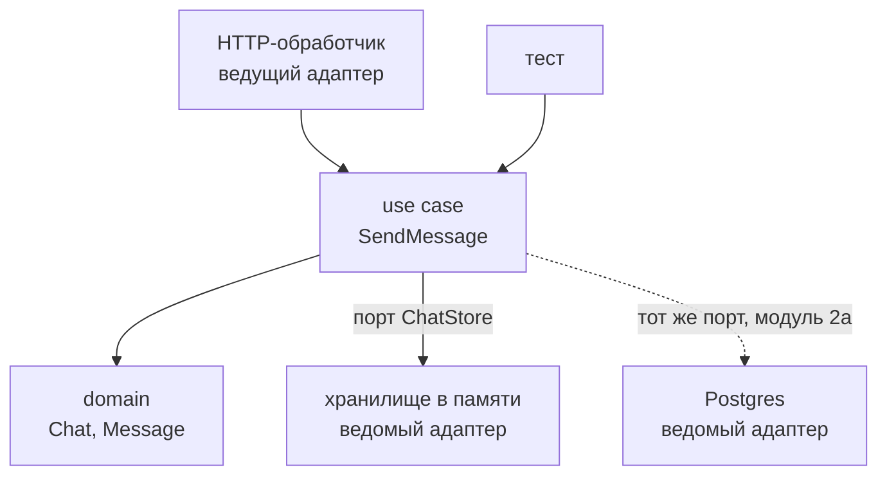

<script setup>
import DepsSandbox from '../../viz/scenes/DepsSandbox.vue'
</script>

# 1.1. Зачем сервису архитектура

## <Part kind="problem" /> Проблема: обработчик, который делает всё

В уроке [0.3](../00-foundation/03-request-path) обработчик «отправить сообщение» разобрал JSON и передал работу дальше одной строкой: `h.send.Execute(...)`. Мы тогда пообещали объяснить, зачем так делить код. Объясняем — начиная с того, как выглядит обработчик, когда его **не** делят. Так пишется первая версия почти любого сервиса, и так она работает — первое время:

<!-- go-check -->

```go
package snippet

import (
	"bytes"
	"database/sql"
	"encoding/json"
	"fmt"
	"log/slog"
	"net/http"
	"strconv"
	"strings"
	"time"
	"unicode/utf8"
)

// SendMessageHandler делает всё сам: HTTP, SQL, правила, уведомления.
type SendMessageHandler struct {
	DB      *sql.DB
	PushURL string
}

func (h *SendMessageHandler) ServeHTTP(w http.ResponseWriter, r *http.Request) {
	// 1. Транспорт: кто пишет и куда.
	userID, err := strconv.ParseInt(r.Header.Get("X-User-ID"), 10, 64)
	if err != nil {
		http.Error(w, `{"error":"unauthorized"}`, http.StatusUnauthorized)
		return
	}
	chatID, err := strconv.ParseInt(r.PathValue("id"), 10, 64)
	if err != nil {
		http.Error(w, `{"error":"bad chat id"}`, http.StatusBadRequest)
		return
	}
	var req struct {
		Text string `json:"text"`
	}
	if err := json.NewDecoder(r.Body).Decode(&req); err != nil {
		http.Error(w, `{"error":"bad json"}`, http.StatusBadRequest)
		return
	}

	// 2. Бизнес-правило: текст 1..4096 символов после обрезки пробелов.
	text := strings.TrimSpace(req.Text)
	if n := utf8.RuneCountInString(text); n == 0 || n > 4096 {
		http.Error(w, `{"error":"text length"}`, http.StatusUnprocessableEntity)
		return
	}

	// 3. Бизнес-правило «отправитель — участник» — прямо в SQL.
	ctx := r.Context()
	var isMember bool
	err = h.DB.QueryRowContext(ctx,
		`SELECT EXISTS(SELECT 1 FROM chat_members WHERE chat_id = $1 AND user_id = $2)`,
		chatID, userID).Scan(&isMember)
	if err != nil {
		http.Error(w, `{"error":"internal"}`, http.StatusInternalServerError)
		return
	}
	if !isMember {
		http.Error(w, `{"error":"not a member"}`, http.StatusForbidden)
		return
	}

	// 4. Хранилище: следующий номер в чате и вставка.
	var id, seq int64
	now := time.Now().UTC()
	err = h.DB.QueryRowContext(ctx,
		`INSERT INTO messages (chat_id, author_id, text, created_at, seq)
		 VALUES ($1, $2, $3, $4, (SELECT COALESCE(MAX(seq), 0) + 1 FROM messages WHERE chat_id = $1))
		 RETURNING id, seq`,
		chatID, userID, text, now).Scan(&id, &seq)
	if err != nil {
		http.Error(w, `{"error":"internal"}`, http.StatusInternalServerError)
		return
	}

	// 5. Уведомление: синхронный HTTP-вызов сервиса пушей.
	push, err := json.Marshal(map[string]any{"chat_id": chatID, "message_id": id})
	if err != nil {
		http.Error(w, `{"error":"internal"}`, http.StatusInternalServerError)
		return
	}
	resp, err := http.Post(h.PushURL, "application/json", bytes.NewReader(push))
	if err != nil {
		slog.Warn("push failed", "err", err)
	} else if err := resp.Body.Close(); err != nil {
		slog.Warn("push body close", "err", err)
	}

	// 6. Формат ответа.
	w.Header().Set("Content-Type", "application/json")
	w.WriteHeader(http.StatusCreated)
	if err := json.NewEncoder(w).Encode(map[string]any{
		"id": id, "seq": seq, "text": text, "created_at": now.Format(time.RFC3339),
	}); err != nil {
		slog.Warn("encode response", "err", fmt.Errorf("message %d: %w", id, err))
	}
}
```

Метод `ServeHTTP` — <N>77 строк</N>. Он компилируется, ошибки проверены, SQL параметризован. Плохого кода в нём, строчка за строчкой, почти нет. Плохо другое: в одной функции живут шесть разных забот — разбор HTTP, два бизнес-правила, хранилище, уведомления и формат ответа. Каждая меняется по своим причинам и в своё время. Вот три жалобы, которые команда принесёт через полгода.

**«Поменяли формат ответа — сломали проверку участника».** Мобильному клиенту понадобился ответ v2: другие имена полей и вложенный объект `message`. Старым клиентам нужен v1. Самый быстрый путь — скопировать обработчик и поправить последние строки. Теперь правило «писать может только участник» живёт в двух копиях. Через месяц в чатах появляются администраторы, которые могут писать без членства; правило правят в v1 и забывают в v2. Ни один тест не упал — тестов на такой обработчик почти нет, см. следующую жалобу.

**«Тест требует живую базу».** Проверить «текст из 4097 символов отклоняется» можно, только вызвав `ServeHTTP`. А он требует `*sql.DB` — конкретный тип, который не подменить. Значит, тест поднимает Postgres, создаёт таблицы, вставляет участника и ещё запускает заглушку сервиса пушей. Такой тест идёт секунды вместо микросекунд, падает из-за порта, занятого соседним тестом, и его в итоге не пишут.

**«В модуле 6 этот код не разрезать».** В модуле 6 пользователи и чаты станут отдельными сервисами со своими базами. Проверка участника здесь — SQL-запрос к таблице `chat_members` в той же базе, где сообщения. Правило склеено с хранилищем: чтобы перенести его в другой сервис, придётся переписывать обработчик целиком, а заодно разбираться, на что ещё он молча опирается.

Попутно в обработчике спрятаны ещё две беды: `MAX(seq) + 1` при двух одновременных отправках выдаст два сообщения с одним номером (разберём в уроке 1.4), а `http.Post` идёт без таймаута — тот самый клиент «ждёт вечно» из урока [0b.6](../00b-network/06-http1-pools). Заметить их трудно именно потому, что всё перемешано.

У такого состояния кода есть имя — <T id="big-ball-of-mud">большой ком грязи (big ball of mud)</T>. Брайан Фут и Джозеф Йодер в 1997 году назвали его архитектурой, которая на деле преобладает на практике, хотя о ней почти не говорят: это система, где всё зависит от всего, и каждая правка задевает что-то далёкое. Ком никто не строит нарочно. Он нарастает, потому что каждая новая строчка ложится туда, где её проще всего написать, — а проще всего в обработчик, у которого уже есть и запрос, и база.

В этом уроке разберём, как сделать, чтобы бизнес-правила не зависели ни от HTTP, ни от SQL: на какие части делить код, в какую сторону им разрешено знать друг о друге и где эти части собираются вместе. Посмотрим, как разложить пакеты мессенджера и почему мы выбрали раскладку по контекстам. И главное — как превратить правило из договорённости в проверку, которая роняет CI.

Подумайте, прежде чем читать дальше: если бизнес-правило не должно знать про базу, а данные для проверки лежат в базе, — как правило до них доберётся?

## <Part kind="theory" /> Слои и правило зависимостей

Разделим обработчик по причинам изменения. Получится четыре группы — четыре **слоя**:

| Слой | Что в нём | В обработчике выше | Когда меняется |
|---|---|---|---|
| **domain** (домен) | понятия предметной области и их правила: «сообщение», «текст 1–4096 символов», «писать может только участник» | шаги 2 и 3 (сами правила) | когда меняется бизнес |
| **usecase** (сценарии) | порядок действий одного сценария: загрузить чат, проверить правило, сохранить, уведомить | связка шагов 3–5 | когда меняется процесс |
| **adapters** (<T id="adapter">адаптеры</T>) | связь с внешним миром: HTTP-обработчик, SQL-хранилище, клиент пушей | шаги 1, 4 (SQL), 5 (HTTP-вызов), 6 | когда меняется технология или формат |
| **infrastructure** (сборка) | `main`: конфиг, создание объектов, запуск сервера | — | когда меняется окружение |

<T id="use-case">Use case (сценарий использования)</T> — это одна операция приложения с точки зрения пользователя: «отправить сообщение», «создать чат». В мессенджере каждый сценарий — отдельный тип с единственным методом `Execute`; подробно — в уроке 1.4.

Разложить код по слоям мало. Главное — **в какую сторону слои знают друг о друге**. Роберт Мартин, автор подхода <T id="clean-architecture">«Чистая архитектура» (Clean Architecture)</T>, сформулировал это одной фразой — <T id="dependency-rule">правило зависимостей (Dependency Rule)</T>: зависимости исходного кода могут указывать только внутрь, к политикам более высокого уровня. Ничто во внутреннем круге не может знать что-либо о внешнем: ни имени функции, ни типа, ни переменной.

Нарисуйте слои кругами, как луковицу: в центре domain, вокруг usecase, дальше adapters, снаружи infrastructure. «Внутрь» значит к центру:

```
infrastructure  →  adapters  →  usecase  →  domain
     (main)       (HTTP, SQL)   (сценарии)   (правила)
```

Стрелка здесь — «импортирует». В Go правило зависимостей проверяется буквально по строкам `import`: пакет домена не импортирует ничего из проекта, use case импортирует домен, HTTP-адаптер импортирует use case и домен, `main` — всех.

Почему именно так, а не наоборот? Посмотрите, кто чаще меняется. Правило «писать может только участник» живёт годами. Формат JSON меняется с каждой версией API, база — раз в несколько лет, транспорт — когда появляется WebSocket или gRPC. Если стабильное зависит от изменчивого, любая смена изменчивого требует переписать стабильное. Правило зависимостей разворачивает это: изменчивое зависит от стабильного, и смена базы касается только адаптера базы.

### Как правилу достать данные из базы: инверсия зависимостей

Вернёмся к вопросу из начала. Use case должен загрузить чат, чтобы проверить участника, — но импортировать SQL-адаптер ему нельзя: это зависимость наружу. Решение — **инверсия зависимостей**: use case сам объявляет, что ему нужно, интерфейсом, а внешний слой этот интерфейс реализует.

<!-- go-check -->

```go
package usecase

import "context"

// ChatID и Chat в мессенджере лежат в chat/domain; здесь — заглушки для примера.
type ChatID string

type Chat struct{ Members []string }

// ChatLoader объявлен в usecase — там, где он нужен, а не там, где реализован.
type ChatLoader interface {
	Load(ctx context.Context, id ChatID) (Chat, error)
}
```

Postgres-адаптер в другом пакете пишет `func (s *Store) Load(ctx context.Context, id usecase.ChatID) (usecase.Chat, error)` и импортирует `usecase` — стрелка импорта идёт снаружи внутрь, как и положено. А **вызов** во время работы идёт наоборот: use case зовёт `Load`, и управление уходит наружу, в адаптер. Направление вызова и направление зависимости в исходном коде теперь противоположны — отсюда слово «инверсия». В Go это особенно легко: тип реализует интерфейс, просто имея нужные методы, без `implements`, поэтому адаптеру не нужно ничего объявлять, кроме методов.

Вторая половина правила: **интерфейс объявляет потребитель**. Если положить `ChatLoader` в пакет Postgres-адаптера, use case придётся импортировать адаптер ради интерфейса — и инверсия пропала. Так ошибаются часто, и в разделе ошибок мы к этому вернёмся.

## <Part kind="theory" /> Порты и адаптеры

Ту же идею раньше «Чистой архитектуры» описал Алистер Кокберн в статье «Hexagonal Architecture» (2005), которую он называет и «Ports and Adapters». Шестиугольник у него — просто форма, на которой удобно рисовать много входов; число шесть ничего не значит. Суть: приложение должно одинаково работать, кто бы им ни управлял — пользователь через HTTP, тест или скрипт, — и разрабатываться и проверяться отдельно от базы и прочих внешних устройств.

Для этого между приложением и внешним миром стоят две детали:

- <T id="hexagonal-port">Порт (port)</T> — интерфейс, через который приложение общается с внешним миром, объявленный на языке приложения. `ChatLoader` выше — порт. Не путайте с сетевым портом из модуля 0b: здесь это «разъём» в коде.
- **Адаптер (adapter)** — код, который подключает к порту конкретную технологию. Как переходник для розетки: розетка (порт) одна, а вилки бывают разные.

Адаптеры бывают двух видов, и в сообществе их называют так:

- **Ведущие (driving)** — зовут приложение. HTTP-обработчик получает запрос, разбирает JSON и вызывает `Execute` у use case. Тест, который вызывает use case напрямую, — тоже ведущая сторона, только без HTTP.
- **Ведомые (driven)** — их зовёт приложение. Хранилище в памяти или на Postgres реализует порт хранилища; клиент сервиса пушей реализует порт «уведомить».



Стрелки на схеме — вызовы. Импорты у ведомых адаптеров идут в обратную сторону: хранилище импортирует use case ради интерфейса и домен ради типов.

Сравните с обработчиком из начала. Тест «4097 символов отклоняются» теперь вызывает конструктор текста в домене — без базы, без HTTP, за микросекунды. Ответ v2 — второй ведущий адаптер к тому же use case, правило участника остаётся в одном месте. Postgres вместо памяти — новый ведомый адаптер к тому же порту, и домен об этом не узнает.

Порты и адаптеры и «Чистая архитектура» — не конкуренты, а два взгляда на одно: Кокберн делит мир на «внутри приложения» и «снаружи», Мартин добавляет внутри деление на сценарии и домен. Мессенджер использует оба: слои domain и usecase — «внутри», адаптеры — «снаружи».

## <Part kind="theory" /> Корень композиции: где рождаются объекты

Если use case получает хранилище через интерфейс, кто-то же должен создать настоящее хранилище и передать его в use case? Да — и это должно происходить в **одном** месте. Его называют <T id="composition-root">корнем композиции (composition root)</T>; термин закрепил Марк Симан в книге и статьях о внедрении зависимостей. В Go это `main`:

<!-- go-check -->

```go
package main

import (
	"errors"
	"fmt"
	"os"
)

// Порт и use case — в мессенджере они в chat/usecase.
type ChatStore interface{ Exists(id string) bool }

type SendMessage struct{ chats ChatStore }

func NewSendMessage(chats ChatStore) (*SendMessage, error) {
	if chats == nil {
		return nil, errors.New("новый SendMessage: хранилище чатов не передано")
	}
	return &SendMessage{chats: chats}, nil
}

// Адаптер — в мессенджере он в chat/adapters/memory.
type MemoryStore struct{ ids map[string]bool }

func (s *MemoryStore) Exists(id string) bool { return s.ids[id] }

// main — корень композиции: только здесь известны конкретные типы.
func main() {
	store := &MemoryStore{ids: map[string]bool{}}
	send, err := NewSendMessage(store)
	if err != nil {
		fmt.Fprintln(os.Stderr, err)
		os.Exit(1)
	}
	fmt.Println(send != nil)
}
```

Остальной код получает зависимости через конструктор и сам ничего конкретного не создаёт: в use case нет `NewPostgresStore()`, в обработчике нет `sql.Open`. От этого два выигрыша. В `main` виден весь граф приложения целиком — кто от кого зависит. А в тесте любую зависимость можно подменить, передав в конструктор фейк вместо настоящего хранилища. У мессенджера `cmd/messenger/main.go` появится в уроке 1.7.

## <Part kind="theory" /> Раскладка пакетов: по слоям или по контекстам

Слои понятны. Но как разложить их по каталогам? У мессенджера две части предметной области: пользователи (`user`) и чаты с сообщениями (`chat`). Это <T id="bounded-context">ограниченные контексты (bounded contexts)</T> — области, внутри которых слова имеют одно точное значение; подробно о них — в уроке [1.2](./02-domain). Пока достаточно: это две части, которые в модуле 6 станут двумя сервисами.

Вариантов три. Первый — **плоские пакеты по типу кода**: `handlers`, `storage`, `models`, `service`. Быстро начать, но `models` становится свалкой, которую импортируют все, граница между пользователями и чатами нигде не видна, а правило «домен не знает про HTTP» не выразить через пути — каждый пакет смешивает всё. Это ком грязи, разложенный по папкам.

Второй — **слои наверху**:

```
internal/
├── domain/
│   ├── user/
│   └── chat/
├── usecase/
│   ├── user/
│   └── chat/
└── adapters/
    ├── memory/
    └── httpapi/
```

Слои видно сразу, правило зависимостей легко проверить по пути. Но код одного контекста разбросан по трём деревьям: одна функция «отправить сообщение» — три каталога. Ничто не мешает `usecase/chat` импортировать `domain/user`. А в модуле 6, чтобы выделить чаты в сервис, придётся выковыривать их из каждого слоя.

Третий — **контексты наверху, слои внутри**. Его мы и выбрали:

```
internal/
├── user/
│   ├── domain/
│   ├── usecase/
│   └── adapters/{memory,httpapi}/
├── chat/
│   ├── domain/
│   ├── usecase/
│   └── adapters/{memory,httpapi,userchecker}/
└── platform/{clock,idgen,httpjson,httpserver}/
```

Всё про чаты — в одном дереве, граница контекста — граница каталога. Чаты узнают о пользователях только через порт `UserChecker` и единственный адаптер `chat/adapters/userchecker` (урок 1.7); в модуле 6 этот адаптер станет gRPC-клиентом, а каталог `internal/chat` переедет в отдельный сервис почти целиком. `platform` — общие технические пакеты, названные по смыслу, а не `utils`: часы, генератор идентификаторов, JSON-помощники для HTTP, настройка сервера.

Цена — больше каталогов и сознательное дублирование: порты `Clock` («который час») и `IDGenerator` («дай новый id») объявлены отдельно в `user/usecase` и в `chat/usecase`. Общий пакет «порты для всех» склеил бы контексты. Два интерфейса по одному методу дешевле, чем связь.

Такие решения мы записываем в <T id="adr">ADR (Architecture Decision Record, запись архитектурного решения)</T> — формат, который вы видели в уроке [0.1](../00-foundation/01-how-to-study): контекст, рассмотренные варианты, решение, последствия. ADR лежат рядом с кодом, в `messenger/docs/adr/`. Вот первый:

<<< @/../messenger/docs/adr/0001-раскладка-по-контекстам.md{md}

Обратите внимание на «Последствия»: там не только плюсы. Хороший ADR честно пишет, чем заплатили и когда решение стоит пересмотреть. Шаблон для следующих записей — `messenger/docs/adr/0000-template.md`.

## <Part kind="theory" /> Как Go помогает держать границы

Часть правил Go проверяет сам, без настроек.

**Каталог `internal/`.** Документация `go` (раздел «Internal Directories» в `go help gopath`): код в каталоге с именем `internal` или ниже можно импортировать только из дерева, корень которого — родитель этого `internal`. Весь код мессенджера лежит в `messenger/internal/...`, поэтому импортировать его может только сам модуль `messenger`. Попытка из чужого модуля закончится ошибкой сборки `use of internal package … not allowed`. Это защита снаружи: никто не привяжется к нашему домену так, что мы не сможем его менять.

**Запрет циклов импорта.** Спецификация Go (раздел «Import declarations»): пакету запрещено импортировать самого себя — прямо или через цепочку других пакетов. Вот что говорит `go build`, если пакет `a` импортирует `b`, а `b` — `a`:

```
package cyc/a
	imports cyc/b from a.go
	imports cyc/a from b.go: import cycle not allowed
```

Значит, граф импортов любой Go-программы — без циклов: это направленный граф, в котором нельзя вернуться туда, откуда вышел. Почему так и чем это помогает слоям — в блоке «Под капотом» ниже.

Но **внутри** модуля Go не мешает ничему, кроме циклов. `chat/domain` может импортировать `net/http`, `chat/usecase` — хранилище в памяти: цикла нет, `internal/` не нарушен, всё соберётся. Правило зависимостей сильнее, чем «без циклов»: оно задаёт **направление**. Его проверяет <T id="linter">линтер (linter)</T> — программа, которая анализирует код, не запуская его. Мы используем `golangci-lint` — одна команда, под которой больше сотни линтеров, — и среди них `depguard`: он сравнивает импорты каждого файла со списками разрешённого и запрещённого. Нарушение не мешает компилятору собрать код. Падает проверка — `golangci-lint run` у вас на машине и в CI, — и изменение не попадёт в основную ветку.

<Deep title="почему Go запрещает циклы импорта и как это помогает слоям">

Первая причина — **инициализация**. У пакета Go могут быть переменные уровня пакета с вычисляемыми значениями и функции `init`. Спецификация («Program initialization») требует: если пакет что-то импортирует, импортированные пакеты инициализируются раньше него, и каждый — ровно один раз. При ацикличном графе такой порядок всегда существует: сначала листья, потом те, кто от них зависит, и так до `main`. Будь у `a` и `b` взаимный импорт, кто из них первый? Если `a.X` вычисляется из `b.Y`, а `b.Z` — из `a.X`, правильного порядка нет, и языку пришлось бы либо выдумывать правила для таких случаев, либо тихо отдавать нулевые значения. Go просто запрещает ситуацию.

Вторая — **скорость сборки**, ради которой Go во многом и создавался. Роб Пайк в докладе «Go at Google» (2012) пишет, что циклы заставляют компилятор обрабатывать большие группы файлов разом, а это замедляет инкрементальную сборку. Без циклов каждый пакет компилируется один раз, когда готовы его зависимости, независимые пакеты собираются параллельно, а изменение в листе пересобирает только тех, кто выше.

Третья — **инженерная**, и для нас главная. Пайк добавляет: по опыту команды, циклические импорты сплетают огромные куски кода в комья, которые невозможно ни тестировать, ни выпускать по отдельности. Цикл означает, что два пакета на самом деле — один, просто разрезанный по файлам.

Как это помогает слоям? Слои — это ацикличный граф с заданным направлением. Go гарантирует первое бесплатно; `depguard` добавляет второе. Многие языки с циклами мирятся, и там слои держатся только на дисциплине.

Что делать, если цикл появился? Обычно он возникает, когда пакет нижнего уровня хочет позвать верхний: хранилище хочет уведомить сервис. Лекарств три. Первое и самое частое — то самое из теории: объявить интерфейс в пакете, которому он нужен, и реализовать его в другом; импорт одной из сторон исчезает. Второе — вынести общее, от чего зависят оба пакета, в третий пакет, названный по смыслу. Третье — признать, что пакеты на самом деле одно целое, и слить их. Мартин в «Чистой архитектуре» (гл. 14) называет это принципом ацикличности зависимостей и предлагает те же два первых лекарства.

</Deep>

## <Part kind="viz" /> Визуализация: песочница графа зависимостей

Песочница показывает пакеты мессенджера в том виде, к которому мы придём к уроку 1.7, и импорты между ними. Выберите импорт, который хочется добавить, и песочница скажет, разрешает ли его правило зависимостей, а если нет — какое правило нарушено и что из-за этого сломается.

<Callout type="simplified">

Песочница показывает не все пакеты: из стандартной библиотеки — только `net/http` и `database/sql`, из `platform` — только `platform/clock`. Проверки в ней те же, что в `.golangci.yml`, плюс проверка циклов, которую делает компилятор Go.

</Callout>

<DepsSandbox />

Задания:

1. Добавьте `chat/domain → net/http`. Какое правило нарушено и что конкретно станет хуже?
2. Сбросьте граф и добавьте `chat/usecase → platform/clock`. Use case нужно текущее время, `platform/clock` его даёт — почему нельзя?
3. Добавьте `chat/adapters/httpapi → chat/usecase`. Почему этот импорт разрешён, хотя адаптер зависит от конкретного пакета use case?
4. Добавьте `chat/domain → chat/adapters/memory`. Чем ответ песочницы отличается от первого задания?

<SelfCheck question="Ответы">

1. Нарушено «домен — только стандартная библиотека без транспорта». С этим импортом домен начинает знать про HTTP: смена транспорта или формата заставит трогать бизнес-правила, а тест домена потянет за собой `net/http`. Обратите внимание: `net/http` — тоже стандартная библиотека, поэтому в `.golangci.yml` он запрещён отдельной строкой.
2. Use case привязался бы к одной реализации часов. В тесте нельзя будет подставить «сейчас 12:00:00» и проверить время сообщения — пришлось бы ждать реальных часов. Правильно: use case объявляет порт `Clock` с методом `Now()`, `platform/clock` его реализует, а в тесте — фейк с фиксированным временем. Собирает их `main`.
3. Стрелка направлена внутрь: внешний слой (адаптер) знает о внутреннем (use case), а не наоборот. Адаптер для того и существует, чтобы переводить HTTP в вызов use case. Если сменится use case, адаптер, возможно, придётся поправить — это нормальная цена, внешнее подстраивается под внутреннее.
4. Это не только нарушение правила, но и **цикл**: `chat/adapters/memory` уже импортирует `chat/domain`. Такой код не соберёт даже компилятор — `import cycle not allowed`, — линтер до него просто не дойдёт.

</SelfCheck>

## <Part kind="code" /> Код: правило как проверка

Вот как правила записаны в `messenger/.golangci.yml`. Сначала домен:

<<< @/../messenger/.golangci.yml#domain-rule{yaml}

Что здесь важно:

- **`files`** — к каким файлам применяется правило: все файлы в любом `internal/*/domain/`, кроме тестов (`!$test`).
- **`list-mode: strict`** — разрешено только то, что перечислено в `allow`. `$gostd` — вся стандартная библиотека Go. Любой сторонний модуль или пакет проекта, которого нет в `allow`, запрещён автоматически.
- **`deny`** сужает `allow`: `net/http`, `database/sql`, `encoding/json`, `log/slog` входят в стандартную библиотеку, но домену не нужны. Строка в `deny` выигрывает у `$gostd`. А `desc` — текст, который увидит разработчик: сообщение линтера должно объяснять, что делать, а не только что нельзя.

Правило для use case устроено так же: `allow` — стандартная библиотека, `domain` и `usecase` самих контекстов (во вложенных пакетах `usecase` будут общие тесты хранилищ, урок 1.6), а `deny` запрещает адаптеры, `platform/*`, `net/http`, `database/sql`. Что use case берёт домен только **своего** контекста, проверяют правила контекстов:

<<< @/../messenger/.golangci.yml#chat-context-rule{yaml}

Здесь режим другой — `lax`: разрешено всё, кроме перечисленного в `deny`. Правило применяется ко всему дереву `internal/chat/` и запрещает импорт чего-либо из `internal/user/`. Исключение — адаптер `userchecker` (`!**/internal/chat/adapters/userchecker/**`): ему как раз положено ходить в `user/usecase`. Зеркальное правило `user-context` запрещает контексту `user` знать про чаты.

### Сломаем правило руками

Добавим в `internal/chat/domain/doc.go` импорт `net/http` — пустой (`_`), чтобы не писать код, который его использует. Это временная правка в вашей рабочей копии, чтобы увидеть ошибку; в репозитории файла с таким импортом нет, и ниже мы её откатим:

```
// Package domain — ядро контекста «чаты»: чаты, сообщения и их правила.
// Пакет не знает ни про HTTP, ни про хранилище: импортирует только стандартную
// библиотеку. Это проверяет depguard (см. .golangci.yml).
package domain

import _ "net/http"
```

И запустим линтер из каталога `messenger/`:

```bash
golangci-lint run ./...
```

```
internal/chat/domain/doc.go:6:8: import 'net/http' is not allowed from list 'domain': домен не знает про транспорт: HTTP — дело адаптера (depguard)
import _ "net/http"
       ^
1 issues:
* depguard: 1
```

Код возврата — 1: в CI такое изменение не пройдёт. Сообщение называет файл и строку, правило (`list 'domain'`) и причину из `desc`. Откатим правку — `git checkout internal/chat/domain/doc.go` — и снова `golangci-lint run ./...`:

```
0 issues.
```

А вот что будет со сторонним модулем, которого нет ни в `allow`, ни в `deny`, — например, библиотекой сравнения `github.com/google/go-cmp/cmp` в домене:

```
internal/chat/domain/x.go:3:8: import 'github.com/google/go-cmp/cmp' is not allowed from list 'domain' (depguard)
import _ "github.com/google/go-cmp/cmp"
       ^
1 issues:
* depguard: 1
```

Пояснения нет — для него не написан `desc`, — но импорт запрещён: это и есть работа `strict`. С режимом `lax` такой импорт прошёл бы молча, и в домен можно было бы затащить хоть ORM.

Перед тем как закоммитить конфиг, мы так проверили <N>26 импортов</N>: все <N>18 запрещённых</N> упали (16 — с пояснением из `desc`, два сторонних модуля — без него, как `go-cmp` выше), все 8 разрешённых (например, `chat/adapters/httpapi → chat/usecase` и `userchecker → user/usecase`) прошли. Одна тонкость: если импорт нарушает сразу два правила, `depguard` сообщает одно. Скажем, `chat/domain → user/domain` нарушает и `domain`, и `chat-context`, а в выводе будет только `chat-context`. Чинить всё равно одну строку.

## <Part kind="practice" /> Что изменилось в мессенджере

Скелет мессенджера: <N>13 пакетов</N>, в каждом пока только `doc.go` с описанием, зачем пакет нужен. Код появится в следующих уроках.

```
messenger/
├── go.mod                      # module messenger, go 1.26
├── .golangci.yml               # depguard: правила слоёв и контекстов
├── docs/adr/
│   ├── 0000-template.md
│   └── 0001-раскладка-по-контекстам.md
└── internal/
    ├── user/
    │   ├── domain/
    │   ├── usecase/
    │   └── adapters/{memory,httpapi}/
    ├── chat/
    │   ├── domain/
    │   ├── usecase/
    │   └── adapters/{memory,httpapi,userchecker}/
    └── platform/{clock,idgen,httpjson,httpserver}/
```

Это первый урок, и сравнивать не с чем, поэтому смотрим на весь `messenger/` в состоянии тега `m01-l01` относительно пустого дерева. `4b825dc…` — хеш пустого дерева в git, он одинаков во всех репозиториях с хешами SHA-1, то есть почти во всех (его печатает `git hash-object -t tree /dev/null`), а `core.quotePath=false` показывает русское имя файла как есть, а не восьмеричными кодами:

```bash
git -c core.quotePath=false diff --stat 4b825dc642cb6eb9a060e54bf8d69288fbee4904 m01-l01 -- messenger
```

```
 messenger/.gitignore                               |  4 +
 messenger/.golangci.yml                            | 93 ++++++++++++++++++++++
 messenger/docs/adr/0000-template.md                | 28 +++++++
 messenger/docs/adr/0001-раскладка-по-контекстам.md | 40 ++++++++++
 messenger/go.mod                                   |  3 +
 messenger/internal/chat/adapters/httpapi/doc.go    |  2 +
 messenger/internal/chat/adapters/memory/doc.go     |  2 +
 .../internal/chat/adapters/userchecker/doc.go      |  3 +
 messenger/internal/chat/domain/doc.go              |  4 +
 messenger/internal/chat/usecase/doc.go             |  3 +
 messenger/internal/platform/clock/doc.go           |  2 +
 messenger/internal/platform/httpjson/doc.go        |  2 +
 messenger/internal/platform/httpserver/doc.go      |  2 +
 messenger/internal/platform/idgen/doc.go           |  2 +
 messenger/internal/user/adapters/httpapi/doc.go    |  2 +
 messenger/internal/user/adapters/memory/doc.go     |  2 +
 messenger/internal/user/domain/doc.go              |  3 +
 messenger/internal/user/usecase/doc.go             |  3 +
 18 files changed, 200 insertions(+)
```

В следующих уроках команда будет проще: `git diff --stat m01-l01 m01-l02`.

Проверить, что всё в порядке, можно так (из `messenger/`): `go build ./...`, `go vet ./...`, `golangci-lint run ./...`, `go test -race ./...`. Тестов пока нет — они придут вместе с доменом в уроке [1.2](./02-domain).

## <Part kind="mistakes" /> Типичные ошибки

<Callout type="mistake">

**Слои ради слоёв.** Утилита на 300 строк с одним источником данных и одним способом запуска не нуждается в domain, usecase и адаптерах: косвенность будет стоить больше, чем даст. `httpbench` из лабораторной [0b.6](../00b-network/06-http1-pools) — один пакет `main`, и это правильно. Порог простой: раскладываем по слоям, как только появляется **второй источник данных или второй транспорт**. У мессенджера впереди и то, и другое: Postgres (модуль 2a), WebSocket (модуль 3), gRPC (модуль 6), — поэтому мы раскладываем сразу.

**Пакеты `models`, `utils`, `common`, `helpers`.** Имя пакета называет тип кода, а не смысл, и туда сваливается всё подряд. `models` импортируют все слои — и правило зависимостей уже не проверить: от него зависят все, а он сам зависит от чего угодно. Называйте пакет тем, что он даёт: `clock`, `idgen`, `httpjson`.

**Интерфейс рядом с реализацией «на будущее».** `postgres.UserRepository` в пакете `postgres` и одна реализация к нему. Use case, чтобы использовать интерфейс, импортирует `postgres` — зависимость снова смотрит наружу, инверсии нет. Интерфейс объявляет потребитель, и ровно с теми методами, которые нужны ему, а не все двадцать методов хранилища.

**Домен, который знает про JSON.** Теги `json:"text"` на доменной структуре `Message` выглядят безобидно. Но теперь переименование поля в API — правка домена, а сериализация закрытых полей требует открыть их наружу и потерять защиту инвариантов. Для HTTP — отдельные DTO и явный перевод в адаптере (урок 1.7). По той же причине в домене нет `sql.NullString` и тегов `db:"…"`.

**Создание зависимостей внутри.** `func NewSendMessage() *SendMessage { return &SendMessage{store: postgres.New(os.Getenv("DSN"))} }` — use case сам выбрал хранилище и прочитал конфиг. Подменить в тесте нельзя, и знание о Postgres пробралось внутрь. Конкретные типы создаёт только корень композиции.

</Callout>

## <Part kind="tradeoff" /> Компромисс: косвенность против заменяемости

<Callout type="tradeoff">

**Слои, порты и адаптеры дают:** бизнес-правила, которые тестируются за микросекунды без базы и сети; замену хранилища, транспорта и формата API без правки домена; распил на сервисы как перенос каталога; правило, которое проверяет машина, а не внимательность ревьюера.

**Чем платим.** Больше файлов и пакетов: вместо одного обработчика на 77 строк — домен, use case, порт, два адаптера и сборка в `main`. Косвенность: чтобы понять, что происходит при отправке сообщения, нужно пройти через несколько пакетов, а «перейти к определению» на интерфейсе приводит к интерфейсу, а не к коду. Перевод данных на каждой границе: DTO → доменная модель → строка таблицы, и обратно. И порог входа для новичка в команде.

**Когда не применять:** маленькие утилиты, одноразовые скрипты, прототипы, которые точно выбросят, — один источник данных и один транспорт. Слои — инвестиция в будущие изменения; если изменений не будет, это деньги на ветер.

**Как выбирать:** спросите, что в этой системе будет меняться в ближайший год. Если ответ «хранилище, транспорт и граница между частями» — как у мессенджера, — косвенность окупится уже в модуле 2a.

</Callout>

## <Part kind="selfcheck" /> Самопроверка

<SelfCheck question="Use case «отправить сообщение» должен проверить, что отправитель — участник чата, а участники хранятся в Postgres. Как use case получит эти данные, не нарушив правило зависимостей?">

Use case объявляет у себя порт — интерфейс, например `ChatLoader` с методом `Load(ctx, id)`, — и получает его реализацию через конструктор. Postgres-адаптер реализует этот интерфейс и импортирует use case (ради интерфейса) и домен (ради типов) — зависимость идёт внутрь. Во время работы вызов идёт наружу, из use case в адаптер, а в исходном коде — наоборот. Это и есть инверсия зависимостей. Связывает их `main`.

</SelfCheck>

<SelfCheck question="Коллега положил интерфейс UserRepository в пакет adapters/postgres, «рядом с реализацией, чтобы было удобно». Что не так, если use case этим интерфейсом пользуется?">

Чтобы использовать интерфейс, use case должен импортировать `adapters/postgres` — зависимость направлена наружу, правило зависимостей нарушено, и `depguard` в мессенджере это поймает. Заодно use case тянет пакет с драйвером базы, и тест use case начинает зависеть от Postgres-адаптера. Интерфейс объявляет потребитель — в `usecase`, — и только с теми методами, которые нужны этому сценарию.

</SelfCheck>

<SelfCheck question="Go и так запрещает циклы импорта. Зачем мессенджеру ещё и depguard?">

Отсутствие циклов не задаёт направление. `chat/domain → net/http` или `chat/usecase → chat/adapters/memory` не создают цикла, и Go их спокойно соберёт. Правило зависимостей сильнее: стрелки только внутрь. Его проверяет `depguard`, а `strict` с `allow: $gostd` гарантирует, что в домен не попадёт и сторонний модуль, о котором никто не подумал заранее. `internal/` тоже не помогает: он защищает от импорта снаружи модуля, а не между пакетами внутри.

</SelfCheck>

<SelfCheck question="Почему мы разложили пакеты сначала по контекстам (user, chat), а уже внутри — по слоям, а не наоборот?">

Код одного контекста лежит в одном дереве: изменение сценария не разбросано по трём каталогам, граница между контекстами совпадает с границей каталога и проверяется правилами `chat-context` и `user-context`. В модуле 6 контексты станут сервисами, и раскладка по контекстам превращает распил в перенос каталога. Цена — больше каталогов и сознательно продублированные маленькие порты (`Clock`, `IDGenerator`) в каждом контексте. Всё это записано в ADR-0001.

</SelfCheck>

<SelfCheck question="Нужно написать CLI-утилиту, которая читает CSV-файл и печатает сводку. Стоит ли раскладывать её по domain, usecase и adapters?">

Нет. Один источник данных (файл) и один способ запуска (командная строка) — слои добавят файлы и косвенность, а заменять нечего. Начинайте с одного пакета и хороших функций. Раскладывать стоит, когда появится второй источник данных (например, ещё и база) или второй транспорт (HTTP-API к той же логике) — тогда заменяемость начнёт окупаться.

</SelfCheck>

## <Part kind="sources" /> Источники

<Callout type="source">

- Мартин Р., «Чистая архитектура. Искусство разработки программного обеспечения», гл. 22 «Чистая архитектура» — правило зависимостей и концентрические круги; гл. 11 — принцип инверсии зависимостей; гл. 14 — принцип ацикличности зависимостей и как разрывать циклы; гл. 26 «Главный компонент» — `main` как место сборки; гл. 34 «Недостающая глава» (Саймон Браун) — раскладка по слоям, по функциям и по компонентам с примерами. Короткая версия — статья [«The Clean Architecture»](https://blog.cleancoder.com/uncle-bob/2012/08/13/the-clean-architecture.html), 13 августа 2012.
- Cockburn A., «Hexagonal Architecture» (2005), [alistair.cockburn.us/hexagonal-architecture](https://alistair.cockburn.us/hexagonal-architecture/) — исходное описание портов и адаптеров: зачем приложению работать одинаково под пользователем, тестом и скриптом.
- Foote B., Yoder J., [«Big Ball of Mud»](http://www.laputan.org/mud/), 1997 — почему ком грязи возникает в каждой команде и почему он так живуч.
- Seemann M., [«Composition Root»](https://blog.ploeh.dk/2011/07/28/CompositionRoot/), 2011 — где собирать граф объектов и почему только там.
- Nygard M., [«Documenting Architecture Decisions»](https://cognitect.com/blog/2011/11/15/documenting-architecture-decisions), 2011 — исходный формат ADR.
- Документация Go: [спецификация](https://go.dev/ref/spec#Import_declarations), разделы «Import declarations» (запрет циклов) и «Program initialization» (порядок инициализации пакетов); `go help gopath`, раздел «Internal Directories» — правило `internal/`.
- Pike R., [«Go at Google: Language Design in the Service of Software Engineering»](https://go.dev/talks/2012/splash.article), 2012, разд. 7 «Dependencies in Go» — почему в Go нет циклов импорта.
- Документация [depguard](https://github.com/OpenPeeDeeP/depguard) — режимы `original`, `strict`, `lax`, переменные `$gostd` и `$test`; [golangci-lint](https://golangci-lint.run/) — как включить и настроить линтеры.

</Callout>
