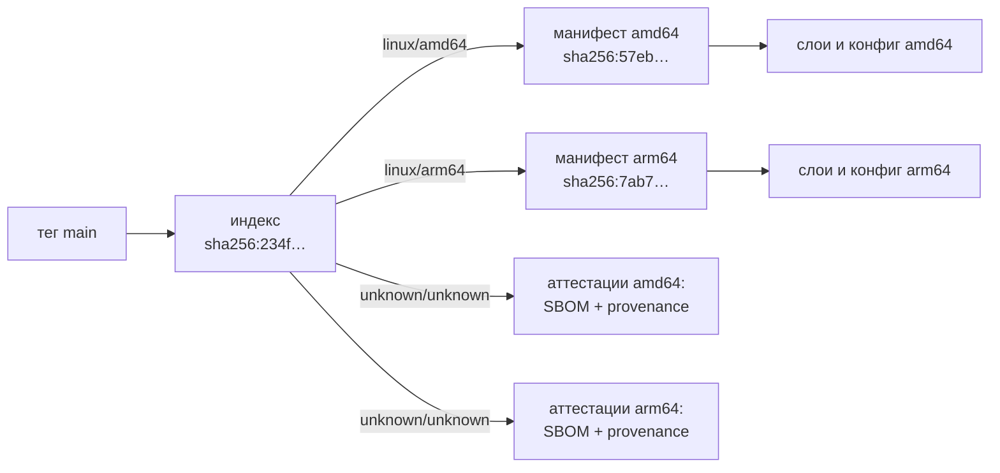
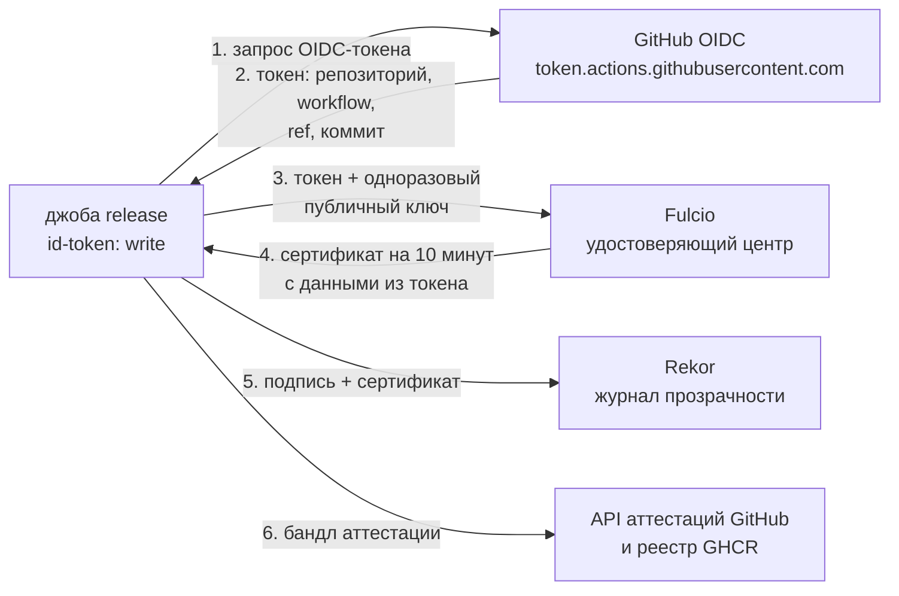

# 1.19. Доставка: реестр, теги, SBOM и происхождение

## <Part kind="problem" /> Проблема: образ есть, а доверять ему нечему

После урока 1.18 каждое изменение проходит ворота CI: линтер, тесты с `-race`, `govulncheck`, сборку образа, `trivy` и smoke-тест. Но образ, который собрала джоба `image`, живёт ровно столько, сколько раннер: джоба закончилась, виртуальная машина удалена, образа больше нет. Чтобы мессенджер можно было запустить где-то ещё, образ надо **опубликовать**. И как только вы это сделаете, появятся три вопроса. Рано или поздно их задаёт любая команда, обычно в самый неудобный момент.

**«Какой код сейчас в проде?»** Пятница, вечер, пользователи жалуются на ошибку. В манифесте окружения написано `image: messenger:latest`. Какой коммит под этим тегом? Вчерашний? Позавчерашний? Тег `latest` за неделю переписали двадцать раз, и узнать, на что он указывал во вторник, уже нельзя. Откатиться «на прошлую версию» тоже нельзя: у неё нет имени.

**«Этот образ собрали мы?»** В реестре лежит `messenger:1.4.2`. Его собрал наш CI из тега `v1.4.2` или кто-то, кто получил токен с правом записи, собрал у себя на ноутбуке образ с «маленьким дополнением» и запушил под тем же именем? Снаружи оба образа выглядят одинаково. В уроке 1.18 вы видели, как злоумышленники перевешивали теги GitHub Actions. Тег в реестре образов изменяем точно так же.

**«В нашей базе нашли CVE — какие сервисы её содержат?»** Декабрь 2021 года, Log4Shell (CVE-2021-44228): критическая уязвимость в Java-библиотеке логирования log4j, которую использовало огромное число систем. Тысячи команд неделями отвечали на один вопрос: «где у нас log4j?». Его надо было найти во всех образах всех версий, включая транзитивные зависимости, о которых никто не помнил. Те, у кого был машиночитаемый список компонентов каждого образа, отвечали за минуты. Остальные разбирали образы руками.

Все три вопроса — о **доверии к артефакту**, а не к коду. Код мы проверили в CI. Но между зелёной галочкой и запущенным контейнером есть ещё реестр, теги, сборка под разные процессоры и люди с правом записи. В этом уроке мы построим вторую половину конвейера, <T id="cd">непрерывную доставку (CD)</T>, и сделаем так, чтобы на каждый из трёх вопросов у образа мессенджера был проверяемый ответ:

- тег `sha-<коммит>` и <T id="image-digest">digest</T> отвечают на «какой код»;
- подписанная аттестация происхождения, которую проверяет `gh attestation verify`, отвечает на «собрали ли мы»;
- SBOM внутри образа отвечает на «где у нас X».

Заодно опубликуем сам курс на GitHub Pages и подключим Dependabot. Закреплённые в 1.16 и 1.18 SHA и digest перестанут быть «замороженными уязвимостями».

## <Part kind="theory" /> Реестр образов и GHCR

<T id="image-registry">Реестр образов</T> — это сервер, который хранит объекты образа и отдаёт их по протоколу OCI Distribution. Вы уже знаете из урока 1.16, что образ состоит из **манифеста**, **конфига** и **слоёв**, и каждый объект адресуется своим хешем (digest). Реестр устроен как хранилище «хеш → байты» плюс таблица «имя:тег → digest манифеста». `docker push` загружает недостающие объекты и обновляет тег. `docker pull` по тегу узнаёт digest манифеста и скачивает только те слои, которых у вас ещё нет.

Отсюда главное свойство: **распространение по digest**. Если вы скачали `ghcr.io/owner/messenger@sha256:4f1c…`, вы получили ровно те байты, хеш которых равен `4f1c…`. Подменить их невозможно, иначе хеш не совпадёт и Docker откажется их принять. Тег — удобное имя для человека, digest — гарантия для машины. Позже вы увидите, что вся цепочка доверия этого урока держится на digest.

Реестров много: Docker Hub, GitHub Container Registry (GHCR, `ghcr.io`), реестры облаков (ECR, Artifact Registry, ACR), собственные (Harbor). Мы выбрали **GHCR** по трём причинам, и все три — про безопасность, а не про удобство:

- **публикация без личного токена.** Workflow входит в GHCR встроенным `GITHUB_TOKEN`, которому джоба выдала право `packages: write`. Этот токен живёт, пока идёт джоба (урок 1.18). Альтернатива — персональный токен (PAT) в секретах репозитория. Он живёт месяцами, обычно даёт доступ ко **всем** пакетам владельца, и его утечка — это месяцы чужого доступа. Документация GHCR прямо рекомендует для workflow `GITHUB_TOKEN`, а не PAT;
- **связь с репозиторием.** Пакет, опубликованный из workflow, автоматически привязан к репозиторию. На странице пакета видно, откуда он, а права наследуются от репозитория;
- **аттестации рядом.** Подписанные утверждения о происхождении образа GitHub хранит у себя и умеет класть в тот же реестр рядом с образом.

Две особенности GHCR, о которых стоит знать заранее. Во-первых, **видимость пакета не обязана совпадать с видимостью репозитория**. По документации GitHub новый пакет приватный, а от связанного репозитория наследует права доступа, но не видимость. При публикации курса пакет `messenger` оказался публичным сразу, хотя документация обещает иное. Поэтому не полагайтесь ни на то, ни на другое: после первой публикации проверьте анонимный `docker pull`. Если реестр ответит `denied` или `unauthorized`, сделайте пакет публичным в его настройках. Во-вторых, **имя образа — только в нижнем регистре**: так требует спецификация OCI Distribution для имён репозиториев. Логин владельца на GitHub может быть `IvanPetrov`, а образ должен называться `ghcr.io/ivanpetrov/messenger`. Поэтому в `release.yml` имя образа приводится к нижнему регистру (`${OWNER,,}` в bash).

## <Part kind="theory" /> Теги: изменяемые и неизменяемые

Тег — это указатель «имя → digest», и его можно перевесить. Это не баг, а назначение: тег `main` **должен** через минуту показывать на новый коммит. Вопрос в том, какие теги мы перевешиваем намеренно, а какие не должны меняться никогда.

| Тег | Пример | Меняется? | Для кого |
|---|---|---|---|
| `sha-<7>` | `sha-b2917f9` | нет: один коммит — один образ | «что именно запущено», откат |
| `main` | `main` | на каждый зелёный `main` | «последнее проверенное», стенд разработки |
| `X.Y.Z` | `1.4.2` | нет: релиз выпускается один раз | потребители, которым нужна конкретная версия |
| `X.Y` | `1.4` | на каждый патч ветки 1.4 | «последний патч 1.4», без мажорных сюрпризов |
| `latest` | `latest` | на каждый релиз | ручной запуск «посмотреть»; **не** для деплоя |
| digest | `@sha256:4f1c…` | не может измениться в принципе | деплой и проверка подписи |

Теги `sha-…` и `X.Y.Z` неизменяемы **по договорённости**: технически их можно перезаписать, но мы этого не делаем. Если пересобрать тот же коммит, получится другой digest: в образе другая метка времени `created` и другое provenance. Тег `sha-b2917f9` тогда начнёт показывать на новый образ, хотя код тот же. Поэтому договорённость дополняют защитой. GHCR позволяет ограничить, кто пишет в пакет, а модуль 13a добавит политику допуска по digest.

Отсюда правило, которое стоит запомнить раз и навсегда: **деплойте по digest, а не по тегу.** Манифест Kubernetes или compose-файл с `messenger@sha256:4f1c…` описывает ровно один образ. Запуск сегодня и через месяц, на одном узле и на другом, даст одно и то же. С `messenger:main` каждый узел скачает то, на что тег указывал в момент `pull`, и после перезапуска одного узла в кластере окажутся две разные версии. Теги нужны людям, чтобы **найти** digest. Записывать в конфигурацию надо сам digest. В модуле 13a это делается автоматически: конвейер выкатки подставляет digest, полученный от `release.yml`.

**Почему `latest` только на релизе.** Многие ставят `latest` на каждый коммит основной ветки, и тогда `docker pull messenger` у пользователя приносит непроверенный в бою код. У нас `latest` значит «последний выпущенный релиз», а для «последнего коммита» есть отдельный честный тег `main`. И ещё деталь: пре-релиз вроде `v1.5.0-rc.1` не получает ни `latest`, ни `1.5`. Кандидат в релиз не должен незаметно стать версией по умолчанию.

<Callout type="idea">

Неизменяемый тег — это то же закрепление, что SHA у action и digest у базового образа (уроки 1.16 и 1.18), только с другой стороны: мы выпускаем артефакт, на который **другие** смогут сослаться неизменяемо. Дайте потребителям digest и подпись, и им не придётся вам верить на слово.

</Callout>

## <Part kind="theory" /> Мультиархитектурный образ

Ноутбук с Apple Silicon, сервер AWS Graviton, Raspberry Pi — это процессоры ARM (`arm64`). Ваш раннер и большинство серверов — `amd64` (x86-64). Бинарь, скомпилированный под одну архитектуру, на другой не запустится: процессор просто не понимает его машинные команды. Docker Desktop на Mac умеет запускать `amd64`-образы через эмуляцию, но медленно. А на ARM-сервере без эмулятора контейнер упадёт с `exec format error`.

### Индекс: один тег — много образов

Решение вы уже видели в уроке 1.16 на примере distroless. **Индекс образа** (image index, в терминологии Docker — manifest list) — это манифест манифестов: список вида «для `linux/amd64` — манифест с digest X, для `linux/arm64` — манифест с digest Y». Тег указывает на индекс. `docker pull` смотрит на платформу машины, выбирает подходящую запись и скачивает только её слои. Пользователь пишет одно имя, а получает образ под свой процессор.



Записи `unknown/unknown` — это **манифесты аттестаций**. BuildKit кладёт их в тот же индекс, по одному на каждую платформу, с аннотацией «я описываю манифест такой-то». Платформа `unknown` нужна, чтобы `docker pull` никогда не выбрал их как запускаемый образ. Что внутри, разберём в следующем разделе. Digest индекса фиксирует всё сразу: оба образа и их аттестации.

### Как собрать образ под чужой процессор

Есть два способа, и разница между ними — секунды против минут.

**Эмуляция (QEMU).** Ядро Linux умеет через механизм `binfmt_misc` передавать «чужие» бинари эмулятору QEMU. Он переводит каждую команду ARM в команды x86 на лету. BuildKit пользуется этим автоматически: весь Dockerfile, включая `go build`, выполняется внутри эмулированного `arm64`-контейнера. Работает для любого Dockerfile, но каждая инструкция процессора эмулируется программно.

**Кросс-компиляция.** Компилятор Go умеет генерировать код под любую поддерживаемую архитектуру, сам при этом работая на родной. Достаточно задать `GOOS` и `GOARCH`. В нашем Dockerfile с урока 1.16 стоит:

- `FROM --platform=$BUILDPLATFORM golang:…` — стадия сборки всегда идёт на платформе **сборщика** (раннера), без эмуляции;
- `ARG TARGETOS TARGETARCH` и `GOOS=$TARGETOS GOARCH=$TARGETARCH go build` — бинарь собирается под **целевую** платформу. Эти аргументы BuildKit заполняет сам для каждой платформы из `--platform`;
- финальная стадия `FROM distroless…` без `--platform` берёт базовый образ целевой архитектуры, а `COPY --from=build` кладёт в него бинарь. В ней нет ни одного `RUN`, поэтому эмулировать нечего: копирование файла не требует процессора целевой архитектуры.

Получается так: компилятор работает на `amd64` в полную силу дважды (под каждую цель), и BuildKit собирает из результатов два манифеста и индекс. Насколько это быстрее эмуляции, мы измерили. Ниже — реальные цифры.

<Callout type="simplified">

Кросс-компиляция Go так проста только при `CGO_ENABLED=0`, то есть когда бинарь <T id="static-binary">статический</T> и не вызывает C-код. С cgo нужен ещё C-компилятор под целевую архитектуру. Тогда выбирают между кросс-тулчейном, QEMU и нативными ARM-раннерами (у GitHub есть `ubuntu-24.04-arm`). Нативные раннеры собирают каждую платформу отдельной джобой, а потом склеивают индекс из двух digest.

</Callout>

## <Part kind="theory" /> Цепочка поставок: SBOM, provenance, подпись

Вернёмся ко второму и третьему вопросам из начала урока. В уроке 1.18 мы называли <T id="supply-chain-attack">атакой на цепочку поставок</T> случай, когда вредоносный код приходит через инструмент, которому вы доверяете. Теперь мы сами становимся звеном чьей-то цепочки: наш образ кто-то скачает. Что мы можем ему дать, чтобы он мог нам не верить на слово, а проверить?

Ответ индустрии — три вида утверждений об артефакте. Каждое отвечает на свой вопрос.

### SBOM: что внутри

<T id="sbom">SBOM</T> (software bill of materials, «спецификация программного обеспечения») — машиночитаемый список компонентов артефакта: пакеты ОС, библиотеки, их версии и идентификаторы. Аналогия — состав на упаковке продукта. Он не говорит, вкусно ли и безопасно ли, но позволяет человеку с аллергией на орехи проверить за секунду, а не звонить производителю.

Форматов два, оба открытые стандарты: **SPDX** (Linux Foundation, ISO/IEC 5962) и **CycloneDX** (OWASP). BuildKit по умолчанию пишет SPDX. Для этого он запускает сканер `syft` (образ `docker/buildkit-syft-scanner`) по файловой системе готового образа. Каждый компонент получает **purl** (package URL), универсальный адрес пакета вида `pkg:golang/golang.org/x/crypto@v0.57.0` или `pkg:deb/debian/tzdata@2026c-0+deb13u1`. По purl сканеры уязвимостей сопоставляют компонент с базами CVE.

Зачем SBOM, если `trivy` и так сканирует образ? Сканирование образа отвечает на «есть ли уязвимости **сейчас**». SBOM — это **запись** о том, что было внутри в момент сборки, и она хранится вместе с образом. Через год в `golang.org/x/net` найдут новую CVE. Тогда не нужно скачивать и распаковывать сотню образов: достаточно пройти по их SBOM и найти purl с уязвимой версией. С 2021 года, после указа президента США о кибербезопасности (Executive Order 14028), SBOM требуют от поставщиков ПО для федерального правительства США. CISA ведёт по нему открытые материалы, а NTIA ещё в 2021-м описала «минимальные элементы» SBOM.

### Provenance: как собрано

<T id="provenance">Provenance</T> (происхождение сборки) — утверждение «этот артефакт (digest) собран такой-то системой сборки, из такого-то исходного кода, с такими-то параметрами, из таких-то зависимостей». Формат задаёт <T id="slsa">SLSA</T> (Supply-chain Levels for Software Artifacts): предикат `https://slsa.dev/provenance/v1`. Там поля `buildDefinition` (что собирали и с какими параметрами), `resolvedDependencies` (базовые образы и прочее, что подтянула сборка, с digest) и `runDetails` (кто собирал и когда).

Provenance — это ответ на атаку «собрали не там». Если образ появился в реестре без provenance от вашего CI, или provenance говорит «собрано на ноутбуке», значит, его собрали не вы.

### Уровни SLSA

SLSA v1.0 описывает трек Build из четырёх уровней. Каждый следующий закрывает конкретный способ подделки:

| Уровень | Требование | Что закрывает |
|---|---|---|
| Build L0 | ничего | — |
| Build L1 | provenance существует и описывает сборку | ошибки и путаницу: видно, из чего и как собрано |
| Build L2 | сборка на **хостируемой** платформе, provenance **подписан** ею | подделку provenance после сборки: подпись ставит платформа, а не разработчик |
| Build L3 | платформа **изолирует** сборки друг от друга, ключ подписи недоступен шагам сборки | подделку изнутри сборки: даже вредоносный шаг не может подписать ложное provenance |

Где мы? Документация GitHub отвечает прямо: аттестации GitHub сами по себе дают **SLSA Build L2**. Сборка идёт на хостируемом раннере, provenance подписывается удостоверением workflow, а не ключом, который мог бы быть у разработчика. Для **L3** нужна изоляция процесса сборки от вызывающего workflow. GitHub предлагает для этого переиспользуемые workflow (reusable workflows): подписывает отдельный, заранее проверенный workflow, а код нашего репозитория не может повлиять на то, что он подпишет. Мы остаёмся на L2, а почему, обсудим в «Компромиссе».

### Подпись без ключа: OIDC → Fulcio → Rekor

Provenance без подписи ничего не стоит: его может написать кто угодно. Классическая подпись — это пара ключей. Приватный ключ хранится в секретах CI и подписывает артефакт, а публичный раздаётся потребителям. Проблема та же, что с PAT: ключ живёт годами, его надо хранить, ротировать и отзывать. А украденный ключ подписывает что угодно, и никто об этом не узнает.

Проект **Sigstore** (Linux Foundation, OpenSSF) предложил подпись без долгоживущего ключа (keyless). Её называют keyless, хотя ключ всё-таки есть, просто живёт он минуты:



1. Джоба с правом `id-token: write` получает у GitHub **OIDC-токен** (OpenID Connect). Это подписанный GitHub документ «предъявитель — workflow `release.yml` репозитория `owner/repo`, запущенный на `refs/heads/main` из коммита `b2917f9…`». Подделать его без ключей GitHub нельзя.
2. Джоба генерирует **одноразовую пару ключей** прямо в памяти раннера.
3. Удостоверяющий центр **Fulcio** проверяет токен и выдаёт сертификат на этот публичный ключ. Сертификат действует **10 минут**, и в него записаны данные из токена: репозиторий, workflow, коммит, событие.
4. Джоба подписывает аттестацию и выбрасывает приватный ключ. Красть больше нечего.
5. Запись о подписи попадает в **Rekor**, публичный журнал прозрачности (transparency log). В него можно только дописывать, а устроен он как дерево Меркла, поэтому задним числом из него ничего не удалишь и не подменишь. Rekor доказывает, что подпись поставлена, пока сертификат был действителен. Кстати, это и делает возможной проверку через год, когда сертификат давно истёк.

Что в итоге утверждает подпись? Не «у кого-то был ключ», а «это подписал **workflow `release.yml` репозитория `owner/repo` на коммите `b2917f9`**». Это и есть ответ на вопрос «собрали ли мы».

### Аттестация GitHub и `gh attestation verify`

<T id="attestation">Аттестация</T> — общая упаковка таких утверждений по стандарту in-toto. В ней **субъект** (имя и digest артефакта), **предикат** (само утверждение: provenance, SBOM, результат сканирования) и подпись. `actions/attest-build-provenance` делает аттестацию provenance для digest нашего индекса, подписывает её через Sigstore описанным выше способом и сохраняет бандл в API аттестаций GitHub. С `push-to-registry: true` бандл ещё и кладётся в GHCR рядом с образом.

Обратите внимание: provenance в нашем образе **два**, и они разные:

- provenance от BuildKit (`provenance: mode=max`) лежит внутри индекса как манифест аттестации. Он подробный: Dockerfile, аргументы сборки, digest базовых образов. Но он **не подписан**. Его написал тот же процесс, который собирал образ;
- аттестация GitHub подписана через Sigstore удостоверением workflow. Её и проверяет `gh attestation verify`.

Первое — подробная опись, второе — подпись под ней. Для проверки «собрали ли мы» важна подпись.

Проверка выглядит так:

```text
gh attestation verify oci://ghcr.io/<owner>/messenger@sha256:<digest> --owner <owner>
```

Что именно проверяет команда (по документации `gh`):

- **подпись и сертификат.** Подпись бандла сходится, сертификат выдан Fulcio, а время подписи подтверждено записью в журнале прозрачности;
- **издатель OIDC** — `https://token.actions.githubusercontent.com`. Подписал GitHub Actions, а не, скажем, чей-то Google-аккаунт;
- **владелец или репозиторий.** С `--owner` — что исходный репозиторий принадлежит этому владельцу, с `--repo` — что это ровно этот репозиторий;
- **тип предиката** — по умолчанию `https://slsa.dev/provenance/v1`;
- **дополнительно, если попросить:** `--signer-workflow` (подписал именно `release.yml`), `--source-ref refs/heads/main` (собрано из `main`, а не из случайной ветки), `--deny-self-hosted-runners` (только хостируемые раннеры GitHub).

Заметьте: `--owner` разрешает **любой** репозиторий владельца. Если у вас есть репозиторий «песочница», где workflow может собрать что угодно, его образ тоже пройдёт проверку `--owner`. Поэтому строгая проверка — `--repo owner/repo --signer-workflow owner/repo/.github/workflows/release.yml`. И главное: документация GitHub подчёркивает, что аттестация **не гарантирует, что артефакт безопасен**. Она связывает артефакт с исходным кодом и процессом сборки, а что считать допустимым, решаете вы своей политикой.

### Dependabot: закрепление, которое не застывает

В уроках 1.16 и 1.18 мы закрепили всё: базовые образы по digest, actions по SHA, модули Go — через `go.sum`, пакеты npm — через `package-lock.json`. У закрепления есть тёмная сторона: **оно ничего не обновляет само**. Выйдет `golang:1.26.10` с исправлением уязвимости в стандартной библиотеке, но наш Dockerfile так и останется на `1.26.9@sha256:f06b…`.

Задумайтесь над этим. В одном отношении закрепление без обновлений **хуже**, чем отсутствие закрепления. Плавающий тег `golang:1.26` при следующей сборке хотя бы подтянул бы патч. Закреплённый digest гарантирует, что уязвимость останется навсегда. Мы меняем защиту от подмены на гарантированное устаревание. Выход не в том, чтобы отказаться от закрепления, а в том, чтобы обновлять закреплённое **автоматически и под ревью**. Это <T id="dependency-update">автообновление зависимостей</T>.

Dependabot — бот GitHub, который по расписанию проверяет зависимости и открывает pull request с обновлением. Мы включаем четыре экосистемы:

| Экосистема | Где | Что обновляет |
|---|---|---|
| `gomod` | `/messenger`, `/labs` | модули в `go.mod` и `go.sum` |
| `npm` | `/course` | `package.json` и `package-lock.json` |
| `github-actions` | `/` (то есть `.github/workflows`) | SHA в `uses:` **и** комментарий `# vX.Y.Z` на той же строке |
| `docker` | `/messenger`, `/labs/0b`, `/labs/1c` | тег и digest в `FROM` |

Про `docker` есть тонкость. Для `golang:1.26.9-trixie@sha256:…` Dependabot предложит новый тег, `1.26.10-trixie`, с его digest. А что делать с `distroless/static-debian13:nonroot@sha256:…`? У тега `nonroot` нет версии, но мейнтейнеры пересобирают его с обновлениями Debian, и digest под ним меняется. В этом случае Dependabot делает обновление только digest: тег тот же, хеш новый. Это видно по исходному коду `dependabot-core` (логика «digest-only refresh» в `update_checker.rb`). Ровно это и превращает закрепление из «заморозки» в «контролируемое обновление».

Три настройки делают поток PR терпимым:

- **`groups`.** Минорные и патч-обновления каждой экосистемы приходят одним PR, мажорные — отдельными. Без группировки неделя может начаться с пятнадцати PR «bump x from 1.2.3 to 1.2.4», и их перестанут читать. Мажорную версию, которая может сломать API, стоит смотреть отдельно;
- **`cooldown.default-days: 14`.** Dependabot не предлагает версию, которой меньше 14 дней. Это то же правило «не моложе двух недель», по которому выбраны все версии в курсе. Свежий релиз ещё не успел показать регрессии, а скомпрометированный (как trivy v0.69.4 в марте 2026, урок 1.18) ещё не успели обнаружить и отозвать. Документация GitHub перечисляет `cooldown` для всех четырёх наших экосистем. Для `docker` и `github-actions` работает только `default-days`, без отдельных сроков для major/minor/patch. Обновлений безопасности выдержка не касается: они приходят сразу;
- **PR проходит наш CI.** Dependabot открывает обычный `pull_request`, и `ci.yml` прогоняет все ворота. Для workflow, запущенных PR от Dependabot, GitHub выдаёт `GITHUB_TOKEN` только на чтение и не передаёт секреты Actions (доступны только отдельные секреты Dependabot). Это та же изоляция, что у PR из форка. Человек читает changelog и решает, сливать ли.

### GitHub Pages для курса

Курс, который вы читаете, — сайт VitePress в каталоге `course/`. Его тоже публикуем: GitHub Pages раздаёт статические файлы бесплатно для публичных репозиториев. Устроено это тремя действиями: `actions/configure-pages` узнаёт адрес сайта, `actions/upload-pages-artifact` упаковывает каталог `dist` в архив-артефакт, а `actions/deploy-pages` выкладывает его.

**Когда.** Как и `release.yml`, workflow `pages.yml` запускается событием **`workflow_run`**: «workflow `ci` завершился». Это событие приходит на **любое** завершение `ci`: успешное и упавшее, на `main` и на PR. Поэтому у джобы стоит условие: `conclusion == 'success'` и `event == 'push'`. Почему не просто `on: push` в `main`? Тогда публикация шла бы **параллельно** с CI и не ждала его. Красный `main` уехал бы в реестр и на сайт. `workflow_run` выстраивает порядок «сначала ворота, потом доставка» без копирования ворот в каждый workflow.

У `workflow_run` есть ловушка, о которой предупреждает документация. Событие видит **последний коммит ветки по умолчанию** (`github.sha`), а не тот коммит, на котором прошёл `ci`. Если между пушем и концом CI в `main` влили ещё один коммит, `github.sha` укажет на него, а он ещё не проверен. Поэтому оба workflow делают checkout `github.event.workflow_run.head_sha`, то есть ровно проверенного коммита. Но одного checkout мало: OIDC-токен джобы, а с ним сертификат Fulcio и provenance аттестации, несёт именно `github.sha`, и подпись назвала бы не тот коммит, что собран. Поэтому джобы публикуют, только если `head_sha` совпадает с `github.sha`, то есть проверенный коммит всё ещё последний в `main`; иначе публикация пропускается, и новый коммит опубликует его собственный прогон `ci`, так что `main` в реестре никогда не откатывается на старый коммит. И ещё одна особенность: `workflow_run` срабатывает, только если файл workflow лежит в **ветке по умолчанию**. Пока `release.yml` есть только в ветке `feat/module-1c`, он не запустится ни разу.

**Базовый путь.** Сайт репозитория на Pages живёт не в корне домена, а по адресу `https://<owner>.github.io/<repo>/`. Все ссылки и ассеты сайта должны начинаться с `/<repo>/`. Ссылка `href="/glossary"` локально работает, а на Pages ведёт на `https://<owner>.github.io/glossary` — в 404. VitePress умеет добавлять префикс сам: в конфиге задаётся `base`. Но значение `base` разное: локально `/`, на Pages `/<repo>/`. Поэтому `base` берётся из переменной окружения `COURSE_BASE` (по умолчанию `/`), а `pages.yml` передаёт в неё `base_path` из `configure-pages` со слэшем на конце.

VitePress переписывает под `base` ссылки Markdown, навигацию, сайдбар и ассеты сборки. **Не** переписывает он две вещи: теги в `head` конфига и ссылки, которые компоненты Vue строят сами. Наш компонент терминов `T` уже с модуля 0 строит ссылку на глоссарий через `withBase()`. А вот favicon в `head` был записан как `href: '/favicon.svg'`, и на Pages вкладка осталась бы без иконки. Чтобы такие ошибки не всплывали только на проде, появился скрипт `npm run check:base`. Он собирает курс под подпутём `/check-base/` и ищет в готовых HTML и CSS любой `href="/…"`, `src="/…"` или `url(…)` с путём от корня без этого префикса. Вывод — в разделе «Код».

<Deep title="SolarWinds, Codecov, xz: три способа отравить сборку">

Три самых известных атаки на цепочку поставок последних лет били в разные звенья, и полезно разобрать, какая мера закрыла бы каждую.

SolarWinds, 2020 год. Злоумышленники проникли в сборочную инфраструктуру компании и поставили на сборочный сервер программу, которую исследователи назвали SUNSPOT. Она следила за сборкой продукта Orion и в момент компиляции подменяла один исходный файл версией с бэкдором SUNBURST. В репозитории исходников всё было чисто, а готовый артефакт был отравлен и подписан настоящим ключом компании. Обновление скачали, по данным самой SolarWinds, до 18 тысяч клиентов. Подпись здесь не помогла: она честно удостоверяла, что артефакт выпустила SolarWinds. Закрывает такую атаку уровень SLSA Build L3: сборки изолированы друг от друга и от постоянных процессов на машине, каждая начинается с чистой среды. Дополнительно помогла бы воспроизводимая сборка: независимая пересборка из тех же исходников дала бы другой хеш.

Codecov, 2021 год. Сервис покрытия кода раздавал скрипт загрузки отчётов, и тысячи CI-конвейеров запускали его командой «скачай и выполни». Через ошибку в создании образа Docker злоумышленники получили учётные данные и изменили скрипт в хранилище Codecov. Около двух месяцев он отправлял на сервер атакующих переменные окружения CI, то есть секреты клиентов. Заметил это клиент, который сверил контрольную сумму скачанного скрипта с опубликованной. Здесь помогли бы закрепление по хешу и проверка подписи или provenance загружаемого инструмента: исполнять только то, происхождение чего проверено. И минимальные права: чем меньше секретов в окружении джобы, тем меньше утечка.

xz, 2024 год (CVE-2024-3094). Самая терпеливая атака: человек под именем Jia Tan около двух лет вносил полезные изменения в библиотеку сжатия xz и стал соавтором проекта. Затем он выпустил версии 5.6.0 и 5.6.1 с бэкдором для sshd. Код бэкдора лежал в репозитории в виде «тестовых» бинарных файлов. А часть, которая его подключала, была только в архиве релиза, собранном вручную, и в git её не было. Обнаружил всё инженер Андрес Фройнд: он заметил, что вход по ssh стал занимать примерно на полсекунды дольше. Требование SLSA собирать артефакты на хостируемой платформе из репозитория, с provenance, сделало бы ручной архив с отличиями от git заметным. Но против злонамеренного мейнтейнера с правом коммита сборка бессильна. Это зона трека Source в SLSA и ревью двумя людьми.

Вывод: SLSA — не волшебная печать, а набор мер против конкретных способов подделки, и каждую атаку надо сопоставлять со своим звеном.

</Deep>

## <Part kind="code" /> Код: `release.yml`, `pages.yml`, `dependabot.yml`

### Теги

<<< @/../.github/workflows/release.yml#release-tags{yaml}

- **`context: git`.** `metadata-action` по умолчанию берёт коммит и ref из контекста события (`github.sha`, `github.ref`). На `workflow_run` это последний коммит `main`, а не собранный, и тег `sha-…` с меткой `org.opencontainers.image.revision` указали бы не на тот коммит. С `context: git` действие читает их из локального git, где мы сделали checkout `head_sha`;
- **`type=sha`** даёт `sha-` плюс 7 символов коммита. **`type=raw,value=main`** включается только на `workflow_run`, то есть только на зелёном `main`. **`type=semver`** срабатывает только на теге `vX.Y.Z` и выдаёт <code v-pre>{{version}}</code> → `1.4.2` и <code v-pre>{{major}}.{{minor}}</code> → `1.4`. На пре-релизе `v1.5.0-rc.1` README действия обещает только <code v-pre>{{version}}</code>, без `1.5`;
- **`flavor: latest=false` и явный `latest`.** В режиме `auto` действие ставит `latest` на любой semver-тег, в том числе `v2.0.8-beta.67` (пример из его README). Мы выключили автоматику и поставили `latest` сами: тег начинается с `v` и не содержит `-`, то есть это не пре-релиз;
- **`priority=50` у `main`.** Первый по приоритету тег становится «версией» образа: выход `version`, метка `org.opencontainers.image.version` и наш `VERSION` в бинаре. По умолчанию `raw` важнее `sha`, и на `main` версией стала бы строка `main`, которая через минуту укажет на другой коммит. С приоритетом 50 (у `sha` — 100) версией на `main` становится `sha-b2917f9`, а на релизе — `1.4.2` (у `semver` — 900);
- **`labels` и `annotations`.** `metadata-action` генерирует метки OCI (`source`, `revision`, `version`, `created`, урок 1.16), а заодно `title` и `description` — **из имени и описания репозитория**. Они перебили бы `LABEL` из Dockerfile. Поэтому `title` и `description` заданы явно. Аннотации с уровнем `index` нужны GHCR: описание мультиархитектурного образа он показывает из аннотации индекса, а не из метки.

Перед тем как написать `context: git`, мы проверили, как действие читает ref из git. Это файл `src/git.ts` его зависимости `@docker/actions-toolkit` 0.92.0, той версии, что собрана в `metadata-action` v6.2.0. И нашли ловушку. `actions/checkout` с `ref: <SHA>` делает `git fetch` одного коммита без ссылки назначения, и HEAD остаётся отсоединённым без единой ветки и тега. Вот что увидит в таком клоне `metadata-action` (воспроизведено локально теми же командами git):

```text
== workflow_run: checkout по SHA (refspec = только коммит)
branch --show-current: ''
show -s --pretty=%D: 'grafted, HEAD'
for-each-ref --contains HEAD: ''
tag --contains HEAD: ''
после git switch --create main: symbolic-ref HEAD = refs/heads/main
== push тега: checkout по умолчанию (refspec +refs/tags/v1.2.3:refs/tags/v1.2.3)
show -s --pretty=%D: 'grafted, HEAD, tag: v1.2.3'
for-each-ref --points-at HEAD refs/tags/: 'refs/tags/v1.2.3'
```

В первом случае функция `inferRefFromHead` перебирает локальные ветки, удалённые ветки и теги, ничего не находит и бросает `Cannot infer ref from detached HEAD`. Шаг упал бы на первом же релизе. Отсюда шаг `git switch --create main` перед `metadata-action` на `workflow_run` и выражение <code v-pre>ref: ${{ github.event.workflow_run.head_sha }}</code> **без** запасного `|| github.sha`. На теге выражение пустое, `checkout` берёт сам тег, и `metadata-action` видит `tag: v1.2.3`. Со «страховкой» `|| github.sha` checkout на теге тоже шёл бы по SHA, и semver-теги не появились бы никогда. Мораль та же, что в уроке 1.18: README действия описывает входы, а поведение на вашем событии проверяйте по коду закреплённой версии.

### Сборка

<<< @/../.github/workflows/release.yml#release-build{yaml}

- **`platforms: linux/amd64,linux/arm64`** — две платформы, один индекс. QEMU (`docker/setup-qemu-action`) не подключён: он не нужен, потому что `go build` идёт на платформе раннера, а в финальной стадии нет `RUN`;
- **`push: true`** — в отличие от `ci.yml`, где образ только загружается в Docker раннера (`load: true`). Мультиплатформенный индекс с аттестациями нельзя загрузить в классическое хранилище образов Docker, его можно только отправить в реестр. Документация Docker прямо говорит, что с `load: true` аттестации не добавляются;
- **`cache-from` из двух областей.** Область `messenger` пишет джоба `image` в CI. Там слои только `amd64`, зато самые свежие. Область `messenger-release` пишет сам релиз, и в ней есть слои `arm64` прошлых релизов. Писать в область CI релиз не должен: у CI и релиза разные наборы платформ, и они вытесняли бы кэш друг друга;
- **`sbom: true`, `provenance: mode=max`.** Для публичного репозитория `build-push-action` и так добавляет provenance `mode=max`, а для приватного — `mode=min`. SBOM он по умолчанию не добавляет. Мы пишем оба явно, чтобы поведение не зависело от видимости репозитория. В `mode=max` provenance включает значения аргументов сборки, поэтому секреты через `build-args` не передают никогда. Для них есть secret mounts (урок 1.16).

### Аттестация

<<< @/../.github/workflows/release.yml#attest{yaml}

- **`subject-name` без тега, `subject-digest` из шага сборки.** Подписывается digest индекса, а не тег: тег можно перевесить, digest — нет;
- **права джобы:** `id-token: write`, чтобы получить OIDC-токен для Fulcio, `attestations: write`, чтобы сохранить бандл в API аттестаций, и `packages: write`, чтобы положить его в GHCR (`push-to-registry`);
- **`create-storage-record: false`.** v4 по умолчанию пытается создать ещё и «запись хранения» (storage record). По коду действия она создаётся только для репозиториев организаций и требует права `artifact-metadata: write`. Без него действие пишет предупреждение, но не падает. Нам она не нужна, и мы её выключили явно;
- README v4 сообщает, что `attest-build-provenance` теперь обёртка над `actions/attest`, и новым проектам советует `actions/attest`. Мы оставили закреплённое в таблице версий действие. Переход — правка одной строки, когда Dependabot принесёт обновление.

### Pages

<<< @/../.github/workflows/pages.yml#pages{yaml}

- **Две джобы.** `build` ничего не публикует и получает только чтение. `deploy` получает `pages: write` и `id-token: write`: `deploy-pages` подтверждает GitHub свою личность OIDC-токеном. Сборка, в которой выполняется `npm ci` (а это скрипты сотен пакетов), не держит права на публикацию;
- **`pages: read` у `build`** нужен `configure-pages`: он читает настройки сайта через API, чтобы отдать `base_path`;
- **`environment: github-pages`** — окружение, которое GitHub создаёт сам, когда источником Pages выбран GitHub Actions, и настраивает правилом защиты: выкладывать в него можно только из ветки по умолчанию (README `deploy-pages`). Даже если кто-то запустит `pages.yml` вручную на своей ветке, `deploy` откажет;
- **`concurrency: pages` без отмены.** Две выкладки не идут одновременно, а начатая не прерывается на середине.

### Dependabot

<<< @/../.github/dependabot.yml#dependabot{yaml}

`directories` (во множественном числе) принимает список каталогов и глобы, а `directory` — один каталог. Ключи и значения сверены со справочником опций Dependabot. `actionlint` этот файл не проверяет, схему проверит GitHub при первом пуше.

### Проверка workflow и базового пути

```text
$ npm run check:workflows

> check:workflows
> cd .. && go run github.com/rhysd/actionlint/cmd/actionlint@v1.7.12

```

Без замечаний: `actionlint` проверил все три workflow, включая выражения и права. Теперь сборка курса под подпутём:

```text
$ npm run check:base

> check:base
> node scripts/check-base.ts

  vitepress v1.6.4

✓ building client + server bundles...
✓ rendering pages...
build complete in 16.97s.
Курс под /check-base/: ссылок мимо базового пути нет.
```

Скрипт перезаписывает `course/.vitepress/dist`, поэтому после него обычный `npm run build` пересобирает сайт с `/`. Сначала скрипт проверял и JS-бандлы, и первый же прогон после написания этого урока упал на нём самом:

```text
assets/modules_01-go-service_19-delivery.md.pDyRo3QG.lean.js: …айте под подпутём."),e(),s("code",null,'href="/glossary"'),e(" в компоненте работает в "),s("code",n…
```

Это не ссылка, а текст урока из раздела «Типичные ошибки»: VitePress хранит содержимое страницы в JS-чанке строками, и пример `href="/glossary"` в `<code>` выглядит там как настоящий атрибут. Поэтому проверка сужена до HTML и CSS. Ссылки, которые строят компоненты Vue, всё равно попадают в HTML: VitePress отрисовывает страницы заранее (SSR), и в HTML текст внутри `<code>` уже экранирован (`href=&quot;…`). Не увидит проверка только ссылку, которую компонент создаёт в браузере после загрузки, в `onMounted`. Таких у курса нет. Похожая ловушка и в самом HTML: фраза про CSS-функцию с путём от корня в тексте этого урока тоже дала бы ложную тревогу. Её пришлось переформулировать.

### Мультиархитектурная сборка локально

У автора Docker Desktop с хранилищем образов containerd (`driver-type io.containerd.snapshotter.v1`). Встроенный сборщик `desktop-linux` с ним собирает мультиплатформенные образы сам, отдельный builder (`docker buildx create --driver docker-container`) не понадобился. С классическим хранилищем Docker понадобился бы именно он. В CI его создаёт `setup-buildx-action`.

```text
$ docker buildx build --progress=plain --no-cache --platform linux/amd64,linux/arm64 -t messenger:multi .
…
#14 [linux/amd64 build 4/6] RUN --mount=type=cache,target=/go/pkg/mod     go mod download
#14 DONE 5.3s
#15 [linux/amd64 build 5/6] COPY . .
#15 DONE 0.1s
#16 [linux/amd64->arm64 build 6/6] RUN … CGO_ENABLED=0 GOOS=linux GOARCH=arm64     go build -trimpath -ldflags="-s -w -X main.version=dev" -o /out/messenger ./cmd/messenger
#17 [linux/amd64 build 6/6] RUN … CGO_ENABLED=0 GOOS=linux GOARCH=amd64     go build -trimpath -ldflags="-s -w -X main.version=dev" -o /out/messenger ./cmd/messenger
#17 DONE 8.6s
#16 DONE 8.7s
#18 [linux/amd64 stage-1 2/2] COPY --from=build /out/messenger /messenger
#19 [linux/arm64 stage-1 2/2] COPY --from=build /out/messenger /messenger
#20 exporting to image
#20 exporting manifest sha256:0eaadf0d12b9e00fa406ff7e56b7061980fdcc8b4a0c579f8388962be20411b0 0.0s done
#20 exporting attestation manifest sha256:8e4d2d38313aef365c78eef2553d5a86bb006b7f61296a0056b2fc6d91eaa387 0.0s done
#20 exporting manifest sha256:b28d83880ae9f6bec8fd8749c1a7292eed197e3c747680a2251fd1970440667d 0.0s done
#20 exporting attestation manifest sha256:3087a9c2f1d70cb1980002b46833ce32835f73c9e1eba64d578890f0a2b83e2f 0.0s done
#20 exporting manifest list sha256:20a6d65029c2fd512d39d74d2460c73d144ea937e2f841f0da0b62eb4da900a2 0.0s done
#20 naming to docker.io/library/messenger:multi done
… 15.652 total
```

Читайте метки шагов. Шаги 1–5 стадии `build` выполнились **один раз** и с меткой `linux/amd64`: у обеих целевых платформ стадия идёт на `$BUILDPLATFORM`, то есть на одной и той же `amd64`. BuildKit видит одинаковые шаги и не повторяет их. Расходятся платформы только на `go build`: метка `linux/amd64->arm64` означает «выполняется на amd64, результат для arm64». Два компилятора отработали параллельно, оба примерно за 8,7 с. Вся сборка заняла <N>15,7 с</N>. В конце — два манифеста, два манифеста аттестаций (provenance `mode=min`, который BuildKit добавляет и локально) и индекс.

```text
$ docker image ls --tree messenger:multi
IMAGE                ID             DISK USAGE   CONTENT SIZE   EXTRA
messenger:multi      20a6d65029c2       21.2MB         7.83MB
├─ linux/amd64       0eaadf0d12b9       17.5MB         4.06MB
└─ linux/arm64       b28d83880ae9       3.76MB         3.76MB
```

`ID` верхней строки — digest индекса (`20a6d650…` из вывода сборки), под ним два манифеста. `docker buildx imagetools inspect` для такого образа не подойдёт: он читает образ из реестра, а `messenger:multi` лежит только в локальном хранилище. После публикации та же команда покажет индекс в GHCR.

**Кросс-компиляция против QEMU.** Чтобы цифры были честными, мы собрали один `linux/arm64` дважды, с чистым кэшем сборки Go (свои `id` у cache mounts) и `--no-cache`. Первый раз — наш Dockerfile. Второй — его копия, где у стадии `build` убран `--platform=$BUILDPLATFORM`, и тогда BuildKit выполняет её в `arm64`-контейнере через QEMU:

Выдержки из двух журналов сборки:

```text
кросс-компиляция:  #14 [build 6/6] RUN … GOARCH=arm64 go build …   #14 DONE 5.8s    … 13.139 total
QEMU:              #14 [build 6/6] RUN … GOARCH=arm64 go build …   #14 DONE 97.5s   … 2:11.69 total
```

Один и тот же `go build`: <N>5,8 с</N> на родном процессоре и <N>97,5 с</N> в эмуляции, то есть примерно в <N>17 раз</N> медленнее. Вся сборка — 13 с против 2 мин 12 с. Во второе время входят ещё 14,5 с на загрузку `arm64`-варианта образа `golang`, который при кросс-компиляции не нужен вовсе. На раннере GitHub с двумя-четырьмя ядрами разница в абсолютных секундах будет больше, а в разах — того же порядка.

### Что внутри индекса: аттестации, SBOM, provenance

Чтобы посмотреть, что BuildKit кладёт в образ с `sbom: true` и `provenance: mode=max`, не публикуя его, соберём образ в файл формата OCI Image Layout. Это тот же формат, который `docker save` давал в уроке 1.16:

```text
$ docker buildx build --platform linux/amd64,linux/arm64 --sbom=true --provenance=mode=max \
    --build-arg VERSION=sha-b2917f9 --output type=oci,dest=messenger-oci.tar,tar=true .
…
#24 [linux/arm64] generating sbom using docker.io/docker/buildkit-syft-scanner:stable-1
#25 [linux/amd64] generating sbom using docker.io/docker/buildkit-syft-scanner:stable-1
…
#26 exporting manifest list sha256:234fc2e8659a41962781b11d190759aff74197553f8796251d4d268678f2f7b1 0.0s done

$ mkdir oci && tar -xf messenger-oci.tar -C oci && cd oci
$ jq . blobs/sha256/234fc2e8659a41962781b11d190759aff74197553f8796251d4d268678f2f7b1
{
  "schemaVersion": 2,
  "mediaType": "application/vnd.oci.image.index.v1+json",
  "manifests": [
    {
      "mediaType": "application/vnd.oci.image.manifest.v1+json",
      "digest": "sha256:57ebaa8eacdc333ff80dae796ebf3d33d963de9e784d1bd01d3d86371096b6d6",
      "size": 2939,
      "platform": { "architecture": "amd64", "os": "linux" }
    },
    {
      "mediaType": "application/vnd.oci.image.manifest.v1+json",
      "digest": "sha256:7ab7759a460b459340b3209ee350900ef866ade9e55bc2f07cdac41204d5d7e4",
      "size": 2939,
      "platform": { "architecture": "arm64", "os": "linux" }
    },
    {
      "mediaType": "application/vnd.oci.image.manifest.v1+json",
      "digest": "sha256:bcfaa217fd433bff72a5d3d87ad659e14af018530f4312b5813426814946c8be",
      "size": 1111,
      "annotations": {
        "vnd.docker.reference.digest": "sha256:57ebaa8eacdc333ff80dae796ebf3d33d963de9e784d1bd01d3d86371096b6d6",
        "vnd.docker.reference.type": "attestation-manifest"
      },
      "platform": { "architecture": "unknown", "os": "unknown" }
    },
    {
      "mediaType": "application/vnd.oci.image.manifest.v1+json",
      "digest": "sha256:a3211b6d29add64c67ce5215ab5700d96525e105c321c6e3e75c032408f487b4",
      "size": 1111,
      "annotations": {
        "vnd.docker.reference.digest": "sha256:7ab7759a460b459340b3209ee350900ef866ade9e55bc2f07cdac41204d5d7e4",
        "vnd.docker.reference.type": "attestation-manifest"
      },
      "platform": { "architecture": "unknown", "os": "unknown" }
    }
  ]
}
```

(`platform` сжат в одну строку для читаемости, значения не менялись.) Четыре записи — ровно та схема, что на диаграмме выше. Аннотация `vnd.docker.reference.digest` связывает манифест аттестаций с образом, который он описывает. Внутри манифеста аттестаций `amd64` два слоя типа `application/vnd.in-toto+json`:

```text
$ jq -c '.layers[] | {digest, size, predicate: .annotations["in-toto.io/predicate-type"]}' blobs/sha256/bcfaa217fd433bff72a5d3d87ad659e14af018530f4312b5813426814946c8be
{"digest":"sha256:408446278273fdf2fb572f3d335794867a0f91e7935531b48f31d444709e70a9","size":647050,"predicate":"https://spdx.dev/Document"}
{"digest":"sha256:dafa6a1f09952fefdb998cfb39b78c0d9eb0c1cf547b4282fd23ae50a606e173","size":18732,"predicate":"https://slsa.dev/provenance/v1"}
```

SBOM в формате SPDX 2.3 описывает <N>15</N> пакетов и 946 файлов. Вот пакеты с их purl:

```text
$ jq -r '.predicate.packages[] | [.name, .versionInfo, (.externalRefs[]? | select(.referenceType=="purl") | .referenceLocator)] | @tsv' blobs/sha256/408446278273fdf2fb572f3d335794867a0f91e7935531b48f31d444709e70a9 | sort
base-files	13.8+deb13u7	pkg:deb/debian/base-files@13.8%2Bdeb13u7?arch=amd64&distro=debian-13.7
ca-certificates	20250419	pkg:deb/debian/ca-certificates@20250419?arch=all&distro=debian-13.7
github.com/apapsch/go-jsonmerge/v2	v2.0.0	pkg:golang/github.com/apapsch/go-jsonmerge/v2@v2.0.0
github.com/golang-jwt/jwt/v5	v5.3.1	pkg:golang/github.com/golang-jwt/jwt/v5@v5.3.1
github.com/google/uuid	v1.6.0	pkg:golang/github.com/google/uuid@v1.6.0
github.com/oapi-codegen/runtime	v1.7.0	pkg:golang/github.com/oapi-codegen/runtime@v1.7.0
golang.org/x/crypto	v0.57.0	pkg:golang/golang.org/x/crypto@v0.57.0
golang.org/x/sys	v0.48.0	pkg:golang/golang.org/x/sys@v0.48.0
media-types	13.0.0	pkg:deb/debian/media-types@13.0.0?arch=all&distro=debian-13.7
messenger	UNKNOWN	pkg:golang/messenger
netbase	6.5	pkg:deb/debian/netbase@6.5?arch=all&distro=debian-13.7
sbom
stdlib	go1.26.9	pkg:golang/stdlib@1.26.9
tzdata	2026c-0+deb13u1	pkg:deb/debian/tzdata@2026c-0%2Bdeb13u1?arch=all&distro=debian-13.7
tzdata-legacy	2026c-0+deb13u1	pkg:deb/debian/tzdata-legacy@2026c-0%2Bdeb13u1?arch=all&distro=debian-13.7
```

Всё, о чём мы говорили в уроках 1.16 и 1.18, на одном экране. Пакеты Debian пришли из distroless: сертификаты, `tzdata`, `netbase`. Модули Go `syft` прочитал из самого бинаря: Go встраивает список модулей в исполняемый файл, и его же показывает `go version -m`. Сюда попал даже `stdlib go1.26.9`, версия компилятора. Это ответ на вопрос «собран ли образ уязвимым Go 1.26.5», который в уроке 1.18 стоил нам 14 уязвимостей. (`messenger UNKNOWN` — главный модуль. В контекст сборки не попадает `.git` (`.dockerignore` из урока 1.16), поэтому Go записывает в бинарь версию модуля `(devel)`: `go version -m` показывает `mod messenger (devel)`. Такую версию `syft` не распознаёт.)

SBOM имеет смысл, только если его кто-то читает. Проверим его сканером, не трогая сам образ. Сначала вынем документ SPDX из аттестации в каталог проекта: Docker Desktop не видит `/tmp` хоста (урок 1.17). Затем запустим `trivy` в режиме `sbom`:

```text
$ jq '.predicate' blobs/sha256/408446278273fdf2fb572f3d335794867a0f91e7935531b48f31d444709e70a9 > "$REPO/messenger/.sbomtmp/messenger-amd64.spdx.json"
$ cd "$REPO"
$ docker run --rm -v "$PWD/messenger/.sbomtmp:/sbom:ro" -v trivy-cache:/root/.cache aquasec/trivy:0.74.0 sbom --quiet /sbom/messenger-amd64.spdx.json

Report Summary

┌────────┬──────────┬─────────────────┐
│ Target │   Type   │ Vulnerabilities │
├────────┼──────────┼─────────────────┤
│        │ gobinary │        1        │
└────────┴──────────┴─────────────────┘
Legend:
- '-': Not scanned
- '0': Clean (no security findings detected)


 (gobinary)
===========
Total: 1 (UNKNOWN: 1, LOW: 0, MEDIUM: 0, HIGH: 0, CRITICAL: 0)

┌─────────────────────┬───────────────┬──────────┬──────────┬───────────────────┬───────────────┬──────────────────────────────────────────────────────────┐
│       Library       │ Vulnerability │ Severity │  Status  │ Installed Version │ Fixed Version │                          Title                           │
├─────────────────────┼───────────────┼──────────┼──────────┼───────────────────┼───────────────┼──────────────────────────────────────────────────────────┤
│ golang.org/x/crypto │ GO-2026-5932  │ UNKNOWN  │ affected │ v0.57.0           │               │ The golang.org/x/crypto/openpgp package is unmaintained, │
│                     │               │          │          │                   │               │ unsafe by design, and has known security...              │
└─────────────────────┴───────────────┴──────────┴──────────┴───────────────────┴───────────────┴──────────────────────────────────────────────────────────┘
```

Та же находка `GO-2026-5932`, что у `govulncheck` в уроке 1.18: пакет `openpgp` в модуле `x/crypto`, который мы не импортируем. Разница в том, что `govulncheck` анализирует достижимость и потому молчит, а сканер по SBOM видит только «модуль такой-то версии» и сообщает. Обратите внимание и на то, чего в отчёте нет: пакетов Debian. В этом SBOM нет отдельной записи об операционной системе, и, судя по всему, без неё `trivy` не знает, с базой какого дистрибутива сверять deb-пакеты. Пакеты ОС надёжнее сканировать по самому образу, как джоба `image` в CI. SBOM — дополнение к сканеру, а не замена.

Наконец, provenance. Самое интересное в нём:

```text
$ jq '.predicate.buildDefinition.externalParameters.request.root.request.args' blobs/sha256/dafa6a1f09952fefdb998cfb39b78c0d9eb0c1cf547b4282fd23ae50a606e173
{
  "build-arg:VERSION": "sha-b2917f9",
  "vcs:localdir:context": "messenger",
  "vcs:localdir:dockerfile": "messenger",
  "vcs:revision": "b2917f9ecd032ab7fdb5a35c95eda2cf0f5c5b65"
}
$ jq '[.predicate.buildDefinition.resolvedDependencies[].uri]' blobs/sha256/dafa6a1f09952fefdb998cfb39b78c0d9eb0c1cf547b4282fd23ae50a606e173
[
  "pkg:docker/docker/buildkit-syft-scanner@stable-1",
  "pkg:docker/docker/dockerfile@1.19?digest=sha256:b6afd42430b15f2d2a4c5a02b919e98a525b785b1aaff16747d2f623364e39b6&platform=linux%2Famd64",
  "pkg:docker/docker/dockerfile@1.19?digest=sha256:b6afd42430b15f2d2a4c5a02b919e98a525b785b1aaff16747d2f623364e39b6",
  "pkg:docker/golang@1.26.9-trixie?digest=sha256:f06b7122f888680048afb247c4e5f49c0069eb6c4c1ccae0f3f4834527a8d22c&platform=linux%2Famd64",
  "pkg:docker/gcr.io/distroless/static-debian13@nonroot?digest=sha256:e2e927ec666bae08560abb3c55d0659eceabb657f56b6782ab500a9fc7f555e3&platform=linux%2Famd64"
]
```

BuildKit записал коммит (`vcs:revision`, его он взял из локального git), аргумент сборки и **все** внешние образы с digest: фронтенд Dockerfile, `golang` (заметьте: `platform=linux/amd64` — стадия сборки шла на платформе сборщика даже для `arm64`-образа), distroless и сам сканер SBOM. Поле `runDetails.builder.id` в локальной сборке пустое (`"id": ""`). В CI там будет адрес прогона workflow. Обратите внимание на `buildkit-syft-scanner@stable-1`: сканер подтянут по плавающему тегу. Его digest provenance записал, но выбрали его не мы. Можно закрепить и его (`sbom: generator=docker/buildkit-syft-scanner@sha256:…`), но тогда его обновление ляжет на нас. Мы оставляем как есть и знаем об этом.

## <Part kind="practice" /> После публикации: первый релиз и проверка

Всё, что ниже, требует репозитория на GitHub. Его создаёте вы сами (урок 1.18). Вывод команд в этом разделе — настоящий: первая публикация репозитория курса `fazletdinov/system-desine` (19 октября 2026 года, коммит `6935c68`). У вас будут свои владелец, имя репозитория и digest.

1. **Создайте репозиторий и отправьте `main`.** `gh auth login` (интерактивно, в браузере), затем `gh repo create <repo> --public --source . --push`. Первый `push` в `main` запустит `ci`. После его успеха `workflow_run` запустит `release` и `pages`: файлы workflow теперь лежат в ветке по умолчанию.
2. **Включите Pages.** Settings → Pages → Build and deployment → Source: **GitHub Actions**. Без этого `configure-pages` упадёт с ошибкой «Get Pages site failed». Если первый прогон `pages` успел упасть, перезапустите его кнопкой Re-run или через Actions → pages → Run workflow (`workflow_dispatch`).
3. **Проверьте видимость пакета.** Анонимный `docker pull` из шага 5 должен пройти. Если реестр отвечает `denied`, откройте профиль → Packages → `messenger` → Package settings → Change visibility → Public.
4. **Защитите `main`** (шаги из урока 1.18): Settings → Rules → Rulesets — «Require a pull request before merging», «Require status checks to pass» с `ci-ok`, «Block force pushes», «Restrict deletions», обход для владельца. В Settings → Code security включите secret scanning, push protection, Dependabot alerts и CodeQL default setup.
5. **Скачайте образ без входа:**

   ```text
   docker pull ghcr.io/<owner>/messenger:main
   docker buildx imagetools inspect ghcr.io/<owner>/messenger:main
   ```

   Чтобы `pull` был действительно анонимным, запустите его с пустым каталогом настроек: `DOCKER_CONFIG=$(mktemp -d) docker pull …`. Иначе Docker молча возьмёт ваш сохранённый логин, и приватный пакет тоже скачается. `imagetools inspect` первой публикации курса:

   ```text
   $ docker buildx imagetools inspect ghcr.io/fazletdinov/messenger:main
   Name:      ghcr.io/fazletdinov/messenger:main
   MediaType: application/vnd.oci.image.index.v1+json
   Digest:    sha256:eae29acc8584f54b96e4076f699d57b70a778bc8f1df5fd674b6ad5386a5ed97

   Manifests:
     Name:        ghcr.io/fazletdinov/messenger:main@sha256:22578d751e20255475c101f8952c43bd796e42f72c05395006bc2c922b5562a2
     MediaType:   application/vnd.oci.image.manifest.v1+json
     Platform:    linux/amd64

     Name:        ghcr.io/fazletdinov/messenger:main@sha256:d544a3445f2b74b679eaaf060a1564703dbb09fcffec1095b7060a1893f93592
     MediaType:   application/vnd.oci.image.manifest.v1+json
     Platform:    linux/arm64

     Name:        ghcr.io/fazletdinov/messenger:main@sha256:63165ae2b8ef58d1be51337ee8b456ff0df9299146f4315afca34a682fa8641d
     MediaType:   application/vnd.oci.image.manifest.v1+json
     Platform:    unknown/unknown
     Annotations:
       vnd.docker.reference.digest: sha256:22578d751e20255475c101f8952c43bd796e42f72c05395006bc2c922b5562a2
       vnd.docker.reference.type:   attestation-manifest
     …
   ```

   Индекс, `linux/amd64`, `linux/arm64` и манифесты `unknown/unknown` с аннотацией `attestation-manifest` (второй, для `arm64`, обрезан). Это та же картина, что в OCI Layout выше. Аннотация `vnd.docker.reference.digest` говорит, к какому платформенному манифесту относится аттестация.
6. **Проверьте происхождение** по digest индекса (строка `Digest:` выше):

   ```text
   $ gh attestation verify oci://ghcr.io/fazletdinov/messenger@sha256:eae29acc8584f54b96e4076f699d57b70a778bc8f1df5fd674b6ad5386a5ed97 --owner fazletdinov
   Loaded digest sha256:eae29acc8584f54b96e4076f699d57b70a778bc8f1df5fd674b6ad5386a5ed97 for oci://ghcr.io/fazletdinov/messenger@sha256:eae29acc8584f54b96e4076f699d57b70a778bc8f1df5fd674b6ad5386a5ed97
   Loaded 1 attestation from GitHub API

   The following policy criteria will be enforced:
   - Predicate type must match:................ https://slsa.dev/provenance/v1
   - Source Repository Owner URI must match:... https://github.com/fazletdinov
   - Subject Alternative Name must match regex: (?i)^https://github\.com/fazletdinov/
   - OIDC Issuer must match:................... https://token.actions.githubusercontent.com

   ✓ Verification succeeded!

   The following 1 attestation matched the policy criteria

   - Attestation #1
     - Build repo:..... fazletdinov/system-desine
     - Build workflow:. .github/workflows/release.yml@refs/heads/main
     - Signer repo:.... fazletdinov/system-desine
     - Signer workflow: .github/workflows/release.yml@refs/heads/main
   ```

   Посмотрите на регулярное выражение для SAN: с `--owner` подходит **любой** workflow любого репозитория владельца. Строгий вариант сужает политику до одного репозитория, одного workflow и одной ветки:

   ```text
   $ gh attestation verify oci://ghcr.io/fazletdinov/messenger@sha256:eae29acc… \
       --repo fazletdinov/system-desine \
       --signer-workflow fazletdinov/system-desine/.github/workflows/release.yml \
       --source-ref refs/heads/main
   …
   The following policy criteria will be enforced:
   - Predicate type must match:................ https://slsa.dev/provenance/v1
   - Source Repository Owner URI must match:... https://github.com/fazletdinov
   - Source Repository URI must match:......... https://github.com/fazletdinov/system-desine
   - Source repo ref must match:............... refs/heads/main
   - Subject Alternative Name must match regex: ^https://github\.com/fazletdinov/system-desine/\.github/workflows/release\.yml(@(refs/.*|[0-9a-fA-F]+))?$
   - OIDC Issuer must match:................... https://token.actions.githubusercontent.com

   ✓ Verification succeeded!
   ```

   И отрицательная проверка: образ, который собирали не вы, должен провалить `verify`.

   ```text
   $ gh attestation verify oci://docker.io/library/golang@sha256:37cfcca63222ec499bec5e8ad7aad52dbf7529db36d5812b8eae2f0621aa92d6 --repo fazletdinov/system-desine
   Loaded digest sha256:37cfcca63222ec499bec5e8ad7aad52dbf7529db36d5812b8eae2f0621aa92d6 for oci://docker.io/library/golang@sha256:37cfcca63222ec499bec5e8ad7aad52dbf7529db36d5812b8eae2f0621aa92d6
   ✗ Loading attestations from GitHub API failed

   Error: HTTP 404: Not Found (https://api.github.com/repos/fazletdinov/system-desine/attestations/sha256:37cfcca6…?per_page=30&predicate_type=https%3A%2F%2Fslsa.dev%2Fprovenance%2Fv1)
   $ echo $?
   1
   ```

   GitHub хранит аттестации по digest. Для чужого digest в этом репозитории их нет, API отвечает 404, и `gh` завершается с кодом 1. В скрипте выкатки важен именно код возврата, а не текст: формулировки ошибок меняются от версии к версии `gh` (здесь 2.102.0). Проверка, которая никогда не говорит «нет», ничего не проверяет.
7. **Откройте курс.** Первая публикация живёт по адресу https://fazletdinov.github.io/system-desine/, у вас будет `https://<owner>.github.io/<repo>/`. Проверьте, что во вкладке есть иконка, ссылки терминов ведут в глоссарий под `/<repo>/glossary`, а поиск работает.
8. **Первый релиз.** `git tag v0.1.0 <коммит main, прошедший ci> && git push origin v0.1.0`. В пакете появятся `0.1.0`, `0.1` и `latest`.

## <Part kind="practice" /> Что изменилось в репозитории

```text
.github/
├── dependabot.yml                    # new: gomod, npm, github-actions, docker; cooldown 14 дней, группы
└── workflows/
    ├── release.yml                   # new: образ в GHCR (amd64+arm64), SBOM, provenance, аттестация
    └── pages.yml                     # new: курс на GitHub Pages после зелёного ci
course/
├── .vitepress/config.ts              # base из COURSE_BASE (по умолчанию /), favicon с base
├── package.json                      # new script: check:base
└── scripts/check-base.ts             # new: сборка под /check-base/ и поиск ссылок мимо base
messenger/docs/adr/
└── 0010-доставка-ghcr-и-аттестации.md   # new
```

Решение записано в ADR-0010. Там GHCR против Docker Hub и своего реестра, keyless-подпись против cosign с ключом и «без подписи», схема тегов, кросс-компиляция против QEMU и нативных ARM-раннеров. Политика допуска образов в кластер отложена до модуля 13a. Состояние репозитория после урока — тег `m01-l19`.

## <Part kind="mistakes" /> Типичные ошибки

<Callout type="mistake">

**Деплой по `latest` (или `main`).** Узлы скачивают то, на что тег указывал в момент `pull`, и после перезапуска части узлов в кластере работают две версии. Откатиться «на прошлую» нельзя, потому что у неё нет имени. В конфигурацию выкатки пишите digest, а теги оставьте людям.

**PAT в секретах вместо `GITHUB_TOKEN`.** «С `GITHUB_TOKEN` не пушилось». Обычно не хватало `packages: write` у джобы. PAT живёт месяцами и даёт доступ ко всем пакетам владельца, а его утечка из журнала или через скомпрометированное действие — месяцы чужого доступа. Выдайте джобе право, а не человеку токен.

**Публикация из PR или параллельно с CI.** `on: push` без ожидания CI публикует красный `main`. `workflow_run` без проверки `conclusion` и `event` публикует после **упавшего** CI и после CI на PR. Публикация `main` — только после успеха ворот и только для `push`. Тег `v*` у нас ворот не ждёт: он публикует `X.Y.Z` и `latest` с любого помеченного коммита, то есть путь тега доверяет тегу. Обычные средства — правило для тегов (tag ruleset: кто вообще может пушить `v*`) или джоба релиза, которая сверяет, что у помеченного коммита есть зелёный `ci`. И собирать надо `head_sha`, а публиковать — только когда он совпадает с `github.sha`: иначе подпись аттестации назовёт другой коммит.

**Закрепление без Dependabot.** Digest и SHA закреплены, а обновлять их некому. Через полгода в образе десяток исправленных у всех, кроме вас, уязвимостей. Закрепление и автообновление — одна мера, а не две.

**SBOM, который никто не читает.** `sbom: true` поставлен, а сканера по SBOM нет, и запросов «где у нас X» к нему тоже. Тогда это 600 КБ JSON в каждом образе и только. Ценность SBOM — в инвентаризации: собирать их в одно место (Dependency-Track, GUAC или хотя бы скрипт по реестру) и сверять с новыми CVE.

**QEMU для Go.** `docker/setup-qemu-action` «потому что так в примере», и `go build` идёт в эмуляции в 17 раз дольше. Для Go без cgo достаточно `FROM --platform=$BUILDPLATFORM` и `GOOS`/`GOARCH`. QEMU нужен только для `RUN` в финальной стадии под чужую архитектуру.

**Проверка подписи «по владельцу».** `gh attestation verify --owner me` пропустит образ, собранный любым workflow любого вашего репозитория, в том числе экспериментального. Проверяйте `--repo` и `--signer-workflow`.

**Абсолютные пути в сайте под подпутём.** `href="/glossary"` в компоненте работает в `npm run dev` и ломается на Pages. Ссылки из компонентов строятся через `withBase()`, теги в `head` получают base вручную, а `check:base` ловит пропущенное.

</Callout>

## <Part kind="tradeoff" /> Компромисс: строгость цепочки поставок против трения

<Callout type="tradeoff">

**Максимальная строгость** выглядит так: SLSA Build L3 через изолированный переиспользуемый workflow, подписанные коммиты, двое ревьюеров на каждое изменение, воспроизводимые сборки, политика допуска в кластере, которая не запустит образ без аттестации из конкретного workflow, и закреплённый сканер SBOM. Каждая мера закрывает реальную атаку из `<Deep>` выше. И каждая стоит времени: на настройку, на поддержку, на каждое изменение.

**Минимальное трение** — `docker push` с ноутбука под тегом `latest`. Быстро, и на ни один из трёх вопросов урока ответа нет.

**Наш выбор сегодня:**

- **делаем:** публикация только из CI после ворот, без долгоживущих секретов; неизменяемые теги и digest; SBOM и provenance в каждом образе; keyless-аттестация (SLSA Build L2); Dependabot с выдержкой. Всё это почти бесплатно: десяток строк YAML и ни одного секрета;
- **откладываем:** Build L3 (переиспользуемый workflow — отдельный репозиторий или файл с жёсткими правами, который для одного сервиса и одного разработчика почти ничего не добавляет: атакующий с правом записи в наш репозиторий изменит и его); политику допуска (её некуда ставить, пока нет кластера, модуль 13a); централизованный разбор SBOM (появится смысл, когда образов станет больше одного); защиту тегов `v*` отдельным ruleset;
- **принимаем:** мы доверяем GitHub как издателю OIDC и Sigstore как удостоверяющему центру. Если скомпрометирован GitHub, наша подпись ничего не стоит. Для учебного проекта это честная цена.

**Когда пересмотреть.** Появились пользователи вне команды — нужны политика допуска и проверка в их конвейере. Появились несколько команд с правом записи — Build L3 и ревью двумя людьми. Появились регуляторные требования (поставки в госсектор, медицина) — SBOM в формате и с полями, которые требует заказчик, и их хранение.

</Callout>

## <Part kind="selfcheck" /> Самопроверка

<SelfCheck question="В манифесте выкатки написано image: ghcr.io/owner/messenger:main. Что может пойти не так при перезапуске половины узлов, и как это исправить?">

Узлы, которые перезапустились, скачают образ, на который `main` указывает сейчас. Если за это время в `main` влили коммит, это уже другой образ. Остальные узлы продолжат работать на старом, и в кластере окажутся две версии сразу, хотя манифест один. Откат тоже сломан: «предыдущий `main`» ничем не назван. Исправление — писать в манифест digest (`messenger@sha256:…`), который `release.yml` получил на шаге сборки, а тег использовать только чтобы найти этот digest.

</SelfCheck>

<SelfCheck question="Почему в release.yml checkout делается по github.event.workflow_run.head_sha, а не по github.sha? Что изменится, если добавить «на всякий случай» || github.sha?">

На событии `workflow_run` `github.sha` — последний коммит ветки по умолчанию в момент старта, а не тот, на котором прошёл `ci`. Если за время CI в `main` влили ещё коммит, собрался бы непроверенный код. `head_sha` — ровно проверенный коммит. (А когда они не совпадают, джоба вовсе пропускается: OIDC-токен, на котором держится подпись, несёт `github.sha`.) Со «страховкой» `|| github.sha` на событии `push` тега checkout тоже пошёл бы по SHA: HEAD отсоединён без ссылок, `metadata-action` с `context: git` не нашёл бы тег. Semver-теги и `latest` не появились бы никогда, а при неудачном выводе ref шаг вообще упал бы. Пустое выражение заставляет checkout взять сам тег.

</SelfCheck>

<SelfCheck question="Зачем вообще подписывать образ, если он и так хранится в GHCR, куда может писать только наш GITHUB_TOKEN?">

«Только наш токен» — допущение, которое атаки и нарушают. Право записи в пакет может быть у PAT, который кто-то завёл, у скомпрометированного действия в любом workflow с `packages: write` или у украденной сессии владельца. Реестр хранит то, что в него положили, и не знает, откуда это пришло. Подпись привязана не к праву записи, а к удостоверению workflow: сертификат Fulcio выдан на `release.yml` этого репозитория и этот коммит, и подпись записана в публичный журнал. Образ, собранный и запушенный мимо `release.yml`, проверку не пройдёт. Кроме того, проверить подпись может потребитель вне GitHub, который нашему реестру не доверяет вовсе.

</SelfCheck>

<SelfCheck question="Мы собрали arm64-образ на amd64-раннере без QEMU. Почему это сработало, и что сломается, если в финальную стадию добавить RUN apk add curl (поменяв базовый образ на alpine)?">

Стадия сборки идёт на `$BUILDPLATFORM`, то есть на родной `amd64`, и Go кросс-компилирует бинарь под `TARGETARCH`. Финальная стадия только копирует файл в базовый образ целевой архитектуры, и для `COPY` процессор этой архитектуры не нужен. `RUN apk add curl` в финальной стадии — это запуск `arm64`-бинарей `apk` и `sh`. Без эмуляции BuildKit не сможет их выполнить и упадёт с `exec format error`. Чтобы так собирать, понадобится QEMU (`setup-qemu-action`) со всей его медлительностью или нативный ARM-раннер.

</SelfCheck>

<SelfCheck question="В образе два provenance: от BuildKit (provenance: mode=max) и от attest-build-provenance. Чем они отличаются, и почему для вопроса «собрали ли это мы» важен второй?">

Provenance BuildKit лежит в индексе как манифест аттестаций и очень подробный: Dockerfile, аргументы сборки, digest всех базовых образов, коммит. Но он не подписан, его написал сам процесс сборки. Злоумышленник, собравший образ у себя, может положить в индекс такой же JSON с любым содержимым. Аттестация GitHub подписана короткоживущим сертификатом Fulcio, выданным по OIDC-токену workflow. В сертификате репозиторий, workflow и коммит, а подпись записана в Rekor. Подделать её без компрометации GitHub или Sigstore нельзя. Первое — подробная опись, второе — подпись под ней.

</SelfCheck>

<SelfCheck question="Dependabot принёс PR, который меняет только digest у distroless/static-debian13:nonroot, тег тот же. Что это значит, нужно ли его сливать и почему cooldown не даёт получить его в день выхода?">

Мейнтейнеры пересобрали образ под тем же тегом, обычно с обновлёнными пакетами Debian (сертификаты, `tzdata`, исправления безопасности). Наш закреплённый digest продолжал указывать на старую сборку. PR проходит те же ворота CI, что и любой другой: сборка, `trivy`, smoke. Если они зелёные, сливать стоит: это и есть «закрепление, которое не застывает». `cooldown` в 14 дней распространяется и на такие обновления только digest. Свежая сборка две недели «отлёживается», и если в ней что-то сломано или она скомпрометирована, это успеют заметить другие.

</SelfCheck>

<SelfCheck question="gh attestation verify ... --owner me прошла успешно. Какие атаки она исключает, а какие нет?">

Исключает подмену образа в реестре кем-то, кто собрал его не в GitHub Actions нашего владельца. Нет подписи с сертификатом на наш репозиторий — проверка не пройдёт. Исключает и изменение образа после подписи: подписан digest. Не исключает: сборку другим workflow или другим репозиторием того же владельца (для этого нужны `--repo` и `--signer-workflow`); сборку из ветки, а не из `main` (`--source-ref`); уязвимый или вредоносный код, честно собранный нашим конвейером, — аттестация удостоверяет происхождение, а не безопасность; компрометацию зависимостей до сборки, вроде xz. Это задача ревью, сканеров и SBOM.

</SelfCheck>

## <Part kind="sources" /> Источники

<Callout type="source">

- GitHub Docs: [Working with the Container registry](https://docs.github.com/en/packages/working-with-a-github-packages-registry/working-with-the-container-registry) — вход `GITHUB_TOKEN` вместо PAT, связь пакета с репозиторием, приватность нового пакета, анонимная загрузка публичных образов, описание мультиархитектурного образа через аннотацию индекса; [Publishing Docker images](https://docs.github.com/en/actions/tutorials/publish-packages/publish-docker-images) — права `packages: write`, `attestations: write`, `id-token: write`.
- GitHub Docs: [Artifact attestations](https://docs.github.com/en/actions/concepts/security/artifact-attestations) — что содержит аттестация, Sigstore public-good для публичных репозиториев, SLSA Build L2 сами по себе и L3 с переиспользуемыми workflow, «аттестации — не гарантия безопасности»; [Using artifact attestations to establish provenance for builds](https://docs.github.com/en/actions/how-tos/secure-your-work/use-artifact-attestations/use-artifact-attestations) — порядок настройки и проверки.
- GitHub CLI manual: [`gh attestation verify`](https://cli.github.com/manual/gh_attestation_verify) — `oci://`, `--owner` и `--repo`, тип предиката по умолчанию, `--cert-oidc-issuer`, `--signer-workflow`, `--source-ref`, `--deny-self-hosted-runners`, `--bundle-from-oci`.
- GitHub Docs: [Dependabot options reference](https://docs.github.com/en/code-security/dependabot/working-with-dependabot/dependabot-options-reference) — `directories` (списки и глобы), `cooldown` (умолчание 3 дня; `default-days` для docker и github-actions, отдельные semver-сроки для gomod и npm; не действует на обновления безопасности), `groups.update-types`, `/` для github-actions; [Supported ecosystems](https://docs.github.com/en/code-security/dependabot/ecosystems-supported-by-dependabot/supported-ecosystems-and-repositories) — обновление комментария версии на строке `uses:`; [Automating Dependabot with GitHub Actions](https://docs.github.com/en/code-security/dependabot/working-with-dependabot/automating-dependabot-with-github-actions) — токен только на чтение и секреты Dependabot в workflow на PR бота; [`dependabot-core`, `docker/update_checker.rb`](https://github.com/dependabot/dependabot-core/blob/main/docker/lib/dependabot/docker/update_checker.rb) — обновление только digest при неизменном теге.
- GitHub Docs: [Events that trigger workflows — `workflow_run`](https://docs.github.com/en/actions/reference/workflows-and-actions/events-that-trigger-workflows#workflow_run) — срабатывает только для файла в ветке по умолчанию, `conclusion`, `head_sha`; [Using custom workflows with GitHub Pages](https://docs.github.com/en/pages/getting-started-with-github-pages/using-custom-workflows-with-github-pages) — источник «GitHub Actions», окружение `github-pages`, права `pages: write` и `id-token: write`.
- README и код действий на закреплённых SHA: [`docker/metadata-action`](https://github.com/docker/metadata-action) — `context: git`, `type=sha`/`raw`/`semver`, `priority`, `latest=auto` и пре-релизы, `DOCKER_METADATA_ANNOTATIONS_LEVELS`, метки `title`/`description` из репозитория (`src/meta.ts`); [`docker/actions-toolkit` v0.92.0, `src/git.ts`](https://github.com/docker/actions-toolkit/blob/v0.92.0/src/git.ts) — вывод ref при отсоединённом HEAD; [`actions/checkout`](https://github.com/actions/checkout) — refspec при `ref: <SHA>` (`src/ref-helper.ts`); [`docker/build-push-action`](https://github.com/docker/build-push-action) — `sbom`, `provenance`, `annotations`; [`actions/attest-build-provenance`](https://github.com/actions/attest-build-provenance) и [`actions/attest`](https://github.com/actions/attest) — входы v4, `push-to-registry`, storage record только для организаций; [`actions/configure-pages`](https://github.com/actions/configure-pages), [`actions/upload-pages-artifact`](https://github.com/actions/upload-pages-artifact), [`actions/deploy-pages`](https://github.com/actions/deploy-pages).
- Docker Docs: [Multi-platform builds](https://docs.docker.com/build/building/multi-platform/) — QEMU, нативные узлы, кросс-компиляция с `BUILDPLATFORM`/`TARGETARCH`, containerd image store; [Attestations](https://docs.docker.com/build/metadata/attestations/) и [SBOM](https://docs.docker.com/build/metadata/attestations/sbom/), [Provenance](https://docs.docker.com/build/metadata/attestations/slsa-provenance/) — `mode=min`/`max`, сканер syft, аргументы сборки в provenance; [Attestations with GitHub Actions](https://docs.docker.com/build/ci/github-actions/attestations/) — умолчания для публичных и приватных репозиториев, аттестации не добавляются при `load: true`; BuildKit, [Attestation storage](https://github.com/moby/buildkit/blob/master/docs/attestations/attestation-storage.md) — манифесты `unknown/unknown` и `vnd.docker.reference.type`.
- [OCI Image Specification — Image Index](https://github.com/opencontainers/image-spec/blob/main/image-index.md) — индекс и поле `platform`; [OCI Distribution Specification](https://github.com/opencontainers/distribution-spec/blob/main/spec.md) — имена репозиториев в нижнем регистре, адресация по digest.
- [SLSA v1.0 — Security levels](https://slsa.dev/spec/v1.0/levels) — трек Build L0–L3 и что закрывает каждый уровень; [SLSA Provenance v1](https://slsa.dev/spec/v1.0/provenance) — `buildDefinition`, `resolvedDependencies`, `runDetails`; [Threats](https://slsa.dev/spec/v1.0/threats) — разбор SolarWinds, Codecov и других атак по звеньям цепочки.
- Sigstore Docs: [Overview](https://docs.sigstore.dev/about/overview/), [Fulcio](https://docs.sigstore.dev/certificate_authority/overview/) (сертификаты на 10 минут по OIDC-удостоверению), [Rekor](https://docs.sigstore.dev/logging/overview/) (журнал прозрачности); [in-toto Attestation Framework](https://github.com/in-toto/attestation).
- SBOM: [SPDX](https://spdx.dev/) (ISO/IEC 5962), [CycloneDX](https://cyclonedx.org/), [package-url (purl)](https://github.com/package-url/purl-spec); CISA, [Software Bill of Materials](https://www.cisa.gov/sbom) — материалы и минимальные элементы SBOM; [Executive Order 14028](https://www.federalregister.gov/documents/2021/05/17/2021-10460/improving-the-nations-cybersecurity) (2021) — требование SBOM для поставщиков федерального правительства США.
- Инциденты: CISA, [Remediating Networks Affected by the SolarWinds and Active Directory/M365 Compromise](https://www.cisa.gov/news-events/news/remediating-networks-affected-solarwinds-and-active-directorym365-compromise) и CrowdStrike, [SUNSPOT: An Implant in the Build Process](https://www.crowdstrike.com/en-us/blog/sunspot-malware-technical-analysis/); Codecov, [Post-Mortem / Root Cause Analysis (April 2021)](https://about.codecov.io/apr-2021-post-mortem/); [CVE-2024-3094](https://nvd.nist.gov/vuln/detail/CVE-2024-3094) и Andres Freund, [«backdoor in upstream xz/liblzma leading to ssh server compromise»](https://www.openwall.com/lists/oss-security/2024/03/29/4) (oss-security, 29.03.2024); [CVE-2021-44228](https://nvd.nist.gov/vuln/detail/CVE-2021-44228) (Log4Shell).

</Callout>

Дальше — урок 1.20: мини-интервью модуля 1. Сервис, образ, CI и доставка, которые мы построили за двадцать уроков, станут материалом для вопросов, какие задают на собеседованиях Middle+ и Senior.
