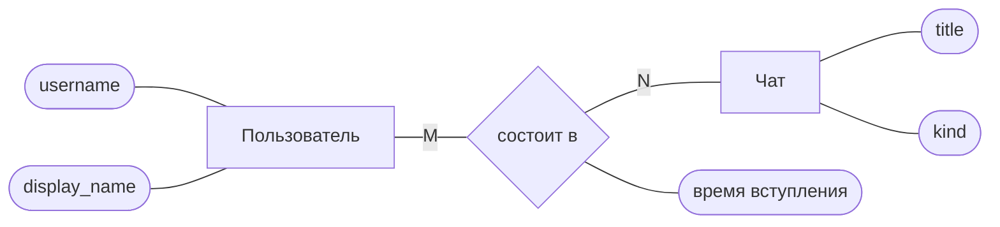
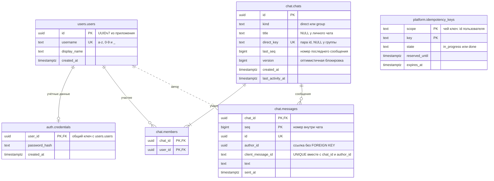

# 2.1. От требований к модели данных

## <Part kind="problem" /> Проблема: таблица, нарисованная с экрана

Представьте, что мессенджеру нужна база, и первым делом команда открывает макет главного экрана — список чатов. В каждой строке списка видно название чата, имя автора последнего сообщения, начало текста, время и счётчик непрочитанных. Проще всего завести таблицу, которая выглядит ровно как этот экран: одна строка таблицы на одну строку списка.

| пользователь | чат | последнее сообщение | автор | время | непрочитано | участники |
| --- | --- | --- | --- | --- | --- | --- |
| alice | Бэкенд | Выкатываем в пятницу? | Боб Смирнов | 18:02 | 0 | alice,bob,carol |
| bob | Бэкенд | Выкатываем в пятницу? | Боб Смирнов | 18:02 | 0 | alice,bob,carol |
| carol | Бэкенд | Выкатываем в пятницу? | Боб Смирнов | 18:02 | 1 | alice,bob,carol |
| alice | Обед | Я в столовой | Кэрол Ли | 12:40 | 3 | alice,carol |

Экран рисуется одним запросом без единого соединения таблиц, и первые дни всё работает. Потом приходят обычные события из жизни мессенджера.

- **Боб меняет отображаемое имя.** «Боб Смирнов» записан в каждой строке, где он автор последнего сообщения, у каждого участника каждого такого чата. Нужно найти и переписать их все. Пропустили одну — и у Кэрол в списке другое имя, чем у Алисы.
- **В «Бэкенд» пишут новое сообщение.** Меняются три строки: у каждого участника. В группе на тысячу человек — тысяча строк на каждое сообщение.
- **Нужна лента сообщений чата.** Самих сообщений в таблице нет — только последнее. Для ленты придётся завести ещё одну таблицу «под экран», и имя автора поселится и там.
- **Кто состоит в чате «Обед»?** Ответ — строка `alice,carol`, которую нужно разбирать в коде. Можно ли добавить туда пользователя, которого не существует? Можно: база видит просто текст.
- **Дизайнер переносит счётчик непрочитанных в другое место экрана и добавляет аватар.** Меняется таблица.

Корень всех пяти бед один: таблица описывает **экран**, а не **то, о чём система должна помнить**. Экраны меняются каждый квартал. Факты предметной области — «Боб зарегистрирован под именем bob», «Боб состоит в чате „Бэкенд“», «Боб написал в „Бэкенд“ сообщение номер 41» — не меняются от того, где их показывают. Модель данных строят от фактов: от требований к системе. Экраны и запросы потом получают свои данные из этой модели, а если какой-то запрос окажется слишком дорогим, мы осознанно добавим к модели копию данных под него (урок 2.2) или ключ и индекс (урок 2.5).

В этом уроке мы построим модель данных мессенджера с нуля, от требований урока [0.6](../00-foundation/06-messenger-requirements), и разложим её по ограниченным контекстам из модуля 1. Это первый шаг части 2a: кода в мессенджере урок не меняет, но всё, что появится в базе в уроках 2.2–2.9, вырастает из модели, которую мы здесь нарисуем.

К концу урока вы:

- выделите из требований сущности, атрибуты и связи и отличите сущность от атрибута;
- определите кардинальность и обязательность связи и переведёте 1:1, 1:N и M:N в таблицы и ключи;
- прочитаете и нарисуете ER-диаграмму в нотации Чена и в нотации «воронья лапка»;
- построите модель мессенджера: пользователи, учётные данные, чаты, участники, сообщения, ключи идемпотентности;
- разложите таблицы по схемам PostgreSQL по ограниченным контекстам и объясните, почему внешние ключи между контекстами разрешены только к `users.users`.

## <Part kind="theory" /> Три уровня модели данных

Слово «модель» в разговорах о базах означает три разные вещи, и полезно различать их с самого начала.

| уровень | что описывает | чего в нём ещё нет | где в курсе |
| --- | --- | --- | --- |
| концептуальная модель | какие вещи есть в предметной области и как они связаны: «пользователь состоит в чатах» | таблиц, столбцов, типов | этот урок |
| логическая модель | таблицы, столбцы, первичные и внешние ключи, нормальные формы | типов конкретной СУБД, индексов, размещения на диске | уроки 2.1–2.4 |
| физическая модель | типы PostgreSQL, индексы, схемы, ограничения, как это лежит на диске | — | уроки 2.3, 2.5, часть 2b |

Концептуальную модель обсуждают с теми, кто знает предметную область, и не спорят на ней о `bigint` против `uuid`. Логическая модель — уже таблицы, но ещё не привязанные к конкретной базе. Физическая — то, что в итоге пишет миграция.

<Callout type="simplified">

В учебниках три уровня строят строго по очереди, и концептуальная модель не знает ни ключей, ни столбцов. Мы будем срезать угол: сущности мессенджера сразу получают имена таблиц (`chat.messages`) и ключевые столбцы, потому что модуль 1 уже дал нам предметную область — домен, контексты и язык. Типы и индексы при этом остаются на потом: их выбор — уроки 2.3 и 2.5.

</Callout>

## <Part kind="theory" /> Сущность и атрибут

### Сущность: то, о чём система помнит

<T id="entity">Сущность</T> (entity) в моделировании данных — вещь или событие предметной области, о котором системе нужно хранить сведения, у которого много экземпляров и каждый экземпляр можно отличить от других. «Пользователь» — сущность: пользователей много, каждый отдельный, о каждом мы помним имя и дату регистрации. «Сообщение» — сущность: это событие, но его тоже много и каждое отдельное.

Слово вам знакомо по уроку [1.2](../01-go-service/02-domain): там сущность — объект с идентичностью, который остаётся собой, когда меняются его поля. Два определения согласованы. И там, и тут сущность отличает **идентичность**, а не набор значений. В базе идентичность выражает <T id="primary-key">первичный ключ</T> (primary key) — столбец или набор столбцов, значение которых не повторяется и не бывает пустым. У пользователя это `id`. Боб может сменить имя, но его `id` останется прежним, и всё, что ссылается на Боба, продолжит ссылаться на него.

Откуда брать кандидатов в сущности? Классический приём из книги Хернандеса «Database Design for Mere Mortals» — читать требования и выписывать **существительные**. В требовании «пользователь регистрируется и входит под своим именем» есть «пользователь» и «имя». Дальше каждый кандидат проходит три вопроса:

1. **Много ли экземпляров и нужно ли их различать?** Пользователей много, и мы их различаем — сущность. «Мессенджер» в единственном экземпляре — не сущность, а сама система.
2. **Есть ли у него собственные сведения?** У пользователя есть имя, отображаемое имя, время регистрации. У «имени» собственных сведений нет: оно само сведение о пользователе. Значит, «имя» — атрибут.
3. **Живёт ли он независимо или только как свойство другого?** Текст сообщения не существует без сообщения — атрибут. Сообщение существует само по себе и на него ссылаются (ответы, статусы прочтения в модуле 3) — сущность.

### Атрибут: свойство сущности

**Атрибут** (attribute) — одно свойство сущности: имя пользователя, время отправки сообщения, название группы. Из атрибутов вырастают столбцы таблицы, и на атрибут сразу действуют два правила хорошей модели.

**Атрибут атомарен и однозначен.** В нём одно значение, а не список. «Участники: alice,bob,carol» из таблицы «под экран» — не атрибут чата, а спрятанная в строку связь чата с пользователями. Это первое требование <T id="normal-form">нормальной формы</T> (normal form), 1НФ; подробно нормальные формы — урок 2.2.

**Атрибут принадлежит своей сущности.** «Имя автора» — атрибут пользователя, а не сообщения. Сообщение хранит, **кто** его автор (ссылку на пользователя), а имя берётся у пользователя. Иначе имя будет жить в двух местах и разъедется при первом переименовании, как у Боба в начале урока.

Отдельный вопрос — **производные атрибуты**: число непрочитанных, число участников, время последней активности. Их можно вычислить из других данных, поэтому по умолчанию их не хранят. Иногда хранят сознательно, ради скорости запроса, и тогда сами отвечают за то, чтобы копия не разошлась с источником. Это <T id="denormalization">денормализация</T> (denormalization), и в мессенджере она уже будет: счётчик `last_seq` и время `last_activity_at` у чата. Почему это оправдано и чем за это платят, разберём в уроке 2.2.

## <Part kind="theory" /> Связи, кардинальность и обязательность

### Связь

<T id="relationship">Связь</T> (relationship) — правило, по которому экземпляры сущностей относятся друг к другу: «пользователь **состоит в** чате», «сообщение **отправлено в** чат», «сообщение **написал** пользователь». Если существительные в требованиях подсказывают сущности, то **глаголы** подсказывают связи.

Про связь задают два вопроса — со стороны каждого её конца.

**Сколько максимум?** Сколько экземпляров B может быть связано с одним A и наоборот. Это <T id="cardinality">кардинальность</T> (cardinality) в узком смысле — одно из трёх значений:

- **1:1, «один к одному».** У пользователя не больше одной записи учётных данных, у записи ровно один пользователь.
- **1:N, «один ко многим».** В чате много сообщений, у сообщения ровно один чат.
- **M:N, «многие ко многим».** Пользователь состоит во многих чатах, и в чате много пользователей.

**Сколько минимум — ноль или один?** Это **обязательность** (participation, optionality). У сообщения обязательно есть чат: сообщения «ни в каком чате» не бывает. А у пользователя может не быть ни одного чата: он только что зарегистрировался. Обязательность смотрят с обеих сторон отдельно. Связь «чат — сообщение» обязательна для сообщения и необязательна для чата: новый чат пуст.

Вместе максимум и минимум дают четыре варианта для каждого конца связи: «ровно один», «ноль или один», «один или много», «ноль или много». Именно их и рисуют на концах линий ER-диаграммы.

<Callout type="simplified">

Слово «кардинальность» в литературе используют по-разному. Одни авторы называют так только максимум (1:1, 1:N, M:N), а минимум зовут обязательностью или степенью участия, другие — пару «минимум и максимум» целиком. Мы держимся первого: кардинальность — максимум, обязательность — минимум, и всегда проговариваем обе. И не путайте связь 1:1 с «личным чатом 1:1» из требований 0.6: там «1:1» значит «двое собеседников», а не кардинальность.

</Callout>

### Как связь превращается в таблицы

Реляционная база хранит связи не линиями, а значениями: строка одной таблицы держит значение ключа строки другой. Столбец, который ссылается на первичный ключ другой таблицы, называется <T id="foreign-key">внешним ключом</T> (foreign key). Объявленный как ограничение, он не даёт сослаться на несуществующую строку: база проверит родителя при каждой вставке. Для каждого вида связи есть своё стандартное решение.

| связь | пример | как хранится | что даёт база |
| --- | --- | --- | --- |
| 1:N | чат и сообщения | внешний ключ на стороне «многих»: `chat.messages.chat_id → chat.chats.id` | `NOT NULL` на `chat_id` делает связь обязательной для сообщения |
| 1:1 | пользователь и учётные данные | внешний ключ, который сам уникален; у нас — общий первичный ключ: `auth.credentials.user_id` и ключ, и ссылка на `users.users.id` | вторую запись для того же пользователя база не примет |
| M:N | пользователи и чаты | третья таблица — <T id="junction-table">таблица-связка</T> (junction table) `chat.members (chat_id, user_id)` с двумя внешними ключами | составной первичный ключ не даст добавить участника дважды |

Почему внешний ключ лежит на стороне «многих», а не наоборот? Потому что в ячейке одно значение. У сообщения ровно один чат — это один столбец `chat_id`. У чата тысячи сообщений, и одного столбца «сообщения» в чате быть не может: пришлось бы класть список в ячейку, а это ровно та беда, с которой начался урок.

M:N тем более не помещается ни в одну из двух таблиц: списки нужны с обеих сторон. Таблица-связка решает это, превращая каждую пару «пользователь u состоит в чате c» в отдельную строку. Одна связь M:N распадается на две связи 1:N: у пользователя много строк участия, у чата много строк участия, у строки участия ровно один пользователь и ровно один чат. У связки бывают и собственные атрибуты — то, что описывает именно участие, а не пользователя или чат: роль участника, время вступления, номер последнего прочитанного сообщения (последнее понадобится в модуле 3 для статусов «прочитано»).

### Что связь в базе выразить не может

Внешний ключ и `NOT NULL` хорошо держат обязательность **на стороне ребёнка**: у сообщения не может не быть чата. Обязательность **на стороне родителя** — «в чате хотя бы два участника» — внешним ключом не выражается. База не мешает вставить чат без единой строки в `chat.members`: ограничение `FOREIGN KEY` смотрит от ребёнка к родителю, а не наоборот. То же с верхними границами: «в группе до 1 000 участников» из требований 0.6 — не кардинальность связи, а бизнес-правило.

Такие правила держит домен. Конструктор группы из урока 1.2 не создаст чат без участников, а лимит — именованная константа `GroupMaxMembers`. В базовой версии модуля 1 она равна 200, а не 1 000 из требований: до целевого числа лимит дорастёт вместе с доставкой через очередь в модуле 7, и для модели данных это ничего не меняет — меняется одна константа домена. Use case создаёт чат и его участников вместе, и с базой это будет одна <T id="transaction">транзакция</T> (transaction): либо записалось всё, либо ничего. Где граница между тем, что держит домен, и тем, что держит база, — тема урока 2.4.

## <Part kind="theory" /> ER-диаграмма: нотации Чена и «воронья лапка»

<T id="er-diagram">ER-диаграмма</T> (entity-relationship diagram) — схема модели данных: сущности, их атрибуты и связи между ними. По ней обсуждают модель до того, как написана первая строка DDL (Data Definition Language — команды `CREATE`, `ALTER`, `DROP`, которые описывают структуру базы: таблицы, столбцы, ограничения). Нотаций несколько, и две из них полезно знать в лицо.

### Нотация Чена

Модель «сущность — связь» предложил Питер Чен в статье «The Entity-Relationship Model — Toward a Unified View of Data» (ACM Transactions on Database Systems, 1976). В его нотации сущность — прямоугольник, связь — ромб, атрибут — овал, а кардинальность подписана у линий.

Что смотреть на схеме. Синий и зелёный прямоугольники — сущности «Пользователь» и «Чат». Янтарный ромб — сама связь «состоит в»: в нотации Чена связь — отдельная фигура, равноправная с сущностями. Буквы M и N у линий — кардинальность «многие ко многим». Серые овалы — атрибуты. Обратите внимание на «время вступления»: этот атрибут висит на **ромбе**. Он описывает не пользователя и не чат, а их связь. Нотация Чена показывает это прямо, и это лучший способ понять, откуда в реляционной модели берётся таблица-связка: у связи M:N есть свои данные, значит, ей нужна своя таблица. (Время вступления — пример для иллюстрации: в схеме мессенджера его пока нет.)

Нотация Чена хороша для разговора о понятиях, но громоздка: на модели из двадцати сущностей овалы атрибутов закрывают всё остальное. Поэтому в практике её почти вытеснила вторая нотация.

### «Воронья лапка»

В нотации **«воронья лапка»** (crow's foot) связь — просто линия между прямоугольниками, а кардинальность и обязательность нарисованы символами на концах линии. Символ «многие» — трёхзубая развилка, похожая на птичью лапу; отсюда название. Нотацию предложил Гордон Эверест в 1976 году, а в 1980-х её распространила методология Information Engineering Джеймса Мартина и Клайва Финкельштейна. Сегодня в ней рисуют большинство инструментов проектирования баз и mermaid, которым мы пользуемся в курсе.

Конец линии читается двумя символами: внешний, ближе к прямоугольнику, — максимум, внутренний — минимум.

| символ в mermaid | рисунок на конце линии | читается |
| --- | --- | --- |
| `\|\|` | две черты | ровно один |
| `\|o` или `o\|` | черта и кружок | ноль или один |
| `}\|` или `\|{` | развилка и черта | один или много |
| `}o` или `o{` | развилка и кружок | ноль или много |

Связь читают от каждого конца по очереди. Запись `chats ||--o{ messages` значит: «у одного чата — ноль или много сообщений; у одного сообщения — ровно один чат». Тот же пример с нашими таблицами — ниже, в разделе «Код».

Сплошная или пунктирная линия — ещё одно различие. Сплошная линия в mermaid означает **идентифицирующую** связь: ключ родителя входит в первичный ключ ребёнка, ребёнок без родителя не мыслим даже как идентификатор. `chat.messages` с ключом `(chat_id, seq)` — такой случай: номер 41 имеет смысл только внутри конкретного чата. Пунктир — **неидентифицирующая** связь: ссылка есть, но в ключ ребёнка не входит.

Есть и другие нотации. IDEF1X — стандарт американского правительства, им пользуются в крупных корпоративных инструментах. Диаграмма классов UML тоже годится для модели данных: кратности пишут числами (`1`, `0..1`, `*`). Принципы одни и те же: сущности, атрибуты, связи с двумя вопросами на каждом конце.

<Deep title="Сущность в DDD и строка в таблице: почему Chat в коде — один объект, а в базе — две таблицы">

В уроке 1.2 чат был <T id="aggregate">агрегатом</T> (aggregate): участники лежали внутри объекта `Chat` срезом `members []UserID`, и менять их можно было только через методы чата. В модели данных участники — отдельная таблица `chat.members`. Противоречия здесь нет, это две проекции одной вещи на разные среды.

Агрегат — граница **согласованности** в коде. Он отвечает на вопрос «что меняется вместе и под чьим контролем»: чтобы проверить «автор — участник» и выдать следующий `seq`, чат должен видеть своих участников и свой счётчик. В памяти Go естественно положить всё это в один объект.

Таблица — граница **хранения** в реляционной модели. В ячейке одно значение, поэтому список участников превращается в строки связки. Реляционная модель знает только таблицы и ключи и ничего не знает о том, что `chat.chats` и `chat.members` — один агрегат.

Значит, соответствие «агрегат → таблицы» держит **адаптер** хранилища (урок 2.9). Он читает строку чата и строки участников и собирает из них `*domain.Chat`. При сохранении — раскладывает объект обратно атомарно, потому что агрегат меняется целиком или никак: новый чат и его участников адаптер пишет одним оператором SQL (`INSERT` с <T id="cte">CTE</T>), а если бы записей было несколько, их объединила бы одна транзакция. Use case и домен об этом не знают: они видят порт `ChatFinder`, а не таблицы.

Отсюда практическое следствие для проектирования. Границы агрегатов подсказывают границы транзакций и блокировок: запись в агрегат — одна транзакция, и параллельных писателей одного чата упорядочивает блокировка строки чата (урок 2.5). А вот границы таблиц агрегаты не задают. Один агрегат может лечь в несколько таблиц, как чат. Сообщения при этом в агрегат не входят: в памяти `Chat` их не держит, а лишь выдаёт следующий номер. И таблица сообщений растёт сама по себе: миллионы строк, которые никто не загружает в память целиком.

Ловушка, в которую попадают часто: сделать таблицу на каждый класс Go и столбец на каждое поле. Тогда схема повторяет устройство кода, а не факты предметной области, и любое изменение структуры в коде становится миграцией. Модель данных строят от требований и паттернов доступа, а отображение на объекты домена — забота адаптера.

</Deep>

## <Part kind="theory" /> От требований мессенджера к модели

Пройдём по требованиям урока [0.6](../00-foundation/06-messenger-requirements), которые относятся к хранению, и по двум требованиям, которые добавил модуль 1. Для каждого — что появляется в модели и почему именно так. Требования, которые реализуют другие модули (каналы, доставка в реальном времени, статусы, вложения), в модель пока не попадают: YAGNI — модель строят под то, что система делает, а не под то, что «может понадобиться». Как модель вырастет под них, вы попробуете сами в разделе «Практика».

### 1. Регистрация и вход → `users.users` и `auth.credentials`

Требование 1 из 0.6: «Регистрация и вход». Существительные — пользователь, имя, пароль.

**Пользователь** — сущность. Атрибуты из домена урока 1.2: `username` (имя для входа, уникальное), `display_name` (отображаемое имя), `created_at`. Первичный ключ — `id`, <T id="surrogate-key">суррогатный ключ</T> (surrogate key): значение без бизнес-смысла, которое выдаёт приложение, — <T id="uuidv7">UUIDv7</T> из `idgen`. Почему не `username`? Он тоже уникален, но имя — сведение, которое пользователь может захотеть поменять, а ключ, на который ссылаются другие таблицы, меняться не должен. Выбор ключа и типа подробно разберём в уроке 2.3.

**Пароль** не атрибут пользователя, хотя на первый взгляд похож. В уроке [1.13](../01-go-service/13-passwords) учётные данные ушли в отдельный контекст `auth`: у них другая причина для изменений (политика паролей, хеширование, токены), а хеш пароля незачем видеть остальным, кто читает профиль. Поэтому **учётные данные** — своя сущность `auth.credentials` с атрибутом `password_hash`.

Связь «пользователь — учётные данные» — 1:1: у записи учётных данных ровно один пользователь, у пользователя — ноль или одна запись. Ноль, а не ровно одна: в логической модели пользователь может существовать без пароля, например при входе через внешнего провайдера в будущем. А при регистрации их создаёт одна транзакция (об этом ниже). Связь 1:1 реализована общим первичным ключом: `auth.credentials.user_id` одновременно первичный ключ таблицы и внешний ключ на `users.users.id`. Вторую запись для того же пользователя база не примет — это нарушение первичного ключа.

### 2–3. Личные и групповые чаты → `chat.chats`

Требования 2 и 3: личные чаты двух собеседников и групповые чаты до 1 000 участников.

**Чат** — сущность. Возникает вопрос: личный и групповой чат — одна сущность или две? Признаки двух сущностей были бы такими: разные атрибуты, разные связи, разное поведение. Здесь же почти всё общее — участники, сообщения, лента, нумерация. Отличаются только название (у группы есть, у личного чата нет) и правило «личный чат для пары один». Поэтому чат — одна сущность с атрибутом `kind` (`direct` или `group`), как и в домене урока 1.2.

Правило «личный чат для пары один» требует атрибута, по которому его можно проверить. `direct_key` — отсортированная пара id собеседников. У личного чата она есть и уникальна, у группы — `NULL`. Уникальность этого столбца не даст завести второй личный чат той же пары, даже если два запроса придут одновременно. Как именно база это держит — урок 2.4.

Ещё четыре атрибута чата — не прямые сведения из требований, а следствия решений модуля 1:

- `last_seq` — номер последнего сообщения. Сообщения внутри чата нумеруются подряд (требование порядка из 0.6, урок 1.2), и номер следующего выдаёт чат. Это производный атрибут — максимум `seq` среди сообщений чата, — хранимый сознательно (урок 2.2);
- `version` — версия для <T id="optimistic-locking">оптимистичной блокировки</T> (optimistic locking) из урока 1.4: растёт при каждом изменении чата;
- `created_at` и `last_activity_at` — время создания и последней активности; по второму сортируется список чатов (урок 1.11).

### 3. Участники → `chat.members`

В требовании 3 спрятан глагол: пользователь **состоит** в чатах. У пользователя много чатов, у чата много участников — связь M:N. Значит, нужна таблица-связка `chat.members` со строкой на каждую пару «чат — участник» и первичным ключом `(chat_id, user_id)`. Оба столбца — внешние ключи: `chat_id` на `chat.chats`, `user_id` на `users.users`.

Обратите внимание на обязательность. Со стороны строки участия связь обязательна в обе стороны: участия без чата или без пользователя не бывает (`NOT NULL` на обоих столбцах — их и так требует первичный ключ). Со стороны чата — «один или много»: чат без участников бессмыслен, но, как мы выяснили, это правило держит домен, а не внешний ключ.

### 5. История сообщений → `chat.messages`

Требование 5: история сообщений с пагинацией. **Сообщение** — сущность: у него есть текст, автор, время, номер в чате. Связь с чатом — 1:N, обязательная для сообщения. Внешний ключ `chat_id` лежит на стороне сообщений.

Первичный ключ сообщения — `(chat_id, seq)`, а не просто `id`. Это решение от **паттерна доступа**: самый частый запрос к сообщениям — «страница ленты чата c по номерам до такого-то», и ключ `(chat_id, seq)` отдаёт её одним диапазоном индекса. У сообщения при этом остаётся и свой `id` (UUIDv7) — уникальный, для поиска сообщения по id. Цену второго уникального индекса и всю логику выбора ключей от запросов разберём в уроке 2.5.

Атрибут `client_message_id` пришёл из урока 1.12: клиент сам присваивает сообщению идентификатор до первой попытки, и повторная отправка не создаёт дубль. В модели это требование уникальности тройки `(chat_id, author_id, client_message_id)` — <T id="natural-key">естественный ключ</T> (natural key) сообщения в смысле урока 1.12.

А `author_id` — ссылка на пользователя, и связь «пользователь — сообщения» тоже 1:N. Но внешнего ключа на этой ссылке не будет. Почему — в разделе о контекстах ниже.

### Повтор запроса → `platform.idempotency_keys`

Последняя сущность пришла не из продуктовых требований, а из надёжности. В уроке [1.12](../01-go-service/12-idempotency) мы научили сервер узнавать повтор запроса по заголовку `Idempotency-Key`. <T id="idempotency-key">Ключ идемпотентности</T> (idempotency key) и сохранённый ответ живут, пока в памяти процесса. Это тоже данные, которые должны пережить перезапуск и быть видны всем экземплярам сервиса. Значит, им нужна таблица.

Ключ записи — `(scope, key)`: сам ключ выбирает клиент, а `scope` — область, в которой он уникален (у нас — id пользователя), чтобы ключи разных пользователей не столкнулись. Атрибуты — состояние (`in_progress` или `done`), сохранённый ответ и сроки: `reserved_until` для зависшей резервации и `expires_at`, после которого запись можно удалить. Связей у таблицы нет, хотя `scope` — это id пользователя. Таблица обслуживает HTTP-слой и не знает, что такое пользователь: для неё `scope` — просто строка. Внешний ключ превратил бы общий механизм платформы в часть контекста `users`.

Итого шесть сущностей: `users.users`, `auth.credentials`, `chat.chats`, `chat.members`, `chat.messages` и `platform.idempotency_keys`. Префиксы перед точкой — схемы PostgreSQL, и к ним мы сейчас перейдём.

## <Part kind="theory" /> Ограниченные контексты → схемы PostgreSQL

### Контексты мессенджера

В уроках [1.1](../01-go-service/01-architecture) и [1.2](../01-go-service/02-domain) мы разложили код по <T id="bounded-context">ограниченным контекстам</T> (bounded contexts) — областям, внутри которых слова <T id="ubiquitous-language">единого языка</T> имеют одно точное значение. Сейчас их три: `user` (профили), `chat` (чаты и сообщения) и `auth` (учётные данные и токены, урок 1.13). Механизм идемпотентности живёт в `platform` — общей инфраструктуре, которая не принадлежит ни одному контексту. Контексты не импортируют друг друга. Там, где одному нужен другой, стоит порт и узкий адаптер-мост: `chat` спрашивает `user` через порт `UserChecker`, `auth` создаёт профиль через `ProfileRegistrar`. Это правило проверяет линтер (`depguard`).

Если в базе все таблицы лягут в одну кучу, граница, которую мы так берегли в коде, исчезнет в данных. Ничто не помешает адаптеру чатов прочитать хеш пароля одним `JOIN`. И через год никто не скажет, какие таблицы можно трогать, меняя контекст `auth`.

### Схема на контекст

<T id="db-schema">Схема</T> (schema) в PostgreSQL — именованное пространство внутри одной базы данных. Таблица `messages` в схеме `chat` пишется как `chat.messages`. Документация PostgreSQL перечисляет, зачем нужны схемы: разделить объекты на логические группы, чтобы ими было проще управлять; дать нескольким пользователям одну базу так, чтобы они не мешали друг другу; держать объекты сторонних приложений в отдельных схемах, чтобы их имена не конфликтовали. У нас первая причина: каждый контекст получает свою схему.

| схема | контекст | таблицы |
| --- | --- | --- |
| `users` | `user` — профили | `users.users` |
| `auth` | `auth` — учётные данные | `auth.credentials` |
| `chat` | `chat` — чаты и сообщения | `chat.chats`, `chat.members`, `chat.messages` |
| `platform` | общая инфраструктура | `platform.idempotency_keys` |

Схема называется `users`, а не `user`: `USER` — зарезервированное слово SQL, и такое имя пришлось бы везде брать в кавычки. Таблица `users.users` выглядит тавтологией, но читается однозначно: таблица пользователей в схеме контекста пользователей. Правила именования подробнее — в уроке 2.7.

Что дают схемы на практике:

- **граница видна в каждом запросе.** `SELECT … FROM auth.credentials` в коде контекста `chat` заметен на ревью сразу, как импорт чужого пакета;
- **права выдаются на схему.** Можно дать роли доступ к `chat` и не дать к `auth`: `GRANT USAGE ON SCHEMA` и права на таблицы схемы. Мессенджер пока работает одной ролью, но граница для такого шага уже есть;
- **имена не конфликтуют.** У двух контекстов может быть своя таблица `events`;
- **миграции и владение группируются.** Видно, какие таблицы принадлежат какому контексту, когда контекст будут выделять в сервис.

При этом схемы — не отдельные базы. Документация подчёркивает: в отличие от баз данных, схемы не изолированы жёстко. Один запрос и одна транзакция видят все схемы сразу, а внешний ключ может ссылаться на таблицу другой схемы. Это и сила, и опасность, и дальше всё решает дисциплина.

<Deep title="Три способа разделить данные контекстов и почему мы выбрали средний">

Есть три распространённых варианта, где держать данные нескольких контекстов.

**Одна схема, все таблицы рядом** (`public.users`, `public.credentials`, `public.messages`). Просто, и так начинается большинство проектов. Цена — границы контекстов в данных нет: любой код может соединить любые таблицы, и связи между контекстами растут незаметно. Когда контекст придёт время выделять, выяснится, что его таблицы участвуют в десятке чужих запросов. Ричардсон на microservices.io называет такой вариант «общей базой» (Shared database) и отмечает главный недостаток — связанность команд и сервисов через схему.

**Отдельная база на контекст** («база на сервис», Database per service у того же Ричардсона). Граница абсолютная: внешний ключ между разными базами PostgreSQL невозможен вовсе, а запрос из одной базы в другую требует расширения `postgres_fdw` или `dblink` — и даже с ним ссылочной целостности между базами нет. Контекст можно мигрировать, масштабировать и выносить независимо. Цена — нет общих транзакций и ссылочной целостности между контекстами. Регистрация, которая меняет и профиль, и учётные данные, становится распределённой операцией: нужна сага или транзакционный outbox (модуль 7). Для монолита на одной машине это сложность без выгоды.

**Схема на контекст в одной базе** — наш вариант. Граница видна и проверяема: имена, права, миграции по контекстам. При этом одна база и одна транзакция ещё доступны, когда без них не обойтись. Это вариант модульного монолита: код уже разделён по контекстам, и данные разделяются так же, но без цены распределённой системы.

Важно понимать, что граница в схемах держится соглашением, а не механизмом. PostgreSQL выполнит `JOIN` между `chat.messages` и `auth.credentials`, если у роли есть права. Поэтому к схемам прилагаются правила: код контекста ходит только в свою схему; межсхемные внешние ключи — только перечисленные явно; межсхемные транзакции — только в известных сценариях. Правила записываются в ADR, а проверка «адаптер чатов не трогает чужие схемы» живёт в ревью и в тестах адаптеров.

Когда контекст `chat` станет отдельным сервисом (модуль 6), переход будет таким: снять межсхемные внешние ключи, заменить их проверкой через порт, перенести схему в отдельную базу. Код контекста при этом не переписывается: он и так ходил только в свою схему.

</Deep>

### Межконтекстные внешние ключи: только к `users.users`

Внешний ключ между схемами — самая сильная связь между контекстами, какая бывает в базе. Пока он есть, таблицу-родителя нельзя перенести в другую базу. А когда в мессенджере появится удаление пользователя (сейчас его нет), строку-родителя нельзя будет удалить, не подумав о детях из чужого контекста. Поэтому мы разрешаем ровно два межсхемных внешних ключа, и оба ведут в одну таблицу:

- `auth.credentials.user_id → users.users.id` — учётные данные без пользователя бессмысленны;
- `chat.members.user_id → users.users.id` — участником может быть только существующий пользователь.

Почему именно `users.users`? Идентичность пользователя — понятие, общее для всех контекстов: и чат, и учётные данные говорят о «пользователе с этим id», и это одно и то же понятие во всех словарях. Чем-то похожим в коде было <T id="shared-kernel">общее ядро</T> (shared kernel) `kernel/ident` из урока 1.13: формат идентификатора, о котором контексты договорились. Ссылаться на идентичность — естественно, а внешний ключ дешёво даёт гарантию, которую иначе пришлось бы проверять кодом при каждой вставке: в таблице участников нет «мёртвых» пользователей.

А почему не на что-то ещё? Каждый межконтекстный ключ — это пункт в будущем плане распила. Связи контекста `chat` с контекстом `user` уже есть в коде: порт `UserChecker` перед созданием чата проверяет, что все участники существуют. Внешний ключ на `members` дублирует эту проверку на уровне базы и закрывает гонку между проверкой и вставкой. Остальным связям между контекстами этого не нужно, и их нет.

Самый показательный случай — `chat.messages.author_id`. Это ссылка на пользователя, связь 1:N, и внешний ключ выглядит естественным. Но мы его не ставим:

- **гарантия уже есть.** Use case `SendMessage` пишет сообщение только от участника чата (проверка «автор — участник» в агрегате, урок 1.2). А участник — это строка `chat.members` с внешним ключом на пользователя. В момент вставки автор существует;
- **таблица сообщений — самая горячая.** Внешний ключ проверяется при каждой вставке. PostgreSQL ищет строку родителя по индексу и блокирует её в режиме `FOR KEY SHARE`, чтобы родителя не удалили до конца транзакции. Для сообщений это ещё одно обращение к чужой таблице на каждую запись — ради гарантии, которая уже есть;
- **меньше межконтекстных связей на самой большой таблице.** Когда чаты уедут в свой сервис, таблицу на миллиарды строк не придётся перестраивать.

Решение «схема на контекст, межконтекстные внешние ключи только к `users.users`» и первый шаг при выделении сервиса мы запишем в архитектурное решение ADR-0014 в уроке 2.4, вместе с остальными решениями об ограничениях.

### Одна транзакция на два контекста: регистрация

Осталась последняя связь между контекстами — не ссылка, а сценарий. Регистрация меняет два контекста: создаёт профиль в `user` и учётные данные в `auth`. В модуле 1 хранилища были в памяти и разными, общей транзакции не было, и ADR-0004 честно записал окно неатомарности: профиль создан, а пароль не сохранён — такой пользователь не может войти.

С общей базой это окно закрывается одной транзакцией: `INSERT` в `users.users` и `INSERT` в `auth.credentials` фиксируются вместе или не фиксируются вовсе. Строго говоря, это нарушает идеал «транзакция не пересекает границу контекста». Мы принимаем такой компромисс сознательно:

- **внутри одной базы он дешёвый и надёжный.** Альтернатива — сага с компенсацией («удалить профиль, если пароль не сохранился») или outbox. Это сложнее и всё равно оставляет окно, только короче;
- **он виден.** Транзакцию открывает use case регистрации через узкий порт `Transactor` (урок 2.9). Контексты по-прежнему не знают таблиц друг друга: каждый адаптер пишет в свою схему, общая у них только транзакция;
- **у него известна цена выхода.** Когда `auth` и `user` станут разными сервисами (модуль 6), общая транзакция исчезнет, и сценарий регистрации перейдёт на события и outbox (модуль 7). Use case к этому готов: шаги уже упорядочены так, чтобы вероятные сбои случались до побочных эффектов (ADR-0004).

## <Part kind="viz" /> Визуализация: плеер er-build

Плеер строит модель мессенджера шаг за шагом: сверху — требование и его источник, на диаграмме — что из него появилось. Новое на каждом шаге выделено. Кнопки «вперёд» и «назад» листают шаги, подпись под диаграммой объясняет решение.

<ErBuild />

Что смотреть:

1. **Шаг 1, пользователь.** У сущности два вида ключевых пометок: `PK` у `id` и `UQ` у `username`. Имя уникально, но ключом не стало: ссылки на пользователя не должны зависеть от того, что пользователь может поменять.
2. **Шаг 2, учётные данные.** Первая связь — 1:1. Прочитайте концы линии: у `users` две черты («ровно один»), у `credentials` черта и кружок («ноль или один»). У `user_id` сразу две пометки — `PK FK`: общий первичный ключ и есть механизм 1:1.
3. **Шаг 4, участники.** Таблица `members` с пометкой `M:N` — связка. Связь «многие ко многим» на диаграмме не одна линия, а две линии 1:N: от `users` и от `chats`. Обе — «ноль или много» на стороне связки.
4. **Шаг 5, сообщения.** Две новые линии. Сплошная от `chats` — внешний ключ `chat_id`, который входит в первичный ключ `(chat_id, seq)`. Пунктир от `users` — `author_id`: связь есть, а внешнего ключа нет. Её держит use case, а не база.
5. **Шаг 6, ключи идемпотентности.** Сущность без единой линии. Это нормально: таблица обслуживает HTTP-слой и не знает о пользователях и чатах.
6. **Шаг 7, границы.** Пунктирные рамки — схемы PostgreSQL. Выделены две линии, которые пересекают границу схем: внешние ключи из `auth.credentials` и `chat.members` в `users.users`. Других линий через границу со внешним ключом нет: пунктир `author_id` тоже пересекает её, но он без внешнего ключа.

<Callout type="simplified">

На диаграмме плеера показаны только ключевые столбцы — всё остальное не помещается на экран телефона. Все 1:N плеер рисует как «ноль или много»: это то, что гарантирует база. Полная ER-диаграмма в разделе «Код» показывает у участников чата «один или много» — бизнес-правило, которое база не проверит. Точное «не меньше двух участников» не выражает ни одна из диаграмм: «воронья лапка» знает только минимум ноль или один. Это правило живёт в домене.

</Callout>

Вопросы к визуализации:

1. На шаге 2 поменяйте мысленно концы местами: у `users` — «ноль или один», у `credentials` — «ровно один». Что тогда утверждала бы модель?
2. На шаге 5 связь `chats → messages` идентифицирующая, а `users → messages` — нет. Что изменилось бы в ключе сообщений, будь первичным ключом просто `id`?
3. На шаге 7 линия `author_id` пересекает границу схем. Почему это не нарушает правило «межконтекстные внешние ключи только к `users.users`»?

<SelfCheck question="Ответы">

1. «У каждого пользователя ровно одна запись учётных данных, а запись учётных данных может существовать без пользователя». Первая половина — бизнес-правило, которое база не выражает внешним ключом: на стороне родителя обязательность так не задать. Вторая — бессмыслица: хеш пароля, который не принадлежит никому. Направление связи и обязательность на концах — содержательное утверждение о предметной области, а не оформление.
2. Связь с чатом стала бы неидентифицирующей: `chat_id` остался бы внешним ключом, но вышел бы из первичного ключа. Номер `seq` тогда уже не был бы частью идентичности сообщения, и уникальность пары `(chat_id, seq)` пришлось бы объявлять отдельным ограничением. А ленту чата обслуживал бы второй индекс, а не первичный ключ (урок 2.5).
3. Правило говорит о **внешних ключах**, а у `author_id` его нет — это пунктир. Ссылка без внешнего ключа не мешает перенести схемы в разные базы: она просто значение, которое держит код. Межсхемных ограничений по-прежнему ровно два.

</SelfCheck>

## <Part kind="code" /> Код: ER-модель мессенджера

### ER-диаграмма

Полная модель мессенджера в нотации «воронья лапка». Столбцы и ключи — те, что появятся в миграции в уроке 2.8. Типы PostgreSQL здесь только для полноты: почему `uuid`, `text`, `bigint` и `timestamptz` — урок 2.3. У ключей идемпотентности показаны только ключ, состояние и сроки: служебные столбцы (например, `owner` — кто держит резервацию) и поля сохранённого ответа опущены, их окончательный состав определит адаптер идемпотентности в уроке 2.9.

Что смотреть на диаграмме. Цвет — контекст, то есть схема PostgreSQL: синий — `users`, фиолетовый — `auth`, зелёный — `chat`, серый — `platform`, общая инфраструктура вне предметной области. Сплошных линий между разными цветами две: из `auth.credentials` и из `chat.members` в `users.users`. Это межсхемные внешние ключи. Третья линия между цветами — пунктир «автор»: связь в модели есть, а внешнего ключа нет. Строго говоря, пунктир в mermaid значит «неидентифицирующая связь», а не «без внешнего ключа»: в общем случае неидентифицирующая связь тоже бывает с внешним ключом. В нашей модели эти два свойства совпали — «автор» единственная неидентифицирующая связь и единственная без внешнего ключа, — а на плеере пунктир означает именно «без FOREIGN KEY». Конец `||--|{` у `chat.chats` и `chat.members` значит «у чата один или много участников». Это бизнес-правило из домена, а не внешний ключ: база его не проверит. На плеере выше тот же конец нарисован как «ноль или много». У `platform.idempotency_keys` линий нет вовсе.

Сверим диаграмму с требованиями, с которых начали.

| требование | сущность или связь | решение в модели |
| --- | --- | --- |
| регистрация и вход (0.6, 1) | `users.users`, `auth.credentials`, 1:1 | общий первичный ключ `user_id`; пароль в своём контексте |
| личные чаты (0.6, 2) | `chat.chats` с `kind = 'direct'` | уникальный `direct_key`: один личный чат на пару |
| группы (0.6, 3) | `chat.chats` с `kind = 'group'`, `chat.members` | M:N через связку; лимит участников — в домене (`GroupMaxMembers`, сейчас 200) |
| история с пагинацией (0.6, 5) | `chat.messages`, 1:N к чату | ключ `(chat_id, seq)` под ленту чата |
| порядок внутри чата (0.6, нефункциональное) | `chats.last_seq`, `messages.seq` | номер выдаёт чат, подряд и без пропусков |
| повтор без дубля (1.12) | `messages.client_message_id`, `platform.idempotency_keys` | уникальная тройка у сообщения; ключ `(scope, key)` |

### Агрегат Chat и его таблицы

В коде чат — один объект. Вот его поля (агрегат из урока 1.2, код не меняется):

<<< @/../messenger/internal/chat/domain/chat.go#chat{go}

Каждое поле агрегата находит своё место в модели:

| поле `Chat` | где в базе | почему так |
| --- | --- | --- |
| `id` | `chat.chats.id` | первичный ключ |
| `kind`, `title` | `chat.chats.kind`, `chat.chats.title` | атрибуты чата |
| `members []UserID` | строки `chat.members` | список не кладут в ячейку: M:N → связка |
| `lastSeq`, `version` | `chat.chats.last_seq`, `chat.chats.version` | хранимый счётчик и версия для блокировки |
| `createdAt`, `lastActivityAt` | `chat.chats.created_at`, `chat.chats.last_activity_at` | время создания и ключ сортировки списка |
| — | `chat.chats.direct_key` | в агрегате его нет: это вычисляемый из участников ключ, нужный только базе, чтобы держать уникальность личного чата |

Последняя строка — хороший пример того, как модель данных и модель домена расходятся. Домену `direct_key` не нужен: уникальность личного чата он проверяет через порт `DirectChatFinder`. Но проверка в коде не защищает от двух одновременных запросов, и базе нужен столбец, на который можно повесить `UNIQUE`. Его заполняет адаптер из отсортированной пары участников. Домен о нём не знает.

### Регистрация: окно, которое закрывает транзакция

Сценарий регистрации из урока 1.13 — фрагмент показывает код таким, каким его сделал урок 2.9:

<<< @/../messenger/internal/auth/usecase/signup.go#signup{go}

`RegisterProfile` пишет в контекст `user`, `SaveCredentials` — в `auth`. В модуле 1 между ними не было общей транзакции: если второй вызов падал, оставался профиль без учётных данных. С Postgres оба вызова выполняются внутри одной транзакции, которую открывает use case через порт `Transactor` (`WithinTx`, урок 2.9), и записываются в две схемы, `users` и `auth`, атомарно. Хеш пароля посчитан до неё: транзакция держит соединение с базой, и занимать его на время Argon2id незачем. Код контекстов при этом не знает друг о друге: общая у них транзакция, а не таблицы.

## <Part kind="practice" /> Практика: модель растёт вместе с требованиями

Кода в мессенджере этот урок не меняет. Модель из него воплотится в миграции `00001_init.sql` в уроке 2.8 и в Postgres-адаптерах в уроке 2.9. Состояние репозитория после урока — тег `m02-l01`.

Требования 0.6, которые мы сознательно отложили, — хорошая тренировка. Для каждого ответьте на три вопроса: какие новые сущности, атрибуты и связи; в какой контекст и в какую схему они лягут; что меняется в уже существующих таблицах.

- **Статусы «прочитано» (требование 7).** Где хранить, до какого сообщения пользователь прочитал чат?
- **Несколько устройств у пользователя (требование 9).** Устройство — сущность или атрибут пользователя? В какой контекст оно попадёт?
- **Каналы с неограниченным числом подписчиков (требование 4).** Канал — ещё одно значение `kind` или отдельная сущность?
- **Вложения (требование 10).** Какой будет кардинальность связи «сообщение — вложение»?

<SelfCheck question="Возможные ответы">

- **Прочитано.** Это сведение не о пользователе и не о чате, а об **участии** пользователя в чате, то есть атрибут связки: `chat.members.last_read_seq`. Номер, а не время: `seq` идёт подряд, и «непрочитанных» — это `chats.last_seq − members.last_read_seq`, без подсчёта строк. Новой сущности не нужно.
- **Устройства.** Сущность: их у пользователя несколько, у каждого свои сведения (тип, токен push-уведомлений, время последнего входа). Связь «пользователь — устройство» — 1:N. Контекст — скорее `auth` (сессии и токены) или новый контекст доставки уведомлений, но не `users`: профиль не меняется оттого, что пользователь купил планшет. Если устройство ссылается на пользователя внешним ключом, это ещё один межсхемный ключ к `users.users`, и его придётся явно добавить в правило.
- **Каналы.** Канал похож на группу, но отличается всем, что важно для хранения: писать может только владелец, подписчиков миллионы, а не тысяча. Таблица `chat.members` с миллионом строк на канал и проверкой «автор — участник» на каждую публикацию тут не годится. Это довод в пользу отдельной сущности с отдельной таблицей подписок и своими паттернами доступа (модуль 7). Один атрибут `kind` уместен, пока различия — в атрибутах, а не в поведении и масштабе.
- **Вложения.** 1:N: у сообщения ноль или много вложений, у вложения ровно одно сообщение. Внешний ключ на стороне вложения, на составной ключ `(chat_id, seq)` или на уникальный `id` сообщения. Сами файлы в базе не хранят — только метаданные и ссылку на объектное хранилище (модуль 11). А если вложение одно и его атрибуты почти не фильтруют, кандидат — JSONB-поле сообщения (урок 2.6).

</SelfCheck>

## <Part kind="mistakes" /> Типичные ошибки

<Callout type="mistake">

**Модель «от экранов», а не от требований.** Таблица повторяет макет: строка — строка списка, столбцы — то, что видно на экране, включая имена авторов и счётчики. Получается копия одних и тех же сведений в десятках мест: переименование пользователя превращается в массовый `UPDATE`, новое сообщение — в запись по строке на каждого участника, а новый экран — в новую таблицу. Модель строят от фактов, о которых система помнит: сущностей и связей из требований. Экраны получают свои данные запросами к модели. Если запрос под экран дорог, осознанно добавляют копию (урок 2.2) или индекс (урок 2.5) и сами отвечают за её согласованность.

**M:N без таблицы-связки.** Участники чата лежат строкой через запятую (`'1,2,3'`), массивом `uuid[]` или JSONB-списком в строке чата. Запрос «чаты пользователя» превращается в поиск подстроки или разбор массива по всей таблице. Ссылочной целостности нет: массив примет id несуществующего пользователя, и база не заметит удаления. Дубль участника тоже ничто не запрещает. У Карвина это первый антипаттерн книги — Jaywalking («переход в неположенном месте»). Решение — связка с двумя внешними ключами и составным первичным ключом; лаба урока 2.7 показывает обе версии.

**Смешение контекстов в одной таблице.** Хеш пароля — столбцом в `users`, «чтобы не делать `JOIN`», или счётчик непрочитанных — в профиле пользователя. Таблица начинает меняться по причинам двух контекстов. Хеш пароля читают все, кто читает профиль, а выделить `auth` в сервис можно, только распилив таблицу. Это ровно вариант 1 из ADR-0004, который мы отвергли в модуле 1. Правило: таблица принадлежит одному контексту и лежит в его схеме. Если двум контекстам нужны сведения об одной сущности, у каждого своя таблица с общим ключом, как `users.users` и `auth.credentials`.

**«У каждой таблицы `id` и больше ничего».** Каждой таблице по привычке достаётся суррогатный `id` первичным ключом — и на этом проектирование ключей заканчивается. У связки `members` появляется `id bigserial`, и та же пара `(chat_id, user_id)` вставляется дважды: первичный ключ разный, уникальность пары никто не объявил. У сообщения `id` — ключ, а настоящий ключ `(chat_id, seq)` не объявлен, и два сообщения с одним номером в чате база примет. Карвин называет это антипаттерном ID Required. Суррогатный ключ — инструмент, а не ритуал. У каждой таблицы спрашивают: что в предметной области однозначно определяет строку? Это и объявляют первичным ключом или `UNIQUE`. Подробнее о ключах — урок 2.3.

**Таблица на каждый класс Go.** Схема повторяет структуру кода: `ChatSnapshot` → таблица, `Members` → `jsonb`-поле, вложенная структура → ещё таблица. Через месяц любое переименование поля в коде становится миграцией, а схема данных — производной от раскладки пакетов. Модель данных строят от требований и паттернов доступа; соответствие объектам домена держит адаптер.

**Внешний ключ «везде, где есть ссылка».** Каждая ссылка между таблицами разных контекстов получает внешний ключ: автор сообщения, `scope` ключа идемпотентности, всё, что похоже на `user_id`. Контексты сплетаются в базе, хотя в коде их разделяют порты, и выделить любой из них уже нельзя без большой миграции. Межконтекстный внешний ключ — архитектурное решение, а не оформление. Его ставят там, где гарантия нужна и её дёшево держать, перечисляют явно и записывают в ADR.

</Callout>

## <Part kind="tradeoff" /> Компромисс: граница контекстов в одной базе

<Callout type="tradeoff">

**Что даёт схема на контекст в одной базе.** Граница контекстов видна в данных так же, как в коде: по имени таблицы понятно, кому она принадлежит, а права и миграции группируются по контекстам. Внешние ключи к `users.users` бесплатно дают ссылочную целостность там, где она важнее всего: нет учётных данных и участников-«призраков». Регистрация становится атомарной одной транзакцией, без саги и outbox.

**Чем платим.** Контексты связаны на уровне базы. Схемы нельзя мигрировать и выносить независимо, пока между ними есть внешние ключи и общие транзакции. Граница держится соглашением: PostgreSQL выполнит запрос из одной схемы в другую, если у роли есть права. Нужна дисциплина на ревью и явный перечень исключений. И одна база — одна точка отказа и один предел вертикального масштабирования для всех контекстов сразу.

**Как выбирать.** Модульный монолит на одной базе — схема на контекст и короткий явный список межсхемных связей (у нас — два внешних ключа к `users.users` и одна транзакция регистрации). Независимые команды, разные требования к масштабу или к доступности у контекстов — база на контекст, ссылки через порты, согласованность через события (модули 6–7). Одна общая схема без границ годится только для прототипа, который не будет расти. В любом варианте модель начинают с требований, а не с экранов и не с классов в коде.

</Callout>

## <Part kind="selfcheck" /> Самопроверка

<SelfCheck question="В требовании сказано: «пользователь указывает город, а сервис показывает погоду в этом городе». Город — сущность или атрибут пользователя?">

Зависит от того, что система о городе помнит. Если город — просто строка, которую пользователь ввёл, и мы ничего больше о нём не храним, это атрибут пользователя. Если у города есть собственные сведения (координаты для запроса погоды, часовой пояс), если многие пользователи ссылаются на один и тот же город и важно, чтобы «Москва» у всех была одна, — это сущность со связью «город — пользователи» 1:N. Признаки сущности: много экземпляров, которые нужно различать, и собственные атрибуты. Сначала ответьте на них, потом решайте.

</SelfCheck>

<SelfCheck question="Почему связь 1:N хранится внешним ключом на стороне «многих», а не списком на стороне «одного»?">

Потому что в ячейке таблицы одно значение. У сообщения ровно один чат — это один столбец `chat_id`. У чата сообщений много, и столбца «сообщения» быть не может: пришлось бы класть список в ячейку. Тогда нарушается 1НФ, теряется ссылочная целостность (база не проверит элементы списка), а запрос «чат сообщения» превращается в разбор строки. Внешний ключ на стороне «многих» с `NOT NULL` заодно выражает обязательность: сообщение без чата вставить нельзя.

</SelfCheck>

<SelfCheck question="Как в реляционной базе выразить связь 1:1 между пользователем и учётными данными? Назовите два способа.">

Первый — общий первичный ключ: `auth.credentials.user_id` одновременно первичный ключ и внешний ключ на `users.users.id`. Вторая запись для того же пользователя нарушит первичный ключ. Так сделано в мессенджере. Второй — собственный ключ у `credentials` и отдельный столбец `user_id` с внешним ключом и ограничением `UNIQUE`. Оба способа держат «не больше одной записи на пользователя». Первый проще и экономит столбец и индекс, второй нужен, если у записи своя идентичность, независимая от пользователя.

</SelfCheck>

<SelfCheck question="Прочитайте связь mermaid: chats ||--|{ members. Что она утверждает и какую её часть база проверит внешним ключом?">

С конца `||` у `chats`: у каждой строки участия ровно один чат. С конца `|{` у `members`: у каждого чата один или много участников. Внешний ключ `members.chat_id → chats.id` с `NOT NULL` проверяет первую половину: участие без чата невозможно. Вторую — «у чата хотя бы один участник» — внешний ключ не выражает: он смотрит от ребёнка к родителю. Её держит домен (конструкторы чата требуют участников), а адаптер записывает чат и участников одним оператором SQL — вместе или никак.

</SelfCheck>

<SelfCheck question="Коллега предлагает хранить участников чата в столбце member_ids uuid[]: «PostgreSQL умеет массивы, и не нужна лишняя таблица». Что ответить?">

Массив — это M:N без связки, антипаттерн Jaywalking в современной одежде. База не проверит, что каждый id существует: внешних ключей на элементы массива в PostgreSQL нет. Дубль участника тоже ничто не запретит. Запрос «чаты пользователя» придётся обслуживать отдельным индексом по массиву, а добавление участника переписывает строку чата целиком, конкурируя с отправкой сообщений за одну строку. Таблица-связка с составным первичным ключом даёт всё это даром и позволяет хранить атрибуты участия — роль, время вступления, прочитанное.

</SelfCheck>

<SelfCheck question="Почему у chat.messages.author_id нет внешнего ключа на users.users, а у chat.members.user_id есть?">

Межсхемные внешние ключи связывают контексты в базе, поэтому их держат минимальными. У `members` внешний ключ закрывает дыру, которая откроется вместе с удалением пользователей (сейчас в мессенджере его нет): проверка через `UserChecker` и вставка — два шага, и между ними пользователь сможет исчезнуть. Ключ гарантирует целостность и тогда, и при любой записи в обход use case. У `messages` гарантия уже есть: сообщение пишет только участник, а участник — строка с внешним ключом на пользователя. Ещё один ключ на самой горячей и большой таблице стоил бы проверки и блокировки строки пользователя на каждую вставку и добавил бы межконтекстную связь, которую пришлось бы снимать при выделении чатов в сервис.

</SelfCheck>

<SelfCheck question="Схемы users, auth, chat, platform лежат в одной базе. Можно ли сделать JOIN между chat.messages и auth.credentials? Что тогда защищает границу контекстов?">

Можно: схемы в PostgreSQL — пространства имён, а не изоляция. Запрос видит все схемы базы, на которые у роли есть права. Границу защищают соглашения и их проверка. Код контекста ходит только в свою схему: адаптер `chat` знает только таблицы `chat.*`. Межсхемные внешние ключи и транзакции перечислены явно и записаны в ADR. Нарушения ловит ревью, а при желании — отдельные роли с правами только на свою схему. Жёсткую изоляцию даёт только отдельная база, и за неё платят отказом от общих транзакций.

</SelfCheck>

<SelfCheck question="Регистрация пишет в users.users и auth.credentials одной транзакцией. Это нарушение границ контекстов? Что изменится, когда контексты станут разными сервисами?">

Формально — да: транзакция пересекает границу двух контекстов. Это сознательный компромисс. Внутри одной базы он дешёвый и закрывает окно неатомарности из ADR-0004: профиль без учётных данных больше не появится. Контексты при этом не знают таблиц друг друга: каждый адаптер пишет в свою схему, общая у них только транзакция, которую открывает use case через порт `Transactor`. Когда `user` и `auth` станут разными сервисами, общей транзакции не будет. Регистрация перейдёт на события и outbox (модуль 7), и окно вернётся в управляемом виде: с повторами и компенсацией вместо «всё или ничего».

</SelfCheck>

## <Part kind="sources" /> Источники

<Callout type="source">

- Peter P. Chen, «The Entity-Relationship Model — Toward a Unified View of Data», ACM Transactions on Database Systems, vol. 1, no. 1, 1976 — модель «сущность — связь» и исходная нотация: сущности, связи-ромбы, атрибуты, кардинальность.
- Gordon C. Everest, «Basic Data Structure Models Explained with a Common Example», Proceedings of the Fifth Texas Conference on Computing Systems, Austin, 1976, pp. 39–46 — исходная нотация «воронья лапка»; распространила её методология Information Engineering (James Martin, Clive Finkelstein).
- Michael J. Hernandez, «Database Design for Mere Mortals», 4-е изд. (25th Anniversary Edition), Addison-Wesley, 2020 — от требований к таблицам, выделение сущностей и атрибутов; раздел «Relationship-Related Terms» (с. 50) — виды связей, таблица-связка (linking table), тип и степень участия.
- Bill Karwin, «SQL Antipatterns, Volume 1», Pragmatic Bookshelf, 2022 — главы «Jaywalking» (списки через запятую вместо связки) и «ID Required» (суррогатный `id` вместо настоящего ключа).
- Документация PostgreSQL 18: [Schemas](https://www.postgresql.org/docs/18/ddl-schemas.html) — схемы как пространства имён, причины их использовать, отсутствие жёсткой изоляции между схемами, права на схему; [Constraints](https://www.postgresql.org/docs/18/ddl-constraints.html) — первичные ключи, внешние ключи, требование уникальности у ссылаемых столбцов, отсутствие автоматического индекса на ссылающихся столбцах; [Explicit Locking](https://www.postgresql.org/docs/18/explicit-locking.html) — блокировка строки `FOR KEY SHARE`; [CREATE SCHEMA](https://www.postgresql.org/docs/18/sql-createschema.html).
- [Mermaid: Entity Relationship Diagrams](https://mermaid.js.org/syntax/entityRelationshipDiagram.html) — синтаксис «вороньей лапки» в mermaid, идентифицирующие и неидентифицирующие связи, псевдонимы сущностей, классы стилей.
- Eric Evans, «Domain-Driven Design», 2003 — ограниченные контексты, агрегаты, общее ядро; Vaughn Vernon, «Implementing Domain-Driven Design», 2013 — контекст Identity & Access, агрегат как граница согласованности.
- Chris Richardson, microservices.io: [Shared database](https://microservices.io/patterns/data/shared-database.html) и [Database per service](https://microservices.io/patterns/data/database-per-service.html) — общая база против базы на сервис.
- Курс: урок [0.6](../00-foundation/06-messenger-requirements) — требования мессенджера; [1.1](../01-go-service/01-architecture) и [1.2](../01-go-service/02-domain) — ограниченные контексты, сущность, агрегат `Chat`; [1.4](../01-go-service/04-usecases) — use case'ы, порты, версия чата; [1.11](../01-go-service/11-pagination) — список чатов по активности; [1.12](../01-go-service/12-idempotency) — `client_message_id` и ключи идемпотентности; [1.13](../01-go-service/13-passwords) — контекст `auth`, общее ядро и ADR-0004 (неатомарность регистрации).
- Код: `messenger/internal/chat/domain/chat.go` (регион `chat`), `messenger/internal/auth/usecase/signup.go` (регион `signup`); сцена `course/viz/simulations/er-build.ts`.

</Callout>
