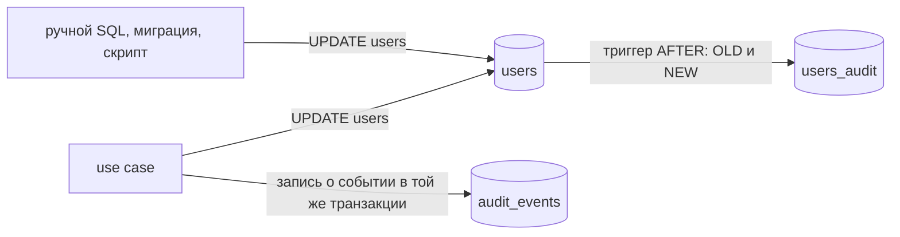

<script setup>
import SoftDeletePitfalls from '../../viz/scenes/SoftDeletePitfalls.vue'
</script>

# 2.6. JSONB, мягкое удаление и история

## <Part kind="problem" /> Проблема: три «простых» решения, которые ломают схему

Уроки 2.1–2.5 построили схему, в которой каждое правило держит база: типы, `NOT NULL`, `CHECK`, `UNIQUE`, внешние ключи. В этом уроке три просьбы, которые звучат в любой команде и каждую из которых можно выполнить за пять минут:

- «Настройки клиента будут меняться, давайте сложим их в один JSON-столбец, чтобы не писать миграцию на каждую новую галочку».
- «Удалять пользователей насовсем страшно, давайте ставить `deleted_at` — вдруг придётся восстановить».
- «Нужна история изменений: кто и когда поменял профиль».

Все три решения рабочие. И каждое незаметно отключает часть того, что мы строили. Вот что показывает лаба `labs/2a/history.sql` на таблице пользователей с `deleted_at`, где имя защищено обычным `UNIQUE`:

```text
UPDATE users SET deleted_at = now() WHERE username = 'alice';
UPDATE 1
SELECT token, user_id FROM sessions;
   token   | user_id 
-----------+---------
 tok-alice |       1
(1 row)

INSERT INTO users (username, display_name) VALUES ('alice', 'Другая Алиса');
psql:/lab/history.sql:82: ERROR:  duplicate key value violates unique constraint "users_username_key"
DETAIL:  Key (username)=(alice) already exists.
SQLSTATE 23505
```

<Run dir="labs" cmd="docker compose -f 2a/compose.yaml exec -T db sh -c 'psql -X -f /lab/history.sql 2>&amp;1'" needs="docker" before="`docker compose -f 2a/compose.yaml up -d --wait`" />

машина: 12th Gen Intel Core i5-12400 (6 ядер, 12 логических процессоров), Ubuntu 24.04.5, ядро Linux 7.0, Docker 29.9.1, PostgreSQL 18.6 с настройками образа по умолчанию и данными на tmpfs, go1.27.2; полный вывод — `labs/2a/results/history.txt`, шаг 2.

alice «удалена», но её сессия жива: `ON DELETE CASCADE` на `UPDATE` не срабатывает. А имя alice занято навсегда: `UNIQUE` сравнивает со всеми строками, в том числе с «удалёнными». Дальше в уроке — ещё две ловушки той же природы и цена журнала аудита: тот же `UPDATE` 100 000 строк с триггером аудита шёл <N>в 3,3 раза дольше</N> и записал в журнал предзаписи (WAL) почти вдвое больше. Ни одна из этих цен не видна, пока не посмотришь.

К концу урока вы:

- отличите данные, которым место в JSONB (неструктурированные, редко фильтруемые, читаемые целиком), от данных, которые JSONB превращает в EAV, и вернёте часть проверок через `CHECK`;
- выберете между мягким удалением, переносом в архив и настоящим удалением по четырём последствиям: уникальность, внешние ключи, запросы и право на удаление персональных данных;
- почините мягкое удаление частичным уникальным индексом и представлением и объясните, чего они не чинят;
- сравните три способа вести историю: триггерную таблицу, события из приложения и темпоральные таблицы — и назовёте цену каждого;
- объясните, почему в мессенджере нет ни мягкого удаления, ни журнала аудита и что появится, когда появится удаление аккаунта.

## <Part kind="theory" /> JSONB: когда уместен

### Что такое JSONB

<T id="jsonb">JSONB</T> — тип PostgreSQL для JSON-документа, который хранится не текстом, а в разобранном двоичном виде. В PostgreSQL два JSON-типа, и разница между ними практическая. Документация PostgreSQL 18 («JSON Types»): `json` хранит точную копию входного текста, и каждая функция разбирает его заново; `jsonb` разбирает документ один раз при записи, поэтому запись чуть медленнее, а чтение и поиск быстрее, и только `jsonb` умеет индексы. Платой за разбор: `jsonb` «does not preserve white space, does not preserve the order of object keys, and does not keep duplicate object keys. If duplicate keys are specified in the input, only the last value is kept». Почти всегда нужен `jsonb`; `json` — только когда важен исходный текст байт в байт.

Основные операторы видны на примере настроек пользователя из лабы `jsonb/settings.sql`:

<<< @/../labs/2a/jsonb/settings.sql#jsonb{sql}

`->` возвращает значение как `jsonb`, `->>` — как текст, цепочка операторов идёт вглубь. `@>` — «содержит»: документ слева содержит документ справа. `?` — «есть ключ верхнего уровня». Отсутствующий ключ — `NULL`, а не ошибка, поэтому умолчание (`coalesce(…, 'ru')`) приходится писать в каждом запросе:

```text
 user_id | theme | mentions | language 
---------+-------+----------+----------
       1 | dark  | true     | ru
       2 | light | false    | ru
       3 |       |          | ru
(3 rows)
```

<Run dir="labs" cmd="docker compose -f 2a/compose.yaml exec -T db sh -c 'psql -X -f /lab/jsonb/settings.sql 2>&amp;1'" needs="docker" before="`docker compose -f 2a/compose.yaml up -d --wait`" />

машина та же; полный вывод — `labs/2a/results/jsonb-settings.txt`, шаг 2. Частичное обновление пишется через `||` (слить объекты верхнего уровня) или `jsonb_set` (заменить значение по пути). Но «частичное» оно только в SQL: PostgreSQL хранит документ одним значением и при любом изменении пишет новую версию строки с документом **целиком** (как любой `UPDATE`, урок 2.5). Документ на 100 КБ, в котором меняют одну галочку, — 100 КБ записи на каждую галочку.

### Чего JSONB не проверяет

Столбцы держат правила сами: тип `boolean` не примет строку `'often'` (`22P02`), а `CHECK (theme IN ('light', 'dark', 'system'))` отвергнет `42` (`23514`). В JSONB схемы нет, и база принимает всё:

<<< @/../labs/2a/jsonb/settings.sql#jsonb-no-checks{sql}

```text
INSERT INTO settings_jsonb VALUES (4, '{"theme": 42}'), (5, '{"thme": "dark"}');
INSERT 0 2
 user_id | theme 
---------+-------
       4 | 42
       5 | 
(2 rows)
```

<Run dir="labs" cmd="docker compose -f 2a/compose.yaml exec -T db sh -c 'psql -X -f /lab/jsonb/settings.sql 2>&amp;1'" needs="docker" before="`docker compose -f 2a/compose.yaml up -d --wait`" />

машина та же, шаг 4. Число вместо строки и опечатка в ключе приняты молча. Опечатку видно только по последствиям: у пользователя 5 тема «не задана», и он видит умолчание вместо выбранной тёмной темы. Часть проверок можно вернуть через `CHECK`: корень — объект, ключи — только известные, `theme` — строка из списка:

<<< @/../labs/2a/jsonb/settings.sql#jsonb-checks{sql}

Все три записи (число, опечатка `thme` и массив `["dark", "light"]`) теперь отвергаются с `23514`. Проверка типа `jsonb_typeof(…) = 'string'` нужна по неочевидной причине: короткое `settings -> 'theme' <@ '["light", "dark", "system"]'` пропустило бы массив `["dark", "light"]` — он ведь тоже «содержится» в списке. Но посмотрите, во что превратились три простых правила столбцов: в три выражения, которые надо поддерживать руками и менять миграцией при каждом новом ключе. Это и есть главный аргумент: **если у данных есть известная структура, столбцы проверяют её бесплатно, а JSONB — только если вы перепишете схему на `CHECK`**.

### Цена хранения и поиск по GIN

Вторая цена — место. Лаба `jsonb/gin.sql` складывает одни и те же настройки 100 000 пользователей столбцами и в JSONB:

```text
 layout  | table_size | avg_row_bytes 
---------+------------+---------------
 columns | 5960 kB    |            55
 jsonb   | 13 MB      |           126
(2 rows)
```

<Run dir="labs" cmd="docker compose -f 2a/compose.yaml exec -T db sh -c 'psql -X -f /lab/jsonb/gin.sql 2>&amp;1'" needs="docker" before="`docker compose -f 2a/compose.yaml up -d --wait`" />

машина та же; полный вывод — `labs/2a/results/jsonb-gin.txt`, шаг 2. Средняя строка — <N>55 байт против 126</N>: JSONB хранит в **каждой** строке имена ключей (`"theme"`, `"notify"`, `"mentions"`, `"language"`, `"beta"`), а у столбцов имена живут один раз в каталоге. Таблица вдвое больше — значит, вдвое больше страниц читать, кешировать и копировать в реплики.

Искать по содержимому JSONB можно с индексом. B-дерево индексирует значение целиком и для «содержит ли документ ключ `beta` со значением `new_composer`» не годится. Для этого есть <T id="gin-index">GIN-индекс</T> (generalized inverted index) — обратный индекс: он раскладывает документ на элементы и для каждого элемента хранит список строк, где тот встречается. Так устроен предметный указатель в конце книги: слово → список страниц. Без индекса поиск `@>` — полный просмотр (`Seq Scan`), с индексом — `Bitmap Index Scan`:

```text
EXPLAIN (COSTS OFF)
SELECT count(*) FROM settings_jsonb WHERE settings @> '{"beta": ["new_composer"]}';
                                 QUERY PLAN                                  
-----------------------------------------------------------------------------
 Aggregate
   ->  Bitmap Heap Scan on settings_jsonb
         Recheck Cond: (settings @> '{"beta": ["new_composer"]}'::jsonb)
         ->  Bitmap Index Scan on settings_gin_path
               Index Cond: (settings @> '{"beta": ["new_composer"]}'::jsonb)
(5 rows)
```

<Run dir="labs" cmd="docker compose -f 2a/compose.yaml exec -T db sh -c 'psql -X -f /lab/jsonb/gin.sql 2>&amp;1'" needs="docker" before="`docker compose -f 2a/compose.yaml up -d --wait`" />

машина та же, шаг 4. У GIN для JSONB два класса операторов. `jsonb_ops` (по умолчанию) индексирует каждый ключ и каждое значение и обслуживает `@>`, `?`, `?|`, `?&`. `jsonb_path_ops` индексирует хеши путей до значений, умеет только `@>` (и jsonpath), зато меньше: в лабе <N>1 048 КБ против 448 КБ</N>, и планировщик выбрал именно его. А вот `settings ->> 'language' = 'kk'` GIN не обслуживает вовсе: это сравнение текста, извлечённого из документа, а не «содержит». План — снова `Seq Scan`. Такой запрос либо переписывают через `@>` (`settings @> '{"language": "kk"}'`), либо строят B-дерево по выражению `(settings ->> 'language')`. И если ключ фильтруют так часто, что ему нужен свой индекс, это сигнал, что ему место в столбце. Устройство GIN, его медленные вставки и список ожидания (pending list) — часть 2b.

<Callout type="simplified">

Есть и третья цена, о которой лаба не говорит: статистика. Команда `ANALYZE` собирает для планировщика статистику по значениям столбца целиком, а не по ключам внутри документа, поэтому оценка «сколько строк с `language = 'kk'`» для JSONB грубая. Индекс по выражению или `CREATE STATISTICS` по выражению (PostgreSQL 14+) дают планировщику статистику по такому выражению. Подробно — часть 2b, где разбираются оценки планировщика.

</Callout>

### Правило выбора

| признак данных | столбцы | JSONB |
| --- | --- | --- |
| структура известна и общая для всех строк | ✓ типы, `NOT NULL`, `CHECK`, умолчания бесплатно | придётся повторять схему в `CHECK` |
| по полю фильтруют, сортируют, соединяют | ✓ B-дерево, статистика планировщика | только `@>`/`?` через GIN или индекс по выражению |
| на поле ссылаются (`FOREIGN KEY`) | ✓ | нельзя: внешний ключ на значение внутри документа не объявить |
| форма разная у разных строк, ключи заранее неизвестны | десятки столбцов, почти все `NULL` | ✓ |
| документ читают и пишут целиком, внутрь заглядывают редко | лишние соединения и миграции | ✓ |
| данные чужие: тело вебхука, ответ внешнего API, заголовки | пришлось бы повторять чужую схему | ✓ хранить как пришло |

JSONB уместен для того, что сервер хранит и отдаёт целиком: настройки клиента, которые сервер не интерпретирует (урок 2.2 приводил список тегов клиента как пример значения, которое для 1НФ «одно»), метаданные вложения, у которых разные поля у картинки и у документа (урок 2.1), сырые данные интеграций. Неуместен — для того, у чего есть структура, но её не захотели проектировать. Тогда JSONB становится <T id="eav">EAV</T> (entity-attribute-value) в одежде JSON: «гибко» на вид, а на деле без типов, без ограничений, без внешних ключей и с запросами, которые разбирают документ в каждой строке. Сам антипаттерн EAV и его разбор по Карвину — урок 2.7.

В мессенджере JSONB ровно в одном месте, и оно подходит под правило. Таблица ключей идемпотентности (урок 1.12) хранит сохранённый ответ: код, заголовки и тело. Заголовки — это `http.Header`, то есть `map[string][]string`; сервер записывает их один раз и при повторе отдаёт целиком, не фильтруя и не соединяя:

<<< @/../messenger/migrations/00001_init.sql#idempotency-keys{sql}

`pgx` кодирует `map[string][]string` в `jsonb` как JSON-объект сам, без кода в адаптере. Тело ответа — `bytea`: это байты, которые нужно вернуть точь-в-точь, а `jsonb` переставил бы ключи и убрал пробелы.

## <Part kind="theory" /> Мягкое удаление, архив или настоящее удаление

### Три способа «удалить»

Удаление строки — самое разрушительное, что умеет SQL, и командам хочется подстраховаться. Есть три стратегии.

- **Настоящее удаление** — `DELETE`. Строки нет; восстановить её можно только из резервной копии. Внешние ключи делают с детьми то, что объявлено в `ON DELETE` (урок 2.4): запрещают, удаляют каскадом, обнуляют ссылку.
- <T id="soft-delete">Мягкое удаление</T> (soft delete) — вместо `DELETE` строке ставят пометку, обычно `deleted_at timestamptz` (`NULL` — жив, время — когда удалили), и все запросы приложения должны такие строки пропускать. Восстановление — `UPDATE … SET deleted_at = NULL`.
- **Перенос в архив** — строку удаляют из рабочей таблицы и в той же команде вставляют в архивную с теми же столбцами и временем переноса. В PostgreSQL это одна команда: `DELETE … RETURNING` внутри `WITH` отдаёт удалённые строки `INSERT`'у.

<<< @/../labs/2a/history.sql#archive{sql}

Мягкое удаление выглядит самым безопасным: ничего не теряется. Посмотрим, что оно делает с правилами, которые держала база.

### Ловушка 1: уникальность

Начало урока показало: `UNIQUE (username)` сравнивает новое имя со всеми строками таблицы, и имя «удалённой» alice занято навсегда. Удалённый пользователь для приложения не существует, а регистрация отвечает «имя занято». Исправление урок 2.4 показывал на адресах почты — уникальный <T id="partial-index">частичный индекс</T> (partial index), в котором лежат только строки, подходящие под условие:

<<< @/../labs/2a/history.sql#partial-unique{sql}

```text
INSERT INTO users (username, display_name) VALUES ('alice', 'Другая Алиса');
INSERT 0 1
INSERT INTO users (username, display_name) VALUES ('alice', 'Третья Алиса');
psql:/lab/history.sql:94: ERROR:  duplicate key value violates unique constraint "users_username_active_key"
DETAIL:  Key (username)=(alice) already exists.
SQLSTATE 23505
```

<Run dir="labs" cmd="docker compose -f 2a/compose.yaml exec -T db sh -c 'psql -X -f /lab/history.sql 2>&amp;1'" needs="docker" before="`docker compose -f 2a/compose.yaml up -d --wait`" />

машина та же, шаг 3. Новая alice зарегистрирована, вторая живая — отвергнута. Правило изменилось с «имя уникально» на «имя уникально среди живых», и это уже честное правило предметной области. Но у исправления есть цена, которую легко пропустить:

- **Имя в ошибке стало другим.** Адаптер мессенджера узнаёт «имя занято» по `ConstraintName` (урок 2.4). Поменяли ограничение на индекс — меняйте и адаптер, в той же миграции и том же ревью.
- **Восстановление может не получиться.** `UPDATE users SET deleted_at = NULL` для первой alice теперь упадёт с `23505`: её имя занято новой alice. «Восстановить можно всегда» — неправда; процедура восстановления должна уметь сказать «имя занято, выберите другое».
- **На частичный индекс нельзя сослаться внешним ключом** (урок 2.4), и `INSERT … ON CONFLICT` должен повторить его условие: `ON CONFLICT (username) WHERE deleted_at IS NULL`.

### Ловушка 2: запросы и ссылки

Мягкое удаление переносит правило «удалённого нет» из базы в каждый запрос приложения. Вход по имени, написанный до появления `deleted_at` или просто без него, находит обеих alice:

```text
SELECT id, username, display_name, deleted_at IS NOT NULL AS deleted
FROM users WHERE username = 'alice' ORDER BY id;
 id | username | display_name | deleted 
----+----------+--------------+---------
  1 | alice    | Алиса        | t
  4 | alice    | Другая Алиса | f
(2 rows)

INSERT INTO messages (author_id, text) VALUES (1, 'пишу после удаления');
INSERT 0 1
```

<Run dir="labs" cmd="docker compose -f 2a/compose.yaml exec -T db sh -c 'psql -X -f /lab/history.sql 2>&amp;1'" needs="docker" before="`docker compose -f 2a/compose.yaml up -d --wait`" />

машина та же, шаг 4. Две строки там, где адаптер ждёт одну: в лучшем случае ошибка, в худшем — вход в чужой, удалённый аккаунт. И вторая строка вывода хуже первой. <T id="foreign-key">Внешний ключ</T> (foreign key) проверяет, что строка `users` с `id = 1` **есть**, а не что она **жива**: сообщение от удалённой alice принято без единого слова. Условие «автор не удалён» в `FOREIGN KEY` не записать. Его держит только код — или триггер, о котором ниже. Сюда же относится сессия из начала урока: всё, что `ON DELETE CASCADE` сделал бы сам, при мягком удалении должен сделать код, в той же транзакции, что и `UPDATE deleted_at`.

Защита от забытого условия — записать «живой» в **одном** месте. В PostgreSQL это представление (view), и запросы приложения читают из него, а не из таблицы:

<<< @/../labs/2a/history.sql#active-view{sql}

У представления есть второй, менее очевидный смысл — частичный индекс. Документация PostgreSQL 18 («Partial Indexes»): индекс можно использовать, только если система видит, что условие `WHERE` запроса «mathematically implies the predicate of the index». Лаба проверяет это на 100 000 пользователях, каждый десятый из которых удалён:

```text
EXPLAIN (COSTS OFF) SELECT id FROM users WHERE username = 'user42';
              QUERY PLAN               
---------------------------------------
 Seq Scan on users
   Filter: (username = 'user42'::text)
(2 rows)

EXPLAIN (COSTS OFF) SELECT id FROM active_users WHERE username = 'user42';
                     QUERY PLAN                      
-----------------------------------------------------
 Index Scan using users_username_active_key on users
   Index Cond: (username = 'user42'::text)
(2 rows)
```

<Run dir="labs" cmd="docker compose -f 2a/compose.yaml exec -T db sh -c 'psql -X -f /lab/history.sql 2>&amp;1'" needs="docker" before="`docker compose -f 2a/compose.yaml up -d --wait`" />

машина та же, шаг 4. Без `deleted_at IS NULL` запрос не может взять индекс, в котором нет удалённых строк: вдруг ответ — удалённая. Остаётся полный просмотр всех 100 000 строк. С условием — или через представление, которое его подставляет, — точечный поиск по индексу. Забытый фильтр бьёт дважды: и по правильности, и по скорости.

### Ловушка 3: право на удаление

<T id="right-to-erasure">Право на удаление</T> (right to erasure) — право человека потребовать, чтобы сервис стёр его персональные данные. В Европе это статья 17 GDPR («право быть забытым»), в России похожее требование — в 152-ФЗ «О персональных данных» (статья 21: уничтожение данных после отзыва согласия). Мягкое удаление его не выполняет: оно прячет строку от запросов, а имя, почта и телефон лежат в таблице, в каждой реплике и в каждой резервной копии. Архив — тоже: данные просто переехали в соседнюю таблицу.

Настоящее удаление упирается в связи. Сообщения alice лежат в чатах её собеседников, и стереть их — значит стереть и чужую переписку:

<<< @/../labs/2a/history.sql#erase-soft{sql}

```text
 username | display_name | deleted 
----------+--------------+---------
 alice    | Алиса        | t
(1 row)

DELETE FROM users WHERE id = 1;
psql:/lab/history.sql:178: ERROR:  update or delete on table "users" violates foreign key constraint "messages_author_id_fkey" on table "messages"
DETAIL:  Key (id)=(1) is still referenced from table "messages".
SQLSTATE 23503
```

<Run dir="labs" cmd="docker compose -f 2a/compose.yaml exec -T db sh -c 'psql -X -f /lab/history.sql 2>&amp;1'" needs="docker" before="`docker compose -f 2a/compose.yaml up -d --wait`" />

машина та же, шаг 7. Обычный путь в таких системах — **обезличить** строку: идентификатор остаётся ради ссылок, а всё, что указывает на человека, заменяется. Сессии удаляются явно, ведь каскад на `UPDATE` не срабатывает:

<<< @/../labs/2a/history.sql#erase{sql}

```text
 username  |        text         
-----------+---------------------
 deleted_1 | привет
 deleted_1 | пишу после удаления
(2 rows)
```

<Run dir="labs" cmd="docker compose -f 2a/compose.yaml exec -T db sh -c 'psql -X -f /lab/history.sql 2>&amp;1'" needs="docker" before="`docker compose -f 2a/compose.yaml up -d --wait`" />

машина та же. Сообщения на месте, собеседники видят их от «Удалённого пользователя». Но в базе есть ещё одна копия имени, о которой легко забыть, — журнал аудита. К нему мы вернёмся в следующем разделе.

<Callout type="simplified">

Это не юридическая консультация. У права на удаление есть исключения: закон может и **требовать** хранить данные (бухгалтерские документы, сведения, которые сервис обязан передавать по запросу), и тогда их хранят ровно столько, сколько требует закон, отдельно и с ограниченным доступом. Что считать персональными данными и какие сроки действуют, решает юрист вместе с владельцем продукта. Задача инженера — чтобы схема позволяла выполнить любое из этих решений: знать, где лежат все копии данных человека, и уметь их стереть или обезличить.

</Callout>

### Сравнение

| последствие | мягкое удаление | перенос в архив | настоящее удаление |
| --- | --- | --- | --- |
| уникальность | `UNIQUE` держит имя удалённого; нужен частичный индекс и смена имени ограничения в адаптере | рабочая таблица чистая, обычный `UNIQUE` работает | обычный `UNIQUE` работает |
| внешние ключи | дети ссылаются на «удалённую» строку, база это пропускает; `ON DELETE CASCADE` не срабатывает | перенос упирается в детей (`23503`): их переносят вместе или отвязывают | работает то, что объявлено в `ON DELETE` |
| запросы | условие `deleted_at IS NULL` в каждом запросе (лучше — представление); без него частичный индекс не используется | рабочие запросы не меняются; история — отдельным запросом к архиву | не меняются |
| восстановление | `UPDATE … SET deleted_at = NULL`, если имя никто не занял | `INSERT` из архива, с той же оговоркой | только из резервной копии |
| право на удаление | не выполняет: данные в таблице | не выполняет: данные в архиве | выполняет для таблицы; копии — журнал, резервные копии — отдельно |
| размер | таблица и индексы растут за счёт удалённых | рабочая таблица маленькая | минимальный |

Из таблицы видно, когда мягкое удаление оправдано: когда восстановление — **требование продукта** с понятным сроком. «Корзина» с отменой в течение 30 дней — честный случай. Тогда мягкое удаление делают вместе со всем, что из него следует: частичный уникальный индекс, представление для запросов, удаление зависимых строк в той же транзакции и фоновая задача, которая по истечении срока удаляет строку по-настоящему или обезличивает её. Тот же приём «пометить, а убрать потом» мессенджер уже использует для ключей идемпотентности: у ключа есть срок хранения (<T id="retention">retention</T>), и фоновая очистка удаляет просроченные ключи настоящим `DELETE` (урок 1.5.6, индекс `idempotency_keys_expires_at_idx` из урока 2.5).

«Вдруг понадобится» — не требование. Для «вдруг понадобится узнать, что было» есть журнал аудита, для «вдруг удалили по ошибке» — резервные копии (модуль 8) и ограничения, которые не дают удалить лишнее (`NO ACTION` у `chat.members → users.users`, урок 2.4).

## <Part kind="theory" /> История и аудит

### Что такое журнал аудита

<T id="audit-log">Журнал аудита</T> (audit log) — неизменяемая запись о том, кто, когда и что изменил в данных. Неизменяемая значит, что в журнал только дописывают: исправление ошибки — новая запись, а не правка старой. Журнал отвечает на вопросы поддержки («кто поменял название чата?»), безопасности («что делал этот токен?») и закона («покажите историю обработки моих данных»).

Где рождается запись журнала — главный выбор. Вариантов три.



Триггер видит **все** изменения таблицы, от любого писателя, но знает о них только то, что знает база. Событие из приложения знает всё о запросе, но только о тех изменениях, которые прошли через этот код.

### Триггерная таблица истории

<T id="db-trigger">Триггер</T> (trigger) — функция, которую база сама вызывает при `INSERT`, `UPDATE` или `DELETE` в таблице: до изменения (`BEFORE`) или после (`AFTER`), для каждой строки (`FOR EACH ROW`) или один раз на команду (`FOR EACH STATEMENT`). Строковому триггеру доступны старая и новая версии строки — `OLD` и `NEW`, а `to_jsonb(OLD)` превращает строку целиком в JSONB-документ. Получается журнал, которому не нужно знать столбцы таблицы:

<<< @/../labs/2a/history.sql#audit{sql}

Здесь JSONB опять на своём месте: старая и новая версии строки — снимок «как было», который читают целиком и редко; новый столбец таблицы попадёт в журнал без правки триггера. Это и есть сила триггера: правку из консоли дежурного, скрипт миграции и забытый код он ловит одинаково.

А вот **кто** сделал правку, база не знает: для неё все запросы приходят от одной роли — пользователя пула соединений сервиса. Приложение может передать автора через настройку сеанса, а триггер — прочитать её через `current_setting`:

<<< @/../labs/2a/history.sql#audit-actor{sql}

```text
   op   | actor  | db_role | old_name | new_name 
--------+--------+---------+----------+----------
 INSERT |        | lab     |          | Боб
 UPDATE | user:2 | lab     | Боб      | Боб Б.
 UPDATE |        | lab     | Боб Б.   | Боб
(3 rows)
```

<Run dir="labs" cmd="docker compose -f 2a/compose.yaml exec -T db sh -c 'psql -X -f /lab/history.sql 2>&amp;1'" needs="docker" before="`docker compose -f 2a/compose.yaml up -d --wait`" />

машина та же, шаг 6. Правка из приложения записана с автором, ручная — без него: триггер её поймал, но кто из людей это был, не знает. `SET LOCAL` важен: настройка живёт до конца транзакции. Обычный `SET` остался бы на соединении, и следующий запрос из пула, от другого пользователя, записал бы в журнал чужое имя.

Теперь вернёмся к праву на удаление. Журнал хранит строку **целиком**, и после обезличивания alice её имя осталось в истории:

```text
SELECT op, old_row ->> 'username' AS old_name, new_row ->> 'username' AS new_name
FROM users_audit WHERE user_id = 1 ORDER BY id;
   op   | old_name | new_name  
--------+----------+-----------
 INSERT |          | alice
 UPDATE | alice    | alice
 UPDATE | alice    | deleted_1
(3 rows)
```

<Run dir="labs" cmd="docker compose -f 2a/compose.yaml exec -T db sh -c 'psql -X -f /lab/history.sql 2>&amp;1'" needs="docker" before="`docker compose -f 2a/compose.yaml up -d --wait`" />

машина та же, шаг 7. Вставка, мягкое удаление и само обезличивание — имя alice во всех <N>трёх строках</N> её истории. Процедура удаления должна пройти и по журналу:

<<< @/../labs/2a/history.sql#audit-scrub{sql}

После чистки `audit_rows_with_name = 0`, а сами строки — кто, когда, какая операция — остались. Это правка журнала, в который приложение только дописывает, поэтому её выполняет отдельная роль базы с правом `UPDATE` на журнал, а у роли приложения такого права нет. Другой подход — не класть персональные данные в журнал вообще: хранить в нём `user_id` и имена изменённых полей, а значения только для полей, которые персональными данными не являются.

### Цена триггера

Триггер работает внутри каждой команды записи: для каждой строки вызывается функция на PL/pgSQL, строится два JSONB-документа и вставляется строка в журнал. Лаба меряет это на двух одинаковых таблицах по 100 000 строк, у второй — тот же триггер; `UPDATE` всех строк одной командой:

```text
EXPLAIN (ANALYZE, COSTS OFF, TIMING OFF)
UPDATE plain SET display_name = display_name || '!';
…
 Execution Time: 448.069 ms

EXPLAIN (ANALYZE, COSTS OFF, TIMING OFF)
UPDATE audited SET display_name = display_name || '!';
…
 Trigger audited_audit: calls=100000
 Execution Time: 1478.265 ms

   tbl   |  wal  | wal_bytes 
---------+-------+-----------
 plain   | 39 MB |  40420704
 audited | 73 MB |  76980928
(2 rows)

 plain_size | audited_size | new_audit_rows | audit_growth 
------------+--------------+----------------+--------------
 12 MB      | 12 MB        |         100000 | 26 MB
(1 row)
```

<Run dir="labs" cmd="docker compose -f 2a/compose.yaml exec -T db sh -c 'psql -X -f /lab/history.sql 2>&amp;1'" needs="docker" before="`docker compose -f 2a/compose.yaml up -d --wait`" />

машина та же; выдержка из шага 8 (`…` — пропущены строки плана). Время <N>448 мс против 1 478 мс</N> — в 3,3 раза. Журнал предзаписи (<T id="wal">WAL</T>), который база пишет на диск при каждом изменении и отправляет репликам, — <N>39 МБ против 73 МБ</N>, в 1,9 раза. А сам журнал аудита после **одного** обновления каждой строки вырос на <N>26 МБ</N> — вдвое больше таблицы, которую он описывает: в каждой строке журнала две полные копии строки в JSONB, с именами ключей (та же цена хранения, что в разделе о JSONB). Абсолютные миллисекунды зависят от машины, поэтому `scenario.sh` проверяет только соотношение: с триггером дольше хотя бы в 1,2 раза, WAL больше хотя бы в 1,3 раза.

Это массовый `UPDATE` — худший случай: вся работа команды — обновление строк, и триггер удваивает её. В запросе мессенджера, который обновляет одну строку, накладные расходы — доли миллисекунды на фоне сети и остального кода. Но журнал растёт со скоростью записей, и для горячей таблицы (сообщения: каждое — `INSERT`) триггерный журнал означает удвоение записи. Поэтому журнал ведут для таблиц, где история нужна (профили, права, настройки безопасности), а не «для всех таблиц на всякий случай», и сразу решают, сколько его хранить.

<Deep title="Как PostgreSQL выполняет AFTER-триггер для каждой строки">

Строковый `AFTER`-триггер не вызывается в момент изменения строки. Исполнитель команды складывает события «строка изменена» в очередь триггеров текущей транзакции (`AfterTriggerSaveEvent` в `src/backend/commands/trigger.c`) вместе с адресами старой и новой версий. Когда команда закончила менять строки, `AfterTriggerEndQuery` проходит очередь и для каждого события вызывает функцию триггера, заново читая версии строки по сохранённым адресам. Поэтому в плане `EXPLAIN ANALYZE` триггер — отдельная строка `Trigger audited_audit: calls=100000` вне дерева узлов, а время его работы входит в `Execution Time`, но не в время узла `Update`.

Из этого следуют три практические вещи. Первая: `AFTER`-триггер видит итоговое состояние строки после всех `BEFORE`-триггеров и не может его изменить; результат функции (`RETURN NULL`) игнорируется. Вторая: если строка не изменилась, событие всё равно есть — `UPDATE … SET x = x` попадёт в журнал. Отсечь такие события можно условием `WHEN (OLD IS DISTINCT FROM NEW)` в `CREATE TRIGGER` или встроенной функцией `suppress_redundant_updates_trigger()`. Третья: ограничения внешних ключей PostgreSQL реализует теми же механизмами — системными триггерами (строка `Trigger for constraint …` в плане из урока 2.4). Порядок триггеров одного вида на таблице — по алфавиту имён; поэтому проверка внешнего ключа (`RI_ConstraintTrigger_…`) срабатывает раньше нашего `users_audit`: при архивации bob ошибка `23503` пришла раньше, чем журнал успел бы что-то записать, — а откатилось бы всё равно всё.

Альтернатива строковому триггеру для массовых команд — `FOR EACH STATEMENT` с переходными таблицами (`REFERENCING OLD TABLE AS old_rows NEW TABLE AS new_rows`, PostgreSQL 10+): функция вызывается один раз на команду и вставляет журнал одним `INSERT … SELECT` из переходных таблиц. Это заметно дешевле на массовых правках, а на правках по одной строке — то же самое. Документация: «CREATE TRIGGER», раздел о `REFERENCING`, и «Overview of Trigger Behavior».

</Deep>

### События из приложения

Второй путь — use case сам записывает, что произошло: «пользователь 42 сменил отображаемое имя, запрос `req-…`, с устройства …». Запись идёт в отдельную таблицу журнала в **той же транзакции**, что и само изменение (порт `Transactor`, урок 2.9): либо фиксируются оба, либо ни одно. Эта запись знает то, чего никогда не узнает триггер: кто из пользователей действовал, какой запрос, зачем (бизнес-смысл: «сменил имя», а не «`UPDATE` столбца `display_name`»). И журнал можно сразу сделать без персональных данных.

Цена — полнота. Журнал из приложения видит только изменения, прошедшие через этот код. Ручной `UPDATE` из консоли, скрипт миграции данных, второй сервис — мимо. Новый use case, в котором забыли записать событие, — тоже мимо, и никакой тест базы этого не поймает. Поэтому для таблиц, где полнота важнее контекста (права доступа, финансовые операции), выбирают триггер или оба способа сразу: триггер ловит всё, приложение добавляет смысл. Когда событие нужно не только хранить, но и доставить другим сервисам, оно становится сообщением через outbox — это модуль 7.

Есть и третий источник изменений, о котором полезно знать: журнал предзаписи самой базы. Логическое декодирование (logical decoding) PostgreSQL отдаёт поток изменений строк из WAL наружу, и инструменты захвата изменений (change data capture) строят из него историю без триггеров и без нагрузки на команды записи. Но и он не знает, кто из людей действовал, — это та же информация, что у триггера, только доставленная иначе.

### Темпоральные таблицы

<T id="temporal-table">Темпоральная таблица</T> (temporal table) хранит не только текущее состояние строк, но и периоды, когда каждая версия была верна, и отвечает на вопрос «каким было значение на момент T» обычным запросом. Стандарт SQL:2011 различает два времени:

- **системное** (system time) — когда версия была записана в базу и когда заменена. База ведёт его сама, приложение его не задаёт. Это журнал истории, встроенный в таблицу: в стандарте и в MariaDB это `WITH SYSTEM VERSIONING`, в SQL Server — `WITH (SYSTEM_VERSIONING = ON)`, в Db2 — `ADD VERSIONING`, а запрос к прошлому везде `FOR SYSTEM_TIME AS OF …`;
- **прикладное** (application time) — когда факт верен в мире: тариф действует с 1 по 31 число, пользователь заглушён в чате с 10:00 до 12:00. Его задаёт приложение, и он может быть в прошлом или будущем.

В PostgreSQL 18 системного версионирования нет. Есть часть прикладного времени: ограничения `WITHOUT OVERLAPS` для первичного ключа и `UNIQUE` и `PERIOD` для внешних ключей (release notes 18, раздел «Constraints»). Урок 2.4 уже показал, как `UNIQUE (chat_id, user_id, during WITHOUT OVERLAPS)` не даёт двум периодам заглушения пересечься. Системную историю в PostgreSQL ведут триггером в отдельную таблицу — ровно то, что мы сделали выше, — или сторонними расширениями, которые делают то же триггером.

Хранить историю версий **в той же таблице** (столбцы `valid_from`/`valid_to` или флаг `is_current` у рабочей таблицы) — соблазн, который повторяет все ловушки мягкого удаления: каждый запрос должен помнить условие «текущая версия», уникальность — только частичным индексом, внешние ключи ссылаются на конкретную версию, а не на сущность, и таблица растёт с каждым изменением. Если история нужна как данные предметной области (цена товара на дату заказа), её проектируют как отдельную сущность с периодом. Если как журнал — она живёт в отдельной таблице.

### Сравнение способов вести историю

| | триггер в таблицу истории | события из приложения | темпоральная таблица |
| --- | --- | --- | --- |
| что ловит | все изменения таблицы, от любого писателя | только изменения через этот код | все изменения (системное время); прикладное — то, что задало приложение |
| кто и зачем | только роль базы; пользователя — если приложение передало его (`SET LOCAL`) | всё: пользователь, запрос, бизнес-смысл | только роль базы |
| персональные данные | копия всей строки: при удалении чистить и журнал | выбираете сами, что записывать | копия всех версий строки |
| цена записи | в лабе ×3,3 по времени и ×1,9 по WAL на массовом `UPDATE` | одна вставка на событие, в той же транзакции | как у триггера: база пишет версию на каждое изменение |
| в PostgreSQL 18 | есть: триггеры, `to_jsonb(OLD/NEW)` | обычный код и таблица | только прикладное время (`WITHOUT OVERLAPS`, `PERIOD`) |

## <Part kind="viz" /> Визуализация: плеер soft-delete-pitfalls

Плеер проводит по трём ловушкам мягкого удаления на той же схеме, что и лаба: `users` с `deleted_at`, `sessions` с `ON DELETE CASCADE`, `messages` без каскада и (в последнем варианте) журнал `users_audit`. Переключатель сверху выбирает ловушку: «Уникальность», «Запросы и ссылки», «Право на удаление». Под ним плашка с итогом шага, правило уникальности имени, последняя команда и её результат: полоса слева у команды — цвет ответа (прошла, ошибка, вернула строки). Ниже таблицы. «Удалённые» строки приглушены, имя в них перечёркнуто и в столбце `deleted_at` написано «удалён». Строки, в которых видна проблема шага, выделены цветом ошибки и полосой слева. В варианте «Право на удаление» внизу счётчик: где в базе ещё живёт имя alice.

<SoftDeletePitfalls />

Что смотреть:

1. **Имя занято навсегда.** В варианте «Уникальность» на шаге 3 строка alice перечёркнута, живой alice нет, а регистрация получает `23505` по `users_username_key`. Обычный `UNIQUE` не знает слова «удалён».
2. **Имя в ошибке.** На последнем шаге того же варианта ошибка снова `23505`, но с именем `users_username_active_key`. Сравните строку «уникальность имени» до и после шага 4: правило изменилось, и адаптер, который узнаёт ошибку по имени, должен измениться вместе с ним.
3. **Две alice на один вход.** Вариант «Запросы и ссылки», шаг 2: запрос без `deleted_at IS NULL` выделяет обе строки alice. Шаг 5 — тот же поиск через `active_users`: одна строка, и план идёт по частичному индексу.
4. **Внешний ключ молчит.** Шаги 3 и 4: сессия и новое сообщение ссылаются на удалённую alice, и база ни разу не возразила. Обратите внимание на пометку «(удалён)» рядом с `user_id`.
5. **Копия в журнале.** Вариант «Право на удаление»: следите за счётчиком внизу. После обезличивания (шаг 4) в строке `users` с id 1 имени нет (`alice` с id 4 — другой человек), а в журнале строк с именем стало больше — три вместо двух. Ноль — только после чистки журнала.

<Callout type="simplified">

Плеер сжимает схему: у пользователя три столбца и пометка вместо времени в `deleted_at`, у сообщения — только текст и автор, у журнала — только имя из старой и новой версии строки. Номера строк журнала — порядок в истории alice, а не `id` из лабы: в лабе журнал ведётся и для 100 000 вставок шага 4, и `id` последней строки истории alice там шестизначный. Последний шаг варианта «Запросы и ссылки» — шаблон процедуры мягкого удаления с параметром `$1`, его лаба не выполняет; всё остальное — команды и ответы из `labs/2a/history.sql`.

</Callout>

Вопросы к визуализации:

1. В варианте «Уникальность» после шага 5 администратор решает восстановить первую alice: `UPDATE users SET deleted_at = NULL WHERE id = 1`. Что ответит база и почему?
2. В варианте «Запросы и ссылки» поставьте на `sessions.user_id` не `ON DELETE CASCADE`, а `NO ACTION`. Изменится ли что-нибудь на шаге 3?
3. В варианте «Право на удаление» вместо обезличивания удалите сообщения alice (`DELETE FROM messages WHERE author_id = 1`) и потом её саму. Какие два вопроса это решение оставляет открытыми?

<SelfCheck question="Ответы">

1. `23505` по `users_username_active_key`. Восстановление возвращает строку в частичный индекс, а в нём уже есть живая alice с `id = 4`. Мягкое удаление обещает «восстановить можно всегда», но частичная уникальность это обещание ограничивает: процедура восстановления должна уметь сообщить «имя занято, выберите другое».
2. Нет. `ON DELETE` срабатывает только на `DELETE` родителя, а мягкое удаление — `UPDATE`. С `NO ACTION` сессия так же жива, а различие появится только при настоящем удалении: вместо каскада — ошибка `23503`.
3. Первое — чужая переписка: сообщения alice в чатах собеседников исчезнут, и в ответах на них появятся дыры; это решение продукта, а не базы. Второе — копии: журнал `users_audit` по-прежнему хранит имя alice (триггер записал и `DELETE` со старой версией строки), а резервные копии хранят всё до истечения своего срока.

</SelfCheck>

## <Part kind="code" /> Код: лаба history.sql

### Схема

Пользователи, их сессии и сообщения. Внешние ключи разные намеренно: сессиям без пользователя смысла нет (`CASCADE`), сообщения переживают автора (`NO ACTION`):

<<< @/../labs/2a/history.sql#soft-schema{sql}

### Мягкое удаление и частичный индекс

Мягкое удаление, сессия, которая его пережила, и регистрация занятого имени:

<<< @/../labs/2a/history.sql#soft-delete{sql}

Внешний ключ, который не знает про `deleted_at`, и запрос без условия:

<<< @/../labs/2a/history.sql#forgotten-filter{sql}

Данные и планы для частичного индекса:

<<< @/../labs/2a/history.sql#partial-plan-setup{sql}

<<< @/../labs/2a/history.sql#partial-plan{sql}

### Архив без детей

Пользователь без сообщений и сессий переносится в архив одной командой:

<<< @/../labs/2a/history.sql#archive-ok{sql}

### Замер триггера

Две одинаковые таблицы и отметки журнала предзаписи:

<<< @/../labs/2a/history.sql#audit-cost{sql}

<<< @/../labs/2a/history.sql#audit-cost-plain{sql}

<<< @/../labs/2a/history.sql#audit-cost-audited{sql}

<<< @/../labs/2a/history.sql#audit-cost-wal{sql}

### JSONB: столбцы и GIN

Те же настройки столбцами — тип и `CHECK` держат правила сами:

<<< @/../labs/2a/jsonb/settings.sql#columns{sql}

Частичное обновление документа:

<<< @/../labs/2a/jsonb/settings.sql#jsonb-update{sql}

Размер строки и два класса операторов GIN:

<<< @/../labs/2a/jsonb/gin.sql#size{sql}

<<< @/../labs/2a/jsonb/gin.sql#gin{sql}

<<< @/../labs/2a/jsonb/gin.sql#gin-not-used{sql}

## <Part kind="practice" /> Что появилось в лабе

```text
labs/2a/
├── history.sql            # новый: мягкое удаление и UNIQUE/FK, частичный индекс и его план,
│                          # архив, обезличивание, журнал аудита триггером и его цена
├── scenario.sh            # + раздел history.sql: коды, имена, планы; время и WAL — относительно
├── README.md              # + описание history.sql
└── results/history.txt    # полный вывод, на который ссылается урок
course/viz/                # плеер soft-delete-pitfalls: simulations/, renderers/, scenes/
course/viz/core/player.ts  # клавиши плеера с Alt/Ctrl/Meta больше не перехватываются
```

Лабы `jsonb/settings.sql` и `jsonb/gin.sql` появились раньше, вместе со всей лабой 2a, и урок цитирует их без изменений. Запуск из каталога `labs/`:

```bash
docker compose -f 2a/compose.yaml up -d --wait
docker compose -f 2a/compose.yaml exec -T db sh -c 'psql -X -f /lab/history.sql 2>&1'
docker compose -f 2a/compose.yaml exec -T db sh -c 'psql -X -f /lab/jsonb/settings.sql 2>&1'
docker compose -f 2a/compose.yaml exec -T db sh -c 'psql -X -f /lab/jsonb/gin.sql 2>&1'
docker compose -f 2a/compose.yaml down -v
```

`history.sql` идёт около 4 с (две пачки по 100 000 строк и замер триггера) и входит в `scenario.sh`. Скрипт пересоздаёт свою схему `history`, поэтому его можно запускать сколько угодно раз. Ошибок в выводе ровно четыре, все задуманные: `23505` дважды, `23503` дважды. Время и WAL от прогона к прогону гуляют; планы, коды ошибок и строки журнала — одинаковы.

### А мессенджер?

В мессенджере нет ни мягкого удаления, ни журнала аудита, и это не упущение. В требованиях урока 0.6 нет удаления аккаунта, удаления или правки сообщений, а значит, нет и решения, которое этот урок помогает принять. Схема защищает от случайного удаления сама: `chat.members → users.users` объявлен с `NO ACTION` (урок 2.4), и удалить пользователя, у которого есть чаты, база не даст. Единственное настоящее удаление в мессенджере — очистка просроченных ключей идемпотентности, и это честный `DELETE` по сроку хранения. Единственный JSONB — сохранённые заголовки ответа в тех же ключах.

Когда удаление аккаунта появится, урок уже дал ответ на главный вопрос: мягкое удаление для него не годится (право на удаление), а настоящее упирается в сообщения в чужих чатах. Значит, обезличивание строки `users.users` и удаление учётных данных (у `auth.credentials` уже `ON DELETE CASCADE`, но строка пользователя останется, поэтому их удалят явно) в одной транзакции. Если к тому времени появится журнал аудита, процедура удаления пройдёт и по нему.

Попробуйте сами (в базе после прогона лабы, `docker compose -f 2a/compose.yaml exec db psql`, затем `SET search_path = history;`):

- Попробуйте восстановить первую alice: `UPDATE users SET deleted_at = NULL WHERE id = 1`. Что ответит база? А после обезличивания (её имя теперь `deleted_1`)?
- Добавьте в `CREATE TRIGGER` условие `WHEN (OLD IS DISTINCT FROM NEW)` (для `UPDATE` — отдельным триггером) и выполните `UPDATE users SET display_name = display_name WHERE id = 2`. Появилась ли строка в журнале?
- Перепишите триггер аудита на `FOR EACH STATEMENT` с `REFERENCING OLD TABLE AS old_rows NEW TABLE AS new_rows` и повторите замер шага 8. Сколько стало времени и WAL?
- Создайте индекс `CREATE INDEX ON jsonb_gin.settings_jsonb ((settings ->> 'language'))` и снова снимите план запроса `settings ->> 'language' = 'kk'` из `gin.sql`. Какой узел появился?

Состояние репозитория после урока — тег `m02-l06`.

## <Part kind="mistakes" /> Типичные ошибки

<Callout type="mistake">

**JSONB для всего.** «Сложим профиль в JSON, чтобы не писать миграции» — и база перестаёт проверять типы, обязательность и допустимые значения, внешний ключ на значение внутри документа не объявить, строка вдвое больше (в лабе 55 байт против 126), а `->> … =` не идёт ни по какому индексу без отдельного индекса по выражению. Миграцию вы не написали, но схема никуда не делась: теперь она в коде каждого читателя и в `CHECK`, которые придётся написать, когда в данных найдутся `"thme"` и `42`. JSONB — для того, что читают и пишут целиком и у чего структура действительно разная.

**`deleted_at` без частичного уникального индекса.** Обычный `UNIQUE` держит имя удалённого пользователя занятым навсегда (`23505` на регистрации). Чинят уникальным индексом `WHERE deleted_at IS NULL` — и сразу меняют имя ограничения, по которому адаптер узнаёт ошибку, и условие в `ON CONFLICT`.

**Условие `deleted_at IS NULL` в каждом запросе руками.** Его забудут — в новом запросе, в отчёте, в соединении с другой таблицей, — и запрос вернёт удалённых. И без него частичный индекс не используется: полный просмотр вместо точечного поиска. Записывайте «живой» один раз — в представлении — и читайте из него.

**Мягкое удаление как исполнение права на удаление.** Данные остаются в таблице, в репликах, в резервных копиях. Право на удаление требует стереть или обезличить данные во всех копиях: таблица, архив, журнал аудита, кеши; резервные копии — сроком хранения.

**Ждать от внешнего ключа и `ON DELETE CASCADE` того же, что при `DELETE`.** Мягкое удаление — `UPDATE`: каскад не срабатывает, и внешний ключ пропускает новые ссылки на «удалённую» строку. Всё, что раньше делала база, — удалить сессии, запретить новые сообщения — теперь делает код, в той же транзакции.

**Аудит в той же таблице.** Версии строки рядом с текущей (`is_current`, `valid_to`) приносят все ловушки мягкого удаления сразу: фильтр в каждом запросе, частичная уникальность, ссылки на версию вместо сущности, таблица, растущая с каждой правкой. Журнал — отдельная таблица, в которую только дописывают.

**Триггер аудита на всех таблицах «на всякий случай».** На массовом `UPDATE` в лабе он утроил время и почти удвоил WAL, а журнал после одной правки каждой строки стал вдвое больше таблицы. На горячей таблице это удвоение каждой записи. Журнал — для таблиц, где история нужна, со сроком хранения и без лишних персональных данных.

**`SET app.actor` вместо `SET LOCAL`.** Обычный `SET` остаётся на соединении после конца транзакции, и следующий запрос из пула, от другого пользователя, попадёт в журнал под чужим именем.

</Callout>

## <Part kind="tradeoff" /> Компромисс: гибкость и обратимость против гарантий

<Callout type="tradeoff">

**JSONB.** Выигрываете гибкость: новый ключ без миграции, документ любой формы, чужие данные как пришли. Платите гарантиями (типы, `NOT NULL`, внешние ключи), местом (имена ключей в каждой строке) и запросами (GIN только для «содержит», грубая статистика). Не применяйте для данных с известной структурой, по которым фильтруют и на которые ссылаются.

**Мягкое удаление.** Выигрываете обратимость: строку можно вернуть одним `UPDATE`. Платите тем, что правило «удалённого нет» уходит из базы в каждый запрос и в дисциплину: частичный индекс, представление, ручной каскад, проверка ссылок в коде, фоновая окончательная очистка. И не выполняете право на удаление. Применяйте, когда восстановление — требование продукта со сроком («корзина» на 30 дней), а не страховка «вдруг понадобится».

**Журнал аудита триггером.** Выигрываете полноту: ни один писатель не пройдёт мимо. Платите ценой каждой записи, ростом журнала и копиями персональных данных; кто из людей действовал, триггер знает, только если ему сказали. **События из приложения** — наоборот: смысл и контекст без лишних копий, но без ручных правок и забытых сценариев.

**Выбор мессенджера сегодня — ни того, ни другого.** Нет требования — нет мягкого удаления, архива и журнала: схема и так не даёт удалить лишнее (`NO ACTION`), а настоящее удаление есть только у ключей идемпотентности, по сроку. Платите тем, что, когда удаление аккаунта появится, решение придётся принимать и мигрировать — но уже с этой таблицей последствий, а не «на всякий случай» заранее.

</Callout>

## <Part kind="selfcheck" /> Самопроверка

<SelfCheck question="Чем jsonb отличается от json и почему почти всегда берут jsonb? Что значит «частичное обновление» JSONB для хранения?">

`json` хранит точную копию входного текста и разбирает его при каждом обращении; `jsonb` разбирает документ один раз при записи и хранит в двоичном виде: не сохраняет пробелы, порядок ключей и дубли (остаётся последний), зато чтение и поиск быстрее, и только у `jsonb` есть индексы (GIN). `json` нужен, только когда важен исходный текст байт в байт. «Частичное» обновление (`||`, `jsonb_set`) частичное только в SQL: документ — одно значение, и `UPDATE` пишет новую версию строки с документом целиком.

</SelfCheck>

<SelfCheck question="Почему настройки в JSONB заняли 126 байт на строку против 55 у столбцов? И почему запрос settings ->> 'language' = 'kk' не пошёл по GIN-индексу, а settings @> '{&quot;beta&quot;: [&quot;new_composer&quot;]}' — пошёл?">

JSONB хранит в каждой строке имена всех ключей и служебную структуру документа, а у столбцов имена хранятся один раз в каталоге, и значения лежат в фиксированных позициях. GIN — обратный индекс: он хранит элементы документа (ключи, значения, пути) и списки строк, где они встречаются, и поэтому обслуживает операторы «содержит» (`@>`) и «есть ключ» (`?`). `->> … =` — сравнение текста, извлечённого из документа, это не оператор GIN; для него нужно переписать запрос через `@>` или построить B-дерево по выражению `(settings ->> 'language')`.

</SelfCheck>

<SelfCheck question="Таблица users с UNIQUE (username) и столбцом deleted_at. Назовите три правила, которые база держала до появления мягкого удаления и перестала держать после, и как починить каждое.">

1. «Имя свободно, если пользователя нет» — `UNIQUE` держит имя удалённого (`23505`); чинят уникальным частичным индексом `WHERE deleted_at IS NULL` и меняют имя ограничения в адаптере. 2. «Удалённого нет в ответах» — каждый запрос без `deleted_at IS NULL` возвращает удалённых; чинят представлением `active_users`, из которого читает приложение (заодно запросы идут по частичному индексу). 3. «Зависимые строки уходят вместе с пользователем, и на удалённого нельзя сослаться» — `ON DELETE CASCADE` не срабатывает на `UPDATE`, внешний ключ пропускает ссылки на удалённого; чинят кодом: удаление зависимых строк в той же транзакции и проверка «автор жив» в use case (или триггер).

</SelfCheck>

<SelfCheck question="Почему запрос SELECT id FROM users WHERE username = $1 не использует частичный индекс users_username_active_key, а тот же запрос через представление active_users — использует?">

Частичный индекс содержит только строки, подходящие под его условие (`deleted_at IS NULL`). Планировщик может взять его, только если из условия запроса логически следует условие индекса: иначе среди ответов могли бы быть удалённые строки, которых в индексе нет. Запрос без `deleted_at IS NULL` этого не гарантирует — остаётся `Seq Scan`. Представление подставляет условие `deleted_at IS NULL` в каждый запрос к нему, и план становится `Index Scan using users_username_active_key`.

</SelfCheck>

<SelfCheck question="Пользователь требует удалить его данные, а у него сотни сообщений в чужих чатах. Почему не годятся мягкое удаление, архив и DELETE, и что делают вместо этого? Где ещё нужно искать его данные?">

Мягкое удаление и архив оставляют данные в базе (в таблице или в архиве) — право на удаление не выполнено. `DELETE` упирается во внешний ключ сообщений (`23503`), а удалить сообщения — значит стереть и чужую переписку. Вместо этого строку обезличивают: `id` остаётся ради ссылок, имя и контакты заменяются, зависимые строки вроде сессий удаляются явно, всё в одной транзакции. Копии данных: журнал аудита (триггер хранит старые версии строки целиком — в лабе имя осталось в трёх строках истории), архивы, кеши, реплики (получат изменение сами) и резервные копии (очищаются сроком хранения).

</SelfCheck>

<SelfCheck question="Сравните журнал аудита триггером и события из приложения: что каждый ловит, что знает и чего стоит? Когда берут оба?">

Триггер ловит все изменения таблицы от любого писателя — приложения, ручного SQL, миграции, — но знает только роль базы; автора-пользователя — только если приложение передало его через `SET LOCAL`. Он копирует строку целиком (вместе с персональными данными) и стоит работы в каждой команде записи: в лабе массовый `UPDATE` — в 3,3 раза дольше и в 1,9 раза больше WAL. Событие из приложения знает пользователя, запрос и бизнес-смысл, пишется одной вставкой в той же транзакции и может не содержать персональных данных, но пропускает ручные правки и забытые сценарии. Оба сразу — для таблиц, где важны и полнота, и смысл: права доступа, финансовые операции.

</SelfCheck>

<SelfCheck question="Что такое системное и прикладное время в темпоральных таблицах, и что из этого есть в PostgreSQL 18? Почему историю версий не хранят в той же таблице?">

Системное время — когда версия была записана в базу и когда заменена; его ведёт сама база (system-versioned таблицы в MariaDB, SQL Server, Db2 — у каждой свой синтаксис включения, запрос `FOR SYSTEM_TIME AS OF`). Прикладное — когда факт верен в мире (период тарифа, заглушения); его задаёт приложение. В PostgreSQL 18 есть только часть прикладного: `WITHOUT OVERLAPS` для первичного ключа и `UNIQUE` и `PERIOD` для внешних ключей; системную историю ведут триггером в отдельную таблицу. Версии в той же таблице повторяют ловушки мягкого удаления: условие «текущая версия» в каждом запросе, частичная уникальность, ссылки на версию вместо сущности, рост таблицы с каждой правкой.

</SelfCheck>

## <Part kind="sources" /> Источники

<Callout type="source">

- Документация PostgreSQL 18: [JSON Types](https://www.postgresql.org/docs/18/datatype-json.html) — `json` против `jsonb`, порядок и дубли ключей, вложенность и индексация `jsonb`, классы операторов `jsonb_ops` и `jsonb_path_ops`; [JSON Functions and Operators](https://www.postgresql.org/docs/18/functions-json.html) — `->`, `->>`, `@>`, `?`, `||`, `-`, `jsonb_set`, `jsonb_typeof`, `to_jsonb`; [GIN Indexes](https://www.postgresql.org/docs/18/gin.html) — обратный индекс, встроенные классы операторов; [Partial Indexes](https://www.postgresql.org/docs/18/indexes-partial.html) — частичный уникальный индекс и правило «условие запроса должно влечь условие индекса»; [Views](https://www.postgresql.org/docs/18/tutorial-views.html); [WITH Queries](https://www.postgresql.org/docs/18/queries-with.html) — `DELETE … RETURNING` в `WITH` для переноса строк; [Triggers](https://www.postgresql.org/docs/18/triggers.html) и [Overview of Trigger Behavior](https://www.postgresql.org/docs/18/trigger-definition.html) — `BEFORE`/`AFTER`, строковые и командные, порядок по имени; [CREATE TRIGGER](https://www.postgresql.org/docs/18/sql-createtrigger.html) — `WHEN`, `REFERENCING OLD TABLE / NEW TABLE`; [Trigger Functions](https://www.postgresql.org/docs/18/functions-trigger.html) — `suppress_redundant_updates_trigger`; [PL/pgSQL Trigger Functions](https://www.postgresql.org/docs/18/plpgsql-trigger.html) — `OLD`, `NEW`, `TG_OP`; [System Administration Functions](https://www.postgresql.org/docs/18/functions-admin.html) — `current_setting(…, missing_ok)`, `pg_current_wal_lsn`; [SET](https://www.postgresql.org/docs/18/sql-set.html) — `SET LOCAL` до конца транзакции; [CREATE STATISTICS](https://www.postgresql.org/docs/18/sql-createstatistics.html) — статистика по выражениям; [Logical Decoding](https://www.postgresql.org/docs/18/logicaldecoding.html).
- PostgreSQL 18 Release Notes, раздел «Constraints»: `WITHOUT OVERLAPS` и `PERIOD` — [release-18](https://www.postgresql.org/docs/18/release-18.html).
- Системное время у других СУБД: Microsoft Learn, [Temporal tables](https://learn.microsoft.com/en-us/sql/relational-databases/tables/temporal-tables) — `WITH (SYSTEM_VERSIONING = ON)` в SQL Server; IBM Db2, [Creating a system-period temporal table](https://www.ibm.com/docs/en/db2/11.5.x?topic=tables-creating-system-period-temporal-table) — `ADD VERSIONING USE HISTORY TABLE`; MariaDB, [System-Versioned Tables](https://mariadb.com/docs/server/reference/sql-structure/temporal-tables/system-versioned-tables) — `WITH SYSTEM VERSIONING`; запрос к прошлому у всех — `FOR SYSTEM_TIME AS OF`.
- Исходники PostgreSQL 18.6 (тег `REL_18_6`): [`src/backend/commands/trigger.c`](https://github.com/postgres/postgres/blob/REL_18_6/src/backend/commands/trigger.c) — очередь `AFTER`-триггеров (`AfterTriggerSaveEvent`, `AfterTriggerEndQuery`).
- Регламент ЕС 2016/679 (GDPR), [статья 17 «Right to erasure»](https://gdpr-info.eu/art-17-gdpr/) — основания и исключения; Федеральный закон № 152-ФЗ «О персональных данных», статья 21 — уничтожение данных после отзыва согласия.
- Стандарт ISO/IEC 9075:2011 (SQL:2011) — системное и прикладное время; обзор: Kulkarni, Michels, «Temporal features in SQL:2011», SIGMOD Record 41(3), 2012.
- Bill Karwin, «SQL Antipatterns, Volume 1», Pragmatic Bookshelf, 2022 — глава «Entity-Attribute-Value» (и почему JSON её не отменяет).
- Dimitri Fontaine, «The Art of PostgreSQL», 2nd ed., 2020 — JSONB «когда уместен», денормализация через документы, триггеры.
- Michael J. Hernandez, «Database Design for Mere Mortals», 4th ed., Addison-Wesley, 2020 — целостность данных и правила удаления.
- Курс: урок [0.6](../00-foundation/06-messenger-requirements) — требования мессенджера и срок хранения; [1.12](../01-go-service/12-idempotency) — ключи идемпотентности; [2.1](./01-modeling) — вложения как кандидат в JSONB; [2.2](./02-normalization) — 1НФ и «одно значение»; [2.4](./04-constraints) — частичный уникальный индекс, `ON DELETE`, `WITHOUT OVERLAPS`, перевод ошибок по имени ограничения; [2.5](./05-access-patterns) — новая версия строки при `UPDATE`, очистка ключей идемпотентности.
- Код: `labs/2a/history.sql` (регионы `soft-schema`, `audit`, `soft-delete`, `partial-unique`, `forgotten-filter`, `active-view`, `partial-plan-setup`, `partial-plan`, `archive`, `archive-ok`, `audit-actor`, `erase-soft`, `erase`, `audit-scrub`, `audit-cost`, `audit-cost-plain`, `audit-cost-audited`, `audit-cost-wal`), вывод `labs/2a/results/history.txt`; `labs/2a/jsonb/settings.sql` (регионы `columns`, `jsonb`, `jsonb-update`, `jsonb-no-checks`, `jsonb-checks`) и `labs/2a/jsonb/gin.sql` (регионы `size`, `gin`, `gin-not-used`), выводы `labs/2a/results/jsonb-settings.txt`, `jsonb-gin.txt`, `machine.txt`; `messenger/migrations/00001_init.sql` (регион `idempotency-keys`); сцена `course/viz/simulations/soft-delete-pitfalls.ts`.

</Callout>
