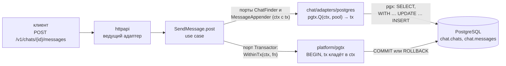
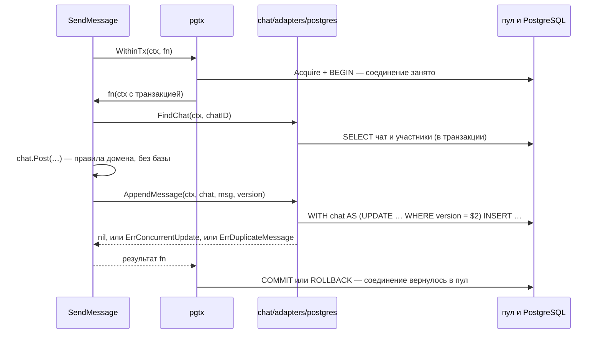

# 2.9. Мессенджер на Postgres

## <Part kind="problem" /> Проблема: тот же код, другое хранилище

До модуля 2a перезапуск мессенджера стирал всё: пользователей, чаты, сообщения. Теперь вот что происходит, когда сквозной прогон регистрирует двух пользователей, отправляет сообщение и перезапускает сервер:

```text
$ docker compose restart messenger
 Container messenger-messenger-1 Started 
после перезапуска:
  POST /v1/tokens (smoke_a_17925865601637325) → 200
  GET /v1/chats/{id}/messages → 200
  лента: 1 сообщение, seq 1, «привет из smoke 17925865601637325»
$ docker compose stop
...
остановка (код выхода 0), журнал по порядку:
  сервер остановлен
  фоновые компоненты остановлены
  пул закрыт
```

<Run dir="messenger" cmd="scripts/smoke.sh --compose" needs="docker" before="секреты и ключ — по README в корне репозитория, раздел «В Docker»" />

машина: 12th Gen Intel Core i5-12400, 12 логических процессоров (в шапке файла её нет — та же машина, что у замеров пула ниже); прогон 2026-10-21, Docker Engine 29.9.1, Docker Compose v5.5.1, Linux 7.0.0-38-generic; полный вывод — `labs/2a/results/messenger-smoke.txt` (`scripts/smoke.sh --compose`). Строки `docker compose stop` о контейнерах опущены (`...`).

Пользователь вошёл тем же паролем, лента на месте, остановка прошла в правильном порядке. Уроки 2.1–2.8 спроектировали схему и научились её применять. Этот урок разбирает, как к ней подключился код, который писался для хранилища в памяти, и почему ему для этого почти не пришлось меняться. По дороге придётся ответить на вопросы, которых у хранилища в памяти не было:

- **сколько соединений с базой держать** и почему не «чем больше, тем лучше»;
- **кто открывает транзакцию**, если регистрация пишет в два контекста, а адаптеры контекстов не знают друг о друге;
- **как убедиться**, что Postgres-адаптер выполняет те же обещания портов, что и хранилище в памяти;
- **что значит «готов»**, когда у сервиса появилась внешняя зависимость, и в каком порядке теперь останавливаться.

К концу урока вы:

- настроите `pgxpool` осознанно: размер пула по закону Литтла из настоящего замера, жизнь соединения, проверка при старте;
- объясните, почему границу транзакции задаёт use case, как транзакция путешествует в `ctx` и чем этот подход платит за удобство;
- прочитаете `platform/pgtx` и порт `Transactor` и назовёте, что они делают при ошибке, панике и отменённом запросе;
- запустите `storetest` против настоящего PostgreSQL в контейнере и объясните, как тест отката ловит «запрос мимо транзакции»;
- объясните, что проверяет `/readyz` с базой и чего это стоит, и почему пул закрывается последним;
- покажете по `git diff`, что в домене и use case'ах изменилось при переезде, а что нет.

## <Part kind="theory" /> Пул соединений

### Соединение — это процесс сервера

Хранилище в памяти отвечало вызовом функции. Запрос к PostgreSQL идёт по сети, и прежде чем отправить первый запрос, нужно соединение: TCP, при необходимости TLS, аутентификация, настройка сеанса. А на стороне сервера каждое соединение обслуживает **отдельный процесс** операционной системы (backend) со своей памятью: кэш системного каталога, подготовленные планы, `work_mem` на каждую сортировку. Открыть соединение на каждый запрос — значит каждый раз платить за установку и за порождение процесса, а держать их тысячами — значит отдать память сервера процессам, большинство которых простаивает.

Поэтому соединения переиспользуют. <T id="connection-pool">Пул соединений</T> (connection pool) держит несколько открытых соединений и выдаёт их запросам на время работы: взял (`Acquire`), выполнил запрос, вернул. В курсе это `pgxpool` из драйвера `pgx` v5.11.0. Его методы `Exec`, `Query` и `QueryRow` сами берут соединение и возвращают его, когда запрос закончен (у `Query` — когда прочитаны и закрыты строки). Если все соединения заняты, `Acquire` **ждёт**, пока какое-нибудь вернут или пока не истечёт `ctx` запроса. Ждущий запрос не падает сразу — он стоит в очереди, и время в этой очереди добавляется к задержке ответа.

Четыре вопроса, на которые отвечает конфигурация пула:

- **сколько соединений максимум** (`MaxConns`) — потолок одновременной работы с базой одного экземпляра сервиса;
- **сколько держать всегда** (`MinConns`) — сколько соединений пул открывает заранее, не дожидаясь запросов;
- **сколько живёт соединение** (`MaxConnLifetime`, `MaxConnIdleTime`) — когда его закрыть и открыть новое;
- **как узнать, что соединение мертво** (`HealthCheckPeriod`) — как часто проверять простаивающие.

Вот как мессенджер отвечает на них:

<<< @/../messenger/cmd/messenger/app.go#db-config{go}

Умолчания `pgxpool` здесь названы явно, хотя значения совпадают. Причина в комментарии: их видно в коде, и смена умолчаний в новой версии `pgx` не изменит поведение молча. `MaxConnIdleTime` (30 минут по умолчанию в `pgxpool/pool.go` v5.11.0) мессенджер не трогает: при `MinConns = 0` простаивающее соединение и так закроется через полчаса. Отдельно — `maxDBMaxConns = 100`. Это не рекомендация, а защита от опечатки: `max_connections` в PostgreSQL по умолчанию 100 на **весь сервер**, и экземпляр, который попросит больше, получит отказы в подключении под нагрузкой, а не при старте.

### Сколько соединений: закон Литтла на живом стенде

Умолчание `pgxpool` для `MaxConns` — `max(4, runtime.NumCPU())`. На машине курса это 12, на большом сервере — 64. Но `NumCPU` видит ядра машины, а не квоту контейнера: в compose у мессенджера `cpus: 1`. Размер пула должен следовать из нагрузки, а не из числа ядер. Инструмент для этого у нас есть с урока [0.4](../00-foundation/04-latency): <T id="littles-law">закон Литтла</T> L = λ × W. Здесь λ — запросы в секунду, W — сколько каждый держит соединение, L — сколько соединений занято в среднем.

Урок 0.4 считал на придуманных числах, а здесь можно измерить. Скрипт `messenger/scripts/pool-load.sh` поднимает стек compose и запускает знакомую по уроку [1.5.10](../01-5-go-concurrency/10-profiling) нагрузку `read-load.sh`: 8 клиентов читают историю чата по keep-alive соединениям. Пока она идёт, скрипт 20 раз в секунду спрашивает базу, сколько соединений мессенджера прямо сейчас выполняют запрос:

<<< @/../messenger/scripts/pool-load.sh#sample{bash}

`pg_stat_activity` — системное представление PostgreSQL: строка на каждый процесс сервера, `state = 'active'` — процесс выполняет запрос. Среднее число активных по выборкам — это L, запросы в секунду из `read-load.sh` — λ, а W = L / λ. Кроме того, до и после каждого прогона скрипт снимает счётчики `cpu.stat` из cgroup обоих контейнеров, как урок 1.5.10. Из них видно, сколько процессора мессенджер и база тратят на запрос и как часто мессенджер упирается в квоту `cpus: 1`.

Один прогон на каждый размер ничего бы не доказал. Урок 1.5.10 измерил разброс этого стенда между прогонами одной настройки, ±20–50 %, и показал, что прогоны надо чередовать: при фиксированном порядке «сначала 10, потом 2, потом 1» эффект пула неотличим от эффекта порядка (прогретые кэши, частота процессора). Поэтому скрипт делает прогрев и шесть раундов по 20 секунд, и в каждом раунде размеры пула 10, 2 и 1 идут в своём порядке. Сводка по шести раундам:

```text
Сводка по размеру пула: медиана (минимум–максимум) по 6 раундам
пул λ                   p99, мс            L                       W, мс                 CPU м, мкс    CPU б, мкс    трот, %
10   1402(1364–1474)    56.6(56.3–57.0)    0.264(0.200–0.297)    0.1835(0.142–0.214)   709.5(673–731)  282.5(270–292)  99(99–100)
2    1579(1468–1624)    50.85(50.6–51.4)   0.189(0.153–0.217)    0.1175(0.094–0.148)   628.5(612–676)  193(188–214)    99(98–100)
1    1882(1834–2090)    32.55(29.8–33.4)   0.19(0.125–0.236)     0.0965(0.063–0.127)   528(475–542)    133.5(117–136)  99(98–100)
```

<Run dir="messenger" cmd="scripts/pool-load.sh 8 20 6 10 2 1" needs="docker" before="секреты и ключ — по README в корне репозитория, раздел «В Docker»" />

машина: 12th Gen Intel Core i5-12400, 12 логических процессоров, регулятор частоты `powersave`. Стенд — `messenger/compose.yaml`: у мессенджера `cpus: 1` и `mem_limit: 256m`, у базы квоты CPU нет. Все 18 прогонов построчно (в каком раунде, в каком порядке, сколько соединений пул открыл) — в `labs/2a/results/messenger-pool.txt`. Столбцы: λ — запросов в секунду; L — среднее число активных соединений; W — время базы на запрос API (два запроса: чат и страница истории); «CPU м» и «CPU б» — процессор мессенджера и базы на запрос API; «трот» — доля периодов квоты мессенджера, в которых он упёрся в `cpus: 1`. Прочитаем по порядку.

**Пул почти пуст.** При пуле 10 в среднем занята четверть соединения: история чата — диапазон первичного ключа (урок 2.5), сервер отвечает за доли миллисекунды. При этом в каждом раунде пул **открыл 8 соединений** из 10. Клиентов восемь, и в моменты, когда все восемь одновременно дошли до базы, пул открыл соединение каждому. Потолок пула — это не «сколько будет занято», а «сколько разрешено открыть в пике».

**Маленький пул быстрее, и это не шум.** Пул из одного соединения обогнал пул из десяти во всех шести раундах, в каком бы порядке они ни шли. Диапазоны не пересекаются: 1834–2090 запросов в секунду против 1364–1474. Пул 2 — посередине. Чтобы понять почему, нужны два последних столбца.

**Экземпляр упирается в квоту процессора — это измерено.** Мессенджер был в троттлинге в 98–100 % периодов квоты в каждом прогоне при любом пуле: он хотел больше процессора, чем ему дано. Значит, λ — это одна секунда процессора в секунду, делённая на процессор на запрос: 1 / 709 мкс ≈ 1410 запросов в секунду для пула 10 и 1 / 528 мкс ≈ 1890 для пула 1. Это совпадает с измеренной λ. Пул влияет на пропускную способность не напрямую, а через то, **сколько процессора мессенджер тратит на запрос**. При пуле 10 запрос стоил на треть дороже, чем при пуле 1.

**Чем больше соединений работает одновременно, тем дороже запрос с обеих сторон — тоже измерено.** База на запрос тратила 283 мкс при пуле 10 и 134 мкс при пуле 1, в два раза больше. Время базы на запрос W выросло так же, с 0,10 до 0,18 мс. А механизм не измерен, и вот наша гипотеза. «Один процесс работает без перерыва» её не объясняет: даже при пуле 1 соединение активно лишь пятую часть времени (L ≈ 0,19), и процесс сервера между запросами засыпает. Разница — в том, **сколько** процессов и горутин делят эти пробуждения. При одном соединении все запросы идут через один процесс сервера и один сокет: просыпается всегда один и тот же процесс, и его код и данные остаются в кэшах одного ядра. При восьми открытых соединениях та же работа размазана по восьми процессам сервера и горутинам мессенджера, которые ждут ответа от разных сокетов. Пробуждений и переключений контекста больше, процессы чаще переезжают между ядрами и находят кэши холодными, а это оплачивают процессором обе стороны. Свой вклад может давать и режим частоты `powersave` из шапки замера: ядро, которое чаще простаивает между короткими пробуждениями, может работать на меньшей частоте. Подтвердить гипотезу можно счётчиками переключений контекста (`perf stat -e context-switches` на процессах базы) — этого мы не делали. В практической части это тот же довод, что внизу раздела: лишние одновременные соединения не ускоряют базу, а делят её процессор.

**Что из этого следует для W.** Выборка `pg_stat_activity` видит только время сервера. Пока ответ идёт по сети и `pgx` разбирает строки, процесс сервера уже `idle`, а соединение в пул ещё не вернулось. Поэтому W из таблицы — нижняя оценка того, сколько запрос держит соединение пула. Верхнюю даёт пул из одного соединения: оно не может быть занято больше, чем всё время, значит L ≤ 1 и W ≤ 1 / λ = 1 / 1882 с ≈ <N>0,53 мс</N> на запрос API, уже с сетью и разбором строк. Но эта граница верна только для условий пула 1, без конкуренции. Как показали столбцы CPU, с ростом числа одновременных соединений запрос дорожает.

Теперь посчитаем, откуда умолчание 10. Если каждое соединение держится запросом не дольше 0,53 мс, через 10 соединений проходит **не меньше** 10 / 0,00053 ≈ <N>18 900</N> запросов чтения в секунду. Это оценка, а не гарантия: при десяти одновременно занятых соединениях запрос стоит дороже, чем при одном. Но запас в десять раз над тем, что экземпляр вообще способен сгенерировать (1400–2100 запросов в секунду, предел — его квота процессора), такую поправку переживает. Для сравнения: та же нагрузка на хранилище в памяти дала в уроке 1.5.10 около 2390 запросов в секунду (`labs/1-5/results/profile/profile-read-load.txt`). Та версия скрипта делила число запросов на заказанные 30 с, а не на фактическое время, поэтому сравнивать можно только порядок величины. Postgres-версия того же порядка.

Почему тогда не 1, раз он быстрее? Потому что он быстрее **на этой нагрузке**: короткие одинаковые чтения, каждое за десятую долю миллисекунды. Одно соединение — это одна очередь. Любой медленный запрос, будь то транзакция записи с `COMMIT`, ожидание блокировки или холодный кэш, держит её целиком, и все остальные запросы экземпляра ждут за ним. Закон Литтла работает со **средними**, а пул должен пережить худшие секунды:

- **запись дороже чтения.** Попытка отправки сообщения — транзакция из четырёх обращений к серверу (`BEGIN`, чтение чата, запись, `COMMIT`), и `COMMIT` ждёт записи журнала на диск (`synchronous_commit = on`). Гипотеза, не замер: 1–5 мс на попытку. При 5 мс десять соединений пропускают 2000 записей в секунду, одно — 200;
- **медленный хвост.** Если один запрос из ста стал занимать 50 мс (блокировка, холодный кэш), среднее W выросло вдвое, а занятых соединений в эти секунды стало в разы больше;
- **регистрация и вход** ходят в базу после хеша Argon2id пачками, когда очередь хешера освобождается.

И почему не больше? Замер показал, что лишние одновременные соединения делают запрос дороже. Кроме того, потолок одного экземпляра умножается на число экземпляров: десять экземпляров по 10 соединений — это уже 100, весь `max_connections` по умолчанию, из которых 3 зарезервированы для суперпользователя (`superuser_reserved_connections`). Больше соединений — больше процессов сервера, которые одновременно делят его процессор и память. Пусть лучше очередь стоит в пуле, чем база сама разбирает лишнюю конкуренцию. На этом же стоит известное правило из вики HikariCP («About Pool Sizing»): начинать с «число ядер базы × 2 + число дисков» соединений на всю базу, а не с числа клиентов, и уточнять замером. Как ставить пулер перед базой (PgBouncer) и как выбирать `max_connections` — модуль 2b.

<Callout type="simplified">

Мы измерили только чтение одной ленты: один паттерн доступа, маленькая база, один экземпляр. Для записи оценка — гипотеза, и проверять её стоит тем же способом: `pool-load.sh` с нагрузкой отправкой сообщений. В продакшене L меряют не выборкой `pg_stat_activity`, а метриками самого пула: `pgxpool.Stat()` отдаёт `AcquiredConns` (занято сейчас), `AcquireCount`, `AcquireDuration` и `EmptyAcquireCount` (сколько раз запросу пришлось ждать соединения). Последняя — главный сигнал «пул мал». Метрики мессенджера появятся вместе с наблюдаемостью в модуле 12.

</Callout>

### Пул в composition root

Пул создаётся один раз, в <T id="composition-root">composition root</T>, и до того, как сервер откроет порт, проверяет базу:

<<< @/../messenger/cmd/messenger/app.go#open-db{go}

`pgxpool.NewWithConfig` соединений не открывает: пул подключается лениво, при первом запросе. Поэтому без `Ping` недоступная база обнаружилась бы на первом запросе пользователя, а не при выкладке. Срок `dbStartTimeout` — 10 секунд: база не ответила — сервер выходит с ошибкой, и оркестратор перезапустит его, а не будет ждать «живой» процесс без порта. Проверку версии схемы (`checkSchema`) разобрал урок 2.8. Строка подключения приходит файлом-секретом `MESSENGER_DATABASE_URL_FILE`, как ключ JWT: в ней пароль, а переменные окружения видны в `docker inspect`. По той же причине ошибка разбора строки не печатается целиком.

## <Part kind="theory" /> Транзакция: кто задаёт границу

### Две операции, которым нужна атомарность

<T id="transaction">Транзакция</T> (transaction) — группа операций, которая фиксируется целиком (`COMMIT`) или не оставляет следа (`ROLLBACK`). У хранилищ в памяти транзакций не было, и две операции мессенджера жили с этим по-разному.

**Регистрация** создаёт профиль в контексте `user` и учётные данные в контексте `auth`. ADR-0004 записал окно: если вторая запись падает, остаётся профиль без пароля, а имя занято навсегда. С Postgres обе таблицы — в одной базе (`users.users` и `auth.credentials`, урок 2.1), и окно можно закрыть одной транзакцией.

**Попытка отправки сообщения** читает чат, применяет правила агрегата (`chat.Post` проверяет участника, выдаёт следующий `seq`) и записывает сообщение вместе с новым состоянием чата при условии, что версия чата не изменилась. Сама запись — один оператор SQL с <T id="cte">CTE</T>:

<<< @/../messenger/internal/chat/adapters/postgres/store.go#append{go}

Урок 2.2 описывал эту запись двумя операторами в транзакции; урок 2.5 объяснил, почему в коде она стала одним: нарушение уникальности `client_message_id` откатывает команду целиком, вместе с `UPDATE`, и счётчик не убегает вперёд сообщений. Оператор атомарен и без транзакции, а <T id="optimistic-locking">оптимистическая блокировка</T> (`WHERE version = $2`) защищает от потерянного обновления и без неё. Зачем тогда попытке транзакция? Посмотрите на `AppendMessage` после оператора: если номер из базы не совпал с номером агрегата, адаптер возвращает ошибку. Без транзакции оператор к этому моменту уже зафиксирован, и ошибка ничего не отменит. В транзакции попытки она откатит и запись. То же с любым шагом, который появится после записи, — например, с журналом аудита в той же транзакции (урок 2.6).

### Почему не адаптер

Самый простой ответ на «кто открывает транзакцию» — адаптер: метод хранилища начинает транзакцию, пишет, фиксирует. Так и сделано там, где хватает одного вызова порта: `CreateChat` пишет чат с участниками одним оператором (урок 2.4), и его use case транзакции не берёт.

Но граница транзакции — это граница **бизнес-операции**, а её знает только сценарий. Адаптер `auth` не знает, что перед ним адаптер `user` создал профиль, и не должен знать: ADR-0001 разделил контексты, а `depguard` следит, чтобы они друг друга не импортировали. Чтобы адаптер открыл транзакцию на оба шага, пришлось бы завести «адаптер регистрации», который пишет и в `users`, и в `auth`, — то есть склеить два контекста в одном пакете. А попытку отправки адаптер смог бы обернуть, только забрав себе «прочитать чат и применить правила» — бизнес-правила ушли бы из домена в SQL.

Есть и другие известные ответы. <T id="unit-of-work">Единица работы</T> (unit of work): use case получает объект, открывает его и берёт хранилища у него — `uow.Users()`, `uow.Credentials()`, в конце `Commit`. Забыть транзакцию невозможно, потому что хранилище вне её не получить. Но интерфейс единицы работы должен выдавать хранилища всех контекстов, которые участвуют в операции, и порт `auth` начинает знать хранилище `user`. Третий вариант — передавать транзакцию аргументом в методы портов — отпадает сразу: в сигнатурах портов появится тип `pgx`, и use case будет зависеть от драйвера.

### Транзакция в `ctx`

Мессенджер выбрал четвёртый вариант, распространённый в продакшен-коде на Go. Use case объявляет узкий порт с одним методом:

<<< @/../messenger/internal/chat/usecase/ports.go#transactor{go}

и вызывает адаптеры внутри `fn` с тем `ctx`, который получил. Реализация порта открывает транзакцию и кладёт её **в `ctx`**. Postgres-адаптер, выполняя запрос, спрашивает у `ctx`: есть ли транзакция? Есть — запрос идёт в ней, нет — в пул. Use case задаёт границу и не знает `pgx`. Адаптеры двух контекстов пишут в одну транзакцию и ничего не знают друг о друге: общий у них только `ctx`. Сигнатуры портов не меняются.

Порт объявлен дважды — в `auth/usecase` и в `chat/usecase`, одинаковыми словами. Это не дублирование знания, а правило «порт у потребителя» (урок 1.1): у каждого контекста свой узкий интерфейс, и `chat` не импортирует `auth` ради трёх строк.

Вот как это выглядит в регистрации:

<<< @/../messenger/internal/auth/usecase/signup.go#signup{go}

Обратите внимание, что **вне** транзакции: хеш пароля. Транзакция держит соединение пула от `BEGIN` до `COMMIT`, а Argon2id считается сотни миллисекунд. Пул в 10 соединений, каждое из которых занято хешем, — это 10 одновременных регистраций и ни одного чтения ленты для остальных. Правило: внутри транзакции только работа с базой и быстрые правила домена; всё медленное — до или после.

Что за этот подход платят? **Неявность.** Транзакция передаётся не аргументом, который видно в сигнатуре, а значением в `ctx`, которое видно только тому, кто знает, где искать. Адаптер, который обратится к пулу напрямую, выполнит запрос **вне** транзакции, и ни компилятор, ни линтер этого не заметят. И `ctx` теперь несёт не только отмену и сроки (урок 1.5): в нём лежит ресурс. Защиту от первого разберём в разделе о `storetest`.

<Deep title="Почему транзакцию нельзя делить между горутинами">

Транзакция PostgreSQL принадлежит **сеансу**, а сеанс — одному соединению. `BEGIN`, все запросы транзакции и `COMMIT` идут по одному TCP-соединению, и протокол PostgreSQL на нём строго последовательный: клиент отправляет сообщение запроса, сервер отвечает строками, затем `CommandComplete` и `ReadyForQuery`. Только после `ReadyForQuery` можно отправить следующий запрос. Протокол позволяет отправить несколько запросов подряд, не дожидаясь ответа (pipeline), но ответы придут строго в том же порядке, одним потоком.

`pgx.Conn` поэтому прямо сказано: «not safe for concurrent usage». `pgx.Tx` — та же связка с одним соединением. Если две горутины одновременно вызовут `tx.Query`, их сообщения перемешаются в одном сокете, и `pgx` либо получит чужие строки, либо увидит нарушение протокола и закроет соединение. Хуже всего, когда одна горутина ещё читает строки, а другая уже вызвала `Commit`: драйвер `pgxv5` библиотеки `go-transaction-manager` прямо предупреждает, что запрос никогда не должен пересекаться с `Commit` или `Rollback` той же транзакции.

Отсюда правило в комментарии порта: `fn` не запускает горутин, которые работают с переданным `ctx`. Если операции нужно параллельно сходить в два места, это не одна транзакция: либо параллельная часть идёт до или после транзакции со своим `ctx` без неё, либо шаги внутри транзакции выполняются по очереди. `context.WithoutCancel` такой `ctx` не даст: он отвязывает отмену, а значение транзакции в нём сохраняется. Последовательные запросы в одной транзакции на одном соединении стоят по одному обмену с сервером каждый, и параллельность внутри транзакции почти никогда не окупается: сервер всё равно выполняет их одним процессом.

Механической проверки у правила нет. Детектор гонок его не поймает: `pgx.Tx` защищён от гонок данных в памяти не больше, чем любой другой тип, а одновременная запись в сокет — не гонка данных в смысле модели памяти Go, а нарушение протокола. Поэтому правило живёт в комментарии порта, в ADR-0015 и на ревью.

</Deep>

### Сделать или взять готовое

Идея «транзакция в `ctx`» не придумана для курса. Её реализует, например, библиотека `avito-tech/go-transaction-manager` (лицензия MIT): модуль `trm/v2` и драйвер `drivers/pgxv5/v2`, на 2026-10-21 последние теги — `v2.0.5`. В ней граница — `trManager.Do(ctx, func(ctx context.Context) error {…})`, а адаптер берёт исполнителя через `trmpgx.DefaultCtxGetter.DefaultTrOrDB(ctx, pool)` — то же, что наш `pgtx.Q(ctx, pool)`. Библиотека умеет больше: семь режимов распространения транзакции (по умолчанию `PropagationRequired` — вложенный вызов присоединяется к внешней транзакции; `PropagationNested` — вложенная транзакция <T id="savepoint">точкой сохранения</T>; `PropagationRequiresNew` — новая независимая транзакция, а текущая приостанавливается, и другие), сроки и отмену транзакции, несколько менеджеров разом, драйверы для `database/sql`, `sqlx`, `gorm`, MongoDB и Redis.

Мессенджер написал своё — `platform/pgtx`, около 120 строк с комментариями. ADR-0015 сравнивает варианты подробно, а коротко довод такой: нам нужен ровно один режим (вложенный вызов присоединяется), одна база и несколько краевых случаев, которые всё равно пришлось бы проверить своими тестами против настоящего PostgreSQL. Этот код целиком помещается в урок. Зато сигнатура `Do` совпадает с нашим `WithinTx`, поэтому если однажды понадобятся точки сохранения или несколько баз, порт use case'ов не изменится: поменяется реализация в composition root и функция `Q` в адаптерах.

## <Part kind="theory" /> `pgtx`: что происходит при ошибке, панике и отмене

### `WithinTx`

<<< @/../messenger/internal/platform/pgtx/pgtx.go#within-tx{go}

Пройдём по исходам:

- **`fn` вернула `nil`** — `COMMIT`. Ошибка фиксации возвращается с обёрткой: например, сервер разорвал соединение, и неизвестно, зафиксировалось ли что-нибудь;
- **`fn` вернула ошибку** — откат, и та же ошибка **без обёртки**. Use case проверяет её через `errors.Is` ровно так же, как без транзакции: `SendMessage` по-прежнему узнаёт `ErrConcurrentUpdate` и повторяет попытку;
- **паника в `fn`** — `defer` откатывает транзакцию и передаёт панику дальше, к `middleware.Recover`, который ответит `500`. Без отката соединение вернулось бы в пул посреди открытой транзакции;
- **`runtime.Goexit`** — то же самое. Его вызывает `t.Fatal` в тесте: без этой ветки упавший тест оставлял бы транзакцию открытой, и следующий тест того же пакета ждал бы её блокировок;
- **`ctx` уже отменён** (клиент ушёл, истёк срок запроса). С отменённым `ctx` `pgx` не отправит `ROLLBACK`, а закроет соединение как находящееся «в неизвестном состоянии», и пул заплатит за новое. Поэтому `rollback` отвязывает откат от отмены (`context.WithoutCancel`) и даёт ему `rollbackTimeout` — <N>5 с</N>;
- **`ctx` уже несёт транзакцию** — вложенный вызов. `fn` выполняется во внешней транзакции, без нового `BEGIN` и без `SAVEPOINT`.

Уровень изоляции — `READ COMMITTED`, умолчание PostgreSQL. Где нужна защита от гонок, мессенджер полагается на проверку версии и ограничения, а не на повышение изоляции; почему это так и чем опасны более строгие уровни — модуль 2b.

### Вложенный вызов без точки сохранения

Точка сохранения (`SAVEPOINT`) позволила бы вложенному шагу откатиться и дать внешней транзакции продолжить — так работают `tx.Begin` у `pgx.Tx` и режим `PropagationNested`. Мессенджер их не ставит. Вложенный вызов здесь — шаг той же операции, и операция удаётся или откатывается целиком. Точка сохранения — это разрешение проглотить ошибку шага и пойти дальше, а внешний код об этом не узнает. Плюс обмен с сервером на каждый шаг.

Следствие записано в `doc.go` пакета и проверено тестом `TestSwallowedNestedPgErrorLeavesTxAborted`: ошибку вложенного `WithinTx` нельзя проглатывать. Если это была ошибка Postgres, транзакция уже **оборвана**: сервер отклоняет все её команды до `ROLLBACK` с `25P02` (урок 2.4), и `COMMIT` превращается в откат.

### `Q`: исполнитель для адаптера

<<< @/../messenger/internal/platform/pgtx/pgtx.go#q{go}

`Q` возвращает `Querier` — то, что адаптеру нужно для запросов. Этот интерфейс реализуют и пул, и транзакция:

<<< @/../messenger/internal/platform/pgtx/pgtx.go#querier{go}

Ключ транзакции в `ctx` — неэкспортируемый тип `txKey`, поэтому положить транзакцию в `ctx` в обход `WithinTx` снаружи пакета нельзя. Все Postgres-адаптеры, включая хранилище ключей идемпотентности, обращаются к базе только через `Q`. Вне транзакции каждый запрос через пул — своя неявная транзакция: PostgreSQL фиксирует его сразу после выполнения (autocommit).

### Повтор сообщения: прочитать после отката

Из правила «ошибка Postgres обрывает транзакцию» следует изменение, которое хранилище в памяти не требовало. Раньше на повтор `client_message_id` хранилище отвечало `*DuplicateMessageError` с уже сохранённым сообщением, и use case возвращал его клиенту. Postgres так не может: нарушение уникальности `messages_client_id_key` оборвало транзакцию попытки, и прочитать в ней сохранённое сообщение нельзя. Поэтому `AppendMessage` отвечает только «такое уже есть» (`errors.Is(err, domain.ErrDuplicateMessage)`), а сообщение use case читает **после отката**, через новый узкий порт:

<<< @/../messenger/internal/chat/usecase/ports.go#message-finder{go}

<<< @/../messenger/internal/chat/usecase/send_message.go#send-saved{go}

Это единственный новый порт за весь переезд. Чтение идёт по тому же ключу, что держит `UNIQUE`, и его индекс обслуживает запрос.

## <Part kind="viz" /> Визуализация: путь запроса до строки

Две схемы показывают одну попытку отправки сообщения. Первая — **кто кого вызывает** и на какой границе живёт транзакция. Цвет узла — его роль: клиент, код мессенджера, база.



Вторая — **порядок во времени** и то, где занято соединение пула:



Что смотреть:

1. **Use case не говорит с базой.** На первой схеме от `SendMessage.post` к PostgreSQL нет ни одной стрелки: только порты. `pgx` появляется справа от адаптера и от `pgtx`, ровно там, где его разрешает `depguard`.
2. **Транзакция переходит через `ctx`.** Стрелка к адаптеру подписана «ctx с tx»: адаптер не получает транзакцию аргументом, он находит её в `ctx` через `pgtx.Q`. Если адаптер забудет `Q` и обратится к пулу, его стрелка к базе пойдёт мимо транзакции, и `ROLLBACK` справа её не отменит.
3. **Соединение занято от `BEGIN` до `COMMIT`.** На второй схеме между этими строками есть шаг `chat.Post` без базы. Пока он идёт, соединение держит транзакция. Это микросекунды правил домена; хеш пароля в регистрации поэтому стоит до `WithinTx`.
4. **Ошибка возвращается через `fn`.** `ErrConcurrentUpdate` и `ErrDuplicateMessage` доходят до `pgtx` как результат `fn`, и тот откатывает транзакцию. Конфликт версии — новая попытка с новой транзакцией; дубль — чтение сохранённого сообщения уже после отката.

<Callout type="simplified">

Схемы показывают одну попытку без повторов и без цепочки middleware (аутентификация, таймаут, журнал). `Acquire` и `BEGIN` в `pgx` — два действия: соединение берётся из пула, затем по нему уходит `BEGIN`. Строк «соединение открыто» здесь нет: пул открывает новое соединение, только если свободных нет и потолок не достигнут.

</Callout>

Вопросы к визуализации:

1. Адаптер чата забыл `pgtx.Q` в `AppendMessage` и пишет через `s.pool`. Что изменится на схемах, и что окажется в базе, если после записи адаптер вернёт ошибку несовпадения `seq`?
2. Почему на второй схеме нельзя поменять местами `FindChat` и `BEGIN` — прочитать чат до транзакции, а записать в ней — и чем это отличается от того, что делает оптимистическая блокировка?
3. `MESSENGER_DB_MAX_CONNS=1`. Внутри `fn` адаптер забыл `Q` и вызвал `s.pool.QueryRow`. Что произойдёт с запросом?

<SelfCheck question="Ответы">

1. Стрелка записи пойдёт к базе мимо транзакции: оператор выполнится на другом соединении пула и зафиксируется сразу (autocommit). Ошибка `seq` вернётся из `fn`, `pgtx` откатит транзакцию — но откатывать там нечего, кроме чтения. Сообщение и новая версия чата останутся в базе, хотя use case считает попытку неудавшейся. Это ловит `TestAppendMessageRollsBackWithTx`.
2. Корректность не пострадала бы: запись всё равно проверяет версию, прочитанную в начале, и при конфликте не обновит ничего. Но ошибка после записи (несовпадение `seq`, будущий журнал аудита) должна отменять запись, а для этого запись должна быть в транзакции; чтение в той же транзакции делает попытку одной единицей — «прочитал, проверил, записал». Оптимистическая блокировка решает другое: она не мешает двум попыткам идти одновременно, а отвергает ту, что опоздала.
3. Единственное соединение держит транзакция. `s.pool.QueryRow` вызовет `Acquire` и будет ждать свободного соединения, которое не освободится, пока `fn` не вернётся, а `fn` ждёт этот запрос. Запрос простоит до конца срока `ctx` (таймаут запроса), затем вернёт ошибку контекста. При пуле побольше ожидание не наступит — и ошибка станет тихой: запрос просто выполнится вне транзакции.

</SelfCheck>

## <Part kind="code" /> Код: адаптеры, `storetest` на testcontainers, пробы, остановка

### Адаптеры за теми же портами

Каждый контекст получил пакет `adapters/postgres` рядом с `adapters/memory`: `user`, `auth`, `chat` и хранилище ключей `platform/idempotency/postgres`. Они реализуют те же порты из `*/usecase/ports.go`, что и хранилища в памяти, и устроены одинаково:

- **запросы — через `pgtx.Q`**, параметры — только `$1, $2, …`, никакой склейки строк с данными;
- **ошибки ограничений** переводятся в доменные по `pgconn.PgError.Code` и имени ограничения (`platform/pgerr`, урок 2.4), всё остальное — ошибка сервера с `%w`;
- **строка таблицы собирается в доменный объект конструкторами домена.** Каждое поле разбирается `Parse…`/`New…`, а агрегат восстанавливается `RestoreChat` или `RestoreMessage`. Строка, которая не проходит проверки домена (её записали в обход приложения), — ошибка сервера, а не `400` клиенту.

Хранилищу в памяти последний пункт не был нужен: оно держало в картах готовые доменные значения. Адаптеру базы он нужен, и ради него в домене появился конструктор `RestoreMessage` — об этом ниже, в разделе «Что не изменилось».

Хранилище ключей идемпотентности в Postgres — та же таблица с владельцем резервации, что спроектировал урок 2.1 (поля ответа и `owner` он отложил до этого урока):

<<< @/../messenger/migrations/00001_init.sql#idempotency-keys{sql}

`Reserve` — три шага, каждый атомарен сам:

<<< @/../messenger/internal/platform/idempotency/postgres/store.go#reserve-sql{go}

Свободный ключ — один `INSERT … ON CONFLICT DO NOTHING`. Зависшая запись «в работе» (`reserved_until` прошёл) — перехват атомарным `UPDATE … WHERE`: второй перехватчик ждёт блокировку строки, перечитывает её и видит свежий срок. Цена занятого ключа — **три обмена с сервером**: вставка упёрлась в конфликт, перехват не нашёл строки, чтение вернуло чужую запись. Каждый — отдельный запрос через пул. Повтор, пока первый запрос в работе, — нечастое событие, и три коротких запроса по первичному ключу его не разорят; но если повторы пачками станут нормой (клиент без паузы между попытками), это первое место для оптимизации.

Честная граница: ключ живёт в той же базе, что и чаты, но **запись ключа и операция — разные транзакции**. Middleware резервирует ключ до обработчика, обработчик создаёт чат, middleware сохраняет ответ после. Упади процесс между созданием чата и сохранением ответа — повтор получит `409`, пока не истечёт срок резервации (срок запроса плюс 5 с), а затем перехватит ключ и создаст вторую группу. До 2a вместо «срока запроса плюс 5 с» были сутки, а после перезапуска — сразу второй чат. Закрыть окно полностью можно только записью ответа в транзакции операции; ADR-0005 и ADR-0015 записывают, почему этого шага пока нет.

### Время с точностью базы

Одно изменение ради Postgres живёт в `platform/clock`: `clock.System.Now()` усекает время до микросекунд. `timestamptz` в PostgreSQL хранит микросекунды, а `time.Now()` в Go — наносекунды. Без усечения первый ответ на сообщение нёс бы `sent_at` с наносекундами (из памяти процесса), а повтор того же сообщения — уже прочитанный из базы, с микросекундами, и клиент увидел бы у одного сообщения два разных времени. Усечение в часах, а не в адаптере: домен и хранилище работают с одним и тем же значением.

### `storetest` против настоящей базы

Контракт хранилища (урок [1.6](../01-go-service/06-tests)) — батарея проверок `storetest.Run(t, newStore)`, которую обязана пройти любая реализация порта:

<<< @/../messenger/internal/chat/usecase/storetest/storetest.go#run{go}

Postgres-адаптер вызывает её со своей фабрикой, которая отдаёт чистую базу. Чтобы проверка шла против **настоящего** PostgreSQL — с его `UNIQUE`, блокировками строк и кодами ошибок, — её база живёт в контейнере, который поднимает <T id="testcontainers">testcontainers</T>-go (модуль `modules/postgres`, v0.44.0). Как это устроено, рассказывает пакет-помощник `platform/pgtest`:

<<< @/../messenger/internal/platform/pgtest/doc.go{go}

Ключевая деталь — снимок. Применять миграции перед каждой проверкой долго, а оставлять данные соседа нельзя. Поэтому контейнер один на тестовый бинарь пакета, миграции применяются один раз, база сохраняется снимком (`Snapshot` — копия базы-шаблона внутри того же сервера), а перед каждой проверкой восстанавливается из него (`Restore` пересоздаёт базу через `CREATE DATABASE … TEMPLATE`). Поэтому база не может называться `postgres`: системную базу, к которой подключается сам снимок, удалить нельзя. Поэтому же проверки одного пакета не идут параллельно: `Restore` обрывает соединения соседа.

Настоящий прогон контракта чатов:

```text
$ MESSENGER_REQUIRE_DOCKER=1 go test -race -count=1 -v ./internal/chat/adapters/postgres/ | grep -Ev '^[0-9]{4}/[0-9]{2}/[0-9]{2} |^  [A-Z]'
...
--- PASS: TestStoreContract (3.64s)
    --- PASS: TestStoreContract/создание_и_поиск (2.73s)
    --- PASS: TestStoreContract/второй_личный_чат_для_пары (0.04s)
    --- PASS: TestStoreContract/оптимистическая_блокировка (0.05s)
...
    --- PASS: TestStoreContract/одновременная_запись (0.13s)
...
    --- PASS: TestStoreContract/одновременные_повторы_client_message_id (0.11s)
...
=== RUN   TestCreateChatRollsBackWithTx
--- PASS: TestCreateChatRollsBackWithTx (0.04s)
=== RUN   TestAppendMessageRollsBackWithTx
--- PASS: TestAppendMessageRollsBackWithTx (0.05s)
=== RUN   TestDuplicateInTxAbortsAttempt
--- PASS: TestDuplicateInTxAbortsAttempt (0.05s)
...
PASS
```

<Run dir="messenger" cmd="MESSENGER_REQUIRE_DOCKER=1 go test -race -count=1 -v ./internal/chat/adapters/postgres/ | grep -Ev '^[0-9]{4}/[0-9]{2}/[0-9]{2} |^  [A-Z]'" needs="docker" />

машина та же, образ `postgres:18.6-trixie`; полный вывод, включая все 17 проверок контракта, прогон всех пакетов с Postgres и прогон с `-short` — `labs/2a/results/messenger-storetest.txt`. Фильтр `grep -Ev` убирает строки журнала testcontainers. Первая проверка заняла <N>2,73 с</N>: в неё вошёл запуск контейнера и миграции. Каждая следующая — 40–130 мс вместе с `Restore` снимка. Те же 17 проверок проходит и `memory.Store`: контракт один на обе реализации. Каждый пакет с Postgres целиком — 7–9 секунд:

```text
ok  	messenger/internal/user/adapters/postgres	8.023s
ok  	messenger/internal/auth/adapters/postgres	7.516s
ok  	messenger/internal/chat/adapters/postgres	8.390s
ok  	messenger/internal/platform/idempotency/postgres	8.708s
ok  	messenger/internal/platform/pgtx	7.998s
ok  	messenger/internal/platform/pgtest	7.481s
ok  	messenger/cmd/messenger	9.272s
```

Без Docker такие тесты пропускаются с сообщением, а с `-short` — даже не пробуют найти Docker: так идёт быстрая CI-джоба `messenger-test`. Отдельная джоба `messenger-integration` запускает их с `MESSENGER_REQUIRE_DOCKER=1`, и там пропуск превращается в провал: иначе сломанный Docker на раннере выглядел бы зелёной сборкой без единого интеграционного теста.

### Тест отката: защита от забытого `pgtx.Q`

Контракт `storetest` не знает о транзакциях: он проверяет порт, а в порте их нет. Забытый `pgtx.Q` он не поймает — запрос через пул вне транзакции работает так же правильно. Поэтому у каждой пишущей операции Postgres-адаптера есть свой тест отката: записать внутри `WithinTx`, вернуть ошибку и убедиться, что после отката записи нет.

<<< @/../messenger/internal/chat/adapters/postgres/store_test.go#rollback-test{go}

Если в `AppendMessage` заменить `pgtx.Q(ctx, s.pool)` на `s.pool`, тест упадёт на первой же проверке: после отката в истории окажется сообщение. Такие тесты есть у каждой пишущей операции: `TestCreateUserRollsBackWithTx` (`user`), `TestSaveCredentialsRollsBackWithTx` (`auth`), `TestCreateChatRollsBackWithTx`, `TestAppendMessageRollsBackWithTx` и `TestDuplicateInTxAbortsAttempt` (`chat`), `TestReserveRollsBackWithTx` (идемпотентность). Правило для ревью: новая пишущая операция адаптера приходит с таким тестом.

Атомарность регистрации проверяет `TestSignUpRollsBackProfileOnCredentialsFailure`: настоящие адаптеры обоих контекстов, мост `userbridge`, `pgtx` и хранилище учётных данных, которое записывает строку и затем отказывает. После отказа в базе нет ни профиля, ни учётных данных. Тест лежит в `cmd/messenger/signup_tx_test.go`, а не в пакете адаптера `auth`: он собирает регистрацию так же, как composition root, а `depguard` не даёт `auth` импортировать `user` даже в тестах.

### `/readyz` с базой

<T id="readiness-probe">Проба готовности</T> (`/readyz`) с 2a проверяет базу:

<<< @/../messenger/cmd/messenger/app.go#root-mux{go}

Проверка `dbCheck` — `pool.Ping` со сроком `dbPingTimeout` = 1 с, в пределах общего срока проб. Живость (`/livez`) базу не проверяет, и это сознательно (урок 1.17): если база недоступна, перезапуск процесса её не починит, а одновременный перезапуск всех экземпляров превратит сбой базы в отказ всего сервиса. Пробы теперь стоят под `middleware.Recover`: проверка ходит в базу, и паника в ней должна дать `500 problem+json`, а не оборванное соединение, которое проба примет за сетевой сбой.

У этой проверки есть цена, которую видно только в исходниках `pgxpool`: `Pool.Ping` — это `Acquire`, затем `Ping` по полученному соединению (`pgxpool/pool.go`, v5.11.0). Проба **занимает слот пула** и встаёт в ту же очередь, что и запросы пользователей. Под насыщением, когда все 10 соединений заняты, проба ждёт свободного, через секунду получает ошибку срока, и экземпляр отвечает `503 «не готов»`. Отчасти это правильно: перегруженный экземпляр полезно вывести из ротации. Но если перегружены все экземпляры, они начинают по очереди выпадать из ротации, и нагрузка переходит на оставшихся. Альтернатива — проверять базу отдельным соединением вне пула или кэшировать результат проверки на несколько секунд. Мессенджеру хватает простого варианта; выбор и его метрики — модуль 12.

### Порядок остановки

Пул закрывается **последним**:

<<< @/../messenger/cmd/messenger/main.go#close-db{go}

`lifecycle.Run` (урок 1.5.6) останавливает стадии по очереди: сначала HTTP (дренаж: `/readyz` отвечает `503`, пауза, `Shutdown` дожидается начатых запросов), затем фоновые компоненты (очистка ключей идемпотентности, которая сама ходит в базу). Только после этого `defer` закрывает пул. `Pool.Close` ждёт, пока все выданные соединения вернутся, поэтому закрыть его раньше значило бы либо зависнуть на соединении начатого запроса, либо оборвать фоновую очистку «закрытым пулом». Журнал остановки из начала урока — ровно этот порядок: `сервер остановлен`, `фоновые компоненты остановлены`, `пул закрыт`.

Тот же порядок держит compose. Сервис `messenger` зависит не только от `migrate`, но и от `db` с `condition: service_healthy`: при `docker compose stop` compose останавливает зависимых первыми, и сервер закрывает пул раньше, чем уходит база. База в compose:

<<< @/../messenger/compose.yaml#db{yaml}

## <Part kind="practice" /> Что изменилось в мессенджере

Переезд на Postgres приехал в ветку модуля одним блоком, и уроки 2.4, 2.5 и 2.8 уже разобрали свои части: ограничения и перевод ошибок, запросы и индексы, миграции. Этот урок разобрал остальное — пул, транзакции, адаптеры, тесты, пробы и остановку — и добавил запись о решении и воспроизводимые прогоны:

```text
messenger/
├── docs/adr/0015-транзакции.md         # новый: граница в use case, транзакция в ctx,
│                                       #   Transactor, pgtx против go-transaction-manager
├── scripts/pool-load.sh                # новый: L, λ и W закона Литтла для пулов 10, 2 и 1
└── internal/chat/adapters/postgres/
    └── store_test.go                   # + регион rollback-test (только комментарии)
labs/2a/results/
├── messenger-pool.txt                  # новый: вывод pool-load.sh
└── messenger-storetest.txt             # новый: storetest и тесты отката на testcontainers
course/glossary/terms.yaml              # + savepoint, outbox
```

А вот всё, что появилось в мессенджере за переезд, если смотреть со стороны этого урока:

```text
messenger/internal/
├── platform/
│   ├── pgtx/                     # Transactor, WithinTx, Q; тесты: коммит, откат по ошибке,
│   │                             #   панике, Goexit и отменённому ctx, вложенный вызов
│   ├── pgtest/                   # testcontainers: контейнер на пакет, Snapshot/Restore
│   ├── pgerr/                    # нарушение уникальности по коду и имени ограничения
│   ├── idempotency/postgres/     # Reserve с перехватом, Complete, Release, Sweep порциями
│   └── clock/clock.go            # время усечено до микросекунд
├── user/adapters/postgres/       # профили (users.users)
├── auth/adapters/postgres/       # учётные данные (auth.credentials)
├── auth/usecase/                 # порт Transactor; SignUp — профиль и пароль в одной транзакции
├── chat/adapters/postgres/       # чаты, участники, сообщения; UserChecker одним запросом
├── chat/usecase/                 # порты Transactor и MessageByClientIDFinder; попытка
│                                 #   SendMessage — в транзакции, повтор читается после отката
└── chat/domain/message.go        # MessageSnapshot и RestoreMessage
messenger/cmd/messenger/
├── app.go                        # пул, проверка базы и схемы, /readyz с базой, сборка адаптеров
├── main.go                       # пул закрывается после HTTP и фоновых компонентов
└── signup_tx_test.go             # откат регистрации через два контекста
```

### Что не изменилось — и что всё-таки изменилось

Обещание модуля было «use case'ы и домен — ни строки». Проверим по `git`, сравнив код после модуля 1.5 (тег `m01-5-l11`) с состоянием после этого урока:

```text
$ git diff --stat m01-5-l11 m02-l09 -- 'messenger/internal/*/domain/*'
 messenger/internal/chat/domain/errors.go  |  4 +++-
 messenger/internal/chat/domain/message.go | 19 +++++++++++++++++++
 2 files changed, 22 insertions(+), 1 deletion(-)
```

<Run dir="." cmd="git diff --stat m01-5-l11 m02-l09 -- 'messenger/internal/*/domain/*'" />

Не ноль, и честно сказать, почему.

- **`message.go`, +19 строк** — `MessageSnapshot` и `RestoreMessage`. У чата снимок и восстановление были с урока 1.4 (`ChatSnapshot`, `RestoreChat`), у сообщения — нет: хранилище в памяти держало готовые `domain.Message` и ни разу не собирало их из полей. Адаптер базы читает строку таблицы, и собрать из неё `Message` с неэкспортируемыми полями снаружи пакета `domain` нельзя. Пришлось добавить конструктор — по образцу `RestoreChat`, без тегов `db:"…"`: как раскладывать поля по столбцам, решает адаптер.
- **`errors.go`, +3 −1** — только комментарий к `DuplicateMessageError`. Тип и его поведение прежние; комментарий больше не обещает, что хранилище всегда приложит сохранённое сообщение: в памяти — приложит, Postgres — не может (транзакция оборвана), и use case читает его сам.

Правила домена — проверки, агрегат, выдача `seq`, участники — не изменились ни в одной строке. Use case'ы:

```text
$ git diff --stat m01-5-l11 m02-l09 -- 'messenger/internal/*/usecase/*' \
    ':!messenger/internal/*/usecase/storetest/*' ':!messenger/internal/*/usecase/*_test.go'
 messenger/internal/auth/usecase/ports.go        | 12 ++++
 messenger/internal/auth/usecase/signup.go       | 45 ++++++++-----
 messenger/internal/chat/usecase/create_chat.go  |  5 ++
 messenger/internal/chat/usecase/ports.go        | 31 ++++++++-
 messenger/internal/chat/usecase/send_message.go | 90 ++++++++++++++++++-------
 5 files changed, 141 insertions(+), 42 deletions(-)
```

Ровно две причины: **порт `Transactor`** (объявление в двух `ports.go`, зависимость конструктора, шаги внутри `WithinTx` в `signup.go` и `send_message.go`) и **порт `MessageByClientIDFinder`** с чтением повтора после отката (`ports.go` и `send_message.go`). В `create_chat.go` — только комментарий о том, почему этот use case транзакцию не берёт. Сигнатуры прежних портов не изменились, кроме комментария к `MessageAppender` о форме ошибки дубля. Тесты use case'ов (`*_test.go`, +230 −22) получили фейк `Transactor` и проверки нового поведения, контракты `storetest` — новые проверки (поиск по `client_message_id`, перехват резервации). Сценарии use case'ов, проверенные на фейке, не переписывались.

Состояние репозитория после урока — тег `m02-l09`.

### Как воспроизвести

Из каталога `messenger/` (нужны Docker, Go 1.27 и секреты из `README.md` в корне, раздел «В Docker»):

```bash
scripts/smoke.sh --compose > ../labs/2a/results/messenger-smoke.txt   # сценарий, перезапуск, остановка
scripts/pool-load.sh > ../labs/2a/results/messenger-pool.txt          # пулы 10, 2 и 1, 6 раундов (≈ 10 мин)
MESSENGER_REQUIRE_DOCKER=1 go test -race -count=1 ./...               # все тесты, включая testcontainers
docker compose stop
```

`pool-load.sh` пересоздаёт контейнер `messenger` с `MESSENGER_DB_MAX_CONNS=<размер>` для каждого прогона, чередует порядок размеров по раундам и оставляет стек поднятым с умолчанием 10. Счётчики `cpu.stat` он читает из `/sys/fs/cgroup/system.slice/docker-<id>.scope/` — нужны cgroup v2 и драйвер cgroup `systemd`, как у Docker в Ubuntu по умолчанию. Отдельные прогоны гуляют (λ при пуле 1 — от 1834 до 2090), а повторяется по всем шести раундам вот что: пул 1 быстрее пула 10 и дешевле по процессору на запрос с обеих сторон, мессенджер в троттлинге не меньше чем в 98 % периодов, а процессор базы на запрос растёт с размером пула. У мессенджера рост виден по медианам, но не в каждом раунде: в раунде 1 пул 2 и пул 10 сравнялись (676 и 673 мкс). Это видно в построчной таблице `messenger-pool.txt`.

Попробуйте сами:

- В `chat/adapters/postgres/store.go` замените в `AppendMessage` `pgtx.Q(ctx, s.pool)` на `s.pool` и запустите `go test -run RollsBack ./internal/chat/adapters/postgres/`. Какой тест упал и на какой проверке? Почему `TestStoreContract` при этом проходит?
- Запустите `scripts/pool-load.sh 32 20 3 10 1` (32 клиента, 20 с, 3 раунда). Как изменились L, число открытых соединений и p99 при пуле 1? Остался ли пул 1 быстрее, и что говорят столбцы CPU?
- Добавьте в `fn` регистрации `time.Sleep(200 * time.Millisecond)` (имитация хеша внутри транзакции) и запустите `scripts/overload.sh 50` рядом с `read-load.sh`. Что происходит с p99 чтения при пуле 10 и почему?

## <Part kind="mistakes" /> Типичные ошибки

<Callout type="mistake">

**Транзакция внутри адаптера на несколько вызовов use case.** Хранилище, которое начинает транзакцию в одном методе и фиксирует в другом, держит её в поле структуры:

<!-- go-check -->
```go
package snippet

import (
	"context"

	"github.com/jackc/pgx/v5"
	"github.com/jackc/pgx/v5/pgxpool"
)

// Неправильно: Store один на весь процесс, а tx — состояние одного запроса.
type Store struct {
	pool *pgxpool.Pool
	tx   pgx.Tx
}

func (s *Store) Begin(ctx context.Context) (err error) {
	s.tx, err = s.pool.Begin(ctx) // второй запрос перезапишет транзакцию первого
	return err
}

func (s *Store) Commit(ctx context.Context) error { return s.tx.Commit(ctx) }
```

Хранилище создаёт composition root один раз, и все запросы делят его поля: второй одновременный запрос перезапишет транзакцию первого, и оба будут писать в одну, а фиксировать — чужую. Граница транзакции — локальное состояние одного вызова use case, а не поле общего объекта: `WithinTx` держит транзакцию в `ctx` запроса и закрывает её до возврата.

**Горутины внутри `WithinTx`.** Желание ускорить операцию параллельными запросами:

<!-- go-check -->
```go
package snippet

import (
	"context"
	"sync"
)

type Transactor interface {
	WithinTx(ctx context.Context, fn func(ctx context.Context) error) error
}

type Step func(ctx context.Context) error

// Неправильно: оба шага получают ctx с одной транзакцией, то есть одно соединение.
func parallelInTx(ctx context.Context, tx Transactor, a, b Step) error {
	return tx.WithinTx(ctx, func(ctx context.Context) error {
		var wg sync.WaitGroup
		var errA, errB error
		wg.Go(func() { errA = a(ctx) })
		wg.Go(func() { errB = b(ctx) })
		wg.Wait()
		if errA != nil {
			return errA
		}
		return errB
	})
}
```

Оба шага найдут в `ctx` одну транзакцию и одновременно пойдут в одно соединение: протокол PostgreSQL на нём последовательный, `pgx.Tx` не для одновременного использования. Итог — перемешанные ответы, закрытое соединение или запрос, пересёкшийся с `Commit`. Шаги внутри транзакции — по очереди; параллельная работа — до или после неё.

**Пул на запрос.** `pgxpool.New` в обработчике или в конструкторе, который зовут на каждый запрос: каждый запрос платит за TCP, аутентификацию и процесс сервера, соединения не переиспользуются, а незакрытые пулы копят открытые соединения до `max_connections` («sorry, too many clients already»). Пул — один на процесс, создаётся в composition root и закрывается при остановке.

**Забытый `pgtx.Q`.** Адаптер пишет через `s.pool` вместо `pgtx.Q(ctx, s.pool)`: запрос молча выполняется вне транзакции и фиксируется сразу, откат операции его не отменит. Внутри транзакции, которая держит блокировку строки, такой запрос ещё и может ждать собственную транзакцию до таймаута, а при пуле из одного соединения — ждать свободного соединения, которое держит та же операция. Компилятор не поможет; поможет тест отката на каждую пишущую операцию.

**Медленная работа внутри транзакции.** Хеш пароля, HTTP-запрос к другому сервису, ожидание очереди — внутри `WithinTx`. Соединение и блокировки строк держатся всё это время, и десять таких операций занимают весь пул. Внутри транзакции — только запросы к базе и быстрые правила домена.

**Проглоченная ошибка в транзакции.** `if err := step(ctx); err != nil { log(err) }` и дальше по `fn`. Если это была ошибка Postgres, транзакция уже оборвана: следующие команды получат `25P02`, а `COMMIT` превратится в откат, хотя `fn` вернула `nil`. Ошибку шага возвращают из `fn`.

**Размер пула «по ядрам» или «побольше».** Умолчание `max(4, NumCPU)` не видит квоту контейнера, а «на всякий случай 100» умножается на число экземпляров и упирается в `max_connections` базы. Размер — по закону Литтла от измеренного W, с запасом на хвост и запись, и с проверкой «экземпляры × потолок < `max_connections`».

</Callout>

## <Part kind="tradeoff" /> Компромисс: транзакция в `ctx`

<Callout type="tradeoff">

**Транзакция в `ctx` и порт `Transactor` (выбор мессенджера).** Выигрываете границу транзакции в use case без знания о драйвере, общую транзакцию для адаптеров разных контекстов и неизменные сигнатуры портов. Платите неявностью: забытый `pgtx.Q` выполнит запрос вне транзакции, и защищают от этого только тесты отката; правило «без горутин в `fn`» держится на ревью. Применяйте, когда операция пишет через несколько портов, а слои должны остаться независимыми от базы.

**Единица работы.** Выигрываете явность: хранилище вне транзакции получить нельзя. Платите интерфейсом, который знает хранилища всех участвующих контекстов, и тяжёлыми фейками. Хороша внутри одного контекста с многими хранилищами.

**Транзакция внутри адаптера.** Выигрываете простоту и полную локальность. Платите тем, что граница не шире одного вызова порта. Применяйте, когда хватает одного оператора или одного вызова — как `CreateChat`.

**Транзакция поверх двух контекстов.** Выигрываете атомарную регистрацию без саг и компенсаций. Платите тем, что `user` и `auth` привязаны к одной базе: при выделении сервиса эта транзакция исчезнет, и её место займут <T id="outbox">transactional outbox</T> или сага (модуль 7).

**Пул 10 соединений.** Выигрываете запас около десяти раз над тем, что экземпляр способен сгенерировать, устойчивость к медленным запросам и записи, которой у пула 1 нет, и потолок, который помещается в `max_connections` при нескольких экземплярах. Платите тем, что на коротких чтениях больше одновременных соединений делают запрос дороже: на этом стенде он стоил на треть больше процессора, чем при пуле 1. Если запись или хвост окажутся дороже гипотезы, начнётся очередь за соединением, и её покажет `EmptyAcquireCount`.

</Callout>

## <Part kind="selfcheck" /> Самопроверка

<SelfCheck question="При пуле 10 замер показал в среднем 0,26 занятого соединения при 1402 запросах в секунду, а пул открыл 8 соединений. Почему открыто больше, чем занято в среднем? Почему W из pg_stat_activity — нижняя оценка? И почему пул 1 оказался быстрее, но умолчанием остался 10?">

Закон Литтла даёт среднее, а пул открывает соединения под пик: восемь клиентов иногда одновременно доходят до базы, и пул открывает соединение каждому, если свободного нет и потолок не достигнут. Выборка `pg_stat_activity` считает только время, когда процесс сервера выполняет запрос (`active`). Пока ответ идёт по сети и `pgx` разбирает строки, процесс уже `idle`, а соединение ещё не вернулось в пул, поэтому время занятости пула больше. Верхнюю оценку дал прогон с пулом из одного соединения: L ≤ 1, значит W ≤ 1 / 1882 с ≈ 0,53 мс, но только без конкуренции. Пул 1 быстрее потому, что экземпляр упирается в квоту процессора (троттлинг в 98–100 % периодов), а при одном соединении запрос стоил меньше процессора и мессенджеру, и базе (528 против 709 мкс и 134 против 283 мкс). Умолчание 10, потому что одно соединение — одна очередь: медленная запись или ожидание блокировки остановили бы все запросы экземпляра.

</SelfCheck>

<SelfCheck question="Почему границу транзакции регистрации задаёт use case SignUp, а не адаптер auth или HTTP-обработчик? Почему хеш пароля считается до WithinTx?">

Какие шаги составляют одну бизнес-операцию, знает только сценарий: адаптер `auth` видит один вызов `SaveCredentials` и не знает, что до него адаптер `user` создал профиль, а обработчик видит запрос, а не шаги. Сделать транзакцию в адаптере — значит склеить два контекста в одном пакете. Хеш — до транзакции, потому что транзакция держит соединение пула от `BEGIN` до `COMMIT`, а Argon2id считается сотни миллисекунд: десять одновременных регистраций заняли бы весь пул, и чтения встали бы в очередь.

</SelfCheck>

<SelfCheck question="Что делает pgtx.WithinTx, если fn паникует? Если ctx запроса уже отменён к моменту отката? Если ctx уже несёт транзакцию?">

Паника: `defer` откатывает транзакцию и передаёт панику дальше (`middleware.Recover` ответит `500`) — соединение не вернётся в пул посреди открытой транзакции; то же при `runtime.Goexit`. Отменённый `ctx`: откат выполняется с `context.WithoutCancel` и сроком 5 с, иначе `pgx` не отправил бы `ROLLBACK`, а закрыл бы соединение, и пул потерял бы его. Транзакция в `ctx`: вложенный вызов выполняет `fn` во внешней транзакции, без `BEGIN` и без `SAVEPOINT`; фиксирует или откатывает только внешний вызов, поэтому ошибку вложенного нельзя проглатывать.

</SelfCheck>

<SelfCheck question="Почему при повторе client_message_id use case читает сохранённое сообщение после отката, а не внутри транзакции попытки? Какой порт для этого понадобился?">

Нарушение уникальности `messages_client_id_key` (`23505`) обрывает транзакцию: до `ROLLBACK` сервер отклоняет все её команды с `25P02`, и прочитать сообщение в ней нельзя. Поэтому `AppendMessage` отвечает только «такое уже есть» (`ErrDuplicateMessage`), `pgtx` откатывает попытку, а use case читает сообщение отдельным запросом через новый порт `MessageByClientIDFinder` и сравнивает текст: тот же — повтор (`200`), другой — `ErrClientMessageIDReused`.

</SelfCheck>

<SelfCheck question="storetest проходит и для memory.Store, и для Postgres-адаптера. Почему он не поймает адаптер, который пишет через s.pool вместо pgtx.Q, и что его ловит?">

Контракт проверяет порт, а в порте нет транзакций: запись через пул вне транзакции выполняет обещания порта так же правильно. Ошибка проявляется только при откате операции — запись остаётся. Это ловит тест отката у каждой пишущей операции: записать внутри `WithinTx`, вернуть ошибку, убедиться, что записи нет (`TestAppendMessageRollsBackWithTx` и соседи). Регистрацию через два контекста проверяет `TestSignUpRollsBackProfileOnCredentialsFailure` в `cmd/messenger`.

</SelfCheck>

<SelfCheck question="/readyz теперь проверяет базу через pool.Ping, а /livez — нет. Почему так, и что произойдёт с /readyz, когда все 10 соединений пула заняты?">

Живость означает «процесс отвечает»: если база недоступна, перезапуск процесса её не починит, а перезапуск всех экземпляров разом превратит сбой базы в отказ сервиса. Готовность означает «могу обслуживать запросы», а без базы не может. `Pool.Ping` — это `Acquire` и `Ping`: проба занимает слот пула и стоит в общей очереди. При занятых 10 соединениях она ждёт, через `dbPingTimeout` (1 с) получает ошибку, и экземпляр отвечает `503` — выпадает из ротации. Для одного перегруженного экземпляра это полезно, для всех сразу — нагрузка перетекает на оставшихся.

</SelfCheck>

<SelfCheck question="В каком порядке останавливается мессенджер и почему пул закрывается последним?">

Сначала HTTP: дренаж (`/readyz` → `503`, пауза), `Shutdown` дожидается начатых запросов. Затем фоновые компоненты — очистка ключей идемпотентности, которая сама ходит в базу. Последним `defer` закрывает пул. `Pool.Close` ждёт возврата всех выданных соединений, поэтому раньше он завис бы на соединении начатого запроса или оборвал бы очистку. Журнал smoke-прогона: `сервер остановлен`, `фоновые компоненты остановлены`, `пул закрыт`.

</SelfCheck>

<SelfCheck question="Обещание «use case'ы и домен — ни строки» при переезде не выполнено буквально. Что именно изменилось в домене и почему без этого нельзя было обойтись?">

`git diff --stat m01-5-l11 m02-l09` по `internal/*/domain` показывает два файла. `message.go` (+19): `MessageSnapshot` и `RestoreMessage` — адаптер базы собирает сообщение из строки таблицы, а поля `Message` неэкспортируемые; хранилищу в памяти это не требовалось, оно держало готовые значения. `errors.go` (+3 −1): только комментарий — Postgres не прикладывает сохранённое сообщение к ошибке дубля. Правила домена не изменились. Use case'ы изменились ровно на подключение `Transactor` и порт `MessageByClientIDFinder`.

</SelfCheck>

## <Part kind="sources" /> Источники

<Callout type="source">

- pgx v5.11.0: [`pgxpool.Config`](https://pkg.go.dev/github.com/jackc/pgx/v5@v5.11.0/pgxpool#Config) — `MaxConns`, `MinConns`, `MaxConnLifetime`, `MaxConnIdleTime`, `HealthCheckPeriod`; [`pgxpool/pool.go`](https://github.com/jackc/pgx/blob/v5.11.0/pgxpool/pool.go#L18-L26) — умолчания; [`Pool.Ping`](https://github.com/jackc/pgx/blob/v5.11.0/pgxpool/pool.go#L850-L857) — `Acquire` и `Ping`; [`Pool.Close`](https://github.com/jackc/pgx/blob/v5.11.0/pgxpool/pool.go#L468-L475) — ждёт возврата соединений; [`pgxpool.Stat`](https://pkg.go.dev/github.com/jackc/pgx/v5@v5.11.0/pgxpool#Stat) — метрики пула; [`pgx.Conn`](https://pkg.go.dev/github.com/jackc/pgx/v5@v5.11.0#Conn) — «not safe for concurrent usage»; [`tx.go`](https://github.com/jackc/pgx/blob/v5.11.0/tx.go#L176-L188) — вложенный `Begin` как `SAVEPOINT`.
- Документация PostgreSQL 18: [Transactions](https://www.postgresql.org/docs/18/tutorial-transactions.html); [SAVEPOINT](https://www.postgresql.org/docs/18/sql-savepoint.html); [Transaction Isolation](https://www.postgresql.org/docs/18/transaction-iso.html); [The Cumulative Statistics System, `pg_stat_activity`](https://www.postgresql.org/docs/18/monitoring-stats.html#MONITORING-PG-STAT-ACTIVITY-VIEW); [Connections and Authentication](https://www.postgresql.org/docs/18/runtime-config-connection.html) — `max_connections`, `superuser_reserved_connections`; [Frontend/Backend Protocol, Message Flow](https://www.postgresql.org/docs/18/protocol-flow.html) — последовательный обмен и `ReadyForQuery`; [Error Codes](https://www.postgresql.org/docs/18/errcodes-appendix.html) — `23505`, `25P02`.
- testcontainers-go v0.44.0: [модуль Postgres](https://golang.testcontainers.org/modules/postgres/) — `Run`, `Snapshot`, `Restore`, `WithSQLDriver`, ограничение на базу `postgres`.
- avito-tech/go-transaction-manager: [README](https://github.com/avito-tech/go-transaction-manager); [`trm/transaction.go`](https://github.com/avito-tech/go-transaction-manager/blob/trm/v2.0.5/trm/transaction.go) — режимы распространения; [`drivers/pgxv5`](https://github.com/avito-tech/go-transaction-manager/tree/drivers/pgxv5/v2.0.5/drivers/pgxv5) — `DefaultTrOrDB`, вложенная транзакция точкой сохранения, предупреждение о `Commit` во время запроса.
- HikariCP wiki, [About Pool Sizing](https://github.com/brettwooldridge/HikariCP/wiki/About-Pool-Sizing) — почему маленький пул быстрее большого.
- Little J. D. C., «Little's Law as Viewed on Its 50th Anniversary», Operations Research, 2011, т. 59, № 3.
- Martin Fowler, «Patterns of Enterprise Application Architecture», [Unit of Work](https://martinfowler.com/eaaCatalog/unitOfWork.html).
- Brandur Leach, [Implementing Stripe-like Idempotency Keys in Postgres](https://brandur.org/idempotency-keys) — атомарные фазы.
- Курс: урок [0.4](../00-foundation/04-latency) — закон Литтла и размер пула; [1.1](../01-go-service/01-architecture) — порты у потребителя; [1.6](../01-go-service/06-tests) — контрактные тесты; [1.12](../01-go-service/12-idempotency) — идемпотентность; [1.17](../01-go-service/17-service-in-container) — пробы; [1.5.6](../01-5-go-concurrency/06-background-work) — стадии остановки; [1.5.10](../01-5-go-concurrency/10-profiling) — нагрузка `read-load.sh` и шум стенда; [2.4](./04-constraints) — перевод ошибок и обрыв транзакции; [2.5](./05-access-patterns) — запись одним оператором; [2.8](./08-migrations) — миграции и проверка схемы.
- Код: `messenger/internal/platform/pgtx/pgtx.go` (регионы `within-tx`, `q`, `querier`), `messenger/internal/platform/pgtest/doc.go`; `messenger/internal/auth/usecase/signup.go` (регион `signup`); `messenger/internal/chat/usecase/ports.go` (регионы `transactor`, `message-finder`), `send_message.go` (регион `send-saved`); `messenger/internal/chat/adapters/postgres/store.go` (регион `append`), `store_test.go` (регион `rollback-test`); `messenger/internal/chat/usecase/storetest/storetest.go` (регион `run`); `messenger/internal/platform/idempotency/postgres/store.go` (регион `reserve-sql`); `messenger/migrations/00001_init.sql` (регион `idempotency-keys`); `messenger/cmd/messenger/app.go` (регионы `db-config`, `open-db`, `root-mux`), `main.go` (регион `close-db`); `messenger/compose.yaml` (регион `db`); `messenger/scripts/pool-load.sh` (регион `sample`); выводы `labs/2a/results/messenger-smoke.txt`, `messenger-pool.txt`, `messenger-storetest.txt`; ADR-0005, ADR-0014, ADR-0015, ADR-0016.

</Callout>
